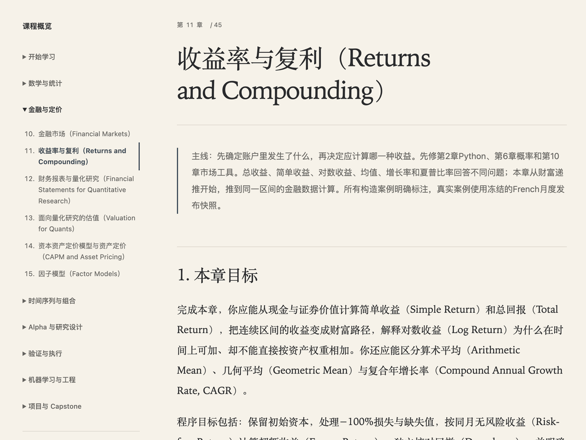
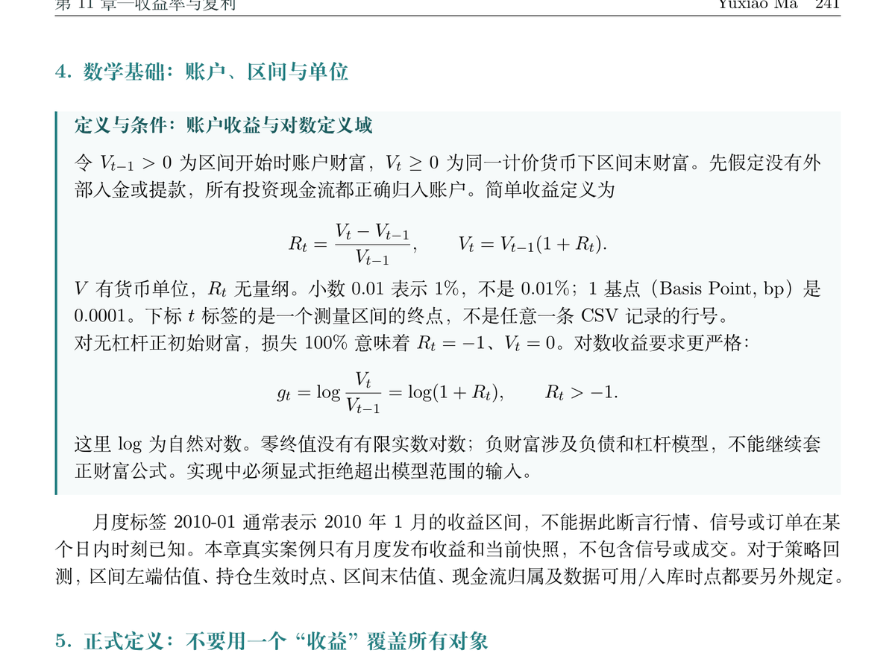
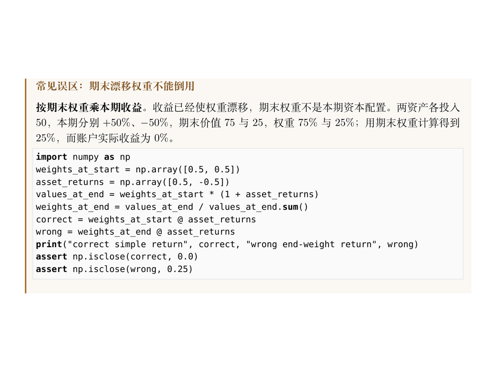
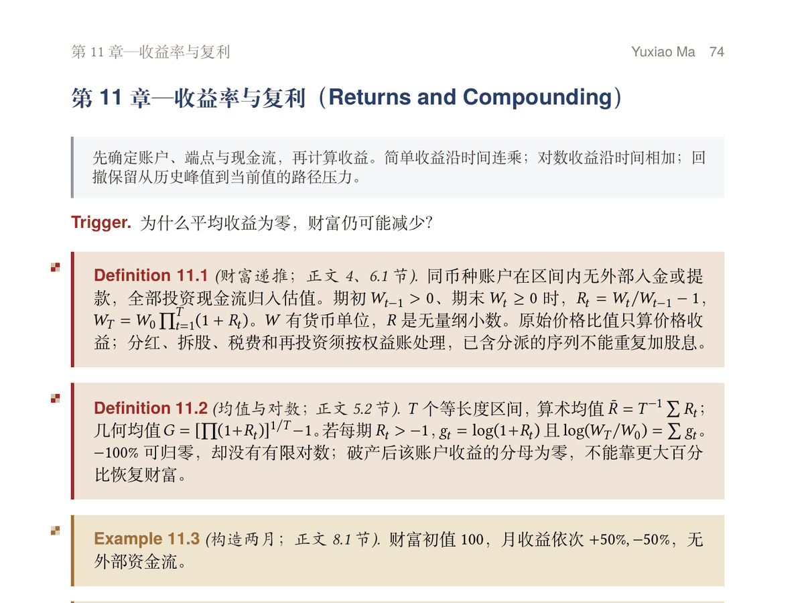
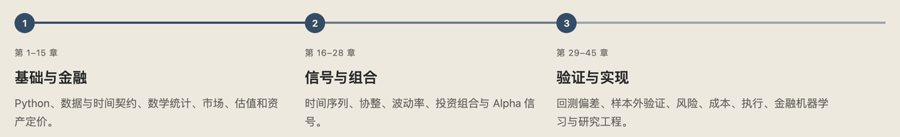

<p align="right"><strong>简体中文</strong> | <a href="README.en.md">English</a></p>


# QuantWeft · 量化经纬

**量化金融与系统化研究双语课程** · 45 章 · 6 个项目 · 1 个 Capstone

[](https://quantweft.yuxiao.win/read/zh/) [](LICENSE.md)

**[打开网页版教材 →](https://quantweft.yuxiao.win/read/zh/)**　全文搜索 · 同章中英切换 · 夜晚模式

## 下载 PDF

| | 中文 | English |
| :--- | :--- | :--- |
| **正文** | [中文正文](editions/zh/body/quantweft-textbook-zh.pdf) | [Textbook](editions/en/body/quantweft-textbook-en.pdf) |
| **练习册**（含完整答案） | [中文练习册](editions/zh/workbook/quantweft-workbook-zh.pdf) | [Workbook](editions/en/workbook/quantweft-workbook-en.pdf) |

建议先读正文，独立完成练习册，再运行 Notebook 核对计算与输出。

## 看看里面

<table>
<tr>
<td width="50%"><br><sub>网页版 · 第 11 章</sub></td>
<td width="50%"><br><sub>教材 PDF · 定义与条件</sub></td>
</tr>
<tr>
<td width="50%"><br><sub>常见误区 · 附反例代码</sub></td>
<td width="50%"><br><sub>练习册 · 定义、例题与练习</sub></td>
</tr>
</table>

## 学习路线



从 Python、数据与时间契约出发，经由回归、优化、时间序列与投资组合，进入样本外验证、风险、交易成本、执行和金融机器学习。

[中文学习指南](editions/zh/README.md) · [课程大纲](editions/zh/resources/syllabus.md) · [学习路线](editions/zh/resources/learning_roadmap.md) · [章节依赖图](editions/zh/resources/dependency_graph.md)

## 用项目连接知识

| 基础应用 | 策略研究 |
| :--- | :--- |
| [金融数据分析](projects/project01/README.md)：收益、财富、波动与回撤 | [多因子股票策略](projects/project04/README.md)：信号、股票池、成本与稳健性 |
| [CAPM 与 Fama-French](projects/project02/README.md)：回归、暴露与推断 | [配对交易](projects/project05/README.md)：训练内筛选与样本外账本 |
| [组合优化](projects/project03/README.md)：滚动估计与基准比较 | [机器学习 Alpha](projects/project06/README.md)：日期切分、基线与稳定性 |

[Capstone](capstone/README.md)将研究问题、时间契约、协议、执行和报告串起来。负结果也可以形成合格研究，市场研究另有数据与授权条件。

## 跑通第一个 Notebook

两种语言共用代码、数据契约、依赖和运行器，Notebook 的代码单元一致。

以下命令从**仓库根目录**执行。项目声明 Python ≥ 3.12；此锁文件对应已核验的 **macOS arm64 / CPython 3.14.7** 环境，其他平台尚未验证。

```sh
python3 -m venv .venv
.venv/bin/python -m pip install -r requirements-macos-arm64-py314.lock
.venv/bin/python -m ipykernel install --prefix .venv --name python3 --display-name 'Reader Python'
.venv/bin/python run_notebook.py editions/zh/notebooks/ch35_execution_ledger_constructed.ipynb
```

这是第 35 章的构造执行账本示例。安装依赖可能联网，默认教学执行离线。英文读者可运行同一路径下的 [English Notebook](editions/en/notebooks/ch35_execution_ledger_constructed.ipynb)。更多运行说明见 [Notebook 导读](editions/zh/NOTEBOOK_GUIDE.md)。

## 继续查阅

[术语表](editions/zh/resources/glossary.md) · [符号与单位](editions/zh/resources/notation.md) · [参考来源](editions/zh/resources/references.md) · [逐章正文](course/README.md) · [文件导航](editions/zh/FILE_TREE.md) · [仓库导航](docs/README.md) · [网站与构建](docs/SITE.md)

<details>
<summary>版本、验证范围与公开状态</summary>

运行环境与兼容性见[运行说明](editions/zh/LOCAL_VALIDATION.md)。

默认路线使用构造数据，不分发 French 市场数据，也未执行真实市场研究。历史结果与未解决的证据缺口按原记录保留，详见[后续事项](editions/zh/REMAINING_ITEMS.md)与[可选数据契约](editions/zh/OPTIONAL_DATA.md)。

作者：**Yuxiao Ma**。原创代码采用 **MIT**；作者有权许可的原创教材与练习采用 **CC BY-NC-SA 4.0**，仅限非商业使用，商业使用须另行许可。第三方例外见[许可范围](LICENSE.md)。仓库已公开，[权利核查](docs/legal/RIGHTS_REVIEW.md)持续进行。见[仓库范围与来源](docs/maintenance/REPOSITORY_STATUS.md)。

</details>

## 练习设计来源

练习册的部分练习设计与版式借鉴了 [loom-notes](https://github.com/Polaris-Aeterna/loom-notes) 的 LaTeX 模板，并按课程目标选择和调整，并非完整套用。详见[来源与致谢](docs/legal/ACKNOWLEDGEMENTS.md)。

## 参与与支持

读到错误或有建议，欢迎[提交学习反馈](https://github.com/YuxiaoMa66/quantweft/issues/new?template=feedback.yml)，或先看[贡献指南](.github/CONTRIBUTING.md)。觉得有用，欢迎点个 Star，或转给需要的同学。

课程免费阅读和使用。如果它帮到了你，校对、分享或赞助都能让我继续维护和更新。可以通过 [GitHub Sponsors](https://github.com/sponsors/YuxiaoMa66)，或展开下方的微信、支付宝收款码，金额随意。详见[支持方式](.github/SUPPORT.md)。

<details>
<summary>微信 / 支付宝支持 · 查看收款码</summary>

请在对应 App 中核对收款人。点击图片可放大原图。仓库不处理支付，实际收款是否可用以平台提示为准。

| 微信支付 | 支付宝 |
| --- | --- |
| [](docs/assets/support/wechat-pay.jpg) | [](docs/assets/support/alipay.jpg) |

</details>
