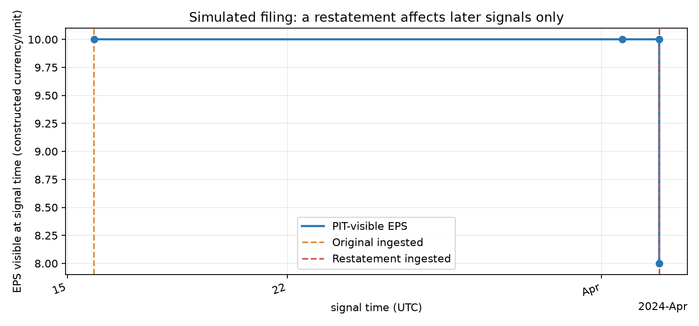

# Chapter 3 — Financial Data Engineering

> Prerequisite: Chapter 2's data and Python foundations. After this chapter, you can check market records and corporate actions, select historically visible versions, explain missingness and security identities, and specify signal times and holding-return intervals.

## 1. Learning Objectives

You should be able to deliver these checks for a colleague to review:

1. Explain the objects, units and intervals described by Open, High, Low, Close and Volume (OHLCV).
2. Distinguish raw prices, split-adjusted prices and dividend-reinvested total-return series, and identify the questions each answers.
3. Calculate wealth returns from share quantities and cash through splits and dividends; recognize that missing delisting returns cannot simply become zero.
4. Classify missing data rather than merge nontrading days, suspensions, zero trading and pipeline failures into one blank.
5. Define execution times using venue time zones and calendars, then compare timezone-aware timestamps in UTC.
6. Preserve event, external availability, ingestion and revision times for each fact, and apply a bitemporal point-in-time (PIT) contract.
7. Link symbol changes through permanent security IDs, rebuild the contemporaneous universe and inspect survivorship and selection.
8. Preserve source, version, quality and license constraints for reproducible, authorized research.

Deliver an auditable dictionary, list every input visible at a signal time, specify execution and holding intervals, and explain each exclusion.

## 2. Why Quantitative Research Needs Data Engineering

Research turns a market hypothesis into orders. Selecting securities, reading indicators, calculating returns and simulating fills all depend on inputs. Future information hidden in those inputs cannot become executable evidence through better statistics.

Suppose a Friday-close signal uses prices back-adjusted for a split announced over the weekend, earnings overwritten by a later correction and a list containing only today's surviving stocks. These records may accurately describe history as known today, yet differ from what was visible on Friday.

Follow the whole lifecycle:

Raw records → security identity and calendar → corporate actions and versions → signal-time snapshot → executable order time → holding returns → costs and performance.

A unit error needs a unit contract; a timing error needs a timing contract; a universe error needs historical membership; reproducibility needs snapshots, versions and rights. Executing a cleaning rule does not establish truth or lack of bias.

## 3. Intuition: Every Value Has a Source and an Availability Time

“A stock at 20.00” is incomplete. Is the currency EUR or USD? Is the quote per share, American Depositary Receipt (ADR) or pre-split unit? Is it an auction close or last intraday trade? What was the venue-local date? When did the vendor publish it and this system receive it? Was it revised?

Think of each record as a receipt with distinct clocks:

- The event clock describes the economic occurrence, such as a closing trade, ex-dividend event or reporting period.
- The release clock describes the earliest external availability, such as a company announcement or regulatory acceptance.
- The system clock records actual receipt of that version.
- The revision clock identifies a correction without erasing its predecessor.

Suppose an after-close initial earnings-per-share (EPS) report says 10, but arrives in this system later. The system may use 10 only after receipt. A future restatement to 8 belongs to later information sets, not earlier signals. A database showing only 8 today does not change what traders could have seen then.

The inherited New York Stock Exchange (NYSE) official description specifies core hours of 9:30–16:00 Eastern Time. New York 9:30 is 13:30 UTC in daylight saving time and 14:30 UTC in standard time. Treating a naive 9:30 as UTC is wrong in both seasons. Time zone is part of the record.

## 4. Prices, Returns, Actions and Time

### 4.1 OHLCV Objects and Dimensions

For security \(i\) and bar interval \(t\), let \(O_{i,t},H_{i,t},L_{i,t},C_{i,t},V_{i,t}\) denote open, high, low, close and volume. Prices are quotation currency per quoted unit; volume may mean shares, units or contracts. Daily, minute and auction intervals are different objects.

Basic internal checks require
\[
L_{i,t}\leq\min(O_{i,t},C_{i,t})
\leq\max(O_{i,t},C_{i,t})\leq H_{i,t},\qquad V_{i,t}\geq0.
\]
These are necessary, not sufficient. Multiplying every price by 100 preserves inequalities but may confuse currency units with cents. Zero volume may mean no trade or a fault sentinel. State volume units and whether prices come from official auctions, last trades, aggregated bars or vendor synthesis.

For a defined price convention,
\[
R_{i,t}=\frac{P_{i,t}}{P_{i,t-1}}-1,\qquad
r_{i,t}=\ln\!\left(\frac{P_{i,t}}{P_{i,t-1}}\right).
\]
Endpoints must share security, currency, share unit and price definition. Both returns are dimensionless decimals over \(t-1\) to \(t\). Simple return measures change per unit of initial wealth. Log returns add over consecutive intervals via \(\ln(ab)=\ln a+\ln b\), but do not directly capital-weight portfolios. Without an action convention, the price ratio lacks a complete economic interpretation.

### 4.2 Raw Prices, Split Adjustment and Total Return

A raw price is the nominal market quote at the time. Adjustment rescales history under a specified action rule to make returns comparable; the adjusted value is not an actual historical fill quote. Price return counts quotation changes; total return also counts distributions. Raw prices support order checks, microstructure and execution; ratios across splits mix economics with a unit change.

If one old share becomes \(q\) new shares, with \(q\) measured as new shares per old share,
\[
N_{\rm post}=qN_{\rm pre},\qquad
P_{\rm pre}^{(\rm new\ unit)}=\frac{P_{\rm pre}^{(\rm raw)}}{q},
\qquad
N_{\rm pre}P_{\rm pre}^{(\rm raw)}
=N_{\rm post}P_{\rm post}^{(\rm raw)}.
\]
\(N\) is share quantity and \(P\) is currency per share. The last equality describes the ideal conversion without another market move: a split itself creates no wealth, but subsequent prices need not stay constant. Historical volume in new-share units can become \(V_{\rm pre}^{(\rm new\ unit)}=qV_{\rm pre}^{(\rm raw)}\); verify the vendor's factors and volume definition.

Back-adjustment may be written
\[
P_t^{(\rm adj)}=P_t^{(\rm raw)}A_t,\qquad A_t=\prod_{j>t}a_j.
\]
Each future action \(j\) contributes a dimensionless factor \(a_j\). Vendors differ in factor direction, special-dividend treatment, dates and precision. “Adjusted close” alone does not specify a method. It describes history rescaled using the current factors, rather than the original quote. Later factors can alter past price-level signals. Adding dividends again to a total-return-adjusted series double counts them.

For comparable share units and currencies, an entitled beginning holding and no taxes, fees or reinvestment, the simplified pre-reinvestment total return is
\[
R_t^{(\rm TR)}=\frac{P_t+D_t}{P_{t-1}}-1.
\]
\(D_t\) is cash per share belonging to the interval. If a split or exchange occurs inside it, first transform quantities, prices and flows, then calculate account wealth. Declaration, record, ex-dividend and payment dates represent different events. Entitlement follows holding rights and market rules; declaration is not cash receipt.

### 4.3 Bitemporal Records and Versions

Economic valid time and system-record time are the two basic bitemporal axes: when a fact applies in the world and when the system records a version. Financial research also needs external release/availability. Keep **event_time**, **available_at**, **ingested_at** and **revision_time** distinct. valid_from/valid_to and system_from/system_to can preserve intervals of fact applicability and knowledge. An announcement date labels release; a vendor's report date may mean period-end, filing date or something else. Period-end describes coverage, not availability. None substitutes for a precise available_at.

For fact key \(k\), version \(v\) is eligible at signal time \(s\) only when both gates hold:
\[
\operatorname{eligible}(v,s)=
\mathbf1\{\operatorname{available\_at}(v)\leq s\}
\mathbf1\{\operatorname{ingested\_at}(v)\leq s\}=1.
\]
All three clocks are comparable timezone-aware instants; \(\mathbf1\) is an indicator. Equality requires evidence that the version was already visible at the signal. If second-resolution clocks cannot establish ordering, use strict inequality or finer timestamps/receipt sequence numbers.

Let \(\mathcal V(k,s)\) contain versions of the same fact key satisfying both gates. Select the latest external version:
\[
v^*(k,s)=\underset{v\in\mathcal V(k,s)}{\arg\max}
\ \operatorname{available\_at}(v).
\]
available_at orders source versions; ingested_at determines local eligibility, not revision order. Multiple conflicting rows at the same key and available_at require an ambiguity error and quarantine, not a row-order winner. \(\max(\operatorname{available\_at},\operatorname{ingested\_at})\) is the first eligibility time; it neither orders source versions nor replaces the original clocks.

Keep period-end, company announcement, regulator acceptance, vendor availability and ingestion distinct. A fact describes a past period without being known at its end. An as-of query reconstructs visibility at the specified instant, rather than selecting the table's latest row.

### 4.4 Identities, Calendars and Missingness

A permanent security key \(K_i\) identifies an economically continuous security. Map symbols, venues, currencies and valid intervals to it, and retain when the mapping entered the system. Otherwise a later-discovered identity relation can leak backward. Permanent company keys, security keys and tickers are different levels.

A venue calendar defines session dates \(S_e\) and their open, close, breaks, early closes and auction windows. It is more than weekdays. Define sessions in venue-local time and convert to UTC. IANA zone rules handle daylight saving changes; a fixed offset cannot replace them.

A missing indicator \(M_{i,t}\) says no usable observation exists, not why. A separate status \(Z_{i,t}\) should classify nontrading day, suspension, no trade, quote outage, delisting, uncovered security, inapplicable field or parsing failure. Do not map missing price to zero return without a rule informed by holdings, signals, calendar and reason.

## 5. Field Contracts

A minimal auditable market row includes:

| Field | Definition and check |
|---|---|
| security_id | Permanent security ID, issuing authority, level and validity |
| symbol, venue | Venue and symbol with valid dates; symbols are not globally unique |
| event_time, session_date | Event instant and venue-local session, possibly across UTC dates |
| open, high, low, close, volume | Numeric units, currency, aggregation and raw/adjusted status |
| available_at, ingested_at | External availability and local receipt, both timezone-aware |
| source_id, source_version | Source and snapshot, file, API version or batch |
| action_id, adjustment_method | Action linkage and factor method if adjusted |
| quality_status | Checks, quarantine reason and repair person/program version |

A financial fact also needs issuer_id, concept, unit, start/end or instant, reporting period, form, accession/document version, announcement/acceptance, vendor, revision and ingestion times. Keep announcement_date, report-period end, as-of date, revision_time and ingested_at. Matching concepts need not be comparable across currencies, durations, consolidation scopes, units or contexts.

Corporate actions change quantities, cash or identities: splits and reverse splits, cash/stock dividends, mergers, spin-offs, rights issues, exchanges, special distributions and delistings. Preserve events and effective dates, not only final adjusted prices. Distinguish price and shareholder total returns; separately record share changes, cash receivables, payments and fees.

Delisting means leaving a venue or sample, not automatically losing all wealth or deleting a return. Acquisition, bankruptcy, transfer and privatization can give different cash, exchange or liquidation proceeds. If terminal value is absent, preserve unknown and investigate; do not substitute zero or the last quote. For two sequential simple returns on the same holding and currency,
\[
R_t^{(\rm combined)}=(1+R_t^{(\rm regular)})(1+R_t^{(\rm delist)})-1.
\]
This does not apply when a source defines the two as alternative estimates for the same interval.

PIT data contains only versions and securities visible at a historical decision time. A valid query constrains identity, valid intervals, both clocks, version order and signal_time. Joining a quarter to market dates is insufficient.

Data quality needs evidence about completeness, timeliness, units, uniqueness, internal consistency and source reliability. A version records original payload, retrieval time, hash, software/cleaning version and revision relations; each change retains a traceable identity. A license specifies access, use, retention, display, redistribution, commercial, derivative and territorial rights. Free access or teaching use does not by itself authorize redistribution.

## 6. From Records to Visible Returns

### 6.1 Reconstruct Wealth Before Calculating Returns

Start with \(N_0\) shares at raw price \(P_0\). A 2:1 split gives \(q=2\), then each new share has cash entitlement \(D=1\); ending price is \(P_1\). Entitlement belongs to both new shares. Ignore taxes/fees and reinvestment; record the dividend as a receivable at the endpoint.

\(N_1=qN_0\), with shares and new/old share units explicit. In one currency,
\[
W_1=N_1(P_1+D)=qN_0(P_1+D),\qquad W_0=N_0P_0,
\]
so
\[
R_{0,1}=\frac{W_1}{W_0}-1
=\frac{q(P_1+D)}{P_0}-1
=\frac{P_1+D}{P_0/q}-1.
\]
Cancellation uses \(N_0>0\) and continuity of the same holding. A split creates no wealth; entitlement rules determine dividends. A dividend declared per old share must be converted before using a per-new-share amount.

```{=latex}
\needspace{18\baselineskip}
```

### 6.2 Period-end Is Not Availability

::: {.body-conditions title="Availability conditions: both clocks must pass"}

All numbers and timestamps here are constructed fixture data. Initial 2023Q4 EPS=10 is released March 15, 2024 at 16:05 New York daylight time and ingested at 16:12. A 16:10 signal cannot use it; 16:15 can. Times have offset −04:00.

At \(s=16{:}10\), release \(a=16{:}05\leq s\), but ingestion \(g=16{:}12>s\), so the conjunction fails. A later executable order may use the report after ingestion. If a vendor publishes at 16:25 but a system retrieves an authorized file at 16:24, availability still depends on the license and research contract; do not misrepresent information unavailable to other users as public.

:::

### 6.3 Revisions Preserve Prior States

These constructed versions match the PIT fixtures.

| Version | EPS | available_at | ingested_at | revision_time |
|---|---:|---|---|---|
| Initial v1 | 10 | 2024-03-15 16:05 −04:00 | 2024-03-15 16:12 −04:00 | 2024-03-15 16:05 −04:00 |
| Restated v2 | 8 | 2024-04-02 16:05 −04:00 | 2024-04-02 16:08 −04:00 | 2024-04-02 16:05 −04:00 |

March 15 at 16:10 has no visible initial report; 16:15 selects 10. April 2 at 16:06 still selects 10 because the restatement has not arrived; 16:10 selects 8. Rank eligible versions by available_at. A future restatement must not overwrite earlier signals.

### 6.4 Signal, Execution and Label Intervals

Separate signal_time, trade_time, return_start and return_end. Daily close data often becomes available after the auction, with a subsequent signal and next-session order. A same-close fill needs an explicit auction deadline, calculation latency and participation design; otherwise it uses future prices as fills.

Measure returns after the holding actually takes effect through exit or valuation. Track rights through suspensions, delisting and actions. Prediction labels additionally have label_start, label_end and label_available_at. A label ending after the training cutoff remains invisible even if its feature was already known.

## 7. Financial Meaning of Transformations

Raw, adjusted and total-return series measure different questions. Raw quotes support execution; split adjustment makes share units comparable; total return measures price changes plus distribution rights. Preserve corresponding fields for execution, performance and factor definitions.

A signal based on back-adjusted price levels need not use a historically visible nominal quote. Adjacent returns are invariant if a vendor later multiplies all history by one constant. If factors change differently across dates, returns can change too. Distinguish scale-invariant calculations from price-level-dependent ones and inspect source versions.

Actions affect holdings and returns; delisting affects sample boundaries. Selecting eventual survivors or securities with complete prices removes failures and difficult exits. A strategy for the historical investable universe needs that universe rebuilt, including securities that later disappeared and terminal-value quality.

Information arrives, is processed, informs a signal and only then enters an order. Returns begin after a holding could actually be established, not at the report-period end. This ordering does not guarantee profit, but excludes profits relying on unavailable inputs.

## 8. Worked Numerical Example

Constructed security SEC_ABC uses permanent key PERM_001 across prices, fact versions and actions. Prices are USD per share. Dates and times do not claim real NYSE securities, sessions or tradability; version times use −04:00 and can be converted to UTC. The financial event describes 2023Q4; release and receipt are separate. An EPS key must fix concept, period, currency and share unit. Split-era EPS is not comparable without the vendor's unit convention.

### 8.1 Filter Each Version Before Ordering It

| Version | EPS: USD/report share unit | available_at | ingested_at |
|---|---:|---|---|
| v1 initial | 10 | 3/15 16:05 | 3/15 16:12 |
| v2 restated | 8 | 4/2 16:05 | 4/2 16:08 |
| v_old older correction arriving late | 9.5 | 3/20 10:00 | 4/20 09:00 |

Each cell below gives release/ingestion eligibility. “yes” means its clock is no later than the query.

| Query/as-of \(s\) | v1 | v2 | v_old | Eligible set → selection |
|---|---|---|---|---|
| 3/15 16:00 | no/no | no/no | no/no | Empty → unknown; period-end is insufficient |
| 3/15 16:10 | yes/no | no/no | no/no | Empty → unknown; ingestion is late |
| 3/15 16:15 | yes/yes | no/no | no/no | {v1} → 10 |
| 4/2 16:06 | yes/yes | yes/no | yes/no | {v1} → 10 |
| 4/2 16:10 | yes/yes | yes/yes | yes/no | {v1,v2} → 8 |
| 4/21 16:00 | yes/yes | yes/yes | yes/yes | All three → v2, 8 |

Perform both tests per version, then select the latest public version within the eligible set. v_old remains stored and eligible at the last query, but does not win. Selecting v2 globally then deleting it as unreceived at April 2 16:06 wrongly returns nothing and loses eligible v1. Release and receipt constrain external knowledge and local readability; neither proves a license.

```{=latex}
\needspace{28\baselineskip}
```

### 8.2 One-Share Split and Dividend Ledger

::: {.body-example title="Complete example: split and dividend ledger"}

All values are teaching constructions. Start with one old share at 100; a 2:1 split gives two new shares, each entitled to cash 1 and ending at 51. At the endpoint recognize the dividend receivable, ignoring payment delay, tax, reinvestment, foreign exchange (FX) effects and fees.

1. Starting wealth: \(1\ \mathrm{share}\times100\ \mathrm{currency/share}=100\ \mathrm{currency}\).
2. New quantity: \(1\times2=2\) shares, without wealth creation by the split.
3. Ending stock value: \(2\times51=102\) currency units.
4. Receivable: \(2\times1=2\).
5. Ending wealth: \(102+2=104\).
6. Total return: \(104/100-1=0.04=4\%\).

The old price becomes \(100/2=50\) per new share. Thus \((51+1)/50-1=4\%\) total return, versus \(51/50-1=2\%\) price return. \(51/100-1=-49\%\) mixes share units; 2% omits cash. Our specified entitlement belongs to the two shares held when rights are determined. Declaration, record and payment are not one event.

:::

```{=latex}
\clearpage
```

### 8.3 Connecting Records to Execution and Returns

| Constructed record | Event/object | Visibility and use |
|---|---|---|
| 3/15 filing | 2023Q4 v1, released 16:05, ingested 16:12 | Unusable 16:10; may inform a 16:15 research signal |
| D2 fill | D2 09:30, raw price 100; acknowledgement 09:30:01 | Separate post-signal fill; returns start after execution, not period-end |
| 4/2 restatement | v2 ingested 16:08 | Later queries switch to 8; earlier signal logs remain |
| 5/10 starting valuation | A separate account already holds one old share at 100 | New wealth base for the ledger below, without adding the D2 order again |
| 5/15 action | Prior constructed announcement; 2:1 split, cash entitlement 1/new share, endpoint 51 | Stock 102, receivable 2, wealth 104; preserve separate rights/payment events |
| Later payment | Receivable 2 becomes cash 2 | Receivable −2, cash +2; wealth does not increase again |
| 6/28 exit | Constructed listing termination, terminal value still needs checking | Retain historical membership; no assumed continued trading; missing terminal value remains unknown |

The D2 record explains the signal/fill/return interface; the May 10 ledger is a separate one-share account, not the same uninterrupted account. All prices and open states are assumed constructions, without evidence of real fills. Membership valid_from/valid_to describes economic intervals; available_at/ingested_at determines whether those membership records were known. Today's omission of SEC_ABC does not erase its past existence or prove historical investability on every date.

**Keep accounting routes separate.** The quantity/raw-price/cash ledger gives \(2(51)+2=104\). The comparable-new-unit route gives \((51+1)/50-1=4\%\). These describe the same result; neither treats adjusted prices as fills nor adds dividends twice. A total-return index 100 → 104 already includes the dividend; adding another cash 2 falsely gives 106 and 6%.

**Delisting counterexample.** If subsequent −20% and −50% intervals apply only to stock, its compounded return is \((1-0.2)(1-0.5)-1=-60\%\). The second loss acts on the remaining 0.8. For stock 102 plus cash 2, with cash unchanged and unreinvested, ending wealth is \(102(0.8)(0.5)+2=42.8\), returning about −58.846154% from 104. Unknown terminal values cannot be filled with −50%; these percentages are a separately specified constructed branch.

## 9. Python Implementation

### Default Entry in the Accepted Reader

Follow the accepted I3 [reader installation instructions](../../../../editions/en/README.md), then run from the reader-package root:

```bash
.venv/bin/python run_notebook.py notebooks/ch03_data.ipynb
```

The default Notebook uses packaged shared logic without French files or downloads. New outputs use a unique runs directory; the reader CLI uses UUIDs and rejects overwrites. The original course-root code and historical tests below are a separate route. Optional French input requires the [data contract](../../../../editions/en/OPTIONAL_DATA.md) and was not rerun. Constructed runs do not establish market or fill evidence.

The core function is in [pit.py](../../../../src/quant_course/pit.py); the full example is [ch03_data.py](../../../../code/ch03_data.py) and its [Notebook](../../../../notebooks/ch03_data.ipynb). Simulated fixtures are [signals](../../../../data/fixtures/a1_pit_signals.csv), [versions](../../../../data/fixtures/a1_pit_versions.csv) and [corporate actions](../../../../data/fixtures/a1_corporate_actions.csv); metadata explicitly identifies simulation.

The default interface is:

```text
pit_asof_join(
    signals,
    versions,
    security_col="security_id",
    period_col="fiscal_period",
    signal_time_col="signal_time",
    available_at_col="available_at",
    ingested_at_col="ingested_at",
)
```

It matches permanent security ID and reporting period, preserves signal order/index and returns pit_effective_at. All three clocks must be timezone-aware. Both gates must precede or equal signal_time; eligible versions are ordered by available_at. Duplicate fact-key/available_at rows raise an explicit error. ingested_at is an eligibility gate, never a source-version ordering rule.

In the course root, the Python 3.12+ project environment runs `.venv/bin/python tools/run_a1.py --chapter 3`. It reads fixtures, converts time columns to UTC, calls the join and makes the figure. The constructed EPS results are no version at March 15 16:10, 10 at 16:15; still 10 at April 2 16:06 and 8 at 16:10. This demonstrates query contracts, not actual company disclosure.

Save the following standalone ledger as ch03_split_demo.py and run with Python 3.10+. It only demonstrates §8's constructed split/cash account, without duplicating PIT join. Outputs are currency and dimensionless return; no external data, random seed or NaN filling is used.

```python
old_shares = 1
old_price = 100
split_ratio = 2
new_close = 51
cash_dividend_per_new_share = 1

new_shares = old_shares * split_ratio
ending_cash = new_shares * cash_dividend_per_new_share
ending_wealth = new_shares * new_close + ending_cash
total_return = ending_wealth / (old_shares * old_price) - 1

from math import isclose
assert ending_wealth == 104
assert isclose(total_return, 0.04, rel_tol=0, abs_tol=1e-12)
print(f"{ending_wealth} {total_return:.2f}")
```

Output:

```text
104 0.04
```

Production account wealth also includes security value, cash, receivables and liabilities in a common base currency, with relevant FX timestamps retained.

### A Self-contained Dual-clock Example

The following code handles a finite set of supplied versions with the same fact key, units and time zone. It does not replace the multi-security/period core API or its input checks. It tests five SEC_ABC signals, including late release, late receipt, restatement and a late-arriving older version.

```python
import pandas as pd

# Historical versions of security SEC_ABC
versions_data = [
    {
        "version_id": "v1",
        "eps": 10.0,
        "available_at": pd.Timestamp("2024-03-15 16:05:00-04:00"),
        "ingested_at": pd.Timestamp("2024-03-15 16:12:00-04:00"),
    },
    {
        "version_id": "v2",
        "eps": 8.0,
        "available_at": pd.Timestamp("2024-04-02 16:05:00-04:00"),
        "ingested_at": pd.Timestamp("2024-04-02 16:08:00-04:00"),
    },
    {
        "version_id": "v_old",
        "eps": 9.5,
        "available_at": pd.Timestamp("2024-03-20 10:00:00-04:00"),
        "ingested_at": pd.Timestamp("2024-04-20 09:00:00-04:00"),
    },
]
df_versions = pd.DataFrame(versions_data)

def query_asof_eps(signal_time_str: str) -> float | None:
    s = pd.Timestamp(signal_time_str)
    if s.tzinfo is None:
        raise ValueError("timezone required")
    # Filter eligibility using both clocks
    eligible = df_versions[
        (df_versions["available_at"] <= s) & (df_versions["ingested_at"] <= s)
    ]
    if eligible.empty:
        return None
    if eligible["available_at"].duplicated().any():
        raise ValueError("ambiguous source time")
    # Select latest available_at among eligible versions
    latest_version = eligible.sort_values("available_at", ascending=False).iloc[0]
    return float(latest_version["eps"])

# Assert five representative cases
assert query_asof_eps("2024-03-15 16:10:00-04:00") is None  # Late ingestion
assert query_asof_eps("2024-03-15 16:15:00-04:00") == 10.0  # Initial version becomes eligible
assert query_asof_eps("2024-04-02 16:06:00-04:00") == 10.0  # Restatement not ingested
assert query_asof_eps("2024-04-02 16:10:00-04:00") == 8.0   # Restatement becomes eligible
assert query_asof_eps("2024-04-21 16:00:00-04:00") == 8.0   # Late older version does not overwrite restatement
```

## 10. Visualization



The horizontal axis is UTC signal time; the vertical axis is visible constructed EPS in currency per unit. The blue step shows 10 after initial ingestion, then 8 after restatement ingestion. Orange and red dashed vertical lines mark those two ingestion times. March 15 16:10 ET has no eligible EPS and no plotted value; April 2 16:06 retains 10 and 16:10 shows 8. All values are simulated fixtures.

There are no separate available_at lines and no price/return axis. The plot shows the two-gate version join, with UTC converted from local signals. It verifies visibility, without evidence of EPS predicting returns.

## 11. Official Interfaces and Calendars: Reading, Not a Market Experiment

The inherited reading of SEC EDGAR API documentation on 2026-10-05 covers data.sec.gov filing histories and XBRL facts. companyfacts aggregates issuer facts; frames selects the closest fact for a target calendar period using the most recently filed facts. The documentation describes real-time JSON updates following disclosures and bulk ZIP republication around 3 a.m. Eastern Time.

Today's companyfacts response is today's snapshot, not automatically a frozen earlier information set. A frames “most recently filed” selection cannot stand in for an initial report at a historical date. Preserve filing versions, issuer/concept contexts, release/acceptance, ingestion, retrieval time, raw payload, URL and hash, then apply the dual-clock query per signal. The documentation does not establish vendor availability or local ingestion for every fact.

submissions also provides filing history and current/historical names, venues and symbols. Use these as identity clues, then construct mappings with validity and system times rather than apply today's ticker to all history. A Central Index Key (CIK) identifies a filing entity, not one permanent tradable security; an issuer may have several securities or classes.

The inherited 2026 NYSE page specifies 9:30–16:00 Eastern core hours, annual holidays and some early closes after Thanksgiving and on Christmas Eve. It establishes venue/time-zone and special-session conventions, without historical tick data or proof that this chapter downloaded quotes or calendars.

Reading boundaries:

- Sources: SEC API documentation and NYSE Hours & Calendars; exact URLs appear in §20 and source_notes.md.
- Reading date: 2026-10-05. No company-fact or price sample was downloaded/extracted; no empirical frequency or sample period exists.
- Revision evidence: documented live JSON refresh and nightly ZIP mechanism; no historical API vintage was saved.
- Access: documentation describes access without authentication/API keys. Automated access still follows SEC Privacy and Security Policy; public access is not unlimited redistribution permission.
- Hashes: no data files exist for this example, hence no data hashes. Documentation pages are not market-sample snapshots.
- Experiment status: no market-return test, backtest or price comparison was run. Every EPS, split and dividend number above is explicitly constructed.

## 12. Common Mistakes and Repairs

### 12.1 Dividing Nominal Prices Across a Split

Incorrect:

```python
old_price = 100
new_close = 51
naive_return = new_close / old_price - 1
print(naive_return)  # -0.49
```

−49% treats a share-unit change as loss. The account earns 4% with the two entitled shares and dividend 1 per share. For price return alone, convert the old price to 50 per new share and calculate \(51/50-1=2\%\); total wealth also includes cash rights.

```{=latex}
\needspace{12\baselineskip}
```

### 12.2 Treating Period-end as Release

::: {.body-pitfall title="Common mistake: period end is not release"}

Joining today's fact by fiscal_period_end/report_end_date to quarter-end market dates can introduce unreleased reports and future restatements. Filter each signal using both available_at and ingested_at. The constructed initial report released 16:05 and ingested 16:12 is absent at 16:10, visible as 10 at 16:15. The April 2 restatement remains unreceived at 16:06; only at 16:10 does 8 become eligible.

:::

### 12.3 Labeling Local Time UTC

Wrong:

```python
from datetime import datetime, timezone

wrong = datetime(2026, 7, 1, 9, 30, tzinfo=timezone.utc)
print(wrong)
```

This means 09:30 UTC rather than New York 09:30. In summer:

```python
from datetime import datetime, timezone
from zoneinfo import ZoneInfo

local_open = datetime(
    2026, 7, 1, 9, 30, tzinfo=ZoneInfo("America/New_York")
)
print(local_open.astimezone(timezone.utc))
```

The result is 2026-07-01 13:30:00+00:00. Winter offsets differ, so use IANA rules. Repeated fall-back times need an offset or fold handling; “01:30” alone is ambiguous.

### 12.4 Forward-filling Every Missing Price

Incorrect:

```python
closes = [10.0, None, 9.0]
filled = [10.0, 10.0, 9.0]
returns = [None, 0.0, -0.1]
print(returns)
```

This invents a 0% return on an unknown day and misplaces the intervening change. If the day is suspended, no new fill is possible then. A reopening at 9 after a known 10 gives \(9/10-1=-10\%\) over the Monday-to-Wednesday span, not two observed daily returns. Retain original missingness, reason, preceding valid timestamp and session span. Daily holding valuation needs a separate suspension valuation/risk-discount policy; generic forward fill does not define one.

### 12.5 Retaining Only Today's Symbols

A current universe applied ten years backward selects on future survival. Bankruptcy, acquisition and symbol changes disappear or misjoin. Use permanent mappings with valid_from/valid_to and historical membership snapshots, retaining both effective and received times. Check liquidation cash, exchange consideration, last quotes and delisting definitions. Unknown terminal values need investigation and defensible bounds, not zero or silent deletion.

### 12.6 Using “Adjusted” Without a Definition

Inspect whether factors include splits, regular dividends, special distributions and which effective dates. Adding \(D\) to a total-return-adjusted close double counts; treating a split-adjusted quote as an actual spot fill changes the object. Retain raw and adjusted values, source, factors, action types and method versions, and use them in their appropriate layers.

### 12.7 Treating Latest APIs as Version Archives

Current responses may update. A URL alone cannot reproduce the bytes weeks later. Preserve original JSON/files, UTC retrieval, permitted HTTP metadata, parser version, hashes and accessions. Treat each response as a new snapshot rather than overwrite the only copy.

## 13. Auditable Inputs for an Event Strategy

Consider the hypothesis that a larger initial financial surprise relative to expectations predicts higher next-session risk-adjusted returns. This is a design example, not an established result.

First define units: permanent security, issuer, concept, units, reporting coverage and initial filing version. Security IDs link trades/quotes; issuer IDs group company facts. Specify FX source/time and standardize differing quarter lengths or reporting conventions before comparison.

Reconstruct the information set per signal by selecting the latest version passing both clocks. Preserve initial and corrected records; do not overwrite initial EPS with the current value. Report unreceived, missing, conflicting and unsynchronized cases, including unmatched proportions and exclusions.

Rebuild the historical universe from then-known listing and tradability records. Keep subsequently delisted securities before exit. Link symbol changes by valid identity intervals; a merger does not automatically make old and new shares interchangeable.

Define execution and returns next. After-close announcements received later imply signal_time no earlier than receipt, with trade_time at a subsequent executable session. Orders/quotes must support any next-open fill assumption. Returns start after actual fills and end at a prespecified exit/valuation. Record split quantities, dividends and delisting proceeds. Deduct commissions, spreads, impact, financing and borrow costs from gross PnL for net PnL.

In a common base currency:
\[
NAV_t=\sum_iN_{i,t}P_{i,t}^{(\rm base)}
+\mathrm{Cash}_t+\mathrm{Receivables}_t-\mathrm{Liabilities}_t,
\]
\[
R_{t_0,t_1}^{(\rm net)}=\frac{NAV_{t_1}}{NAV_{t_0}}-1.
\]
\(N\) is held quantity and \(P^{(\rm base)}\) is per-share base-currency valuation. The ratio requires positive initial NAV, no external deposits/withdrawals, and all investment flows/costs in the ledger. With external flows, use Chapter 11's segmented measurement rather than count deposits as profit. Derivatives require their contract-specific valuation in place of spot-share value.

Compare no-signal holdings in the same universe, market/industry exposures and simple event windows. Report year, liquidity, venue and delisting strata, counts, missing coverage and cost model. An advantage relying on revised facts, surviving stocks, same-close fills or zero costs fails the executable design. If initial availability cannot be reconstructed, bound the conclusion to inability of the current dataset to identify historical executable performance.

## 14. Chapter Summary

A financial observation needs identity, units, venue clocks, release clocks and version. OHLCV summarizes trading activity without specifying adjustments, cash rights or tradability. Splits change quantities/units; dividends enter as rights; price and total returns follow these definitions.

Before calculating historical returns, determine whether a version was both released and ingested by signal_time and whether the security belonged to the contemporary universe. Use IANA zones and actual calendars, classify missingness, and retain delisting terminal values or explicit unknowns. Deliver code, snapshots, hashes and licenses with numbers. Bound conclusions wherever reconstruction is incomplete.

## 15. Concepts and Hand Calculations

Answers are in §18.

**3-E01.** What does each of event_time, available_at, ingested_at and revision_time answer? Why cannot period_end replace available_at?

**3-E02.** Which questions use raw, split-adjusted and total-return series? Give a risk in using back-adjusted levels for historical signals.

**3-E03.** A security has no close. Give at least four causes and explain why return cannot be zero before diagnosis.

**3-E04.** Distinguish ticker, permanent security ID and issuer ID. What selection does today's universe impose on historical research?

**3-E05.** One old share starts at 100, splits 2:1, with dividend 1/new share and ending price 51. Under the endpoint-receivable assumption and no taxes/fees, calculate stock value, cash entitlement, wealth, total return and price return; label the holding interval.

**3-E06.** Initial EPS 10 is released March 15 at 16:05 and ingested 16:12; EPS 8 restatement is released April 2 at 16:05 and ingested 16:08. Determine visibility at March 15 16:10/16:15 and April 2 16:06/16:10, using matching New York dates/zones.

**3-E07.** A holding returns −20% then −50% in a delisting phase, sequentially in comparable units. Calculate combined return and explain why addition fails.

**3-N01 — Identify the Mechanism.**

1. Distinguish late announcement from late ingestion and explain how each invalidates a backtest.
2. Why must eligibility use available_at≤s AND ingested_at≤s rather than OR?
3. Why cannot an already included dividend be added again? Can a split factor and cash simply be added?

**3-N02 — Stepwise Version Selection.** PERM_001 has A: March 15 16:05 release, 16:12 ingestion, value 10; B: April 2 16:05 release, 16:08 ingestion, value 8; C: March 20 10:00 release, April 20 09:00 ingestion, value 9.5. At April 21 16:00, identify each eligible version and the latest visible version. Why not latest-ingested C?

**3-N03 — Full Ledger.** Reproduce §8.2's quantities, stock value, receivable, wealth, price and total return. Then pay the receivable into cash 2; stock alone returns −20% then −50%, with unchanged unreinvested cash, no taxes/fees or external flows. Calculate stock compounded return, final stock value, account wealth, subsequent return from 104 and whole-path return from 100. Can a constructed −50% replace unknown real terminal value?

## 16. Programming Exercises

**3-P01 — Dual-clock Query.** Read the simulated signal/version fixtures, convert clocks to timezone-aware UTC and join by permanent security_id/fiscal_period through §9's API. Apply both gates, select latest available_at and preserve signal order/IDs. Assert pre_release missing, post_ingest 10, restatement_available_only 10, after_restatement_ingest 8 and other_security 77. Reject conflicting duplicate fact-key/available_at rows.

**3-P02 — Missingness and Intervals.** D1 close 10, suspended D2 missing, reopened D3 close 9. Return D2 missing with reason=suspended and D3 about −10% across two trading sessions. Do not invent D2 0% or label the two-session change daily; compare floats with tolerance.

**3-P03 — OHLCV and Local Time.** Write a standard-library row checker for finite real numbers excluding bool, parseable offset-aware time, low/high ordering, OHLC range, nonnegative volume and venue-local session_date. July 1, 2026 09:30 −04:00 converts to 13:30 UTC. Explicitly reject volume −1 and low>high; preserve bad inputs.

**3-N04 — Diagnose a Join.**

```python
# As-of join code to diagnose
import pandas as pd

def bad_asof_select(versions_df, signal_time):
    # Error 1: ordering by ingestion to select newest version
    sorted_df = versions_df.sort_values('ingested_at', ascending=False)
    # Error 2: selecting first row using only ingestion eligibility
    valid = sorted_df[sorted_df['ingested_at'] <= signal_time]
    return valid.iloc[0]['eps']
```

Explain its late-arriving older-version defect. Supply a self-contained correction and assert that an older late receipt cannot overwrite a restatement.

## 17. Challenge Problems

**3-C01 — Late and Out-of-order Data.** A vendor sends earlier public A, later public B, and delayed batches whose ingestion order differs. Design a reproducible schema/query for latest versions both released and received by each signal. Discuss same-second boundaries, withdrawals, duplicates and historical backfills. Ten points: timing semantics 3, version retention 2, query correctness 3, exception handling 2.

**3-C02 — Delisting Audit.** A monthly strategy uses today's constituents over ten historical years and deletes securities without complete month-end prices. Give the shortest executable audit plan for data, mapping and falsification. Explain reporting when delisting return is absent. Ten points: PIT universe 2, permanent IDs/symbols 2, missingness/exit 2, realizable returns/costs 2, bounded conclusions 2.

**3-N05 — Research Judgment.** A constructed vendor contract says its total-return index already reinvests dividends; the researcher nevertheless adds the same dividend to portfolio wealth. The universe uses current membership and deletes holdings without month-end quotes. Separate the confirmed accounting error, possible selection and required evidence. Can you quantify total bias or real net return? Do not invent a vendor or loss value.

```{=latex}
\needspace{14\baselineskip}
```

## 18. Complete Solutions

**3-E01.** event_time describes the event; available_at the specified external-source/vendor availability; ingested_at local receipt and persistence; revision_time revision release. period_end describes coverage. Earnings for a quarter ending March 31 may appear weeks later. Signals need both available_at≤signal_time and ingested_at≤signal_time.

**3-E02.** Raw prices represent contemporaneous quotes and execution checks. Split adjustment gives comparable share units; total return includes distributions. Back-adjustment can rewrite levels using later actions, making price-level signals depend on unknown factors. Even return calculations require revision and double-count checks.

**3-E03.** Causes include venue closure, suspension, no trade, vendor omission, delisting, inapplicable field and parsing failure. Zero return asserts an observed unchanged value; missing asserts no trustworthy price. Confusing them invents low volatility and trading opportunities. Retain statuses and define valuation/intervals separately.

**3-E04.** A ticker is venue/time-specific and may change or be reused. A permanent security ID represents a continuous tradable claim; issuer ID represents a company/filing entity with potentially several classes. Today's list conditions history on later survival and membership, excluding prior constituents and delisted securities.

**3-N01.** Late announcement delays external disclosure after the economic period; using period_end introduces not-yet-released information. Late ingestion delays local receipt after public release through networks, queues or batches; treating release as receipt assumes inputs live systems could not read. Both external availability under the contract and persistence must hold; neither proves rights. Splits change share units; cash distributions add cash. A total-return series that has already compounded the distribution cannot receive the same cash again. A dimensionless split factor and currency amount cannot be added.

**3-E05.** \(W_0=100\); two shares end at \(2(51)=102\), plus receivable \(2(1)=2\), so \(W_1=104\) and total return 4%. Comparable starting price is \(100/2=50\), giving price return 2%. The interval runs from the initial old-share valuation to the post-split close and entitlement recognition. The example recognizes a receivable, not actual payment, belonging to both new shares.

**3-E06.**

| Signal | Initial 10 | Restated 8 | Result |
|---|---|---|---:|
| 3/15 16:10 | Released, unreceived | Unreleased | Missing unless an earlier eligible version exists |
| 3/15 16:15 | Released/received | Unreleased | 10 |
| 4/2 16:06 | Released/received | Released, unreceived | 10 |
| 4/2 16:10 | Released/received | Released/received | 8 |

No earlier version was supplied, so the first row cannot be filled.

**3-E07.** Start at 1; after −20%, wealth is 0.8; after −50%, it is 0.4. Combined return is −60%. The −70% arithmetic sum wrongly applies the second loss to initial wealth.

**3-N02.** At April 21 16:00, A, B and C all satisfy both clocks, so the eligible set is {A,B,C}. B wins with EPS8 because April 2 release follows C's March 20 release. C's latest receipt is pipeline delay, not the newest source fact.

**3-N03.** Two shares give stock 102 and receivable 2, wealth 104. Starting price in new units 50 gives price return 2% and total return 4%. Payment reclassifies receivable to cash without adding wealth. Stock returns −60% and ends at \(102(0.8)(0.5)=40.8\). Add unchanged cash 2 for wealth 42.8. Subsequent account return is \(42.8/104-1\approx-58.846154\%\); whole-path return \(42.8/100-1=-57.2\%\). \(104(0.4)=41.6\) wrongly loses cash too. Unknown terminal values remain unknown and need investigation, not the constructed −50%.

**3-P01 — Reference Implementation.** Run from the course root; it calls the shared API and checks signal IDs and the original index.

```python
from pathlib import Path
import sys

import pandas as pd

ROOT = Path.cwd()
if not (ROOT / "data" / "fixtures" / "a1_pit_signals.csv").exists():
    raise RuntimeError("run this example from the quant_course root")

sys.path.insert(0, str(ROOT / "src"))
from quant_course import pit_asof_join

signals = pd.read_csv(ROOT / "data" / "fixtures" / "a1_pit_signals.csv")
versions = pd.read_csv(ROOT / "data" / "fixtures" / "a1_pit_versions.csv")
signals["signal_time"] = pd.to_datetime(signals["signal_time"], utc=True)
for column in ("available_at", "ingested_at"):
    versions[column] = pd.to_datetime(versions[column], utc=True)

joined = pit_asof_join(signals, versions)
by_signal = joined.set_index("signal_id")

assert pd.isna(by_signal.loc["pre_release", "eps"])
assert by_signal.loc["post_ingest", "eps"] == 10
assert by_signal.loc["before_restatement", "eps"] == 10
assert by_signal.loc["restatement_available_only", "eps"] == 10
assert by_signal.loc["after_restatement_ingest", "eps"] == 8
assert by_signal.loc["other_security", "eps"] == 77
assert joined.index.equals(signals.index)
assert joined["security_id"].equals(signals["security_id"])

print(joined[["signal_id", "version_id", "eps"]].to_string(index=False))
```

Inherited actual output:

```text
                 signal_id      version_id  eps
               pre_release             NaN  NaN
               post_ingest     original_10 10.0
        before_restatement     original_10 10.0
restatement_available_only     original_10 10.0
  after_restatement_ingest      restated_8  8.0
            other_security other_issuer_77 77.0
```

This matches the recorded direct fixture call of 2026-10-05, without a fresh claim of execution in this translation batch. Duplicate key/available_at rows raise ValueError rather than a silent row-order winner.

**3-P02 — Reference Implementation.**

```python
from math import isclose

observations = [
    {"date": "D1", "close": 10.0, "status": "observed"},
    {"date": "D2", "close": None, "status": "suspended"},
    {"date": "D3", "close": 9.0, "status": "observed"},
]

assert observations[1]["close"] is None
assert observations[1]["status"] == "suspended"
interval_return = observations[2]["close"] / observations[0]["close"] - 1
sessions_spanned = 2
assert isclose(interval_return, -0.1, rel_tol=0, abs_tol=1e-12)
assert sessions_spanned == 2
print(interval_return, sessions_spanned)
```

Output:

```text
-0.09999999999999998 2
```

D2 remains unknown, reason=suspended; D3 spans D1 close to D3 close over two sessions and returns about −10%. Define which decision owns that label. Missing intermediate prices cannot establish two daily returns.

**3-P03 — Reference Implementation.** This Python 3.10+ standard-library program retains both valid and bad inputs without rewriting them.

```python
from datetime import datetime
from zoneinfo import ZoneInfo
from math import isfinite
from numbers import Real

def validate_bar(row, exchange_tz):
    errors = []
    for name in ("open", "high", "low", "close", "volume"):
        value = row.get(name)
        if value is None:
            errors.append(f"{name}: missing")
        elif isinstance(value, bool) or not isinstance(value, Real) or not isfinite(value):
            errors.append(f"{name}: finite real number required")
    try:
        stamp = datetime.fromisoformat(row["event_time"])
    except (KeyError, TypeError, ValueError):
        return errors + ["event_time: invalid ISO timestamp"]
    if stamp.tzinfo is None:
        errors.append("event_time: timezone offset required")
    values = [row.get(k) for k in ("open", "high", "low", "close")]
    if all(isinstance(v, Real) and not isinstance(v, bool) and isfinite(v) for v in values):
        opn, high, low, close = values
        if low > high:
            errors.append("low exceeds high")
        if not (low <= min(opn, close) <= max(opn, close) <= high):
            errors.append("OHLC ordering invalid")
    volume = row.get("volume")
    if (isinstance(volume, Real) and not isinstance(volume, bool)
            and isfinite(volume) and volume < 0):
        errors.append("volume is negative")
    if stamp.tzinfo is not None:
        local = stamp.astimezone(ZoneInfo(exchange_tz))
        if local.date().isoformat() != row.get("session_date"):
            errors.append("session_date disagrees with local event date")
    return errors

good = {
    "event_time": "2026-07-01T09:30:00-04:00",
    "session_date": "2026-07-01",
    "open": 50.0, "high": 51.0, "low": 49.0,
    "close": 50.5, "volume": 100,
}
bad = {
    "event_time": "2026-07-01T09:30:00-04:00",
    "session_date": "2026-07-01",
    "open": 50.0, "high": 49.0, "low": 51.0,
    "close": 50.5, "volume": -1,
}

assert validate_bar(good, "America/New_York") == []
errors = validate_bar(bad, "America/New_York")
assert "low exceeds high" in errors
assert "volume is negative" in errors
for invalid in (float("nan"), float("inf"), True, "100"):
    assert "volume: finite real number required" in validate_bar(
        dict(good, volume=invalid), "America/New_York")
assert "event_time: invalid ISO timestamp" in validate_bar(
    dict(good, event_time="not a timestamp"), "America/New_York")
utc_time = datetime.fromisoformat(good["event_time"]).astimezone(ZoneInfo("UTC"))
assert utc_time.isoformat() == "2026-07-01T13:30:00+00:00"
print(utc_time.isoformat(), errors)
```

Output:

```text
2026-07-01T13:30:00+00:00 ['low exceeds high', 'OHLC ordering invalid', 'volume is negative']
```

It rejects missing, nonfinite, mistyped or unparseable values and checks internal relationships. Asset classes need their own rules for negative prices. Offset awareness does not prove a valid session or trade; production checks still need precise calendars and quote/auction provenance.

**3-N04.** Sorting by ingestion lets a late March 20 version displace an already effective April 2 restatement. Ignoring external availability can also admit an embargoed version received before release. Correct both gates and order only eligible versions by available_at:

```python
import pandas as pd

def correct_asof_select(versions_df: pd.DataFrame, signal_time: str) -> float | None:
    s = pd.Timestamp(signal_time)
    if s.tzinfo is None:
        raise ValueError("timezone required")
    # Both clocks must satisfy eligibility
    eligible = versions_df[
        (versions_df["available_at"] <= s) & (versions_df["ingested_at"] <= s)
    ]
    if eligible.empty:
        return None
    if eligible["available_at"].duplicated().any():
        raise ValueError("ambiguous source time")
    # Select latest available_at among eligible versions
    winning = eligible.sort_values("available_at", ascending=False).iloc[0]
    return float(winning["eps"])

# Constructed test data
versions_df = pd.DataFrame([
    {
        "version_id": "v1", "eps": 10.0,
        "available_at": pd.Timestamp("2024-03-15 16:05:00-04:00"),
        "ingested_at": pd.Timestamp("2024-03-15 16:12:00-04:00"),
    },
    {
        "version_id": "v2", "eps": 8.0,
        "available_at": pd.Timestamp("2024-04-02 16:05:00-04:00"),
        "ingested_at": pd.Timestamp("2024-04-02 16:08:00-04:00"),
    },
    {
        "version_id": "v_old", "eps": 9.5,
        "available_at": pd.Timestamp("2024-03-20 10:00:00-04:00"),
        "ingested_at": pd.Timestamp("2024-04-20 09:00:00-04:00"),
    },
])

assert correct_asof_select(versions_df, "2024-03-15 16:10:00-04:00") is None
assert correct_asof_select(versions_df, "2024-03-15 16:15:00-04:00") == 10.0
assert correct_asof_select(versions_df, "2024-04-02 16:10:00-04:00") == 8.0
assert correct_asof_select(versions_df, "2024-04-21 16:00:00-04:00") == 8.0  # Late older version does not overwrite
```

**3-C01 — Reference Argument and Scoring.** Preserve stable fact key, security, period, concept/unit, valid interval, version ID, clocks, source, raw hash, parser and withdrawal/supersession relations. Per signal, first filter the matching facts by both gates, then select by a defined source-version order. Selecting global maximum available_at before deleting late arrivals can lose an earlier eligible version.

If same-second order is unknown, exclude or use finer time/monotonic sequences. Deduplicate source/version/hash while retaining receipt events. Add withdrawal events with availability instead of erasing history. Backfills affect later signals unless evidence proves earlier visibility and possession. Award 3 timing, 2 retained versions, 3 per-signal correct reconstruction, 2 boundaries/withdrawals/duplicates/backfills.

**3-C02 — Reference Argument and Scoring.** Obtain membership and tradability at each historical rebalance, with validity and visibility clocks. Map permanent IDs to time-bounded symbols, distinguishing issuers, common/preferred shares, ADRs and venues. Keep later delistings before exit; investigate acquisition consideration, bankruptcy distributions, delisting returns and cessation dates. Classify closures, suspensions, outages, vendor omissions and exits, with coverage and valuation/exclusion rules. Use executable holding intervals, reproducible costs and survivor-versus-full-PIT comparisons. Unknown terminal values require reported unknown proportions and defensible bounds or censoring sensitivity, not silent zero/deletion. If key exits remain unknown, limit results to identifiable-terminal-value subsamples and state that selection may change direction. Score the five two-point categories.

**3-N05.** The stated contract confirms double counting of the same dividend. Reconcile through either raw-price/quantity/cash accounting or a return route already including dividends. Today's membership cannot reconstruct history; absent quotes do not erase holdings/rights. Add historical membership/visibility, permanent mappings, suspension/exit reasons, terminal proceeds, action versions and fill costs. These descriptions cannot quantify overall bias or establish losses for every omitted security. Compare affected samples and benchmarks after repair. Ten points: double count 3, universe/holdings 3, evidence 2, bounded conclusion 2.

## 19. Further Reading

- **Must know — SEC EDGAR API:** API, companyfacts, frames and Update Schedule explain endpoints, aggregation and refresh. They do not replace vendor/local receipt evidence.
- **Must know — NYSE Hours & Calendars:** yearly holidays and Trading Hours bind sessions to Eastern Time and identify early closes.
- **Should know — Python zoneinfo:** IANA sources, constructors and fold address conversions and repeated times. Fix time-zone database dependencies for cross-platform deployment.
- **Should know — pandas.merge_asof:** direction, sorting, tolerance and allow_exact_matches explain the time-neighbor primitive. It does not manage filing versions or constrain ingestion automatically.
- **Optional — French Data Library:** browse the directory and Historical Archives. Future factor use requires its own authorized snapshot, version, date and construction checks. This chapter downloaded no French data and makes no empirical claim from it.

## 20. References and Reading Boundaries

Keys are registered in shared references/sources.json and references.bib. Exact inherited reading scope and dates are in [Chinese source audit record](../../../zh/chapters/ch03/source_notes.md). This translation adds no new online reading or market run.

- **SEC_API:** [EDGAR Application Programming Interfaces](https://www.sec.gov/edgar/sec-api-documentation). Endpoints, companyfacts/frames, refresh, bulk data and access; no proof of vendor/local clocks.
- **NYSE_CAL:** [Holidays & Trading Hours](https://www.nyse.com/markets/hours-calendars). Eastern hours, holidays and early closes; no historical quote sample.
- **PY_ZONEINFO:** [zoneinfo — IANA time zone support](https://docs.python.org/3/library/zoneinfo.html). Database sources and daylight-saving ambiguities.
- **PANDAS_ASOF:** [pandas.merge_asof](https://pandas.pydata.org/docs/reference/api/pandas.merge_asof.html). Sorted backward joins, grouping and tolerance; no inferred fact-validity or ingestion semantics.
- **FRENCH_LIBRARY:** [Kenneth R. French Data Library](https://mba.tuck.dartmouth.edu/pages/faculty/ken.french/Data_Library.html). Optional directory entry, without chapter-level revision or empirical claims.
