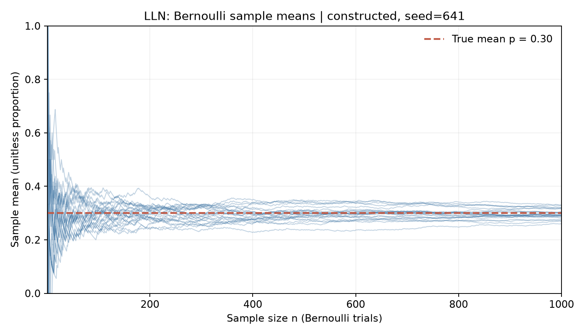
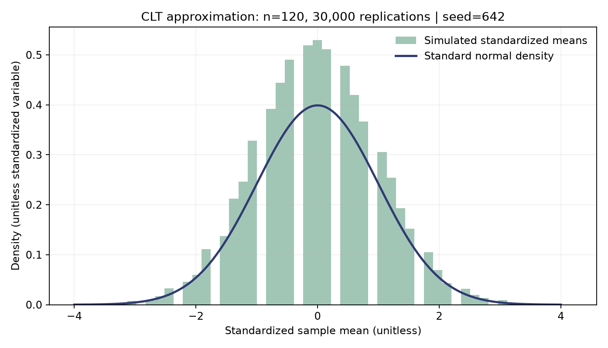
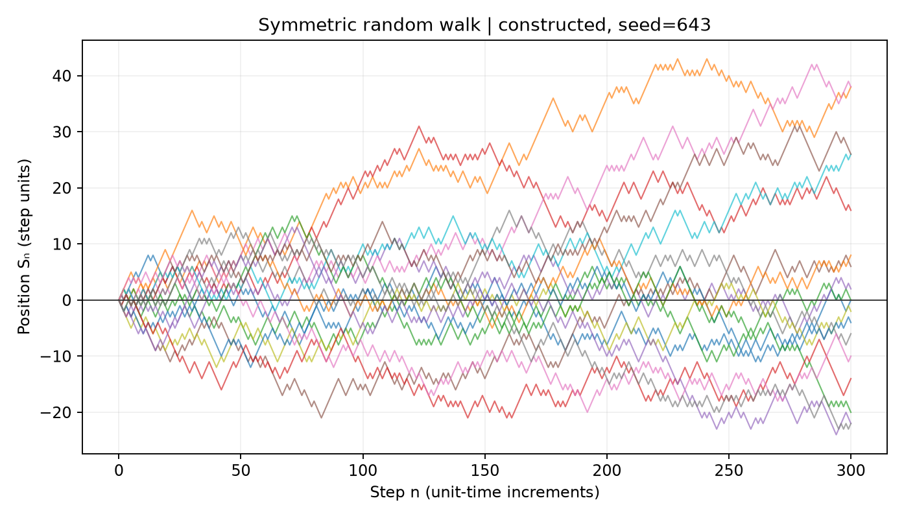
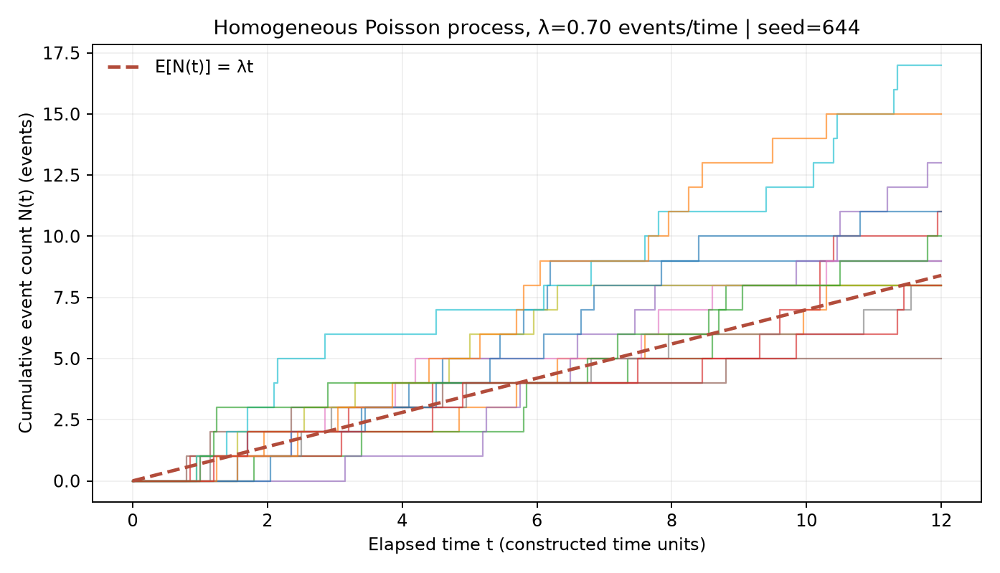

# Chapter 6 — Probability

> Thread: express uncertainty as events and distributions that you can check, then update your judgment with conditional information. Simulation output does not replace checking assumptions.
> Prerequisites: Chapter 4 on calculus and Chapter 5 on linear algebra and covariance. After this chapter, you can compute conditional probabilities and moments, identify common distributions, explain the assumptions of the law of large numbers (LLN) and central limit theorem (CLT), and implement basic stochastic processes.

The terminology connects this chapter to course materials, NumPy/SciPy documentation and program output. When a symbol first appears, its meaning and units connect the formula to the quantity you compute.

## 1. Learning goals

After reading, you should be able to:

1. Define probability using a sample space and events, and update judgments with conditional probability, total probability and Bayes’ rule.
2. Distinguish discrete and continuous random variables, and use probability mass functions (PMFs), probability density functions (PDFs) and cumulative distribution functions (CDFs) correctly.
3. Compute expectations, variances, covariances and conditional expectations, and explain their roles in portfolio risk and prediction.
4. Identify parameters and moment conditions for Bernoulli, binomial, normal, lognormal, Poisson and Student’s t distributions.
5. State the sampling assumptions of LLN and CLT, and explain how temporal dependence, heavy tails and parameter uncertainty change conclusions.
6. Generate sample means, random walks and Poisson counting processes with fixed seeds, and distinguish constructed simulations from market evidence.

You have completed the chapter when you can work through Section 8’s low-base-rate Bayes example by hand, identify nonexistent distribution moments, run Section 9’s script, and explain what each figure demonstrates and what it does not.

## 2. Why a quant needs probability

Quantitative research asks questions involving randomness: what is the probability of a loss after a signal? How large is the risk that several assets fall together? Why does a finite-sample average differ from the population mean? Can a counting model approximate the number of arriving events?

Probability supplies a common language for these questions, but a model output is not itself a fact. A probability of \(0.02\) describes an event under a specified model and information set. It does not guarantee exactly one occurrence in every fifty trials, or imply that model parameters are known without error. Separate these questions:

- **Path randomness:** the next outcome remains uncertain even with parameters specified.
- **Parameter uncertainty:** probabilities, means, volatilities and intensities come from finite-sample estimates; their true values remain unknown.
- **Model uncertainty:** the chosen distribution or process may fail to describe the target object.

Low-base-rate events can mislead intuition in risk monitoring. A detector with high sensitivity may still produce mostly false positives. Evaluate an alert using the event’s prior probability. The chapter demonstrates this with constructed numbers that you can calculate by hand, then extends the same conditioning logic to returns, processes and simulations.

## 3. Intuition

Imagine independently drawing a red or blue card from a bag each day, with fixed red probability \(p\). Which card appears is path randomness. If you have observed only a few days and do not know the red-card proportion, \(p\) also carries estimation uncertainty. Distinguish the two layers: fixing \(p=0.3\) in a simulation displays only the first.

The bag analogy separates individual outcomes from repeated trials. Financial returns may also exhibit volatility clustering, common shocks and temporal dependence; the analogy does not establish independence of returns.

Conditioning narrows the population you examine. Among days with a positive alert, ask what fraction actually contains the event, rather than looking only at the detector’s hit rate when events occur. Bayes’ rule places the prior, hit rate and false-positive rate in one denominator.

Consider a symmetric random walk with one-unit up or down steps. Each increment has population mean zero, and its sample average approaches zero under independence. Yet the cumulative position’s variance grows with the number of steps, and a path can move far from zero. Convergence of average increments does not imply convergence of the cumulative position. LLN concerns sample averages under repeated trials, not convergence of a financial price path to a constant. CLT describes the approximate distribution of a standardized sample mean, not normality of individual-period returns.

Every numerical experiment here constructs samples from specified parameters and a pseudorandom number generator (PRNG). A fixed seed makes output reproducible in the same environment; it does not turn simulation into market data or establish that parameters suit real assets.

## 4. Mathematical foundations

### 4.1 Probability and events

::: {.body-definition title="Definition: probability models and events"}

Let \(\Omega\) be the sample space of possible outcomes, \(\mathcal{F}\) the collection of events we may discuss (an event \(\sigma\)-algebra), and \(\mathbb{P}\) a probability measure. An event \(A\in\mathcal{F}\) is a set of outcomes. Probability satisfies:

\[
\mathbb{P}(A)\ge 0,\qquad
\mathbb{P}(\Omega)=1,\qquad
\mathbb{P}\left(\bigcup_{j=1}^{\infty}A_j\right)=
\sum_{j=1}^{\infty}\mathbb{P}(A_j)
\quad\text{if } A_j \text{ are pairwise disjoint.}
\]

\(\Omega\) denotes all outcomes, and \(A_j\) a countable collection of disjoint events. \(\mathbb{P}\) takes values in \([0,1]\) and has no physical units. The axioms imply \(\mathbb{P}(\varnothing)=0\), \(\mathbb{P}(A^c)=1-\mathbb{P}(A)\) and
\(\mathbb{P}(A\cup B)=\mathbb{P}(A)+\mathbb{P}(B)-\mathbb{P}(A\cap B)\).
You may add union probabilities directly only when \(A\cap B=\varnothing\).

:::

### 4.2 Conditional probability and updating

When \(\mathbb{P}(B)>0\), the conditional probability of \(A\) given that \(B\) occurred is defined by:

\[
\mathbb{P}(A\mid B)=
\frac{\mathbb{P}(A\cap B)}{\mathbb{P}(B)}.
\]

\(A,B\) are events. The denominator is the probability mass selected by the conditioning event, and the ratio is dimensionless. Interchanging \(A,B\) generally changes the result. Independence requires \(\mathbb{P}(A\cap B)=\mathbb{P}(A)\mathbb{P}(B)\); whenever the conditional probability exists, this is equivalent to \(\mathbb{P}(A\mid B)=\mathbb{P}(A)\).

If \(B_1,\dots,B_k\) form a mutually exclusive and exhaustive partition, total probability gives
\[
\mathbb{P}(A)=\sum_{j=1}^{k}\mathbb{P}(A\mid B_j)\mathbb{P}(B_j).
\]
Substitution into the conditional-probability definition yields Bayes’ rule:
\[
\mathbb{P}(B_i\mid A)=
\frac{\mathbb{P}(A\mid B_i)\mathbb{P}(B_i)}
{\sum_{j=1}^{k}\mathbb{P}(A\mid B_j)\mathbb{P}(B_j)}.
\]
\(\mathbb{P}(B_i)\) is the prior, \(\mathbb{P}(A\mid B_i)\) the likelihood, and \(\mathbb{P}(B_i\mid A)\) the posterior after observing \(A\). All are dimensionless probabilities. The denominator is the total probability of observing \(A\) across all possible states.

Conditional probability asks how common \(A\) is among cases where \(B\) has been observed. It does not establish that \(B\) causes \(A\). A causal effect compares outcome distributions under intervention on \(B\) and without intervention on \(B\), using an identification argument such as random assignment or control of confounding. Knowing \(\mathbb{P}(A\mid B)\) alone does not supply an intervention effect.

### 4.3 Random variables and distributions

A random variable \(X:\Omega\rightarrow\mathbb{R}\) maps outcomes to real numbers. Its cumulative distribution function (CDF) is
\[
F_X(x)=\mathbb{P}(X\le x).
\]
\(x\) has the same units as \(X\). \(F_X\) is dimensionless, nondecreasing and right-continuous, with limiting values 0 and 1. For any \(a<b\),
\(\mathbb{P}(a<X\le b)=F_X(b)-F_X(a)\).

For a discrete \(X\), the probability mass function (PMF) is \(p_X(x)=\mathbb{P}(X=x)\) and sums to 1 over the possible values. If a continuous \(X\) has a probability density function (PDF) \(f_X\), then
\[
F_X(x)=\int_{-\infty}^{x} f_X(u)\,du,\qquad
\mathbb{P}(a<X\le b)=\int_a^b f_X(u)\,du.
\]
\(u,x\) have the same units as \(X\). Density \(f_X\) has inverse-variable units \(1/X\), so integration yields a dimensionless probability. A continuous variable assigns zero probability to an individual point; density height is not probability.

Fix the Section 3 bag at 10 cards: 3 red and 7 blue. Replace and mix the cards after each draw. Two successive draws form one ordered trial record; encode red as success 1 and blue as failure 0. Repeating the mechanism produces another record. The model specifies independent draws with fixed success probability \(p=0.30\). Use two independent Bernoulli trials to connect these objects. Event \(A\) means both draws succeed; event \(B\) means at least one succeeds. Random variable \(X\) maps a record to its success count. The table lists each record and its probability; an event-column value of 1 means occurrence, and 0 means nonoccurrence:

| Outcome \(\omega\) | Outcome probability | Event A | Event B | Count X |
|---|---:|---:|---:|---:|
| 00 | \(0.7\times0.7=0.49\) | 0 | 0 | 0 |
| 01 | \(0.7\times0.3=0.21\) | 0 | 1 | 1 |
| 10 | \(0.3\times0.7=0.21\) | 0 | 1 | 1 |
| 11 | \(0.3\times0.3=0.09\) | 1 | 1 | 2 |

The sample space is \(\Omega=\{00,01,10,11\}\); events are its subsets. The four probabilities sum to 1. An outcome probability is the probability of the singleton set \(\{\omega\}\). Conditioning retains the three rows in \(B\) and then selects \(A\) within them: \(\mathbb{P}(A\mid B)=0.09/(0.21+0.21+0.09)=3/17\). Grouping rows by \(X\) yields \(\mathbb{P}(X=0)=0.49\), \(\mathbb{P}(X=1)=0.42\) and \(\mathbb{P}(X=2)=0.09\). The next section uses this distribution table to calculate expectation and variance.

### 4.4 Expectation, variance and covariance

When the moment exists, expectation is the probability-weighted long-run average. The discrete and continuous expressions are
\[
\mathbb{E}[X]=\sum_x x p_X(x),\qquad
\mathbb{E}[X]=\int_{-\infty}^{\infty}x f_X(x)\,dx.
\]
\(X\) and its mean share units. Variance measures squared deviations from the mean; standard deviation has the same units as \(X\):
\[
\operatorname{Var}(X)=\mathbb{E}[(X-\mathbb{E}X)^2]
=\mathbb{E}[X^2]-(\mathbb{E}X)^2.
\]
Covariance describes the direction in which two variables deviate together from their means:
\[
\operatorname{Cov}(X,Y)=
\mathbb{E}[(X-\mathbb{E}X)(Y-\mathbb{E}Y)].
\]
Covariance has units equal to the units of \(X\) times those of \(Y\). When both variances are finite and strictly positive, correlation standardizes covariance and lies in \([-1,1]\).
Define correlation by
\[
\operatorname{Corr}(X,Y)=\frac{\operatorname{Cov}(X,Y)}{\sigma_X\sigma_Y},
\]
Here \(\sigma_X,\sigma_Y\) are the respective standard deviations, with units matching \(X,Y\). Numerator and denominator units cancel.

If \(X,Y\) are independent with finite second moments, their covariance is zero; the converse does not hold. Section 12.5 uses \(Y=X^2\) to show zero correlation with complete dependence.

Return to the two Bernoulli trials. The success-count distribution is \((0,0.49),(1,0.42),(2,0.09)\). Thus
\[
\mathbb{E}[X]=0(0.49)+1(0.42)+2(0.09)=0.60,
\qquad
\mathbb{E}[X^2]=0^2(0.49)+1^2(0.42)+2^2(0.09)=0.78,
\]
\[
\operatorname{Var}(X)=0.78-(0.60)^2=0.42.
\]
First obtain probabilities from the outcomes, then weight them according to the definitions. This connects the experiment, PMF, expectation and variance in one calculation.

For a vector \(R\) of returns on \(n\) assets with fixed weights, portfolio return is \(R_p=w^\top R\), with variance
\[
\operatorname{Var}(R_p)=w^\top\Sigma w
=\sum_{i=1}^{n}\sum_{j=1}^{n}w_iw_j\operatorname{Cov}(R_i,R_j).
\]
\(w_i\) are dimensionless capital weights, and each entry of \(\Sigma\) is the covariance of the corresponding returns. With returns in decimals, variance has squared decimal-return units. Omitting cross terms and looking only at individual volatilities loses information about diversification or common movements.

### 4.5 Conditional expectation

Conditional expectation given event \(B\) is \(\mathbb{E}[X\mid B]\). Conditional expectation \(\mathbb{E}[X\mid\mathcal{G}]\) given information set \(\mathcal{G}\) is a random variable using only information in \(\mathcal{G}\). Its units match \(X\). Total expectation and total variance give
\[
\mathbb{E}[X]=\mathbb{E}[\mathbb{E}(X\mid\mathcal{G})],
\]
\[
\operatorname{Var}(X)=
\mathbb{E}[\operatorname{Var}(X\mid\mathcal{G})]
+\operatorname{Var}(\mathbb{E}[X\mid\mathcal{G}]).
\]
The first term is average randomness within states; the second is variation between state-conditional means. Reporting only the first misses uncertainty in state means.

### 4.6 Process and convergence notation

Independent and identically distributed (i.i.d.) observations \(X_1,\ldots,X_n\) are mutually independent and have the same distribution. Their sample mean is \(\bar X_n=n^{-1}\sum_{i=1}^nX_i\). Convergence notions have different strengths: convergence in probability is \(\xrightarrow{p}\), almost sure convergence is \(\xrightarrow{a.s.}\), and convergence in distribution is \(\xrightarrow{d}\). These symbols are not interchangeable.

Weak white noise (WN) is a second-order concept: \(\mathbb E[X_t]=0\), a finite variance constant over time, and zero autocovariance at every nonzero lag. A zero-mean i.i.d. sequence with finite variance is white noise. White noise itself does not require independence, so it is not equivalent to i.i.d. Chapter 16 develops processes with zero autocovariance and remaining dependence.

A stochastic process is a family of random variables indexed by time. A random walk accumulates increments. A Markov process makes the future conditionally independent of earlier history given the current state. A Poisson process counts arrivals over time. Brownian motion is a standard continuous-time diffusion with continuous paths. Section 6 supplies their definitions and assumptions.

## 5. Definitions and common distributions

### 5.1 Bernoulli and binomial distributions

A Bernoulli random variable \(X\sim\operatorname{Bernoulli}(p)\) takes only 0 or 1, with \(\mathbb{P}(X=1)=p\). Its mean is \(p\) and variance \(p(1-p)\). Across \(n\) independent trials with the same success probability, the total \(K=\sum_{i=1}^{n}X_i\) has a binomial distribution:
\[
\mathbb{P}(K=k)=\binom{n}{k}p^k(1-p)^{n-k},\quad k=0,\ldots,n.
\]
\(n\) is the dimensionless number of trials, \(k\) the number of successes, and \(p\) a dimensionless probability. Mean is \(np\) and variance \(np(1-p)\). A fixed trial count, independence and equal success probabilities are model assumptions, not consequences of a variable’s name.

### 5.2 Normal, lognormal and Student’s t distributions

For a normal distribution \(X\sim N(\mu,\sigma^2)\), \(\mu\) has the same units as \(X\), \(\sigma>0\) is standard deviation in those units, and variance is \(\sigma^2\). The standard normal has mean 0 and variance 1. Its support is the full real line. It can approximate certain aggregated errors, but its tails still decay at an exponential-of-a-square rate.

First define \(Y\) as a dimensionless growth multiplier. If \(Z=\ln Y\sim N(\mu,\sigma^2)\), then \(Y=e^Z\) is lognormal and \(Y>0\). Here \(\mu,\sigma\) are the mean and standard deviation of log growth. The multiplier’s expectation is \(e^{\mu+\sigma^2/2}\) and its median \(e^\mu\); the larger mean reflects right skew. For a price \(V\) measured in currency, choose a positive reference \(V_0>0\) with matching units, write \(V=V_0Y\) and \(Z=\ln(V/V_0)\). Then \(\mathbb E[V]=V_0e^{\mu+\sigma^2/2}\), and price variance equals multiplier variance times \(V_0^2\). Do not take the logarithm of a dimensional price directly.

Student’s t has degrees-of-freedom parameter \(\nu>0\) and standard-form center 0. Its mean exists only for \(\nu>1\) and then equals 0. Variance exists only for \(\nu>2\) and equals \(\nu/(\nu-2)\). For \(1<\nu\le2\), mean exists but finite variance does not; for \(\nu\le1\), even the mean does not exist. Heavier tails than the normal do not make t a description of every heavy-tailed process.

### 5.3 Poisson distribution

A Poisson random variable \(N\sim\operatorname{Poisson}(\lambda)\) describes an event count over an interval in a counting process, with probabilities
\[
\mathbb{P}(N=k)=e^{-\lambda}\frac{\lambda^k}{k!},\quad k=0,1,\ldots.
\]
\(\lambda\ge0\) is the expected count over that interval. Its numerical value is dimensionless; “events” labels the count. Mean and variance both equal \(\lambda\). With interval length \(\Delta t\), a homogeneous Poisson process has \(\lambda=\rho\Delta t\), where \(\rho\) has units events per unit time. Independent increments, stationary increments and constant rate define this model; justify the constant-rate assumption for the application.

### 5.4 Distribution reference table

| Distribution | Parameters and support | Mean and variance | Uses and limits |
|---|---|---|---|
| Bernoulli | \(p\in[0,1]\); \(\{0,1\}\) | \(p,\ p(1-p)\) | One binary outcome; no automatic independence over time |
| Binomial | \(n\in\mathbb{N}, p\in[0,1]\); \(\{0,\ldots,n\}\) | \(np,\ np(1-p)\) | Fixed number of independent equal-probability trials |
| Normal | \(\mu\in\mathbb{R},\sigma>0\); \(\mathbb{R}\) | \(\mu,\sigma^2\) | Aggregated errors or asymptotic approximation; no guaranteed tail fit |
| Lognormal | \(\ln Y\sim N(\mu,\sigma^2)\); \(Y>0\) | \(e^{\mu+\sigma^2/2},(e^{\sigma^2}-1)e^{2\mu+\sigma^2}\) | Positive multiplicative quantities; not a single-period return that can be negative |
| Poisson | \(\lambda\ge0\); nonnegative integers | \(\lambda,\lambda\) | Interval counts; assumptions include equal mean and variance |
| Student’s t | \(\nu>0\); \(\mathbb{R}\) | Mean 0 for \(\nu>1\); variance \(\nu/(\nu-2)\) for \(\nu>2\) | Heavy tails at finite degrees of freedom; low degrees can lack moments |

SciPy distribution objects use their own application programming interface (API) parameter names. In particular, lognormal shape=sigma and scale=exp(mu) correspond to \(Y=e^Z,\ Z\sim N(\mu,\sigma^2)\) here. Check parameterization before using a library function.

### 5.5 Uniform and exponential distributions: simulation and waiting times

A uniform distribution \(U\sim\operatorname{Uniform}(a,b)\) has density \(1/(b-a)\) on \(a<b\) and zero outside. Equal-length subintervals have equal probability. Its mean is \((a+b)/2\) and variance \((b-a)^2/12\). For example, \(U\sim\operatorname{Uniform}(0,1)\) gives \(\mathbb P(0.2<U<0.5)=0.3\). Uniform random numbers can drive simulations of other distributions; this does not make returns uniformly distributed.

For an exponential distribution \(T\sim\operatorname{Exponential}(\rho)\), \(\rho>0\) is the arrival rate. Density is \(\rho e^{-\rho t}\) for \(t\ge0\), survival probability is \(\mathbb P(T>t)=e^{-\rho t}\), mean is \(1/\rho\) and variance \(1/\rho^2\). \(T\) has time units, while \(\rho\) and the density have inverse-time units. Rate and mean waiting time are different parameters: SciPy expon uses scale \(1/\rho\).

If \(N(t)\) is a homogeneous Poisson process with rate \(\rho>0\), the first arrival’s waiting time satisfies \(T_1>t\) if and only if \(N(t)=0\). Hence
\[
\mathbb P(T_1>t)=\mathbb P(N(t)=0)=e^{-\rho t}.
\]
This connects the count distribution to the waiting-time distribution. Further,
\[
\mathbb P(T_1>s+t\mid T_1>s)=
\frac{e^{-\rho(s+t)}}{e^{-\rho s}}=e^{-\rho t},
\quad s,t\ge0.
\]
This is memorylessness. It holds in this model; it does not establish the absence of seasonality or clustering in actual order arrivals. At \(\rho=0.7\) events/hour, mean waiting time is about 1.428571 hours. The probability of waiting more than 5 hours is about 0.0301974, equal to the probability of zero arrivals in 5 hours.

## 6. Derivations and assumptions

### 6.1 Deriving Bayes’ rule from definitions

The conditional-probability definition gives
\(\mathbb{P}(B_i\mid A)=\mathbb{P}(B_i\cap A)/\mathbb{P}(A)\).
The multiplication rule for intersections gives
\(\mathbb{P}(B_i\cap A)=\mathbb{P}(A\mid B_i)\mathbb{P}(B_i)\),
and total probability over the partition gives
\(\mathbb{P}(A)=\sum_j\mathbb{P}(A\mid B_j)\mathbb{P}(B_j)\).
Substitute the last two expressions into the first to obtain Bayes’ rule. All conditional probabilities must be defined, and the observed event \(A\) must have positive total probability.

### 6.2 Bernoulli and binomial moments

For \(X\in\{0,1\}\), \(\mathbb{E}[X]=0(1-p)+1p=p\) and \(X^2=X\). Thus
\[
\operatorname{Var}(X)=\mathbb{E}[X^2]-\mathbb{E}[X]^2
=p-p^2=p(1-p).
\]
Let \(K=\sum_{i=1}^nX_i\). Linearity of expectation does not require independence, so \(\mathbb{E}[K]=np\). Independence eliminates cross covariances, giving
\(\operatorname{Var}(K)=\sum_i\operatorname{Var}(X_i)=np(1-p)\).
With correlated trials, the mean can remain the same, but variance must include all covariance terms.

The binomial formula selects \(k\) success positions among \(n\) positions in \(\binom nk\) arrangements. Each arrangement has probability \(p^k(1-p)^{n-k}\). Adding the mutually exclusive arrangement probabilities gives the PMF.

### 6.3 Lognormal expectation

If \(Z\sim N(\mu,\sigma^2)\), the normal moment-generating function is
\(\mathbb{E}[e^{tZ}]=e^{t\mu+t^2\sigma^2/2}\). Setting \(t=1\) yields
\(\mathbb{E}[Y]=\mathbb{E}[e^Z]=e^{\mu+\sigma^2/2}\); setting \(t=2\) yields
\(\mathbb{E}[Y^2]=e^{2\mu+2\sigma^2}\). Therefore
\[
\operatorname{Var}(Y)=e^{2\mu+2\sigma^2}-e^{2\mu+\sigma^2}
=(e^{\sigma^2}-1)e^{2\mu+\sigma^2}.
\]
\(\mu,\sigma\) are log-scale parameters, and the exponent is dimensionless. For a variable measured in currency, normalize by a reference unit before taking logs, then restore units to its mean and variance.

### 6.4 Law of large numbers

::: {.body-conditions title="Assumptions: two laws of large numbers"}

LLN states that a sample average approaches the population expectation under suitable assumptions. If \(X_i\) are i.i.d. and \(\mathbb{E}|X_i|<\infty\), the strong law of large numbers (SLLN) gives \(\bar X_n\xrightarrow{a.s.}\mu\), where \(\mu=\mathbb{E}X_i\). With the additional assumption of finite variance \(\sigma^2\),
\[
\mathbb{E}[\bar X_n]=\mu,\qquad
\operatorname{Var}(\bar X_n)=\frac{\sigma^2}{n}.
\]
Chebyshev’s inequality gives
\(\mathbb{P}(|\bar X_n-\mu|\ge\epsilon)\le\sigma^2/(n\epsilon^2)\). For any \(\epsilon>0\), the bound tends to zero, establishing convergence in probability. This short derivation uses finite variance; the i.i.d. sufficient condition for SLLN can be as weak as a finite absolute first moment.

:::

### 6.5 Central limit theorem

The classical i.i.d. CLT gives, for \(0<\sigma^2<\infty\),
\[
\frac{\sqrt n(\bar X_n-\mu)}{\sigma}\xrightarrow{d}N(0,1).
\]
\(n\) is sample size, \(\mu\) the population mean and \(\sigma\) its standard deviation. The standardized quantity is dimensionless. The theorem concerns the **standardized sample mean** as sample size grows, not the distribution of raw observations \(X_i\). Zero autocovariance or weak white noise alone does not justify this classical i.i.d. theorem. Finite-sample approximation depends on skewness, tails and sample size; discrete observations do not become continuous because of CLT. One proof route studies characteristic functions: finite variance gives a second-order expansion near zero, and independence makes the standardized sum’s characteristic function the \(n\)th power of that expansion evaluated at \(t/\sqrt n\). Its limit is \(e^{-t^2/2}\), the standard-normal characteristic function. This explains the normal limit’s origin without replacing the theorem’s assumptions.

For a weakly stationary sequence with finite second moments, sample-mean variance is
\[
\operatorname{Var}(\bar X_n)=
\frac{1}{n^2}\left[n\gamma_0+
2\sum_{k=1}^{n-1}(n-k)\gamma_k\right],
\]
Here \(\gamma_k=\operatorname{Cov}(X_t,X_{t-k})\) and \(\gamma_0\) is marginal variance. Units are \(X^2\). Nonzero covariances prevent simply copying \(\sigma^2/n\). Dependent sequences may satisfy an LLN or CLT, but need additional conditions involving stationarity, ergodicity, mixing or moment/covariance decay. Different theorem versions use different conditions; identifying data as a time series does not establish them.

### 6.5a Why zero autocovariance is insufficient: a shared-scale counterexample

::: {.body-example title="Complete counterexample: uncorrelated observations, nonnormal means"}

Let a shared random scale \(A\) take values 1 and 2 with probability \(1/2\) each. Draw it once at the start of the whole sequence and keep it fixed. Let \(\varepsilon_t\) be i.i.d. standard-normal innovations independent of \(A\), and define the dimensionless teaching sequence \(X_t=A\varepsilon_t\). Each observation has mean 0 and variance \(\mathbb E[A^2]=(1+4)/2=2.5\). For distinct \(s,t\), \(\operatorname{Cov}(X_s,X_t)=\mathbb E[A^2]\mathbb E[\varepsilon_s\varepsilon_t]=0\). The sequence therefore meets the second-order conditions for weak white noise.

All observations in a sequence nevertheless share one scale. Observing larger squared values changes your judgment of the other observations’ volatility. A direct check gives \(\operatorname{Cov}(X_s^2,X_t^2)=\mathbb E[A^4]-(\mathbb E[A^2])^2=(1+16)/2-2.5^2=2.25>0\). Zero linear covariance leaves this dependence intact.

The fourth moment is \(\mathbb E[Z^4]\). For a standard normal, the moment-generating function is \(M_Z(t)=e^{t^2/2}\), with fourth derivative \(M_Z^{(4)}(t)=(t^4+6t^2+3)e^{t^2/2}\). Hence \(\mathbb E[Z^4]=M_Z^{(4)}(0)=3\). If \(Y=\sqrt v Z\), where \(v\) is the variance, then \(\mathbb E[Y^4]=v^2\mathbb E[Z^4]=3v^2\). We use this identity to calculate the mixture’s fourth moment.

For any sample size \(n\), conditional on \(A\), \(\sqrt n\bar X_n\sim N(0,A^2)\). Standardizing by the marginal standard deviation \(\sqrt{2.5}\) gives a mixture: half its mass comes from \(N(0,0.4)\) and half from \(N(0,1.6)\). This mixture distribution has variance 1 but fourth moment \(\tfrac12[3(0.4)^2+3(1.6)^2]=4.08\), whereas the standard normal’s fourth moment is 3. Its distribution does not change with \(n\), so it does not approach the standard normal. Sample-mean variance is still exactly \(2.5/n\): a correct variance formula for the standard error and a valid normal interval require different checks. This shared-scale construction is not a market model. It shows why zero autocovariance cannot replace independence in the classical i.i.d. CLT.

:::

### 6.6 Heavy-tail limits

Heavy tails usually mean slower tail-probability decay than a normal or exponential benchmark; definitions differ. Student’s t provides a computable example: no finite variance exists for \(\nu\le2\), so inserting sample standard deviation into a classical finite-variance CLT argument lacks justification. With an even lower tail index, mean may also fail to exist. You can still calculate a sample mean, but it may not estimate a finite population parameter, and standard errors or normal intervals may fail. Check moment conditions before choosing a limit theorem, robust method or tail model. Histogram appearance alone is insufficient.

### 6.7 From discrete to continuous processes

A symmetric random walk uses independent \(\epsilon_i\) taking values \(\pm1\) with probability \(1/2\) each, and position
\(S_n=\sum_{i=1}^n\epsilon_i\). Then \(\mathbb{E}S_n=0\) and \(\operatorname{Var}(S_n)=n\). Shrink time steps to \(1/n\) and positions by \(1/\sqrt n\); the heuristic expression is
\[
W^{(n)}_t=\frac{1}{\sqrt n}\sum_{i=1}^{\lfloor nt\rfloor}\epsilon_i,
\qquad
\operatorname{Var}(W^{(n)}_t)=\frac{\lfloor nt\rfloor}{n}\to t.
\]
Under appropriate conditions, a functional CLT relates the scaled random-walk path distribution to Brownian motion. This chapter uses variance scaling for intuition, without proving that theorem.

Standard Brownian motion \((W_t)_{t\ge0}\) starts at \(W_0=0\), has continuous paths and independent increments over disjoint time intervals. Its increment law is \(W_t-W_s\sim N(0,t-s)\) and depends only on interval length, giving stationary increments. \(t\) uses a chosen time unit; \(W_t\) has units \(\sqrt{\text{time}}\) and satisfies \(\operatorname{Var}(W_t)=t\). These define a process rather than establish a fit to asset returns. Rigorous random-walk convergence, stochastic integration and Itô’s formula are left to Chapter 44.

Donsker’s invariance principle supplies a precise entry point to the random-walk limit. If increments \(\epsilon_i\) are i.i.d. with mean 0 and variance 1, set \(S_m=\sum_{i=1}^m\epsilon_i\). Over a fixed finite horizon, shrinking time steps to \(1/n\) and positions by \(1/\sqrt n\) makes the path \(W_n(t)=S_{\lfloor nt\rfloor}/\sqrt n\) converge in distribution to standard Brownian motion as \(n\) increases. Symmetric \(\pm1\) steps meet these increment assumptions. Later courses supply the formal function-space definition and proof; here you identify the input, scaling and target process.

For stochastic calculus, Brownian motion must also be defined relative to a filtration \((\mathcal F_t)\). \(\mathcal F_t\) represents information available by time \(t\). Adaptation to \(\mathcal F_t\) means that \(W_t\) is measurable using information then available. Future increments \(W_t-W_s\) must also be independent of past information \(\mathcal F_s\). Before Itô integration, learn filtrations, adapted processes, quadratic variation, integrals of simple predictable processes and the Itô isometry; then study Itô’s formula and stochastic differential equations. Chapter 44 develops these formally. Here the process definition and scaling provide the entry point.

### 6.8 Total variance, portfolio variance and the Poisson limit

Let \(m=\mathbb{E}[X\mid\mathcal{G}]\) and \(\mu=\mathbb{E}[X]\). Decompose the deviation as
\(X-\mu=(X-m)+(m-\mu)\). Expand the square and take expectation. The cross term vanishes because
\(\mathbb{E}[X-m\mid\mathcal{G}]=0\) and \(m-\mu\) depends only on \(\mathcal{G}\). Therefore
\[
\operatorname{Var}(X)=
\mathbb{E}[(X-m)^2]+\mathbb{E}[(m-\mu)^2]
=\mathbb{E}[\operatorname{Var}(X\mid\mathcal{G})]
+\operatorname{Var}(m).
\]
Every term has units \(X^2\). Apply the same square-expansion argument to portfolio returns:
with \(R_p=w^\top R\),
\[
\operatorname{Var}(R_p)
=\mathbb{E}\!\left[(w^\top(R-\mathbb{E}R))^2\right]
=w^\top\mathbb{E}\!\left[(R-\mathbb{E}R)(R-\mathbb{E}R)^\top\right]w
=w^\top\Sigma w.
\]
\(w\) is dimensionless and \(\Sigma\) has squared-return units. These equalities require finite second moments.

The Poisson distribution also arises as a limit of rare independent events. Partition an interval of length \(T\) into \(m\) cells. In each cell, let one event occur independently with probability \(\rho T/m\), temporarily excluding multiple events per cell. The total is approximately
\(K_m\sim\operatorname{Binomial}(m,\rho T/m)\). Fix \(k\) and take \(m\to\infty\):
\[
\mathbb{P}(K_m=k)
=\binom{m}{k}\left(\frac{\rho T}{m}\right)^k
\left(1-\frac{\rho T}{m}\right)^{m-k}
\longrightarrow e^{-\rho T}\frac{(\rho T)^k}{k!}.
\]
\(\rho\) is measured in events/time, \(T\) in time, and \(\rho T\) is the dimensionless expected count. The limit depends on independent cells and the rare-event construction; it does not establish a Poisson arrival process in reality.

### 6.9 Markov and Poisson processes

The discrete-time Markov property states that the current state summarizes the history needed to predict the future:
\[
\mathbb{P}(X_{t+1}\in A\mid X_0,\ldots,X_t)=
\mathbb{P}(X_{t+1}\in A\mid X_t).
\]
\(A\) is a set of states. This restricts conditional distributions; it does not claim that yesterday alone causes today’s state. A finite-state, time-homogeneous Markov chain uses transition matrix \(P\) with entries \(P_{ij}=\mathbb{P}(X_{t+1}=j\mid X_t=i)\) and row sums 1. Time homogeneity means these probabilities do not change with \(t\).

A counting process \(N(t)\) takes nonnegative integer values, is nondecreasing and right-continuous, and has \(N(0)=0\). A homogeneous Poisson process counts at rate \(\rho\ge0\) in events/time. Increments over disjoint intervals are independent, with
\[
N(t)-N(s)\sim\operatorname{Poisson}(\rho(t-s)),\quad 0\le s<t.
\]
Consequently \(\mathbb{E}[N(t)]=\operatorname{Var}(N(t))=\rho t\). Independent and stationary increments are model definitions. Clustering, intraday seasonality or changing intensity in data makes a homogeneous process an assumption to examine, not a default truth.

For \(\rho>0\), an equivalent construction uses i.i.d. interarrival times with distribution \(\operatorname{Exponential}(\rho)\). \(\rho=0\) means no arrivals, so the waiting time is not a finite exponential variable. Exponential memorylessness corresponds to Poisson independent, stationary increments. Section 5.5 derives the first waiting time from the zero-count probability. Markov chains, Poisson processes and Brownian motion each have explicit state or increment conditions; their names cannot replace those conditions.

## 7. Financial interpretation

### 7.1 Conditioning requires an information time

In trading and risk research, known information must refer to its availability time. Let \(\mathcal{F}_t\) be information available at \(t\), and write future-return conditional mean as \(\mathbb{E}[R_{t+1}\mid\mathcal{F}_t]\). Do not define the conditioning group from future outcomes. Align signals, release times, ingestion times and return intervals first; probability formulas cannot repair look-ahead bias.

### 7.2 Covariance links individual and portfolio risk

Changing correlation changes portfolio variance even when individual asset risks remain fixed. With weights \(w_1,w_2\), portfolio variance includes \(2w_1w_2\operatorname{Cov}(R_1,R_2)\). Diversification comes from imperfect comovement, not asset count alone. Frequency, overlapping intervals, missingness, tails and estimation error affect sample covariance; a historical estimate does not automatically describe the future.

### 7.3 Distributions are approximations, not asset labels

- Bernoulli/binomial models can describe default indicators or success counts over fixed periods, but require a default definition, observation window and treatment of common shocks.
- Normal distributions ease sums and derivations, while returns may exhibit skew, heavy tails, volatility clustering or extreme jumps.
- Lognormal distributions suit strictly positive multiplicative quantities, such as terminal values in certain price models. This does not make simple returns lognormal.
- Poisson provides a count-model benchmark. Examine overdispersion, clustering and intensity changes as possible failures.
- Student’s t adds tail mass at finite degrees of freedom. If fitted degrees of freedom are too low, some moments and the metrics using them cease to exist.

### 7.4 State what a process model preserves

Random walks accumulate increments to illustrate path randomness and mean/variance growth. Markov processes compress historical information; specify states, time variation in transitions and parameter estimation. Poisson processes simulate counts; examine independent increments and stable intensity. Brownian motion uses continuous paths and Gaussian increments as an entry point to continuous-time models. A path looking like a price chart does not establish any of these as a price-generating process.

## 8. Numerical Example

All following numbers are teaching constructions for hand calculations and code checks, not market frequencies, strategy performance or risk-parameter estimates.

### 8.1 Low-base-rate alerts: Bayes updating

::: {.body-example title="Complete example: Bayes updating for a low-base-rate alert"}

Let the event prior be \(0.005\), sensitivity (a positive alert given an event) \(0.95\), and false-positive rate given no event \(0.05\). Then
\[
\mathbb{P}(E\cap +)=0.005\times0.95=0.00475,
\]
\[
\mathbb{P}(+)=0.00475+(1-0.005)\times0.05
=0.00475+0.04975=0.05450,
\]
\[
\mathbb{P}(E\mid +)=\frac{0.00475}{0.05450}
=0.0871559633\approx 8.7156\%.
\]
\(E\) denotes the event and \(+\) a positive alert. Sensitivity is 95%, yet event probability after a positive is about 8.72%, because nonevents dominate the population. Choose the conditional direction from the question.

Express the same model as frequencies among 200,000 objects. These are model-expected counts obtained from specified probabilities, not guaranteed counts in one realized sample:

| Actual state | Positive alert | Negative alert | Total |
|---|---:|---:|---:|
| Event | 950 | 50 | 1,000 |
| No event | 9,950 | 189,050 | 199,000 |
| Total | 10,900 | 189,100 | 200,000 |

The positive-column denominator is \(950+9,950=10,900\), giving posterior \(950/10,900=19/218\approx0.08715596\). The table expands the Bayes denominator cell by cell: it contains both true and false positives.

:::

### 8.2 Bernoulli counts and portfolio covariance

Across \(n=20\) independent trials with \(p=0.30\), the success total \(K\sim\operatorname{Binomial}(20,0.30)\) has
\[
\mathbb{E}[K]=20(0.30)=6,\qquad
\operatorname{Var}(K)=20(0.30)(0.70)=4.2.
\]
Variance is measured in squared success-count units.

::: {.body-example title="Complete example: a four-state portfolio and conditional variance"}

Construct two assets’ daily decimal returns across four equally likely states: \((R_A,R_B)\) takes values \((0.1,0.1)\), \((-0.1,-0.1)\), \((0.1,-0.1)\) and \((-0.1,0.1)\). Both assets have mean 0, variance \(0.01\) and zero covariance. Equal capital weights produce returns \(0.1,-0.1,0,0\), with mean 0 and variance
\((0.01+0.01+0+0)/4=0.005\). Keeping only the first two perfectly aligned states leaves each marginal variance at \(0.01\) but raises covariance to \(0.01\) and equal-weight portfolio variance to \(0.01\). Individual volatilities are unchanged while portfolio risks differ; the numbers isolate the covariance term’s role.

Use the same construction for total expectation and variance. Let \(C\) denote the first two aligned states, with \(\mathbb P(C)=\mathbb P(C^c)=1/2\), and let \(\mathcal G=\sigma(\mathbf 1_C)\) represent knowing only whether \(C\) occurred. Within \(C\), returns are \(0.1,-0.1\), so conditional mean is 0 and variance \(0.01\). Within \(C^c\), returns are \(0,0\), so both conditional moments are 0. Thus \(\mathbb E[R_p]=\tfrac12(0)+\tfrac12(0)=0\), and
\[
\operatorname{Var}(R_p)=\mathbb E[\operatorname{Var}(R_p\mid\mathcal G)]+\operatorname{Var}(\mathbb E[R_p\mid\mathcal G])
=\tfrac12(0.01)+\tfrac12(0)+0=0.005,
\]
This agrees with the direct four-state calculation.

:::

### 8.3 Lognormal mean and median

Let one-period log growth be \(Z\sim N(0.08,0.20^2)\) and the gross growth factor \(G=e^Z\). Median is \(e^{0.08}\approx1.0833\) and expectation
\(\mathbb{E}[G]=e^{0.08+0.20^2/2}=e^{0.10}\approx1.1052\). If \(G\) is terminal wealth per unit of initial wealth, its mean exceeds its median. This does not guarantee a net return and accounts for neither costs, bankruptcy, jumps nor parameter error.

### 8.4 Poisson counts

With constructed rate \(0.7\) events/hour, the 5-hour count parameter is \(\lambda=0.7\times5=3.5\). The homogeneous Poisson model gives mean and variance 3.5 over that interval. A realized path with 2 or 6 events is consistent with this: theoretical moments describe repeated sampling, not numbers every path must attain.

### 8.5 Student’s t, random walks and Brownian scaling

A standard t distribution with \(\nu=4\) has mean 0, variance \(4/(4-2)=2\) and standard deviation \(\sqrt{2}\). Reducing degrees of freedom to 1 removes both mean and variance. Finite degrees of freedom alone do not guarantee a given moment.

A symmetric random walk \(S_n\) uses \(+1\) or \(-1\) per step. After \(n=4\) steps, \(\mathbb{E}[S_4]=0\) and \(\operatorname{Var}(S_4)=4\), giving standard deviation 2 step units. For standard Brownian motion measured in hours, at \(t=4\) hours, \(\operatorname{Var}(W_4)=4\) hours and standard deviation \(2\sqrt{\text{hours}}\). This converts process-definition scales; it does not estimate asset-price volatility.

### 8.6 A two-state Markov chain

Use the constructed transition matrix
\[
P=\begin{pmatrix}0.9&0.1\\0.3&0.7\end{pmatrix}
\]
to describe one-step probabilities between states \(A,B\); each row sums to 1. From initial row-vector probabilities \(\pi_0=(0.5,0.5)\), one step gives \(\pi_1=\pi_0P=(0.6,0.4)\) and two steps \(\pi_2=\pi_1P=(0.66,0.34)\). Probabilities and state labels are dimensionless. Before applying this constructed matrix to markets, define states knowable in real time and estimate and examine transition stability.

## 9. Python Implementation

### Default entry point in the accepted reader package

From the accepted I3 reader package root, create the isolated environment described in its [README](../../../../editions/en/README.md), then run:

```bash
.venv/bin/python run_notebook.py notebooks/ch06_probability.ipynb
```

This notebook calls the packaged shared implementation, reads no omitted French data and downloads nothing. Each execution writes a unique UUID subdirectory under runs and prints its location. Old production tests and the historical course-root commands below belong to the original working project; the reader’s default route is the package-root notebook and its assertions. Optional historical French paths follow the reader’s [data contract](../../../../editions/en/OPTIONAL_DATA.md) and were not rerun in this batch.

### Historical course-root route

[ch06_probability.py](../../../../code/ch06_probability.py) implements Bayes calculations, Bernoulli/binomial moments and four fixed-seed constructed simulations. It uses local NumPy Generators without changing global random state. Out-of-range or nonfinite probabilities and undefined conditioning events raise errors. Simulations use no financial data or global shuffle.

Run from the course-project root:

```bash
.venv/bin/python code/ch06_probability.py --seed 641 --output-dir figures/a2
.venv/bin/python -m pytest tests/test_ch06_probability.py -q
```

Historical tests cover the Bayes denominator, closed-form moments, reproducibility with the same seed, moments of LLN/CLT constructed samples, random-walk steps, Poisson monotonicity and moments, and writing all four figures. The recorded validation environment was Python 3.14.7, NumPy 2.5.3 and SciPy 1.18.1; the course project’s .venv determines dependency versions.

The next self-contained snippet checks Section 8.1. Inputs, imports and assertions are included; tolerance handles floating-point rounding:

```python
import math

prior = 0.005
sensitivity = 0.95
false_positive_rate = 0.05
joint_event_and_positive = prior * sensitivity
positive_rate = joint_event_and_positive + (1 - prior) * false_positive_rate
posterior = joint_event_and_positive / positive_rate

assert math.isclose(positive_rate, 0.0545, rel_tol=0.0, abs_tol=1e-12)
assert math.isclose(posterior, 0.0871559633027523, rel_tol=0.0, abs_tol=1e-12)
print(f"P(event | positive) = {posterior:.4%}")
```

```python
import numpy as np
from scipy import stats

rate_per_hour = 0.7
waiting = stats.expon(scale=1.0 / rate_per_hour)
no_arrival_in_five_hours = waiting.sf(5.0)
zero_count_probability = stats.poisson.pmf(0, mu=rate_per_hour * 5.0)
assert np.isclose(no_arrival_in_five_hours, zero_count_probability)
assert np.isclose(waiting.mean(), 1.0 / rate_per_hour)
assert np.isclose(waiting.sf(3.0 + 2.0) / waiting.sf(3.0), waiting.sf(2.0))
uniform_probability = stats.uniform.cdf(0.5) - stats.uniform.cdf(0.2)
assert np.isclose(uniform_probability, 0.3)
print("constructed waiting time mean, hours", waiting.mean())
print("constructed P(no arrival in 5 hours)", no_arrival_in_five_hours)
```

The waiting-time example explicitly uses hours; other process figures use specified constructed time units. These examples have no market sampling frequency, signal time or trade time because they contain no security records. Script process time is dimensionless teaching time. A future application to real signals must define the event window, information cutoff, execution time and return interval separately.

## 10. Visualization

The chapter script generated the following constructed-simulation figures. Axes carry labels, and titles state the seeds.

### 10.1 LLN sample-mean paths



The horizontal axis is Bernoulli trial count \(n=1,\ldots,1000\); the vertical axis is the sample mean for each of 24 paths. The dashed line marks constructed population mean \(p=0.30\). Paths fluctuate widely early and narrow around \(p\) later. Each line is a cumulative mean of independently constructed Bernoulli observations. The figure illustrates convergence; it does not prove it.

### 10.2 CLT standardized sample means



The horizontal axis is the standardized Bernoulli sample mean at \(n=120\). A density histogram uses 30,000 constructed replications; the curve is standard-normal density. At finite \(n\) the variable remains discrete, and the curve is a limiting approximation.

Each replication draws \(n=120\) independent Bernoulli\((p=0.30)\) observations and computes \(Z_{n,m}=(\bar X_{n,m}-p)/\sqrt{p(1-p)/n}\). Index \(m=1,\ldots,30{,}000\) labels independent sample replications, not observations within a sample. The 30,000 constructed statistics check whether code follows the specified model and show its approximate sampling distribution. They do not prove CLT or establish i.i.d. real returns.

### 10.3 Symmetric random walks



The horizontal axis runs from step 0 to 300 and the vertical axis records cumulative position. Each of 18 paths uses independent \(+1/-1\) increments. The figure illustrates path randomness without fitting prices or returns.

### 10.4 Poisson counting processes



The horizontal axis covers 0 to 12 constructed time units and the vertical axis cumulative count. Fourteen step paths use independent Poisson increments on 240 equal-width cells of size 0.05. The dashed line is theoretical mean \(\rho t\), with \(\rho=0.70\) events/time. Every path takes integer values and is nondecreasing.

Section 9 gives reproduction commands and seeds. These four figures illustrate definitions, convergence trends and count structure; they do not establish the same process assumptions in real data.

## 11. Real Market Example

This chapter downloaded or tested no real security, order, default or return data. It therefore reports no market frequencies, fitted parameters or in-/out-of-sample results, and the alert example is not empirical evidence. Official course notes and distribution APIs support definitions and methods, not conclusions that a particular market follows a distribution.

For a future real-data case, first choose a sourced, licensed dataset. Record issuer/venue, event definition, sample period, frequency, download time, version and checksum. An alert study must prevent test-period base rates, label availability or revised values leaking into the signal time. Examine interarrival distributions, intraday seasonality, clustering and intensity changes before accepting a count model. Until those checks are complete, the model remains a hypothesis to test.

## 12. Common Mistakes

### 12.1 Confusing sensitivity with event probability after an alert

\(\mathbb{P}(+\mid E)\) and \(\mathbb{P}(E\mid +)\) reverse the conditional direction. Calculate them separately using Section 8.1 inputs:

```python
prior = 0.005
sensitivity = 0.95
false_positive_rate = 0.05

sensitivity_value = sensitivity
posterior_value = prior * sensitivity / (
    prior * sensitivity + (1 - prior) * false_positive_rate
)
print(f"P(positive | event) = {sensitivity_value:.2%}")
print(f"P(event | positive) = {posterior_value:.4%}")
```

Outputs are 95.00% and about 8.7156%. Reporting only the first leaves the reliability of a positive alert unanswered.

### 12.2 Reading density height as probability

Density carries units; interval integration gives probability, while a specified point has zero probability here. The following example uses the standard normal:

```python
from scipy.stats import norm

density_at_zero = norm.pdf(0.0)
probability_near_zero = norm.cdf(0.01) - norm.cdf(-0.01)
print(f"density at zero = {density_at_zero:.6f}")
print(f"P(-0.01 < Z < 0.01) = {probability_near_zero:.6f}")
```

density_at_zero is about 0.398942 and interval probability about 0.007979. The former is not \(P(Z=0)\); a continuous standard normal assigns zero probability to any specified single point.

### 12.3 Applying finite-variance CLT to heavy tails without checking moments

Student’s t with 1 degree of freedom has no finite mean or variance. SciPy moment interfaces return nonfinite values for nonexistent moments; function conventions may represent them as infinity or NaN:

```python
import numpy as np
from scipy.stats import t

mean, variance = t.stats(df=1, moments="mv")
assert not np.isfinite(mean)
assert not np.isfinite(variance)
print("df=1: population mean and variance do not exist")
```

You can calculate a finite-sample mean, but cannot standardize by a nonexistent population standard deviation and claim a guaranteed classical CLT normal approximation.

### 12.4 Redrawing cumulative counts independently at each time

Independently drawing \(N(t_1),N(t_2),\ldots\) as separate Poisson variables can make a later count lower than an earlier one, violating a counting process’s path definition. Draw independent interval increments and accumulate them instead:

```python
import numpy as np

rng = np.random.default_rng(644)
rate = 0.7
horizon = 12.0
n_intervals = 240
dt = horizon / n_intervals
increments = rng.poisson(lam=rate * dt, size=n_intervals)
counts = np.concatenate(([0], np.cumsum(increments)))
assert np.all(np.diff(counts) >= 0)
assert counts[0] == 0
print(f"terminal count = {counts[-1]}")
```

Accumulation makes the path nondecreasing, with disjoint-interval counts generated as independent increments. The chapter script also generates increments before cumulative sums.

### 12.5 Zero correlation does not imply independence

::: {.body-pitfall title="Common mistake: inferring independence from zero correlation"}

Take \(X\sim\operatorname{Uniform}(-1,1)\) and \(Y=X^2\). Symmetry gives \(\mathbb E[X]=\mathbb E[X^3]=0\), hence \(\operatorname{Cov}(X,Y)=0\). Both variances are positive and correlation is zero. Yet \(Y\) is determined completely by \(X\), so they are dependent. Correlation describes linear comovement; its absence does not remove all conditional relationships. A nonlinear feature in a conditional model should not be discarded solely because its raw linear correlation is near zero.

:::

## 13. Quant Research Application

Suppose the target is whether an extreme loss occurs within a defined future window. Build the probability study in this order:

1. **Define the event:** for example, next-trading-day portfolio simple return below a threshold. State the interval, gross/net convention, timezone and when the label becomes known.
2. **Define information:** use only information available at signal time, denoted \(\mathcal{F}_t\). Features, historical base rates and label versions must meet point-in-time constraints. Here \(\mathcal{F}_t\) is information at prediction time \(t\), and \(R_{t+1}\) is return over the prespecified subsequent interval.
3. **Choose the estimand:** predict conditional event probability \(\mathbb{P}(E_{t+1}=1\mid\mathcal{F}_t)\), rather than claiming that an alert caused the loss. Separate path randomness, finite-sample parameter uncertainty and model uncertainty.
4. **Choose baseline and conditional models:** report the unconditional base rate first, then assess whether features improve prediction. Check calibration, group base rates and out-of-sample loss. With imbalanced classes, report precision, recall and false-positive burden as well as accuracy.
5. **Examine dependence and tails:** time-series labels may overlap and returns may correlate. Use temporal splits and dependence-aware uncertainty assessments. Resampling must preserve temporal structure; a global shuffle does not establish i.i.d. observations.
6. **Translate prediction into action and include costs:** thresholds depend on false-positive/false-negative losses, capital, liquidity, execution delay and trading costs. A probability is neither a trading rule nor a net-return result.
7. **Falsify and assess robustness:** vary base rates, windows, states and thresholds; compare historical baselines; examine drift, restatements, missingness and out-of-distribution cases. Conclusions relying on one window or a few events need narrower claims.

For posterior event probability \(q_t\) after a positive, compare false-positive and false-negative losses in a simplified binary decision. Let \(C_{FP}\) be the loss from acting when no event occurs and \(C_{FN}\) the loss from not acting when it occurs. Normalize correct-decision losses to zero. Expected loss from acting is \(C_{FP}(1-q_t)\); from not acting, \(C_{FN}q_t\). Making the former smaller and rearranging gives the action condition
\[
q_t>\frac{C_{FP}}{C_{FP}+C_{FN}}.
\]
\(q_t\) is dimensionless; express both costs in the same loss units. Real decisions also include the action’s effects and opportunity costs. Section 8’s 8.72% is not a universal market threshold.

## 14. Chapter Summary

Probability axioms define event probabilities. Conditioning and Bayes’ rule update state probabilities with new information. Random variables map outcomes to numbers; distributions, expectations, variances and covariances describe values, centers, dispersion and comovement. Portfolio risk requires covariance, not just individual asset variances.

Common distributions have specific supports, parameters and moment conditions. LLN brings sample means toward population means under assumptions; CLT concerns standardized means’ limiting distribution. Correlation, overlap, nonstationarity and infinite variance change available conclusions. Random walks, Markov, Poisson and Brownian processes preserve different path structures. Assess assumptions against the target data; these simulations illustrate only mathematics under constructed parameters.

## 15. Exercises

Questions 6-E01 through 6-E07 use constructed inputs, not market observations.

**6-E01 (concepts).** Define sample space, event, mutual exclusion and independence. Are mutually exclusive events necessarily independent? Give a simple example with positive event probabilities.

**6-E02 (concepts).** Given \(\mathbb{P}(A)=0.2\) and \(\mathbb{P}(B)=0.5\), can marginal probabilities alone determine \(\mathbb{P}(A\mid B)\)? Identify the missing information.

**6-E03 (concepts).** If a continuous variable’s PDF equals 0.4 at a point, is that point’s probability 40%? Explain interval probabilities and density units.

**6-E04 (concepts).** Distinguish the objects described by LLN and CLT, and state the classical i.i.d. finite-variance CLT assumptions. Which population moments fail to exist for t with 1 degree of freedom?

**6-E05 (hand calculation).** A binary signal has prior event probability \(0.02\), sensitivity \(0.80\) and false-positive rate \(0.10\). Compute positive-alert probability and event probability given a positive.

**6-E06 (hand calculation).** Repeat \(X\sim\operatorname{Bernoulli}(0.25)\) independently 16 times. Find the single-trial mean and variance, and the total-success mean and variance.

**6-E07 (calculation and interpretation).** \(N(t)\) is a homogeneous Poisson process at \(1.2\) events/hour. Give the 2-hour count distribution, zero-count probability, mean and variance. State its two increment assumptions.

Additional questions 6-N01 through 6-N05 also use teaching constructions.

**6-N01 (identify objects).** Record two independent Bernoulli\((0.30)\) trials as 00, 01, 10 and 11. Give the sample space and outcome probabilities, define \(A=\{\text{both succeed}\}\), \(B=\{\text{at least one succeeds}\}\) and the success-count random variable \(X\), and give the support and PMF of \(X\).

**6-N02 (one calculation).** Using 6-N01, calculate only \(\mathbb P(A\mid B)\). State which outcomes conditioning removes and which rows form the denominator.

**6-N03 (complete calculation).** From 6-N01’s table, list probabilities for \(X=0,1,2\), then calculate \(\mathbb E[X]\), \(\mathbb E[X^2]\) and \(\operatorname{Var}(X)\). Does the variance agree with the sum of two independent Bernoulli variances?

**6-N04 (code diagnosis).** For each Bernoulli\((p)\) sample of size \(n\), a program computes \(z=(\bar X-p)/\sqrt{p(1-p)}\), plots many \(z\) values and overlays standard-normal density. Identify the missing scaling, derive the current statistic’s variance and correct the denominator. Explain what more replications can check and cannot prove.

**6-N05 (research judgment).** A fixed-seed i.i.d. simulation produces a bell-shaped sample-mean histogram, and an autocorrelation test on real monthly returns does not reject zero correlation. The researcher claims: “Real returns are proven i.i.d. normal; the signal caused subsequent losses; classical CLT intervals are valid.” Evaluate all three claims and list the objects or assumptions still needed for prediction, causality and mean inference.

**6-B01 (dependence counterexample).** In Section 6.5a’s shared-scale construction, how does drawing \(A\) once differ from independently redrawing it each period? Calculate single-period variance, cross-period linear covariance, covariance of squared observations and the fourth moment of \(Z_n=\sqrt n\bar X_n/\sqrt{2.5}\). Why does \(\operatorname{Var}(\bar X_n)=2.5/n\) still not establish that \(Z_n\) becomes standard normal?

## 16. Programming Exercises

Programming questions 6-P01 through 6-P03 must run independently in a Python 3 NumPy/SciPy environment. Use a function-local default_rng with the specified seed; do not use global shuffle.

**6-P01 (conditional probability).** With Section 8.1’s low-base-rate inputs, compute and print positive-alert probability and event probability given a positive. Assert 0.0545 and approximately 0.0871559633 using math.isclose.

**6-P02 (LLN and CLT).** With seed 6202, generate 100,000 Bernoulli observations at \(p=0.3\) and report prefix means for 100, 1,000 and 100,000 observations. With seed 6203, generate 20,000 binomial sample totals from samples of \(n=100\) trials and standardize by theoretical mean and standard deviation. Check an empirical standardized mean near 0 and variance near 1. Explain why these checks do not establish i.i.d. real data.

**6-P03 (process paths).** With seed 6204, generate a 300-step symmetric random walk and a Poisson path at rate \(\rho=0.7\) over horizon \(T=10\). Print path shapes and terminal count. Assert walk increments belong to \(\{-1,1\}\), counts never decrease and initial count is 0. Optionally call the chapter script to generate figures.

## 17. Challenge Problems

**6-C01 (correlation and effective sample size).** Let \(X_t\) be stationary with mean 0, marginal variance 1 and autocorrelation \(\rho_k=0.5^k\). Derive \(\operatorname{Var}(\bar X_4)\) at \(n=4\) and compare with i.i.d. variance. Explain the direction of error from treating observation count as independent sample count. Scoring: covariance-sum formula 2 points; correct lag substitution 2; comparison and interpretation 2.

**6-C02 (state switching, Poisson and diffusion limits).** Propose a conceptual model with finite-state Markov states, state-dependent event intensity and conditional continuous returns. Explain:
(a) state transitions; (b) conditional Poisson intensity; (c) structure needed for Brownian return increments; (d) real features that could invalidate the model; (e) out-of-sample testing. Give a falsifying diagnostic. Scoring: states and information times 2 points; intensity and increments 2; Brownian restrictions 2; failure mechanisms and falsification 2. Answers may differ, but must describe a testable model rather than a fact.

## 18. Solutions / Solution Hints

### 6-E01

Mutual exclusion means \(A\cap B=\varnothing\); independence means the intersection probability equals the product of marginals. With \(\mathbb{P}(A)>0,\mathbb{P}(B)>0\) and mutually exclusive events, \(\mathbb{P}(A\cap B)=0\) while \(\mathbb{P}(A)\mathbb{P}(B)>0\), so they are dependent. For example, roll a fair die once and take \(A=\{1\}\) and \(B=\{2\}\). If one event has probability zero, mutual exclusion can also satisfy independence.

### 6-E02

No. You also need \(\mathbb{P}(A\cap B)\); conditional probability is \(\mathbb{P}(A\cap B)/0.5\). Fréchet bounds permit the intersection to range from
\(\max(0,0.2+0.5-1)=0\) to \(\min(0.2,0.5)=0.2\), corresponding to conditional probabilities 0 to 0.4. Adding independence gives 0.2, but two marginal probabilities alone cannot imply independence.

### 6-E03

No. A continuous variable assigns zero probability to a specified point. Density has reciprocal-variable units, so its height is not a dimensionless probability. Over a small interval \([a,b]\), probability is
\(\int_a^b f_X(x)\,dx=F_X(b)-F_X(a)\). Only when density changes little over the interval does \(f_X(x)(b-a)\) approximate its probability.

### 6-E04

LLN brings sample means toward the population mean under assumptions; CLT describes the asymptotic normal distribution of a centered mean scaled by its standard error. The classical CLT requires i.i.d. observations and finite, positive variance. At \(\nu=1\), t has neither mean nor variance, preventing classical standardization with those population moments.

### 6-E05

\[
\mathbb{P}(+)=0.02(0.80)+0.98(0.10)=0.016+0.098=0.114.
\]
\[
\mathbb{P}(E\mid+)=0.016/0.114=0.1403508772\approx14.0351\%.
\]
The numerator is the joint probability of an event and a positive alert. The denominator includes true and false positives.

### 6-E06

Single-trial mean is \(p=0.25\) and variance \(p(1-p)=0.1875\). Over 16 independent trials, total-success mean is \(16p=4\) and variance \(16p(1-p)=3\).

### 6-E07

The 2-hour parameter is \(\lambda=1.2\times2=2.4\), hence \(N(2)\sim\operatorname{Poisson}(2.4)\). Zero-count probability is \(e^{-2.4}\approx0.090718\), and mean and variance are both 2.4. Disjoint-interval increments must be independent, and their distributions must depend only on interval length (stationary increments). Rate has events/hour units and variance squared-count units.

### 6-P01 Reference implementation

```python
import math

prior = 0.005
sensitivity = 0.95
false_positive_rate = 0.05
joint_positive_event = prior * sensitivity
positive_rate = joint_positive_event + (1 - prior) * false_positive_rate
posterior = joint_positive_event / positive_rate

assert math.isclose(positive_rate, 0.0545, rel_tol=0.0, abs_tol=1e-12)
assert math.isclose(posterior, 0.0871559633027523, rel_tol=0.0, abs_tol=1e-12)
print(f"positive_rate={positive_rate:.4f}; posterior={posterior:.8%}")
```

Expected output: positive_rate=0.0545; posterior=8.71559633%. The assertions check both total-probability denominator and conditional direction.

### 6-P02 Reference implementation

```python
import numpy as np

p = 0.30
rng_lln = np.random.default_rng(6202)
draws = rng_lln.binomial(1, p, size=100_000)
prefix_means = [float(draws[:n].mean()) for n in (100, 1_000, 100_000)]

rng_clt = np.random.default_rng(6203)
sample_size = 100
replications = 20_000
successes = rng_clt.binomial(1, p, size=(replications, sample_size)).sum(axis=1)
z = (successes - sample_size * p) / np.sqrt(sample_size * p * (1 - p))
z_mean = float(z.mean())
z_variance = float(z.var(ddof=1))

assert len(prefix_means) == 3
assert abs(prefix_means[-1] - p) < 0.01
assert abs(z_mean) < 0.04
assert abs(z_variance - 1.0) < 0.06
print("prefix means:", [round(value, 4) for value in prefix_means])
print(f"standardized mean={z_mean:.4f}; variance={z_variance:.4f}")
```

This code generates constructed samples from the specified Bernoulli model. It checks implementation against known theoretical parameters, not whether any real returns are i.i.d.

### 6-P03 Reference implementation

```python
import numpy as np

rng = np.random.default_rng(6204)
walk_steps = 300
walk_increments = 2 * rng.integers(0, 2, size=walk_steps) - 1
walk = np.concatenate(([0], np.cumsum(walk_increments)))

rng_count = rng
rate = 0.7
horizon = 10.0
n_intervals = 200
dt = horizon / n_intervals
increments = rng_count.poisson(lam=rate * dt, size=n_intervals)
counts = np.concatenate(([0], np.cumsum(increments)))

assert walk.shape == (301,)
assert set(np.unique(np.diff(walk))) <= {-1, 1}
assert counts.shape == (201,)
assert counts[0] == 0
assert np.all(np.diff(counts) >= 0)
print(f"walk points={walk.size}; terminal position={walk[-1]}")
print(f"count points={counts.size}; terminal count={counts[-1]}")
```

A local Generator produces both paths in sequence with seed 6204. Poisson increments are independently generated on a grid of width \(T/n_{\text{intervals}}\) and accumulated. An increment above 1 permits multiple events in a cell.

### 6-C01 Reference derivation

The stationary sample-mean variance is
\[
\operatorname{Var}(\bar X_n)=\frac{1}{n}
\left[1+2\sum_{k=1}^{n-1}\left(1-\frac{k}{n}\right)\rho_k\right]
\]
with marginal variance 1. Substitute \(n=4,\rho_k=0.5^k\):
\[
\operatorname{Var}(\bar X_4)
=\frac14\left[1+2\left(\frac34\cdot\frac12+
\frac12\cdot\frac14+\frac14\cdot\frac18\right)\right]
=\frac{33}{64}=0.515625.
\]
I.i.d. variance is \(1/4=0.25\). Correlation provides less effective information than 4 independent observations. Ignoring positive autocorrelation understates sample-mean uncertainty and overstates precision. This finite-\(n\) calculation does not establish the given autocorrelation function in a real sequence.

### 6-C02 One acceptable reference argument

Let \(S_t\in\{0,1\}\) describe two market states, updated only at equal-length window boundaries using fixed transition matrix \(P\), and held constant within each window \([t,t+\Delta)\). This is a testable benchmark only if states/transitions remain stable and the state is knowable at the window start. Assume also that window counts are conditionally independent given the full state sequence and that count innovations do not affect transitions. Given initial state \(S_t=s\), use the fixed-intensity model
\[
N_{t+\Delta}-N_t\mid S_t=s\sim\operatorname{Poisson}(\rho_s\Delta).
\]
\(\rho_s\) has events/time units and \(\Delta\) uses the same time unit. For continuous increments, hold drift and volatility fixed within the window and make Brownian innovations independent of the state chain:
\[
X_{t+\Delta}-X_t\mid S_t=s\sim N(\mu_s\Delta,\sigma_s^2\Delta).
\]
Here \(\mu_s\) is drift per unit time and \(\sigma_s\) volatility per square root of time. This is a piecewise-constant conditional construction, not a market calibration.

If states switch inside a window, the two distributions conditional only on its starting state generally fail. Given an exogenous full state path, Poisson parameter becomes \(\int_t^{t+\Delta}\rho_{S_u}\,du\), and normal conditional mean and variance use corresponding drift and variance integrals. Without the intervening path, integrate over its distribution, generally producing a mixture. If states are determined endogenously by the same count or Brownian innovations, re-examine these conditional laws. Chapters 19 and 44 develop hidden states and stochastic integration; this chapter performs no Itô derivation or calibration.

Possible failures include macro-dependent transitions, states unavailable in real time, clustered event intensity, return jumps, volatility clustering, heavy tails and switching-induced parameter drift. Split out-of-sample tests by time. Freeze state and intensity estimates, then examine Poisson calibration/dispersion, count-residual correlation, standardized continuous-return residuals and tail quantiles. Compare with constant baselines and independent Bernoulli/Poisson benchmarks. Holdout overdispersion or clustered residuals falsify a simple conditional Poisson model; heavy standardized tails or discontinuous jumps weaken the Brownian return model. Preserve information availability and versions rather than filling signals with future states or revised values.

### 6-C02 Scoring check

Total: 8 points. Clear state variables, observable information times and transitions earn 2; state-conditional intensity, count-increment assumptions and units 2; Brownian continuous paths, independent normal increments and time-growing variance 2; at least two failure mechanisms plus a falsifying holdout diagnostic 2. Claims that real markets must be Markov/Poisson/Brownian receive no points for the corresponding assumptions.

### 6-N01

The sample space is \(\Omega=\{00,01,10,11\}\). Independence gives outcome probabilities \(0.49,0.21,0.21,0.09\) summing to 1. Events are \(A=\{11\}\) and \(B=\{01,10,11\}\). Random variable \(X\) maps outcomes to counts: \(X(00)=0\), \(X(01)=X(10)=1\) and \(X(11)=2\). Support is \(\{0,1,2\}\), with PMF \(0.49,0.42,0.09\) respectively.

### 6-N02

Condition \(B\) retains 01, 10 and 11 with total probability \(0.21+0.21+0.09=0.51\). Only 11 belongs to \(A\), so \(\mathbb P(A\mid B)=0.09/0.51=3/17\approx0.17647059\). The denominator is neither single-trial sensitivity nor all four rows’ total probability.

### 6-N03

Group outcomes by \(X\): \(\mathbb P(X=0)=0.49\), \(\mathbb P(X=1)=0.21+0.21=0.42\) and \(\mathbb P(X=2)=0.09\). Then
\[
\mathbb E[X]=0(0.49)+1(0.42)+2(0.09)=0.60,
\]
\[
\mathbb E[X^2]=0^2(0.49)+1^2(0.42)+2^2(0.09)=0.78,
\qquad \operatorname{Var}(X)=0.78-(0.60)^2=0.42.
\]
Each Bernoulli variance is \(0.3(0.7)=0.21\), and two independent trials give total variance \(0.21+0.21=0.42\), agreeing with the outcome table.

### 6-N04

Keeping numerator \(\bar X-p\) requires denominator \(\sqrt{p(1-p)/n}\). Alternatively use numerator \(\sqrt n(\bar X-p)\) and divide by \(\sqrt{p(1-p)}\). The original statistic is \(1/\sqrt n\) times the correct CLT-standardized value, with variance
\[
\operatorname{Var}(z)=\frac{\operatorname{Var}(\bar X)}{p(1-p)}
=\frac{p(1-p)/n}{p(1-p)}=\frac1n,
\]
rather than 1. More independent replications show the statistic’s distribution under the specified Bernoulli model more clearly and check implementation; they neither prove an asymptotic CLT nor establish independence and identical distributions of real returns.

### 6-N05

All three claims exceed the evidence. A simulation describes one construction under specified generation; even many replications check only that model’s sampling distribution. Failure to reject zero autocorrelation means insufficient evidence against that test’s null, not proof of zero population covariance, independence or normality. Predictive probabilities require an event, return window, signal information time and out-of-sample evaluation. Causal claims additionally require an intervention and identification through randomization or defensible confounder control. A classical i.i.d. mean-CLT interval requires independent, identically distributed observations with finite positive population variance, and a centered sample mean standardized using each sample’s size \(n\) and population standard deviation. Using sample standard deviation also requires consistency and corresponding inference assumptions. Dependent-sequence methods need their own dependence and moment conditions. One plot or test cannot replace these requirements.

### 6-B01

Drawing shared \(A\) once preserves cross-period scale dependence. Redrawing it independently each period with independent innovations creates a different i.i.d. mechanism. \(\mathbb E[A^2]=2.5\) gives variance 2.5 and zero cross-period covariance, hence \(\operatorname{Var}(\bar X_n)=2.5/n\). Yet \(\mathbb E[A^4]=8.5\) and squared cross covariance \(8.5-2.5^2=2.25\). Conditional on scale, \(Z_n\) has variance 0.4 or 1.6 with equal weights; the normal fourth-moment identity in Section 6.5a gives \(3(0.4^2+1.6^2)/2=4.08\). The same nonnormal mixture holds for every \(n\), so standardization produces no standard-normal limit. This argument does not infer general distributional convergence from fourth moments. The distribution is already known to be unchanged for all \(n\); its fourth moment only checks that it is not standard normal. Second moments and zero covariance determine mean variance; a normal limit also needs suitable independence or weak-dependence conditions.

## 19. Further Reading

- **Must Know:** MIT 6.041SC Lectures 1–2 on sample spaces, axioms, conditioning, total probability and Bayes; Lectures 5–6 on random variables, expectation, variance and conditional expectation; Lecture 8 on continuous variables and PDF/CDF; Lecture 12 on iterated expectation and total variance. Official links appear in Section 20.
- **Should Know:** MIT 6.262 Lectures 3–4 and Chapter 2 §2.1 on convergence, Poisson arrivals and increments; MIT 6.041SC Lecture 17 introduces finite-state Markov chains.
- **Advanced:** MIT 15.070J Lecture 6 on Brownian motion, especially heuristic random-walk construction and process definitions. The notes explicitly distinguish this heuristic from a proof. Continue with rigorous limits and stochastic integration; this course develops Itô calculus in Chapter 44.
- **APIs:** NumPy Generator, binomial, normal and poisson references explain generators and parameters. SciPy binom, norm, lognorm, poisson and t references specify parameterization. Software documentation supplies interfaces, not market evidence.

## 20. References

Sources are official course materials or software documentation. [source_notes.md](../../../zh/chapters/ch06/source_notes.md) records reading scope, retrieval and limits. This chapter has no empirical market source.

- **MIT_6041SC** — MIT OpenCourseWare, [6.041SC Probabilistic Systems Analysis and Applied Probability, Fall 2013](https://ocw.mit.edu/courses/6-041sc-probabilistic-systems-analysis-and-applied-probability-fall-2013/). Source notes list links and reading scope for Lectures 1–2, 5–6, 8, 10, 12 and 17.
- **MIT_6262** — MIT OpenCourseWare, [6.262 Discrete Stochastic Processes, Spring 2011](https://ocw.mit.edu/courses/6-262-discrete-stochastic-processes-spring-2011/). Source notes link the consulted Lectures 3–4 and Poisson Processes Chapter 2 §2.1.
- **MIT_BROWNIAN** — MIT OpenCourseWare, [15.070J Advanced Stochastic Processes, Fall 2013, Lecture 6](https://ocw.mit.edu/courses/15-070j-advanced-stochastic-processes-fall-2013/6774cb366bae388320c0c8a251ee8daf_MIT15_070JF13_Lec6.pdf). Brownian definitions and heuristic random-walk construction, not a market-fitting source.
- **NUMPY_RANDOM** — NumPy, [Random Generator reference](https://numpy.org/doc/stable/reference/random/generator.html), [Generator.binomial](https://numpy.org/doc/stable/reference/random/generated/numpy.random.Generator.binomial.html), [Generator.normal](https://numpy.org/doc/stable/reference/random/generated/numpy.random.Generator.normal.html), [Generator.poisson](https://numpy.org/doc/stable/reference/random/generated/numpy.random.Generator.poisson.html).
- **SCIPY_STATS** — SciPy [binom](https://docs.scipy.org/doc/scipy/reference/generated/scipy.stats.binom.html), [norm](https://docs.scipy.org/doc/scipy/reference/generated/scipy.stats.norm.html), [lognorm](https://docs.scipy.org/doc/scipy/reference/generated/scipy.stats.lognorm.html), [poisson](https://docs.scipy.org/doc/scipy/reference/generated/scipy.stats.poisson.html) and [t](https://docs.scipy.org/doc/scipy/reference/generated/scipy.stats.t.html) distribution references.

Additional official APIs: [SciPy expon](https://docs.scipy.org/doc/scipy/reference/generated/scipy.stats.expon.html) and [SciPy uniform](https://docs.scipy.org/doc/scipy/reference/generated/scipy.stats.uniform.html). The original root review read definitions and parameterizations; count-to-waiting-time and zero-correlation examples are original derivations.

