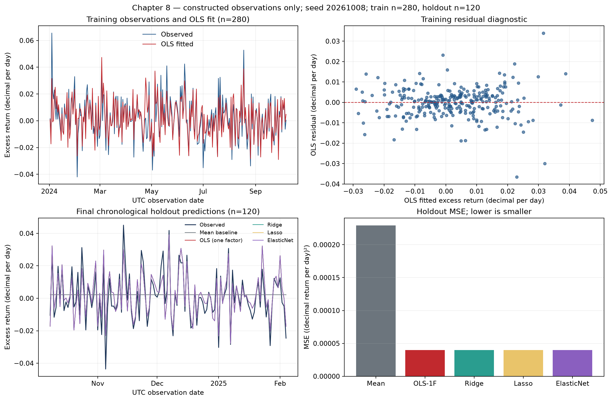

# Chapter 8 — Regression

**Thread: from market-risk exposure to predictions available in time**

> Thread: regression coefficients, statistical inference and out-of-sample prediction answer different questions. Verify each against its own assumptions and information times.
> Prerequisites: Chapter 5 on linear algebra and Chapter 7 on statistics. By the end, you can derive and fit ordinary least squares (OLS); interpret and test linear coefficients; diagnose heteroskedasticity, autocorrelation and collinearity; compare classical, HC3 (heteroskedasticity-consistent covariance of type 3) and HAC (heteroskedasticity and autocorrelation consistent) inference; and use Ridge, Lasso and Elastic Net in chronological cross-validation pipelines.

## 1. Learning objectives

Write responses and features as a linear model and determine when its normal equations have a unique solution. Calculate \(R^2\) and adjusted \(R^2\) from residual sums of squares; test individual or joint linear restrictions using \(t\) or \(F\) and interpret p-values correctly. Explain the effects of heteroskedasticity, autocorrelation and multicollinearity, choose covariance estimates for the stated error structure, and select preprocessing and penalized regression using only past observations.

Completion means following Section 9 to run `.venv/bin/python run_notebook.py notebooks/ch08_regression.ipynb` from the reader-package root, checking notebook outputs and figures in each new UUID execution directory. Historical course-root CLI and figure paths remain in Section 9. Explain why this contemporaneous simulated sample establishes neither causality, empirical CAPM validity nor tradable returns.

## 2. Why a quant needs regression

Regression serves three roles in research: describing conditional association, testing a pricing or risk hypothesis, and measuring prediction error on held-out observations. Their code may differ by only a `fit` or `predict` call, but their statistical meanings differ. Coefficients describe model-conditional slopes; standard errors and tests depend on error structure; out-of-sample error also requires that prediction inputs were available at the relevant time. “The regression is significant, so the strategy is profitable” skips economic interpretation, information availability, transaction costs and execution checks.

Start with a linear model relating asset excess returns to market excess returns. Use the same constructed data to study classical and robust standard errors, collinearity and regularization. This extends Chapter 7’s sampling inference and prepares for real French-factor analysis in Chapter 15 and Project 2. The capital asset pricing model (CAPM) connects regression to financial interpretation; empirical analysis with real observations belongs to those later chapters.

## 3. Intuition

Before fitting a line, establish what one row means in the financial example:

| Object | Meaning here | Units and timing |
|---|---|---|
| Observation unit | One paired market/asset observation; 400 simulated rows | One consecutive UTC calendar day per row; not a trade, a guarantee of independent sampling, or an actual trading day |
| Explanatory variable | Market excess return \(x_t\) | Daily decimal return: 0.01 means 1%; the same observation period \(t\) as the response |
| Response variable | Asset excess return \(y_t\) | Daily decimal return recorded contemporaneously with the feature |
| Timing | \(x_t\) and \(y_t\) are realized returns in period \(t\) | The market return is known only at period end. It cannot predict that period’s asset return at period start. Next-period prediction needs features already available at signal time to predict \(y_{t+1}\) |

Rows are time-ordered and errors may be correlated across them. A row is not automatically an independent draw. This construction defines no signal, execution or holding interval.

First isolate fitting with three hand-calculable observations \(x=(-1,0,1)^T,\;y=(1,2,4)^T\). Their units are arbitrary teaching units, not daily decimal returns or actual CAPM observations. Compare fitted values, vertical residuals \(e_i=y_i-\hat y_i\) and squared loss for three candidate lines:

| Candidate line | Fitted values \(\hat y\) | Residuals \(e=y-\hat y\) | Squared loss \(RSS=\sum_i e_i^2\) |
|---|---|---|---:|
| \(\hat y=2\) | \((2,2,2)\) | \((-1,0,2)\) | \(5\) |
| \(\hat y=2+x\) | \((1,2,3)\) | \((0,0,1)\) | \(1\) |
| \(\hat y=7/3+3x/2\) | \((5/6,7/3,23/6)\) | \((1/6,-1/3,1/6)\) | \(1/6\) |

The diagram compares these lines against the same three points. Dotted vertical segments show OLS residuals; the OLS line has the smallest squared loss on these observations.

\begin{center}
\begin{tikzpicture}[x=1.25cm,y=0.85cm]
  \draw[->] (-1.45,0) -- (1.55,0) node[right] {\(x\) (arbitrary teaching units)};
  \draw[->] (-1.35,0.25) -- (-1.35,4.55) node[above] {\(y\) (arbitrary teaching units)};
  \foreach \x/\y in {-1/1,0/2,1/4} {
    \fill (\x,\y) circle (2.2pt);
  }
  \draw[gray,dashed,thick] (-1.3,2) -- (1.3,2)
    node[pos=0.85,below] {\(\hat y=2\)};
  \draw[orange!80!black,dash dot,thick] (-1.3,0.7) -- (1.3,3.3)
    node[pos=0.15,below right] {\(\hat y=2+x\)};
  \draw[blue!70!black,very thick] (-1.3,0.3833) -- (1.3,4.2833)
    node[pos=0.74,below right] {OLS \(\hat y=7/3+3x/2\)};
  \foreach \x/\y/\yh in {-1/1/0.8333,0/2/2.3333,1/4/3.8333} {
    \draw[red,dotted,thick] (\x,\y) -- (\x,\yh);
  }
  \draw[gray] (-1,0.08) -- (-1,-0.08) node[below=2pt] {\(-1\)};
  \draw[gray] (0,0.08) -- (0,-0.08) node[below=2pt] {\(0\)};
  \draw[gray] (1,0.08) -- (1,-0.08) node[below=2pt] {\(1\)};
\end{tikzpicture}
\end{center}

Squaring prevents positive and negative residuals from cancelling and gives larger deviations more weight. Loss has squared \(y\) units. For an arbitrary line \(a+bx\), define\[
Q(a,b)=\sum_{i=1}^{3}(y_i-a-bx_i)^2.
\]Differentiate with respect to both scalar parameters and set the derivatives to zero:\[
\frac{\partial Q}{\partial a}=-2\sum_i(y_i-a-bx_i)=0,\qquad
\frac{\partial Q}{\partial b}=-2\sum_i x_i(y_i-a-bx_i)=0.
\]Here \(\sum_i x_i=0,\;\sum_i y_i=7,\;\sum_i x_i^2=2,\;\sum_i x_i y_i=3\), so the equations reduce to \(3a=7,\;2b=3\) and yield \(a=7/3,\;b=3/2\). Next express these scalar conditions using a design matrix, then generalize to normal equations with \(n\) rows and \(k\) columns.

Return to the financial setting: record market excess return \(x_t\) and asset excess return \(y_t\) for each constructed daily period. An upward-sloping scatter indicates that observations with higher market returns tend to have higher asset returns. The intercept \(\alpha\) is the model’s conditional mean at \(x=0\); slope \(\beta\) gives the fitted average change in \(y\) for a one-unit increase in \(x\). The vertical distance from a point to the line is its residual.

Three limits matter. A fitted association does not exclude omitted variables or reverse causality. Error variance and temporal dependence determine whether standard errors are appropriate. If \(x_t\) and \(y_t\) are contemporaneous returns, \(x_t\) is known only at period end and cannot predict \(y_t\) at its start. The code holds out the final 120 observations chronologically, but the variables remain contemporaneous. It demonstrates held-out conditional fitting error, not an executable forecast at period start.

## 4. Mathematical foundations

Let \(n\) be observation count, \(p\) feature count excluding the intercept, and \(k=p+1\) parameter count including it. Design matrix \(X\in \mathbb{R}^{n\times k}\) has an initial column of ones followed by feature columns. Response \(y\in \mathbb{R}^n\), coefficients \(\beta \in \mathbb{R}^k\) and errors \(\varepsilon \in \mathbb{R}^n\) satisfy

\[
y=X\beta+\varepsilon.
\]

In the financial example, \(y\) and the market feature are daily excess returns in decimal form; 0.01 represents a single-period return of 1%. The response is asset excess return and the feature market excess return. The slope is dimensionless; intercept and residuals have daily decimal-return units, as does \(y\). Changing to percentage points or another frequency changes parameter and error units.

The core algebraic condition is full column rank of \(X\): \(rank(X)=k\). No column can be expressed exactly by the others, and \(X'X\) is invertible. Statistical inference additionally needs error assumptions; prediction also needs inputs available at the prediction time.

## 5. Definitions

::: {.body-definition title="Definition and assumptions: OLS, exogeneity and exact inference"}

**Ordinary least squares (OLS)** chooses coefficients \(\hat{\beta}\) to minimize residual sum of squares:

\[
\hat\beta=\arg\min_b (y-Xb)'(y-Xb).
\]

A constant design column provides an intercept and permits a nonzero conditional intercept. Its presence alone does not guarantee uniqueness: the entire design must have full column rank. A constant feature or a column exactly determined by others destroys coefficient uniqueness. Omitting the intercept instead forces the fitted line through the origin.

Model \(y=X\beta +\varepsilon\) specifies the observation relation. Conditional exogeneity \(E[\varepsilon |X]=0\) gives conditional mean \(E[y|X]=X\beta\) and, with full column rank, unbiased OLS coefficients conditional on \(X\). **Gauss–Markov assumptions** additionally require constant conditional error variance and uncorrelated errors across observations; OLS then has minimum variance among linear unbiased estimators satisfying these conditions. **Normal errors** are unnecessary for calculating OLS or obtaining unbiasedness under exogeneity. With \(\varepsilon|X\sim N(0,\sigma^2 I_n)\) and the remaining model conditions, classical small-sample \(t/F\) distributions are exact.

:::

Each output answers a different question:

- **Coefficient estimate \(\hat\beta\)**: the conditional-relation parameters minimizing this sample’s residual sum of squares.
- **Standard error (SE)**: uncertainty in the coefficient estimate under the stated covariance estimator and error assumptions; not the standard deviation of observed returns.
- **\(t/F\) tests and p-values**: tests of prespecified individual or joint parameter restrictions. Reference distributions and exactness depend on error assumptions and covariance estimation.
- **\(R^2\)**: in-sample squared-deviation fit relative to the sample-mean benchmark for an intercept model; not causality, significance or future error.
- **Out-of-sample error**: prediction loss on held-out observations. It describes prospective prediction only when features were available at prediction time; it is not net trading return.

Fitted values are \(\hat y =X\hat{\beta}\) and residuals \(e=y-\hat y\). For an intercept model, the **coefficient of determination (\(R^2\))** is

\[
R^2=1-\frac{RSS}{TSS},\quad RSS=\sum_{t=1}^n e_t^2,\quad TSS=\sum_{t=1}^n(y_t-\bar y)^2.
\]

This ratio requires \(TSS>0\). A constant response has \(TSS=0\), leaving the ratio undefined even if coefficients can be fitted uniquely. It describes the fraction of in-sample total squared deviation explained by fitted values, not classification accuracy or causal validity. **Adjusted \(R^2\)** accounts for parameter count:

\[
\bar R^2=1-(1-R^2)\frac{n-1}{n-p-1}.
\]

This expression also requires \(n>k=p+1\). Here \(p\) excludes the intercept; the denominator’s degrees of freedom are \(n-p-1=n-k\). Unlike \(R^2\), adjusted \(R^2\) can fall when weak explanatory features are added.

**Heteroskedasticity** means \(Var(\varepsilon _t|X_t)\) varies with observations or features. **Autocorrelation** means errors at different times have \(Cov(\varepsilon _t,\varepsilon _s|X)\ne 0\). **Multicollinearity** means strong linear dependence among features. Heteroskedasticity and autocorrelation mainly invalidate classical covariance estimates; severe collinearity destabilizes coefficients, while perfect collinearity removes coefficient uniqueness.

## 6. Derivations

Define objective \(Q(b)=(y-Xb)'(y-Xb)\). Expanding gives

\[
Q(b)=y'y-2b'X'y+b'X'Xb.
\]

Differentiate with respect to vector \(b\), using the symmetry of \(X'X\):

\[
\nabla_bQ(b)=-2X'y+2X'Xb.
\]

Setting the gradient to zero gives the **normal equations** \(X'X\hat{\beta}=X'y\). Only full column rank of \(X\) permits the unique solution

\[
\hat\beta=(X'X)^{-1}X'y.
\]

Set \(P=X(X'X)^{-1}X'\), giving \(\hat y=Py\). Matrix \(P\) is symmetric and idempotent, hence the orthogonal projector onto the column space of \(X\). The normal equations equivalently give \(X'e=0\): residuals are perpendicular to every design column. With an intercept, orthogonality to the constant column makes residuals sum to zero.

Conditional exogeneity gives \(E[\hat{\beta}|X]=\beta\). If additionally \(Var(\varepsilon |X)=\sigma ^2I_n\), then

\[
\operatorname{Var}(\hat\beta\mid X)=\sigma^2(X'X)^{-1},\qquad
\widehat{\operatorname{Var}}(\hat\beta\mid X)=s^2(X'X)^{-1},\qquad
s^2=\frac{RSS}{n-k}.
\]

Require \(n>k\); otherwise \(RSS/(n-k)\) cannot estimate error variance using positive residual degrees of freedom. Calculating t/F statistics also needs the relevant standard error or \(s^2\) to be positive. For example, perfect fitting and an estimated zero standard error do not yield a generally testable case. Classical standard errors are square roots of covariance-diagonal entries. For individual-coefficient null \(H_0:\beta _j=\beta _{j,0}\), the classical \(t\) statistic is

\[
t_j=\frac{\hat\beta_j-\beta_{j,0}}{SE(\hat\beta_j)}.
\]

Under IID normal errors and the remaining classical model conditions, it has a \(t\) distribution with \(n-k\) degrees of freedom. Without normality, large-sample approximations are common, but the covariance estimator’s applicability must be stated.

The two-sided \(1-\gamma\) classical confidence interval is \(\hat{\beta}_j \pm  t_{1-\gamma /2,n-k} SE(\hat{\beta}_j)\). Its coverage is a repeated-sampling property, not a probability \(1-\gamma\) assigned to a fixed parameter after observing this interval. A p-value is the probability, under the null and test assumptions, of a statistic at least as extreme as observed.

For \(q\) linear restrictions \(H_0:R\beta =r\), the classical \(F\) statistic is

\[
F=\frac{(R\hat\beta-r)'[R(X'X)^{-1}R']^{-1}(R\hat\beta-r)/q}{s^2}.
\]

Here \(R\) is a \(q\times k\) restriction matrix and \(r\in \mathbb{R}^q\). Require \(1\le q\le k\) and \(\operatorname{rank}(R)=q\): restrictions are nonredundant. With full column rank of \(X\), matrix \(R(X^\top X)^{-1}R^\top\) is then positive definite and invertible. Calculating this statistic also requires \(n>k\) and \(s^2>0\). Exact classical F inference additionally needs a correctly specified linear model, conditional exogeneity, homoskedastic errors with \(\sigma^2>0\), and conditional normality. Under that classical normal model it has an \(F\) distribution with numerator degrees of freedom \(q\) and denominator degrees of freedom \(n-k\). For one slope restriction, classical \(F=t^2\). With robust covariance, joint hypotheses need the corresponding Wald/\(F\) test; the classical homoskedastic formula cannot simply be relabelled robust.

Heteroskedasticity-robust **HC3** covariance weights residuals by leverage \(h_{tt}\):

\[
\widehat V_{HC3}=(X'X)^{-1}\left[\sum_t x_tx_t'\frac{e_t^2}{(1-h_{tt})^2}\right](X'X)^{-1}.
\]

Here \(x_t'\) is row \(t\) of \(X\); every \(h_{tt}<1\) is an additional condition for directly calculating this HC3 formula. HC3 changes coefficient-covariance estimation, leaving OLS point estimates unchanged. It addresses unequal observation variances, not serial error correlation.

::: {.body-example title="Complete counterexample: unique fitting with undefined inference formulas"}

**Complete counterexample: full rank and positive residual degrees of freedom are insufficient.** Take three dimensionless teaching observations \(x=(0,0,1)^\top\) and \(y=(0,2,1)^\top\) with an intercept. Direct calculation gives\[
X=\begin{pmatrix}1&0\\1&0\\1&1\end{pmatrix},\quad
X^\top X=\begin{pmatrix}3&1\\1&1\end{pmatrix},\quad
(X^\top X)^{-1}=\begin{pmatrix}1/2&-1/2\\-1/2&3/2\end{pmatrix}.
\]The determinant is 2, hence \(\operatorname{rank}(X)=k=2\) and \(n-k=1>0\). Normal equations give \(\hat\beta=(1,0)^\top\), fitted values \((1,1,1)^\top\), residuals \(e=(-1,1,0)^\top\) and \(RSS=2\). Leverage is the diagonal of the hat matrix \(H=X(X^\top X)^{-1}X^\top\):\[
h_{11}=h_{22}=1/2,\qquad h_{33}=1.
\]Observation 3 is the only point with \(x=1\) and is fitted exactly, so \(e_3=0\). Its HC3 weight \(e_3^2/(1-h_{33})^2=0/0\) is undefined. Do not arbitrarily set it to zero or treat a finite floating-point result as valid. Full column rank guarantees coefficient uniqueness; positive residual degrees of freedom permits a classical residual-variance estimate. Neither ensures nonzero denominators for all HC3 leverage corrections.

The same design checks two other denominators. Replace the response by constant \(y=(1,1,1)^\top\): coefficients remain unique, but \(TSS=RSS=0\) and the chapter’s \(R^2\) definition becomes \(1-0/0\), which cannot be calculated. Repeating “slope equals zero” as two restrictions gives\[
R=\begin{pmatrix}0&1\\0&2\end{pmatrix},\qquad r=\begin{pmatrix}0\\0\end{pmatrix},\qquad
R(X^\top X)^{-1}R^\top=\begin{pmatrix}3/2&3\\3&6\end{pmatrix}.
\]Both rows express the same restriction: \(\operatorname{rank}(R)=1\) and the final matrix has determinant zero. Retain one nonredundant restriction and use \(q=1\). Using a pseudoinverse while keeping \(q=2\) does not create two independent pieces of information. This example identifies formula domains, not empirical financial observations or validated inference.

:::

**HAC** covariance estimates cross-period score dependence as well as heteroskedasticity. Bartlett weights are \(w_\ell =1-\ell /(L+1)\), where \(L\) is the maximum included lag. HAC standard errors depend on stationarity, weak dependence, moments, sample length, kernel and bandwidth, among other conditions. Increasing \(L\) is not automatically more robust: a short truncation can miss dependence, while a long one can add estimation noise.

To see what HAC estimates, let \(u_t=x_te_t\) be the residual-score vector of length \(k\). Define\[
S_\ell=\sum_{t=\ell+1}^{n}u_tu_{t-\ell}^\top,\qquad
\widehat S=S_0+\sum_{\ell=1}^{L}w_\ell(S_\ell+S_\ell^\top).
\]Here \(S_0\) sums same-period score outer products; \(S_\ell\) sums products separated by \(\ell\) periods, with the transpose ensuring symmetry. The sandwich form before small-sample correction is\[
\widehat V_{\mathrm{HAC}}=(X^\top X)^{-1}\widehat S(X^\top X)^{-1}.
\]The outer matrices map error-score covariance to parameter covariance; the middle retains cross-period joint variation. The implementation also uses the official API’s small-sample correction. Do not compare software output entry by entry against this uncorrected expression. HC3/HAC here report \(t_{n-k}\) reference-tail probabilities using `use_t=True`. This is an approximate convention for dependent, heteroskedastic observations, without classical normal-model finite-sample exactness. HAC consistency for an infinite-memory process also needs bandwidth to grow at an appropriate rate with sample size. Fixed \(L=5\) can omit material longer lags.

Regularization penalizes coefficient size to reduce high variance. With an unpenalized intercept, write

\[
\begin{aligned}
\text{Ridge: }&\min_{a,b}\frac{1}{2n}\|y-a\mathbf1-Xb\|_2^2+\lambda\|b\|_2^2,\\
\text{Lasso: }&\min_{a,b}\frac{1}{2n}\|y-a\mathbf1-Xb\|_2^2+\lambda\|b\|_1,\\
\text{Elastic Net: }&\min_{a,b}\frac{1}{2n}\|y-a\mathbf1-Xb\|_2^2+\lambda\left(\rho\|b\|_1+\frac{1-\rho}{2}\|b\|_2^2\right).
\end{aligned}
\]

\(\lambda \ge 0\) controls penalty strength and \(0<\rho <1\) mixes L1 and L2 penalties. Software scales losses and penalties differently; alpha values are not comparable without their objective conventions.

Changing feature units changes coefficients and their effective penalties. Standardize features with mixed scales. Put the scaler inside each time-series cross-validation pipeline so its mean and standard deviation are fitted only on that fold’s training rows. Choose penalties using validation folds inside the training window, then score the final holdout once after selection.

### 6.1 Why Ridge shrinks coefficients
Temporarily omit the intercept, or center features and response using training means to remove the unpenalized intercept. With loss \(1/(2n)\) and penalty \(\lambda\|b\|_2^2\),\[
-\frac1nX^\top(y-Xb)+2\lambda b=0,\qquad
\hat b_{\mathrm{Ridge}}=(X^\top X+2n\lambda I)^{-1}X^\top y.
\]\(I\) is the identity in \(p\) feature dimensions. For \(\lambda>0\), the eigenvalues are \(d_j^2+2n\lambda\), bounded below by \(2n\lambda\). Curvature rises in small-singular-value directions; stability still depends on \(\lambda\). For centered design decomposition \(X=UDV^\top\) with nonnegative singular values \(d_j\),\[
\hat b_{\mathrm{Ridge}}=
V\operatorname{diag}\!\left(\frac{d_j}{d_j^2+2n\lambda}\right)U^\top y.
\]Relative to OLS’s \(1/d_j\) in nonzero singular directions, each direction is multiplied by \(d_j^2/(d_j^2+2n\lambda)\), between 0 and 1. Smaller singular values receive more shrinkage. Added bias can reduce prediction variance but need not help every holdout window. scikit-learn Ridge uses a loss not divided by \(2n\), so its `alpha` corresponds to \(2n\lambda\) here. Lasso uses `alpha` \(=\lambda\); Elastic Net uses `alpha` \(=\lambda\) and `l1_ratio` \(=\rho\). Different objective scales prevent direct comparison of hyperparameter magnitudes.

Lasso’s absolute value is nondifferentiable at zero, so the smooth derivative above does not apply there. For a standardized one-dimensional feature \(x^\top x/n=1\), set \(z=x^\top y/n\). Removing terms independent of \(b\) leaves objective\[
\frac12(b-z)^2+\lambda|b|.
\]For \(b>0\) the derivative is \(b-z+\lambda\), whose candidate \(z-\lambda\) is feasible only if \(z>\lambda\). For \(b<0\) the derivative is \(b-z-\lambda\), whose candidate \(z+\lambda\) is feasible only if \(z<-\lambda\). At zero, the absolute-value subgradient is \([-1,1]\), so zero is optimal when \(|z|\le\lambda\). Combining the three cases gives soft thresholding:\[
\hat b=\operatorname{sign}(z)(|z|-\lambda)_+,\qquad (a)_+=\max(a,0).
\]A penalized zero coefficient does not prove zero economic effect. Lasso selections can change with the sample when features are highly correlated. Elastic Net’s L2 component can mitigate some instability, but still requires out-of-sample assessment and discussion of selection uncertainty. Chapter 39 develops penalized financial prediction pipelines.

## 7. Financial interpretation

The CAPM single-factor regression is

\[
R_{i,t}-R_{f,t}=\alpha_i+\beta_i(R_{m,t}-R_{f,t})+\varepsilon_{i,t},
\]

\(R_i\) is asset return, \(R_f\) risk-free return and \(R_m\) market return; excess returns use a common frequency. \(\beta _i\) describes linear exposure to market excess return, and \(\alpha _i\) the conditional intercept when market excess return is zero. CAPM’s economic theory comes from equilibrium assumptions. Historical regression estimates a particular sample, proxy and frequency; estimated \(\alpha\) alone establishes neither persistent abnormal return nor a causal premium.

The plotted construction sets true \(\alpha =0.0001\) per day and \(\beta =1.2\), while training estimates are \(0.00064027\) and \(1.124669\). Finite samples and correlated errors produce differences between estimates and generator parameters. These truths belong to the simulator, not real markets. Frequency, market proxy, asset universe, risk-free definition and sample period all affect economic interpretation.

Statistical significance does not establish trading value. Regression null \(H_0:\beta =0\) concerns a conditional linear relation, not net return, market impact, borrowing, capacity or execution quality. Risk attribution needs stability and intervals; prediction needs features available at the forecast time; trading additionally needs positions, orders, holding periods and costs.

## 8. Numerical Example

::: {.body-example title="Complete example: three-point OLS and fit statistics"}

Section 3 introduced these points through candidate-line calculations and scalar first-order conditions. Here matrix equations, centering and fit statistics cross-check them. Units remain arbitrary teaching units, not daily decimal returns or actual CAPM data. Take \(x=(-1,0,1)^T\) and \(y=(1,2,4)^T\) with intercept design \(X=[\mathbf1,x]\).

In matrix form, the same problem uses \(X=[\mathbf1,x]\), giving\[
X^\top X=\begin{pmatrix}3&0\\0&2\end{pmatrix},\qquad
X^\top y=\begin{pmatrix}7\\3\end{pmatrix},\qquad
X^\top X\hat\beta=X^\top y.
\]Full column rank makes the normal-equation solution unique: \(\hat\beta=(7/3,3/2)^\top\).

Centering provides an independent check of slope and intercept. Since \(\bar x =0\),

\[
\hat\beta_1=\frac{\sum_t(x_t-\bar x)(y_t-\bar y)}{\sum_t(x_t-\bar x)^2}
=\frac{-1+4}{2}=1.5,\qquad
\hat\beta_0=\bar y-\hat\beta_1\bar x=\frac73.
\]

Fitted values are \((5/6,7/3,23/6)\) and residuals \((1/6,-1/3,1/6)\). Thus \(RSS=1/6\), \(TSS=14/3\) and \(R^2=1-(1/6)/(14/3)=27/28\approx 0.964286\). With \(n=3,p=1\), adjusted \(R^2=1-(1-R^2)\times 2/1=13/14\approx 0.928571\). These arbitrary-unit observations check algebra only; they are not financial observations.

:::

The larger fixed-seed construction has 400 UTC calendar-day observations from 2024-01-02 through 2025-02-04: 280 for training and 120 held out. Generator parameters are \(\alpha =0.0001,\beta =1.2\); errors combine innovation scales depending on absolute market return with an AR(1) recursion at \(\phi =0.55\). One-factor training OLS gives \(R^2=0.776925\) and adjusted \(R^2=0.776123\). For a zero-slope null, standard errors are 0.036144 classical, 0.052391 HC3 and 0.055402 HAC(5), with two-sided p-values approximately \(1.474\times10^{-92}\), \(5.966\times10^{-61}\) and \(8.014\times10^{-57}\). Point estimates coincide; uncertainties and test results differ. These values describe constructed data and selected covariance conventions, not null-hypothesis probabilities or significant alpha in any real asset.

## 9. Python Implementation

### Default entry in the accepted reader package

From the reader-package root, create its isolated environment following the [README](../../../../editions/en/README.md), then run:

```bash
.venv/bin/python run_notebook.py notebooks/ch08_regression.ipynb
```

The notebook calls the packaged shared implementation. Its default route reads no omitted French data and downloads none. Each execution and its figures go to a unique UUID runs directory, whose actual location is printed. Old production tests and the historical commands below belong to the course working project; readers use the package-root notebook and its assertions. Optional historical data follows the reader’s [data contract](../../../../editions/en/OPTIONAL_DATA.md); those optional historical inputs are not run by default.

The reader package does not include the historical `code/ch08_regression.py`; use the included Notebook and `regression_tools` implementation as the default route.

### Historical course-root route

Implementation resides in [`regression_tools.py`](../../../../src/quant_course/regression_tools.py): time-index and feature validation, `fit_ols_with_robust_covariance`, fixed-seed generator `simulate_capm_like_data` and training-only model selector `select_regularized_models`. Features and response must have exactly aligned, unique, ascending, timezone-aware indexes. Inputs must be finite real numbers; missing values are neither dropped nor filled silently. Full rank is checked after adding the intercept, and HAC’s maximum lag must be below observation count. For HC3, the correction is undefined when leverage reaches one because its denominator vanishes. High leverage below one is not by itself a failure; input checks still do not certify valid inference. Input checks still do not certify valid inference. The teaching wrapper requires equal elapsed timestamp intervals, rejecting missing periods, irregular events and unequal month-length labels compressed into equally spaced rows. It explicitly rejects complex inputs. Empirical monthly, trading-day or event-time tasks need a declared observation clock and an appropriate implementation; do not fabricate zero returns to pass validation.

From the course-project root, run the full example and plotting route independently:

```bash
.venv/bin/python tools/run_a2.py --chapter 8
```

The following self-contained script runs from that project root and shows the API, training slice, covariance comparison and units:

```python
from pathlib import Path
import sys
import numpy as np

sys.path.insert(0, str(Path("src").resolve()))
from quant_course.regression_tools import (
    fit_ols_with_robust_covariance,
    simulate_capm_like_data,
)

data = simulate_capm_like_data(n=400, seed=20261008, alpha=0.0001, beta=1.2)
train = data.iloc[:280]
fit = fit_ols_with_robust_covariance(
    train[["market_excess"]], train["asset_excess"], hac_maxlags=5
)
for name, result in (("classical", fit.classical), ("HC3", fit.hc3), ("HAC(5)", fit.hac)):
    params = np.asarray(result.params)
    standard_errors = np.asarray(result.bse)
    print(name, "alpha/day", float(params[0]),
          "beta", float(params[1]),
          "beta_SE", float(standard_errors[1]))
```

The full script reports training estimates, classical/HC3/HAC tests, near-collinear coefficients, penalties selected only within training, and final holdout MSE, and creates the figure. Dependencies are pinned in the course’s local `.venv`; the corresponding standalone notebook is [`ch08_regression.ipynb`](../../../../notebooks/ch08_regression.ipynb). Simulation frequency is one constructed observation per UTC calendar day, not an exchange session. `market_excess_t` and `asset_excess_t` share the same row and period. The code defines no executable `signal_time`, `trade_time` or real holding interval.

## 10. Visualization



The script generated this four-panel figure. Upper left: UTC observation dates against daily decimal asset excess returns, comparing 280 training observations with OLS fits. Upper right: training residuals against fitted values. Lower left: 120 held-out observations and contemporaneous conditional fits from the mean, OLS, Ridge, Lasso and Elastic Net models. Lower right: their holdout mean squared errors, measured in squared daily decimal-return units. All panels use the same fixed-seed construction; dates are observation labels.

Classical, HC3 and HAC results share an OLS slope but different uncertainty. Near-duplicate features destabilize individual slope decompositions. Penalized-model MSEs are close to one-factor OLS here. The last panel measures numerical prediction error, omitting costs and trading outcomes. Because features and response are contemporaneous, its “holdout predictions” cannot be executed at the beginning of the same return interval.

## 11. Real Market Example

This chapter reports no real-market regression and does not call constructed data an empirical CAPM test. The course controller previously prepared a real French 10 Industry monthly-return cache; numerical empirical work belongs to Chapter 15 and Project 2, without redownload or re-estimation here. Sharpe’s original CAPM paper supplies equilibrium-theory background, not evidence for this simulation. Future use of real returns needs a download URL, snapshot date, sample interval, frequency, units, risk-free and market-proxy definitions, version, license boundary and SHA-256. Report cleaning and estimates separately from this construction.

## 12. Common Mistakes

**Omitting the intercept.** `statsmodels.OLS` does not add a constant automatically. Forcing the model through the origin changes the slope when the conditional mean permits an intercept. Incorrect call:

```python
import numpy as np
import statsmodels.api as sm
x = np.array([1., 2., 3.])
y = 1. + 2. * x
fit_without_intercept = sm.OLS(y, x, missing="raise").fit()
print("slope through origin", fit_without_intercept.params[0])
```

Correction:

```python
import numpy as np
import statsmodels.api as sm
x = np.array([1., 2., 3.])
y = 1. + 2. * x
design = sm.add_constant(x, has_constant="add")
fit_with_intercept = sm.OLS(y, design, missing="raise").fit()
print("intercept, slope", fit_with_intercept.params)
```

The chapter’s wrapper adds an intercept and rejects an already supplied constant feature.

::: {.body-pitfall title="Common mistake: robust standard errors do not repair a model"}

**Treating robust standard errors as model repair.** HC3/HAC change estimated coefficient uncertainty, without correcting omitted variables, wrong functional form, nonstationary trends or future-information leakage. HC3 does not automatically handle autocorrelation. Do not pick the standard error that makes results most significant after inspecting outputs. State assumptions, covariance type and finite-sample limitations from the data structure first.

:::

**Standardizing all data before splitting.** This leaks future means and scales into historical models. Chronological validation puts `StandardScaler` inside `Pipeline` and gives the entire pipeline to the searcher in each fold. scikit-learn’s documentation explains that preprocessing `fit` on test observations leaks data. [`SK_PITFALLS`](../../../../references.md)

```python
from sklearn.pipeline import Pipeline
from sklearn.preprocessing import StandardScaler
from sklearn.model_selection import TimeSeriesSplit, GridSearchCV
from sklearn.linear_model import Ridge
import numpy as np

X_train = np.arange(40., dtype=float).reshape(-1, 1)
y_train = 0.2 * X_train[:, 0] + np.sin(X_train[:, 0])

pipe = Pipeline([("scale", StandardScaler()), ("model", Ridge())])
cv = TimeSeriesSplit(n_splits=5, test_size=4, gap=1)
search = GridSearchCV(pipe, {"model__alpha": [1e-3, 1e-2, 1e-1]}, cv=cv,
                      scoring="neg_mean_squared_error")
search.fit(X_train, y_train)
print(search.best_params_, -search.best_score_)
```

**Randomly shuffling time series.** Ordinary random K-fold splits can train on later observations to predict earlier ones. `TimeSeriesSplit` preserves forward ordering. `gap=5` excludes five rows between training end and validation start; it does not automatically resolve arbitrary target overlap, revisions, suspensions or irregular indexes. The helper therefore requires equally spaced timestamps. Empirical finance additionally needs folds and purging rules based on the actual trading calendar.

**Calling a significant p-value or high \(R^2\) a strategy return.** A p-value is a null-model tail probability for a statistic at least as extreme, given the prespecified test conditions; it is not the probability the null is true. Similarly, \(R^2\) does not measure return after costs. Here \(y_t\) and \(x_t\) are contemporaneous, so these results establish no ability to predict \(y_t\) at period start.

## 13. Quant Research Application

An auditable workflow first specifies whether the question concerns contemporaneous systematic exposure, future-return prediction or a trading signal. Freeze the universe, return and factor definitions, timezone alignment, risk-free series, frequency and availability times. Audit missingness, anomalies, adjustments, delistings and revisions. Reserve training and final holdout intervals; do not select features, thresholds or penalties on the final holdout. For exposure, prespecify \(H_0:\beta =0\) and report coefficients, covariance estimator, intervals, residual diagnostics and coefficient stability.

The construction uses 280 training rows for OLS and chronological cross-validation. `TimeSeriesSplit(n_splits=5, test_size=30, gap=5)` produces five consecutive 30-row validation windows with expanding training sizes. The full training interval is 2024-01-02 through 2024-10-07 UTC; the final 120-row holdout spans 2024-10-08 through 2025-02-04 UTC. Ridge selects `alpha=0.01`, Lasso `alpha=0.00001` and Elastic Net `alpha=0.00001, l1_ratio=0.2` using training-internal validation only. Final holdout MSEs are 0.0002291795 for the mean benchmark, 0.0000400386 for one-factor OLS, 0.0000400437 for Ridge, 0.0000400481 for Lasso and 0.0000400414 for Elastic Net, all in squared daily decimal-return units. Under this generator and split, their linear conditional-fit errors are similar. This establishes neither risk-adjusted net return nor an out-of-sample causal effect.

For prospective prediction, inputs must exist when the forecast is issued. If \(x_t\) is a market return known only after the close and the target is that day’s asset return, contemporaneous feature \(x_t\) is unavailable at the open. Use information through the close of \(t\) to forecast a subsequent target such as \(y_{t+1}\), explicitly define \(signal\_time_t < trade\_time_{t+1}\) and the holding interval, and build labels using release times, execution delays and the trading calendar. The code performs no such shift, defines no trades and subtracts no costs; MSE cannot be interpreted as strategy performance.

With variance varying by scale, report HC3 and examine high-leverage observations. With serial dependence, HAC may be appropriate under stationarity, weak dependence and sufficient sample length; assess plausible lag bandwidths. For multi-entity panels, choose entity or two-way clustered covariance according to shared error shocks and ensure enough clusters. A large design condition number calls for checks of units, correlations and stability. Regularization can reduce prediction variance but changes the coefficient target; ordinary OLS \(t\) statistics generally cannot be assigned to coefficients selected by tuning.

Prespecify disconfirming outcomes: coefficient directions or magnitudes change materially across reasonable periods, proxies, frequencies or definitions; training-selection gains fail on the final holdout; the contemporaneous relation disappears under the available information set; error structure exceeds the chosen inference conditions; or realistic costs, capacity and borrowing make the strategy objective fail. Narrow or withdraw the claim when these occur, rather than switching significance conventions.

## 14. Chapter Summary

OLS minimizes residual sum of squares to estimate a linear conditional relation. Full column rank provides uniqueness; exogeneity supports unbiased interpretation. \(R^2\) describes in-sample fit, while standard errors and tests depend on error covariance. HC3 and HAC adjust uncertainty without repairing model specification or information timing. Ridge, Lasso and Elastic Net trade bias for variance; selection and preprocessing belong inside training-only chronological validation. Financial regression conclusions must state variable definitions, availability, sample interval, error structure and interpretation limits.

## 15. Exercises

**8-E01 (concepts).** List separate conditions for a unique OLS solution, conditional unbiasedness, and exact classical small-sample \(t\) / \(F\) inference. Which steps do not require normality?

**8-E02 (interpretation).** Interpret \(\alpha\) and \(\beta\) in a CAPM-style excess-return regression. If \(\hat{\alpha}>0\) and its classical p-value is below 0.05, list at least three conclusions that still do not follow.

**8-E03 (diagnosis).** Distinguish heteroskedasticity, autocorrelation and multicollinearity and explain their main effects on OLS point estimates, classical standard errors or coefficient stability.

**8-E04 (calculation).** An intercept model has \(n=100,p=4,R^2=0.20\). Calculate adjusted \(R^2\) and explain how adding one feature affects \(R^2\) and adjusted \(R^2\).

**8-E05 (tests).** State nulls for a single slope and a joint zero test of three market factors. In the classical single-restriction case, how do \(F\) and \(t\) relate? Interpret the p-value.

**8-E06 (methods).** Daily-return residuals vary in scale with fitted values and show persistence. What do classical, HC3 and HAC estimators address? Is HAC lag 5 automatically optimal?

**8-E07 (time validation).** What does `gap` exclude in `TimeSeriesSplit(gap=5)`? Does it guarantee leakage-free financial labels? State feature/target availability constraints and explain the purpose of panel-clustered standard errors.

**8-T01 (identify objects).** Each of the 400 simulated rows contains `market_excess_t` and `asset_excess_t` for the same UTC calendar day. Identify observation unit, feature, response and units. Why does this pairing not represent a forecast before the open?

**8-T02 (one calculation).** Given \(\hat\beta=1.124669\) and HAC(5) standard error \(SE=0.055402\), calculate the observed \(t\) statistic for \(H_0:\beta=0\).

**8-T03 (complete calculation).** For \(x=(-1,0,1)^T\) and \(y=(1,2,4)^T\), list fitted values, residuals and RSS point by point for \(\hat y=2\), \(\hat y=2+x\) and OLS. Then calculate \(TSS\), \(R^2\) and adjusted \(R^2\) using the OLS line.

**8-T04 (code diagnosis).** Inspect Section 12’s incorrect `sm.OLS(y, x, missing="raise")` call. With \(y=1+2x\), what does it estimate? How do you fit an intercept, and why does the slope change?

**8-T05 (research judgment).** A 400-row contemporaneous simulated sample gives high \(R^2\) and a significant HAC(5) slope. State two supported and three unsupported conclusions. What timing, validation and trading elements must be fixed before investigating next-period prediction?

**8-B01 (formula-domain diagnosis).** For Section 6’s intercept construction \(x=(0,0,1)^\top\) and \(y=(0,2,1)^\top\), calculate the determinant of \(X^\top X\), OLS coefficients, residuals and all three leverage values. Why do \(n>k\) and full column rank still fail to ensure calculable HC3? How does \(R^2\) become undefined with a constant response? For two copies of the same slope restriction, what happens to the joint-F inverse matrix and \(q\)?

## 16. Programming Exercises

**8-P01 (hand calculation and code).** Build an intercept regression for \(x=(-1,0,1)^T\) and \(y=(1,2,4)^T\) in NumPy. Solve normal equations and cross-check using statsmodels; assert agreement of coefficients, RSS, \(R^2\) and Section 8’s hand calculations.

**8-P02 (inference).** Use the first 280 rows from simulate_capm_like_data(n=400, seed=20261008). Fit OLS with classical, HC3 and HAC(5) covariance; report intercept/slope, standard errors and p-values for \(H_0:\beta =0\). Assert that all point estimates coincide; do not label generator truths as estimated results.

**8-P03 (chronological regularization).** Build a `StandardScaler` + Ridge pipeline from near-duplicate market features in the first 280 rows. Use `TimeSeriesSplit(n_splits=5, test_size=30, gap=5)` and training-internal grid selection of `alpha`. Check training/validation ordering, five-row gaps and training-fold-only scaler fitting. Score the final 120 rows only after selection, without selecting again from that score.

## 17. Challenge Problems

**8-C01 (collinearity counterexample).** Construct highly correlated features, one nearly copying the other. Compare one- and two-feature OLS coefficients, fits and condition numbers, then Ridge. Explain why large coefficient changes establish neither changed economic effects nor causality. State acceptable reporting limits.

**8-C02 (research design).** Write a pre-analysis validation plan for “Can a market factor predict next-period asset excess returns?” Cover timestamps/shift, training and holdout, lagged targets, error structure, HAC bandwidth sensitivity, model selection, residuals, benchmarks, execution and disconfirmation. Explain why contemporaneous construction and HAC lag 5 do not answer the question. Score timing, inference assumptions, leakage control, trading feasibility and falsifiability from 0 to 2 each, total 10.

## 18. Solutions / Solution Hints

**8-E01 solution.** Full column rank makes \(X'X\) invertible and OLS unique. Conditional exogeneity \(E[\varepsilon |X]=0\) supports unbiasedness conditional on \(X\). Classical covariance additionally needs homoskedastic, cross-row-uncorrelated errors; conditional normality makes finite-sample \(t\) / \(F\) distributions exact. Calculating OLS and obtaining unbiasedness under exogeneity do not need normality. Without it, asymptotic inference may be available under suitable large-sample and error conditions.

**8-E02 solution.** \(\alpha\) is the conditional intercept at zero benchmark return and \(\beta\) conditional linear market exposure. A positive intercept and small classical p-value alone establish neither correct specification, freedom from heteroskedasticity/autocorrelation/multiple-testing effects, future positive performance, causal risk premium nor profitability after costs. Examine error assumptions, sample selection, proxies, stability, versions and execution.

**8-E03 solution.** Heteroskedasticity changes error variance, not necessarily its conditional mean. Exogeneity can preserve unbiased OLS while classical homoskedastic standard errors fail. Autocorrelation likewise may preserve unbiasedness under exogeneity while invalidating classical covariance. Multicollinearity makes \(X'X\) ill-conditioned, inflates individual-slope uncertainty and creates sensitivity to samples or specification. Perfect collinearity removes full rank and unique coefficients.

**8-E04 solution.** \(n-p-1=95\), giving\[
\bar R^2=1-(1-0.20)\frac{99}{95}=1-\frac{79.2}{95}\approx0.166316.
\]For intercept OLS on the same observations, \(R^2\) cannot decrease when columns are added. Adjusted \(R^2\) penalizes lost degrees of freedom and falls if fit improvement is insufficient. Missingness, sample changes or different fitting procedures invalidate this monotonicity comparison.

**8-E05 solution.** The individual null is \(H_0:\beta _m=0\); three-factor null \(H_0:\beta _1=\beta _2=\beta _3=0\) can be written \(R\beta =0\). One linear restriction in the classical model gives \(F=t^2\). Its p-value is the null-model tail probability of a statistic at least as extreme under test assumptions, not the probability the null is true.

**8-E06 solution.** Classical covariance needs homoskedasticity and no cross-period error correlation. HC3 handles heteroskedasticity but still needs independence or suitable cross-observation conditions. HAC includes cross-period score correlation under heteroskedasticity, requiring sufficient sample length, stationarity/weak dependence and appropriate bandwidth. A fixed truncation cannot capture arbitrarily long dependence. Script setting \(L=5\) is reproducible teaching input, not automatically optimal; justify frequency/bandwidth and check sensitivity.

**8-E07 solution.** `gap=5` leaves five rows between training end and validation start in every fold. It does not guarantee appropriate label intervals, releases, holding periods, timezones or transformations; design windows for target horizon and feature availability. Features must be available by signal time, signals precede execution, and target returns follow execution. Panel-clustered covariance addresses error dependence within entities or time clusters; justify clusters and account for limited cluster counts.

**8-P01 reference implementation.** Run from the course-project root. Normal equations, statsmodels and assertions cross-check results:

```python
import numpy as np
import statsmodels.api as sm
x = np.array([-1., 0., 1.]); y = np.array([1., 2., 4.])
X = np.column_stack([np.ones(3), x])
b = np.linalg.solve(X.T @ X, X.T @ y)
fit = sm.OLS(y, X, hasconst=True, missing="raise").fit()
assert np.allclose(b, [7/3, 1.5])
assert np.isclose(np.sum((y-X@b)**2), 1/6)
assert np.isclose(fit.rsquared, 27/28)
assert np.isclose(fit.rsquared_adj, 13/14)
print(b, fit.rsquared, fit.rsquared_adj)
```

**8-P02 reference implementation.**

```python
from pathlib import Path
import sys
import numpy as np
sys.path.insert(0, str(Path("src").resolve()))
from quant_course.regression_tools import fit_ols_with_robust_covariance, simulate_capm_like_data

data = simulate_capm_like_data(n=400, seed=20261008, alpha=.0001, beta=1.2)
train = data.iloc[:280]
fit = fit_ols_with_robust_covariance(
    train[["market_excess"]], train["asset_excess"], hac_maxlags=5
)
for label, result in (("classical", fit.classical), ("HC3", fit.hc3), ("HAC5", fit.hac)):
    params = np.asarray(result.params)
    standard_errors = np.asarray(result.bse)
    p_values = np.asarray(result.pvalues)
    print(label, "alpha", params[0], "beta", params[1],
          "beta_SE", standard_errors[1], "beta_p", p_values[1])
assert np.allclose(np.asarray(fit.classical.params), np.asarray(fit.hc3.params))
assert np.allclose(np.asarray(fit.classical.params), np.asarray(fit.hac.params))
```

Training OLS gives \(\hat{\alpha}=0.00064027\) and \(\hat{\beta}=1.124669\). Slope standard errors are 0.036144 classical, 0.052391 HC3 and 0.055402 HAC(5), giving \(t\) statistics 31.116, 21.467 and 20.300. Significance does not remove the construction’s violations of classical error assumptions.

**8-P03 reference implementation.**

```python
from pathlib import Path
import sys
sys.path.insert(0, str(Path("src").resolve()))
from quant_course.regression_tools import select_regularized_models, simulate_capm_like_data

data = simulate_capm_like_data(n=400, seed=20261008)
train, holdout = data.iloc[:280], data.iloc[280:]
features = ["market_excess", "market_near_duplicate"]
selected = select_regularized_models(train[features], train["asset_excess"],
                                     n_splits=5, gap=5, test_size=30)
for name, choice in selected.items():
    assert choice.training_end == train.index[-1]
    assert all(fold.train_end < fold.validation_start for fold in choice.folds)
    assert all(fold.gap_n == 5 for fold in choice.folds)
    assert all(fold.validation_end <= train.index[-1] for fold in choice.folds)
    print(name, choice.best_params, choice.best_cv_mse,
          "holdout MSE computed after selection only")
    # score only after selection; do not feed this score back to the search
    pred = choice.estimator.predict(holdout[features])
    print(float(((holdout["asset_excess"].to_numpy() - pred) ** 2).mean()))
```

A five-row gap counts observations, not a universal embargo duration. The implementation places `StandardScaler` inside each pipeline; cross-validation `fit` uses only that fold’s training rows. The selected pipeline is refitted on all 280 training rows. The final 120 do not enter model or hyperparameter selection.

**8-C01 reference reasoning and scoring.** Simulate near-duplicate features \(x_2=x_1+\eta\) with small noise \(\eta\). A single-feature model attributes shared variation to \(x_1\); a two-feature model tries to divide almost the same signal, so coefficients can offset with large positive and negative values while fits barely change and conditioning deteriorates. L2 shrinkage usually stabilizes predictions but changes the coefficient target; it does not identify causality. The fixed-seed one-factor condition number is 84.008; near-duplicate two-feature design 135724.250, with slopes approximately \((-2.83396,3.95871)\). Report the construction, dependence and instability, plus specification/prediction sensitivity; do not call coefficient changes economic effects. Ten points: construction/rank 2, coefficients versus fits 2, Ridge bias/stability 2, causal limits 2, sample/units 2.

**8-C02 reference plan and scoring.** Define timezone and release times and generate signals only after market information exists. Align \(x_t\) with future target \(y_{t+1}\), specifying signal, execution and return intervals. Contemporaneous \(x_t,y_t\) is not a tradable forecast. Freeze chronological training, validation and final holdout; scalers, missing-value handling and selection stay inside training folds. Set gap/purge by label spans, tune penalties inside training and use holdout once. State classical homoskedastic/no-autocorrelation assumptions. Use HC3 for heteroskedasticity and theoretically motivated HAC lag choices for weakly dependent sequences, with sensitivity checks. Examine residuals, breaks and collinearity. Compare MSE/prediction loss with mean or simple-factor benchmarks. A trading extension also needs positions, turnover, fees, slippage, borrowing, capacity and execution. Prespecify failure to replicate across periods, failure after costs, unavailable inputs or sensitivity to reasonable lags/splits as disconfirming results. Score the five dimensions 0–2 each. This construction lacks trading times and future targets, checking regression/inference implementation and a teaching pipeline only. \(L=5\) is fixed teaching input, not a universal optimum or substitute for error diagnostics.

**8-T01 solution.** A row is a paired record for one simulated UTC calendar day, not guaranteed independent or a trade. `market_excess_t` is the explanatory variable and `asset_excess_t` the response, both daily excess returns in decimals; 0.01 means 1%. They are realized in the same period. Market return is known at period end, so that day’s `market_excess_t` cannot predict asset return at the open. A prospective design aligns available inputs with a future target such as \(y_{t+1}\).

**8-T02 solution.** \(t=(1.124669-0)/0.055402\approx20.300\). This is the statistic under HAC(5) covariance; a p-value additionally needs the reference distribution and degrees of freedom. It is not an exact classical finite-sample test for dependent heteroskedastic observations.

**8-T03 solution.** For \(\hat y=2\), fits \((2,2,2)\) and residuals \((-1,0,2)\) give \(RSS=1+0+4=5\). For \(\hat y=2+x\), fits \((1,2,3)\) and residuals \((0,0,1)\) give \(RSS=1\). OLS coefficients \(\hat\beta_0=7/3\) and \(\hat\beta_1=3/2\) produce fits \((5/6,7/3,23/6)\) and residuals \((1/6,-1/3,1/6)\), hence \(RSS=(1+4+1)/36=1/6\). Response mean \(7/3\) gives \(TSS=(-4/3)^2+(-1/3)^2+(5/3)^2=14/3\), so \(R^2=1-(1/6)/(14/3)=27/28\approx0.964286\). With \(n=3,p=1\), adjusted \(R^2=1-(1-R^2)\frac{n-1}{n-p-1}=1-(1/28)\frac{2}{1}=13/14\approx0.928571\).

**8-T04 solution.** `sm.OLS(y, x, ...)` adds no constant and estimates a constrained through-origin slope. Section 12 uses \(x=(1,2,3)\) and \(y=(3,5,7)\), giving \(\hat b=\sum x_i y_i/\sum x_i^2=34/14=17/7\approx2.429\). With an intercept, estimates are 1 and 2. Build a two-column design using `sm.add_constant(x, has_constant="add")`, then fit it. The origin constraint forces the slope to absorb the intercept; this difference is not caused by standard errors or the optimizer.

**8-T05 solution.** Supported conclusions: under this constructed sample’s contemporaneous pairing, linear fitting explains part of in-sample variation; using HAC(5) covariance, the sample slope is far from zero. Neither establishes that market return causes asset return, sustainable CAPM alpha, prediction of same- or next-period returns at period start, or profitability after costs. A prospective study needs availability times, signal/execution/holding intervals, target alignment, chronological training/validation/holdout, within-training-fold scaling/tuning, gap/purge for label overlap, covariance and bandwidth sensitivity, benchmarks/costs and prespecified disconfirmation.

**8-B01 solution.** \(X^\top X=\left(\begin{smallmatrix}3&1\\1&1\end{smallmatrix}\right)\) has determinant 2 and inverse \(\left(\begin{smallmatrix}1/2&-1/2\\-1/2&3/2\end{smallmatrix}\right)\). With \(X^\top y=(3,1)^\top\), coefficients are \((1,0)^\top\), fits \((1,1,1)^\top\) and residuals \((-1,1,0)^\top\), giving \(RSS=2\) and \(n-k=1\). Rowwise \(h_{tt}=x_t^\top(X^\top X)^{-1}x_t\) yields \((1/2,1/2,1)\); the third HC3 weight is \(0/0\). Floating-point rounding does not theoretically repair this undefined term. A constant response gives \(TSS=RSS=0\), so \(R^2\) is undefined here; a software convention does not change that definition. Duplicate restriction matrix \(R=\left(\begin{smallmatrix}0&1\\0&2\end{smallmatrix}\right)\) has rank 1; \(R(X^\top X)^{-1}R^\top=\left(\begin{smallmatrix}3/2&3\\3&6\end{smallmatrix}\right)\) has determinant zero and no inverse. Remove one duplicate row and test a single slope with \(q=1\). Even when all denominator conditions hold, exact classical F/t inference needs a correctly specified linear model, conditional exogeneity, positive homoskedastic variance and conditional normal errors. HC3/HAC have their own inference conditions; input validation is not an inference certificate.

## 19. Further Reading

- **Must Know**: statsmodels’ official linear-regression documentation, especially the OLS intercept, classical covariance and result attributes; scikit-learn’s `TimeSeriesSplit` and leakage guidance for folds, `gap` and training-only preprocessing.
- **Should Know**: White (1980) on heteroskedasticity-consistent covariance; MacKinnon and White (1985) on finite-sample HC comparisons; Newey and West (1987) on HAC. They explain estimator construction, without certifying a particular sample’s dependence or finite-sample inference.
- **Advanced**: Hoerl and Kennard (1970) on Ridge; Tibshirani (1996) on Lasso; Zou and Hastie (2005) on Elastic Net. Compare penalties, selection stability, coefficient bias and tuning uncertainty.
- **Optional / later empirical work**: Sharpe (1964) on CAPM equilibrium theory; Chapter 15 and Project 2 use real French data. Theory does not empirically validate this construction.

## 20. References

Course source keys and limits appear in [`references.md`](../../../../references.md): `STATSMODELS` supports regression API use, `SK_PITFALLS` training-only preprocessing and `SK_TSS` chronological splitting and `gap`. API references are [statsmodels OLS](https://www.statsmodels.org/stable/generated/statsmodels.regression.linear_model.OLS.html), [robust covariance](https://www.statsmodels.org/stable/generated/statsmodels.regression.linear_model.OLSResults.get_robustcov_results.html) and [OLS results](https://www.statsmodels.org/stable/generated/statsmodels.regression.linear_model.OLSResults.html). See [TimeSeriesSplit](https://scikit-learn.org/stable/modules/generated/sklearn.model_selection.TimeSeriesSplit.html) and [data-leakage pitfalls](https://scikit-learn.org/stable/common_pitfalls.html) for chronological tuning.

Method background: White, H. (1980), “A Heteroskedasticity-Consistent Covariance Matrix Estimator and a Direct Test for Heteroskedasticity,” *Econometrica*, 48(4), 817–838, [JSTOR/DOI](https://doi.org/10.2307/1912934); MacKinnon, J. G. and H. White (1985), “Some Heteroskedasticity-Consistent Covariance Matrix Estimators with Improved Finite Sample Properties,” *Journal of Econometrics*, 29(3), 305–325, [DOI](https://doi.org/10.1016/0304-4076(85)90158-7); Newey, W. K. and K. D. West (1987), “A Simple, Positive Semi-definite, Heteroskedasticity and Autocorrelation Consistent Covariance Matrix,” *Econometrica*, 55(3), 703–708, [NBER working-paper record](https://www.nber.org/papers/t0055). Original regularization methods: Hoerl, A. E. and R. W. Kennard (1970), “Ridge Regression: Biased Estimation for Nonorthogonal Problems,” [DOI](https://doi.org/10.1080/00401706.1970.10488634); Tibshirani, R. (1996), “Regression Shrinkage and Selection Via the Lasso,” [DOI](https://doi.org/10.1111/j.2517-6161.1996.tb02080.x); Zou, H. and T. Hastie (2005), “Regularization and Variable Selection via the Elastic Net,” *Journal of the Royal Statistical Society: Series B*, 67(2), 301–320, [DOI](https://doi.org/10.1111/j.1467-9868.2005.00503.x). CAPM theory: Sharpe, W. F. (1964), “Capital Asset Prices: A Theory of Market Equilibrium under Conditions of Risk,” *The Journal of Finance*, 19(3), 425–442, [DOI](https://doi.org/10.1111/j.1540-6261.1964.tb02865.x).