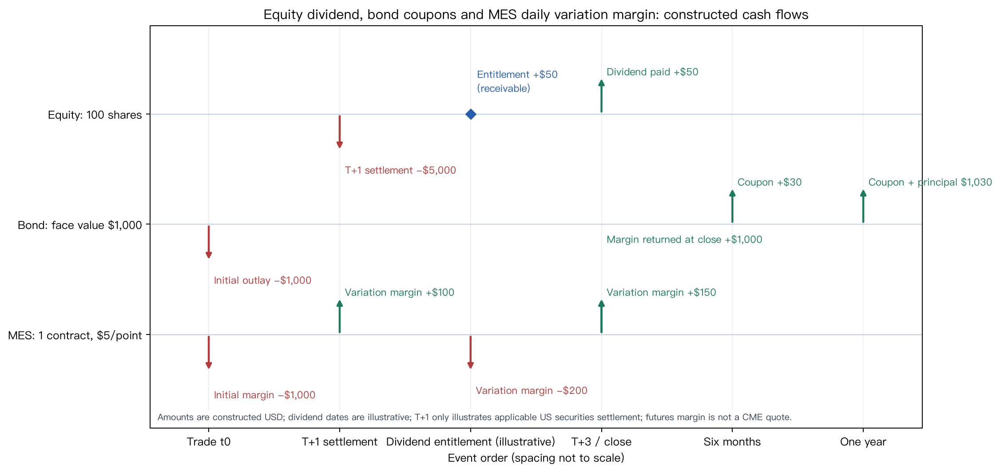

# Chapter 10 — Financial Markets

> Thread: a trade moves through quotation, execution, clearing and settlement. Its economic return, rights, obligations and cash-flow dates depend on the instrument and contract. Prerequisite: timestamps and the data lifecycle in Chapter 1. By the end, you can trace who owes what in an equity, bond, FX or derivative trade, when assets move, and how notional exposure, margin and actual profit differ.

## 1. Learning objectives

Describe stocks, exchange-traded funds, bonds, FX, futures, options, swaps and repurchase agreements as checkable rights and obligations. Distinguish brokers, dealers, exchanges, central counterparties and custody/settlement institutions; arrange events by trade, clearing and settlement dates. With explicit units, calculate dividend-inclusive return, coupons, net swap payments, currency conversion, futures variation settlement, option profit at expiry and repo haircuts. Explain why short sales and margin arrangements can cause losses exceeding initial collateral.

This chapter establishes instrument terminology and cash-flow ledgers. Full bond valuation, option-pricing models and order-book execution are developed later, along with return construction, market microstructure and costs, stress risk and derivative pricing.

## 2. Why a quant needs market instruments

A numerical column often captures only one aspect of a contract. Equity price changes omit some dividends; fund-share prices differ from net asset value; futures index points become monetary profit only after applying a multiplier. An FX quote of “1.10” is uninterpretable without its direction, and trade dates can differ from cash-settlement dates.

These distinctions determine return denominators, information availability, loss settlement and the date assigned in a backtest. Treating futures notional exposure as invested principal gives the wrong return. Treating margin as maximum loss understates cash shortfalls before liquidation. Collapsing reporting endpoints, executions and settlement dates into one time makes a tidy ledger that may violate the contract.

Ask four questions first: what is traded, how is it quoted, what have the parties promised, and when do cash or securities transfer? Use them throughout the instruments below.

## 3. Intuition

Begin with three teaching ledgers, all constructed rather than historical. An investor buys 100 shares at USD 50 each; price later becomes USD 50.20 and the holder becomes entitled to USD 0.50 per share in dividends. A USD 1,000 fixed-coupon bond pays 6% annually in semiannual installments. For CME Micro E-mini S&P 500 futures (MES), the contract multiplier is USD 5 per index point.

::: {.body-example title="Complete example: equity entitlement and cash events"}

Write the equity trade as an event table. Dates, prices and dividend arrangements are constructed. Record an established receivable separately from cash receipt, while marking securities at the price then prevailing.

| Event | Rights and obligations | Quantity and amount | Cash change, investor’s perspective |
|---|---|---|---|
| Trade T | Investor buys through a broker; counterparties acquire delivery obligations | 100 shares × USD 50/share = USD 5,000 | Not yet settled; cash is not automatically debited |
| Clearing | Determine deliveries; netting or a central counterparty (CCP) depends on applicable rules | 100 shares against USD 5,000 | Calculating obligations is separate from paying cash |
| Settlement | Investor pays and receives settled securities | 100 shares delivered against USD 5,000 | −USD 5,000 |
| Dividend entitlement | Under the example, the holder acquires a claim against the issuer | 100 shares × USD 0.50/share = USD 50 | 0; dividend receivable increases by USD 50 |
| Dividend payment | Issuer pays through payment/custody arrangements | USD 50 | +USD 50; receivable decreases by USD 50 |
| Terminal valuation | Investor still holds 100 shares priced at USD 50.20/share | Securities worth USD 5,020 | Valuation itself transfers no cash |

Terminal wealth is USD 5,020 in securities plus USD 50 dividend cash, totaling USD 5,070. If payment remains outstanding but the entitlement is valid, cash has not increased; wealth includes the USD 50 receivable instead. Do not count both receivable and paid dividend. This simplified table omits borrowing, taxes, fees and cash interest. Check actual delivery obligations against trade confirmations and product rules. Chapter 11 constructs return intervals from these endpoint values; Chapter 29 adds execution and fee ledgers.

:::

Equity holding-period wealth includes terminal security value and entitled dividends. Bondholders receive contractual interest and usually principal at maturity. Futures settle price changes through contract multipliers rather than requiring full cash purchase of an index basket, while demanding performance collateral. Each may respond to “a rising market,” yet their cash flows differ.

Think of a contract as a promise with explicit units and dates. Units resemble quantities in a recipe; dates resemble an agreed collection time. Without either, a number has no operational meaning. The analogy is only a memory aid: actual rights come from product documents, applicable law and trading rules.

## 4. Mathematical foundations

State a currency for every amount: USD for dollars and EUR for euros. Prices per share use USD/share; futures multipliers use USD/index point with contract count specified. Multiplication by share or contract quantity produces USD. Returns are dimensionless ratios, usually stored as decimals: 5% is 0.05.

Let $t_0$ denote execution or the beginning of a holding interval and $t_1$ its endpoint. Signal time identifies when the strategy forms a signal from available information; trade time identifies when the order can actually execute. A return interval has explicit start and end. Execution $t_0$ is not automatically settlement or information availability. A backtest requires information available before signal formation and explicit execution delay. These constructed ledgers illustrate contract cash flows, not matching-engine behavior.

“One contract” is not a universal unit. Products specify size, currency, quote precision, maturity and delivery method. Define $N$, $M$, $S$ and $K$ where used: the units of quantity $N$ and multiplier $M$, quote direction of price $S$, and currency and underlying unit of strike $K$.

## 5. Definitions

**Stock/equity** represents a company’s residual ownership claim. Shareholders may receive cash dividends and voting rights, but dividends are not guaranteed fixed interest and equity usually ranks after creditors in liquidation. Ordinary-share rights, voting, distributions and corporate actions depend on issue documents and applicable law.

An **exchange-traded fund (ETF)** holds an asset basket or follows another documented fund strategy, with shares traded on a venue. Retail investors typically trade at intraday market prices. **Net asset value (NAV)** follows the fund’s valuation rules; market price may trade at a discount or premium to NAV. An ETF share does not grant every investor on-demand redemption of each underlying asset. This introductory treatment follows US Investor.gov education; individual product terms differ.

A **bond** is a debt instrument promising contractual interest, principal repayment at maturity or another specified payment structure. Face value $F$ is monetary, coupon rate $c$ is annualized, and payment frequency $m$ is payments/year. For a plain fixed coupon, each payment is $Fc/m$. Credit, seniority, collateral, early redemption and payment structure may change actual cash flows.

**Foreign exchange (FX)** exchanges one currency for another. Here $S_{Q/B}$ means units of quote currency $Q$ for one unit of base currency $B$. With $S_{USD/EUR}=1.10$, 1 EUR is quoted at 1.10 USD. EUR 10,000 converts to USD 11,000 at that midpoint, before spreads, fees or settlement arrangements.

A **futures contract** is a derivative traded on a standardized venue and settled daily or at the specified frequency under its rules. The **contract multiplier** converts underlying quote movements into contract monetary profit. CME MES pays USD 5 per contract per index point; E-mini S&P 500 futures (ES) pays USD 50. A multiplier sets the profit scale, rather than contract value or margin itself. Positive signed quantity is long; negative is short, describing price exposure rather than ownership of index constituents. Periodic cash adjustment following futures-price changes is **variation margin**; contract rules govern its settlement.

An **option** gives its buyer a contractual exercise-or-abandon right and imposes the corresponding obligation on its seller. Strike price is $K$. Premium paid or received is an opening cash flow. A call’s expiry **payoff** is \(\max(S_T-K,0)\); a put’s is \(\max(K-S_T,0)\). \(S_T,K\) share the same underlying unit and quote currency. Exercise style, maturity and settlement assets depend on the contract.

A **swap** exchanges a contractual set of future cash flows. Interest-rate swaps use a notional amount to calculate interest without necessarily exchanging that principal: one side may pay fixed and receive floating, with contractual net settlement. Directions, floating benchmarks, reset dates and payment netting are specified. Central or bilateral clearing arrangements differ; the word “swap” alone determines no collateral rule.

A **repurchase agreement (repo)** sells securities with an agreement to repurchase them, economically often providing secured financing. A **haircut** is the proportion of collateral market value not financed. Contracts and market conventions determine actual haircuts, valuation frequency, margin calls and default disposal.

::: {.body-definition title="Definition: distinct trading, clearing and settlement responsibilities"}

A **broker** generally acts for customer orders or arranges trades. A **dealer** trades on its own account and bears inventory risk. A **market maker** supplies two-way quotations continuously or under specified arrangements. One institution may perform several roles; legal duties depend on jurisdiction and activity. An **exchange** organizes listings, quotes or matching. **Clearing** confirms obligations, nets them, manages risk or substitutes a central counterparty (CCP) for the original trading relationship. **Settlement** transfers securities, cash or other contractual assets. These are related stages with distinct meanings.

:::

**Margin** consists of cash or securities required for performance or financing. A **securities margin loan** is broker financing secured by account assets. Futures margin resembles a **performance bond**, rather than a down payment on full notional exposure. **Initial margin** is required to open a position; **maintenance margin** is the minimum supporting continued holding. Rules and risk conditions can change amounts. **Collateral** supports performance or credit exposure, can change value and may require top-ups. Initial margin neither prepays a maximum loss nor limits losses; losses can exceed the original collateral.

## 6. Derivations

Hold $N$ shares at beginning price $P_0$ and ending price $P_1$, with entitled cash dividend $D$ per share. All prices and dividends use USD/share. Initial investment is $NP_0$ USD, terminal securities value $NP_1$ USD and dividend cash $ND$ USD. This cash-equity example requires $N>0$ and $P_0>0$; $P_1$ and $D$ are finite and nonnegative in the stated model, giving a valid initial-capital denominator $NP_0$. Simple total return is therefore

\[
R_{total}=\frac{NP_1+ND-NP_0}{NP_0}
=\frac{P_1-P_0+D}{P_0}.
\]

Quantity $N$ cancels because it multiplies both numerator and denominator. The derivation assumes an entitled holding-period dividend, cash receipt without reinvestment, and no taxes, fees, splits or other corporate actions. Price return is \((P_1-P_0)/P_0\) and excludes the dividend.

A fixed-coupon bond’s annual interest is face value times annual coupon rate, $Fc$. Dividing evenly among $m$ payments gives $C=Fc/m$. USD 1,000 face value at annual rate 0.06 with two payments gives USD 30 per payment. Principal is separately due on the contractual repayment date. Coupon rate is neither market yield nor a direct statement of current bond price.

For a simplified single-currency fixed-for-floating swap with no principal exchange, let $N$ be notional, $r_f$ the period’s annual floating rate, $r_k$ the fixed annual rate and $\delta$ its year fraction. The receive-floating/pay-fixed side’s net payment is

\[
CF=N(r_f-r_k)\delta.
\]

With $N=USD\ 1{,}000{,}000$, $r_f=3.6\%$, $r_k=4.0\%$ and $\delta=0.25$, net cash is $-USD\ 1{,}000$: that side pays USD 1,000. $N$ uses USD; rates are annualized fractions and $\delta$ is a dimensionless year fraction, so the result is USD. The formula assumes same-currency legs, one accrual interval, simple interest, no fees and payment at period end. Different benchmarks, day counts, frequencies or principal exchanges require contractual calculations. Notional is an interest base, separate from the net payment.

For futures, let $q$ be signed contract count, positive for long and negative for short; $M$ has units USD/(contract $\cdot$ index point), and \(\Delta F_t\) is the change between consecutive settlement prices in index points. Periodic variation settlement is

\[
VM_t=qM\Delta F_t\quad [USD].
\]

A rising price produces positive cash for a long and negative cash for a short. If each settlement change is paid, several periods’ nominal cash flows sum to $qM(F_T-F_0)$, provided quantity and multiplier remain constant, with no fees, additional collateral, delivery or other position changes. This sum excludes interest, reinvestment and financing on intervening balances; differently timed payments can therefore differ from financed economic profit. Futures profit is separate from a cash-security return. Dividing by chosen initial margin gives a return dependent on that capital convention, not a cash-asset return on notional principal.

::: {.body-example title="Complete example: MES cash and three capital denominators"}

Place notional exposure, collateral balance and profit in separate columns. Take one long MES contract, USD 5 per index point, initially settled at 5,000 points, with an assumed USD 1,000 performance deposit. These are constructed conditions. No withdrawals, top-ups, interest or fees occur; balances illustrate cash needs rather than broker margin rules.

| Settlement level | Reference notional USD | Period VM USD | Collateral account USD |
|---|---|---|---|
| 5,000 (initial) | 25,000 | No return interval yet | 1,000 |
| 5,020 | 25,100 | +100 | 1,100 |
| 4,980 | 24,900 | −200 | 900 |
| 5,010 | 25,050 | +150 | 1,050 |

Cumulative trading profit is USD 50. Dividing by initial notional USD 25,000 gives 0.2%; dividing by the assumed USD 1,000 deposit gives 5%. If allocated within an initially USD 100,000 portfolio, its gross profit contribution is 0.05%. These answer different capital-base questions, so state each denominator. Actual margin calls also depend on maintenance requirements, other positions and client rules. A change in notional value is not an additional USD 50 payment.

:::

::: {.body-example title="Two covered-parity paths and a complete six-month example"}

FX units can be checked directly. Base-currency amount $A_B$ has units B; multiplying quote $S_{Q/B}$ with units Q/B gives quote-currency amount $A_Q=A_BS_{Q/B}$ in Q. For simple interest, matched maturity and this quote direction, the teaching **covered interest parity (CIP)** reference is

\[
F_{Q/B}=S_{Q/B}\frac{1+r_Q\tau}{1+r_B\tau}.
\]

Start both paths with the same 1 B and express both terminal amounts in Q:

| Path | Initial capital | Intermediate action | Terminal Q amount |
|---|---|---|---|
| Deposit B and cover FX | 1 B | Deposit at the B rate; sell its terminal B amount forward at inception | $(1+r_B\tau)F_{Q/B}$ Q |
| Convert spot to Q and deposit | 1 B | Receive $S_{Q/B}$ Q at spot and deposit at the Q rate | $S_{Q/B}(1+r_Q\tau)$ Q |

With borrowing/lending at these rates, a lockable forward, no friction and matched dates, terminal values coincide: $(1+r_B\tau)F_{Q/B}=S_{Q/B}(1+r_Q\tau)$. Divide by the positive B accumulation factor to obtain the reference formula. If values differ, an arbitrage argument must also establish a financing leg; the starting 1 B is not free profit.

In the six-month USD/EUR example, the first path turns EUR 1 into EUR 1.015 and converts forward to USD $1.015F$. The second converts to USD 1.10 at spot, then reaches USD $1.10\times1.025=1.1275$. Hence $F=1.1275/1.015=1.1108374384$ USD/EUR. The reverse quote is $1/F$ EUR/USD; reversing currency labels also swaps the interest rates in numerator and denominator.

Here $r_Q,r_B$ are annual simple rates, \(\tau\) is in years, and $F$ and $S$ both use Q/B. Both accumulation factors, $1+r_Q\tau$ and $1+r_B\tau$, must be positive. The relation equates terminal value of depositing 1 B with converting to Q and depositing there under forward-covered conversion. Actual trades also involve spreads, day counts, delivery dates, credit, financing, collateral and cross-currency basis. A conditional relation is not a promise of executable arbitrage.

:::

## 7. Financial interpretation

A cash-equity purchase pays the full execution value; profit comes from price movement, dividends and corporate actions. A **short sale** typically borrows securities through securities lending, sells them and later repurchases and returns them. Rising prices increase repurchase cost; borrowing fees, substitute dividend payments, recalls, margin and compulsory buy-ins also matter. This mechanism implies no uniform short-selling rule across markets.

Bondholders have contractual payment claims but face issuer default, interest-rate, inflation, liquidity, reinvestment and early-redemption risk. The **term structure** relates rates or yields across maturities. **Duration** measures local price sensitivity to a small yield change; **convexity** measures curvature. Modified duration $D_{mod}$ and convexity $C$ give the local approximation

\[
\frac{\Delta P}{P}\approx-D_{mod}\Delta y+\frac12C(\Delta y)^2.
\]

When $\Delta y$ is a decimal annual-yield change, duration is measured in years under the compounding convention and $C$ in years squared. A one-percentage-point increase is $\Delta y=0.01$, or 100 basis points (bps), not one basis point; $1\ \mathrm{bp}=0.0001$. The approximation requires a local shock, substantially fixed cash flows and a consistent yield definition. It excludes full repricing, credit-spread changes, optionality and nonparallel curve shifts. Calculate these sensitivities under explicit compounding below. Chapter 27 uses zero-coupon duration for carry and rolldown; Chapter 44 develops derivative pricing. No separate, undeclared fixed-income chapter is assumed.

### 7.1 From cash flows to duration and convexity

Extend Chapter 4’s single-payment discounting to fixed cash flows. Payment $CF_i$ USD occurs in year $t_i$, discounted at one effective annual yield $y>-1$. This valuation example makes no separate accrued-interest deduction:

\[
P(y)=\sum_i CF_i(1+y)^{-t_i}.
\]

Differentiate each power term and sum: $P'(y)=-\sum_i t_iCF_i(1+y)^{-t_i-1}$ and $P''(y)=\sum_i t_i(t_i+1)CF_i(1+y)^{-t_i-2}$. Define modified duration $D_{mod}=-P'(y)/P(y)$ and convexity $C=P''(y)/P(y)$, converting USD price derivatives into relative sensitivity. Taylor expansion gives $P(y+\Delta y)=P(y)+P'(y)\Delta y+P''(y)(\Delta y)^2/2+\cdots$; division by $P(y)>0$ produces the relative-price approximation. Under annual compounding, **Macaulay duration** is $D_{Mac}=\sum_i t_i[CF_i(1+y)^{-t_i}/P]$; comparing terms yields $D_{mod}=D_{Mac}/(1+y)$. Years are the accrual basis. Semiannual compounding, separate discount curves or optional cash flows require new derivatives.

::: {.body-example title="Complete example: two-year bond sensitivity and exact repricing"}

Construct a USD 1,000 face-value bond paying USD 60 annually and maturing in two years. Value it at $y=5\%$:

| Payment year | Cash flow USD | Discounted value USD | Contribution to $-P'$ | Contribution to $P''$ |
|---|---|---|---|---|
| 1 | 60 | $60/1.05=57.142857$ | $60/1.05^2=54.421769$ | $120/1.05^3=103.660512$ |
| 2 | 1,060 | $1060/1.05^2=961.451247$ | $2120/1.05^3=1831.335709$ | $6360/1.05^4=5232.387740$ |
| Total | 1,120 (undiscounted) | $P=1018.594104$ | $1885.757478$ | $5336.048252$ |

Thus $D_{mod}=1.851334$ and $C=5.238640$. Yield rises to 6%, with $\Delta y=0.01$. The first-order term is $-0.018513336$ and the second-order term $+0.000261932$, totaling approximately $-1.825140\%$. Exact repricing gives $60/1.06+1060/1.06^2=1000$ USD, a change of $-1.825467\%$. Convexity improves this small-shock approximation without replacing discounting. Use it to estimate local rate exposure; if deteriorating credit changes cash flows, the problem is no longer one in which only $y$ changes.

:::

Futures notional exposure is the price level times multiplier times contract count. A constructed MES contract near 5,000 points represents 5,000 index points × USD 5/index point = USD 25,000. This reference exposure is usually neither USD 25,000 paid at inception nor margin. Profit uses subsequent point changes. Exchanges, clearing members and brokers adjust margin for products, clients, volatility and rules. Shortfalls may cause calls, reductions or liquidation; extreme losses can exceed initial collateral.

A **futures roll** closes a nearby or expiring contract and opens a later maturity. Record both contracts, execution prices, quantities, multipliers, costs and times. The near/far spread is not automatically a separate booked loss. Attribution and empirical roll costs belong to later strategy and trading chapters.

Option rights and obligations are asymmetric. Buyers usually pay premium upfront; pre-expiry profit also depends on time, implied volatility, rates, dividends and exercise rules. Expiry payoff shows only terminal intrinsic value. For a simply fully paid long option without subsequent costs, maximum contract loss is usually premium paid. Sellers owe performance; a short call can incur very large losses. One expiry-payoff line is no substitute for full risk disclosure.

Swaps and repos specify dated payment obligations rather than forming one generic “leverage” category. Swaps may settle net payments; repos provide securities-backed financing with reverse repurchase. Product documents determine clearing, collateral and default terms. Central clearing changes counterparties and requires margin without removing economic losses.

## 8. Numerical Example

**Equity total return.** Construct $N=100$ shares, $P_0=USD\ 50.00/share$, $P_1=USD\ 50.20/share$ and $D=USD\ 0.50/share$. Initial investment is USD 5,000; terminal securities USD 5,020 plus dividends USD 50 give USD 5,070. Total return is $(5070-5000)/5000=0.014=1.4\%$. Price-only return is $(5020-5000)/5000=0.004=0.4\%$.

**Bond coupon.** USD 1,000 face value, 6% annual coupon and two payments per year give each coupon $1000×0.06÷2=USD\ 30$. Assume one-year holding and timely payment: USD 30 at six months, then USD 30 plus USD 1,000 principal at twelve months, totaling USD 1,030 at year end. Including the earlier coupon gives USD 1,060 received over the year. Purchase price, accrued interest, taxes, default and reinvestment are omitted.

**Interest-rate swap.** Construct an effective date of January 4, 2027 and first settlement on April 5, 2027, using year fraction $\delta=0.25$ for hand calculation. Notional is USD 1,000,000, receiving floating 3.6% annually and paying fixed 4.0% over that interval. Net cash for the floating receiver is $1{,}000{,}000×(0.036−0.04)×0.25=-USD\ 1{,}000$, requiring payment of USD 1,000. Only interest differences are exchanged, with no principal exchange, fees, discounting, credit or collateral costs. Dates and rates are constructed.

**MES periodic settlement.** The reviewed CME specification gives USD 5/index point. Construct settlements at 5,000, 5,020, 4,980 and 5,010. One long receives/pays $+20×5=+USD\ 100$, $-40×5=-USD\ 200$ and $+30×5=+USD\ 150$, totaling +USD 50, matching $5×(5010-5000)=USD\ 50$. A 300-point fall from 5,000 produces $−300×5=−USD\ 1,500$. This exceeds an assumed initial USD 1,000 deposit. That deposit is a drawing assumption, not a current CME margin quote or guaranteed maximum loss.

**FX quote.** With $S_{USD/EUR}=1.10\ USD/EUR$, EUR 10,000 converts to USD 11,000. At annual simple USD rate 5%, EUR rate 3% and six months, the simplified reference forward is $1.10×(1+0.05×0.5)/(1+0.03×0.5)=1.110837\ USD/EUR$. Actual two-way quotes depend on more than this equation.

**Options and repo.** Construct one call with 100 shares/contract, strike USD 100/share, premium USD 4/share and terminal stock USD 110/share. Long profit at expiry is $(110-100-4)×100=USD\ 600$. For a short put with stock USD 90/share, strike USD 100/share and premium USD 3/share, profit is $-[(100-90)-3]×100=-USD\ 700$. A constructed repo with collateral worth USD 1,000,000 and a 5% haircut advances $1,000,000×(1-0.05)=USD\ 950,000$. The USD 50,000 value buffer does not guarantee default recovery.

Separate the call example by time and state. Opening premium paid is $4\times100=USD\ 400$; at expiry $S_T=110$ yields $(110-100)\times100=USD\ 1,000$, for nominal net cash USD 600. If $S_T\le100$ at expiry, payoff is zero and profit −USD 400. If $100<S_T<104$, payoff is positive but profit remains negative; break-even is 104. Here profit is expiry net profit ignoring financing and costs. Bringing opening premium to the same terminal date requires its funding cost. The short put receives USD 300 initially and pays USD 1,000 at expiry, net −USD 700. Retain both negative payoff and received premium.

## 9. Python Implementation

### Default entry in the reader edition

From the reader package root, prepare an independent environment following its [environment instructions](../../../../editions/en/README.md), then run:

```bash
.venv/bin/python run_notebook.py notebooks/ch10_markets.ipynb
```

The Notebook calls the packaged shared implementation using constructed contract cash flows throughout Chapter 10. The runner saves fresh-kernel execution records to a unique runs/execution_* directory; new figures use another UUID directory. The terminal prints actual locations. Omitted French data are not read by default or downloaded. The old production tests and CLI below refer to the working-course root; reader checks use the Notebook assertions above. Optional historical data follow the [data contract](../../../../editions/en/OPTIONAL_DATA.md) and are not run by default.

### Historical working-course root and original implementation

Core functions in [src/quant_course/market_instruments.py](../../../../src/quant_course/market_instruments.py) state currencies and quote directions through names, parameters and docstrings. They reject NaN, infinities, missing and invalid inputs rather than disguising them as zero. They calculate equity total return, coupons, simplified swap net cash, FX conversion/reference forwards, futures variation settlement, option expiry profit and repo advances. [code/ch10_markets.py](../../../../code/ch10_markets.py) provides the historical CLI and teaching figure; tests use pytest. These commands run from the working-course root:

```bash
.venv/bin/python code/ch10_markets.py --output-dir figures/a3
.venv/bin/python -m pytest tests/test_ch10_markets.py -q
```

The original [notebooks/ch10_markets.ipynb](../../../../notebooks/ch10_markets.ipynb) is opened and run sequentially from the project root. Notebook and tests call shared package functions; the CLI generates the figure and demonstration output. There is no observed price series or random simulation, so no seed is specified. Inputs are constructed cash-flow events or settlement intervals. Outputs are amounts/returns, without tradable signals, signal times, trade times or return estimation.

Interfaces require the caller to establish holding-period dividend entitlement. FX is always quote currency per one base unit; futures changes are index points between consecutive settlements. Option premium and terminal underlying prices share currency and underlying units, with explicit multiplier. Repo haircut satisfies \(0\le h<1\). Functions return amounts or simple returns without selecting taxes, financing, calendars, clearing or contract rules.

## 10. Visualization



The script generated this [cash-flow timeline](../../../../figures/a3/ch10_cashflow_timeline_en.png). Its horizontal axis lists events from trade through T+1, illustrative dividend entitlement, T+3, and semiannual/annual bond nodes. Spacing is not proportional to days or a calendar. T+1 illustrates applicable US security settlement only; dividend and other-lane dates are constructed rather than synchronized market events. Vertical lanes classify equities, a USD 1,000 face-value bond and one MES; they are not amount scales. Arrow labels use USD; upward means receipt and downward means payment/deposit. A blue diamond separately marks dividend entitlement, not cash receipt.

The equity purchase settles at the constructed T+1 node; entitlement and later dividend payment are distinct. Bond coupons follow constructed semiannual dates. Futures settle signed periodic cash flows and illustrate return of assumed collateral on closure. Collateral transfers account funds rather than constituting a trading loss. Compare timing and cash-flow nature, not arrow heights or spacing across lanes.

## 11. Real Market Example

This chapter neither loads/downloads market prices nor treats constructed values as executions. Actual-rule examples concern US securities settlement and CME specifications. The SEC staff FAQ identifies May 28, 2024 as the compliance date. Rule 15c6-1 covers the specified security transactions executed by US-registered brokers/dealers, with listed instrument/arrangement exceptions and some expressly agreed extended settlement at execution. For a covered trade on Tuesday May 28, 2024, business-day T+1 is Wednesday May 29. This is no common calendar for all bonds, FX, futures, repos, cross-border securities or transactions.

DTCC descriptions of NSCC Continuous Net Settlement (CNS) and DTC securities/cash book-entry transfers illustrate US infrastructure rather than defining global clearing. Reviewed CME specifications state MES as USD 5 × S&P 500 index points and ES as USD 50 × points. Only multipliers are used, excluding changing margin quotes and notional valuations. See [source_notes.md](../../../zh/chapters/ch10/source_notes.md) for references.

## 12. Common Mistakes

**Calling price return equity total return.** The 100-share example gives price-only return 0.4%, or 1.4% after USD 0.50/share dividend. Name the measure and verify holding-period entitlement.

**Omitting FX quote direction.** “1.10” alone converts nothing. USD/EUR=1.10 means USD 1.10 per EUR; the reverse EUR/USD is $1/1.10\ EUR/USD$. State numerator/denominator currencies, then cancel units.

::: {.body-pitfall title="Common mistake: margin is not a loss ceiling"}

**Combining futures notional, margin and profit.** MES at 5,000 points has USD 25,000 reference notional; a 20-point move produces USD 100. An assumed USD 1,000 deposit neither changes the profit formula nor caps loss. Margin supports risk management and performance.

:::

**Treating trade date as cash settlement.** T+1 belongs to specific markets, instruments and rules. T is trade date; count subsequent days under the relevant business calendar. Economic exposure may begin at execution, while available cash or settled securities follow rules. Record them separately.

**Drawing only option expiry payoff.** It omits opening premium, pre-expiry market value, assignment risk and contract adjustments. A single upward/downward payoff curve cannot establish the risks of long and short options.

**Treating a repo haircut as risk-free insurance.** A haircut provides an initial difference between funding and collateral value. Price gaps, liquidity discounts, legal enforcement and counterparty risk can consume the buffer. One haircut value does not eliminate credit risk.

**Calling a futures roll spread a realized loss.** A roll closes the nearby position and opens a later contract. Different quotes change position reference prices but do not automatically equal realized cash loss. Outcomes depend on quantity, multipliers, close/open prices, costs, margin and underlying movements. Term-structure and roll-return attribution follow later.

## 13. Quant Research Application

Build a research prototype that checks units and timing first. Record instrument, contract code, quote currency/unit, multiplier, maturity, trade/settlement times and data availability. Store executions, terminal marks, dividends/coupons, variation settlement, fees and collateral changes separately. Do not force heterogeneous instruments into one return column.

For cash equities, identify adjusted-price conventions, dividend accrual/payment and tax basis. For futures, specify notional, margin-capital or NAV denominator and roll rules. For FX, state home/foreign direction and conversion date. Missing fields should fail checks or enter a defined quality queue, never default to zero. Strategies additionally require Chapter 3 information clocks, Chapters 29–30 execution delay/look-ahead checks, and Chapters 34–36 quotes, order books and costs. This ledger alone is no backtest evidence.

## 14. Chapter Summary

Financial instruments specify future rights and obligations, differing in underlying, units, funding, return sources and settlement. Stocks and bonds are cash securities; ETFs are fund shares. Futures, options and swaps are derivative contracts; repo provides secured financing; FX requires a quote direction. Brokerage, trading, clearing and settlement have distinct responsibilities.

Begin calculations with units and timing. State currencies, unit prices, quantities and multipliers, then distinguish cash entitlement from payment. Total return differs from price movement; notional differs from invested capital; margin differs from maximum loss; T+1 differs from a universal settlement rule.

## 15. Exercises

**10-E01 (concepts).** What may brokers, dealers and market makers do? Must they be three separate institutions?

**10-E02 (concepts).** Distinguish ETF intraday price, NAV and underlying securities. Why is buying an ETF share not the same as buying every underlying security individually?

**10-E03 (concepts).** In the US example, what do T, clearing and settlement mean? Why is T+1 no universal rule for all global securities and derivatives?

**10-E04 (concepts).** Explain why futures margin is not maximum loss. Distinguish a securities margin loan from a futures performance bond.

**10-E05 (concepts).** What cash obligations and operational risks accompany a short sale beyond a rising stock price?

**10-E06 (hand calculation).** Buy 100 shares at USD 50/share; terminal price is USD 49.80/share, with entitled dividend USD 0.30/share. Calculate price and total returns, stating the denominator.

**10-E07 (hand calculation).** One long MES contract has USD 5/index point multiplier. Settlements are 4,000, 3,992, 4,005. Calculate both variation payments and cumulative profit. Why does assumed USD 500 collateral not cap loss?

**10-E08 (hand calculation).** A USD 1,000,000 notional interest-rate swap receives floating 3.6% and pays fixed 4.0%, with year fraction $\delta=0.25$. Calculate net cash and explain whether notional transfers on this payment date.

**10-P01 (programming).** Use the chapter functions to calculate E06 total return and one coupon for USD 5,000 face value, 4% annual rate and quarterly payments. Print amounts/ratios and assert the results.

**10-P02 (programming).** Convert EUR 25,000 using $S_{USD/EUR}=1.08\ USD/EUR$, then calculate the simplified six-month covered-parity forward with USD rate 4% and EUR rate 2%. Print direction and assert the formula.

**10-P03 (programming).** Construct a short MES position with settlement changes (−12,+7) points and calculate cash flows. Calculate a long put with terminal underlying USD 85/share, strike USD 90/share, premium USD 2/share and multiplier 100, then a repo advance for USD 2,000,000 collateral and 3% haircut. Assert all three results.

## 16. Programming Exercises

**10-P04.** Extend a ledger function accepting dated amounts, currencies and event types, ordered by time. Sum within currency only; reject NaN, infinities or missing currency. Return daily balances and cumulative cash flows. Use separate dividend-entitlement/payment dates to demonstrate that events are not merged.

**10-P05.** Write a contract checker accepting instrument, quote string, multiplier, quantity and price change. Check monetary units. Reject missing FX direction, nonpositive multipliers and futures changes mislabeled as “USD per contract” instead of index-point changes paired with USD/index point.

## 17. Challenge Problems

**10-C01 (research design).** A cash ETF and MES referencing the same index each have initial USD 25,000 notional exposure. Design a comparison separating holding return, dividends/financing, fees, rolls, margin capital and settlement cash flows. Specify at least four required data items and explain why percentage price movements cannot establish replicable returns.

**10-C02 (reasoning).** An institution pledges bonds worth USD 1,000,000 in a repo with 5% haircut and borrows USD 950,000. Design price, liquidity/haircut and counterparty/settlement stresses. Explain worsening balances and the contractual/market data needed to assess loss. Why does the initial haircut not ensure full recovery?

### Additional independent exercises

**10-N01 (events and state).** Use the Section 3 table: terminal stock price is 50.20 and USD 50 dividend entitlement is established but unpaid. State securities, receivable, dividend cash and total wealth before and after payment. Why should payment not increase wealth a second time?

**10-N02 (two FX paths).** Starting with EUR 1, spot USD/EUR=1.10, simple annual USD rate 5%, EUR rate 3% and six months, write both terminal USD paths and solve the forward. Explain the reciprocal for EUR/USD.

**10-N03 (sensitivity).** Use the Section 7.1 two-year bond’s cash flows to compute price, modified duration and convexity. Give first-order, second-order and exact repricing for a 100bps increase. State cash-flow and compounding assumptions.

**10-N04 (capital and option profit).** Why does USD 50 MES profit produce 0.2%, 5% and 0.05% in Section 6? For a call with strike USD 100, premium USD 4 and multiplier 100 shares, calculate payoff/profit at terminal prices 102 and 104.

## 18. Solutions / Solution Hints

**10-E01.** Brokers transmit or arrange customer orders; dealers take inventory/counterparty exposures on their own accounts; market makers provide two-way quotes under institutional/commercial arrangements. One entity can perform several roles, with jurisdiction-, venue- and activity-specific duties and disclosure. Economic roles do not determine legal-entity count.

**10-E02.** ETF shares are units of fund ownership, with venue prices determined by supply/demand and NAV by valuation rules. Discounts/premiums may be temporary or persistent. Ordinary secondary-market purchases do not deliver the underlying basket on every trade. Authorized participants usually handle creation/redemption under product rules; consult the fund documents.

**10-E03.** T is execution date. Clearing confirms trades, calculates obligations and may net/manage risk; settlement transfers cash/securities. The SEC staff FAQ describes T+1 from May 28, 2024 for transactions covered by Rule 15c6-1 and US-registered brokers/dealers, with scope, exceptions and expressly extended-settlement cases. Other markets, instruments and arrangements require their own rules and business calendars.

**10-E04.** Securities margin loans finance purchases against account collateral; futures margin supports performance while profit settles through point changes and multipliers. Shortfalls may cause cash calls, reductions or forced liquidation; gaps can produce losses beyond deposits.

**10-E05.** A short seller must repurchase and return borrowed securities. Rising prices increase repurchase cost; borrowing fees, substitute dividends, recalls, changing borrow availability, margin and compulsory buy-ins add obligations. Rules and eligible securities vary by market and broker.

**10-E06.** Initial investment $100×50=USD\ 5,000$; terminal securities $100×49.80=USD\ 4,980$ and dividends $100×0.30=USD\ 30$ give USD 5,010. Price return $100×(49.80−50)/5,000=-0.004=-0.4\%$; total return $(5,010−5,000)/5,000=0.002=0.2\%$. The denominator is initial purchase capital USD 5,000. Assume entitled dividends and no taxes or fees.

**10-E07.** First change $3992−4000=-8$ points gives VM $−8×USD\ 5/point=−USD\ 40$. Second change $4005−3992=+13$ points gives $+13×5=+USD\ 65$. Cumulative $−40+65=+USD\ 25$ also equals $5×(4005−4000)$. USD 500 is assumed collateral. A subsequent 101-point adverse move can lose USD 505 before costs and may impose calls. Collateral does not truncate profit/loss.

**10-E08.** The receive-floating/pay-fixed net amount is $N(r_f-r_k)\delta$. Substitution gives $1{,}000{,}000×(0.036−0.04)×0.25=-1{,}000$, so that side pays USD 1,000. In this simplified interest-only swap, notional is a calculation base and does not transfer on payment day. A principal-exchange clause would require a different ledger.

**10-P01 reference implementation** (run independently from the working-course root):

```python
import sys
from pathlib import Path
sys.path.insert(0, str(Path.cwd() / "src"))

from quant_course.market_instruments import bond_coupon_cashflow, equity_total_return

total_return = equity_total_return(100, 50.0, 49.8, 0.3)
coupon = bond_coupon_cashflow(5_000.0, 0.04, 4)
assert abs(total_return - 0.002) < 1e-12
assert abs(coupon - 50.0) < 1e-12
print(f"Total return={total_return:.3%}; Coupon per payment=USD {coupon:.2f}")
```

Expected output is total return 0.200% and coupon per payment USD 50.00. Equity return follows Section 6; the coupon is $5000×0.04÷4=50$.

**10-P02 reference implementation:**

```python
import sys
from pathlib import Path
sys.path.insert(0, str(Path.cwd() / "src"))

from quant_course.market_instruments import covered_fx_forward_quote, fx_convert_base_to_quote

spot_usd_per_eur = 1.08
usd = fx_convert_base_to_quote(25_000.0, spot_usd_per_eur)
forward = covered_fx_forward_quote(spot_usd_per_eur, 0.04, 0.02, 0.5)
assert abs(usd - 27_000.0) < 1e-10
assert abs(forward - 1.0906930693069308) < 1e-12
print(f"USD per EUR: spot={spot_usd_per_eur:.4f}, reference forward={forward:.6f}")
print(f"EUR 25,000 converts to USD {usd:,.2f} at the stated spot")
```

Units are USD/EUR, so EUR 25,000 × 1.08 USD/EUR = USD 27,000. The simplified forward is $1.08×1.02/1.01\approx1.0906930693\ USD/EUR$, under the frictionless teaching assumptions.

**10-P03 reference implementation:**

```python
import sys
from pathlib import Path
sys.path.insert(0, str(Path.cwd() / "src"))

from quant_course.market_instruments import (
    futures_variation_margin_usd, listed_option_pnl, repo_cash_advanced,
)

short_mes = futures_variation_margin_usd(-1, 5.0, [-12.0, 7.0])
put_pnl = listed_option_pnl(85.0, 90.0, 2.0, 1, 100, "put")
repo_cash = repo_cash_advanced(2_000_000.0, 0.03)
assert short_mes == (60.0, -35.0)
assert abs(put_pnl - 300.0) < 1e-12
assert abs(repo_cash - 1_940_000.0) < 1e-8
print(f"short MES settlement cashflows: {short_mes} USD")
print(f"long put expiry P&L: USD {put_pnl:.2f}")
print(f"repo cash advanced: USD {repo_cash:,.2f}")
```

The short receives USD 60 for a 12-point fall, then pays USD 35 for a 7-point rise, totaling USD 25. The put has USD 5/share intrinsic value, less USD 2/share premium, times 100 shares: net USD 300. Repo advances USD 2,000,000 × 97% = USD 1,940,000.

**10-P04 reference implementation** (independent execution):

```python
from dataclasses import dataclass
from datetime import date
import math
import re

@dataclass(frozen=True)
class CashEvent:
    event_date: date
    amount: float
    currency: str
    event_type: str
    moves_cash: bool

def cash_ledger(events: list[CashEvent]) -> list[dict[str, object]]:
    ordered = sorted(events, key=lambda event: event.event_date)
    balances: dict[str, float] = {}
    rows: list[dict[str, object]] = []
    for event in ordered:
        if not isinstance(event.event_date, date):
            raise TypeError("event_date must be datetime.date")
        if (
            isinstance(event.amount, bool)
            or not isinstance(event.amount, (int, float))
            or not math.isfinite(event.amount)
        ):
            raise ValueError("amount must be a finite number")
        if (
            not isinstance(event.currency, str)
            or re.fullmatch(r"[A-Z]{3}", event.currency.upper()) is None
        ):
            raise ValueError("currency must be a three-letter code")
        if not isinstance(event.event_type, str) or not event.event_type:
            raise ValueError("event_type must be non-empty")
        if not isinstance(event.moves_cash, bool):
            raise TypeError("moves_cash must be a boolean")
        currency = event.currency.upper()
        cash_flow = float(event.amount) if event.moves_cash else 0.0
        balances[currency] = balances.get(currency, 0.0) + cash_flow
        rows.append({
            "date": event.event_date.isoformat(),
            "event_type": event.event_type,
            "currency": currency,
            "event_amount": float(event.amount),
            "cash_flow": cash_flow,
            "running_cash": balances[currency],
        })
    return rows

events = [
    CashEvent(date(2025, 1, 2), 50.0, "USD", "dividend_entitlement", False),
    CashEvent(date(2025, 1, 6), 50.0, "USD", "dividend_payment", True),
]
rows = cash_ledger(events)
assert rows[0]["date"] == "2025-01-02" and rows[0]["cash_flow"] == 0.0
assert rows[0]["running_cash"] == 0.0
assert rows[1]["date"] == "2025-01-06" and rows[1]["cash_flow"] == 50.0
assert rows[1]["running_cash"] == 50.0
print(rows)
```

The ledger retains entitlement date but increases USD cash only on payment date. It does not treat a receivable as cash. Currency balances accumulate separately. NaN, infinities, empty currency and invalid events fail. Scoring, 10 points: fields/currency checks 2, missing/nonfinite rejection 2, separate entitlement/payment dates 2, reproducible daily/cumulative balances 2, tests/units 2. Entitlement-as-cash or cross-currency summation cannot earn full credit.

**10-P05 reference implementation** (independent execution):

```python
import math
import re

def convert_fx(amount_base: float, quote: str, quote_per_base: float) -> tuple[str, float]:
    if not isinstance(quote, str) or re.fullmatch(r"[A-Z]{3}/[A-Z]{3}", quote) is None:
        raise ValueError("quote must state QUOTE/BASE, for example USD/EUR")
    if not math.isfinite(amount_base) or not math.isfinite(quote_per_base):
        raise ValueError("FX amount and rate must be finite")
    if amount_base < 0 or quote_per_base <= 0:
        raise ValueError("amount must be non-negative and rate positive")
    quote_currency, _base_currency = quote.split("/")
    return quote_currency, amount_base * quote_per_base

def futures_pnl(
    signed_contracts: int,
    multiplier: float,
    multiplier_unit: str,
    price_change: float,
    price_change_unit: str,
) -> float:
    if isinstance(signed_contracts, bool) or not isinstance(signed_contracts, int):
        raise TypeError("signed_contracts must be an integer")
    if multiplier_unit != "USD/index point" or price_change_unit != "index point":
        raise ValueError("futures multiplier and price-change units do not match")
    if not math.isfinite(multiplier) or multiplier <= 0 or not math.isfinite(price_change):
        raise ValueError("multiplier must be positive and inputs finite")
    return signed_contracts * multiplier * price_change

currency, converted = convert_fx(10_000.0, "USD/EUR", 1.10)
mes_pnl = futures_pnl(-1, 5.0, "USD/index point", -12.0, "index point")
assert currency == "USD" and converted == 11_000.0
assert mes_pnl == 60.0
for invalid_pair in ("", "1.10", "EURUSD"):
    try:
        convert_fx(10_000.0, invalid_pair, 1.10)
    except ValueError:
        pass
    else:
        raise AssertionError(f"accepted ambiguous FX quote: {invalid_pair!r}")
try:
    futures_pnl(1, 0.0, "USD/index point", 1.0, "index point")
except ValueError:
    pass
else:
    raise AssertionError("accepted zero multiplier")
try:
    futures_pnl(1, 5.0, "USD/contract", 1.0, "USD")
except ValueError:
    pass
else:
    raise AssertionError("accepted mismatched units")
print(f"FX conversion: {currency} {converted:.2f}; short MES P&L: USD {mes_pnl:.2f}")
```

FX assertions reject missing/ambiguous direction; futures require matching contract × USD/index point × index point units. Scoring, 10 points: FX direction/conversion units 3, multiplier/direction checks 2, futures-unit derivation 2, counterexample tests 2, field-specific errors 1.

**10-C01 reasoning and scoring, 10 points.** Include execution prices/fees, ETF distributions/fund fees, daily futures settlement, margin capital, rolls/maturities, financing/cash rates, settlement times and FX conversion. Supply at least four auditable data items; distinguish ETF NAV from traded price and specify multiplier/delivery. Compare equal notional or risk budgets with an explicit denominator. A supported conclusion is that the tools have different cash flows, funding and implementation risks despite shared index exposure; percentage price changes cannot establish replicable net returns. Score denominator 2, data 3, cash-flow/cost distinctions 3, restrained causal/arbitrage claims 2.

**10-C02 reasoning and scoring, 10 points.** Initial buffer is USD 50,000. A 4% collateral decline leaves USD 960,000 against USD 950,000 debt, only USD 10,000 buffer before interest/fees. Raising haircut from 5% to 8% supports USD 920,000 funding on USD 1,000,000 collateral, potentially requiring USD 30,000 cash/collateral. A price gap, delayed default disposal and additional 7% liquidation discount can leave recovery below debt; disposal costs widen the gap. Assess repo agreements, valuation/top-up frequency, interest, insolvency/clearing law, liquidity and stress prices. Score at least two quantified stresses 4, contractual/execution data 3, explanation that haircut does not guarantee recovery 3. Other consistent inputs/formulas are acceptable.

**10-N01 complete solution.** Before payment: securities USD 5,020, dividend receivable USD 50, dividend cash zero, total USD 5,070. After payment: receivable zero, dividend cash USD 50, securities unchanged, total still USD 5,070. Converting a receivable into cash does not add a second USD 50 to wealth already containing it. Initial capital USD 5,000 gives 1.4% total return with valid entitlement and no taxes/fees.

**10-N02 complete solution.** EUR deposits grow to EUR $1(1+0.03\times0.5)=1.015$ and forward conversion gives USD $1.015F$. Spot-to-USD deposits reach USD $1.10(1+0.05\times0.5)=1.1275$. Equality gives $F=1.1108374384$ USD/EUR, reciprocal approximately 0.9002217295 EUR/USD. Paths share initial capital, maturity and currency, with positive accumulation factors and the borrowing/quotation/cost assumptions stated above.

**10-N03 complete solution.** $P=60/1.05+1060/1.05^2=1018.594104$; $-P'=60/1.05^2+2120/1.05^3=1885.757478$; $P''=120/1.05^3+6360/1.05^4=5336.048252$. Divide by $P$ to obtain $D_{mod}=1.851334$ and $C=5.238640$. A 100bps shock is 0.01: first-order change −1.851334%, second-order −1.825140%. Exact $P(0.06)=1000$ gives −1.825467%. Conditions are effective annual compounding, fixed cash flows, one yield and no accrued interest, default or callability.

**10-N04 complete solution.** $50/25000=0.2\%$ uses initial reference notional; $50/1000=5\%$ uses assumed margin; $50/100000=0.05\%$ is gross contribution to initial portfolio NAV. Margin does not cap loss. At 102, payoff=$(102-100)100=USD\ 200$ and profit=$200-400=-USD\ 200$. At 104, payoff is USD 400 and profit zero. Funding and fees are omitted; break-even is $K+premium=104$.

## 19. Further Reading

- **Must Know:** Investor.gov equity, ETF, bond, margin, short-sale and order-execution education introduces investor rights/obligations without replacing contracts or regulation.
- **Must Know:** SEC T+1 FAQ and DTCC clearing/settlement descriptions, limited to their US security/service scopes and exceptions.
- **Must Know:** CME MES/ES specifications and margin education for multipliers, quote precision and terminology; actual trading also requires current rulebooks and broker requirements.
- **Should Know:** OCC standardized-option disclosures, especially exercise, assignment and expiry. The complete document was not reviewed page by page.
- **Should Know:** CFTC swap/clearing explanations, ECB repo mechanisms and BIS FX-swap discussion for notional, cash-flow and counterparty distinctions; individual materials do not establish current market size.
- **Advanced:** MIT OpenCourseWare 15.401 fixed-income materials for yields and rate-risk measures. Section 7.1 gives fixed-cash-flow local sensitivity; Chapter 27 uses zero-coupon duration for rolldown and Chapter 44 develops derivative pricing.

## 20. References

See [source_notes.md](../../../zh/chapters/ch10/source_notes.md) for references and boundaries. Main sources are official SEC/Investor.gov, DTCC, CME, OCC, CFTC, ECB, BIS and MIT OCW materials. Original constructed inputs illustrate arithmetic, separate from source quotes or observations. US T+1, CME multipliers and margin statements support only the named rules/contracts and are not generalized to other markets/products.

The C5 sensitivity bridge uses original derivations and constructed cash flows. The October 13, 2026 supplemental source read covered MIT Part IV transcript 17:05–19:32 on local approximations and risk use. See the batch source review for that scope and inherited evidence.
