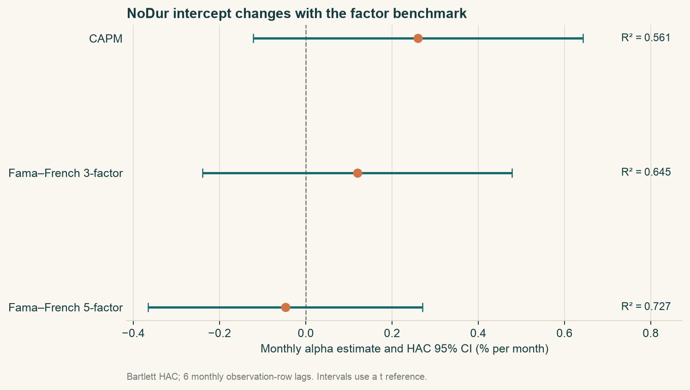
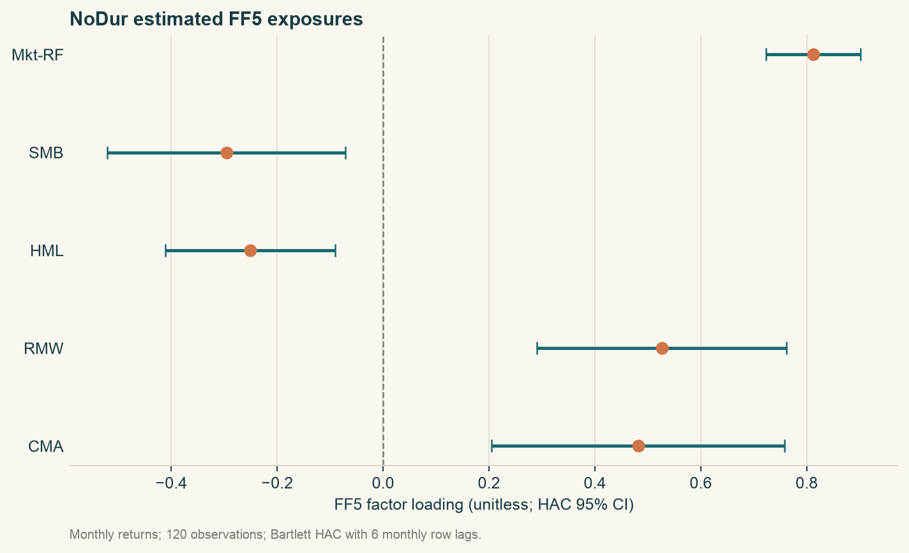
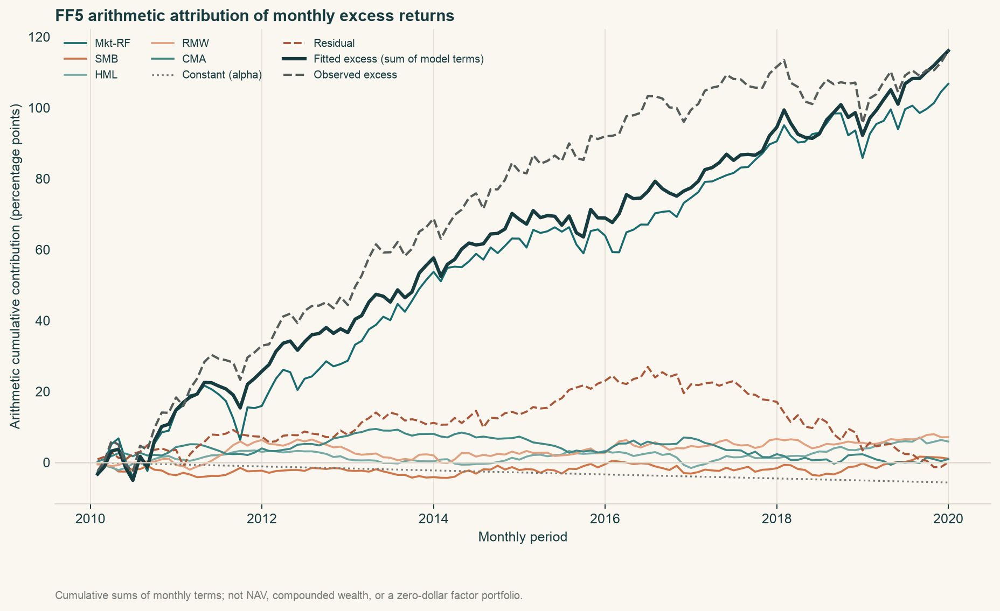

# Chapter 15 — Factor Models

Prerequisites: Chapter 8 regression, Chapter 11 returns, Chapters 12–13 statements and valuation, and Chapter 14 asset pricing.

## 1. Learning Objectives

When a portfolio earns more than cash, how much compensates for market and other common risks, and how much remains unexplained by the chosen model? Move from CAPM to the Fama–French Three-Factor Model (FF3) and Five-Factor Model (FF5), understand the construction of size, value, profitability, and investment factors, and complete a historical monthly regression independently.

Distinguish factors, factor loadings, exposures, intercept alpha, and residual risk. Derive how omitted variables change alpha, identify assumptions behind risk decomposition, and explain why statistical significance still does not establish tradable net profit. The historical case uses actual Kenneth French industry and factor snapshots, without inventing stock trades.

## 2. Why Quants Need This

A portfolio with strong historical performance may simply hold high-market-beta stocks, favor small companies, or bear value or profitability risks. Establish a benchmark before naming that compensation a unique skill.

Chapter 13 constructs cheapness characteristics from statements and prices matched to the same claims. Here we ask how a portfolio holding those characteristics moves with the market and other styles. Company characteristics and common portfolio-return variation serve different purposes. Chapters 23–28 later turn characteristics into signals available at decision time. This chapter explains risk and attributes returns; a realized same-month factor return is not a forecast input available beforehand.

Factor models also support risk management. Many stock names need not diversify risk if they share exposures. A low-dimensional coordinate system helps portfolio construction; Chapters 20–21 use it for risk and constraints, subject to data quality, out-of-sample behavior, and costs.

## 3. Intuition

Think of portfolio returns as an ensemble: the market is a melody most stocks respond to, and other factors capture different parts. Loadings measure response strength, rather than the fraction of capital invested in each part. Residuals contain firm events, measurement error, omitted factors, and noise. Calling the unexplained part exceptional skill is premature.

Why go beyond a market regression? Firms with similar market sensitivity may share persistent variation through financing, valuation, profitability, or reinvestment. Adding a factor tests whether this comovement explains variation previously left in residuals. A better-looking historical fit alone supplies no evidence of future validity.

A rising value factor does not mean every low-P/E stock must rise. Factors are rule-based portfolio-return differences and can be positive or negative. A company characteristic, regression exposure, and next-month return are not linked by a mechanical identity.

## 4. Mathematical Foundations

### 4.1 From One Asset to N Assets

For asset i's simple total return in month t, write:

\[
y_{i,t}=R_{i,t}-R_{f,t}=\alpha_i+\boldsymbol\beta_i^\top\boldsymbol f_t+\varepsilon_{i,t}.
\]

\(R_{i,t}\) is its monthly total return and \(R_{f,t}\) a same-currency cash proxy over the same interval, both decimal returns per month. \(y_{i,t}\) is arithmetic excess return. The K×1 factor-return vector \(\boldsymbol f_t\) and dimensionless K×1 loading vector \(\boldsymbol\beta_i\) form an inner product; \(\top\) transposes the latter into a row. The result is explained monthly excess return. \(\alpha_i\) is a decimal monthly intercept and \(\varepsilon_{i,t}\) the monthly residual.

For N assets together:

\[
\boldsymbol y_t=\boldsymbol\alpha+B\boldsymbol f_t+\boldsymbol\varepsilon_t.
\]

\(\boldsymbol y_t,\boldsymbol\alpha,\boldsymbol\varepsilon_t\) are N×1, while \(B\) is N×K, with one asset's loadings per row. Bf is N×1. Dimensions prevent confusing the number of assets with the number of factors. N can be large while K is usually much smaller, giving factor risk models their dimension reduction.

### 4.2 Expectations and Volatility Answer Different Questions

With fixed loadings and intercepts, finite second moments, and zero population residual mean:

\[
\mathbb E[y_i]=\alpha_i+\boldsymbol\beta_i^\top\boldsymbol\mu_f,
\qquad \boldsymbol\mu_f=\mathbb E[\boldsymbol f_t].
\]

\(\boldsymbol\mu_f\) is the expected monthly return vector of K factors. This is an expectation decomposition. Claiming that the model correctly prices every asset additionally requires \(\alpha_i=0\) and an account of how factors represent priced risks. High statistical explanatory power alone does not establish that pricing claim.

Volatility concerns deviations from means; constant alpha adds no variance. If factors and residuals are uncorrelated:

\[
\Sigma_y=B\Sigma_fB^\top+\Sigma_\varepsilon.
\]

\(\Sigma_y\) is the N×N asset excess-return covariance matrix, \(\Sigma_f\) the K×K factor covariance, and \(\Sigma_\varepsilon\) the N×N residual covariance, all in squared monthly-return units. Shared residual shocks make \(\Sigma_\varepsilon\) nondiagonal. A diagonal approximation is a modeling choice; the word residual does not justify ignoring residual correlations.

In general let $C=\operatorname{Cov}(\boldsymbol f,\boldsymbol\varepsilon)$, a K×N matrix. The full expression is

\[
\Sigma_y=B\Sigma_fB^\top+\Sigma_\varepsilon+BC+C^\top B^\top.
\]

$BC$ is N×N and the other cross term is its transpose. Expanding $(B(f-\mu_f)+(\varepsilon-\mu_\varepsilon))(\cdots)^\top$ yields factor risk, residual risk, and both cross-covariances. Only $C=0$ recovers the simpler formula. Factor–residual covariance $C$ differs from cross-asset residual covariance $\Sigma_\varepsilon$.

## 5. Formal Definitions

### 5.1 CAPM, FF3, and FF5

The CAPM time-series regression uses market excess return as its sole factor:

\[
R_{i,t}-R_{f,t}=\alpha_i+\beta_{M,i}(R_{M,t}-R_{f,t})+\varepsilon_{i,t}.
\]

\(R_M\) is the chosen market proxy's monthly return and \(\beta_M\) its loading. Chapter 14 discusses equilibrium assumptions; here published proxies estimate historical linear relations. A proxy is not the aggregate-wealth market portfolio, so a zero-intercept test jointly depends on proxy and specification.

FF3 adds size and value portfolio-return spreads:

\[
y_{i,t}=\alpha_i+\beta_{M,i}MKT_t+s_iSMB_t+h_iHML_t+\varepsilon_{i,t}.
\]

\(MKT_t=R_{M,t}-R_{f,t}\): Small Minus Big (SMB) is the size spread and High Minus Low (HML) the high-minus-low book-to-market value spread. \(s_i,h_i\) are dimensionless loadings. High or low stock characteristics differ from positive or negative long–short returns: negative monthly HML means its value side lost to its growth side that month.

FF5 adds Robust Minus Weak (RMW) profitability and Conservative Minus Aggressive (CMA) investment:

\[
y_{i,t}=\alpha_i+\beta_{M,i}MKT_t+s_iSMB_t+h_iHML_t+r_iRMW_t+c_iCMA_t+\varepsilon_{i,t}.
\]

\(r_i,c_i\) are profitability and investment loadings, not discount rates r. Subscripted loadings here belong to regressions. Conservative and aggressive describe company investment growth, rather than trader courage. FF5 constructs SMB differently from FF3, as explained below.

### 5.2 From Characteristic Sorts to Factor Returns

To avoid confusing value exposure with greater small-cap exposure, first split stocks into Small/Big, then each size group into Value/Neutral/Growth by book-to-market. Denote the six monthly portfolio returns SV, SN, SG, BV, BN, BG. Returns within each group are value-weighted; the outer combinations below use equal weights.

\[
SMB_{BM}=\frac{SV+SN+SG}{3}-\frac{BV+BN+BG}{3},
\qquad HML=\frac{SV+BV}{2}-\frac{SG+BG}{2}.
\]

Every symbol is a same-month decimal return. These formulas subtract portfolio returns rather than six companies' statement figures. Size averages across value groups; value averages across size groups. This reduces confounding without guaranteeing statistical orthogonality. Record within-group and between-group weights separately when replicating factors. [Official French three-factor construction](https://mba.tuck.dartmouth.edu/pages/faculty/ken.french/Data_Library/f-f_factors.html)

Profitability groups are Robust/Neutral/Weak; investment groups are Conservative/Neutral/Aggressive. Construct size spreads \(SMB_{OP}\) and \(SMB_{INV}\) by the same three-group averaging. FF5 uses:

\[
SMB_5=\frac{SMB_{BM}+SMB_{OP}+SMB_{INV}}{3}.
\]

All three are monthly small-minus-big spreads. Let SR, BR, SW, BW denote small/big robust/weak profitability groups, and SC, BC, SA, BA small/big conservative/aggressive investment groups. Then:

\[
RMW=\frac{SR+BR}{2}-\frac{SW+BW}{2},
\qquad CMA=\frac{SC+BC}{2}-\frac{SA+BA}{2}.
\]

Each portfolio retains monthly-return units; denominators 2 and 3 are dimensionless equal-weight counts. This explains construction without claiming replication from stock-level statements and historical universes. The chapter reads published factors directly. Official annual sorts use lagged financial eligibility and July–June holding periods, unlike backfilling all current restatements into history. [Official French five-factor description](https://mba.tuck.dartmouth.edu/pages/faculty/ken.french/Data_Library/f-f_5_factors_2x3.html)

### 5.3 Factor Returns, Characteristics, Loadings, and Positions

| Object | Input → operation → output | Units and availability clock |
|---|---|---|
| Stock financial characteristic | Public book equity and market value on consistent definitions → ratio → book-to-market 0.6 | Dimensionless; check publication, ingestion, and price times |
| Sorted portfolio | Characteristics known at cutoff and eligible universe → sorting and within-group weights → monthly SV-type return | Decimal/month; determine groups and holdings before returns realize |
| Factor return | Same-month group returns → high-minus-low/small-minus-big → HML-type spread | Decimal/month; observed after the month is realized and published |
| Regression loading | Realized asset excess returns and same-month factors → specified-window OLS → h=0.8 | Dimensionless; estimated after training-window cutoff |
| Position weight | Available signals, risk budget, constraints → portfolio decision → stock at 4% of NAV | Dimensionless; record decisions and actual trades separately |


Net Asset Value (NAV) is the weight denominator. No identity maps a loading directly to holdings: objectives, constraints, and costs are also needed. Characteristics form sorted groups, their returns form factors, and factor returns estimate loadings. Regression cannot reconstruct the stocks you actually bought.

Define exposure explicitly: it may mean a regression beta or a holdings-weighted characteristic. One is estimated from return comovement; the other uses statements and holdings. They may correlate without being the same number. Loadings need not lie between 0 and 1 or sum to 1. Highly correlated factors can destabilize individual loadings even when aggregate fitted returns remain similar.

## 6. Derivation

### 6.1 Why the Fitted Intercept Can Fall

Use an included factor x and omitted factor z. Suppose the true statistical relation is:

\[
y=\alpha+\beta x+\gamma z+u,
\quad \operatorname{Cov}(u,x)=\operatorname{Cov}(u,z)=0.
\]

x, z, y are same-month return variables; alpha is the intercept, beta and gamma loadings, and u a zero-mean error. Regressing only on x gives the population projection slope:

\[
\widetilde\beta=\frac{\operatorname{Cov}(x,y)}{\operatorname{Var}(x)}
=\beta+\gamma\frac{\operatorname{Cov}(x,z)}{\operatorname{Var}(x)}.
\]

First apply the population single-regressor projection with an intercept, then substitute y inside covariance. Constants have zero covariance and Cov(x,u)=0. With \(q=\operatorname{Cov}(x,z)/\operatorname{Var}(x)\), x absorbs some omitted-factor variation. This requires Var(x)>0.

The intercept equates fitted and observed means, so:

\[
\widetilde\alpha=\mathbb E[y]-\widetilde\beta\mathbb E[x]
=\alpha+\gamma\{\mathbb E[z]-q\mathbb E[x]\}.
\]

An omitted factor can raise or lower the intercept; adding z can also increase alpha. A positive intercept is not automatically skill, nor does its disappearance mean the model removed actual profits. The benchmark and projection changed; investors' cash flows did not reverse when the researcher changed models.

### 6.2 Multivariate OLS and Loadings

For T months, the T×(K+1) design X has an initial column of ones and contemporaneous factor-return columns; y is T×1 asset excess return. Solve:

\[
\widehat\theta=\arg\min_\theta(y-X\theta)^\top(y-X\theta).
\]

\(\theta=(\alpha,\beta_1,\ldots,\beta_K)^\top\) is a K+1 parameter vector. Squared historical explanation error is not trading profit. Expanding and differentiating gives \(-2X^\top(y-X\theta)=0\), hence:

\[
X^\top X\widehat\theta=X^\top y,
\qquad \widehat\theta=(X^\top X)^{-1}X^\top y.
\]

The inverse expression requires full column rank and T>K+1; no factor may be an exact linear combination of the others. Actual software should solve with stable QR or SVD methods rather than manual inversion. Full rank identifies parameters without guaranteeing precision; near-collinearity still amplifies uncertainty. This links Chapter 5's rank and singular values to Chapter 8 regression and risk explanation.

The normal equations give \(X^\top\widehat\varepsilon=0\). The ones column makes residuals sum to zero; factor columns give in-sample orthogonality. This OLS algebra does not promise uncorrelated future residuals.

### 6.3 When Risk Decomposition Holds

For one asset, let \(v=\boldsymbol\beta^\top\boldsymbol f\). Then:

\[
\operatorname{Var}(y)=\operatorname{Var}(v)+\operatorname{Var}(\varepsilon)+2\operatorname{Cov}(v,\varepsilon).
\]

Constant alpha has no variance. Center y and expand its squared expectation. If Cov(f,epsilon)=0, the third term vanishes and the first expands as \(\boldsymbol\beta^\top\Sigma_f\boldsymbol\beta\). Correlated factors also require cross term \(2\beta_1\beta_2\operatorname{Cov}(f_1,f_2)\); individual volatilities cannot simply be added.

With an intercept, in-sample OLS fitted values and residuals are orthogonal. Using the same T−1 sample-variance denominator:

\[
s_y^2=s_{\widehat y}^2+s_{\widehat\varepsilon}^2.
\]

All three s² terms are centered variances over the same sample and denominator T−1. An unbiased regression-noise variance estimate may divide residual sum of squares by T−K−1 instead. That different denominator cannot be inserted directly into this identity; this explains apparent discrepancies between software residual variance and hand-calculated risk.

For fixed portfolio weights w, factor exposure is \(B^\top w\) and portfolio variance:

\[
\sigma_p^2=(B^\top w)^\top\Sigma_f(B^\top w)+w^\top\Sigma_\varepsilon w.
\]

w is N×1; B and Sigma have Section 4's dimensions. The first term is common-factor risk and the second residual risk, both squared monthly returns. This requires fixed weights, linear return aggregation, and orthogonality. Dynamic weights, financing, costs, and nonlinear option exposures need a fuller model.

### 6.4 Why Independent-Sample Standard Errors May Fail

Factors and residuals can have serial dependence and heteroskedasticity. OLS still minimizes squared error, while independent homoskedastic standard errors may understate uncertainty. We use heteroskedasticity and autocorrelation consistent covariance (HAC), monthly-row lag L=6, and Bartlett weights \(a_\ell=1-\ell/(L+1)\).

Let \(q_t=x_t\widehat\varepsilon_t\), where x_t is the K+1 design column including the constant, and define score cross-products \(\Gamma_\ell=\sum_{t=\ell+1}^Tq_tq_{t-\ell}^\top\). Before finite-sample correction, the sandwich is:

\[
\widehat V=(X^\top X)^{-1}\left[\Gamma_0+\sum_{\ell=1}^L a_\ell(\Gamma_\ell+\Gamma_\ell^\top)\right]\cdot(X^\top X)^{-1}.
\]

V is (K+1)×(K+1) parameter covariance; square roots of diagonal entries are standard errors. Lagged score products capture cross-month dependence; downweighting distant lags limits finite-sample noise. Software additionally applies finite-sample correction and a t reference. This remains conditional approximate inference, without immunity to arbitrarily strong dependence. Neither 120 months nor six lags is universally optimal. Transparently compare 3, 6, 12 rather than choosing L by the most favorable p-value.

To see the sandwich components, use Section 8.4's four-month constructed regression. The table repeats only factors and OLS residuals needed for HAC; Section 8.4 gives asset excess returns and their derivation. There is a constant and one factor, parameters ordered (alpha, beta), with T=4 and p=2. L=1 is chosen solely for this teaching calculation; the historical French case retains L=6.

| Month | Factor x (decimal/month) | OLS residual (decimal/month) |
|---|---:|---:|
| 1 | −0.020 | 0.001 |
| 2 | 0.000 | −0.001 |
| 3 | 0.020 | −0.001 |
| 4 | 0.040 | 0.001 |

With design order (constant, x), each score q_t is the design vector times the residual. The four rows form:

\[
\begin{bmatrix}q_1^\top\\q_2^\top\\q_3^\top\\q_4^\top\end{bmatrix}
=10^{-3}\begin{bmatrix}1&-0.02\\-1&0\\-1&-0.02\\1&0.04\end{bmatrix}.
\]

Multiplication gives the lag-zero and lag-one score cross-products:

\[
\Gamma_0=\begin{bmatrix}4.0\times10^{-6}&4.0\times10^{-8}\\4.0\times10^{-8}&2.4\times10^{-9}\end{bmatrix}.
\]

\[
\Gamma_1=\begin{bmatrix}-1.0\times10^{-6}&0\\-2.0\times10^{-8}&-8.0\times10^{-10}\end{bmatrix}.
\]

For L=1, Bartlett weight \(a_1=1-1/(1+1)=0.5\). The middle sandwich matrix (meat) is therefore:

\[
M=\Gamma_0+0.5(\Gamma_1+\Gamma_1^\top)=\begin{bmatrix}3.0\times10^{-6}&3.0\times10^{-8}\\3.0\times10^{-8}&1.6\times10^{-9}\end{bmatrix}.
\]

The design cross-product and its inverse, ordered constant then beta, are:

\[
X^\top X=\begin{bmatrix}4&0.04\\0.04&0.0024\end{bmatrix},\qquad
(X^\top X)^{-1}=\begin{bmatrix}0.3&-5\\-5&500\end{bmatrix}.
\]

Multiplying on both sides gives the uncorrected covariance and software finite-sample-corrected result:

\[
\widehat V_{\mathrm{raw}}=\begin{bmatrix}2.20\times10^{-7}&-3.25\times10^{-6}\\-3.25\times10^{-6}&3.25\times10^{-4}\end{bmatrix}.
\]

\[
\widehat V_{\mathrm{HAC}}=\frac{T}{T-p}\widehat V_{\mathrm{raw}}=2\widehat V_{\mathrm{raw}}=\begin{bmatrix}4.40\times10^{-7}&-6.50\times10^{-6}\\-6.50\times10^{-6}&6.50\times10^{-4}\end{bmatrix}.
\]

p=2 includes the intercept, so \(T/(T-p)=4/(4-2)=2\). Alpha's standard error is \(\sqrt{4.40\times10^{-7}}=0.0006633\) in decimal monthly returns; beta's is \(\sqrt{6.50\times10^{-4}}=0.025495\), dimensionless. The statsmodels t reference uses degrees of freedom \(T-p=2\): alpha t=3.0151, p=0.09464, and 95% interval [−0.0008541, 0.0048541]. These illustrate software settings. Four observations cannot establish reliable inference; correction and a t reference do not validate error assumptions.

The following code independently recalculates every matrix and asserts agreement with the helper's statsmodels HAC standard errors, t statistics, p-values, and intervals. Inversion is used only to display this tiny example; actual regression uses stable OLS.

```python
from pathlib import Path
import sys
sys.path.insert(0, str(Path.cwd() / "src"))

import numpy as np
import pandas as pd
import statsmodels.api as sm
from quant_course.factor_models import fit_monthly_factor_model

x = np.array([-0.020, 0.000, 0.020, 0.040])
y = np.array([-0.013, 0.001, 0.017, 0.035])
design = np.column_stack([np.ones(len(x)), x])
params = np.linalg.lstsq(design, y, rcond=None)[0]
residual = y - design @ params
scores = design * residual[:, None]

gamma0 = scores.T @ scores
gamma1 = sum(
    np.outer(scores[t], scores[t - 1]) for t in range(1, len(scores))
)
weight1 = 1 - 1 / (1 + 1)
meat = gamma0 + weight1 * (gamma1 + gamma1.T)
bread = np.linalg.inv(design.T @ design)
raw_cov = bread @ meat @ bread
correction = len(y) / (len(y) - design.shape[1])
manual_cov = correction * raw_cov

np.testing.assert_allclose(params, [0.002, 0.8], atol=1e-14)
np.testing.assert_allclose(residual, [0.001, -0.001, -0.001, 0.001], atol=1e-14)
np.testing.assert_allclose(gamma0, [[4e-6, 4e-8], [4e-8, 2.4e-9]], atol=1e-20)
np.testing.assert_allclose(gamma1, [[-1e-6, 0], [-2e-8, -8e-10]], atol=1e-20)
np.testing.assert_allclose(
    manual_cov,
    [[4.4e-7, -6.5e-6], [-6.5e-6, 6.5e-4]],
    rtol=1e-12, atol=1e-18,
)

months = pd.period_range("2020-01", periods=4, freq="M", name="month")
factors = pd.DataFrame({"Mkt-RF": x, "RF": np.zeros(4)}, index=months)
fit = fit_monthly_factor_model(
    pd.Series(y, index=months), factors, ("Mkt-RF",), hac_maxlags=1
)
robust = sm.OLS(y, design).fit().get_robustcov_results(
    cov_type="HAC", maxlags=1, kernel="bartlett",
    use_correction=True, use_t=True,
)
np.testing.assert_allclose(robust.cov_params(), manual_cov, rtol=1e-12, atol=1e-18)
np.testing.assert_allclose(
    fit.coefficient_table["standard_error_hac"].to_numpy(), robust.bse,
    rtol=1e-12, atol=1e-14,
)
np.testing.assert_allclose(
    fit.coefficient_table.loc["const", ["t_hac", "p_hac"]].to_numpy(dtype=float),
    [robust.tvalues[0], robust.pvalues[0]],
)
np.testing.assert_allclose(
    fit.coefficient_table.loc["const", ["ci_low_hac", "ci_high_hac"]].to_numpy(dtype=float),
    robust.conf_int()[0],
)
assert robust.df_resid == 2
print("V_HAC:", manual_cov)
print(fit.coefficient_table[["standard_error_hac", "t_hac", "p_hac", "ci_low_hac", "ci_high_hac"]])
```

::: {.body-conditions title="Scope of fixed-loading formulas"}

### 6.5 Time-Varying Loadings: Do Not Multiply Averages First

The preceding mean attribution uses fixed $\boldsymbol\beta$. If states or holdings make loadings $\boldsymbol\beta_t$, generally

\[
\mathbb E[\boldsymbol\beta_t^\top\boldsymbol f_t]
=\mathbb E[\boldsymbol\beta_t]^\top\mathbb E[\boldsymbol f_t]
+\sum_{k=1}^K\operatorname{Cov}(\beta_{k,t},f_{k,t}).
\]

Expand each product expectation to obtain this result. Dimensionless loadings and decimal monthly factors make the covariance term a decimal monthly return. Mean loading times mean factor return is not the average contribution of an arbitrary dynamic portfolio. In two equally likely teaching states, take $(\beta,f)=(0.5,-2\%)$ and $(1.5,4\%)$ with zero intercept and error. Contributions are −1% and 6%, averaging 2.5%; average loading 1 times average factor return 1% gives only 1%, missing a 1.5-percentage-point covariance term. This state construction provides no foreseeable rebalancing signal.

Nor may unconditional risk replace random $B_t$ with average $B$ in a fixed-loading formula. For a conditional model on pre-month information $\mathcal I_{t-1}$, require $B_{t-1}$ to be known, conditional residual mean zero, and conditional factor–residual orthogonality before writing

\[
\operatorname{Var}(\boldsymbol y_t\mid\mathcal I_{t-1})
=B_{t-1}\operatorname{Var}(\boldsymbol f_t\mid\mathcal I_{t-1})B_{t-1}^\top
+\operatorname{Var}(\boldsymbol\varepsilon_t\mid\mathcal I_{t-1}).
\]

Unconditional variance additionally follows total variance: expected conditional variance plus variance of the conditional mean. Rolling estimation produces window-dependent loading estimates without proving conditional orthogonality or making this month's realized factors known beforehand. Chapters 19–21 further distinguish estimation error, conditional risk, and dynamic weights. This chapter's empirical analysis remains fixed-window contemporaneous attribution.

:::

## 7. Financial Interpretation

### 7.1 A Risk-Premium Explanation Is Not Causal Proof

Positive factor means can relate to risk compensation, behavior, institutional constraints, or the selected sample. A regression describes return relations without deciding between mechanisms. Risk compensation needs adverse states, marginal investors, and an economic mechanism; behavioral mispricing needs an account of biases and limits to arbitrage. Correlation does not establish causation.

### 7.2 Why Alpha Is Relative

\(\widehat\alpha=\bar y-\widehat{\boldsymbol\beta}^\top\bar{\boldsymbol f}\). Alpha answers how much average return remains for this sample, cash proxy, and factor set. A portfolio with market beta 0.8 and value loading 0.6 does not have positive alpha merely because it beats cash; first subtract model-explained compensation.

A significant intercept still requires scrutiny of assumptions, selection, omissions, and repeated attempts. Statistical significance differs from economic significance; insignificance does not prove alpha exactly zero. A small p-value is especially inadequate after testing many portfolios, models, and windows. Chapter 32 covers multiple testing.

### 7.3 Residuals Are Not a Free Lunch

Holding more unrelated assets may diversify residual risk, but zero in-sample residual mean follows from fitting an intercept rather than negligible event risk. Incomplete factors can leave many stocks exposed to shared liquidity or industry shocks. Treating every residual as independent noise can severely understate concentration.

## 8. Numerical Example

### 8.1 Hand Calculation of Factor Construction

These are constructed monthly returns: SV=4%, SN=3%, SG=2%, BV=2%, BN=1%, BG=0%. Small averages 3% and Big 1%, giving SMB_BM=2%. Value averages (4%+2%)/2=3%; Growth averages (2%+0%)/2=1%, giving HML=2%. Equal factor returns this month do not make their long-run series identical, and one month cannot estimate correlation.

### 8.2 Explained Return and Alpha

Construct one month with RF=0.2%, asset R=2.6%, intercept \(\alpha=0.2\%\), market excess return MKT=2%, SMB=1%, HML=−1%, and loadings \(\beta_M=0.8,s=0.3,h=0.5\). Asset excess return is 2.4%. Let c denote factor-explained contribution:

\[
\begin{aligned}
c&=0.8\times2\%+0.3\times1\%+0.5\times(-1\%)=1.4\%,\\
\varepsilon&=(R-RF)-(c+\alpha)=2.4\%-1.4\%-0.2\%=0.8\%.
\end{aligned}
\]

The intercept is 0.2% per month and epsilon the unexplained monthly variation; all terms retain same-month return units.

This month's residual 0.8% is not its 0.2% intercept. A single month's unexplained variation differs from a regression intercept across time. Subtract cash once from asset total returns. MKT is already excess return and SMB/HML already spreads, so do not subtract RF again.

### 8.3 Common Risk by Hand

Construct two uncorrelated factors with monthly volatility 4% and 2%, loadings 0.8 and 0.5, and residual volatility 1%. Denote explained variance v_f and total variance v:

\[
v_f=0.8^2\times0.04^2+0.5^2\times0.02^2=0.001124,
\qquad v=v_f+0.01^2=0.001224.
\]

v_f and v have squared monthly-return units. Taking the final square root gives about 3.4986% volatility. Square, add, and then take the root; adding 3.2%, 1%, and 1% to get 5.2% is incorrect.

With factor correlation 0.5, cross-covariance is \(0.5\times0.04\times0.02=0.0004\). Denote the additional cross term d:

\[
d=2\times0.8\times0.5\times0.0004=0.00032,
\qquad v_{corr}=0.001224+d=0.001544.
\]

d and v_corr have squared monthly-return units. Correlated-case monthly volatility is \(\sqrt{v_{corr}}\), about 3.9294%. Correlation changes risk even with unchanged loadings.

### 8.4 A Four-Month Regression Ledger

Use one market factor to unpack Section 6.2's matrix algorithm into hand calculations. All values are constructed monthly decimal returns, without real companies or prediction tests. y already subtracts same-month cash:

| Constructed month | x: market excess return | y: asset excess return |
|---|---:|---:|
| 1 | −0.020 | −0.013 |
| 2 | 0.000 | 0.001 |
| 3 | 0.020 | 0.017 |
| 4 | 0.040 | 0.035 |

First calculate means \(\bar x=0.010\) and \(\bar y=0.010\). Centering matters because an intercept permits different levels; slope should reflect comovement around each mean rather than mistake average levels for covariance.

Second, x deviations are −0.030, −0.010, 0.010, 0.030; y deviations are −0.023, −0.009, 0.007, 0.025. Their product sum is 0.00069+0.00009+0.00007+0.00075=0.00160, and the x squared-deviation sum is 0.00090+0.00010+0.00010+0.00090=0.00200.

Third, slope \(\widehat\beta=0.00160/0.00200=0.8\). Sample covariance and variance both divide by 3, which cancels to give 0.8. One percentage point more market excess return raises fitted asset excess return by 0.8 percentage points; it does not mean an 80% capital allocation.

Fourth, restore levels: \(\widehat\alpha=\bar y-0.8\bar x=0.002\), or 0.2% per month. Omitting the intercept forces slope to absorb mean differences and answers another question.

Fifth, calculate \(\widehat y=0.002+0.8x\) month by month: −0.014, 0.002, 0.018, 0.034. Subtract fitted values from y to obtain residuals 0.001, −0.001, −0.001, 0.001. Their sum and inner product with x are zero. These are solution orthogonality properties, rather than evidence that future errors are independent.

Finally, y's centered sum of squares is 0.001284 and residual sum of squares 0.000004, giving \(R^2=1-0.000004/0.001284\approx0.996885\). High R² comes from deliberate construction, without market advantage. Multivariate OLS extends this comovement calculation by solving columns jointly, with each slope controlling the others. Section 6's matrix equations do this simultaneously.

## 9. Python Implementation

### Default Entry Point for This Reader Edition

From the accepted I 3 reader package root, establish its [documented environment](../../../../editions/en/README.md), then run:

```bash
.venv/bin/python run_notebook.py notebooks/ch15_factor_models.ipynb
```

Seed 20261015 constructs 120 monthly rows from 2010-01, five normal factor columns with standard deviation 0.025, RF=0.001, and one CONSTRUCTED asset equal to RF+0.002+1.0×Mkt-RF+0.3×HML plus normal error with standard deviation 0.01. CAPM, FF3, and FF5 use common underlying columns, making these constructed models strictly nested. Actual `build_summary(..., constructed=True)` checks all three ddof=1 variance identities and unchanged point estimates for HAC3/6/12. A coefficient CSV, summary JSON, and three new charts go to `runs/ch15_factor_models_<uuid>/`. CSV columns explicitly include `model` and `coefficient`. Charts show monthly alpha with HAC intervals, FF5 loadings with intervals, and arithmetic cumulative monthly attribution; titles use the CONSTRUCTED asset name. `RUN_FRENCH=False` disables loading historical French snapshots. Sections 10–11 retain the original historical NoDur charts and tables.

The runner separately records kernel execution in unique `runs/execution_*`, distinct from the Notebook's chapter UUID method directory. Constructed runs check interfaces without producing market research, PIT forecasts, or strategy returns after costs. Chapter 14 historical NoDur uses HAC5; Chapter 15 and Project 2 historical main tables use HAC6. Keep estimates and inference settings distinct rather than rewriting intervals for superficial agreement. This batch inspected source without executing these Notebooks or rerunning historical regressions.

I 3 Chapter 15 Notebook cells 4 and 18 still describe differences between official snapshot shared-name columns. This applies only to historical French data, rather than current common constructed columns. English Markdown for Chapters 14–15 and correction of those cells belong to BIL23; this batch leaves chapter Notebooks unchanged. The CLI and old production tests below refer to the working course root. Readers need not restore production tests absent from the package.

### Historical Course Working Root and Original Implementation

### 9.1 Input Contracts Before Fitting

The historical entry is [ch15_factor_models.py](../../../../code/ch15_factor_models.py), with teaching [ch15_factor_models.ipynb](../../../../notebooks/ch15_factor_models.ipynb). From the course directory run `.venv/bin/python code/ch15_factor_models.py`; it writes a coefficient CSV and summary JSON with source hashes. These are experiment outputs, not replacement inputs for another regression.

The core is `fit_monthly_factor_model()` in [factor_models.py](../../../../src/quant_course/factor_models.py). Asset input is a `Series` and factor input a `DataFrame`, both indexed by identical consecutive, unique, increasing monthly `PeriodIndex` labels. Original French percentages have already been converted to decimals in processed snapshots; do not divide by 100 again. NaN, infinity, booleans, complex values, missing months, and rank deficiency are rejected rather than hidden by zero filling.

April asset returns paired with May factors can still produce numbers, but answer a different financial question. Dropping missing rows after an outer join also changes the research window. Explicit failure is preferable to uninterpretable beta. A month labels a return interval, without claiming publication at its first instant.

::: {.body-example title="Complete example: checking a noiseless constructed regression"}

This standalone constructed monthly example fixes seed 15. It verifies the estimator interface rather than backtesting a financial strategy.

```python
from pathlib import Path
import sys
sys.path.insert(0, str(Path.cwd() / "src"))
import numpy as np
import pandas as pd
from quant_course.factor_models import fit_monthly_factor_model

rng = np.random.default_rng(15)
months = pd.period_range("2000-01", periods=120, freq="M")
factors = pd.DataFrame({
    "Mkt-RF": rng.normal(0.005, 0.04, 120),
    "SMB": rng.normal(0.002, 0.02, 120),
    "HML": rng.normal(0.003, 0.02, 120),
    "RF": np.full(120, 0.001),
}, index=months)
asset = factors["RF"] + 0.002 + 0.8*factors["Mkt-RF"] + 0.3*factors["SMB"] + 0.5*factors["HML"]
fit = fit_monthly_factor_model(asset, factors, ("Mkt-RF", "SMB", "HML"), hac_maxlags=6)
assert np.allclose(fit.coefficient_table["estimate"], [0.002, 0.8, 0.3, 0.5])
assert np.max(np.abs(fit.residuals)) < 1e-14
print(fit.coefficient_table["estimate"])
```

Random error is deliberately absent so estimates can be checked exactly. Near-zero standard errors provide no real-world significance evidence. Financial returns contain noise; the historical confidence intervals below describe uncertainty in that experiment.

:::

### 9.2 Inspect Returned Values, Beyond a Summary

The result stores coefficients, fitted excess returns, residuals, R², adjusted R², observation count, condition number, and HAC lag count. `estimate` gives monthly intercept or dimensionless loading, `standard_error_hac` the corresponding standard error, and `ci_low_hac/ci_high_hac` approximate 95% bounds. Intercept bounds are decimal monthly returns.

The condition number helps detect near-collinearity, but also depends on scaling when constants accompany decimal-return columns. No arbitrary threshold validates every model. Inspect loading intervals, correlations, window stability, and economic meaning together.

Historical regressions use frozen snapshots for 2010-01 through 2019-12. This retrospective descriptive experiment has no signal timestamp, trade timestamp, or orders. A `return interval` labels each published monthly portfolio-return interval. Trading research would separately require training cutoff, data availability, signal, execution, and subsequent evaluation interval.

## 10. Visualization

These three charts were generated from the same frozen historical entry and share Section 11's values. Read them in this order:








1. Model intercepts and 95% HAC intervals: monthly alpha and interval horizontally (percentage points/month), CAPM/FF3/FF5 vertically. Examine benchmark changes and whether intervals cover zero, rather than only point-estimate signs.
2. FF5 loadings and intervals: dimensionless loading and HAC interval horizontally, factor names vertically. Examine market, size, value, profitability, and investment directions and uncertainty. Loadings are not holdings proportions.
3. Arithmetic cumulative attribution: sample month horizontally, cumulative monthly `beta_k*f_k` contributions in percentage points vertically, alongside cumulative alpha and residuals. This is a linear attribution ledger, rather than investable NAV or compounded wealth. Monthly components sum to excess return, and arithmetic summation preserves that identity across months; it cannot replace Chapter 11's wealth product.

Do not treat a zero-net-investment long–short spread as a fund return with initial wealth 1. A factor-strategy NAV requires long/short scale, collateral, financing, rebalancing, and costs. Those ledgers are absent here; the chart supports attribution in the stated input units.

## 11. Real Market Example

### 11.1 Sample, Sources, and Evidence Scope

Inputs are published Kenneth French Nondurables (NoDur) monthly industry total returns and US FF3/FF5 factors. Snapshots were downloaded 2026-10-05; originals declare CRSP202608. The fixed 2010-01–2019-12 window contains 120 months with USD return conventions. The industry portfolio is not a directly purchasable fund; this chapter does not reconstruct constituents, prices, or historical universes.

SHA-256 hashes of processed industry, FF3, and FF5 files respectively are:

- `3b097d810c295d64eedfa1ece7067ff2a0707f5ca90e33935df9949251f70950`
- `c19770a19a0ac47ad1c29074f57234570aeaa9725212cb4fa8146a2846c52814`
- `833bd925b49651428781c789c13a6ac7454d4676449e6d119782050046a57eea`

The industry manifest and factor manifest identify sources, raw and processed files, and hashes. Hashes fix current inputs without proving availability in the corresponding 2010 month. Current snapshots are not historical point-in-time (PIT) data. The official RF source changes from 2024-06; this window ends in 2019 and avoids that switch, but longer experiments must record the boundary.

### 11.2 Interpreting Historical Estimates

Chapter 14's same-sample CAPM uses five HAC monthly lags. This chapter uses six for all models and separately reports 3/6/12 sensitivity. Point estimates agree across chapters; intervals and p-values require their settings to accompany comparisons. These are explicit teaching choices, without a claim of formal preregistration before observing data.

The following estimates use actual frozen data, six-row Bartlett HAC, finite-sample correction, and a t reference. They are not constructed teaching values.

| Model | Monthly alpha (%) | Alpha 95% interval (%) | Alpha p-value | R² | Adjusted R² |
|---|---:|---|---:|---:|---:|
| CAPM | 0.26034 | [−0.12227, 0.64295] | 0.1804 | 0.56080 | 0.55708 |
| FF3 | 0.11947 | [−0.23925, 0.47818] | 0.5108 | 0.64496 | 0.63578 |
| FF5 | −0.04716 | [−0.36528, 0.27095] | 0.7695 | 0.72651 | 0.71451 |

All three intervals contain zero, so these approximate tests do not reject zero intercepts. This does not prove the industry has no alpha. Lower FF5 sample residual variance means greater explanation in this window, without establishing better future prediction.

FF5 market, SMB, HML, RMW, and CMA loadings are about 0.81212, −0.29609, −0.25075, 0.52627, 0.48148. Controlling the other factors, NoDur has positive historical profitability and conservative-investment exposure, and negative size/value spread exposure. This neither classifies every industry company into those groups nor proves the factors causally drove returns.

### 11.3 An Important Observed Data Difference

Over the same 120 months, the maximum absolute difference in FF3/FF5 `Mkt-RF` is 0.0003, or 0.03 percentage points; SMB differs by up to 0.0137, or 1.37 percentage points. HML and RF agree. In 2018-05 the two raw market values are 2.66% and 2.63%, despite both headers declaring CRSP202608. The historical work checked raw values without resolving their upstream cause. Do not assume rounding, revision, or publication error.

FF5 already uses a different SMB construction, and the market columns also differ. These fits are therefore not strictly nested regressions retaining every old column and adding two. A nested F-test of only RMW/CMA is inappropriate, and the entire R² increase cannot be assigned to them. Isolating added columns requires fixed common market/SMB/HML series before adding RMW/CMA: an explicitly labeled custom hybrid, rather than official FF5.

### 11.4 Risk Decomposition and Uncertainty

All models have target sample variance 0.0010394864 in squared monthly-return units. FF5 fitted variance 0.0007551957 plus residual variance 0.0002842907 matches it. This checks the same-denominator OLS sample identity, without proving future residual independence.

At HAC lags 3,6,12, FF5 intercept remains−0.0004716374 decimal/month; its standard errors are approximately 0.0015052,0.0016058,0.0018439. Changing covariance estimation leaves OLS point estimates unchanged but alters intervals and p-values. Stable estimates across covariance choices do not establish stable future returns.

## 12. Common Mistakes

### 12.1 Subtracting RF Twice Changes the Definition

The error treats `Mkt-RF` as total market return and subtracts RF again. Test a one-month constructed case:

```python
import numpy as np
rf, asset, market_excess, beta = 0.002, 0.026, 0.020, 0.8
correct_left = asset-rf
wrong_right = beta*(market_excess-rf)
correct_right = beta*market_excess
assert np.isclose(correct_left, 0.024)
assert np.isclose(correct_right-wrong_right, 0.0016)
print(f"Incorrect market contribution={wrong_right:.2%}; correct={correct_right:.2%}")
```

Incorrect contribution is 1.44%, versus 1.60% correctly, a 0.16-percentage-point gap. Do not subtract RF from SMB/HML spreads either. Time-varying cash changes the entire regression relation, rather than necessarily only its intercept.

### 12.2 Loadings Are Not Weights; Correlations Matter

Normalizing 0.8,0.3,0.5 to sum to 1 changes fitted response coefficients. Loadings come from comovement rather than a budget. Ignoring correlations also miscalculates risk; reproduce Section 8's comparison:

```python
import numpy as np
beta = np.array([0.8, 0.5])
vol = np.array([0.04, 0.02])
independent = np.diag(vol**2)
correlated = independent.copy()
correlated[0, 1] = correlated[1, 0] = 0.5*vol[0]*vol[1]
wrong_risk = np.sqrt(beta @ independent @ beta + 0.01**2)
correct_risk = np.sqrt(beta @ correlated @ beta + 0.01**2)
assert np.isclose(wrong_risk, np.sqrt(0.001224))
assert np.isclose(correct_risk, np.sqrt(0.001544))
print(f"Ignoring correlation={wrong_risk:.4%}; including correlation={correct_risk:.4%}")
```

Here ignoring correlation understates monthly volatility by about 0.43 percentage points. Other loading signs and negative correlations can reverse the effect. Apply the formula rather than assume correlation always increases risk.

### 12.3 A Current Snapshot Is Not a Forecast; Future Data Cannot Extend Training

Full-window regression supports retrospective attribution. A 2014-end estimate used as a 2015-start signal may use only training data readable at that time. Incorrect `train = sample.loc[:"2019-12"]` includes the future; cutoff `sample.loc[:"2014-12"]` fixes the time span, while publication and ingestion clocks still require checking. Slicing dates alone does not turn revised current data into PIT inputs.

These slices are executable, but no full strategy was constructed, so no Sharpe gap between incorrect and correct versions is claimed. The established difference is 120 versus 60 training months. Coefficient changes require actual fitting before reporting. Data availability, estimation, and tradable backtesting have separate evidence requirements.

### 12.4 Monthly Intercepts Are Not Realizable Annual Returns

Multiplying monthly alpha by 12 gives a linear annual scale. \((1+\alpha)^{12}-1\) instead assumes an account repeatedly earning the same monthly return, rather than a general intercept annualization. Historical intercepts omit trading, financing, and stock-borrow costs. Treating annualized alpha as fund earnings crosses both inference and execution boundaries.

## 13. Quant Research Application

### 13.1 Completing a Risk-Explanation Experiment

State an economic hypothesis: historical excess returns may reflect size, value, profitability, or investment exposures. Fix asset definition, window, factor vintage, currency, monthly intervals, and missing-data rules, then validate inputs and compare models. Report coefficients, intervals, errors, correlations, and method differences rather than selecting the best row.

Instead of mechanically picking the highest R², ask whether interpretation is plausible, loadings stable across windows, residuals still share structure, and new factors reduce out-of-sample errors or improve risk estimates. If the design only supports retrospective attribution, keep that conclusion.

### 13.2 Requirements for Trading Research

Residual means predicting future returns is a different hypothesis from linear explanation of realized returns. Define loadings estimated solely in training, the subsequent target and holding interval, benchmarks, turnover, costs, short feasibility, and industry exposure. Falsification must allow disappearing residuals, unstable exposures, or gross returns below costs to reject the strategy.

Training ends at t; signal s follows availability of every input; execution e follows s; evaluated returns start after e. Explaining t+1 returns using already realized t+1 factors is not an ex-ante forecast. Rolling or expanding windows only restrict fitting spans; full PIT and leakage controls remain necessary. Chapters 29–31 implement these contracts.

### 13.3 From Statements to Factor Exposures

Chapters 12–13 clean statements and align characteristics; Chapter 15 identifies common-return exposure; Chapters 23–28 test future-return relations; Chapters 20–21 turn expected returns and risk into weights; Chapter 35 deducts costs. A more complex factor model cannot repair any failed step. Complexity should follow the research question and bounded evidence.

## 14. Chapter Summary

Factor models specify comparison coordinates, estimate exposures from historical returns, then examine unexplained returns and risk. Characteristics describe companies, factor returns describe sorted portfolios, and beta describes conditional responses. State alpha together with model, sample, and cash proxy.

Same-sample OLS orthogonality supports algebraic risk decomposition; future decomposition needs additional assumptions. HAC improves inference under specified conditions, while costs and timing determine realizability. Deliverable conclusions state what was explained, what remains unproved, and how a next experiment could falsify the hypothesis.

## 15. Exercises

**15-E01** Why are book-to-market, HML return, and a stock's HML loading different quantities? Give each unit and calculation clock.

**15-E02** Keep Section 8.1's six constructed portfolios, changing only SG from 2% to−1%. Recalculate SMB_BM and HML. Why do both change?

**15-E03** Using Section 8.2 with RF 0.2% and total asset return 2.6%, calculate excess return, factor contribution, fitted return including intercept, and residual. Explain why one monthly residual is not alpha.

**15-E04** In Section 6.1 take alpha=0, beta=0.8, gamma=0.5, E[x]=0.5%, E[z]=0.3%, and Cov(x,z)/Var(x)=0.4. What slope and intercept result when regressing only on x?

**15-E05** With uncorrelated factors, beta=(0.8,0.5), volatilities=(4%,2%), and residual volatility 1%, recalculate total variance. What changes at correlation−0.5?

**15-E06** Why must residual variance using T−K−1 be adjusted before entering a sample risk identity using T−1? Does that identity establish residual independence?

**15-E07** Historical NoDur FF5 monthly alpha is about−0.04716%, with 95% interval[−0.36528%,0.27095%]. Does this prove zero alpha or future underperformance?

**15-E08** Why is a nested F-test adding only two columns inappropriate for the official FF3/FF5 comparison here? Design and correctly name an experiment isolating the added factors.

**15-E09 | Cross-covariance.** An externally fixed model has $y=f+\varepsilon$, $\varepsilon=0.5f+u$, zero-mean uncorrelated $f,u$, $\operatorname{Var}(f)=0.0004$, and $\operatorname{Var}(u)=0.0001$. Calculate residual variance, cross-covariance, and total variance. How much does omitting the cross term change it? These are not fitted OLS residuals; explain why that matters.

**15-E10 | Varying loadings.** Recalculate Section 6.5's two-state mean factor contribution and $\operatorname{Cov}(\beta,f)$. Does this example alone establish an executable strategy of raising exposure in positive-factor months?

## 16. Programming Exercises

**15-P01** Fit FF3 on Section 9.1's constructed inputs. Shift all factor months forward by one and assert rejection rather than silent inner-join fitting. Then make one factor twice another and assert rank-deficiency rejection.

**15-P02** On the same constructed sample with random residuals, use HAC lags 3,6,12 and assert unchanged OLS coefficients. Report intercept standard errors and check that ddof=1 fitted plus residual sample variance equals excess-return variance.

**15-P03** Recalculate CAPM, FF3, FF5 on frozen historical inputs. Report monthly alpha and intervals, SMB loadings, and R²; check shared-name FF3/FF5 column differences. Do not claim unexecuted net alpha or stock-level replication.

## 17. Challenge Problems

**15-C01 | Models and economic meaning.** A researcher searches 100 asset windows, selects an FF5 intercept with p<0.05, and claims tradable net alpha. Give statistical, data, economic, and execution falsifications. Design follow-up research without substituting more same-sample searches for out-of-sample testing.

**15-C02 | Portfolio risk; prerequisites Chapters 5,9.** Two assets have one-factor loadings 1 and−0.5 and weights 0.5 each. Factor volatility is 4% per month; each residual volatility is 2%. Calculate total portfolio volatility first with uncorrelated residuals, then residual correlation 0.8. Why can low market exposure coexist with concentration risk?

## 18. Solutions / Solution Hints

### 18.1 Conceptual and Hand-Calculation Answers

**15-E01** Book-to-market divides common-equity book value from a known statement version by consistently defined market value. It is dimensionless, with publication/ingestion and market clocks recorded separately. HML is the monthly return difference of specified high/low book-to-market portfolios, decimal/month, known after realization and publication. Loading h is a dimensionless conditional response controlling other factors in a specified training sample, using only data readable by cutoff. These are a company attribute, a realized portfolio return, and a comovement parameter.

**15-E02** Small now averages \((4\%+3\%-1\%)/3=2\%\), Big remains 1%, giving SMB_BM=1%. Value averages 3%; Growth averages \((-1\%+0\%)/2=-0.5\%\), giving HML=3.5%. SG belongs to both Small and low book-to-market groups, so both formulas include it. Sorting does not automatically make spreads orthogonal.

**15-E03** Step by step:

\[
\begin{aligned}
y&=2.6\%-0.2\%=2.4\%,\\
c&=1.6\%+0.3\%-0.5\%=1.4\%,\\
\widehat y&=c+0.2\%=1.6\%,\\
\varepsilon&=y-\widehat y=0.8\%.
\end{aligned}
\]

Here c is factor contribution; all terms are this month's return percentages. Alpha is a conditional mean shift estimated across the sample; a residual is one month's deviation from its fit. They are not interchangeable.

**15-E04** The omitted-factor slope is 0.8+0.5×0.4=1.0; intercept 0+0.5×(0.003−0.4×0.005)=0.0005, or 0.05% per month. True constructed alpha is zero. The single-factor positive intercept reflects omitted z's mean component, without newly created trading skill.

**15-E05** With zero correlation, common variance 0.001124 plus residual variance 0.0001 gives 0.001224 and volatility 3.4986%. Correlation−0.5 adds cross term−0.00032, giving 0.000904 and about 3.0067%. Risk effects depend on the product of correlation and loading signs. Covariance must remain valid; impossible correlation combinations cannot be assigned arbitrarily.

**15-E06** With RSS the residual sum of squares, an intercept makes residual mean zero, so sample residual variance is RSS/(T−1). Noise variance estimate RSS/(T−K−1) is usually larger. Different targets and denominators cannot be mixed in the same-sample identity. Zero in-sample inner products do not establish variable independence, cross-asset residual independence, or future orthogonality.

**15-E07** The approximate 95% interval permits both negative and positive values and does not reject zero under current assumptions. It does not prove alpha exactly zero. Future performance also involves new data, states, costs, and realizable portfolios. Historical industry attribution cannot imply certain future underperformance. Insignificance is not proof of no effect.

**15-E08** Official FF3/FF5 SMB definitions differ, and their market columns also differ numerically here. Changed old columns prevent nesting by only two additions. Fix identical MKT/SMB/HML, RF, asset, and months, then add same-vintage RMW/CMA; call it a custom extension with a fixed FF3 benchmark. Testing still requires appropriate covariance/error assumptions; an ordinary homoskedastic F-test cannot automatically replace robust testing. This also does not establish better forecasts.

**15-E09** $\operatorname{Var}(\varepsilon)=0.5^2\times0.0004+0.0001=0.0002$ and $\operatorname{Cov}(f,\varepsilon)=0.5\times0.0004=0.0002$. Total variance is $0.0004+0.0002+2\times0.0002=0.0010$, also obtained directly by expanding $y=1.5f+u$ to give $1.5^2\times0.0004+0.0001=0.0010$. Dropping the cross term gives only 0.0006, understating by 0.0004; volatilities are 3.1623% and 2.4495%. Loading 1 is externally assigned, leaving $0.5f$ in the remainder. A best linear projection with an intercept on this population would instead give loading 1.5 and residual u, enabling orthogonal decomposition. Arbitrary model remainders do not inherit OLS orthogonality.

**15-E10** $\mathbb E[\beta]=1$, $\mathbb E[f]=0.01$, $\mathbb E[\beta f]=(-0.01+0.06)/2=0.025$, and $\operatorname{Cov}(\beta,f)=0.025-1\times0.01=0.015$. Centered products $[(-0.5)(-0.03)+(0.5)(0.03)]/2$ also give 0.015. Mean contribution 2.5% contains a 1.5-percentage-point covariance term. Contemporaneous loadings and realized factors supply no pre-period predictive ability, execution, or costs. Choosing the month's loading after observing its factor realization introduces future information, without establishing strategy validity.

### 18.2 Complete Programming References

**15-P01** This standalone example uses constructed seed 1501 and requires rejection of shifted months and exact collinearity.

```python
from pathlib import Path
import sys
sys.path.insert(0, str(Path.cwd() / "src"))
import numpy as np
import pandas as pd
from quant_course.factor_models import fit_monthly_factor_model

rng = np.random.default_rng(1501)
index = pd.period_range("2000-01", periods=120, freq="M")
f = pd.DataFrame({"Mkt-RF": rng.normal(0.005, 0.04, 120),
                  "SMB": rng.normal(0.002, 0.02, 120),
                  "HML": rng.normal(0.003, 0.02, 120),
                  "RF": np.full(120, 0.001)}, index=index)
y = f["RF"] + 0.002 + 0.8*f["Mkt-RF"] + 0.3*f["SMB"] + 0.5*f["HML"]
fit = fit_monthly_factor_model(y, f, ("Mkt-RF", "SMB", "HML"))
assert np.allclose(fit.coefficient_table["estimate"], [0.002, 0.8, 0.3, 0.5])
shifted = f.copy()
shifted.index = shifted.index + 1
rank_deficient = f.copy()
rank_deficient["SMB"] = 2*rank_deficient["Mkt-RF"]
for invalid in (shifted, rank_deficient):
    try:
        fit_monthly_factor_model(y, invalid, ("Mkt-RF", "SMB", "HML"))
    except ValueError:
        pass
    else:
        raise AssertionError("wrong months or rank deficiency must be rejected")
print("both invalid experiments rejected")
```

**15-P02** Nonzero random error makes interval changes under covariance choices meaningful. Noise demonstrates the interface without claiming realistic financial states.

```python
from pathlib import Path
import sys
sys.path.insert(0, str(Path.cwd() / "src"))
import numpy as np
import pandas as pd
from quant_course.factor_models import fit_monthly_factor_model

rng = np.random.default_rng(1502)
index = pd.period_range("2000-01", periods=120, freq="M")
f = pd.DataFrame({"Mkt-RF": rng.normal(0.005, 0.04, 120),
                  "SMB": rng.normal(0.002, 0.02, 120),
                  "RF": np.full(120, 0.001)}, index=index)
asset = f["RF"] + 0.002 + 0.8*f["Mkt-RF"] + 0.3*f["SMB"] + rng.normal(0, 0.01, 120)
fits = [fit_monthly_factor_model(asset, f, ("Mkt-RF", "SMB"), hac_maxlags=lag)
        for lag in (3, 6, 12)]
for model in fits:
    assert np.array_equal(model.coefficient_table["estimate"], fits[0].coefficient_table["estimate"])
    observed = asset-f["RF"]
    assert np.isclose(observed.var(ddof=1),
                      model.fitted_excess.var(ddof=1)+model.residuals.var(ddof=1))
    print(model.hac_maxlags, model.coefficient_table.loc["const", "standard_error_hac"])
```

**15-P03** Load frozen inputs from manifests rather than treating existing result JSON as the calculation source. Recalculating on a current snapshot does not give historical PIT eligibility.

```python
from pathlib import Path
import sys
import json
sys.path.insert(0, str(Path.cwd() / "src"))
import numpy as np
from quant_course.market_data import load_monthly_snapshot
from quant_course.factor_models import fit_monthly_factor_model

root = Path.cwd()
a = json.loads((root / "data/manifests/french_industries_2026-10-05.json").read_text())
m = json.loads((root / "data/manifests/french_factors_2026-10-05.json").read_text())["datasets"]
asset = load_monthly_snapshot(root/a["processed_path"], a["processed_sha256"], ["NoDur"])
asset = asset.loc["2010-01":"2019-12", "NoDur"]
columns = {"ff3": ("Mkt-RF", "SMB", "HML"),
           "ff5": ("Mkt-RF", "SMB", "HML", "RMW", "CMA")}
frames = {name: load_monthly_snapshot(root/m[name]["processed_path"],
                                     m[name]["processed_sha256"], [*cols, "RF"])
                   .loc["2010-01":"2019-12"]
          for name, cols in columns.items()}
expected = {"capm": (0.002603392167217396, 0.5607993620708411),
            "ff3": (0.001194674972166453, 0.6449619292529103),
            "ff5": (-0.0004716374176230468, 0.7265084935780675)}
for name in expected:
    frame = frames["ff5" if name == "ff5" else "ff3"]
    cols = ("Mkt-RF",) if name == "capm" else columns[name]
    fit = fit_monthly_factor_model(asset, frame, cols, hac_maxlags=6)
    assert fit.nobs == 120
    assert np.isclose(fit.coefficient_table.loc["const", "estimate"], expected[name][0])
    assert np.isclose(fit.r_squared, expected[name][1])
    print(name, fit.coefficient_table, "R2=", fit.r_squared)
for col, difference in {"Mkt-RF": 0.0003, "SMB": 0.0137, "HML": 0.0, "RF": 0.0}.items():
    measured = (frames["ff3"][col]-frames["ff5"][col]).abs().max()
    assert np.isclose(measured, difference)
    print(col, measured)
```

Monthly alpha, intervals, and R² appear in Section 11. SMB loadings are about−0.42424 for FF3 and−0.29609 for FF5. Different SMB columns and conditioning factors prevent attributing economic mechanisms to the loading gap alone. After-cost performance is outside these outputs.

### 18.3 Challenge Arguments

**15-C01** Statistical falsifications include selection across 100 attempts and sensitivity to dependence, HAC bandwidth, and misspecification. Data concerns include revised statements, surviving-stock universes, month mismatch, and unavailable inputs. Economic alternatives include omitted risk, industry concentration, and liquidity exposure difficult to bear in adverse states. Execution concerns include gross returns below costs, unstable stock borrowing, and capacity. Freeze hypotheses, definitions, and training/validation windows; preserve untouched future evaluation periods; compare simple benchmarks under fixed robustness rules; retain failures. Reselecting favorable subdivisions of the searched sample is not independent out-of-sample evidence.

Score 10:1 per falsification category;2 for validation windows and clocks;2 for multiple search and test assumptions;2 for costs/capacity and negative-result rules. Alternative mechanisms are acceptable if falsifiable.

**15-C02** Portfolio loading is 0.5×1+0.5×(−0.5)=0.25, common variance 0.25²×0.04²=0.0001. Independent residual portfolio variance is 0.5²×0.02²+0.5²×0.02²=0.0002, giving total 0.0003 and volatility 1.7321%. With correlation 0.8, residual covariance is 0.8×0.02²=0.00032; added portfolio cross term 2×0.5×0.5×0.00032=0.00016 gives total 0.00046 and volatility 2.1448%. Shared residual shocks raise risk despite low market loading.

Score 10:2 for portfolio loading;2 each for both residual-variance calculations;2 for total variance/volatility;2 for explaining why low beta need not mean low concentration.

## 19. Further Reading

First read French's official construction pages and check columns and monthly intervals by hand; then read the verified introductions and method passages of the original papers. Separate factor construction, tests of return relations, and claims about an asset-pricing mechanism. Success at one level does not establish the others.

The 1993 paper studies common stock and bond risks; its five risk factors are not the 2015 equity FF5. The 2015 HML redundancy discussion is conditional on its US 1963–2013 sample and model, rather than a claim that value is permanently useless. Original-paper historical table values are not presented as this chapter's current-window results. [1993 journal-PDF teaching mirror](https://www.bauer.uh.edu/rsusmel/phd/Fama-French_JFE93.pdf), [2015 journal-PDF teaching mirror](https://tevgeniou.github.io/EquityRiskFactors/bibliography/FiveFactor.pdf)

For deeper risk models, consult classic portfolio-management texts on factor and residual covariance estimation. They are course-wide references; inaccessible chapters must not be cited as if read page by page. Chapters 18–21 develop volatility, estimation uncertainty, and portfolio risk; Chapters 23–28 turn to characteristics and prediction.

## 20. References

- Fama, E. F., & French, K. R. (1993). *Common risk factors in the returns on stocks and bonds*. Journal of Financial Economics,33,3–56. Uses the read introduction and selected methods, without reproducing original charts.
- Fama, E. F., & French, K. R. (2015). *A five-factor asset pricing model*. Journal of Financial Economics,116,1–22. Uses the read introduction and selected redundancy discussion, without claiming equation-by-equation verification of the entire paper.
- Kenneth R. French Data Library: [three factors](https://mba.tuck.dartmouth.edu/pages/faculty/ken.french/Data_Library/f-f_factors.html), [five factors](https://mba.tuck.dartmouth.edu/pages/faculty/ken.french/Data_Library/f-f_5_factors_2x3.html). Method pages and snapshot vintages are checked separately.
- statsmodels: [robust covariance API](https://www.statsmodels.org/stable/generated/statsmodels.regression.linear_model.RegressionResults.get_robustcov_results.html). Parameters support reproducibility without replacing statistical assumptions.

Full source-reading limits appear in [source_notes.md](../../../zh/chapters/ch15/source_notes.md). The historical root acceptance identifies the prior revision's body, code, Notebook, figures, and same-chapter answers. C7 teaching additions remain subject to independent review by the original lead.
