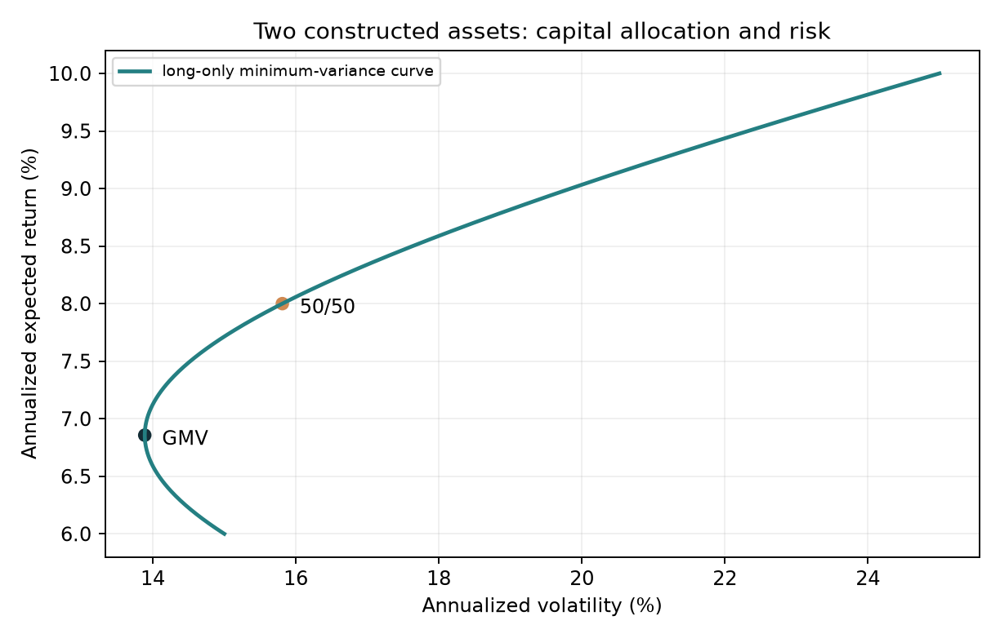

# Chapter 20 — Modern Portfolio Theory

> Portfolio risk depends on weights and covariance. A mean–variance frontier is an exact mathematical object conditional on its input moments; estimated moments give an in-sample frontier.
> Prerequisites: Chapter 5 for matrices and definiteness, Chapter 9 for Lagrange multipliers and convex quadratic programming, Chapter 11 for simple/excess returns, Chapter 14 for CML/SML, and Chapter 15 for covariance and factor risk.
> You will derive portfolio variance, calculate two-asset portfolios, derive the GMV and target-return frontier, check tangency conditions, and distinguish population from estimated moments.

## 1. Learning goals

1. State portfolio mean and variance for \(n\) assets, including the dimensions, units, interval, and timing of \(\mathbf w,\boldsymbol\mu,\Sigma\).
2. Explain how correlation changes a two-asset risk–return curve and find the threshold for a long-only portfolio to reduce risk below the least volatile asset.
3. Derive the global minimum variance (GMV) portfolio, exact-target minimum-variance portfolio, and frontier hyperbola with Lagrange multipliers; identify its inefficient branch.
4. Derive the tangency portfolio and optimal capital allocation line (CAL) under a single-period model with equal borrowing/lending rates; check the positive normalization denominator.
5. Interpret two historical French 10-industry estimated frontiers and extreme weights as in-sample descriptions.

Check the hand calculations against Section 9, retain complete solutions in Section 18, and identify axes, units, and samples in each figure. The inherited 13 core questions, two C10 bridge questions, and new 20-B01 all retain answers.

## 2. Why a quant needs portfolio theory

Chapter 11 measures single-asset returns and volatility; Chapter 14 discusses CAPM pricing of systematic risk. Allocating across assets raises three questions:

- Mean return is a weighted average of asset means.
- Risk is not a weighted average of asset volatilities. Assets with volatilities 15% and 25% can give an equal-weight volatility of 5% or 20%, depending on joint movement.
- Which weights deserve consideration under a risk budget, and which are dominated regardless of preference?

Modern portfolio theory (MPT) uses covariance to calculate risk and constrained optimization to select candidates. In the lifecycle, it follows signals/forecasts and precedes execution: upstream estimates of expected return and risk inform target weights.

Using weighted-average volatility misrepresents diversification. Calling the optimizer's output “the answer” ignores dependence on input moments. Chapter 21 and Project 3 handle estimation and implementation; here we develop the exact mathematics.

## 3. Intuition: correlation determines how much risk can offset

Take constructed annualized means 6%/10% and volatilities 15%/25%. Allocate \(w_1\) to asset 1 and \(1-w_1\) to asset 2. Mean moves linearly between the two asset means; risk depends on correlation \(\rho\).

**Calculate an ordinary portfolio first.** Set \(\rho=0.2\) and weights 50/50, fixed over one period. In annualized decimal units,
\[
\begin{aligned}
\sigma_{12}&=\rho\sigma_1\sigma_2=0.2(0.15)(0.25)=0.0075,\\
\Sigma&=\begin{pmatrix}0.0225&0.0075\\0.0075&0.0625\end{pmatrix},\quad
\mathbf w=\begin{pmatrix}0.5\\0.5\end{pmatrix},\\
E[R_p]&=0.5(0.06)+0.5(0.10)=0.08,\\
\operatorname{Var}(R_p)&=0.5^2(0.0225)+0.5^2(0.0625)+2(0.5)(0.5)(0.0075)\\
&=0.005625+0.015625+0.003750=0.025,\\
\sigma_p&=\sqrt{0.025}=0.158114.
\end{aligned}
\]
The first two contributions come from each asset's own variance; the third from joint movement. Two cross-products appear when expanding the square. Mean is 8% and volatility 15.81%, rather than the weighted-average 20%. A variance of 0.025 is not volatility 2.5%. Covariance has squared-return units, \(w\) is a two-by-one capital vector, and every matrix element uses the same frequency. Section 6.1 generalizes the expansion.



The horizontal axis is annualized volatility (%) and the vertical axis annualized expected return (%). This constructed curve restricts weights to 0–1. Locate the 50/50 point and the leftmost GMV. Points below the GMV mean have higher-return counterparts at equal risk. Section 8 calculates GMV and the 8% target. Optimality is conditional on the stated moments.

Change only correlation:

| Correlation | Lowest long-only volatility, \(0\le w_1\le 1\) | Interpretation |
|---|---:|---|
| +1.0 | 15.00%, all asset 1 | Joint movements leave no offset in the long-only set |
| +0.5 | 14.90% | A small offset |
| 0.0 | 12.86% | Uncorrelated components reduce variance |
| −0.5 | 9.28% | Opposing movements allow more offset |
| −1.0 | 0.00% | A riskless combination within this pair |

The chapter CLI calculated these teaching numbers. Correlation below 1 is not sufficient to reduce long-only risk below the safer asset. At 0.5, improvement is small; above \(\sigma_1/\sigma_2=0.6\), the long-only minimum holds only asset 1. Section 6.2 derives the threshold.


The axes show annualized portfolio volatility and mean (%). Only \(\rho\) varies in Section 8's constructed inputs. Solid segments restrict \(w_1\) to 0–1; dashed segments permit shorting. Moving from asset 1 toward asset 2 raises mean linearly; volatility may first fall and then rise. Lower correlation bends the curve left. At +1 the long-only segment is straight; at −1 it touches zero volatility. At +0.5 the leftmost point lies just left of asset 1, consistent with weak diversification near the 0.6 threshold.

Correlation measures linear co-movement over the specified horizon. It does not give the probability of joint tail crashes or ensure stability next period.

## 4. Mathematical foundations and notation

Use a single holding period \([t,t +1]\). Set weights at \(t\), then observe returns at \(t+1\).

- \(n\): number of risky assets.
- \(\mathbf R\in\mathbb R^{n\times 1}\): simple returns in decimals; \(R_i=0.02\) means 2%.
- \(\mathbf w\in\mathbb R^{n\times 1}\): invested amount divided by starting NAV; a negative weight means a short position, with proceeds accounted for elsewhere.
- \(\mathbf 1\in\mathbb R^{n\times 1}\): ones. \(\mathbf 1^\top w=1\) allocates the full budget to risky assets.
- \(\boldsymbol\mu=E[\mathbf R]\in\mathbb R^{n\times 1}\): expected decimal returns per period.
- \(\Sigma=\operatorname{Cov}(\mathbf R)\in\mathbb R^{n\times n}\): entries \(\sigma_{ij}=\operatorname{Cov}(R_i,R_j)\), in squared-return units; diagonals \(\sigma_i^2\) are variances.
- \(r_f\): a deterministic risk-free return for the same currency and period.

\(w^\top\) is 1-by-\(n\), \(w^\top\mu\) a scalar, \(\Sigma w\) \(n\)-by-one, and \(w^\top\Sigma w\) a scalar.

::: {.body-conditions title="Input conditions: one holding period"}

Keep frequency consistent across mean, covariance, and risk-free return. Constructed examples use annualized inputs; French calculations use monthly inputs. Multiplying monthly mean and covariance by 12 assumes IID returns for this reporting convention and ignores compounding. GMV weights do not change under proportional covariance scaling; tangency weights require matching \(r_f\) and mean frequencies.

:::

A covariance matrix is symmetric and positive semidefinite (PSD): \(w^\top\Sigma w=\operatorname{Var}(w^\top R)\ge 0\) for any \(w\). The inverse-based formulas require positive definiteness (PD), so every nonzero direction has strictly positive variance and \(\Sigma^{-1}\) exists. Singular PSD matrices remain legitimate covariance matrices; only the inverse formulas fail.

### 4.1 A valid covariance can still be singular

Construct \(R_1=0.06+Z\) and \(R_2=0.10+Z\), with \(E[Z]=0\) and \(\operatorname{Var}(Z)=0.04\). Then
\[
\Sigma=\begin{pmatrix}0.04&0.04\\0.04&0.04\end{pmatrix}.
\]
Eigenvalues 0.08 and 0 make it PSD but not PD. Every budget-one vector \((w,1-w)\) has random component \(Z\) and variance 0.04, yet mean \(0.10-0.04w\). A minimum variance exists, but all such vectors attain it: GMV is not unique. Failure to invert the matrix does not make portfolio mean or risk undefined.

Measure both legs against the same reference capital. The 0.04 below is deterministic PnL per unit of that reference, not return divided by zero net investment. The zero-budget direction \((1,-1)\) has constant return −0.04; reversing it gives +0.04. Under unrestricted, cost-free shorting, this constructed model contains an arbitrage direction. Long-only constraints prevent unlimited scaling. Do not interpret the toy model as an implementable trade. Adding a small diagonal term makes the matrix invertible by changing the risk input. Explain the estimation or regularization rationale instead of claiming the unique solution to the original problem.

If both assets instead have identical returns, the same covariance remains singular, but the zero-budget direction returns 0. Singularity alone therefore does not establish arbitrage. Check means and the feasible set too.

## 5. Definitions

::: {.body-definition title="Definition: portfolio return and expectation"}

**Portfolio return and expected return:**
\[
R_p=\sum_iw_iR_i=w^\top R,\qquad \mu_p=E[R_p]=w^\top\mu.
\]
The return identity is exact for beginning weights with no intraperiod trading: \(V_{t +1}=\sum_iw_iV_t(1+R_i)\), divided by \(V_t\) minus one. Do not substitute it for multiperiod compounding, intraperiod rebalancing, or log-return aggregation.

:::

**Covariance and portfolio variance:**
\[
\sigma_p^2=\sum_i\sum_jw_iw_j\sigma_{ij}=w^\top\Sigma w,\qquad \sigma_p=\sqrt{\sigma_p^2}.
\]
Section 6.1 derives the expression.

**Diversification:** variance reduction, at a fixed budget, from assets that do not move together perfectly. It does not mean an increase in return.

**Feasible set and minimum-variance frontier:** minimize variance for each target mean \(m\), subject to \(\mathbf 1^\top w=1\) and \(\mu^\top w=m\). With unrestricted shorting, PD covariance, and unequal means, the frontier lies on the right branch of a hyperbola in \((\sigma_p,\mu_p)\) space.

**GMV:** the minimum-variance portfolio under the budget constraint alone, at the frontier's leftmost point.

**Efficient frontier:** the segment with mean at least the GMV mean. The lower branch is inefficient because the upper branch offers a higher mean at the same volatility.

**Sharpe ratio:** \(S_p=(\mu_p-r_f)/\sigma_p\). Sharpe's 1994 discussion uses differential returns, representing a zero-investment strategy. With fixed \(r_f\), the differential is portfolio return minus the risk-free return. Here the ratio uses population moments (ex ante); a historical estimate is ex post.

**Risky and risk-free assets:** the ideal model allows unlimited borrowing and lending at the same \(r_f\), without margin, taxes, costs, or shorting restrictions. Risky weights \(w\) leave cash \(1-\mathbf 1^\top w\); negative cash denotes borrowing.

**Tangency portfolio:** the budget-one risky portfolio maximizing Sharpe with positive excess mean, when it exists. Its line to \(r_f\) is the optimal CAL.

**Population versus estimated moments:** \(\mu,\Sigma\) are parameters of the generating process; \(\hat\mu,\hat\Sigma\) are historical-window estimates. “Optimal” refers to the input moments. An estimated frontier is an in-sample object; Section 11 and Chapter 21 address its relationship to future results.

## 6. Derivations

### 6.1 From a double sum to a quadratic form

Start with the variance definition,
\[
\operatorname{Var}(R_p)=E[(R_p-\mu_p)^2].
\]
Substitute \(R_p-\mu_p=\sum_iw_i(R_i-\mu_i)\), then multiply out the finite sums:
\[
(R_p-\mu_p)^2=\Big(\sum_iw_i(R_i-\mu_i)\Big)\Big(\sum_jw_j(R_j-\mu_j)\Big)
=\sum_i\sum_jw_iw_j(R_i-\mu_i)(R_j-\mu_j).
\]
Beginning weights are constants. Linearity of expectation, with finite second moments, gives
\[
\operatorname{Var}(R_p)=\sum_i\sum_jw_iw_jE[(R_i-\mu_i)(R_j-\mu_j)]
=\sum_i\sum_jw_iw_j\sigma_{ij}.
\]
There are \(n^2\) terms: \(n\) own-variance terms and \(n(n-1)\) off-diagonal terms. Each of the \(n(n-1)/2\) distinct covariances appears twice. Since \((\Sigma w)_i=\sum_j\sigma_{ij}w_j\), left multiplication by \(w^\top\) yields the same sum:
\[
\sigma_p^2=w^\top\Sigma w.
\]
Weights have no units and covariance has squared-return units, so variance has squared-return units.

For two assets,
\[
\sigma_p^2=w_1^2\sigma_1^2+w_2^2\sigma_2^2+2w_1w_2\rho\sigma_1\sigma_2.
\]
Only the cross-term contains correlation. It explains the change in curvature.

**Equal weighting and asset count.** For \(n\) assets with common volatility \(\sigma\), common pairwise correlation \(\rho\), and \(w_i=1/n\),
\[
\sigma_p^2=n\frac{\sigma^2}{n^2}+n(n-1)\frac{\rho\sigma^2}{n^2}
=\frac{\sigma^2}{n}+\left(1-\frac1n\right)\rho\sigma^2
\longrightarrow\rho\sigma^2.
\]
At \(\sigma=20\%,\rho=0.3\), volatility is 20% for \(n=1\), \(\sqrt{0.004+0.0108}=12.17\%\) for \(n=10\), and \(\sqrt{0.012}=10.95\%\) in the limit. Rewrite as \(\sigma^2(1-\rho)/n+\rho\sigma^2\): the first component diversifies away; the common component remains. An equicorrelation matrix is PSD only if \(-1/(n-1)\le\rho\le 1\). A fixed negative correlation cannot remain valid as \(n\to\infty\), so the fixed-correlation limit requires \(\rho\ge 0\). This is the portfolio calculation behind Chapter 14's systematic-risk discussion.

### 6.2 Two-asset minimum variance and the correlation threshold

Set \(w_2=1-w_1\) and differentiate:
\[
\frac{d\sigma_p^2}{dw_1}=2w_1\sigma_1^2-2(1-w_1)\sigma_2^2+2(1-2w_1)\sigma_{12}.
\]
Setting this to zero and collecting \(w_1\) gives
\[
w_1^*=\frac{\sigma_2^2-\sigma_{12}}{\sigma_1^2+\sigma_2^2-2\sigma_{12}}.
\]
The denominator is \(\operatorname{Var}(R_1-R_2)\). It is positive unless the return difference is almost surely constant. Unequal means with identical random components can still give zero denominator. A positive denominator gives a positive second derivative and a minimum.

Assume \(\sigma_1<\sigma_2\). Then \(w_1^*<1\) is equivalent to \(\sigma_{12}<\sigma_1^2\), or
\[
\rho<\frac{\sigma_1}{\sigma_2}.
\]
The numerator is positive because \(\sigma_2^2-\sigma_{12}=\sigma_2(\sigma_2-\rho\sigma_1)\ge\sigma_2(\sigma_2-\sigma_1)>0\). Thus the strict threshold gives \(0<w_1^*<1\): both assets appear in the long-only minimum. In the example, the threshold is 0.6. Below it, minimum volatility falls below 15%; above it, \(w_1^*>1\), requiring a short in asset 2. The long-only optimum then holds only asset 1. At \(\rho=0.5\), the small improvement to 14.90% reflects proximity to the threshold.

### 6.3 GMV via Lagrange multipliers

Solve
\[
\min_w\ \tfrac12w^\top\Sigma w\quad\text{subject to}\quad\mathbf1^\top w=1.
\]
The factor \(1/2\) simplifies differentiation without changing the solution. Define \(L=\tfrac 12 w^\top\Sigma w-\lambda(\mathbf 1^\top w-1)\).

1. Symmetry gives \(\nabla_wL=\Sigma w-\lambda\mathbf 1\).
2. The first-order condition is \(\Sigma w=\lambda\mathbf 1\). Marginal variance contributions \((\Sigma w)_i\) are equal. Moving capital toward a lower contribution would otherwise reduce variance.
3. PD covariance permits \(w=\lambda\Sigma^{-1}\mathbf 1\).
4. The budget gives \(\lambda A=1\), with \(A=\mathbf 1^\top\Sigma^{-1}\mathbf 1>0\), since the inverse is also PD.
5. Hence
\[
w_{\mathrm{GMV}}=\frac{\Sigma^{-1}\mathbf1}{\mathbf1^\top\Sigma^{-1}\mathbf1},\qquad
\sigma^2_{\mathrm{GMV}}=\lambda^2\mathbf1^\top\Sigma^{-1}\mathbf1=\frac1A.
\]

The objective is strictly convex and the constraint affine, so the feasible stationary point is the unique global minimum. Scaling covariance by any positive \(c\) scales its inverse by \(1/c\), which normalization cancels. GMV weights therefore remain unchanged under proportional monthly/annualized covariance or decimal/percent conversion.

The implementation `global_minimum_variance_weights` solves \(\Sigma z=\mathbf 1\) and normalizes \(z\), avoiding an explicit inverse.

### 6.4 Exact target return and the frontier hyperbola

Add target mean \(m\):
\[
\min_w\ \tfrac12w^\top\Sigma w\quad\text{subject to}\quad\mathbf1^\top w=1,\quad\mu^\top w=m.
\]
With \(L=\tfrac 12 w^\top\Sigma w-\lambda(\mathbf 1^\top w-1)-\gamma(\mu^\top w-m)\), the first-order condition gives
\[
\Sigma w=\lambda\mathbf1+\gamma\mu,\qquad
w=\lambda\Sigma^{-1}\mathbf1+\gamma\Sigma^{-1}\mu.
\]
Define
\[
A=\mathbf1^\top\Sigma^{-1}\mathbf1,\quad B=\mathbf1^\top\Sigma^{-1}\mu,\quad
C=\mu^\top\Sigma^{-1}\mu,\quad D=AC-B^2.
\]
\(A\) has inverse-squared-return units, \(B\) inverse-return units, \(C\) is dimensionless, and \(D\) has inverse-squared-return units. Target \(m\) is a return; \(\lambda\) has squared-return units and \(\gamma\) return units. These constants summarize the input moments; they are not new observed data.

Substitute into both constraints:
\[
\lambda A+\gamma B=1,\qquad\lambda B+\gamma C=m.
\]
This two-by-two system has determinant \(D\). Cramer's rule gives
\[
\lambda=\frac{C-Bm}{D},\qquad\gamma=\frac{Am-B}{D}.
\]
In the inner product \(\langle x,y\rangle=x^\top\Sigma^{-1}y\), Cauchy–Schwarz gives \(B^2\le AC\), with equality precisely when \(\mu\) is proportional to \(\mathbf1\). If all means are equal, the two constraints repeat or conflict, and no return choice remains. Unequal means give \(D>0\); the target-weight function rejects the equal-mean degeneracy.

Simplify variance using the first-order condition:
\[
\begin{aligned}
\sigma_p^2&=w^\top\Sigma w\\
&=w^\top(\lambda\mathbf1+\gamma\mu) &&\text{first-order condition}\\
&=\lambda+\gamma m &&\text{budget and target}\\
&=\frac{Am^2-2Bm+C}{D} &&\text{substitute and collect}.
\end{aligned}
\]
Variance is quadratic in \(m\), producing a hyperbola in \((\sigma_p,m)\). Minimizing over \(m\) gives \(m=B/A\) and variance \((C-B^2/A)/D=1/A\), agreeing with GMV.

- The upper branch \(m\ge B/A\) is efficient.
- The lower branch \(m<B/A\) is inefficient. Reflection to target \(2B/A-m\) gives equal risk and higher mean. The target-weight function returns either branch; check efficiency yourself.

**Two-fund separation.** \(w(m)\) is affine in \(m\). Affine combinations of two distinct frontier portfolios, with coefficients summing to one, remain on the minimum-variance frontier. Allowing coefficients outside 0–1 generates the whole frontier. Targets below \(B/A\) generate its inefficient lower branch, rather than efficient portfolios.

**Two assets.** With \(n=2\), the two equality constraints uniquely determine weights; optimization reduces to solving equations. For \(n\ge 3\), \(n-2\) free dimensions remain for variance minimization.

### 6.5 Cash, tangency, and the CAL

Risky weights need not sum to one. Cash \(1-\mathbf 1^\top w\) earns \(r_f\), giving return \(r_f+w^\top(R-r_f\mathbf 1)\). Define \(e=\mu-r_f\mathbf 1\). For target excess return \(\epsilon>0\), solve
\[
\min_w\ \tfrac12w^\top\Sigma w\quad\text{subject to}\quad e^\top w=\epsilon.
\]
Then
\[
\begin{aligned}
L(w,\kappa)&=\tfrac12w^\top\Sigma w-\kappa(e^\top w-\epsilon),\\
\nabla_wL&=\Sigma w-\kappa e=0.
\end{aligned}
\]
Symmetry gives the quadratic gradient; the constraint gradient is \(e\). Both \(\epsilon\) and multiplier \(\kappa\) have same-frequency return units; \(H\) below is dimensionless. Thus \(w=\kappa\Sigma^{-1}e\), and substitution into the target gives \(\kappa H=\epsilon\), where
\[
H=e^\top\Sigma^{-1}e=C-2r_fB+r_f^2A.
\]
PD inverse gives \(H>0\) for \(e\ne 0\). Completing the square gives \(H=A(r_f-B/A)^2+D/A\ge D/A>0\) when means differ. Therefore \(\sigma_p^2=\epsilon^2/H\), or \(\epsilon=\sqrt H\,\sigma_p\). The optimal CAL begins at \((0,r_f)\) with slope \(\sqrt H\), the maximum attainable Sharpe for this feasible set.

Call it the **capital market line (CML)** only with Chapter 14's CAPM equilibrium, market clearing, and the market portfolio as tangency fund. Constructed moment inputs do not establish equilibrium, so our plots say CAL. Investors share direction \(\Sigma^{-1}e\) and scale it by risk preference: Tobin-style two-fund separation.

Normalize the direction to a risky-only budget-one portfolio:
\[
w_T=\frac{\Sigma^{-1}(\mu-r_f\mathbf1)}{\mathbf1^\top\Sigma^{-1}(\mu-r_f\mathbf1)},\qquad
\mathbf1^\top\Sigma^{-1}(\mu-r_f\mathbf1)=B-r_fA.
\]
A positive denominator requires \(r_f<B/A\), the GMV mean. Then \(e^\top w_T=H/(B-r_fA)>0\), and the fund lies at the upper-branch tangency. If \(r_f>B/A\), the denominator is negative; normalized excess mean is negative and the fund lies on the lower branch with the lowest Sharpe. The optimal cash allocation instead shorts that fund. At \(r_f=B/A\), the direction sums to zero and cannot normalize to a budget-one risky fund. The CAL still exists with slope \(\sqrt{D/A}\). `tangency_weights` rejects nonpositive denominators.

Direct Sharpe maximization gives the same direction. For
\[
S(w)=\frac{e^\top w}{\sqrt{w^\top\Sigma w}},
\]
positive scaling leaves the ratio unchanged (degree-zero homogeneity). Its stationary condition is
\[
e\sqrt{w^\top\Sigma w}-\frac{e^\top w}{\sqrt{w^\top\Sigma w}}\Sigma w=0,
\]
so \(\Sigma w\propto e\). The ratio itself is not concave. With long-only constraints, Chapter 9 Section 7 and 9-C01 establish the convex-QP substitution \(y=w/(e^\top w)\), conditional on positive excess return and homogeneous rewriting of weight caps. Chapter 21 implements it for rolling portfolios.

List the ideal assumptions: one period, unlimited equal-rate borrowing/lending, no costs/taxes/margin/shorting restrictions, common moments across investors, and divisible assets. If borrowing costs more than lending earns, the two rates generally give different tangencies. Between them, an investor may follow a segment of the risky efficient frontier, with lending/borrowing lines outside. Do not draw two lines joined at a presumed common tangency. Different investors may hold different risky funds.

### 6.6 Long-only KKT and why clipping is not optimization

Adding \(w\ge 0\) replaces the general closed form with numerical quadratic programming (QP). For long-only GMV, Chapter 9's Karush–Kuhn–Tucker (KKT) conditions require \(\lambda\) and \(\nu\ge 0\) such that
\[
\Sigma w=\lambda\mathbf1+\nu,\qquad\nu_iw_i=0.
\]
Positive holdings have \(\nu_i=0\) and equal marginal variances. A zero-weight asset has marginal variance no lower than \(\lambda\); buying it in exchange for a held asset does not reduce variance at the optimum.

Setting negative unrestricted GMV weights to zero and rescaling typically violates these conditions. Removing shorts changes hedges and leaves unequal marginal variances among the surviving assets. In Section 11, the 2000–2009 clipped portfolio has monthly volatility 3.42% versus 3.34% for the constrained QP. The CLI uses Chapter 9's `solve_mean_variance` for the long-only frontier.

## 7. Financial interpretation

**Covariance determines marginal portfolio variance.** Asset \(i\)'s contribution to the current portfolio depends on \((\Sigma w)_i=\operatorname{Cov}(R_i,R_p)\), rather than its standalone variance. This describes risk; it does not establish risk compensation. CAPM equilibrium in Chapter 14 connects market covariance to expected excess return.

**The frontier does not choose a point for you.** It excludes dominated portfolios. Risk aversion or a risk budget chooses among efficient points, as in Chapter 9's utility \(w^\top\mu-\tfrac{\gamma}{2}w^\top\Sigma w\).

**Sharpe has a scope.** It reduces mean and volatility to one number and suits portfolios that can be scaled with risk-free borrowing/lending. A higher-Sharpe fund then offers a higher mean at any volatility. Leverage limits, heavy tails, and skewness require additional drawdown/tail measures (Chapters 32–33).

**Means choose direction; covariance determines hedging.** \(\Sigma^{-1}e\) is linear in excess means. The inverse amplifies mean differences in directions with low variance, including differences between highly correlated assets. Small mean-estimation changes can create large opposing positions; Section 11 illustrates extreme weights.

**Implementation matters.** Known population moments and unlimited cost-free financing/shorting are idealizations. Financing spreads, borrowing fees, margin, turnover costs, and estimation error affect the apparent Sharpe. Chapter 21 addresses them.

```{=latex}
\needspace{14\baselineskip}
```

## 8. Numerical example: two assets

::: {.body-example title="Worked example: a two-asset portfolio in five steps"}

These are constructed annualized decimal inputs:
\[
\mu=\begin{bmatrix}0.06\\0.10\end{bmatrix},\quad
\sigma_1=0.15,\ \sigma_2=0.25,\ \rho=0.2,\quad
\Sigma=\begin{bmatrix}0.0225&0.0075\\0.0075&0.0625\end{bmatrix},\quad r_f=0.02.
\]
Covariance is \(0.2(0.15)(0.25)=0.0075\).

**Step 1: GMV.**
\[
w_1=\frac{0.0625-0.0075}{0.0225+0.0625-2(0.0075)}=\frac{0.055}{0.070}=\frac{11}{14}=0.785714,\quad w_2=\frac3{14}=0.214286.
\]
Mean is \(0.06(11/14)+0.10(3/14)=0.068571\). Variance is
\[
\begin{aligned}
\sigma_G^2&=(11/14)^2(0.0225)+(3/14)^2(0.0625)\\
&\quad+2(11/14)(3/14)(0.0075)\\
&=0.013890+0.002870+0.002526=0.019286.
\end{aligned}
\]
Volatility 13.887% is below 15%, consistent with correlation 0.2 below 0.6.

**Step 2: frontier constants.** \(\det\Sigma=0.0225(0.0625)-0.0075^2=0.00135\), so
\[
\Sigma^{-1}=\frac1{0.00135}\begin{bmatrix}0.0625&-0.0075\\-0.0075&0.0225\end{bmatrix}.
\]
\(\Sigma^{-1}\mathbf 1=[0.055,0.015]^\top/0.00135=[40.7407,11.1111]^\top\), and \(\Sigma^{-1}\mu=[0.003,0.0018]^\top/0.00135=[2.2222,1.3333]^\top\). Thus
\[
A=51.8519,\quad B=3.5556,\quad
C=0.06(2.2222)+0.10(1.3333)=0.26667,\quad D=1.18519.
\]
Check \(B/A=0.068571\) and \(1/A=0.019286\).

**Step 3: target 8%.** Budget and target give \(0.06 w_1+0.10(1-w_1)=0.08\), hence \(w_1=0.5\). The frontier formula gives
\[
\sigma^2=\frac{51.8519(0.0064)-2(3.5556)(0.08)+0.26667}{1.18519}
=\frac{0.331852-0.568889+0.266667}{1.18519}=0.025.
\]
Direct expansion (0.25(0.0225)+0.25(0.0625)+2(0.25)(0.0075)) agrees; volatility 15.81%. Displayed constants are rounded; use full precision for computation.

**Step 4: tangency.** \(B-r_fA=3.5556-1.0370=2.5185>0\). The direction is
\[
\Sigma^{-1}(\mu-0.02\mathbf1)=[2.2222-0.8148,1.3333-0.2222]^\top=[1.4074,1.1111]^\top.
\]
Normalize to \(w_T=(19/34,15/34)=(0.558824,0.441176)\). Mean 0.077647, variance 0.022889, volatility 15.129%, and Sharpe \((0.077647-0.02)/0.15129=0.38103\).

**Step 5: check with \(H\).** \(H=0.26667-0.14222+0.02074=0.14519\); \(\sqrt H=0.38103\). A 10%-volatility CAL allocation holds \(0.10/0.15129=66.1\%\) in the tangency fund and 33.9% cash, with mean \(0.02+0.38103(0.10)=5.81\%\).

:::


The three-asset constructed inputs are annualized means 5%/8%/12%, volatilities 12%/18%/28%, correlations 0.3/0.1/0.4, and \(r_f=2\%\). Navy solid shows the unrestricted efficient frontier and dotted its inefficient lower branch; orange shows Chapter 9's long-only QP frontier; red shows CAL. GMV is leftmost, at volatility 11.02% and mean 6.07%. CAL touches at volatility 13.24%, mean 7.88%, Sharpe 0.444. At low risk, long-only and unrestricted frontiers coincide; when a weight reaches zero, the constrained frontier separates and lies inside the unrestricted opportunity set. It ends at the highest-mean single asset.

## 9. Python implementation

### Default accepted-reader entry point

From the shared I3 reader root, after README.md setup, run:

```bash
.venv/bin/python run_notebook.py notebooks/ch20_portfolio_theory.ipynb
```

The constructed notebook does not read omitted French inputs or download data. Each run writes a fresh `runs/` directory. Historical CLI/test/data paths below refer to the course root. The French route requires authorized local data and manifests and was skipped in this batch. The portable I3 CLI defaults to a new UUID run and rejects overwriting. Stay at the reader root for its commands. See README.md and OPTIONAL_DATA.md; a constructed notebook check does not rerun historical market calculations.

`src/quant_course/portfolio_theory.py` supplies:

- `portfolio_moments`: mean, variance, volatility for given weights;
- `global_minimum_variance_weights`: budget-constrained GMV;
- `minimum_variance_target_weights`: exact-target frontier;
- `tangency_weights`: positive-denominator tangency fund.

Weight functions impose a budget but permit shorts/leverage and solve linear systems. Moment calculations reject nonsymmetric/non-PSD matrices; inverse-based weights additionally require numerical PD, and target weights require unequal means. Moment evaluation accepts singular PSD input. Long-only frontiers reuse `src/quant_course/optimization_tools.py` and Chapter 9's `solve_mean_variance`.

`code/ch20_portfolio_theory.py` recalculates Section 8, draws figures, and provides an optional descriptive French route. It reads local files, checks manifest SHA-256, and does not download. The portable default output is a fresh UUID's results/figures directories; specify fresh targets for the optional historical route:

```bash
.venv/bin/python code/ch20_portfolio_theory.py --output-dir /tmp/ch20-out --figure-dir /tmp/ch20-fig
```

`notebooks/ch20_portfolio_theory.ipynb` calls the shared functions and asserts results. Historical tests are `tests/test_ch20_portfolio_theory.py` and `tests/test_ch20_workflow.py`; they are not bundled as original tests in the reader. Use the course source and its evidence records for these paths.

The block below recalculates Section 8 in annualized decimals:

```python
import numpy as np
from quant_course.portfolio_theory import (
    global_minimum_variance_weights, minimum_variance_target_weights,
    portfolio_moments, tangency_weights,
)

mu = np.array([0.06, 0.10])
cov = np.array([[0.0225, 0.0075], [0.0075, 0.0625]])
rf = 0.02

gmv = global_minimum_variance_weights(cov)
assert np.allclose(gmv, [11 / 14, 3 / 14])
m = portfolio_moments(gmv, mu, cov)
assert np.isclose(m.expected_return, 0.068571428571) and np.isclose(m.variance, 0.019285714286)

ones = np.ones(2)
A = ones @ np.linalg.solve(cov, ones)
B = ones @ np.linalg.solve(cov, mu)
C = mu @ np.linalg.solve(cov, mu)
D = A * C - B ** 2
assert np.isclose(B / A, m.expected_return) and np.isclose(1 / A, m.variance)

target = minimum_variance_target_weights(mu, cov, target_return=0.08)
assert np.allclose(target, [0.5, 0.5])
assert np.isclose(target @ cov @ target, (A * 0.08 ** 2 - 2 * B * 0.08 + C) / D)

tangent = tangency_weights(mu, cov, risk_free_return=rf)
assert np.allclose(tangent, [19 / 34, 15 / 34])
t = portfolio_moments(tangent, mu, cov)
sharpe = (t.expected_return - rf) / t.volatility
assert np.isclose(sharpe ** 2, C - 2 * rf * B + rf ** 2 * A)
print(round(sharpe, 5))  # 0.38103
```

The constructed model sets beginning weights for one common interval. French month labels denote calendar-month returns. Each window's moments use all 120 months, with no signal or fill time: these are historical descriptions. The loader rejects missing/duplicate months and nonfinite values instead of dropping rows.

## 10. Visualization

Read the correlation plot beside Section 3 and the three-asset/cash plot beside Section 8. The next plot shows historical changes in estimated moments.


Axes are monthly volatility (%) and monthly mean (%). Panels use 2000-01–2009-12 and 2010-01–2019-12,120 months each. Black dots are the 10 industries, navy the estimated unrestricted frontier, orange long-only, and red the in-sample tangency line. Industry locations change across windows: HiTec has negative mean in the first and the highest in the second. The first tangency lies beyond the plot, with monthly volatility above 9% and gross exposure about 5.8. These plots describe what follows *if sample moments equal population moments*. They do not forecast the next window.

## 11. Real market example: estimated French 10-industry frontiers

The historical source is Kenneth R. French's value-weighted monthly total returns for 10 Industry Portfolios and RF from the FF3 file, downloaded and frozen 2026-10-05. The full source sample spans 1926-07–2026-08,1,202 months. Processed industry CSV SHA-256 is ` 3b097d810c295d64eedfa1ece7067ff2a0707f5ca90e33935df9949251f70950`. `src/quant_course/french_frozen.py` checks six raw/extracted/processed files against manifests. These are currently revised historical data without historical vintages or reception logs; they are not PIT data. Industry research portfolios are not tradable products with execution records. Raw data are omitted from the portable reader.

For each window, historical calculations used sample means, covariance with divisor \(T-1\), and window-average RF. Monthly results were:

| Window | Mean RF | GMV vol | Long-only min vol | 1/N vol | In-sample tangency Sharpe | Tangency gross exposure | Covariance condition number |
|---|---:|---:|---:|---:|---:|---:|---:|
| 2000-01–2009-12 | 0.227% | 3.07% | 3.34% | 4.45% | 0.300 | 5.84 | 86.8 |
| 2010-01–2019-12 | 0.043% | 2.66% | 2.75% | 3.58% | 0.475 | 2.80 | 101.1 |

Weights in percent:

| Fund | NoDur | Durbl | Manuf | Enrgy | HiTec | Telcm | Shops | Hlth | Utils | Other |
|---|---:|---:|---:|---:|---:|---:|---:|---:|---:|---:|
| 2000 s GMV | 48.2 | −5.5 | −18.5 | 9.5 | 0.6 | −1.1 | 43.2 | 34.3 | 14.0 | −24.7 |
| 2000 s tangency | 159.2 | 6.4 | 29.9 | 51.3 | 24.4 | −122.9 | 51.0 | −10.8 | 19.5 | −108.2 |
| 2000 s long-only min | 40.6 | 0.0 | 0.0 | 2.4 | 0.0 | 0.0 | 13.0 | 31.0 | 13.0 | 0.0 |
| 2010 s GMV | 21.7 | −13.6 | −13.4 | −7.3 | 3.4 | 1.2 | 13.8 | 11.5 | 52.3 | 30.3 |
| 2010 s tangency | −20.0 | −26.3 | 12.6 | −43.4 | 23.4 | 28.8 | 39.2 | 7.0 | 49.0 | 29.7 |
| 2010 s long-only min | 23.4 | 0.0 | 0.0 | 0.0 | 0.0 | 0.0 | 11.1 | 15.2 | 49.7 | 0.6 |

Interpretation against theory:

- GMV and long-only minimum variance have lower in-sample volatility than 1/N in both windows:3.07%/3.34% versus 4.45%, and 2.66%/2.75% versus 3.58%. They use covariance without mean estimates. Persistence out of sample requires Project 3's design.
- Their large long holdings include low-volatility, lower-correlated industries such as NoDur, Hlth, Utils, and Shops. Held-asset marginal variances satisfy the relevant unrestricted or constrained conditions. Within a window, the constraint explains the difference between GMV and long-only minimum variance.
- Clipping and normalizing GMV gives 3.42%/2.88% volatility, above QP's 3.34%/2.75%.
- Tangency weights change sharply: NoDur +159% to −20%, Enrgy +51% to −43%. Their in-sample Sharpe exceeds each individual industry's, using the same data for estimation and evaluation.
- RF 0.227%/month exceeds the later window's 0.043%. Both lie below the corresponding GMV means 0.612%/1.109%, so both tangency denominators are positive.

These results show how fixed formulas respond to different historical windows. They do not evaluate earlier weights in the next window. That requires frozen rolling train/test rules and turnover/cost ledgers, as in Chapter 21 and Project 3. This section supplies no out-of-sample, after-cost, or tradability conclusion.

## 12. Common mistakes

| Error | Consequence | Correction |
|---|---|---|
| Volatility \(\sum_iw_i\sigma_i\) | Ignores covariance; equality holds for perfectly correlated long holdings, while other long-only cases generally give an overestimate; shorts need separate calculation | Use \(\sqrt{w^\top\Sigma w}\) |
| Correlation below 1 guarantees improvement below the safer asset | Above \(\sigma_1/\sigma_2\), the long-only optimum holds only the safer asset | Calculate the threshold |
| Calling the whole frontier efficient | Includes dominated lower-branch portfolios | Restrict to \(m\ge B/A\) |
| Monthly mean/covariance with annual \(r_f\) | Wrong excess mean/direction; denominator can change sign | Match periods |
| Clipped GMV called long-only optimal | Violates KKT;3.42% versus QP 3.34% | Solve constrained QP, check status/residuals |
| Normalize at \(r_f\ge B/A\) | Negative excess mean or zero denominator | Check \(B-r_fA>0\) |
| Passing small monthly covariance directly to a solver | Historical CLARABEL output said optimal but exceeded the core's \(10^{-6}\) budget tolerance | In a zero-mean problem scale covariance by its largest absolute entry; still check status and residuals |
| Present in-sample Sharpe 0.475 as attainable strategy Sharpe | Reuses estimation data for evaluation | Evaluate rolling out-of-sample, after costs |

Runnable comparison:

```python
import numpy as np
from quant_course.portfolio_theory import global_minimum_variance_weights, tangency_weights

cov = np.array([[0.0225, 0.0075], [0.0075, 0.0625]])
w = np.array([0.5, 0.5])
wrong_vol = w @ np.sqrt(np.diag(cov))          # Weighted-average volatility
right_vol = np.sqrt(w @ cov @ w)               # Portfolio volatility
print(round(wrong_vol, 4), round(right_vol, 4))  # 0.2 0.1581

mu_monthly = np.array([0.06, 0.10]) / 12
cov_monthly = cov / 12
annual_rf = 0.02
try:  # Monthly means with annual RF: denominator turns negative
    tangency_weights(mu_monthly, cov_monthly, risk_free_return=annual_rf)
except ValueError as error:
    print("rejected:", error)
fixed = tangency_weights(mu_monthly, cov_monthly, risk_free_return=annual_rf / 12)
assert np.allclose(fixed, [19 / 34, 15 / 34])
assert np.allclose(global_minimum_variance_weights(cov_monthly), [11 / 14, 3 / 14])
```

## 13. Quant research application

A falsifiable question is whether monthly rolling estimated tangency portfolios, under frozen windows/estimators/constraints, improve after-cost out-of-sample Sharpe over equal weight and minimum variance, which do not estimate means.

1. Record source, version, return definition, sample, missing-data rules, and hashes. Revised French industry data support bounded descriptive research without historical vintages.
2. At month \(t-1\) end, estimate moments over \([t-W,t-1]\), set weights, and hold month \(t\). Add a month's information lag as sensitivity if publication delay is relevant.
3. Freeze window length, covariance estimator, caps, cost rate, and fallback before evaluating. Do not tune on the out-of-sample period.
4. Separate drifted pretrade weights, turnover, costs, gross return, and net return.
5. Compare 1/N and minimum variance, plus ERC as a risk-contribution benchmark. Objectives, inputs, and feasible sets differ, so return differences do not isolate a causal contribution from mean estimation.
6. Report uncertainty intervals for return and Sharpe differences, for example paired block bootstrap; retain negative and zero results.
7. Lack of improvement after costs, or improvement restricted to isolated parameter settings, does not support usefulness.

### 13.1 From moments to capital: four interfaces

With NAV 1,000,000, a 10% target means 100,000 currency units. A fully invested risky portfolio satisfies \(\mathbf 1^\top w=1\); cash equals \(1-\mathbf 1^\top w\), with negative cash denoting financing. Section 6 permits shorts; Chapter 21's unconstrained BL/Kelly permits financing. Do not treat these as Project 3's fully invested long-only weights. Constraints define permitted holdings; objectives select among them.

Project 3's frozen monthly ten-industry specification uses:

| Strategy | Objective/input rationale | Feasible set and fallback |
|---|---|---|
| Equal weight (EW) | 10% each, no moment estimation; tests whether estimation/optimization adds value | Long-only, fully invested; predefined optimization fallback |
| Minimum variance (MinVar) | Minimize \(w^\top\hat\Sigma w\), without mean forecasts | Long-only, full investment,40% per-asset cap; log failure and fall back to EW |
| Maximum Sharpe (MaxSharpe) | Training-window excess mean divided by predicted volatility; estimates both moments | Same 40% cap; no positive-excess feasible portfolio or solver failure triggers EW |
| Equal risk contribution (ERC) | Covariance only;10% volatility-contribution share per asset | Positive weights, full investment, no 40% cap; log Newton failure and use EW |

The shared MinVar/MaxSharpe cap aids their comparison; ERC has a wider feasible set. Observed ERC weights below 40% do not establish a guaranteed cap. Strategy differences mix objectives, estimates, and constraints. Report net mean, Sharpe, volatility, drawdown, turnover, and concentration. Minimum variance need not maximize return; equal risk shares need not improve net Sharpe. Chapter 21 separates descriptions from difference intervals.

### 13.2 Two information clocks, one execution time

Month \(t\) names the holding return. This is a backtest clock, rather than a historical reception log:

| Specification | W-month training interval | Decision/virtual fill | Holding interval |
|---|---|---|---|
| Frozen Project 3 lag 0 | \([t-W,t-1]\), ends at \(t-1\) | End of \(t-1\), assuming its data have arrived | End of \(t-1\) to end of \(t\) |
| Teaching lag 1/project sensitivity | \([t-W-1,t-2]\), ends at \(t-2\) | Still end of \(t-1\); one-month information buffer | Same holding month \(t\) |

For January 1990 with \(W=60\), lag 0 uses January 1985–December 1989; lag 1 uses December 1984–November 1989. Both virtually rebalance at December 1989 end. Evaluation does not shift one month.

20-C02 adopts lag 1 as a conservative teaching convention. Project 3 retains idealized lag 0 at the month boundary and checks lag 1 sensitivity. A currently revised French snapshot has no contemporaneous publication versions or fill logs. Lag 1 changes the window; it does not prove historical arrival or tradability. It supports comparisons under a limited rolling specification, with historical availability and execution requiring separate evidence.

## 14. Chapter map

Covariance connects asset risks through \(\sigma_p^2=w^\top\Sigma w\). Minimizing under a budget gives GMV; adding a target mean gives the hyperbola, with the upper branch efficient. Equal-rate unlimited cash borrowing/lending gives a common risky direction and optimal CAL; a normalized positive-Sharpe tangency fund additionally requires \(r_f<B/A\). The inverse-based weights require PD covariance; definitions of mean/risk require finite second moments and allow singular PSD covariance. Long-only constraints call for Chapter 9's QP.

Check input horizons and units, select the objective/feasible set, and treat estimated frontiers as in-sample relationships. Use out-of-sample and after-cost evidence to assess a portfolio decision (Chapter 21/Project 3).

## 15. Exercises

Full solutions follow in Section 18.

**20-E01 (dimensions):** For 10 monthly assets, give dimensions/units of \(w,\mu,\Sigma,\Sigma w,w^\top\Sigma w\). Interpret \((\Sigma w)_i\).

**20-E02 (variance expansion):** \(w=(0.5,0.3,0.2)\), volatilities 0.10/0.20/0.30, correlations 0.5/0/−0.2 for 12/13/23. Write all nine terms and calculate variance/volatility.

**20-E03 (two-asset GMV):** Volatilities 0.20/0.30 and correlation 0.5. Calculate GMV weights, variance, volatility, and long-only feasibility.

**20-E04 (threshold):** Prove that with \(\sigma_1<\sigma_2\), both assets have positive long-only minimum-variance weights iff \(\rho<\sigma_1/\sigma_2\). Above the threshold, can unrestricted GMV risk fall below \(\sigma_1\)?

**20-E05 (limit):** Equal-weight \(n\) assets with volatility 25% and common correlation 0.4. Calculate volatility for \(n=1,5,20,\infty\). Identify diversifiable/common variance.

**20-E06 (lower branch):** Use Section 8 constants for target 5%. Find weights/variance and a higher-mean frontier portfolio at the same risk.

**20-E07 (tangency):** For Section 8 assets with \(r_f=0.08\), calculate the denominator, normalized direction's weights/mean, and CAL slope. Classify the normalized fund.

**20-E08 (estimation):** Under IID, a monthly volatility 4.5% and 120 observations give what mean standard error? Compare it with industry monthly mean differences 0.1%–0.5% and explain changing tangency weights.

**20-B01 (singularity and mean):** For Section 4.1, calculate mean/variance for any budget-one weights, the minimum-variance solution set, and zero-budget direction's return. If both means become 6%, does singularity still establish arbitrage?

## 16. Programming exercises

**20-P01:** Write `frontier_constants(mu, cov)` returning \(A,B,C,D\). Use Section 8's three-asset figure inputs and targets 4%/7%/11% to assert the frontier-variance formula and GMV mean \(B/A\).

**20-P02:** With the authorized frozen French source for 2010-01–2019-12, calculate unrestricted GMV, clipped/normalized GMV, and Chapter 9 long-only QP. Assert QP volatility no greater than clipped volatility and report both monthly values.

**20-P03:** Prove invariance of GMV/target weights when mean×100, covariance×10000, target×100. Construct monthly moments with annual \(r_f\), confirming rejection when the denominator is negative. Show a mismatched example with positive denominator that still returns weights; the function has no frequency metadata. Match frequencies and recover 19/34,15/34.

## 17. Challenge problems

**20-C01:** Prove \(D>0\) unless all means agree; prove an affine combination of two frontier points remains on the frontier; prove equality of the tangency slope and the line slope from \((0,r_f)\). Check the three-asset example. Grade 2 points per proof and 2 for the numerical check.

**20-C02:** Design a test of rolling estimated tangency after-cost superiority to 1/N. Specify data, timing, windows, estimators, constraints, failure/fallback, cost ledger, inference, and falsification. Explain why in-sample Sharpe cannot establish it.

### C10 bridge questions, with separate stable IDs

**20-R01:** For fully invested ten-industry EW/MinVar/MaxSharpe/ERC, identify moments and which methods carry a 40% cap. Why does slightly higher ERC net Sharpe not isolate an algorithm advantage under common constraints? At NAV 1,000,000, give EW amounts.

**20-R02:** January 1990 holding month, \(W=60\): give lag 0/lag 1 training endpoints, virtual fill, and holding interval. Does lag 1 prove contemporaneous French availability or industry-portfolio execution?

\clearpage

## 18. Solutions / Solution Hints

### 20-E01

\(w\):10-by-one, dimensionless NAV fractions. \(\mu\):10-by-one, monthly decimal returns. \(\Sigma\):10-by-ten, squared monthly returns. \(\Sigma w\):10-by-one, squared-return units. \(w^\top\Sigma w\):scalar monthly variance, whose square root is monthly volatility. \((\Sigma w)_i=\sum_j\sigma_{ij}w_j=\operatorname{Cov}(R_i,R_p)\), half the partial derivative of variance with respect to \(w_i\), or marginal variance contribution.

### 20-E02

Covariances are \(\sigma_{12}=0.010\), \(\sigma_{13}=0\), \(\sigma_{23}=-0.012\). The nine terms are three diagonals: \(0.25(0.01)=0.0025\), \(0.09(0.04)=0.0036\), \(0.04(0.09)=0.0036\); two 12 terms of \(0.15(0.010)=0.0015\); two 13 terms of 0; two 23 terms of \(0.06(-0.012)=-0.00072\). Sum \(0.0025+0.0036+0.0036+0.0030-0.00144=0.01126\); volatility 10.61%. Weighted-average volatility 17% differs because correlations are imperfect, with a negative 23 contribution.

### 20-E03

\(\sigma_{12}=0.5(0.2)(0.3)=0.03\).
\[
w_1=\frac{0.09-0.03}{0.04+0.09-0.06}=\frac{0.06}{0.07}=0.857143,\quad w_2=0.142857.
\]
Variance \(0.734694(0.04)+0.020408(0.09)+2(0.857143)(0.142857)(0.03)=0.029388+0.001837+0.007347=0.038571\), volatility 19.64%. Both weights are positive, as correlation 0.5 is below 0.667.

### 20-E04

Section 6.2 gives \(w_1^*<1\iff\sigma_{12}<\sigma_1^2\iff\rho<\sigma_1/\sigma_2\). Also \(w_1^*>0\) because \(\sigma_{12}\le\sigma_1\sigma_2<\sigma_2^2\). The interior minimum is thus long-only iff the strict threshold holds, with risk below the safer asset. Above it, \(w_1^*>1\) shorts asset 2; the derivative at \(w_1=1\) is \(2(\sigma_1^2-\sigma_{12})<0\), so increasing \(w_1\) strictly reduces variance. At equality, GMV is asset 1. Borrowing, margin, and financing costs lie outside this model.

### 20-E05

\(\sigma^2=0.0625\), common variance 0.025, and \(\sigma_p^2=0.0625/n+(1-1/n)0.025\). At 1, variance 0.0625 and volatility 25%; at 5, \(0.0125+0.02=0.0325\),18.03%; at 20, \(0.003125+0.02375=0.026875\),16.39%; at infinity,0.025,15.81%. The diversifiable component \(\sigma^2(1-\rho)/n\) vanishes; the common component \(\rho\sigma^2\) remains.

### 20-E06

\(0.06 w_1+0.10(1-w_1)=0.05\) gives 1.25/−0.25. The frontier variance is
\[
\frac{51.8519(0.0025)-2(3.5556)(0.05)+0.26667}{1.18519}=0.034375,
\]
with full-precision constants, volatility 18.54%. Direct expansion \(0.035156+0.003906-0.004688=0.034375\) agrees. Mirror target \(2 B/A-0.05=0.087143\) gives \(w_1=0.32143\) and the same variance, with mean 3.71 percentage points higher. The 5% target is inefficient.

### 20-E07

\(B-0.08 A=3.5556-4.1481=-0.5926<0\). No positive-excess, budget-one tangency fund exists, although optimal CAL with cash still exists. Direction \([-1.0370,0.4444]\) normalizes to 1.75/−0.75; mean \(0.06(1.75)-0.10(0.75)=0.03<0.08\). It is on the lower branch and minimizes Sharpe. \(H=0.26667-0.56889+0.33185=0.02963\), so CAL slope is 0.1721. The positive-excess cash solution shorts that fund, corresponding to positive \(\kappa\) times the unnormalized negative-net-investment direction. The core function rejects this normalization.

### 20-E08

IID standard error \(0.045/\sqrt{120}=0.004108=0.4108\%\) per month. With serial dependence, use long-run variance, for example HAC, instead of mechanically dividing by \(\sqrt T\). Errors of this size rival 0.1%–0.5% monthly mean gaps and can change rankings. \(\Sigma^{-1}\hat e\) amplifies differences between correlated assets, causing large weight changes. NoDur's +159% to −20% illustrates instability across windows, without identifying its cause from two windows alone. Covariance also has estimation error; Chapter 21 discusses its typical relative precision.

### 20-B01

For \((w,1-w)\), mean is \(0.10-0.04w\) and variance 0.04. All real \(w\) minimize budget-constrained variance; the inverse formula is unavailable. Using equal reference-capital notionals, direction 1/−1 has deterministic PnL per reference unit of −0.04 and its reverse +0.04. These do not divide by zero net investment. The reverse direction yields an arbitrage under unrestricted cost-free shorting. When both means are 6%, the direction returns 0 while covariance remains singular. Long-only constraints restrict \(w\in[0,1]\) and prevent unlimited scaling.

### 20-P01

```python
import numpy as np
from quant_course.portfolio_theory import global_minimum_variance_weights, minimum_variance_target_weights

def frontier_constants(mu, cov):
    ones = np.ones(len(mu))
    inv_one, inv_mu = np.linalg.solve(cov, ones), np.linalg.solve(cov, mu)
    A, B, C = ones @ inv_one, ones @ inv_mu, mu @ inv_mu
    return A, B, C, A * C - B ** 2

sigma = np.array([0.12, 0.18, 0.28])
corr = np.array([[1, 0.3, 0.1], [0.3, 1, 0.4], [0.1, 0.4, 1]])
cov = np.outer(sigma, sigma) * corr
mu = np.array([0.05, 0.08, 0.12])
A, B, C, D = frontier_constants(mu, cov)
for m in (0.04, 0.07, 0.11):
    w = minimum_variance_target_weights(mu, cov, target_return=m)
    assert np.isclose(w @ cov @ w, (A * m * m - 2 * B * m + C) / D)
g = global_minimum_variance_weights(cov)
assert np.isclose(g @ mu, B / A) and np.isclose(g @ cov @ g, 1 / A)
print(np.round([B / A, np.sqrt(1 / A)], 4))  # [0.0607 0.1102]
```

The assertions check each exact-target variance, GMV mean, and GMV variance using shared implementations.

### 20-P02

```python
import numpy as np
from quant_course.french_frozen import load_industries_and_rf
from quant_course.optimization_tools import solve_mean_variance
from quant_course.portfolio_theory import global_minimum_variance_weights

returns, rf, _ = load_industries_and_rf()
cov = returns.loc["2010-01":"2019-12"].cov().to_numpy()
gmv = global_minimum_variance_weights(cov)
clipped = np.clip(gmv, 0, None)
clipped /= clipped.sum()
qp = solve_mean_variance(np.zeros(10), cov / np.max(np.abs(cov))).weights
vol = lambda w: float(np.sqrt(w @ cov @ w))
assert vol(gmv) <= vol(qp) <= vol(clipped)
print(round(100 * vol(clipped), 3), round(100 * vol(qp), 3))  # 2.876 2.751
```

QP satisfies equal marginal variance on positive holdings; clipping does not. Unrestricted GMV has the lowest volatility 2.661%, with shorts in Durbl, Manuf, and Enrgy. Historical displayed clipped/QP values are 2.876%/2.751%; this batch did not rerun the French input route.

### 20-P03

```python
import numpy as np
from quant_course.portfolio_theory import (
    global_minimum_variance_weights, minimum_variance_target_weights, tangency_weights)

mu = np.array([0.06, 0.10]); cov = np.array([[0.0225, 0.0075], [0.0075, 0.0625]])
assert np.allclose(global_minimum_variance_weights(cov), global_minimum_variance_weights(cov * 10000))
assert np.allclose(minimum_variance_target_weights(mu, cov, target_return=0.08),
                   minimum_variance_target_weights(mu * 100, cov * 10000, target_return=8.0))
try:
    tangency_weights(mu / 12, cov / 12, risk_free_return=0.02)
    raise AssertionError("this example has a negative normalization denominator")
except ValueError:
    pass
assert np.allclose(tangency_weights(mu / 12, cov / 12, risk_free_return=0.02 / 12), [19 / 34, 15 / 34])
# No frequency metadata: another mismatched input can return weights.
wrong_but_accepted = tangency_weights(np.array([0.03, 0.04]), cov / 12, risk_free_return=0.02)
assert np.isfinite(wrong_but_accepted).all()
```

Monthly means 0.005/0.00833 are below annual \(r_f=0.02\), making this denominator negative. Use \(0.02/12\) for the matching period. Dividing means/covariance by 12 here illustrates consistency; it does not establish such a conversion for actual market moments. The other mismatched example returns finite weights because the numerical API lacks frequency metadata.

### 20-C01

(1) PD inverse defines \(\langle x,y\rangle=x^\top\Sigma^{-1}y\). Cauchy–Schwarz gives \(B^2\le AC\), with equality iff \(\mu=c\mathbf 1\). Unequal means imply \(D>0\).

(2) \(w(m)=\lambda(m)\Sigma^{-1}\mathbf 1+\gamma(m)\Sigma^{-1}\mu\), with affine multipliers. For \(m_a\ne m_b\) and any real \(a\), \(a\lambda(m_a)+(1-a)\lambda(m_b)=\lambda(am_a+(1-a)m_b)\), and likewise for gamma. Hence \(aw(m_a)+(1-a)w(m_b)=w(am_a+(1-a)m_b)\), on the minimum-variance frontier. It may be on its inefficient branch.

(3) Differentiate \(\sigma^2=(Am^2-2 Bm+C)/D\): \(2\sigma\,d\sigma=(2 Am-2 B)dm/D\), so \(dm/d\sigma=D\sigma/(Am-B)\). At tangency,
\[
m_T=\frac{C-r_fB}{B-r_fA},\qquad\sigma_T^2=\frac H{(B-r_fA)^2}.
\]
For \(B-r_fA>0\), the line slope is \((m_T-r_f)/\sigma_T=\sqrt H\). Since \(Am_T-B=D/(B-r_fA)\), the tangent slope also equals \(D\sigma_T(B-r_fA)/D=\sqrt H\). The three-asset CLI gives slope 0.4442, mean 7.879%, volatility 13.237%; \((0.07879-0.02)/0.13237=0.4442\).

Grade 2 per proof and 2 for the numerical check; subtract 1 for omitting PD or positive denominator conditions.

### 20-C02

A complete plan includes:

- **Data:** source, version, hashes, total-return/currency convention, dates, missingness and delisting. French industry snapshots permit bounded descriptive conclusions.
- **Timing:** estimate only with received information; account for publication lag. Project 3 uses \([t-W,t-1]\); this teaching lag 1 uses \([t-W-1,t-2]\). Both hold month \(t\).
- **Prespecification:** \(W\), sample/shrinkage covariance, mean estimator, shorts/caps, fees, fallback, all before evaluation. An example fallback is EW when no positive-excess feasible portfolio exists.
- **Ledger:** drifted pretrade weights, unhalved \(\sum|\Delta w|\), cost, gross and net returns.
- **Evaluation:** out-of-sample net Sharpe, volatility, drawdown, turnover, concentration; compare 1/N/MinVar; paired block-bootstrap intervals for return and Sharpe differences; retain all cost/window sensitivity settings.
- **Falsification:** no after-cost improvement or improvement only under isolated settings does not establish superiority.

**Teaching reference with an information lag.** Freeze a 60-month rolling window, monthly rebalancing, long-only 40% cap, sample means and shrinkage covariance. Compare EW, MinVar, and MaxSharpe. For holding month \(t\), use received data only through \(t-2\); the extra month is a conservative convention, not a guarantee of publication by all suppliers. Fall back to EW when no positive-excess feasible portfolio exists and log the reason. Calculate turnover from drifted pretrade weights; report 0/10/25/50 bps fees with all sensitivities retained. Move forward through the evaluation period without retuning. Use a paired block bootstrap for net-return/Sharpe differences, plus concentration and drawdown. An advantage appearing only at zero cost or a single window gives insufficient implementation evidence. The French snapshot exercises the workflow but does not supply historical publication, delisted-stock, or executable-price records.

In-sample Sharpe reuses data for choosing and evaluating weights, allowing the optimizer to exploit estimation noise. Grade 2 each for timing/data, prespecification/fallback, ledger/cost, inference/falsification. Full-sample estimation or shuffled K-fold fails this design.

### 20-R01

EW estimates no moments; MinVar/ERC estimate covariance; MaxSharpe also estimates excess means. All are long-only and fully invested; only MinVar/MaxSharpe impose 40%. ERC needs positive risk budgets and PD covariance in this implementation; observed weights below 40% do not ensure a cap. Objective, estimation, and feasible set differ, so a Sharpe ranking cannot isolate an algorithm effect; also report paired difference intervals. At NAV 1,000,000, EW targets 100,000 per asset; amounts drift with returns before rebalancing.

### 20-R02

Lag 0 trains 1985-01–1989-12; lag 1 trains 1984-12–1989-11. Both decide and virtually fill at December 1989 end, holding through January 1990 end. Lag 1 removes the latest month and adds an earlier one, keeping 60 months. It provides a buffer without establishing contemporaneous versions, reception, tradability, constituents, or capacity. Those require separate records.

## 19. Further reading

- **Must know:** Markowitz 1952, “Portfolio Selection,” for E–V motivation, covariance/diversification, and residual common risk. Suggested reading 77–81 is broader than the recorded actual reading of 77–80's first part. The original excludes shorting; do not attribute this chapter's general \(n\)-asset closed forms to that article.
- **Must know:** MOSEK Cookbook Chapter 2, Sections 2.1–2.2, for mean–variance formulations and budget/leverage/turnover constraints.
- **Should know:** Sharpe 1994 for ex ante and ex post ratios and differential returns; Boyd and Vandenberghe for QP/KKT alongside Chapter 9.
- **Advanced:** Stanford CVX Short Course's portfolio example for numerical trade-offs and constraints; this recommendation does not claim a new reading.
- **Optional:** notebook/CLI in order: load, verify hashes, estimate, optimize, plot.

## 20. References

1. **CH20_MARKOWITZ1952:** Harry Markowitz, “Portfolio Selection,” *Journal of Finance*7(1),77–91,1952. [Berkeley mirror](https://traders.berkeley.edu/papers/Markowitz.pdf). Historical actual reading: extracted text on 77–80's first part; later geometric pages and scanned formulas were not fully inspected. Closed-form derivations here are author calculations.
2. **CH20_MOSEK_COOKBOOK:** *Portfolio Optimization Cookbook*1.6.0, [Chapter 2](https://docs.mosek.com/portfolio-cookbook/markowitz.html). Historical record covers 2.1–2.2 and the start of 2.3;2.4 code was not run.
3. **SHARPE1994:** William F. Sharpe, “The Sharpe Ratio,” *Journal of Portfolio Management*, Fall 1994. [Author's page](https://web.stanford.edu/~wfsharpe/art/sr/sr.htm). Recorded reading covers differential returns, ex-ante/ex-post definitions, and aggregation without serial correlation, rather than the full fund-comparison discussion.
4. **BOYD:** Stephen Boyd and Lieven Vandenberghe, *Convex Optimization*. [Author's site](https://web.stanford.edu/~boyd/cvxbook/). Inherited shared source.
5. **CVXPY:** [Documentation](https://www.cvxpy.org/). The historical chapter used Chapter 9's CLARABEL path and did not add a document reading.
6. **FRENCH:** [10 Industry Portfolios](https://mba.tuck.dartmouth.edu/pages/faculty/ken.french/Data_Library/det_10_ind_port.html) and [Fama/French Factors](https://mba.tuck.dartmouth.edu/pages/faculty/ken.french/Data_Library/f-f_factors.html). Historical source/manifest checks remain version-bound; no new download or empirical run occurred in BIL01.

Local shared references: [source notes](../../../zh/chapters/ch20/source_notes.md), [accepted reader setup](../../../../editions/en/README.md), [optional data contract](../../../../editions/en/OPTIONAL_DATA.md), [shared script](../../../../code/ch20_portfolio_theory.py), [shared notebook](../../../../editions/en/notebooks/ch20_portfolio_theory.ipynb), Chinese Chapter 5, Chinese Chapter 9, Chinese Chapter 11, Chinese Chapter 14, Chinese Chapter 15.
