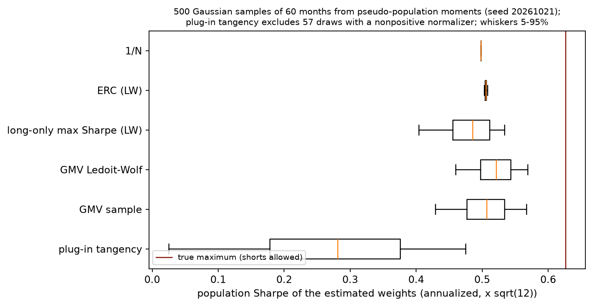
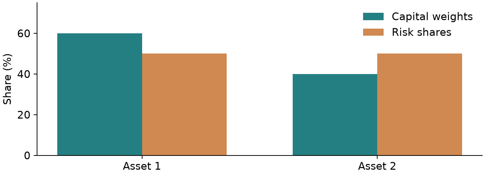
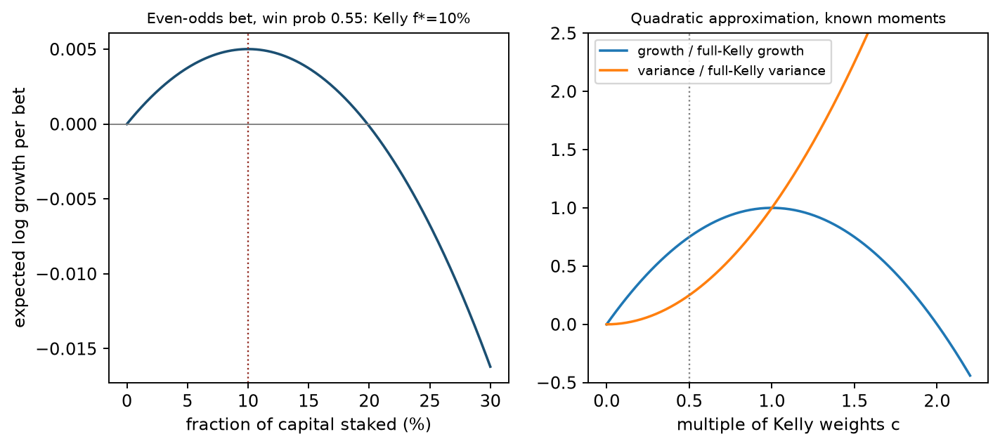
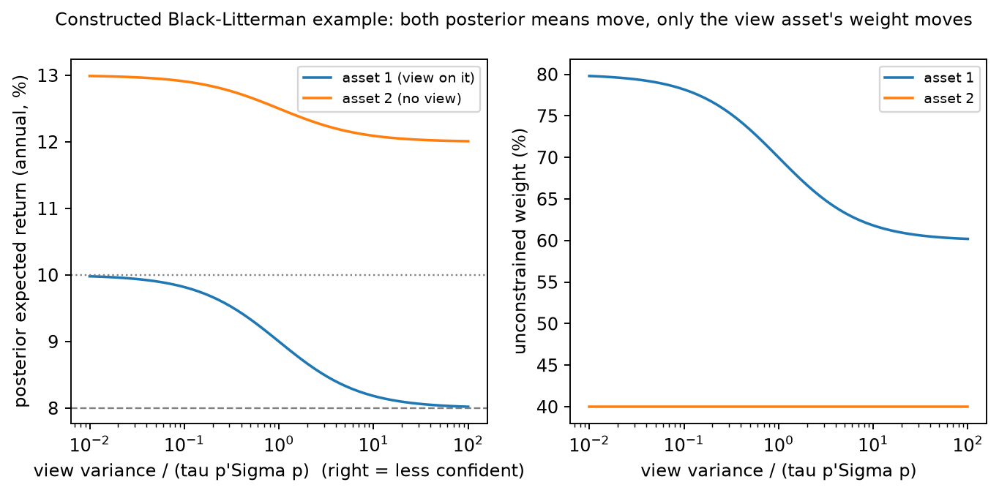
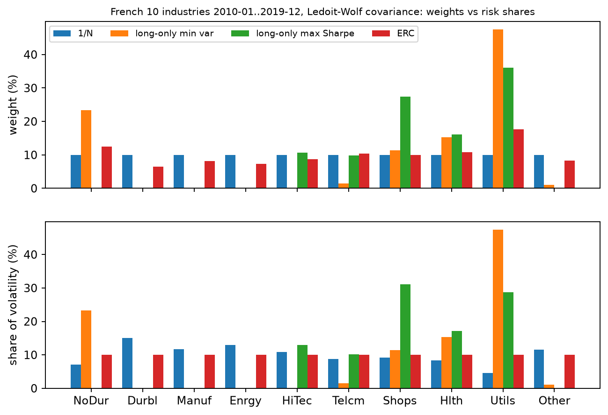

# Chapter 21 — Practical Portfolio Construction

> Prerequisites: Chapter 9 on convex quadratic programming and KKT conditions, Chapter 15 on multi-factor risk models, Chapter 18 on volatility estimation, and Chapter 20 on modern portfolio theory and the unconstrained analytical solution for the mean–variance tangency portfolio.
> After completing this chapter, you will be able to estimate covariance matrices from a training window using Ledoit–Wolf shrinkage and check conditional positive definiteness and out-of-sample risk error; transform long-only maximum-Sharpe optimization, whose objective is not concave, exactly into an equivalent convex quadratic program (convex QP); solve for an equal risk contribution (ERC) portfolio; combine market equilibrium and subjective views with the Black–Litterman model; derive the Kelly criterion's log-growth rate and explain fractional-Kelly constraints; calculate asset drift, turnover, and trading costs; and objectively evaluate portfolio out-of-sample performance after costs.

## 1. Chapter Objectives

After studying this chapter, you should be able to:

1. Calculate estimation error in sample means and covariance matrices, and quantify why uncertainty in expected returns can damage optimized weights more severely than the covariance matrix;
2. Derive the optimal shrinkage intensity toward a scaled identity matrix in Ledoit–Wolf (2004), then use training-window data to compute a positive-definite covariance matrix for out-of-sample use;
3. Calculate two-sided rebalancing turnover, drifted portfolio weights, and trading-friction drag, and maintain an accounting ledger for gross and post-cost net returns;
4. Distinguish dollar-neutral, beta-neutral, and sector-neutral portfolios; explain how absolute sector neutrality across mutually exclusive and exhaustive sectors implies dollar neutrality but generally does not imply beta neutrality; and explain that Euclidean projection minimizes only weight distance;
5. Derive the Euler decomposition of portfolio volatility, calculate marginal risk contributions and relative risk shares, and solve for ERC weights using damped Newton's method with a Newton-decrement stopping rule;
6. Restate the long-only maximum-Sharpe variable substitution proved in Chapter 9, which converts the problem into a convex quadratic program, and implement a solution workflow with a feasibility precheck for weight caps;
7. Derive the Black–Litterman reverse-optimization prior, the block-Gaussian posterior mean and posterior-mean covariance, and verify the orthogonality property of view tilts;
8. Derive the binary-bet log-growth optimum under the Kelly criterion, its discrete second-order expansion, and its diffusion-limit quadratic proxy; analyze the tail-ruin mechanism under full Kelly and the risk–return trade-off under half Kelly;
9. Use a multi-factor risk model to decompose portfolio variance and volatility into factor and specific-risk contributions;
10. Using the French 10 industry historical snapshot and Project 3's 440-month rolling backtest, objectively evaluate each strategy's post-cost rolling out-of-sample performance and statistical uncertainty on the currently revised historical snapshot, without treating it as point-in-time (PIT) tradable evidence.

You have completed the chapter when you can independently reproduce all numerical examples and pass the code assertions, understand the assumptions and failure boundaries of every model, complete all exercises in Sections 15–17, and check the full derivations and code in Section 18.

## 2. Why Quants Need Practical Portfolio Construction

In Chapter 20's mean–variance theory (Modern Portfolio Theory, MPT), tangency-portfolio weights are given by the analytical expression \(\mathbf{w}^* \propto \Sigma^{-1}\boldsymbol{\mu}_{excess}\). In live quantitative investing, however, directly substituting the historical sample mean \(\hat{\boldsymbol{\mu}}\) and sample covariance matrix \(S\) into this expression (the plug-in estimator) usually produces extreme and unstable weights.

This failure arises from three unavoidable practical challenges.

First, **the inversion step sharply amplifies parameter-estimation error**. Financial time series are full of low signal-to-noise-ratio observations. The annualized standard error of an expected-return estimate is often on the same order as the mean itself, while the smallest eigenvalues of a high-dimensional covariance matrix are often close to zero. Inverting a noisy matrix greatly magnifies the directions associated with these small eigenvalues, leading the optimizer to take large long and short positions in directions with the most in-sample noise. In quantitative finance, this phenomenon is sometimes called an “error maximizer.”

Second, **the theoretical tangency portfolio does not model real trading frictions or constraints**. The analytical solution assumes unrestricted short selling, no borrowing-rate penalty, no market-impact or liquidity cost, and no trading commissions. In institutional investing, however, managers face strict long-only rules, position limits, sector and market-risk budgets, and slippage caused by turnover. If these real-world boundaries are ignored, apparently strong paper returns can be eroded by monthly rebalancing costs.

Finally, **diversification is often misunderstood in practice**. A nominally equal-weighted allocation is not necessarily diversified by risk. If a portfolio contains highly volatile assets, a small number of them may dominate total portfolio risk. Likewise, a long–short portfolio described as “market neutral” may still carry substantial systematic market beta or sector-tilt risk if it satisfies only dollar neutrality.

The goal of practical portfolio construction is to use mathematically rigorous shrinkage estimation, convex-optimization transformations, risk budgeting, and Bayesian prior constraints to turn noisy forecasts into real holdings that are implementable out of sample, have controlled risk, and can withstand trading frictions.

## 3. Intuition: From Sample Noise to Implementable Holdings

To see why unconstrained optimization is fragile, consider a deliberately simple thought experiment.

Suppose the market has two assets, each with a true monthly excess return of \(1.0\%\), monthly volatility of \(4.0\%\), and a correlation of \(0.7\) (a constructed teaching example). The two assets are perfectly symmetric, so the true optimal tangency portfolio clearly holds \(50\%\) of each.

Now suppose a researcher estimates the inputs from the past 60 months. Due to sampling variation, asset 1's sample mean happens to be high at \(1.3\%\), while asset 2's happens to be low at \(0.7\%\). This small sampling perturbation of \(0.3\%\) is entirely plausible (the standard error is about \(4.0\% / \sqrt{60} \approx 0.52\%\)).

Substituting these estimates into \(\Sigma^{-1}\boldsymbol{\mu}_{excess}\), the two assets' equal volatilities imply that \(\Sigma^{-1}\) is proportional to \(\begin{bmatrix}1&-0.7\\-0.7&1\end{bmatrix}\). The resulting direction is proportional to \((1.3-0.7\times0.7,\ 0.7-0.7\times1.3)=(0.81,-0.21)\), giving normalized weights of roughly \((135\%,-35\%)\), even though the true optimum is \((50\%,50\%)\). Evaluated using the true parameters, both portfolios have expected excess returns of 1.0% per month, but monthly volatility is \(4\%\times\sqrt{1.35^2+0.35^2-2(0.7)(1.35)(0.35)}=4.53\%\) for \((135\%,-35\%)\), compared with \(4\%\times\sqrt{0.85}=3.69\%\) for the equal-weight portfolio. The monthly Sharpe ratio falls from 0.271 to 0.221. The higher the correlation, the more the same mean-estimation error is amplified (at \(\rho=0.5\), the weights are about \((95\%,5\%)\)).

This simple example reveals the core logic of practical portfolio construction:

1. **Shrinkage guards against covariance ill-conditioning**: With a limited sample, the extreme eigenvalues of the sample covariance matrix can be badly distorted. Shrinking the matrix toward a structured target, such as a diagonal matrix or factor model, at a theoretically chosen rate can dampen very small eigenvalues and keep the inverse from turning local noise into extreme positions.
2. **Constraints are the first line of defense against mean-estimation errors**: Long-only constraints rule out short positions and mathematically cap one mechanism by which estimated means create extreme weights. Although long-only constraints invalidate the analytical solution, they restrict optimization to the simplex and can prevent extreme hedges.
3. **Risk parity avoids relying on unreliable expected-return estimates**: When expected returns cannot be estimated precisely, a portfolio that uses the covariance matrix to equalize assets' contributions to total risk avoids one source of estimation error. It still depends on a risk model, so any improvement in return or risk must be compared out of sample.
4. **Trading frictions shape the turnover boundary**: Price changes cause asset weights to drift away from their targets. If the portfolio is forced back to the exact target every month, commissions and market-impact costs from turnover accumulate quickly. A balance is needed between tracking error from drift and turnover costs.

**Simulation of Estimation Error and Comparison of Strategy Distributions**



- **Horizontal axis**: Annualized population Sharpe ratio realized when each strategy's estimated weights are applied to the true population (multiplied by \(\sqrt{12}\));
- **Vertical axis**: The six strategies compared (plug-in tangency, GMV sample, GMV Ledoit–Wolf, long-only max Sharpe (LW), ERC (LW), and 1/N);
- **Units**: Dimensionless Sharpe ratio;
- **Sample and setup**: The full-sample monthly first and second moments of the French 10 industries are treated as a fixed “pseudo-population.” With random seed 20261021, 500 independent Gaussian Monte Carlo samples are drawn, each 60 months long (representing a five-year rolling window);
- **How to read the figure and what to look for**:
  1. The theoretical maximum true tangency Sharpe ratio is marked by the red vertical line (about \(0.6262\) annualized);
  2. The unconstrained plug-in tangency portfolio performs worst, with a median annualized Sharpe ratio of just \(0.2812\) and a 10th percentile of about \(0.079\) (the whiskers show the 5th–95th percentiles). In addition, 57 samples failed outright because the denominator was non-positive; those failures were excluded from the plotted distribution, making the box plot substantially optimistic. The long-only max-Sharpe (LW) strategy had another 11 samples with no positive-excess-return portfolio in the training sample, triggering the input-feasibility failure described in Section 12.3; those were also excluded from the box plot;
  3. Adding a long-only constraint raises the median for long-only max Sharpe (LW) to \(0.4859\), reducing dispersion caused by estimation error;
  4. Strategies that do not rely on expected-return estimates (GMV LW, ERC LW, and 1/N) are the most stable: the median annualized Sharpe is \(0.5215\) for GMV (LW), \(0.5057\) for ERC (LW), and a stable \(0.4983\) for 1/N;
- **Limitation**: This figure shows a statistical simulation of sampling error only. All asset returns are strictly Gaussian; real-market jumps, fat tails, and structural breaks are not included.

## 4. Mathematical Foundations and Notation

Before turning to the derivations, we standardize notation, matrix dimensions, and units throughout the chapter:

- **Number of assets and sample periods**: The number of assets is denoted by \(n\) (or by \(p\) for the cross-sectional dimension), and the number of periods in the historical training window by \(T\).
- **Return vector**: The vector of single-period simple returns at time \(t\) is \(\mathbf{r}_t = (r_{1,t}, \dots, r_{n,t})^\top \in \mathbb{R}^n\). This chapter uses monthly decimal returns by default. Explicitly labeled annualized teaching examples are exceptions and must not be mixed with monthly empirical inputs; for example, a monthly return of \(1\%\) is written as \(0.01\).
- **Expected-excess-return vector**: \(\boldsymbol{\mu}_{excess} = \boldsymbol{\mu} - r_f \mathbf{1} \in \mathbb{R}^n\), where \(\boldsymbol{\mu} = E[\mathbf{r}]\), \(r_f\) is the risk-free rate, and \(\mathbf{1} = (1, \dots, 1)^\top\) is the all-ones vector.
- **Covariance matrix**: \(\Sigma \in \mathbb{R}^{n \times n}\) is the single-period return covariance matrix and is positive semidefinite (PSD). If invertibility is required, it must be positive definite (PD), denoted by \(\Sigma \succ 0\).
- **Portfolio-weight vector**: \(\mathbf{w} = (w_1, \dots, w_n)^\top \in \mathbb{R}^n\). \(w_i\) is the fraction of portfolio net asset value (NAV) invested in asset \(i\). Fully invested means \(\mathbf{1}^\top \mathbf{w} = 1\), and long-only means \(\mathbf{w} \ge \mathbf{0}\).
- **Matrix Frobenius-norm convention**: Following Ledoit & Wolf (2004), this chapter normalizes the Frobenius norm of a \(p \times p\) matrix \(A\) by its dimension \(p\):
  \[
  \|A\|^2 = \frac{1}{p}\operatorname{tr}(AA^\top) = \frac{1}{p}\sum_{i=1}^p \sum_{j=1}^p a_{ij}^2,
  \]
  The matrix inner product is defined as \(\langle A, B \rangle = \frac{1}{p}\operatorname{tr}(AB^\top)\). Unless stated otherwise, \(\|\cdot\|\) denotes this normalized norm.
- **Time and information set**: Maintain strict causality. In the idealized month-boundary test, if a rebalance decision is made and executed at the end of month \(t-1\), the historical training window available for that decision is restricted to \([t-W, t-1]\) (or to \([t-W-1, t-2]\) when a one-month data-publication lag is assumed). The current-period return \(\mathbf{r}_t\) is never known before the end of month \(t\). Observing returns, calculating weights, and executing at the same month-end does not guarantee real-world availability; a live system must record when data are received and when the next trade can occur.

## 5. Formal Definitions: Estimation Error, Neutrality Constraints, and Risk Budgets

### 5.1 Mean-Estimation Error and Covariance Ill-Conditioning

Suppose asset returns are independently and identically distributed, with true mean \(\boldsymbol{\mu}\) and true covariance \(\Sigma\). The sample-mean estimator is \(\hat{\boldsymbol{\mu}} = \frac{1}{T}\sum_{t=1}^T \mathbf{r}_t\), and its estimation-error standard deviation is:
\[
\operatorname{SE}(\hat{\mu}_i) = \frac{\sigma_i}{\sqrt{T}}.
\]
If an asset has monthly volatility \(\sigma = 4\%\) (about \(13.86\%\) annualized), then with \(T = 120\) months (10 years of history), the standard error of its monthly mean is:
\[
\operatorname{SE}(\hat{\mu}_i) = \frac{0.04}{\sqrt{120}} \approx 0.003651 \quad (0.365\% / \text{month}, \text{about annually: } 4.38\%).
\]
For a hypothetical stock, if a researcher assumes an annualized excess return of only \(5\% \sim 8\%\) (a teaching assumption, not a market statistic verified in this chapter), even 10 years of data may not narrow the expected-return confidence interval enough to determine its sign reliably.

The sample covariance matrix, centered by the sample mean and divided by \(T\), is defined as:
\[
S = \frac{1}{T}\sum_{t=1}^T (\mathbf{r}_t - \hat{\boldsymbol{\mu}})(\mathbf{r}_t - \hat{\boldsymbol{\mu}})^\top.
\]
Equation (12) in Section 2.2 of Ledoit and Wolf (2004) rewrites Lemma 2.1 in terms of eigenvalues: in expectation, the dispersion of sample eigenvalues around their common mean equals the dispersion of the true eigenvalues plus \(E\lVert S-\Sigma\rVert^2\). This shows that estimation noise inflates eigenvalue dispersion in the population sense; it does not guarantee that each sample maximum or minimum eigenvalue moves in a particular direction. The distortion becomes more pronounced as \(p/T\) increases. When \(p > T\), \(S\) is rank-deficient: at least \(p-T+1\) eigenvalues are exactly zero under exact arithmetic (after centering, the rank is at most \(T-1\)), so the sample inverse \(S^{-1}\) does not exist. This does not imply that the population matrix \(\Sigma\) is singular.

### 5.2 Three Definitions of Portfolio Neutrality

Quantitative investors often seek to eliminate exposure to specific macroeconomic or systematic risks. Common forms of “neutrality” include:

1. **Dollar neutrality / capital neutrality**:
   \[
   \mathbf{1}^\top \mathbf{w} = \sum_{i=1}^n w_i = 0.
   \]
   The total market value of long positions equals that of short positions, leaving net exposure equal to 0.
2. **Beta neutrality**:
   Let \(\boldsymbol{\beta} = (\beta_1, \dots, \beta_n)^\top \in \mathbb{R}^n\) be the vector of regression slopes of the assets relative to a benchmark index, such as the S&P 500. A beta-neutral portfolio satisfies:
   \[
   \boldsymbol{\beta}^\top \mathbf{w} = \sum_{i=1}^n w_i \beta_i = 0.
   \]
   At the margin, the portfolio has no direct linear exposure to movements in the overall benchmark return.
3. **Sector neutrality**:
   Suppose the market is partitioned into \(K\) mutually exclusive sectors, and let \(I_k\) be the set of asset indices in sector \(k\). Sector neutrality requires net holdings to be zero in every sector:
   \[
   \sum_{i \in I_k} w_i = 0, \quad \forall k \in \{1, \dots, K\}.
   \]

These conditions are distinct, but they are not independent. If the mutually exclusive sectors cover all assets, summing across sectors gives
\[
\mathbf1^\top\mathbf w=\sum_{k=1}^K\sum_{i\in I_k}w_i=0.
\]
Therefore, the absolute sector neutrality used in this chapter necessarily implies dollar neutrality, but generally does not imply beta neutrality. Dollar neutrality generally implies neither sector nor beta neutrality, and beta neutrality generally implies neither of the other two. For example, within one sector, weights \((0.5,-0.5)\) and betas \((1.5,0.5)\) produce zero net sector weight and zero net dollar exposure, but beta exposure is \(0.5\). Conversely, weights \((0.5,-1.0)\) with betas \((1,0.5)\) have zero beta exposure but net weight of \(-0.5\). If “sector neutrality” instead means an active-weight constraint relative to a fully invested benchmark \(\mathbf w_b\), namely \(Z(\mathbf w-\mathbf w_b)=0\), it implies \(\sum_iw_i=\sum_iw_{b,i}\), not zero absolute net weight. Here \(Z\) is a \(K\times n\) matrix whose rows are sector indicator vectors; this benchmark-relative constraint should be distinguished from the absolute neutrality defined in this section.

### 5.3 Risk Contributions and the Euler Decomposition

Portfolio volatility is the function \(\sigma(\mathbf{w}) = \sqrt{\mathbf{w}^\top \Sigma \mathbf{w}}\).
Because \(\sigma(a\mathbf{w}) = a\sigma(\mathbf{w})\) for any positive scalar \(a > 0\), portfolio volatility is **homogeneous of degree 1** in the weight vector \(\mathbf{w}\).

The derivatives and risk shares below require \(\sigma(\mathbf w)>0\) and a symmetric positive-semidefinite matrix \(\Sigma\). By Euler's theorem for homogeneous functions:
\[
\sigma(\mathbf{w}) = \sum_{i=1}^n w_i \frac{\partial \sigma(\mathbf{w})}{\partial w_i}.
\]
This gives rise to three core definitions in the risk-contribution framework:

- **Marginal risk contribution (MRC)**:
  \[
  \operatorname{MRC}_i = \frac{\partial \sigma(\mathbf{w})}{\partial w_i} = \frac{(\Sigma \mathbf{w})_i}{\sqrt{\mathbf{w}^\top \Sigma \mathbf{w}}} = \frac{(\Sigma \mathbf{w})_i}{\sigma(\mathbf{w})}.
  \]
  The economic meaning of \(\operatorname{MRC}_i\) is the rate of change in total portfolio volatility when the weight of asset \(i\) increases by a small amount. It has the same units as return volatility (monthly decimal units here). This is a partial derivative that holds all other coordinates fixed. If increasing asset i requires selling asset j to preserve the budget, the change along the self-financing direction is MRC_i−MRC_j; it should not be read as MRC_i alone.
- **Absolute risk contribution (RC)**:
  \[
  \operatorname{RC}_i = w_i \operatorname{MRC}_i = \frac{w_i (\Sigma \mathbf{w})_i}{\sigma(\mathbf{w})}.
  \]
  By Euler's theorem, the absolute risk contributions of all assets sum exactly to total portfolio volatility: \(\sum_{i=1}^n \operatorname{RC}_i = \sigma(\mathbf{w})\).
- **Risk fraction / relative risk contribution**:
  \[
  p_i = \frac{\operatorname{RC}_i}{\sigma(\mathbf{w})} = \frac{w_i (\Sigma \mathbf{w})_i}{\mathbf{w}^\top \Sigma \mathbf{w}}.
  \]
  Relative risk shares are dimensionless and sum to one: \(\sum_{i=1}^n p_i = 1\). They are not probabilities. If a weight and its marginal risk contribution have opposite signs, \(p_i\) can be negative, meaning that the position offsets some risk in the current portfolio. A long position can also have a negative risk contribution; a short position multiplied by a negative marginal contribution has a positive contribution.

### 5.4 Equal Risk Contribution (ERC) Portfolios

An equal risk contribution (ERC) portfolio requires every asset to contribute equally in absolute terms to total portfolio volatility, over the fully invested long-only simplex:
\[
\operatorname{RC}_i = \operatorname{RC}_j \iff w_i (\Sigma \mathbf{w})_i = w_j (\Sigma \mathbf{w})_j, \quad \forall i, j \in \{1, \dots, n\},
\]
Thus, each asset carries exactly \(1/n\) of the relative risk share: \(p_i = 1/n\).

**Check the two-asset case before memorizing an ERC formula.** In this annualized-decimal teaching example, \(\sigma_1=0.2,\sigma_2=0.3,\rho=0.2\), so
\[
\Sigma=\begin{pmatrix}0.04&0.012\\0.012&0.09\end{pmatrix}.
\]
Set the two risk contributions equal, first canceling their common positive denominator \(\sigma_p\):
\[
\begin{aligned}
w_1^2(0.04)+w_1w_2(0.012)&=w_1w_2(0.012)+w_2^2(0.09),\\
0.04w_1^2&=0.09w_2^2,\\
0.2w_1&=0.3w_2\quad\text{(positive weights give the positive square root)}.
\end{aligned}
\]
Combining this with \(w_1+w_2=1\) gives \((w_1,w_2)=(0.6,0.4)\). Substituting these weights back into the risk calculation:
\[
\begin{aligned}
\Sigma\mathbf w&=(0.0288,0.0432)^\top,\\
\sigma_p^2&=0.6(0.0288)+0.4(0.0432)=0.03456,\\
\operatorname{RC}_1&=\operatorname{RC}_2=0.01728/\sqrt{0.03456}=0.092952.
\end{aligned}
\]
Volatility is 18.59%, and the two risk shares are 50% each even though the capital weights are 60% and 40%. The two-asset cross terms cancel, so when volatility is positive and \(\rho\in(-1,1)\), ERC weights do not depend on correlation; correlation still changes total volatility. With three or more assets, these pairwise cancellations do not occur, so inverse-volatility weights are not a general substitute for ERC.



The horizontal axis shows the two assets and the vertical axis shows shares (%). Capital weights are 60%/40%, while risk shares are 50%/50%. This figure checks only the annualized example above; it does not show that ERC has higher returns. Section 6.3 explains how to solve for a specified risk budget under a general covariance matrix.

## 6. Core Derivations: Shrinkage, Convex-QP Transformation, and Risk Decomposition

### 6.1 Deriving the Ledoit–Wolf Linear Shrinkage Estimator

Ledoit & Wolf (2004) seek a linear combination \(\Sigma^* = \rho_1 I + \rho_2 S\). In the theoretical derivation, the shrinkage target is \(\mu I\), where \(\mu = \langle \Sigma, I \rangle = \frac{1}{p}\operatorname{tr}(\Sigma)\) is the mean of the true eigenvalues. The feasible estimator later replaces \(\mu\) with its sample counterpart, \(m = \langle S, I \rangle\).
Let the true, unknown covariance matrix be \(\Sigma\). The theoretical objective is to minimize expected squared loss under the normalized Frobenius norm:
\[
\min_{\rho_1, \rho_2} E\left[ \|\Sigma^* - \Sigma\|^2 \right] = E\left[ \|\rho_1 I + \rho_2 S - \Sigma\|^2 \right].
\]
Using an orthogonal decomposition and expanding the expectation, define three key geometric distance parameters. In this subsection, \(\delta^2\) denotes only the total dispersion relevant to shrinkage; it is not the square of the risk-aversion coefficient \(\delta\) in Section 6.4:

1. Expected squared distance from the sample covariance to the target: \(\delta^2 = E\left[ \|S - \mu I\|^2 \right]\);
2. Squared distance from the true covariance to the target: \(\alpha^2 = \|\Sigma - \mu I\|^2\);
3. Expected estimation error of the sample covariance relative to the true covariance: \(\beta^2 = E\left[ \|S - \Sigma\|^2 \right]\).

First derive the result under the theoretical benchmark \(E[S]=\Sigma\). Under this condition, the Pythagorean structure holds in expectation. Centered outer products satisfy the condition when the true mean is known. In a finite sample, a matrix centered using the sample mean and divided by \(T\) instead has \(E[S]=(T-1)\Sigma/T\), so the following relation is not an unconditional finite-sample identity. The practical shrinkage estimator uses an asymptotic construction:
\[
\delta^2 = \alpha^2 + \beta^2.
\]
The proof of Lemma 2.1 uses only \(E[S]=\Sigma\): when expanding \(E\lVert S-\Sigma+\Sigma-\mu I\rVert^2\), the cross term \(2\langle E[S-\Sigma],\,\Sigma-\mu I\rangle=0\). Rewrite \(\Sigma^*\) as the convex combination \(\Sigma^* = \kappa (\mu I) + (1 - \kappa) S\) (the original paper first proves that the optimal target scale is exactly \(\mu\)), and substitute it into the squared-loss objective:
\[
\|\Sigma^* - \Sigma\|^2 = \|(1 - \kappa)(S - \Sigma) - \kappa(\Sigma - \mu I)\|^2.
\]
Expanding the expectation and using the first-moment unbiasedness that makes the cross term vanish gives a quadratic in the shrinkage intensity \(\kappa\):
\[
E\left[ \|\Sigma^* - \Sigma\|^2 \right] = (1 - \kappa)^2 \beta^2 + \kappa^2 \alpha^2.
\]
Differentiate with respect to \(\kappa\) and set the derivative to zero:
\[
-2(1 - \kappa)\beta^2 + 2\kappa\alpha^2 = 0 \implies \kappa^* = \frac{\beta^2}{\alpha^2 + \beta^2} = \frac{\beta^2}{\delta^2}.
\]
Thus, the theoretically optimal shrinkage intensity is exactly the share of total dispersion attributable to estimation-error variance, \(\beta^2/\delta^2\).
Because the population matrix \(\Sigma\) is unknown in practice, Ledoit & Wolf construct asymptotically unbiased feasible estimators for the corresponding quantities:

- Estimate of the target scale: \(m = \frac{1}{p}\operatorname{tr}(S)\);
- Estimate of total sample dispersion: \(d^2 = \|S - mI\|^2 = \frac{1}{p}\sum_{i=1}^p \sum_{j=1}^p (s_{ij} - m\delta_{ij})^2\);
- Asymptotically unbiased estimate of estimation error:
  Let the rows of the centered sample matrix be \(\mathbf{x}_t \in \mathbb{R}^p\), with the outer product for each period \(\mathbf{x}_t \mathbf{x}_t^\top\). Since \(S\) is the average of these \(T\) outer products, the error variance of the average is approximately the dispersion of a single outer product multiplied by \(1/T\). Lemma 3.4 in the original paper therefore uses \(\bar b^2=\frac{1}{T^2}\sum_t\lVert\mathbf{x}_t\mathbf{x}_t^\top-S\rVert^2\) to estimate \(\beta^2\). Expanding with \(\sum_t\mathbf{x}_t^\top S\mathbf{x}_t=T\lVert S\rVert_F^2\) gives:
  \[
  \bar{b}^2 = \frac{1}{T^2 p}\left( \sum_{t=1}^T \|\mathbf{x}_t\|_2^4 - T \sum_{i=1}^p \sum_{j=1}^p s_{ij}^2 \right);
  \]
- Truncated shrinkage intensity: \(b^2 = \min(\max(\bar{b}^2, 0), d^2)\), giving the feasible shrinkage intensity:
  \[
  \hat{\kappa} = \frac{b^2}{d^2} \in [0, 1].
  \]
The resulting feasible shrinkage estimator is positive semidefinite; it is positive definite under the following condition:
\[
S^* = \hat{\kappa} (mI) + (1 - \hat{\kappa}) S.
\]
Because the target matrix \(mI\) is positive definite as long as at least one asset has nonzero variance, when \(\hat{\kappa} > 0\), the smallest eigenvalue of \(S^*\) is strictly positive even if \(S\) is rank-deficient because \(T < p\). The shrunk matrix is therefore numerically invertible.

### 6.2 Convex-QP Reformulation of Long-Only Maximum Sharpe Ratio

The original long-only optimization problem for maximizing a portfolio's Sharpe ratio is:
\[
\max_{\mathbf{w}} \frac{\boldsymbol{\mu}_{excess}^\top \mathbf{w}}{\sqrt{\mathbf{w}^\top \Sigma \mathbf{w}}} \quad \text{s.t.} \quad \mathbf{1}^\top \mathbf{w} = 1, \quad \mathbf{w} \ge \mathbf{0}, \quad \mathbf{w} \le \mathbf{w}_{\max}.
\]
The objective is a ratio, not a concave function, so it cannot be passed directly to CVXPY under Disciplined Convex Programming (DCP) rules. Section 7 of Chapter 9 and exercise 9-C01 already prove the variable substitution below and its conditions. We restate it here as implemented in this chapter; Lesniewski's Baruch MFE Lecture 5 gives the same transformation.

**Proof**:
The discussion below concerns a finite Sharpe ratio and requires every feasible portfolio with positive excess return to have positive variance; \(\Sigma\succ0\) is a simple sufficient condition. If a zero-risk direction has positive excess return, the Sharpe denominator is zero and the QP objective may be zero. This is a degenerate or infinite-Sharpe case, not an ordinary finite optimum.

Keep three separate gates in view. Budget feasibility requires \(nw_{\max}\ge1\). Feasibility of positive excess return requires \(\max_w\mu_{excess}^\top w>0\) under the weight cap. A finite Sharpe ratio also requires the risk denominator of every compared portfolio to be nonzero. \(\Sigma\succ0\) guarantees this for nonzero weights. If the matrix is only positive semidefinite and a feasible \(w\) satisfies both \(w^\top\Sigma w=0\) and \(\mu_{excess}^\top w>0\), it lies on a zero-risk, positive-excess-return boundary where ordinary finite Sharpe is undefined; a QP optimum of 0 cannot be interpreted as a finite maximum Sharpe ratio. A singular matrix does not necessarily create this boundary, but the risk domain must be checked explicitly. The Project 3 implementation requires numerically positive-definite input and does not introduce a separate zero-risk strategy.

Assume that at least one portfolio in the feasible set has strictly positive expected excess return, that is, \(\max_{\mathbf{w}} \boldsymbol{\mu}_{excess}^\top \mathbf{w} > 0\).
Define the scalar transformation factor:
\[
\kappa = \frac{1}{\boldsymbol{\mu}_{excess}^\top \mathbf{w}} > 0,
\]
and define the scaled weight vector:
\[
\mathbf{y} = \kappa \mathbf{w} \in \mathbb{R}^n.
\]
Since \(\mathbf{w} \ge \mathbf{0}\) and \(\kappa > 0\), it follows that \(\mathbf{y} \ge \mathbf{0}\).
The constraints map algebraically as follows:

1. Expected excess return is normalized:
   \[
   \boldsymbol{\mu}_{excess}^\top \mathbf{y} = \kappa (\boldsymbol{\mu}_{excess}^\top \mathbf{w}) = 1;
   \]
2. The investment-budget constraint becomes:
   \[
   \mathbf{1}^\top \mathbf{y} = \kappa (\mathbf{1}^\top \mathbf{w}) = \kappa;
   \]
3. The weight-cap constraint becomes:
   \[
   w_i \le w_{\max} \iff y_i \le w_{\max} \kappa.
   \]
Consider the reciprocal of the squared objective:
\[
\begin{aligned}
\frac{1}{\operatorname{SR}(\mathbf w)^2}
&=\frac{\mathbf w^\top\Sigma\mathbf w}{(\boldsymbol\mu_{excess}^\top\mathbf w)^2}\\
  &=(\kappa\mathbf w)^\top\Sigma(\kappa\mathbf w)\quad\text{(the same positive scaling)}\\
  &=\mathbf y^\top\Sigma\mathbf y\quad\text{(substitute the definition)}.
\end{aligned}
\]
Thus, maximizing the Sharpe ratio is equivalent to minimizing its squared reciprocal:
\[
\min_{\mathbf{y} \in \mathbb{R}^n, \kappa \in \mathbb{R}} \mathbf{y}^\top \Sigma \mathbf{y}
\]
subject to the linear constraints:
\[
\begin{cases}
\boldsymbol{\mu}_{excess}^\top \mathbf{y} = 1, \\
\mathbf{1}^\top \mathbf{y} = \kappa, \\
\mathbf{y} \ge \mathbf{0}, \\
\mathbf{y} \le w_{\max} \kappa, \\
\kappa > 0.
\end{cases}
\]
When \(\Sigma \succeq 0\), \(\mathbf{y}^\top \Sigma \mathbf{y}\) is convex; when \(\Sigma\succ0\), it is strictly convex and the solution is unique. All constraints are affine equalities or inequalities, so this is a convex quadratic program. The strict inequality \(\kappa>0\) need not be passed to the solver: \(\boldsymbol{\mu}_{excess}^\top\mathbf{y}=1\) forces \(\mathbf{y}\ne\mathbf{0}\), and because \(\mathbf{y}\ge\mathbf{0}\), we have \(\kappa=\mathbf{1}^\top\mathbf{y}>0\). The reverse mapping \(\mathbf{w}=\mathbf{y}/\kappa\) sends any feasible \((\mathbf{y},\kappa)\) back to a feasible portfolio with positive excess return. The feasible solutions of the two problems are in one-to-one correspondence, and their objective values equal \(1/\operatorname{SR}^2\).
After solving for the optimum \((\mathbf{y}^*, \kappa^*)\), recover the optimal portfolio weights for the original problem directly using the inverse transformation:
\[
\mathbf{w}^* = \frac{\mathbf{y}^*}{\kappa^*} = \frac{\mathbf{y}^*}{\sum_{i=1}^n y_i^*}.
\]
This completes the proof.

### 6.3 Convex Log-Barrier Formulation and Damped Newton Algorithm for Risk Budgeting (ERC)

Section 3.4 of Maillard, Roncalli, and Teiletche (2009) formulate ERC as a minimum-volatility problem subject to \(\sum_i\ln x_i\ge c\). The unconstrained log-barrier form below corresponds to that formulation, with the constraint multiplier absorbed into the objective; the derivation and implementation here are developed in this chapter.
Consider the log-barrier function:
\[
\min_{\mathbf{y} \in \mathbb{R}^n, \mathbf{y} > \mathbf{0}} f(\mathbf{y}) = \frac{1}{2}\mathbf{y}^\top \Sigma \mathbf{y} - \sum_{i=1}^n b_i \ln y_i,
\]
where \(b_i > 0\) are the specified risk-budget weights, satisfying \(\sum b_i = 1\) (for ERC, \(b_i = 1/n\)). The gradient of this objective is:
\[
\nabla f(\mathbf{y}) = \Sigma \mathbf{y} - \frac{\mathbf{b}}{\mathbf{y}}, \quad \text{where } \left(\frac{\mathbf{b}}{\mathbf{y}}\right)_i = \frac{b_i}{y_i}.
\]
The Hessian matrix is:
\[
\nabla^2 f(\mathbf{y}) = \Sigma + \operatorname{diag}\left( \frac{\mathbf{b}}{\mathbf{y}^2} \right).
\]
As long as \(\Sigma \succeq 0\) and \(b_i > 0\), the diagonal terms are strictly positive and \(\nabla^2 f(\mathbf{y}) \succ 0\). The objective is therefore strictly convex on \(\mathbf{y}>\mathbf{0}\), and any minimizer, if it exists, is unique. The condition \(\Sigma\succ0\) guarantees existence, but is not necessary. For example, although \(\Sigma=\begin{bmatrix}1&1\\1&1\end{bmatrix}\) is singular, with \(b_1=b_2=1/2\) it still has a unique minimizer \(\mathbf y=(1/2,1/2)^\top\), which normalizes to equal weights. The key danger is a nonnegative zero-risk direction: if some nonzero \(\mathbf{v}\ge\mathbf{0}\) satisfies \(\mathbf{v}^\top\Sigma\mathbf{v}=0\), then along \(\mathbf y=\mathbf y_0+t\mathbf v\), with \(\mathbf y_0>0\) and \(t\to\infty\), positive semidefiniteness implies \(\Sigma\mathbf v=0\). The quadratic term stays constant while at least one logarithmic term tends to negative infinity, so no minimizer exists. The core function therefore requires a numerically positive-definite covariance matrix.
At a first-order optimum, the gradient is zero:
\[
(\Sigma \mathbf{y}^*)_i - \frac{b_i}{y_i^*} = 0 \iff y_i^* (\Sigma \mathbf{y}^*)_i = b_i.
\]
Because the variance contribution \(y_i(\Sigma\mathbf y)_i\) is homogeneous of degree 2 in \(\mathbf{y}\) (while the volatility contribution \(y_i(\Sigma\mathbf y)_i/\sigma(\mathbf y)\) is homogeneous of degree 1), normalize \(\mathbf{y}^*\) onto the simplex:
\[
\mathbf{w}^* = \frac{\mathbf{y}^*}{\sum_{j=1}^n y_j^*}.
\]
Normalization does not change the relative proportions of the assets' risk contributions:
\[
w_i^*(\Sigma \mathbf{w}^*)_i = \frac{y_i^* (\Sigma \mathbf{y}^*)_i}{\left(\sum y_j^*\right)^2} = \frac{b_i}{\left(\sum y_j^*\right)^2} \propto b_i.
\]
The denominator also needs to be checked. Let \(s=\sum_j y_j^*\). Summing the first-order conditions gives \(\mathbf y^{*\top}\Sigma\mathbf y^*=\sum_i b_i=1\), so
\[
\sigma^2(\mathbf w^*)=1/s^2,\qquad
\frac{w_i^*(\Sigma\mathbf w^*)_i}{\sigma^2(\mathbf w^*)}
=\frac{b_i/s^2}{1/s^2}=b_i.
\]
This proves the risk-budget proportions, not the budget amounts. In the two-asset example above, set \(\mathbf y=(0.6,0.4)^\top/\sqrt{0.03456}\); the quadratic form is 1 and each contribution is 0.5. Normalization then recovers the original weights. Finding a minimizer, reaching the algorithm's stopping threshold, obtaining a sufficiently small budget residual, and deciding that a strategy is worth trading are four separate judgments.

**Damped Newton Algorithm and Stopping Rule**:

1. Initial point: start at the inverse-diagonal-standard-deviation point \(\mathbf{y}^{(0)} = (1/\sqrt{\Sigma_{11}}, \dots, 1/\sqrt{\Sigma_{nn}})^\top\), then normalize so that \(\mathbf{y}^\top \Sigma \mathbf{y} = 1\).
2. Compute the Newton direction: \(\Delta \mathbf{y} = -[\nabla^2 f(\mathbf{y})]^{-1}\nabla f(\mathbf{y})\).
3. Compute the Newton decrement (Boyd & Vandenberghe, Section 9.5):
   \[
   \lambda^2 = -\nabla f(\mathbf{y})^\top \Delta \mathbf{y}.
   \]
   \(\lambda^2/2\) is a quadratic-model estimate of \(f(\mathbf{y}) - f^*\) (Boyd–Vandenberghe, Section 9.5.1), not a general strict upper bound. Stop the iteration when \(\lambda^2 \le 10^{-14}\), then check the risk-share deviations.
4. Backtracking line search: use the Armijo condition to choose a step size \(\alpha \in (0, 1]\), ensuring that the new point remains in the feasible region \(\mathbf{y} + \alpha \Delta \mathbf{y} > \mathbf{0}\).

### 6.4 Bayesian Derivation of the Black–Litterman Model and Its Gain Form

The Black–Litterman model combines market-equilibrium implied returns and investor views into an expected-return vector. The original Black and Litterman (1992) paper was not available for this chapter; the setup and formulas below are based on Appendix B of He and Litterman (1999).

1. **Reverse optimization determines the prior**:
   Assume that investors as a whole hold the market portfolio \(\mathbf{w}_{mkt}\). By the first-order condition for mean–variance optimization, the market-equilibrium expected-return vector \(\boldsymbol{\Pi}\) must satisfy:
   \[
   \boldsymbol{\Pi} = \delta \Sigma \mathbf{w}_{mkt},
   \]
   Here \(\delta\) is the aggregate risk-aversion coefficient for the market as a whole (He & Litterman 1999 commonly use \(\delta = 2.5\)).
2. **Prior distribution**:
   Treat the expected-return vector itself as a random variable with a prior normal distribution centered on equilibrium returns:
   \[
   \boldsymbol{\mu} \sim N(\boldsymbol{\Pi}, \tau \Sigma),
   \]
   The scalar \(\tau > 0\) scales confidence by the prior variance relative to the variance of realized returns. All returns here are expected excess returns at the same frequency; total returns would also include the cash return over the same period.
3. **View system**:
   Suppose the investor holds \(k\) linear views, expressed in matrix form as:
   \[
   P \boldsymbol{\mu} = \mathbf{Q} + \boldsymbol{\varepsilon}, \quad \boldsymbol{\varepsilon} \sim N(\mathbf{0}, \Omega),
   \]
   Here \(P \in \mathbb{R}^{k \times n}\) is the view-selection matrix, \(\mathbf{Q} \in \mathbb{R}^k\) is the vector of view returns, and \(\Omega \in \mathbb{R}^{k \times k}\) is the covariance matrix of view errors. He and Litterman assume view errors are independent of prior expected-return errors and that errors across views are independent, which is why the view-error covariance is usually taken to be diagonal. The first independence assumption is also needed for this chapter's block-Gaussian covariance derivation.
4. **Deriving the posterior distribution (block-normal conditional update)**:
   The joint distribution of \(\boldsymbol{\mu}\) and the observed views \(\mathbf{v} = P\boldsymbol{\mu} + \boldsymbol{\varepsilon}\) is:
   \[
   \begin{bmatrix} \boldsymbol{\mu} \\ \mathbf{v} \end{bmatrix} \sim N\left( \begin{bmatrix} \boldsymbol{\Pi} \\ P\boldsymbol{\Pi} \end{bmatrix}, \begin{bmatrix} \tau \Sigma & \tau \Sigma P^\top \\ P \tau \Sigma & P \tau \Sigma P^\top + \Omega \end{bmatrix} \right).
   \]
   Applying the conditional-normal formula gives the posterior expected-return mean \(\boldsymbol{\mu}_{BL}\) and posterior-mean covariance \(V_{BL}\):
   \[
   \boldsymbol{\mu}_{BL} = \boldsymbol{\Pi} + \tau \Sigma P^\top (P \tau \Sigma P^\top + \Omega)^{-1}(\mathbf{Q} - P\boldsymbol{\Pi}),
   \]
   \[
   V_{BL} = \tau \Sigma - \tau \Sigma P^\top (P \tau \Sigma P^\top + \Omega)^{-1} P \tau \Sigma.
   \]
   Define the Kalman-form gain matrix \(M = \tau \Sigma P^\top (P \tau \Sigma P^\top + \Omega)^{-1}\). The update can then be written compactly as:
   \[
   \boldsymbol{\mu}_{BL} = \boldsymbol{\Pi} + M(\mathbf{Q} - P\boldsymbol{\Pi}).
   \]
   This gain form does not require \(\Omega\) itself to be invertible, but it does require \(S_v=P\tau\Sigma P^\top+\Omega\) to be invertible. When \(\Omega=0\), \(\Sigma\succ0\), and \(\tau>0\), the rows of \(P\) must be linearly independent. Repeating the same certain view makes \(S_v\) singular; assigning two different values to that duplicated view is even contradictory. The core implementation raises an explicit error rather than hiding the issue with an inverse or pseudoinverse.
   \(V_{BL}\) measures posterior uncertainty about the unknown mean; it is not the covariance of next-period asset returns. If we separately model \(R=\mu+\varepsilon\), with \(\operatorname{Cov}(\varepsilon)=\Sigma\), and assume the new return noise is independent of the posterior mean, the law of total variance gives the posterior predictive covariance \(\Sigma+V_{BL}\). The portfolio tilt below uses \(\Sigma\) as the return-risk penalty, preserving the original model interface. If predictive risk is used instead, the objective and weights must both be recomputed; the two covariance matrices cannot be treated as interchangeable.
5. **Orthogonality of the optimal portfolio tilt**:
   Substitute the posterior mean into the mean–variance optimal allocation:
   \[
   \mathbf{w}^* = (\delta \Sigma)^{-1}\boldsymbol{\mu}_{BL} = (\delta \Sigma)^{-1}\left[\delta \Sigma \mathbf{w}_{mkt} + \tau \Sigma P^\top (P \tau \Sigma P^\top + \Omega)^{-1}(\mathbf{Q} - P\boldsymbol{\Pi})\right].
   \]
   Expanding and rearranging gives:
   \[
   \mathbf{w}^* = \mathbf{w}_{mkt} + P^\top \left[ \frac{\tau}{\delta}(P \tau \Sigma P^\top + \Omega)^{-1}(\mathbf{Q} - P\boldsymbol{\Pi}) \right] = \mathbf{w}_{mkt} + P^\top \boldsymbol{\lambda}.
   \]
   This expression shows that, without constraints, the deviation of portfolio weights from market weights lies in the column space of \(P^\top\), meaning it is a linear combination of the view portfolios. If a column of \(P\) is all zeros (no view concerns that asset), its portfolio weight remains at the market weight, although its posterior mean can still change through correlations (asset 2 in Section 8.5). This property generally no longer holds after adding constraints such as long-only or weight caps.

### 6.5 The Kelly Criterion and Deriving Log Growth

Kelly (1956) studied capital-allocation rules that maximize the geometric growth rate of wealth over the long run.
**Discrete binary bet**:
Suppose an investor bets a fraction \(f \in [0, 1)\) of capital. The probability of winning is \(p\), and the net odds are \(b\): a one-unit stake earns \(b\) units net if it wins and loses the one-unit stake if it loses.
Expected log growth in one period is:
\[
g(f) = E[\ln(W_{t+1}/W_t)] = p \ln(1 + bf) + (1 - p)\ln(1 - f).
\]
Differentiate with respect to \(f\):
\[
g'(f) = \frac{pb}{1 + bf} - \frac{1 - p}{1 - f}.
\]
Set \(g'(f) = 0\):
\[
pb(1 - f) = (1 - p)(1 + bf) \implies pb - pbf = 1 - p + bf - pbf \implies bf = pb - (1 - p).
\]
Solving gives the well-known Kelly-optimal bet fraction:
\[
f^* = p - \frac{1 - p}{b} = \frac{bp - (1 - p)}{b}.
\]
With symmetric odds (\(b = 1\)), the optimal fraction simplifies to \(f^* = 2p - 1\). When \(bp\le 1-p\) (expected net return is non-positive), \(g'(0)=pb-(1-p)\le0\) and \(g\) is concave, so every \(f>0\) is no better than not betting. Therefore, \(f^*=\max\{(bp-(1-p))/b,\,0\}\); the core function `kelly_binary_fraction` applies this truncation.
**Notation note**: On printed page 920 of Kelly's (1956) paper in the *Bell System Technical Journal*, the letter \(q\) denotes the probability that a signal is transmitted correctly (a win), \(p\) denotes the probability of a transmission error (a loss), and the bet fraction is denoted by \(\ell\). This chapter follows modern financial convention, using \(p\) for the probability of winning, \(1-p\) for the probability of losing, and \(f\) for the bet fraction.

**Second-order expansion and quadratic proxy for discrete asset allocation**:
For assets with continuous returns, let single-period excess return be \(\mathbf{r} - r_f \mathbf{1}\), with mean \(\mathbf{m}\) and covariance \(\Sigma\).
A second-order Taylor expansion of single-period portfolio log growth is:
\[
\ln(1 + r_p) \approx r_p - \frac{1}{2}r_p^2.
\]
Let \(a=E[r_p]=r_f+\mathbf w^\top\mathbf m\). The cash return \(r_f\) is deterministic over this holding period, so \(E[r_p^2]=\operatorname{Var}(r_p)+a^2=\mathbf w^\top\Sigma\mathbf w+a^2\). Taking the expectation of the Taylor polynomial gives the full discrete second-order expression:
\[
g_{2,d}(\mathbf w)=a-\tfrac12\left[\mathbf w^\top\Sigma\mathbf w+a^2\right].
\]
The term \(a^2\) cannot be removed from the second-order term without explanation. For example, if \(r_p\) is equally likely to be 0.1 or 0.2, then \(a=0.15\), the variance is 0.0025, and the full second-order mean is 0.1375; omitting the squared mean would give 0.14875. This polynomial approximation also assumes returns stay within a region where the log expansion is valid, and cannot replace a check of the ruin boundary.

The code below uses a local model that also ignores the squared drift term:
\[
g_q(\mathbf{w}) = r_f + \mathbf{w}^\top \mathbf{m} - \frac{1}{2}\mathbf{w}^\top \Sigma \mathbf{w}.
\]
This is an additional approximation. A continuous-time diffusion limit is justified only when, over a time step \(\Delta t\), the mean is \(O(\Delta t)\) and the variance is \(O(\Delta t)\), making \(a^2=O(\Delta t^2)\). Fixed monthly data do not automatically satisfy this limit. `quadratic_log_growth` calculates only \(g_q\), and `gaussian_kelly_weights` optimizes only this explicit proxy objective. For the full discrete second-order expression, the gradient is \((1-a)\mathbf m-\Sigma\mathbf w\), and the unconstrained solution should be \((1-r_f)(\Sigma+\mathbf m\mathbf m^\top)^{-1}\mathbf m\), which generally differs from \(\Sigma^{-1}\mathbf m\).
Taking the first-order condition with respect to the weight vector \(\mathbf{w}\):
\[
\nabla g(\mathbf{w}) = \mathbf{m} - \Sigma \mathbf{w} = \mathbf{0} \implies \mathbf{w}^* = \Sigma^{-1}\mathbf{m}.
\]
Here \(\mathbf{w}^*\) gives the nominal weights of the risky assets as fractions of net asset value; there is no fully invested constraint. The remainder, \(1-\mathbf{1}^\top\mathbf{w}^*\), is held in the risk-free asset; a negative remainder represents borrowing at the risk-free rate (in 21-E08, \(w^*=3.2\) means borrowing 2.2 times net asset value).
If we introduce a fractional-Kelly scaling parameter \(c \in (0, 1]\) and set the portfolio weights to \(\mathbf{w}_c = c \mathbf{w}^*\), then:

- Growth-rate ratio: \(g(c\mathbf{w}^*) - r_f = c \mathbf{w}^{*\top}\mathbf{m} - \frac{1}{2}c^2 \mathbf{w}^{*\top}\Sigma \mathbf{w}^* = (2c - c^2)\left[ \frac{1}{2}\mathbf{m}^\top \Sigma^{-1}\mathbf{m} \right]\);
- Return-variance ratio: \(\operatorname{Var}(c\mathbf{w}^*) = c^2 \operatorname{Var}(\mathbf{w}^*)\).
Under half Kelly (\(c = 0.5\)):

- Under the quadratic proxy objective above, growth above the cash baseline is \(2(0.5) - 0.5^2 = 75\%\) of full Kelly;
- With the same input covariance, variance is \(0.5^2 = 25\%\) of full Kelly.
Under the known-moment quadratic approximation, half Kelly gives up one quarter of the growth rate in exchange for a three-quarter reduction in variance. In an ideal wealth stochastic differential equation with bounded coefficients, no jumps, continuous rebalancing without limit, and no margin liquidation, the stochastic exponential can keep wealth positive; the current discrete monthly model offers no such guarantee. Strictly Gaussian simple returns have an unbounded left tail, so any position with nonzero variance has positive probability of \(r_p\le-1\), making exact \(E\ln(1+r_p)\) ill-defined. The quadratic proxy can still return a number, but that does not make it a valid exact Kelly solution. Even if the asset price cannot fall below zero, a discrete 3.2-times position (ignoring the cash return) would exhaust net asset value after a single-period asset loss greater than 31.25%. Jumps, margin, and financing restrictions widen this model error. If estimated \(\mathbf{m}\) is too high, “full Kelly” already exceeds true Kelly; fractional Kelly provides protection against that error.

**Kelly Growth-Rate and Variance Trade-Off Curves**



- **Horizontal axes**: Bet fraction \(f\) (\(\%\)) in the left panel and Kelly multiplier \(c\) in the right panel;
- **Vertical axes**: Expected log growth per period in the left panel; growth-rate and variance multiples relative to full Kelly in the right panel;
- **How to read the figure and what to look for**:
  1. In the left panel, for \(p = 0.55, b = 1\), log growth peaks at \(f^* = 10\%\), with a maximum of \(0.005008\). At twice the Kelly position (\(f = 20\%\)), expected log growth turns negative. Under this example's assumptions of an IID bet, continued proportional betting, and infinitely many repetitions, wealth almost surely tends to zero;
  2. In the Gaussian approximation shown in the right panel, half Kelly (the gray dashed line at \(c = 0.5\)) achieves \(75\%\) of the theoretical peak growth rate while its variance is only \(25\%\) of full Kelly;
- **Limitation**: The right panel shows only a quadratic growth proxy with known moments and the squared-mean term omitted; the 75% refers to proxy growth above the cash baseline. Gaussian simple returns also have an unbounded left tail and cannot guarantee that exact log utility exists. Fat tails, jumps, financing, and margin constraints further change the position size that can be sustained.

### 6.6 Factor Risk Decomposition

The factor model from Chapter 15, \(\mathbf{r}=B\mathbf{f}+\boldsymbol{\varepsilon}\), gives \(\Sigma=B\Sigma_fB^\top+\Sigma_\varepsilon\). Here \(B\) is an \(n\times K\) loading matrix, \(\operatorname{Cov}(\mathbf{f})=\Sigma_f\), the specific covariance \(\Sigma_\varepsilon\) is diagonal (consistent with Chapter 15 notation; in this chapter \(\Omega\) is reserved for the Black–Litterman view covariance), and factor and specific returns are uncorrelated. Portfolio exposure is \(\boldsymbol{\beta}_p=B^\top\mathbf{w}\) (a \(K\times1\) vector), so
\[
\mathbf{w}^\top\Sigma\mathbf{w}=\boldsymbol{\beta}_p^\top\Sigma_f\boldsymbol{\beta}_p+\mathbf{w}^\top\Sigma_\varepsilon\mathbf{w}.
\]
Asset \(i\)'s variance contribution, \(w_i(\Sigma\mathbf{w})_i\), can also be split into a factor component, \(w_i(B\Sigma_f\boldsymbol{\beta}_p)_i\), and a specific component, \(w_i^2(\Sigma_\varepsilon)_{ii}\). Consider a constructed single-factor example with \(\boldsymbol{\beta}=(1.1,0.9)\), \(\Sigma_f=0.03\), \(\Sigma_\varepsilon=\operatorname{diag}(0.02,0.01)\), and \(\mathbf{w}=(0.5,0.5)\) (annualized decimal units). Then \(\beta_p=1.0\); factor variance is \(0.03\), specific variance is \(0.25(0.02)+0.25(0.01)=0.0075\), total variance is \(0.0375\), and volatility is 19.36%. The factor accounts for 80% of variance. By asset, asset 1 contributes \(0.5(1.1)(0.03)(1.0)=0.0165\) from the factor and \(0.005\) from specific risk; asset 2 contributes \(0.0135\) and \(0.0025\), respectively. The four components sum to \(0.0375\), and asset 1's risk share is 57.3%. Equal capital weights do not imply equal risk; factor exposures determine most of the risk here. This decomposition depends on the factor-model specification, and parameter-estimation error in loadings and factor covariance also flows into the contribution estimates.

## 7. Financial Interpretation: Leverage, Costs, and the Diversification Illusion

### 7.1 Leverage and Position-Exposure Measures

Long–short quantitative strategies must distinguish two measures of portfolio exposure:

- **Net exposure**: \(\sum_{i=1}^n w_i\). This measures net capital or net market-value exposure; market beta exposure must be calculated separately as the sum of each weight times its asset beta. For a market-neutral strategy, net exposure is usually anchored near 0.
- **Gross exposure**: \(\sum_{i=1}^n |w_i|\). This measures the total capital invested as a leverage multiple. For example, with net exposure equal to 0, gross exposure of 2.0 (or \(200\%\)) means that, on a net asset value of 100 million yuan, the portfolio holds 100 million yuan long and 100 million yuan short.
- **Leverage**: When weights are already normalized by net asset value, leverage is gross exposure, \(\sum_i|w_i|\); do not divide by net asset value again. If the inputs are amounts, first divide the sum of the absolute long and short market values by net asset value. With asset returns fixed and risky positions scaled by a common factor, their gross-return contribution and fees under a linear proportional-cost model scale by that factor. Financing costs, market impact, and tail liquidation risk can change nonlinearly; proportional scaling is not guaranteed.

### 7.2 Trading Frictions, Portfolio Drift, and Turnover Drag

Over a full investment period, asset weights change for two reasons: passive price changes create “drift,” while active portfolio rebalancing creates “turnover.”
Suppose beginning-of-period weights are \(\mathbf{w}\) (with \(\sum w_i = 1\)) and realized returns during the period are \(\mathbf{r} = (r_1, \dots, r_n)^\top\).
At the end of the period, the naturally evolved weight of asset \(i\) as a share of total portfolio value (the pre-trade drifted weight) is:
\[
w_i^+ = \frac{w_i (1 + r_i)}{1 + \mathbf{w}^\top \mathbf{r}}.
\]
If next period's target weights are \(\mathbf{w}^{target}\), the normalized weight-turnover proxy for buys and sells combined (not divided by 2) is:
\[
\operatorname{Turnover} = \sum_{i=1}^n |w_i^{target} - w_i^+|.
\]
If the one-way trading-cost rate is \(c\) (for example, 10 basis points, or \(c = 0.0010\)), the trading-cost drag for this period is \(c \times \operatorname{Turnover}\).
Under the model, this proxy cost is deducted at the start of the holding period, and the target weights are applied to the remaining capital. The resulting modeled net return is:
\[
r_{net} = (1 - c \cdot \operatorname{Turnover})(1 + r_{gross}) - 1.
\]
This is not an exact self-financing execution ledger: actual trade amounts also depend on post-cost net asset value, so the fee fraction \(q\) should satisfy \(q=c\sum_i|(1-q)w_i^{target}-w_i^+|\). This chapter and Project 3 use \(q\approx c\operatorname{Turnover}\) as a low-cost approximation and do not separately charge the additional adjustment needed to fund fees; see Section 3 of the Project 3 report. Annualized average fees, \(12E[q]\), differ from the annualized average gross-to-net return difference, \(12E[q(1+r_{gross})]\). Higher turnover increases costs, but whether those costs erase an advantage must be calculated; high turnover alone does not prove that a strategy loses money.

### 7.3 The Diversification Illusion and the Failure of Geometric Projection

Intuitively, holding more assets may appear to spread risk. But when risk contributions are extremely uneven, investors fall into the **diversification illusion**.
Constructed example: stocks have 16% annualized volatility, bonds 5%, and their correlation is 0.2; capital weights are 60% stocks and 40% bonds. Let subscripts s and b denote stocks and bonds: \((\Sigma\mathbf{w})_{s}=0.6(0.0256)+0.4(0.2)(0.16)(0.05)=0.016\), \((\Sigma\mathbf{w})_{b}=0.4(0.0025)+0.6(0.0016)=0.00196\), and portfolio variance is \(0.6(0.016)+0.4(0.00196)=0.010384\). Stocks account for \(0.0096/0.010384=92.4\%\) of risk: the 40% bond allocation carries only about 7.6% of risk.

Another common conceptual error is to try to satisfy neutrality constraints using a “Euclidean projection.”
Suppose an alpha model produces weights \(\mathbf{w}\) that do not satisfy a neutrality constraint \(A\mathbf{w} = \mathbf{0}\). The unweighted Euclidean projection onto the nearest feasible point solves:
\[
\min_{\mathbf{v}} \|\mathbf{v} - \mathbf{w}\|_2^2 \quad \text{s.t.} \quad A\mathbf{v} = \mathbf{0},
\]
Its closed-form solution is:
\[
\mathbf{v}^* = \mathbf{w} - A^\top(AA^\top)^{-1}A\mathbf{w}.
\]
The serious financial flaw is that Euclidean-distance minimization takes place in an abstract mathematical space with no financial dimensions. It is completely unaware of differences in asset volatility, correlations, or liquidity frictions. When constraint rows are correlated, the projection may greatly shrink the original long and short weights (in Section 8.3, gross exposure falls from 1.6 to 0.2). Whether the projection preserves the source of expected returns must be reevaluated using a risk model and return forecasts; a more common approach is to include neutrality conditions as constraints in an optimization with a risk term.

## 8. Numerical Examples

This section gives five benchmark numerical examples with explicit inputs, step-by-step hand calculations, and clearly specified units.

### 8.1 Ledoit–Wolf Covariance-Shrinkage Example by Hand (4×2 Matrix, Percentage Units)

::: {.body-example title="Complete Example: Calculating Covariance Shrinkage Step by Step"}

**Input**:
The training window contains \(T = 4\) observations on \(p = 2\) assets. These are constructed returns for four equal-length observation periods, in percentage units per period; covariance is measured in squared percentage units. The sample has already been demeaned, and no exchange frequency is specified, so these are not monthly market observations:
\[
X = \begin{bmatrix} 3.0 & 2.0 \\ -1.0 & -2.0 \\ 2.0 & 3.0 \\ -4.0 & -3.0 \end{bmatrix}.
\]
**Hand calculation**:

1. **Sample covariance matrix \(S = \frac{1}{T}X^\top X\)**:
   \[
   \begin{aligned}
   (X^\top X)_{11}&=3^2+(-1)^2+2^2+(-4)^2=30,\\
   (X^\top X)_{12}&=3(2)+(-1)(-2)+2(3)+(-4)(-3)=26,\\
   (X^\top X)_{22}&=2^2+(-2)^2+3^2+(-3)^2=26.
   \end{aligned}
   \]
   Divide by \(T = 4\):
   \[
   S = \begin{bmatrix} 7.5 & 6.5 \\ 6.5 & 6.5 \end{bmatrix}.
   \]
2. **Shrinkage-target scale \(m\)**:
   \[
   m = \frac{1}{p}\operatorname{tr}(S) = \frac{7.5 + 6.5}{2} = 7.0.
   \]
3. **Squared sample dispersion \(d^2 = \|S - mI\|^2\)**:
   \[
   S - mI = \begin{bmatrix} 7.5 - 7.0 & 6.5 \\ 6.5 & 6.5 - 7.0 \end{bmatrix} = \begin{bmatrix} 0.5 & 6.5 \\ 6.5 & -0.5 \end{bmatrix}.
   \]
   Squared Frobenius norm (divided by \(p = 2\)):
   \[
   d^2 = \frac{1}{2}\left( 0.5^2 + 6.5^2 + 6.5^2 + (-0.5)^2 \right) = \frac{1}{2}(0.25 + 42.25 + 42.25 + 0.25) = \frac{85.0}{2} = 42.5.
   \]
4. **Estimation-error variance, \(\bar{b}^2\)**:
   Calculate the squared norm of each row, \(\|\mathbf{x}_t\|_2^2\):
   - \(t = 1\): \(3^2 + 2^2 = 13\), whose square is \(13^2 = 169\);
   - \(t = 2\): \((-1)^2 + (-2)^2 = 5\), whose square is \(5^2 = 25\);
   - \(t = 3\): \(2^2 + 3^2 = 13\), whose square is \(13^2 = 169\);
   - \(t = 4\): \((-4)^2 + (-3)^2 = 25\), whose square is \(25^2 = 625\).
   The sum of fourth powers is \(\sum_{t=1}^4 \|\mathbf{x}_t\|_2^4 = 169 + 25 + 169 + 625 = 988\).
   Sum of squared sample-matrix entries:
   \[
   \sum_{i,j} s_{ij}^2 = 7.5^2 + 6.5^2 + 6.5^2 + 6.5^2 = 56.25 + 3(42.25) = 56.25 + 126.75 = 183.0.
   \]
   Substitute into the formula to calculate \(\bar{b}^2\):
   \[
   \bar{b}^2 = \frac{988 - 4(183.0)}{T^2 p} = \frac{988 - 732}{4^2 \times 2} = \frac{256}{32} = 8.0.
   \]
5. **Shrinkage intensity and shrunk estimator**:
   \[
   b^2 = \min(\max(8.0, 0), 42.5) = 8.0 \implies \hat{\kappa} = \frac{b^2}{d^2} = \frac{8.0}{42.5} = \frac{16}{85} \approx 0.18823529.
   \]
   Calculate the shrunk covariance matrix \(S^* = \hat{\kappa} (7.0 I) + (1 - \hat{\kappa}) S\):
   - \(S^*_{11} = \frac{16}{85}(7.0) + \frac{69}{85}(7.5) = \frac{112 + 517.5}{85} = \frac{629.5}{85} \approx 7.40588235\)；
   - \(S^*_{12} = S^*_{21} = \frac{69}{85}(6.5) = \frac{448.5}{85} \approx 5.27647059\)；
   - \(S^*_{22} = \frac{16}{85}(7.0) + \frac{69}{85}(6.5) = \frac{112 + 448.5}{85} = \frac{560.5}{85} \approx 6.59411765\)。
6. **Financial comparison**:
   - Sample correlation coefficient: \(\rho = \frac{6.5}{\sqrt{7.5 \times 6.5}} = \sqrt{\frac{13}{15}} \approx 0.930949\)；
   - Correlation after shrinkage: \(\rho^* = \frac{5.27647059}{\sqrt{7.40588235 \times 6.59411765}} \approx \frac{5.27647059}{\sqrt{48.8352595156}} \approx \frac{5.27647059}{6.9882229154} \approx 0.755052\)。
   The correlation falls from the ill-conditioned \(0.931\) to \(0.755\), substantially improving the matrix condition number.

:::

### 8.2 Hand Calculation of Drift, Turnover, and the Cost Ledger

::: {.body-example title="Complete Example: Drift, Turnover, and Proxy Costs"}

**Input**:
The two-asset portfolio starts with equal weights, \(\mathbf{w} = (0.50, 0.50)\). Monthly returns are \(r_1 = +10.0\%\) (\(0.10\)) and \(r_2 = -10.0\%\) (\(-0.10\)). The next-period target remains equal-weighted, \(\mathbf{w}^{target} = (0.50, 0.50)\). The one-way trading-cost rate is \(c = 10\text{ bps} = 0.0010\).
**Hand calculation**:

1. Portfolio gross return: \(r_{gross} = 0.5(0.10) + 0.5(-0.10) = 0.0\);
2. Drifted weights:
   \[
   w_1^+ = \frac{0.5(1 + 0.10)}{1 + 0.0} = 0.55, \quad w_2^+ = \frac{0.5(1 - 0.10)}{1 + 0.0} = 0.45;
   \]
3. Turnover:
   \[
   \operatorname{Turnover} = |0.50 - 0.55| + |0.50 - 0.45| = 0.05 + 0.05 = 0.10 \quad (10\%\text{ NAV});
   \]
4. Trading-cost drag: \(\text{cost} = 0.0010 \times 0.10 = 0.0001\) (1 basis point);
5. Net return after costs:
   \[
   r_{net} = (1 - 0.0001)(1 + 0.0) - 1 = -0.0001 \quad (-0.01\%).
   \]

:::

### 8.2.1 Checking Exact Self-Financing in Currency Amounts

::: {.body-example title="Complete Example: Amounts Balance After Fees"}

The target in the previous example is unchanged, but trades still occur. Pre-trade net asset value is \(V^-=100\), measured in units of ten thousand yuan (1 million yuan in total), with existing holdings of 550,000 and 450,000 yuan. After costs, net asset value is \(V^+=(1-q)V^-\); if the post-cost target remains 50/50, the new holdings are \(50(1-q)\)／\(50(1-q)\) ten-thousand yuan. Since fees are paid from within the portfolio, trade differences must be calculated from these new amounts:
\[
q=c\sum_i|(1-q)w_i^{target}-w_i^+|.
\]
In this example, with \(c=0.001\) and \(q<0.1\), sales are \(0.05+0.5q\) of pre-trade net asset value and purchases are \(0.05-0.5q\), still totaling 0.10. Thus the exact value is \(q=0.0001\). The fee is 100 yuan, leaving new holdings of 499,950 yuan each; 50,050 yuan is sold and 49,950 yuan is purchased, so the 100-yuan difference pays the fee exactly. The proxy and exact formula happen to agree in this symmetric example; they do not generally agree.

Now change the target so all capital is allocated to asset 1: \(w^{target}=(1,0)\). Selling asset 2 accounts for 0.45 of pre-trade net asset value, while buying asset 1 accounts for \(0.45-q\), so
\[
q=0.001(0.90-q),\qquad q=\frac{0.0009}{1.001}=0.0008991009.
\]
The exact fee is 899.1009 yuan. The proxy charges 900 yuan using turnover of 0.90 based on pre-trade net asset value, an overstatement of 0.8991 yuan. Project 3 reuses the proxy; this exact hand calculation must not be described as a recomputed Project 3 result.

For a fully invested long-only target, \(\sum_iw_i^{target}=1\). The mapping \(F(q)=c\sum_i|(1-q)w_i^{target}-w_i^+|\) has a Lipschitz constant no greater than c, by the triangle inequality for absolute values. When \(0\le c<1/2\), \(F(0)\le2c<1\) and \(F(1)=c<1\). A continuous convex function on [0,1] reaches its maximum at an endpoint, so F maps this interval into itself; the contraction mapping theorem gives a unique nonnegative fee solution. This result assumes no external cash flows, one common proportional fee rate, a fully invested long-only target, and positive net asset value. It does not cover actual market impact, financing, or different buy and sell rates.

These three layers of accounting answer different questions: drifted weights explain why a trade occurs; the proxy makes fixed specifications easier to compare; and the exact equation conserves capital under the specified proportional-fee model. Project 3 has no orders, market-impact estimates, or execution logs, so neither equation establishes live trading costs.

:::

### 8.3 Implications Among the Three Neutralities and a Geometric-Projection Failure Example

::: {.body-example title="Complete Example: Neutrality Constraints and Independent Constraint Rows"}

**Input**:
The four-asset position vector is \(\mathbf{w} = (0.5, 0.3, -0.4, -0.4)^\top\). Market betas are \(\boldsymbol{\beta} = (1.2, 0.8, 1.0, 0.6)^\top\). The assets belong to sectors \([A, B, A, B]\), respectively.
**Hand check**:

- Net dollar exposure: \(0.5 + 0.3 - 0.4 - 0.4 = 0.0\) (dollar neutral);
- Gross exposure: \(|0.5| + |0.3| + |-0.4| + |-0.4| = 1.6\) (\(160\%\) leverage);
- Beta exposure: \(0.5(1.2) + 0.3(0.8) - 0.4(1.0) - 0.4(0.6) = 0.60 + 0.24 - 0.40 - 0.24 = 0.20 \ne 0\) (not beta neutral);
- Net sector exposure:
  Sector A (assets 1 and 3): \(0.5 + (-0.4) = +0.10 \ne 0\);
  Sector B (assets 2 and 4): \(0.3 + (-0.4) = -0.10 \ne 0\) (not sector neutral).
These values disprove the assumption that dollar neutrality automatically implies beta or sector neutrality.
Now apply the unweighted Euclidean projection \(\mathbf{v} = \mathbf{w} - A^\top(AA^\top)^{-1}A\mathbf{w}\) using a constraint matrix \(A\) for the three neutralities above.
Use the independent constraint rows \(A=[\mathbf1^\top;\boldsymbol\beta^\top;Z_A]\), where \(Z_A=(1,0,1,0)\). The dollar-neutrality and sector-A rows already imply the sector-B row. Adding \(Z_B=(0,1,0,1)\) would make the rows dependent because \(\mathbf1^\top=Z_A+Z_B\), rendering \(AA^\top\) non-invertible. The redundant row must be removed; the four-row matrix cannot be inverted directly. The projection weights for the three-row independent version are:
\[
\mathbf{v}^* = (0.05, -0.05, -0.05, 0.05)^\top.
\]
Gross exposure falls sharply from \(1.6\) to \(0.20\) (a reduction of \(87.5\%\)). In this example, the Euclidean-nearest point satisfying all neutrality conditions greatly shrinks total exposure. This is a consequence of these particular constraints and holdings; it does not show that every geometric projection fails. The projection minimizes weight distance, not risk or trading costs, so its suitability depends on the research objective.

:::

### 8.4 Four-Asset Risk-Budget Example from Maillard, Roncalli, and Teiletche (2009)

::: {.body-example title="Complete Example: Four-Asset Risk Budgeting"}

**Input**:
The vector of annualized volatilities for four assets is \(\boldsymbol{\sigma} = [0.10, 0.20, 0.30, 0.40]^\top\). The correlation matrix is:
\[
C = \begin{bmatrix} 1.0 & 0.8 & 0.0 & 0.0 \\ 0.8 & 1.0 & 0.0 & 0.0 \\ 0.0 & 0.0 & 1.0 & -0.5 \\ 0.0 & 0.0 & -0.5 & 1.0 \end{bmatrix}.
\]
The covariance matrix is \(\Sigma = \operatorname{diag}(\boldsymbol{\sigma}) C \operatorname{diag}(\boldsymbol{\sigma})\).
**Results and features**:

1. **Equal-weighted portfolio (1/N, \(\mathbf{w} = [0.25, 0.25, 0.25, 0.25]^\top\))**:
   - Total portfolio volatility: \(\sigma = 11.51\%\) (\(0.115109\));
   - Marginal risk contributions: \(\operatorname{MRC} = [0.0565, 0.1216, 0.0652, 0.2172]^\top\);
   - Relative risk shares: \(p = [12.26\%, 26.42\%, 14.15\%, 47.17\%]^\top\).
   Asset 4, the most volatile asset, accounts for almost half of total risk (\(47.17\%\)), revealing substantial nominal diversification but actual concentration.
2. **Long-only minimum-variance portfolio (Long-Only Min Var)**:
   - Weight vector: \(\mathbf{w} = [74.48\%, 0.00\%, 15.17\%, 10.34\%]^\top\);
   - Total portfolio volatility: \(\sigma = 8.63\%\) (\(0.086303\));
   - Relative risk shares: exactly equal to the weights, \([74.48\%, 0.00\%, 15.17\%, 10.34\%]^\top\).
   Marginal risk contributions are identical across held assets (all equal to \(0.086303\)). The unheld asset 2 has a marginal risk contribution above portfolio volatility (\(0.138085\)), satisfying the KKT complementary-slackness condition.
3. **Equal risk contribution portfolio (ERC)**:
   - Weight vector: \(\mathbf{w} = [38.36\%, 19.18\%, 24.26\%, 18.20\%]^\top\);
   - Total portfolio volatility: \(\sigma = 10.29\%\) (\(0.102934\));
   - Relative risk shares: exactly \(25.00\%\) per asset (\(p = [0.25, 0.25, 0.25, 0.25]^\top\)).
4. **Checking the monotonicity theorem**:
   \[
   \sigma_{mv} (8.63\%) \le \sigma_{erc} (10.29\%) \le \sigma_{1/n} (11.51\%).
   \]
   This agrees with the mathematical ordering theorem of Maillard et al. (2009).

:::

### 8.5 Black–Litterman Two-Asset Example by Hand

::: {.body-example title="Complete Example: View Update and Unconstrained Holdings"}

**Input**:
The annualized covariance matrix for the two assets is \(\Sigma = \begin{bmatrix} 0.04 & 0.02 \\ 0.02 & 0.09 \end{bmatrix}\).
Market benchmark weights are \(\mathbf{w}_{mkt} = (0.60, 0.40)^\top\), and the aggregate market risk-aversion coefficient is \(\delta = 2.5\).
The uncertainty-scaling coefficient is \(\tau = 0.05\).
The subjective view is an absolute view on asset 1, with an expected annualized excess return of \(10.0\%\) (\(0.10\)). Thus, \(P = [1.0, 0.0]\) and \(Q = [0.10]\).
Calibrate the view covariance using the He–Litterman proportion: \(\Omega = \tau P \Sigma P^\top = 0.05(0.04) = 0.002\).
**Hand calculation**:

1. **Reverse-optimization equilibrium return, \(\boldsymbol{\Pi} = \delta \Sigma \mathbf{w}_{mkt}\)**:
   \[
   \Sigma \mathbf{w}_{mkt} = \begin{bmatrix} 0.04(0.6) + 0.02(0.4) \\ 0.02(0.6) + 0.09(0.4) \end{bmatrix} = \begin{bmatrix} 0.024 + 0.008 \\ 0.012 + 0.036 \end{bmatrix} = \begin{bmatrix} 0.032 \\ 0.048 \end{bmatrix}.
   \]
   Multiply by \(\delta = 2.5\):
   \[
   \boldsymbol{\Pi} = 2.5 \begin{bmatrix} 0.032 \\ 0.048 \end{bmatrix} = \begin{bmatrix} 0.08 \\ 0.12 \end{bmatrix} \quad (\text{asset 1: 8.0\% annually; asset 2: 12.0\% annually}).
   \]
2. **Calculating the middle term and gain matrix**:
   \[
   P \tau \Sigma P^\top + \Omega = 0.05(0.04) + 0.002 = 0.002 + 0.002 = 0.004.
   \]
   Gain vector:
   \[
   M = \tau \Sigma P^\top (0.004)^{-1} = 0.05 \begin{bmatrix} 0.04 \\ 0.02 \end{bmatrix} \frac{1}{0.004} = \begin{bmatrix} 0.002 \\ 0.001 \end{bmatrix} \times 250 = \begin{bmatrix} 0.50 \\ 0.25 \end{bmatrix}.
   \]
3. **Posterior expected-return mean**:
   View excess: \(Q - P\boldsymbol{\Pi} = 0.10 - 0.08 = 0.02\).
   \[
   \boldsymbol{\mu}_{BL} = \begin{bmatrix} 0.08 \\ 0.12 \end{bmatrix} + \begin{bmatrix} 0.50 \\ 0.25 \end{bmatrix} (0.02) = \begin{bmatrix} 0.08 + 0.010 \\ 0.12 + 0.005 \end{bmatrix} = \begin{bmatrix} 0.090 \\ 0.125 \end{bmatrix} \quad (9.0\%, 12.5\%).
   \]
4. **Posterior-mean covariance matrix**:
   \[
   V_{BL} = \tau \Sigma - M P \tau \Sigma = \begin{bmatrix} 0.002 & 0.001 \\ 0.001 & 0.0045 \end{bmatrix} - \begin{bmatrix} 0.50 \\ 0.25 \end{bmatrix} [0.002, 0.001] = \begin{bmatrix} 0.0010 & 0.0005 \\ 0.0005 & 0.00425 \end{bmatrix}.
   \]
5. **Optimal unconstrained weights, \(\mathbf{w}^* = (\delta \Sigma)^{-1}\boldsymbol{\mu}_{BL}\)**:
   \[
   \delta \Sigma = 2.5 \begin{bmatrix} 0.04 & 0.02 \\ 0.02 & 0.09 \end{bmatrix} = \begin{bmatrix} 0.10 & 0.05 \\ 0.05 & 0.225 \end{bmatrix}.
   \]
   Determinant: \(\det = 0.10(0.225) - 0.05^2 = 0.0225 - 0.0025 = 0.020\).
   Inverse matrix:
   \[
   (\delta \Sigma)^{-1} = \frac{1}{0.020}\begin{bmatrix} 0.225 & -0.05 \\ -0.05 & 0.10 \end{bmatrix} = \begin{bmatrix} 11.25 & -2.50 \\ -2.50 & 5.00 \end{bmatrix}.
   \]
   Calculate the weights:
   \[
   \mathbf{w}^* = \begin{bmatrix} 11.25(0.090) - 2.50(0.125) \\ -2.50(0.090) + 5.00(0.125) \end{bmatrix} = \begin{bmatrix} 1.0125 - 0.3125 \\ -0.225 + 0.625 \end{bmatrix} = \begin{bmatrix} 0.70 \\ 0.40 \end{bmatrix}.
   \]
   **Key insight**:
   Asset 2 is not directly included in the view, but its positive covariance with asset 1 (\(0.02\)) raises its posterior expected return from \(12.0\%\) to \(12.5\%\).
   At the portfolio-allocation level, however, asset 2's optimal holding stays exactly at its market weight of \(0.40\). The entire excess tilt (\(+0.10\)) goes to the asset named in the view, asset 1, whose weight increases from \(0.60\) to \(0.70\). This confirms the orthogonality of view tilts in the He–Litterman model.
   These unconstrained risky-asset weights sum to 1.10, so the cash weight is −0.10, meaning that 10% of net asset value is borrowed. If borrowing is not allowed, the problem must be re-solved with a budget constraint; the weights cannot simply be normalized and still described as the same optimum.

**Black–Litterman View Confidence and Portfolio-Weight Curves**



- **Horizontal axis**: View-variance scaling multiplier \(\Omega / (\tau P \Sigma P^\top)\) (log scale; moving right means lower confidence and much greater view variance);
- **Vertical axis**: Posterior expected return (annualized \(\%\)) in the left panel and optimal unconstrained portfolio weights (\(\%\)) in the right panel;
- **Units**: Percent (\(\%\));
- **How to read the figure and what to look for**:
  1. In the left panel, when confidence is very high (far left), asset 1's posterior expected return approaches the subjective view of \(10.0\%\), and asset 2 approaches \(13.0\%\). As confidence fades to the right, the two expected returns smoothly return to their prior equilibrium values of \(8.0\%\) and \(12.0\%\);
  2. In the right panel, asset 2, which is not included in the view, stays at a constant optimal weight of \(40.0\%\), regardless of view confidence. Asset 1 bears the full tactical adjustment, smoothly declining from \(80\%\) to its benchmark weight of \(60\%\);
- **Limitation**: This is a constructed two-asset teaching model and does not consider interaction effects from multiple non-orthogonal views or constrained quadratic programming.

:::

## 9. Python Implementation and Assertion Checks

### Default Standalone Run Entry Point

From the root of the companion reader package, create an isolated environment following the package instructions and run:

```bash
.venv/bin/python run_notebook.py notebooks/ch21_portfolio_construction.ipynb
```

By default, `RUN_FRENCH=False`. The Notebook checks LW shrinkage, MRT four-asset risk, BL, Kelly, neutrality constraints, and drift in sequence, and checks boundary cases such as finite Sharpe ratios, ERC existence, posterior-mean covariance, and the quadratic growth proxy. It creates only the chapter's `RUN_DIR`, writes no CSV or PNG files, and skips the historical figures. Figures in Sections 3, 5.4, 6.5, 8.5, and 11 are existing reader materials, not outputs of this run. The chapter run directory differs from the separate `runs/execution_ch21_portfolio_construction_<uuid>/` directory created by the runner, which stores an execution copy and status.

This chapter's 21-E08 uses a monthly excess mean of 0.008 and variance of 0.0025, giving a quadratic-proxy weight of 3.2. The Notebook instead uses 0.006 and 0.0016, giving a weight of 3.75; these are different constructed inputs. The exact binary half-Kelly growth ratio is about 74.9268%; the quadratic growth proxy gives 75% at half of its own optimal risky-asset weight, and this ratio should not be treated as a general result for exact binary growth. The neutrality constraint should be assessed as described in Section 5.2: absolute sector neutrality across mutually exclusive and exhaustive sectors implies dollar neutrality and generally does not imply beta neutrality.

For Project 3's standalone entry point, constructed outputs, and historical report, see the [project guide](../../../../editions/en/projects/project03/READER_GUIDE.md). The call and assertions for the shared implementation are shown below. The course workspace root must have the course package and its dependencies installed; a bare Python interpreter in an unconfigured environment is not a complete reader entry point.

### Calling the Shared Implementation

The code below shows how to call the core module [src/quant_course/portfolio_construction.py](../../../../src/quant_course/portfolio_construction.py) and uses assertions to check Sections 8.1–8.3 and 8.5. Full code for the four-asset ERC example in Section 8.4 is in the answer to 21-P01. The code requires the course package and its dependencies.

```python
import numpy as np
from quant_course.portfolio_construction import (
    ledoit_wolf_identity, risk_contributions, risk_budget_weights,
    max_sharpe_long_only, black_litterman, he_litterman_view_covariance,
    kelly_binary_fraction, binary_log_growth, gaussian_kelly_weights,
    quadratic_log_growth, exposure_report, project_to_constraints,
    drift_weights, turnover,
)

# 1. Ledoit-Wolf 4x2 percentage-matrix shrinkage hand-check
x_hand = np.array([[3.0, 2.0], [-1.0, -2.0], [2.0, 3.0], [-4.0, -3.0]])
lw_res = ledoit_wolf_identity(x_hand)
assert np.isclose(lw_res.target_scale, 7.0)
assert np.isclose(lw_res.intensity, 8.0 / 42.5)
np.testing.assert_allclose(lw_res.sample_covariance, [[7.5, 6.5], [6.5, 6.5]], atol=1e-12)
np.testing.assert_allclose(
    lw_res.covariance,
    [[7.40588235, 5.27647059], [5.27647059, 6.59411765]],
    atol=1e-6,
)

# 2. Black-Litterman two-asset hand-check
cov_bl = np.array([[0.04, 0.02], [0.02, 0.09]])
w_mkt = np.array([0.6, 0.4])
p_view = np.array([[1.0, 0.0]])
q_view = np.array([0.10])
tau_param = 0.05
omega_view = he_litterman_view_covariance(p_view, cov_bl, tau=tau_param)
bl_res = black_litterman(
    cov_bl, w_mkt, risk_aversion=2.5, tau=tau_param,
    view_matrix=p_view, view_returns=q_view, view_covariance=omega_view,
)
np.testing.assert_allclose(bl_res.equilibrium_returns, [0.08, 0.12], atol=1e-12)
np.testing.assert_allclose(bl_res.posterior_mean, [0.09, 0.125], atol=1e-12)
np.testing.assert_allclose(bl_res.weights, [0.7, 0.4], atol=1e-12)

# 3. Kelly log-growth hand-check (p=0.55, b=1)
f_star = kelly_binary_fraction(0.55, 1.0)
assert np.isclose(f_star, 0.10)
g_full = binary_log_growth(0.10, 0.55, 1.0)
g_half = binary_log_growth(0.05, 0.55, 1.0)
g_double = binary_log_growth(0.20, 0.55, 1.0)
assert np.isclose(g_full, 0.0050083668, atol=1e-6)
assert np.isclose(g_half, 0.0037526078, atol=1e-6)
assert g_double < 0  # Double Kelly: expected log growth is negative; long-run wealth almost surely tends to 0

# 4. Neutrality and projection checks
w_demo = np.array([0.5, 0.3, -0.4, -0.4])
beta_demo = np.array([1.2, 0.8, 1.0, 0.6])
sectors_demo = ["A", "B", "A", "B"]
rep = exposure_report(w_demo, beta_demo, sectors_demo)
assert np.isclose(rep.net, 0.0)
assert np.isclose(rep.beta, 0.2)
a_mat = np.vstack([np.ones(4), beta_demo, [1.0, 0.0, 1.0, 0.0]])
proj_w = project_to_constraints(w_demo, a_mat)
np.testing.assert_allclose(a_mat @ proj_w, 0.0, atol=1e-12)

# 5. Drift and turnover ledger checks
w_init = np.array([0.5, 0.5])
r_month = np.array([0.10, -0.10])
w_drift = drift_weights(w_init, r_month)
np.testing.assert_allclose(w_drift, [0.55, 0.45], atol=1e-12)
turnover_val = turnover(w_drift, w_init)
assert np.isclose(turnover_val, 0.10, atol=1e-12)
```

## 10. Visualization

This section examines four core charts generated in advance. All figures were produced from fixed seeds and frozen data.

The figures appear near the relevant discussion: the estimation-error simulation in Section 3, Kelly growth in Section 6.5, BL view confidence in Section 8.5, and French industry risk shares in Section 11. Their original inputs, axes, units, and limitations are retained. The new two-asset figure in Section 5.4 distinguishes capital shares from risk shares.

## 11. Empirical Example Using Real-Market Data

The empirical example uses a frozen snapshot from the Kenneth R. French Data Library:

- **Asset universe**: Value-weighted monthly returns for 10 U.S. equity industries (NoDur, Durbl, Manuf, Enrgy, HiTec, Telcm, Shops, Hlth, Utils, Other), plus the Fama–French three-factor risk-free rate (RF);
- **Sample period**: 1926-07 to 2026-08 (1,202 calendar months);
- **Raw-file hash**: SHA-256 for `industry_raw_zip`: `ebd937a4b995d821867aeb956a96f09a666386f38fa82516b7d1767ee4a49ae5`;
- **Data status**: The French data are a currently revised academic version, not a point-in-time (PIT) historical snapshot. Monthly data are published with a lag, historical values may be revised, and the local manifest does not preserve historical versions. A zero-month lag is an idealized month-boundary decision test.

For the 120-month period from 2010-01 to 2019-12, the observed performance of four representative strategies using the Ledoit–Wolf covariance estimator is recorded in outputs/ch21/ch21_results.json:

| Portfolio strategy | Monthly volatility | Highest-weight industries and weights | Lowest-weight industries and weights | Risk-diversification characteristics |
|---|---|---|---|---|
| **Equal-weighted portfolio (1/N)** | 3.51% | Each industry at 10.0% | Each industry at 10.0% | Uneven risk shares (Durbl 15.1% vs Utils 4.5%) |
| **Long-only minimum variance** | 2.73% | Utils (47.45%), NoDur (23.31%) | Durbl, Manuf, Enrgy, HiTec (0.0%) | Highly concentrated in low-volatility defensive assets; 6 industries have zero weight |
| **Long-only maximum Sharpe** | 2.88% | Utils (36.08%), Shops (27.40%) | NoDur, Durbl, Manuf, Enrgy, Other (0.0%) | Chases assets with high historical returns; 5 industries have zero weight |
| **Equal risk contribution (ERC)** | 3.24% | Utils (17.62%), NoDur (12.42%) | Durbl (6.41%), Enrgy (7.32%) | Nonzero holdings in all industries; risk share is exactly 10.0% each |

The data show that the long-only minimum-variance portfolio has the lowest volatility but pays for it with highly concentrated holdings (the two largest industries account for more than \(70\%\)). Under the fully invested constraint, the ERC portfolio balances volatility reduction with broader market coverage.

**Risk Decomposition Across the French 10 Industries in the Historical Window**



- **Horizontal axis**: French 10 industry codes (NoDur, Durbl, Manuf, Enrgy, HiTec, Telcm, Shops, Hlth, Utils, Other);
- **Vertical axis**: Nominal portfolio weights (\(\%\)) in the upper panel and relative risk shares (\(\%\)) in the lower panel;
- **Units**: Percent (\(\%\));
- **Sample**: 2010-01 to 2019-12 (120 months), using a Ledoit–Wolf shrunk covariance matrix;
- **How to read the figure and what to look for**:
  1. In the equal-weighted portfolio (1/N), every industry has a weight of exactly \(10.0\%\), but utilities (Utils) account for only \(4.52\%\) of risk in the lower panel, while durable goods (Durbl) and energy (Enrgy) account for \(15.09\%\) and \(12.97\%\), respectively;
  2. The long-only minimum-variance portfolio concentrates its weights in defensive industries (Utils \(47.45\%\), NoDur \(23.31\%\), and Hlth \(15.27\%\)); its risk shares match its weights exactly;
  3. In the ERC portfolio, each industry's risk share in the lower panel is \(10.0\%\). To compensate for the low volatility of Utils, ERC raises its portfolio weight to \(17.62\%\) and reduces Durbl to \(6.41\%\);
  4. Monthly volatility comparison: minimum variance (\(2.73\%\)) < maximum Sharpe (\(2.88\%\)) < ERC (\(3.24\%\)) < 1/N (\(3.51\%\));
- **Limitation**: This figure is a static, ex-post description of one historical window, 2010–2019. It is not a rolling out-of-sample result or a live-strategy conclusion.

## 12. Common Mistakes and Debugging

In quantitative portfolio-construction work, researchers often encounter the following pitfalls because of floating-point precision and the interaction between solver implementations and financial constraints:

### 12.1 A Covariance Matrix on a Small Numerical Scale Can Produce a False Solver-Tolerance Failure

- **Symptom**: When calculating a long-only minimum-variance portfolio, pass a monthly covariance matrix directly to a quadratic-programming solver (its elements are often on the order of \(10^{-3} \sim 10^{-4}\)). The solver reports `optimal`, but independently checking the original constraints sometimes finds a budget residual \(|\sum w_i - 1|\) above the default tolerance of \(10^{-6}\), so the quality-control module rejects the result as designed.
- **Possible cause**: Solver stopping rules depend on residual and duality-gap tolerances that are scaled to the problem. When quadratic coefficients are very small, the objective is insensitive to weight deviations, so the solver may report convergence before the budget residual falls below \(10^{-6}\). This section records the symptom and fix; it does not diagnose each internal CLARABEL criterion.
- **Fix**: Before passing the problem to the mean–variance solver, normalize the covariance matrix by its largest absolute entry: \(\tilde{\Sigma} = \Sigma / \max_{i,j}|\Sigma_{ij}|\). Because the mean is zero in the pure minimum-variance problem, multiplying the entire objective by a positive scalar does not change the minimizer \(\mathbf{w}^*\), but it brings the quadratic gradient back to a well-scaled \(O(1)\) range.

### 12.2 False Non-Convergence Stagnation in Damped Newton Log-Barrier Iterations

- **Symptom**: When solving the ERC log-barrier objective, setting the line-search tolerance near floating-point machine precision (for example, \(10^{-12}\)) can make the algorithm stall near the optimum and falsely report “maximum iteration count exceeded without convergence.”
- **Mechanism**: When the objective is on the scale of \(O(1)\), double-precision floating-point arithmetic cannot resolve a decrease on the order of \(10^{-16}\), and Armijo backtracking shrinks the step size to machine zero.
- **Fix**: Following Boyd & Vandenberghe (2004), Section 9.5, use the Newton decrement \(\lambda^2 = -\nabla f(\mathbf{y})^\top \Delta \mathbf{y} \le 10^{-14}\) as the convergence criterion, then check the absolute deviation in risk shares after solving (\(\max_i |p_i - b_i| \le 10^{-6}\)).

### 12.3 Missing a Feasibility Check for Maximum Sharpe with Weight Caps

- **Symptom**: The only check is whether any asset has positive excess return; if so, the convex QP is constructed and sent to the solver. With a per-asset cap such as \(w_{\max} = 0.4\), CLARABEL may report `infeasible`.
- **Mechanism**: A single asset with positive excess return does not imply that the simplex contains a portfolio with positive excess return. If the only asset with a positive excess return is capped at \(40\%\), the remaining \(60\%\) of capital must go to assets with negative excess returns, so the maximum excess return on the simplex may still be strictly negative.
- **Fix**: Before constructing the QP, use a greedy fill in descending order of excess return to calculate the theoretical maximum excess return on the capped simplex. If the maximum is non-positive, raise an explanatory `OptimizationError` in advance.

The code below independently verifies the scale-normalization fix and the feasibility precheck for weight caps:

```python
import numpy as np
from quant_course.optimization_tools import OptimizationError, solve_mean_variance
from quant_course.portfolio_construction import max_sharpe_long_only

# 1. Covariance scale-normalization check
cov_tiny = np.array([[0.0004, 0.0001], [0.0001, 0.0009]])
cov_scaled = cov_tiny / float(np.max(np.abs(cov_tiny)))
res_scaled = solve_mean_variance(np.zeros(2), cov_scaled)
np.testing.assert_allclose(res_scaled.weights, [8 / 11, 3 / 11], atol=1e-6)

# 2. Maximum-Sharpe cap feasibility precheck
mu_infeasible = np.array([0.004, -0.004, -0.004])
cov_diag = np.diag([0.01, 0.01, 0.01])
try:
    max_sharpe_long_only(
        mu_infeasible, cov_diag, risk_free_return=0.0, max_weight=0.4,
    )
except OptimizationError as exc:
    assert exc.solver_status == "infeasible_by_inputs"
```

## 13. Quantitative Research in Practice: Project 3 Rolling Out-of-Sample Evaluation

As an end-to-end engineering check of quantitative portfolio construction, [projects/project03/src/project03_backtest.py](../../../../projects/project03/src/project03_backtest.py) implements a rolling out-of-sample evaluation system covering 1990-01 to 2026-08 (440 evaluation months).

### 13.1 Backtest Design and Parameter Baseline

- **Primary backtest specification**:
  - Training window: rolling estimation with \(W = 60\) months;
  - Covariance estimator: Ledoit–Wolf shrinkage toward a scaled identity matrix;
  - Constraints: long-only (\(w_i \ge 0\)); single-asset cap \(w_{\max} = 40\%\) for minimum variance and maximum Sharpe; 10% per asset for equal weight; no cap for ERC (the sample maximum is about 19.83%);
  - Rebalance timing and lag: zero-month lag (optimize with the then-current cross-section of moments and rebalance at the end of month \(t-1\));
  - Trading-cost baseline: total two-sided turnover multiplied by \(10\text{ bps}\) (\(c = 0.0010\)).
- **Strategies compared**:
  1. `equal_weight`: equal-weighted 1/N each month (baseline);
  2. `min_variance`: long-only minimum-variance portfolio with a weight cap;
  3. `max_sharpe`: long-only maximum-Sharpe portfolio with a weight cap;
  4. `erc`: equal risk contribution portfolio.

### 13.2 Evaluation Results and Statistical Inference

Based on projects/project03/outputs/summary.json and sensitivity.csv, the core performance statistics over 440 months are:

| Evaluation metric | Equal weight (1/N) | Minimum variance (Min Var) | Maximum Sharpe (Max Sharpe) | Equal risk contribution (ERC) |
|---|---|---|---|---|
| **Annualized net excess return** | 9.05% | 7.03% | 8.01% | 8.66% |
| **Annualized net volatility** | 14.32% | 11.78% | 14.36% | 13.37% |
| **Annualized net Sharpe ratio** | 0.631 | 0.596 | 0.558 | 0.648 |
| **Annualized gross Sharpe ratio** | 0.634 | 0.605 | 0.576 | 0.650 |
| **Compound annual growth rate (CAGR)** | 11.25% | 9.42% | 10.11% | 10.98% |
| **Maximum drawdown** | -48.09% | -36.41% | -41.49% | -45.52% |
| **Average monthly turnover** | 2.58% | 8.60% | 21.45% | 2.80% |
| **Annualized average fees as share of prior NAV** | 3.36 bps | 10.57 bps | 25.96 bps | 3.63 bps |
| **Annualized average gross-to-net return difference (cost drag)** | 3.37 bps | 10.65 bps | 26.20 bps | 3.64 bps |
| **Average effective number of assets (\(N_{eff}\))** | 10.00 | 4.03 | 3.49 | 9.31 |
| **Failures triggering fallback** | 0 | 0 | 1 | 0 |


- **Horizontal axis**: Backtest month (1990-01 to 2026-08); **vertical axis**: cumulative net wealth from an initial investment of 1 yuan (log scale);
- **Main observations**:
  1. No optimized strategy credibly beats the naive equal-weighted 1/N portfolio on net returns. 1/N has the highest annualized net excess return (\(9.05\%\)) and the highest ending net wealth;
  2. In this sample, the minimum-variance portfolio reduces full-period volatility (\(11.78\%\) vs \(14.32\%\)) and sharply narrows maximum drawdown from \(-48.09\%\) to \(-36.41\%\), while its annualized average net return is lower than equal weight. These are joint observations from the same historical sample and do not identify a causal mechanism in which lower risk causes lower returns. Volatility and drawdown differences are descriptive; no confidence intervals are available for those differences, so they cannot be called statistically significant. The average-return difference has a separate, unadjusted single-comparison interval in Section 13.3;
  3. The maximum-Sharpe strategy uses rolling sample means and has average monthly turnover of \(21.45\%\) (8.3 times that of equal weight), with an annualized average gross-to-net return difference of 26.20 basis points (average fees equal 25.96 basis points of prior NAV). After costs, its net Sharpe ratio is only \(0.558\), the lowest of the four strategies.

### 13.3 Statistical Inference (Paired Circular Block Bootstrap)

To assess the statistical significance of strategy-return and Sharpe differences, Project 3 uses 5,000 circular moving-block bootstrap samples (12-month blocks, seed 20261006). Sharpe differences use paired resampling:

- **Minimum variance vs equal weight**: The monthly average-return difference is \(-0.168\%\), with a \(95\%\) confidence interval of \([-0.331\%, -0.005\%]\). Only \(2.22\%\) of resampled differences are above zero, so the main-specification average-return difference has an **unadjusted single-comparison interval below zero**. No multiple-comparison adjustment was made across three strategies and two metrics, so this is not a family-wise significance result;
- **Maximum Sharpe vs equal weight**: The monthly average-return difference is \(-0.086\%\), with a \(95\%\) confidence interval of \([-0.275\%, +0.106\%]\), which includes 0. The Sharpe-ratio difference is \(-0.073\), with a \(95\%\) interval of \([-0.236, +0.089]\); there is no statistical advantage;
- **ERC vs equal weight**: Although ERC's net Sharpe ratio (\(0.648\)) is slightly higher than that of equal weight (\(0.631\)), their paired Sharpe difference (\(+0.016\)) has a \(95\%\) confidence interval of \([-0.014, +0.050]\), which clearly includes 0. Therefore, ERC cannot be claimed to be statistically significantly better than equal weight.


The horizontal axis shows the annualized average net-return difference relative to equal weight (percentage points, calculated as the monthly mean difference multiplied by 12); the vertical axis lists the three strategies. Dots show sample differences and horizontal lines show the 95% paired circular-block bootstrap intervals. Check whether each interval crosses the vertical zero-difference line. This figure does not show Sharpe differences and applies no multiple-comparison adjustment.

### 13.4 Cost and Window Sensitivity Analysis


The horizontal axis in the left panel shows cost per unit of combined buy-and-sell turnover (bp); the horizontal axis in the right panel shows training-window length (months). Both vertical axes show annualized net Sharpe. Compare each strategy's cost slope and changes across window lengths; do not choose parameters retrospectively from the highest point in the figure. These data come from prespecified sensitivity specifications on the same frozen sample and are not an independent out-of-sample test.

- **Cost sensitivity**: When trading costs rise from 0 to 50 bps:
  - The annualized Sharpe ratio for equal weight declines only slightly, from \(0.634\) to \(0.622\);
  - ERC declines from \(0.650\) to \(0.636\);
  - Maximum Sharpe's annualized net Sharpe falls from \(0.576\) to \(0.485\) (about 15.8%), indicating greater cost sensitivity; this does not establish that the wealth path collapses.
- **Window and lag sensitivity**: With a 36-month window, maximum Sharpe has 14 fallback months under both sample covariance and Ledoit–Wolf estimation (all industry training-window excess means are negative in 8 months; in 6 months no positive-excess portfolio exists under the 40% cap). These fallbacks are caused by mean estimation and are unrelated to the covariance estimator; at 10 bp, net Sharpe falls to 0.474. Ledoit–Wolf provides a modest improvement for minimum variance (W60: 0.596 versus 0.577 with sample covariance). A one-month lag barely changes the results (ERC 0.648 versus 0.649).

The answer file also reports net Sharpe of about 0.587 for maximum Sharpe at W=24 and 25 equal-weight fallbacks. This window was proposed after seeing the main results, so it is a post hoc exploration. It is outside the 12 frozen window/covariance/lag sensitivity specifications and does not replace the W=60 primary specification. Exploration can generate a question to prespecify next time, but it does not increase the number of independent validations in this round.

### 13.5 Warning About Hindsight Overfitting

Use sample moments from the full evaluation period (1990-01..2026-08), with the same long-only constraint and 40% cap, to calculate a hindsight maximum-Sharpe portfolio (it uses information from the evaluation period and is not tradable):

- The monthly realized Sharpe of the fixed-weight gross-return path is \(0.21774\), or **0.75428** annualized, using the standard deviation of same-month excess returns as the denominator. The optimizer's objective for the supplied moments is 0.75386, using the covariance of asset gross returns as its denominator; these must not be described as the same quantity;
- By comparison, the realized annualized Sharpe ratio for rolling out-of-sample maximum Sharpe is only **0.5580**.
With zero costs, rolling maximum Sharpe is 0.576; with the 10 bp proxy cost it is 0.558. The full-sample fit uses information from the evaluation period, and its estimation window and fixed weights also differ from the rolling weights. The difference from the rolling net figure does not isolate a causal effect of look-ahead bias or measure a tradable advantage.

## 14. Chapter Summary and Decision Logic

1. **Estimation error dominates risk**: Expected-return estimation error is a primary source of failure in mean–variance optimization. Without reliable alpha forecasts, use shrinkage to control covariance ill-conditioning or fall back to minimum-variance or risk-parity portfolios.
2. **Long-only constraints and caps are natural forms of regularization**: Long-only constraints rule out unbounded short leverage, while per-asset caps prevent a single extreme position. A maximum-Sharpe problem with these constraints can be transformed exactly into a convex quadratic program using a scale variable (proved in Chapter 9).
3. **Keep neutrality concepts distinct**: Dollar, beta, and sector neutrality should be added explicitly as constraints in the optimizer. Euclidean projection optimizes only weight distance; if the objective includes risk and costs, use the corresponding objective function. Full-coverage sector constraints also imply dollar neutrality, so redundant rows should be removed.
4. **Risk budgets balance actual risk exposures**: ERC distributes risk evenly across assets, preventing high-volatility assets from dominating the portfolio. Damped Newton's method with a Newton-decrement stopping rule can solve ERC efficiently and reliably.
5. **Trading costs can determine whether a strategy survives live trading**: Portfolio managers must balance rebalancing frequency, tracking error, and turnover frictions. Without significant alpha to support it, a high-turnover strategy's net returns can be consumed by trading costs.
6. **Use benchmarks and try to falsify the strategy**: A naive equal-weighted portfolio (1/N) should be the first benchmark for an optimized strategy. Apparent optimization gains that have not been checked against trading costs and bootstrap uncertainty are often only in-sample statistical illusions.

## 15. Conceptual and Mathematical Exercises

**21-E01 (Scale of estimation error)** Using the IID and stable-variance assumptions from Section 5.1, suppose a stock has monthly volatility of \(6\%\) and a historical observation window of 36 months. Calculate the standard error of its monthly mean (\(\%\)). If the point estimate of monthly excess return is \(0.5\%\), construct a \(95\%\) confidence interval and explain why tangency-portfolio optimization is highly vulnerable to this error.

**21-E02 (Ledoit–Wolf target and intensity)** Briefly explain why Ledoit–Wolf shrinkage uses the scaled identity matrix \(mI\), rather than the fixed unscaled identity matrix \(I\), as its target. What is the asymptotic behavior of the shrinkage intensity \(\hat{\kappa}\) as \(T \to \infty\)?

**21-E03 (Drift and turnover calculation)** A portfolio contains three assets with beginning-of-period weights \(\mathbf{w} = (0.4, 0.4, 0.2)\). Their returns for the month are \(+20\%\), \(-10\%\), and \(0\%\), respectively. Calculate the pre-trade drifted weights \(\mathbf{w}^+\) at month-end. If the next-period target weights return to their initial values, calculate total turnover. If the one-way cost is 15 bps, calculate the cost drag on net asset value.

**21-E04 (Constructing a counterexample for the neutrality conditions)** Construct a 3-asset portfolio weight vector \(\mathbf{w}\) and beta vector \(\boldsymbol{\beta}\) such that the portfolio is dollar neutral (\(\mathbf{1}^\top \mathbf{w} = 0\)) but its total portfolio beta has absolute value at least 0.5.

**21-E05 (Proving the Euler risk decomposition)** Under a symmetric positive-semidefinite covariance matrix, suppose portfolio volatility satisfies \(\sigma(\mathbf w)>0\), and portfolio variance is \(\sigma^2(\mathbf{w}) = \mathbf{w}^\top \Sigma \mathbf{w}\). Use the multivariable chain rule to prove rigorously that \(\frac{\partial \sigma(\mathbf{w})}{\partial w_i} = \frac{(\Sigma \mathbf{w})_i}{\sigma(\mathbf{w})}\), and verify that \(\sum_{i=1}^n w_i \operatorname{MRC}_i = \sigma(\mathbf{w})\).

**21-E06 (Analytical derivation of two-asset ERC)** Let two assets have volatilities \(\sigma_1, \sigma_2\) and correlation \(\rho \in (-1, 1)\). Starting from the definition \(w_1(\Sigma \mathbf{w})_1 = w_2(\Sigma \mathbf{w})_2\), prove that the fully invested long-only solution is \(w_1 = \frac{\sigma_2}{\sigma_1 + \sigma_2}\), and that this weight is exactly independent of the correlation \(\rho\).

**21-E07 (Recovering Black–Litterman equilibrium returns)** Suppose the market contains two assets, with market weights \(\mathbf{w}_{mkt} = (0.7, 0.3)^\top\), covariance matrix \(\Sigma = \begin{bmatrix} 0.05 & 0.01 \\ 0.01 & 0.02 \end{bmatrix}\), and market risk-aversion coefficient \(\delta = 3.0\). Calculate the reverse-optimized equilibrium expected-return vector \(\boldsymbol{\Pi}\).

**21-E08 (Deriving the continuous Kelly approximation)** Write the second-order Taylor expansion of portfolio log growth. Let a single asset's excess return be \(\mu - r_f = 0.008\), with variance \(\sigma^2 = 0.0025\). Both inputs are monthly decimals. Using the quadratic proxy that omits the squared-mean term, calculate the full-Kelly optimal leverage and the monthly proxy growth of full and half Kelly relative to the cash baseline; do not calculate absolute growth with an unspecified cash rate.

## 16. Programming Exercises

**21-P01 (Numerical test of the four-asset MRT example)** Write a standalone test script using the four-asset inputs from Maillard et al. (2009) in Section 8.4. Call `quant_course.portfolio_construction` and the optimization tools to calculate weights and risk shares for equal weight, long-only minimum variance, and ERC. Use `assert` to check that volatility satisfies \(\sigma_{mv} \le \sigma_{erc} \le \sigma_{1/n}\).

**21-P02 (Verifying shrinkage of a rank-deficient covariance matrix)** Generate a Gaussian random sample matrix of shape \(10 \times 20\) (\(T < p\)). Call the Ledoit–Wolf shrinkage function from the Section 9 import list. Assert that the original sample covariance matrix is rank-deficient (\(\operatorname{rank} \le 10\)) and that every eigenvalue of the shrunk covariance matrix is strictly greater than 0 (positive definite and invertible).

**21-P03 (Testing the long-only maximum-Sharpe feasibility precheck under a weight cap)** Construct a 3-asset excess-mean vector \(\boldsymbol{\mu}_{excess}\) with components 0.004, −0.004, and −0.004, and covariance \(0.01I_3\). With a per-asset cap of \(0.40\), assert that the long-only maximum-Sharpe function in the Section 9 import list identifies that no positive-excess-return portfolio exists under the cap and raises `OptimizationError`; the budget constraint itself remains feasible, for example with equal weights.

## 17. Challenge Problems

**21-C01 (Analytical decomposition of risk contributions under a factor model)**
Suppose asset returns follow a general multi-factor model in which factors and specific returns are uncorrelated, but the factors need not be orthogonal: \(\mathbf{r} = B \mathbf{f} + \boldsymbol{\varepsilon}\), where factor covariance is \(\Sigma_f\) and specific covariance is diagonal, \(\Sigma_\varepsilon\) (using Chapter 15 notation).

1. Derive the decomposition of portfolio variance into factor risk and specific risk;
2. Prove that each factor's absolute risk contribution can be written as \(\operatorname{RC}_k = \beta_{p,k}\frac{(\Sigma_f \boldsymbol{\beta}_p)_k}{\sigma(\mathbf{w})}\), where \(\boldsymbol{\beta}_p = B^\top \mathbf{w}\);
3. Construct a numerical example with 2 assets and 1 factor, and calculate the risk shares of every component in full.

**21-C02 (Designing a robust portfolio-construction and backtesting protocol)**
For a long–short equity strategy, design a complete practical portfolio-construction plan. The plan must clearly specify:

1. Data timestamps and causal separation;
2. The covariance estimator and treatment of ill-conditioning;
3. Risk-neutrality constraints and total-leverage controls;
4. Turnover controls and logic for smoothing target weights;
5. Explicit evaluation failure conditions (the quantitative evidence that would require rejecting the strategy for launch).

### 17.1 Integrated Review Questions

**21-R01 (Fee conservation in currency amounts)** Using the 55/45 pre-trade weights, 1 million yuan of net asset value, and c=10bp from Section 8.2, calculate the exact fees and purchase/sale amounts for 50/50 and 100/0 targets. Compare them with the turnover proxy based on prior net asset value. Do both examples establish actual slippage?

**21-R02 (Mathematical objects and statistical judgments)** Diagnose each case: (a) a fully invested long-only weight cap is feasible, but maximum excess mean is non-positive; (b) a zero-risk portfolio has positive excess return; (c) whether the BL posterior-mean covariance can directly replace return risk; and (d) lower sample volatility for MinVar, a single-comparison return-difference interval below 0, an ERC Sharpe difference interval crossing 0, and the post hoc W24 result. For each, state which conclusions can and cannot be drawn.

\clearpage

## 18. Exercise Solutions and Explanations

### 21-E01
- Standard error of the monthly mean:
  \[
  \operatorname{SE}(\hat{\mu}) = \frac{0.06}{\sqrt{36}} = \frac{0.06}{6} = 0.010 \quad (1.00\%).
  \]
- \(95\%\) confidence interval (using the normal critical value \(1.96\)):
  \[
  0.5\% \pm 1.96 \times 1.0\% = [-1.46\%, +2.46\%].
  \]
- The confidence interval is very wide and does not even establish whether true expected excess return is positive or negative. Unconstrained tangency optimization calculates \(\Sigma^{-1}\hat{\boldsymbol{\mu}}\). Substituting either \(-1.46\%\) or \(+2.46\%\) could swing weights by hundreds of percentage points between extreme short and long positions, treating pure sampling noise as a certain signal.

### 21-E02
- Choosing the scaled identity matrix \(mI\) ensures that the shrinkage target has exactly the same trace and total-energy scale as the sample covariance (\(\operatorname{tr}(mI) = \operatorname{tr}(S)\)). If the unscaled identity matrix \(I\) were used, changes in the scale of asset returns (for example, converting decimals to percentages) would severely distort the overall eigenvalue scale of the shrunk matrix.
- As \(T \to \infty\) with fixed \(p\), the law of large numbers implies that the sample covariance matrix \(S\) converges almost surely to the true covariance \(\Sigma\). Estimation-error variance \(\beta^2 \to 0\), while \(d^2\to\alpha^2\). As long as the true \(\Sigma\) is not a scaled identity matrix (\(\alpha^2>0\)), the feasible shrinkage intensity \(\hat{\kappa} = b^2/d^2 \to 0\), and the estimator converges asymptotically back to the sample covariance \(S\). If \(\Sigma\) is exactly \(\mu I\), both quantities tend to 0 and the intensity need not tend to 0; in that case the shrinkage target itself is correct.

### 21-E03
- Portfolio gross return:
  \[
  r_{gross} = 0.4(0.20) + 0.4(-0.10) + 0.2(0.0) = 0.08 - 0.04 + 0.0 = +0.04 \quad (4.0\%).
  \]
- Drifted weights:
  \[
  w_1^+ = \frac{0.4(1 + 0.20)}{1.04} = \frac{0.48}{1.04} \approx 0.461538;
  \]
  \[
  w_2^+ = \frac{0.4(1 - 0.10)}{1.04} = \frac{0.36}{1.04} \approx 0.346154;
  \]
  \[
  w_3^+ = \frac{0.2(1 + 0.0)}{1.04} = \frac{0.20}{1.04} \approx 0.192308.
  \]
- Total turnover (buys and sells combined):
  \[
  \begin{aligned}
  \operatorname{Turnover} &= |0.4 - 0.461538| + |0.4 - 0.346154| + |0.2 - 0.192308|\\
  &= 0.061538 + 0.053846 + 0.007692 = 0.123076 \quad (12.31\%\text{ NAV}).
  \end{aligned}
  \]
- Cost drag (15 bps \(= 0.0015\)):
  \[
  \text{cost} = 0.0015 \times 0.123076 \approx 0.0001846 \quad (1.85\text{ bps}).
  \]

### 21-E04
- Let the weights be \(\mathbf{w} = (0.5, 0.0, -0.5)^\top\).
  Check dollar neutrality: \(\sum w_i = 0.5 + 0.0 - 0.5 = 0.0\).
- Let the beta vector be \(\boldsymbol{\beta} = (1.5, 1.0, 0.3)^\top\).
  The portfolio's total beta is:
  \[
  \boldsymbol{\beta}^\top \mathbf{w} = 0.5(1.5) + 0.0(1.0) - 0.5(0.3) = 0.75 - 0.15 = 0.60.
  \]
  Thus, \(|\boldsymbol{\beta}^\top \mathbf{w}| = 0.60 \ge 0.5\).

### 21-E05

Every division by volatility below requires \(\sigma(\mathbf w)>0\); this derivative does not apply at a zero-risk point.
- Apply the chain rule to \(\sigma(\mathbf{w}) = (\mathbf{w}^\top \Sigma \mathbf{w})^{1/2}\):
  \[
  \frac{\partial \sigma(\mathbf{w})}{\partial w_i} = \frac{1}{2}(\mathbf{w}^\top \Sigma \mathbf{w})^{-1/2} \cdot \frac{\partial (\mathbf{w}^\top \Sigma \mathbf{w})}{\partial w_i}.
  \]
  By the vector derivative rule for a quadratic form, \(\frac{\partial (\mathbf{w}^\top \Sigma \mathbf{w})}{\partial \mathbf{w}} = 2\Sigma \mathbf{w}\), so the derivative with respect to its \(i\)-th component is \(2(\Sigma \mathbf{w})_i\). Substituting gives:
  \[
  \frac{\partial \sigma(\mathbf{w})}{\partial w_i} = \frac{1}{2\sigma(\mathbf{w})} \cdot 2(\Sigma \mathbf{w})_i = \frac{(\Sigma \mathbf{w})_i}{\sigma(\mathbf{w})}.
  \]
- Verify the Euler identity:
  \[
  \sum_{i=1}^n w_i \operatorname{MRC}_i = \sum_{i=1}^n w_i \frac{(\Sigma \mathbf{w})_i}{\sigma(\mathbf{w})} = \frac{\mathbf{w}^\top (\Sigma \mathbf{w})}{\sigma(\mathbf{w})} = \frac{\sigma^2(\mathbf{w})}{\sigma(\mathbf{w})} = \sigma(\mathbf{w}).
  \]
  This completes the proof.

### 21-E06
- For two assets, the covariance matrix is \(\Sigma = \begin{bmatrix} \sigma_1^2 & \rho \sigma_1 \sigma_2 \\ \rho \sigma_1 \sigma_2 & \sigma_2^2 \end{bmatrix}\).
  Calculate their absolute risk contributions:
  \[
  \operatorname{RC}_1 = \frac{w_1 (\Sigma \mathbf{w})_1}{\sigma(\mathbf{w})} = \frac{w_1 (w_1 \sigma_1^2 + w_2 \rho \sigma_1 \sigma_2)}{\sigma(\mathbf{w})};
  \]
  \[
  \operatorname{RC}_2 = \frac{w_2 (\Sigma \mathbf{w})_2}{\sigma(\mathbf{w})} = \frac{w_2 (w_1 \rho \sigma_1 \sigma_2 + w_2 \sigma_2^2)}{\sigma(\mathbf{w})}.
  \]
- Set \(\operatorname{RC}_1 = \operatorname{RC}_2\):
  \[
  w_1^2 \sigma_1^2 + w_1 w_2 \rho \sigma_1 \sigma_2 = w_1 w_2 \rho \sigma_1 \sigma_2 + w_2^2 \sigma_2^2.
  \]
  The cross term \(w_1 w_2 \rho \sigma_1 \sigma_2\) cancels exactly from both sides, giving:
  \[
  w_1^2 \sigma_1^2 = w_2^2 \sigma_2^2.
  \]
  Under the long-only constraint \(w_1, w_2 > 0\), take the positive square root to obtain:
  \[
  w_1 \sigma_1 = w_2 \sigma_2 \iff \frac{w_1}{w_2} = \frac{\sigma_2}{\sigma_1}.
  \]
- Combining this with the fully invested constraint \(w_1 + w_2 = 1\):
  \[
  w_1 + w_1 \frac{\sigma_1}{\sigma_2} = 1 \implies w_1 \left(\frac{\sigma_1 + \sigma_2}{\sigma_2}\right) = 1 \implies w_1 = \frac{\sigma_2}{\sigma_1 + \sigma_2}.
  \]
  The formula contains no correlation coefficient \(\rho\). This completes the proof.

### 21-E07
- Calculate \(\Sigma \mathbf{w}_{mkt}\):
  \[
  \begin{bmatrix} 0.05 & 0.01 \\ 0.01 & 0.02 \end{bmatrix} \begin{bmatrix} 0.7 \\ 0.3 \end{bmatrix} = \begin{bmatrix} 0.05(0.7) + 0.01(0.3) \\ 0.01(0.7) + 0.02(0.3) \end{bmatrix} = \begin{bmatrix} 0.035 + 0.003 \\ 0.007 + 0.006 \end{bmatrix} = \begin{bmatrix} 0.038 \\ 0.013 \end{bmatrix}.
  \]
- Multiply by \(\delta = 3.0\):
  \[
  \boldsymbol{\Pi} = 3.0 \begin{bmatrix} 0.038 \\ 0.013 \end{bmatrix} = \begin{bmatrix} 0.114 \\ 0.039 \end{bmatrix} \quad (11.4\%, 3.9\%).
  \]

### 21-E08

The following calculations use a monthly quadratic-growth proxy relative to the cash baseline, omitting the squared-mean term; this is not exact discrete expected log utility.
- First write the second-order expansion. Let portfolio simple return be \(R_p=r_f+w(R-r_f)\), with mean \(a=r_f+w(\mu-r_f)\) and variance \(w^2\sigma^2\). From \(\ln(1+x)\approx x-x^2/2\),
  \[
  E[\ln(1+R_p)]\approx a-\tfrac12 E[R_p^2]
  =a-\tfrac12\{w^2\sigma^2+a^2\}.
  \]
  This uses \(E[R_p^2]=\operatorname{Var}(R_p)+a^2\). Returns must be sufficiently small, and the ruin boundary and higher-order remainder must be controlled; the second-order expansion alone does not guarantee that exact log utility exists under an arbitrary distribution.
- This exercise then uses the lower-order monthly proxy that omits the squared-mean term \(a^2\):
  \[
  g(w) \approx r_f + w(\mu - r_f) - \frac{1}{2}w^2 \sigma^2.
  \]
- Full-Kelly optimal weight:
  \[
  w^* = \frac{\mu - r_f}{\sigma^2} = \frac{0.008}{0.0025} = 3.20 \quad (3.20\text{ times leverage}).
  \]
- Expected excess log growth under full Kelly:
  \[
  \begin{aligned}
  g(w^*) - r_f &= 3.20(0.008) - \tfrac{1}{2}(3.20^2)(0.0025)\\
  &= 0.0256 - 0.0128 = 0.0128 \quad (1.28\%).
  \end{aligned}
  \]
- Half-Kelly weight, \(w_{half} = 1.60\):
  \[
  \begin{aligned}
  g(w_{half}) - r_f &= 1.60(0.008) - \tfrac{1}{2}(1.60^2)(0.0025)\\
  &= 0.0128 - 0.0032 = 0.0096 \quad (0.96\%).
  \end{aligned}
  \]
  Check: \(0.0096 / 0.0128 = 0.75\), exactly \(75\%\) of full-Kelly growth.

### Reference Implementation and Assertions for 21-P01 to 21-P03

The Python code below can be run independently from the repository root to complete the checking assertions:

```python
import numpy as np
from quant_course.portfolio_construction import (
    ledoit_wolf_identity, risk_budget_weights, risk_contributions,
    max_sharpe_long_only,
)
from quant_course.optimization_tools import solve_mean_variance, OptimizationError

# 21-P01: MRT 2009 four-asset numerical check and volatility ordering
vol_mrt = np.array([0.10, 0.20, 0.30, 0.40])
corr_mrt = np.array([
    [1.0, 0.8, 0.0, 0.0],
    [0.8, 1.0, 0.0, 0.0],
    [0.0, 0.0, 1.0, -0.5],
    [0.0, 0.0, -0.5, 1.0],
])
cov_mrt = np.outer(vol_mrt, vol_mrt) * corr_mrt

# 1/N
ew_res = risk_contributions(np.full(4, 0.25), cov_mrt)
assert np.isclose(ew_res.volatility, 0.1151086, atol=1e-4)
np.testing.assert_allclose(ew_res.fractions, [0.123, 0.264, 0.141, 0.472], atol=1e-3)

# Long-only Min Var
mv_weights = solve_mean_variance(np.zeros(4), cov_mrt).weights
mv_res = risk_contributions(mv_weights, cov_mrt)
assert np.isclose(mv_res.volatility, 0.086303, atol=1e-4)
np.testing.assert_allclose(mv_weights, [0.7448, 0.0, 0.1517, 0.1034], atol=1e-3)

# ERC
erc_weights = risk_budget_weights(cov_mrt).weights
erc_res = risk_contributions(erc_weights, cov_mrt)
assert np.isclose(erc_res.volatility, 0.102934, atol=1e-4)
np.testing.assert_allclose(erc_weights, [0.3836, 0.1918, 0.2426, 0.1820], atol=1e-3)
np.testing.assert_allclose(erc_res.fractions, 0.25, atol=1e-6)

# Verify the volatility-ordering theorem
assert mv_res.volatility <= erc_res.volatility <= ew_res.volatility

# 21-P02: Shrinkage of a rank-deficient covariance matrix for T < p
rng = np.random.default_rng(20261021)
x_low_rank = rng.standard_normal((10, 20))
lw_low_rank = ledoit_wolf_identity(x_low_rank)
assert np.linalg.matrix_rank(lw_low_rank.sample_covariance) <= 10
min_eig = np.linalg.eigvalsh(lw_low_rank.covariance).min()
assert min_eig > 0.0
assert lw_low_rank.intensity > 0.0

# 21-P03: Maximum-Sharpe cap infeasibility precheck test
mu_infeasible = np.array([0.004, -0.004, -0.004])
cov_diag = np.diag([0.01, 0.01, 0.01])
try:
    max_sharpe_long_only(
        mu_infeasible, cov_diag, risk_free_return=0.0, max_weight=0.4,
    )
except OptimizationError as exc:
    assert "capped long-only portfolio has positive expected excess return" in str(exc)
else:
    raise AssertionError("expected OptimizationError was not raised")
```

### 21-C01

Conditions: \(\operatorname{Cov}(\mathbf f,\boldsymbol\varepsilon)=0\), \(\Sigma_\varepsilon\) is diagonal, and \(\sigma(\mathbf w)>0\). Individual contributions can be negative when factors are correlated; the formula does not require \(\Sigma_f\) to be diagonal.

1. **Variance decomposition**:
   Under the factor model \(\mathbf{r} = B\mathbf{f} + \boldsymbol{\varepsilon}\), the return covariance matrix is \(\Sigma = B \Sigma_f B^\top + \Sigma_\varepsilon\).
   Total portfolio variance is:
   \[
   \begin{aligned}
   \sigma^2(\mathbf{w}) &= \mathbf{w}^\top \Sigma \mathbf{w} = \mathbf{w}^\top B \Sigma_f B^\top \mathbf{w} + \mathbf{w}^\top \Sigma_\varepsilon \mathbf{w}\\
   &= \boldsymbol{\beta}_p^\top \Sigma_f \boldsymbol{\beta}_p + \sum_{i=1}^n w_i^2 (\Sigma_\varepsilon)_{ii},
   \end{aligned}
   \]
   Here \(\boldsymbol{\beta}_p = B^\top \mathbf{w} \in \mathbb{R}^K\) is the portfolio's net exposure to the \(K\) common factors.
2. **Factor risk-contribution decomposition**:
   Write the result from step 1 as a sum over components:
   \[
   \sigma^2(\mathbf{w}) = \sum_{k=1}^K \beta_{p,k}(\Sigma_f \boldsymbol{\beta}_p)_k + \sum_{i=1}^n w_i^2 (\Sigma_\varepsilon)_{ii}.
   \]
   Divide both sides by \(\sigma(\mathbf{w})\) and define
   \[
   \operatorname{RC}_{factor, k} = \beta_{p,k}\frac{(\Sigma_f \boldsymbol{\beta}_p)_k}{\sigma(\mathbf{w})},\qquad
   \operatorname{RC}_{spec, i} = \frac{w_i^2 (\Sigma_\varepsilon)_{ii}}{\sigma(\mathbf{w})},
   \]
   Then \(\sum_k\operatorname{RC}_{factor,k}+\sum_i\operatorname{RC}_{spec,i}=\sigma(\mathbf{w})\). Treating \(\sigma\) as a function of factor exposure \(\boldsymbol{\beta}_p\) and specific weights gives \(\partial\sigma/\partial\beta_{p,k}=(\Sigma_f\boldsymbol{\beta}_p)_k/\sigma\), so \(\operatorname{RC}_{factor,k}\) is exactly the Euler form “exposure × marginal risk.”
3. **Two-asset, one-factor example**:
   Let \(\beta = [1.2, 0.8]^\top\), factor variance \(\Sigma_f = 0.04\), specific covariance \(\Sigma_\varepsilon = \operatorname{diag}(0.01, 0.02)\), and weights \(\mathbf{w} = [0.6, 0.4]^\top\).
   - Portfolio factor exposure: \(\beta_p = 0.6(1.2) + 0.4(0.8) = 0.72 + 0.32 = 1.04\);
   - Factor-variance component: \(\sigma_{factor}^2 = (1.04)^2 \times 0.04 = 0.043264\);
   - Specific-variance component: \(\sigma_{spec}^2 = 0.6^2(0.01) + 0.4^2(0.02) = 0.0036 + 0.0032 = 0.0068\);
   - Total portfolio variance: \(\sigma^2 = 0.043264 + 0.0068 = 0.050064 \implies \sigma \approx 0.22375\) (\(22.375\%\));
   - Absolute factor risk contribution: \(\operatorname{RC}_{factor} = \frac{0.043264}{0.22375} \approx 0.19336\) (share \(86.42\%\));
   - Absolute specific risk contribution: \(\operatorname{RC}_{spec} = \frac{0.0068}{0.22375} \approx 0.03039\) (share \(13.58\%\)).

### 21-C02
**Scoring rubric (10 points total)**:

- **Timing and causal separation (2 points)**: At decision time \(t-1\), use only historical data that are available; generate signals strictly before the opening or rebalance; never use future returns to estimate means or covariance.
- **Covariance estimation and numerical robustness (2 points)**: Use Ledoit–Wolf shrinkage or a structured factor-model estimate; never directly invert an ill-conditioned sample covariance matrix; include scale normalization and positive-definiteness safeguards in the optimizer.
- **Realistic constraint architecture (2 points)**: Clearly specify total exposure (leverage), per-stock caps, sector-neutrality and beta-neutrality constraints; do not use a purely geometric Euclidean projection that discards information.
- **Cost and turnover controls (2 points)**: Include a turnover penalty (such as a quadratic or absolute-value cost term) or buffer rules in target weights, and calculate actual net returns after costs.
- **Rigorous falsification and launch thresholds (2 points)**: Prespecify non-negotiable falsification criteria. For this challenge, one may propose an illustrative teaching threshold (not a universal industry standard): under this example's governance rule, reject the strategy for launch if its net Sharpe ratio does not significantly outperform the 1/N benchmark under paired bootstrap, if it is too sensitive to trading costs (a 10 bps cost increase reduces Sharpe by more than \(20\%\)), or if optimizer failures trigger fallback in more than \(1\%\) of backtest periods. Readers may propose different thresholds but must explain the risk budget, economic objective, and evidence requirements set in advance. 1/N is not the only suitable benchmark for every trading task.

### 21-R01

50/50 target: q=0.0001, fees are 100 yuan, and the new holdings are 499,950 yuan each. Sell 50,050 yuan and buy 49,950 yuan; the 100-yuan difference pays the fee. Total traded amount is 100,000 yuan, matching the proxy. For a 100/0 target: q=0.0009/1.001=0.0008991009, fees are 899.1009 yuan, and the new amount in asset 1 is 999,100.8991 yuan. Buy 449,100.8991 yuan of asset 1 from the initial 550,000 yuan position and sell 450,000 yuan of asset 2; the 899.1009-yuan difference pays the fee. Total traded amount is 899,100.8991 yuan, which yields the fee when multiplied by 0.001. The proxy charges 900 yuan on 900,000 yuan of turnover. The capital-conservation check holds, but the model has no actual slippage, market impact, orders, or capacity data, so it does not establish live trading costs.

### 21-R02

(a) Budget feasibility does not imply that the positive-Sharpe transformation is available. Preserve the reason for an equal-weight fallback; do not call every position infeasible. (b) The denominator of an ordinary finite Sharpe ratio is 0. A positive-semidefinite convex QP may return an objective of 0, but this cannot be read as a finite optimal ratio. (c) V_BL represents uncertainty in the estimated mean; only under a hierarchical model with independent new noise is predictive risk Sigma+V_BL. The original BL allocation uses Sigma, and changing the risk objective requires solving again. (d) Lower volatility or drawdown is only a sample description. An unadjusted mean-difference interval supports only that single primary-specification comparison; it does not establish family-wise significance or significant volatility differences. An ERC interval crossing 0 is neither proof of equivalence nor a probability of superiority. W24 is a post hoc exploration; it does not add a prespecified sensitivity validation or replace the primary specification.

## 19. Further Reading

- **Must Know**:
  - Ledoit & Wolf (2004), read Sections 2.1 and 3 of the authors' working-paper version to learn the derivation of the feasible shrinkage-intensity estimator and the Frobenius-norm definition;
  - Maillard, Roncalli & Teiletche (2009/2010), read Sections 1–3.4 to learn the Euler decomposition of volatility, the two-asset independence result, and the convex log-barrier formulation.
- **Should Know**:
  - He & Litterman (1999), read Appendix B to learn how reverse optimization determines the prior, how the gain-form posterior mean is derived, and why view tilts are orthogonal;
  - DeMiguel, Garlappi & Uppal (2009), read Section 3 of the NBER conference-paper version to understand rolling out-of-sample backtesting, turnover calculated from pre-trade drifted weights, and the practical challenges of the naive 1/N benchmark.
- **Advanced**:
  - Boyd & Vandenberghe, *Convex Optimization*, Section 9.5, for convergence analysis of damped Newton's method and the Newton-decrement stopping criterion;
  - Kelly (1956), read printed pages 919–920 of the *Bell System Technical Journal* scan to understand the binary geometric log-growth maximum theorem and ruin boundary.
- **Optional**:
  - Lesniewski's Baruch MFE Lecture 5 (2019 file), “Maximizing the Sharpe ratio,” for comparison with the variable substitution in Chapter 9;
  - Browse the companion core code [src/quant_course/portfolio_construction.py](../../../../src/quant_course/portfolio_construction.py) and applied module [projects/project03/src/project03_backtest.py](../../../../projects/project03/src/project03_backtest.py).

## 20. References

1. **CH21_LEDOITWOLF2004**: Olivier Ledoit and Michael Wolf, “A well-conditioned estimator for large-dimensional covariance matrices,” *Journal of Multivariate Analysis*, 88(2), 365–411, 2004. DOI: [10.1016/S0047-259X(03)00096-4](https://doi.org/10.1016/S0047-259X(03)00096-4). Working-paper version: [http://www.ledoit.net/ole1a.pdf](http://www.ledoit.net/ole1a.pdf). The actual reading scope is documented in the [source reading record](../../../zh/chapters/ch21/source_notes.md).
2. **CH21_MRT2009**: Sébastien Maillard, Thierry Roncalli, and Jérôme Teiletche, “On the properties of equally-weighted risk contributions portfolios,” *Journal of Portfolio Management*, 36(4), 60–70, 2010. DOI: [10.3905/jpm.2010.36.4.060](https://doi.org/10.3905/jpm.2010.36.4.060). Working-paper version: [http://www.thierry-roncalli.com/download/erc.pdf](http://www.thierry-roncalli.com/download/erc.pdf). The actual reading scope is documented in the [source reading record](../../../zh/chapters/ch21/source_notes.md).
3. **CH21_HELITTERMAN1999**: Guangliang He and Robert Litterman, “The Intuition Behind Black-Litterman Model Portfolios,” Goldman Sachs Asset Management Research, 1999. Duke-hosted copy: [https://people.duke.edu/~charvey/Teaching/BA453_2006/GS_The_intuition_behind.pdf](https://people.duke.edu/~charvey/Teaching/BA453_2006/GS_The_intuition_behind.pdf). The actual reading scope is documented in the [source reading record](../../../zh/chapters/ch21/source_notes.md).
4. **CH21_KELLY1956**: J. L. Kelly, Jr., “A New Interpretation of Information Rate,” *Bell System Technical Journal*, 35(4), 917–926, 1956. DOI: [10.1002/j.1538-7305.1956.tb03809.x](https://doi.org/10.1002/j.1538-7305.1956.tb03809.x). Scan: [https://archive.org/details/bstj35-4-917](https://archive.org/details/bstj35-4-917). The actual reading scope is documented in the [source reading record](../../../zh/chapters/ch21/source_notes.md).
5. **CH21_DGU2009**: Victor DeMiguel, Lorenzo Garlappi, and Raman Uppal, “Optimal versus naive diversification: How inefficient is the 1/N portfolio strategy?” *Review of Financial Studies*, 22(5), 1915–1953, 2009. DOI: [10.1093/rfs/hhm075](https://doi.org/10.1093/rfs/hhm075). NBER conference-paper version: [https://users.nber.org/~confer/2006/si2006/ap/uppal.pdf](https://users.nber.org/~confer/2006/si2006/ap/uppal.pdf). The actual reading scope is documented in the [source reading record](../../../zh/chapters/ch21/source_notes.md).
6. **SHARPE1994**: William F. Sharpe, “The Sharpe Ratio,” *Journal of Portfolio Management*, Fall 1994 (volume, issue, and pages were not verified in the webpage read). Author's webpage: [https://web.stanford.edu/~wfsharpe/art/sr/sr.htm](https://web.stanford.edu/~wfsharpe/art/sr/sr.htm).
7. **LESNIEWSKI2019**: Andrew Lesniewski, “Optimization Techniques in Finance — 5. Convex optimization. II,” Baruch College MFE lecture notes (file name Opt_Lecture5_2019.pdf). [https://mfe.baruch.cuny.edu/wp-content/uploads/2014/12/Opt_Lecture5_2019.pdf](https://mfe.baruch.cuny.edu/wp-content/uploads/2014/12/Opt_Lecture5_2019.pdf).
8. **BOYD**: Stephen Boyd and Lieven Vandenberghe, *Convex Optimization*, Cambridge University Press, 2004. [https://web.stanford.edu/~boyd/cvxbook/](https://web.stanford.edu/~boyd/cvxbook/).
9. **CVXPY**: Steven Diamond and Stephen Boyd, “CVXPY: A Python-embedded modeling language for convex optimization,” *Journal of Machine Learning Research*, 17(83), 1–5, 2016. [https://www.cvxpy.org/](https://www.cvxpy.org/).
10. **FRENCH**: Kenneth R. French Data Library, [10 Industry Portfolios](https://mba.tuck.dartmouth.edu/pages/faculty/ken.french/Data_Library/det_10_ind_port.html) and [Fama/French Factors](https://mba.tuck.dartmouth.edu/pages/faculty/ken.french/Data_Library/f-f_factors.html). The data snapshot and hashes are recorded in the local manifest; the actual reading scope is documented in the [source reading record](../../../zh/chapters/ch21/source_notes.md).
