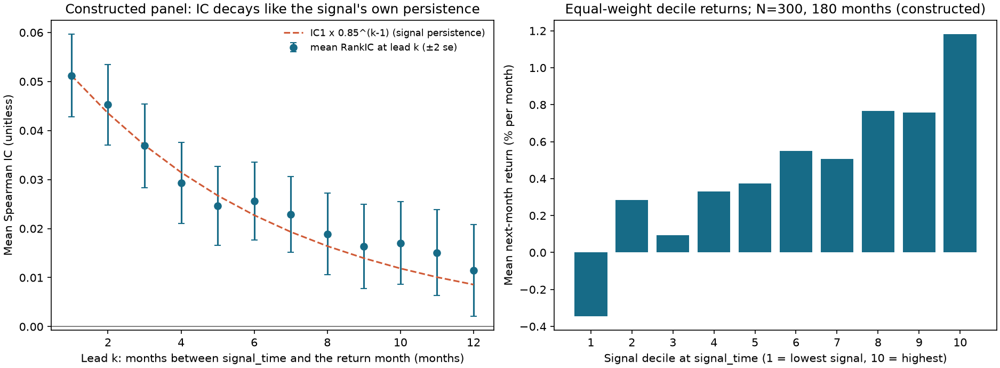
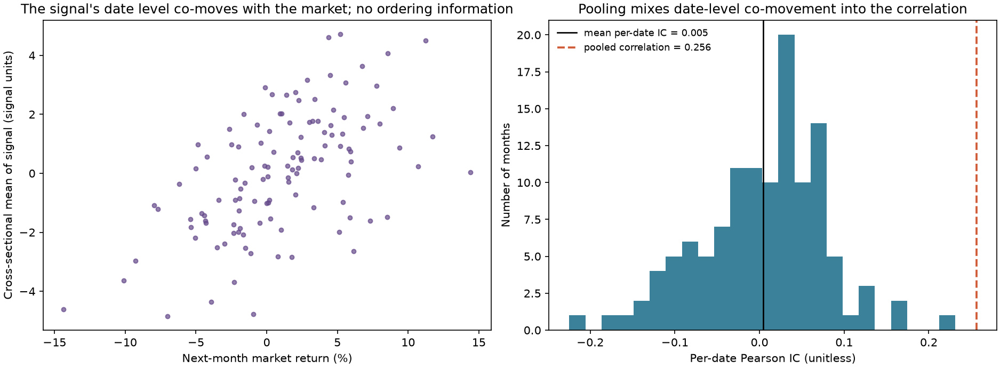
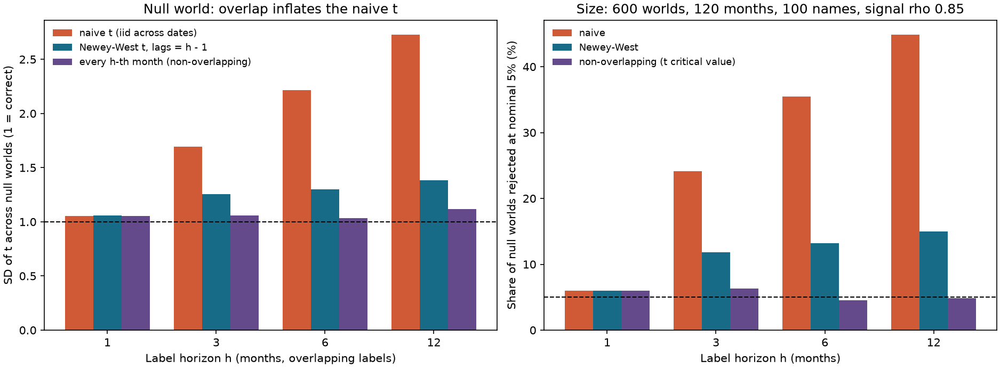
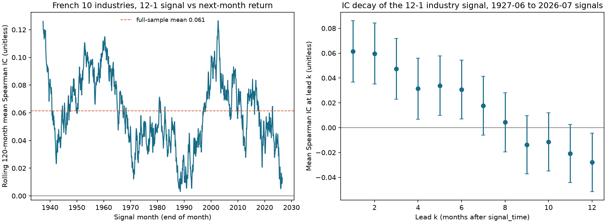

# Chapter 23 — Cross-Sectional Research

> The central idea: At one point in time, rank many assets by a signal. Use the relationship between that ranking and next-period returns to measure prediction, then use quantile portfolios to answer what it would mean to hold the assets. These answer different questions.
> Prerequisites: Chapter 8 (regression), Chapter 15 (factor models and HAC), and Chapter 22 (research methodology). By the end, you will be able to calculate ranks, percentiles, and quantile buckets in a cross-section with ties and missing values; distinguish Pearson IC from Rank IC; derive why a pooled correlation across dates is not the same as per-date IC; construct quantile long-short portfolios and calculate turnover; derive the effective sample size of an IC series with overlapping labels; and use the two-step Fama–MacBeth method to estimate average returns per unit of signal.

## 1. Learning objectives

You should be able to:

1. By hand, calculate ranks, percentiles, and $q$-quantile buckets for a single-date cross-section with ties and missing values (`NaN`), and explain the tie rule at each step.
2. Calculate the Information Coefficient (IC) and Rank IC for each date, aggregate them over time, and use a Newey–West adjustment for inference; explain why a pooled correlation cannot replace per-date IC.
3. Distinguish three time objects: `signal_time` (when the signal is formed), `trade_time` (when the trade executes), and the label interval (the return-measurement period that begins after the signal). Construct labels with `lead_return` and `forward_label` so the label interval does not overlap the signal window.
4. Construct quantile, decile, and long-short portfolios; describe three weighting schemes (equal weight, market-cap weight, and signal-proportional weight); and derive why a signal-proportional portfolio's return equals $\mathrm{IC}\times\sigma_r$.
5. Calculate IC decay and turnover; explain how signal persistence relates to forecast persistence in a specified constructed model, and how weights and costs affect trading frequency.
6. Explain when overlapping labels make the naive $t$ statistic too large, derive the variance inflation factor (VIF), and use the two-step Fama–MacBeth method to estimate average returns per unit of standardized signal.

Completion standard: Given a signal table and a return table indexed by date and asset, you can specify every column in the research table, state when each column becomes available, and reproduce every number in Section 8.

## 2. Why quants need this

Chapter 22 explains how to record experiments honestly. This chapter covers the measurements used most often in each experiment. Most multifactor strategies use a panel with many assets over many dates: at each month-end, hundreds of assets have signal values, and each has a return in the following month. You need to answer two questions: Do assets with higher signals earn higher returns next month (prediction)? And how much would you earn, and how quickly would you trade, by holding assets ranked on the signal (holding)?

These questions require different tools. Prediction concerns only the relative order of assets within each date, so rank within each date first and then aggregate across dates. If you put all assets from all dates into one correlation, market-wide moves and shifts in the signal's overall level enter the calculation, producing a number unrelated to ranking skill. A holding analysis turns ranks into weights and accounts for changes in weights between dates (turnover) and costs.

The chapter proceeds as follows: define within-date ranking and tie rules; measure prediction with per-date IC, aggregate over time for inference, and handle dependence caused by overlapping labels; turn ranks into quantile portfolios and derive the link between IC and portfolio returns; examine how signal persistence relates to IC decay in a specified model and how weights affect turnover; and use Fama–MacBeth regression to estimate average return per unit of signal with a standard error. Each factor in Chapters 24–28 follows this sequence.

## 3. Intuition

Imagine a school that gives an exam every month, with a different subject and difficulty each time. You want to know whether a student's preview score predicts their final-exam score. If you pool every student and every month into one correlation, the easy months (when everyone's scores are high) may coincide with months when preview scores are also high (perhaps the preview questions happened to be easy). That creates a correlation unrelated to individual ability. The right approach is to rank students within each exam, ask whether those who ranked higher on the preview also ranked higher on the final, and then average the results across exams. That is per-date IC.

A quantile portfolio answers a different question. You do not need to predict each student's exact score. You can select the top 20% by preview rank and compare their average final-exam score with the bottom 20%. The difference is the long-short return. It depends on how you form the groups, how you weight students within each group, and how many students you replace each month.

The analogy has limits. Exam subjects differ. In finance, a common market shock creates cross-sectional dependence among assets within a month. Dependence across months is a separate question: examine return dynamics, signal persistence, and overlapping labels rather than inferring time dependence directly from a same-month common shock. The students remain the same group a year later, while asset rankings by signal change from month to month. In the stable linear construction introduced later, the speed of that change is related to the duration of IC. The following sections quantify these issues.

### 3.1 Work through a small asset-by-date table

The following is a teaching construction; the return label is not available on the signal date. An asset with a missing signal is excluded from that date's ranking. An asset with a missing label can still have a signal percentile, but it cannot enter that date's IC calculation. A–E are fixed asset identifiers.

| Date | Field | A | B | C | D | E |
|---|---|---:|---:|---:|---:|---:|
| January | Signal available by the cutoff | 1 | 2 | 3 | 4 | Missing |
| January | Ex post next-month return label | 0.01 | Missing | 0.03 | 0.02 | 0.04 |
| February | Signal available by the cutoff | 1 | 1 | 1 | 1 | Missing |
| February | Ex post next-month return label | 0.01 | 0.02 | 0.03 | 0.04 | Missing |
| March | Signal available by the cutoff | 4 | 3 | 2 | 1 | Missing |
| March | Ex post next-month return label | 0.01 | 0.02 | 0.03 | 0.04 | Missing |

In January, the number of valid signals is $N_{\mathrm{signal},t}=4$. The ranks across all signals are $(1,2,3,4)$, and the percentiles are $(0,1/3,2/3,1)$. With $q=2$, the bucket formula $\lfloor2(r-0.5)/4\rfloor+1$ gives $(1,1,2,2)$. As a tie variant, change C's signal to 2. The average ranks become $(1,2.5,2.5,4)$, the percentiles $(0,0.5,0.5,1)$, and the buckets $(1,2,2,2)$. Do not split a tied group to force equal bucket sizes. The rest of the chapter uses the original table with C=3. For IC, only A, C, and D form valid pairs, so $n_{\mathrm{pair},t}=3$. Re-rank within those three pairs: signal ranks $(1,2,3)$, label ranks $(1,3,2)$, and both means are 2. The centered cross-product sum is 1, each sum of squares is 2, and Rank IC is $1/\sqrt{2\times2}=0.5$.

If you rank all four signals first and then drop B, the signal ranks become $(1,3,4)$, which gives a correlation of about 0.655 with the label ranks. That is not the specified Rank IC. Missing labels change the set of pairs, and therefore the ranking problem; deleting one precomputed rank is not enough.

February has four valid pairs, but the signal is constant, so IC is undefined. March has four valid pairs and Rank IC $=-1$. Thus the panel has three signal dates and per-date pair counts $(3,4,4)$, but only $T_{\mathrm{valid}}=2$ nonmissing IC observations. Their time-series mean is $(0.5-1)/2=-0.25$. Do not treat February's undefined IC as zero, which would give $-1/6$, or treat the 11 pairs as 11 independent dates. Two valid dates illustrate the calculation but do not support a robust statistical conclusion.

## 4. Mathematical foundations

**Notation.** Dates $t=1,\dots,T$ are monthly. Assets are indexed by $i=1,\dots,N_t$, where $N_t=N_{\mathrm{signal},t}$ is the number of assets with valid signals on date $t$ and may vary over time. Let $n_{\mathrm{pair},t}$ be the number of pairs with both signal and label available, and $T_{\mathrm{valid}}$ the number of dates with nonmissing IC. In earlier examples, $n$ or $N$ means the number of valid signals for a single-date ranking and the number of valid pairs for an IC calculation; in time-series inference, $T$ must mean the number of valid dates. Signal $s_{i,t}$ is known at `signal_time` $t$ (month-end); its units depend on the signal definition (a ratio, a return, and so on). Label $y_{i,t}$ is the simple return over a later interval, expressed as a decimal. For example, the next-month label is $y_{i,t}=R_{i,t+1}$; the label over $h$ months is $y_{i,t}=\prod_{k=1}^{h}(1+R_{i,t+k})-1$. A cross-section fixes $t$ and operates across $i$.

**Within-date statistics.** Calculate each IC statistic on the set of valid pairs. In the equations below, $N_t$ therefore means $n_{\mathrm{pair},t}$, not the number of assets with signals only. The within-date sample mean is $\bar s_t=\frac1{N_t}\sum_is_{i,t}$; the population-form variance is $\sigma_{s,t}^2=\frac1{N_t}\sum_i(s_{i,t}-\bar s_t)^2$ (divide by $N_t$, or `ddof=0`); and the covariance is $\mathrm{Cov}_t(s,y)=\frac1{N_t}\sum_i(s_{i,t}-\bar s_t)(y_{i,t}-\bar y_t)$. The within-date Pearson correlation is $\mathrm{IC}_t=\mathrm{Cov}_t(s,y)/(\sigma_{s,t}\sigma_{y,t})$.

**Law of total covariance.** Treat all $(i,t)$ observations from the $T$ dates as one large sample (with $N$ assets per date and $NT$ observations in total). The population covariance equals the average within-date covariance plus the covariance between date-level means. This is the basis for the pooled-correlation issue in the next section.

**Newey–West.** Chapter 22, Section 4 gives the formula. Here we use it to aggregate monthly IC over $T$ dates. $L=0$ corresponds to the independent, identically distributed formula (divisor $T$).

**Autoregressive signal of order 1 (AR(1)).** If $z_{i,t}=\rho z_{i,t-1}+\sqrt{1-\rho^2}\,\epsilon_{i,t}$, with $|\rho|<1$, independent and identically distributed innovations $\epsilon$ of mean 0 and variance 1 that are independent of past signals, and a stationary initialization (signal mean 0 and variance 1), then $\mathrm{Var}(z)=1$ and $\mathrm{Corr}(z_{i,t},z_{i,t+j})=\rho^{j}$.

**Conditional expectation under a bivariate normal distribution.** If $(Z,\,r)$ is bivariate normal, with $Z\sim N(0,1)$, $r$ having mean $\mu_r$ and standard deviation $\sigma_r$, and correlation $\rho_{\mathrm{IC}}$ with $Z$, then $\mathbb E[r\mid Z]=\mu_r+\rho_{\mathrm{IC}}\sigma_rZ$. For a standard normal $Z$, the upper-tail conditional mean is $\mathbb E[Z\mid Z>c]=\varphi(c)/(1-\Phi(c))$, where $\varphi$ is the standard normal density.

Frequency convention: monthly data; `signal_time` is month-end; the label begins in the following month.

## 5. Formal definitions

**Cross-section and panel.** A cross-section is the asset vector at a fixed date $t$. A panel is a table with dates as rows and assets as columns; the row index is `signal_time`. Use NaN as the only missing-value marker. Reject infinities, complex numbers, booleans, text, and `None`: they either have no numerical meaning or may be silently treated as 0 or 1.

**Rank and ties.** For valid (non-NaN) signals on date $t$, sort values in ascending order; the $k$th smallest value has rank $k$. If $m$ values are equal, they occupy ranks $k,\dots,k+m-1$, and each receives their average, $k+(m-1)/2$ (the average-rank rule). Equivalently, $\mathrm{rank}_i=\#\{j:s_j<s_i\}+\bigl(\#\{j:s_j=s_i\}+1\bigr)/2$. Drop NaN before ranking; it occupies no rank and remains missing in the output.

**Percentile.** If there are $n\ge2$ valid items, define percentile $u_i=(\mathrm{rank}_i-1)/(n-1)\in[0,1]$. For $n=1$, define it as 0.5; if all values are tied, each receives 0.5. Percentiles put ranks from dates with different $N_t$ on a common scale.

**$q$-quantile buckets.** Let $\tilde u_i=(\mathrm{rank}_i-\tfrac12)/n\in(0,1)$ and assign bucket $g_i=\lfloor q\,\tilde u_i\rfloor+1\in\{1,\dots,q\}$. Bucket 1 has the lowest signals; bucket $q$ has the highest. Tied values have the same average rank and therefore enter the same bucket. If there are fewer than $q$ valid items, set the whole row to NaN because at least one bucket would be empty. $q=5$ gives quintiles; $q=10$ gives deciles.

**Information Coefficient and Rank IC.** $\mathrm{IC}_t$ is the Pearson correlation between $\{s_{i,t}\}_i$ and $\{y_{i,t}\}_i$ on date $t$. Rank IC is the Pearson correlation of their average ranks, also called Spearman correlation. Use only pairs for which both values are valid, and calculate ranks within that paired set. Under this chapter's minimum-pair convention, do not report IC when there are fewer than three pairs (a mathematical correlation of $\pm1$ is still possible with two nonconstant pairs). A constant value on either side also makes the correlation undefined. The functions return NaN in both cases, not zero.

**IC series, ICIR, and hit rate.** For $\{\mathrm{IC}_t\}_{t=1}^T$, report the mean $\overline{\mathrm{IC}}$ and standard deviation $s_{\mathrm{IC}}$ (`ddof=1`). The Information Coefficient Information Ratio (ICIR) is $\overline{\mathrm{IC}}/s_{\mathrm{IC}}$; it is a per-period ratio, not annualized. The hit rate is the fraction of dates with $\mathrm{IC}_t>0$. Under independent dates, ICIR relates to the Chapter 22 $t$ statistic by $t=\mathrm{ICIR}\cdot\sqrt T$.

**IC decay and signal decay.** Hold signal $s_{i,t}$ fixed and calculate its IC with single-period returns $R_{i,t+k}$ at leads $k=1,2,\dots$. The resulting function of $k$ describes how forecast power fades with horizon.

**Quantile, decile, and long-short portfolios.** On date $t$, sort assets into $q$ buckets by signal. There are three within-bucket weighting schemes: equal weight; market-cap weight, using market capitalization known at `signal_time`; and signal-proportional weight, proportional to the demeaned signal. A long-short portfolio buys bucket $q$ and sells bucket 1, with one unit of capital in each leg, gross exposure of 2, and net exposure of 0. Its gross return excludes costs.

**Turnover.** This chapter uses two definitions. Target-weight turnover is $\sum_i|w_{i,t}-w_{i,t-1}|$ (purchases plus sales, without dividing by two, and excluding weight changes caused by price drift). Membership turnover is the fraction of the prior-period bucket members that are absent from the current bucket. The former is used for cost estimates; the latter is an intuitive measure of signal stability.

**Overlapping labels and effective sample size.** If each month produces an IC from a label spanning $h>1$ months, adjacent IC observations share some return months; the labels overlap. For a stationary series with a finite long-run variance, define $n_{\mathrm{eff}}=T/\mathrm{VIF}$ as the number of dates that would give the same variance for the mean. If the net contribution from autocorrelation is positive, $n_{\mathrm{eff}}<T$; if negative, it can exceed $T$. It is neither a count of new observations nor the degrees of freedom for a test.

**Two-step Fama–MacBeth method.** First, for each date $t$, run a cross-sectional regression across assets: $y_{i,t}=a_t+b_t\,x_{i,t}+e_{i,t}$. Then treat the time series of $b_t$ as data and calculate its mean and standard error. Usually, $x$ is the signal standardized within that date, so $b_t$ has units of label return per one standard deviation of signal.

**Panel dependence.** Returns across assets on the same date are correlated because of common shocks (time effects); residuals for the same asset across dates may be correlated because of persistent characteristics (asset or firm effects). Fama–MacBeth handles the former but gives standard errors that are too small under the latter (Petersen 2005). Newey–West adjusts for time-series dependence but does not address cross-sectional dependence.

### 5.1 Three counts and two divisor conventions

Use $N_{\mathrm{signal},t}$ for percentile ranking and bucket assignment; re-rank the paired observations for IC using $n_{\mathrm{pair},t}$; use $T_{\mathrm{valid}}$ for time-series means and inference. They are all counts, but count different objects. If dates are frequently missing, report the calendar span, missing dates, and their causes. Equal weighting across valid dates is not weighting by the number of asset pairs.

For a date with fixed $n=n_{\mathrm{pair},t}\ge3$, let $C$ be the centered cross-product sum and $S_s,S_y>0$ the two sums of squares. If both use the same cross-sectional divisor $n-d$, where $d=0$ or 1, then

\[
\mathrm{IC}_t=\frac{C/(n-d)}{\sqrt{S_s/(n-d)}\sqrt{S_y/(n-d)}}
=\frac{C}{\sqrt{S_sS_y}}.
\]

The numerator and denominator share the same positive factor, so it cancels and correlation is dimensionless. This cancellation holds when covariance and standard deviations use a consistent divisor; it does not mean arbitrary mixtures of divisors have no effect. For the January ranks, $C=1$ and $S_s=S_y=2$. With `ddof=0`, $\mathrm{Cov}=1/3$ and $\sigma=\sqrt{2/3}$; with `ddof=1`, $\mathrm{Cov}=1/2$ and $\sigma=1$. Both correlations equal 0.5.

Use `ddof=1` for the time-series standard deviation $s_{\mathrm{IC}}$, estimating variation across dates with $(T_{\mathrm{valid}}-1)$. The ordinary standard error of the mean is $s_{\mathrm{IC}}/\sqrt{T_{\mathrm{valid}}}$. In Section 3.1, the two deviations are $+0.75,-0.75$, their squared sum is 1.125, $s=\sqrt{1.125}=1.06066$, the standard error is 0.75, and the naive $t=-1/3$. Do not take the square root of the number of cross-sectional pairs.

In the current HAC implementation, sample autocovariances all use the divisor $T_{\mathrm{valid}}$. Thus, at $L=0$, $\widehat{\mathrm{Var}}_{\mathrm{NW}}(\bar{\mathrm{IC}})=(T_{\mathrm{valid}}-1)s^2/T_{\mathrm{valid}}^2$, which differs from the ordinary $s^2/T_{\mathrm{valid}}$ by a finite-sample factor. The two values in the example are 0.28125 and 0.5625. These are different estimation conventions, not an error in the correlation formula.

**Missing-month interfaces.** `ic_series` first intersects the dates and assets in its two inputs; missing dates outside that intersection do not appear in its returned missing-value count and must be checked against the original calendar separately. `ic_summary` first counts and drops NaN, then passes the compressed array of valid ICs to `newey_west_variance_of_mean`. The latter, when called directly, requires a complete array of finite values and raises `ValueError` on NaN; it does not drop missing values. Newey–West lags count positions in the input array. Thus, January and March in Section 3.1 become adjacent valid observations after compression, and $L=1$ means a one-observation gap, not one calendar month. The return-label constructors instead require a continuous monthly index and reject missing months. Retain missing IC dates and audit their causes. For a HAC analysis with a true “one-month lag,” do not relabel a result from the compressed sequence; define a separate protocol for a continuous date index and missing values, or use a bounded complete window. Do not fill in zeros to manufacture a complete IC series.

### 5.2 Five clocks for financial reports, signals, and trades

The dates below reuse the event record for constructed P102/FY2013 in Project 4; they are not newly collected point-in-time data.

| Clock | Current field and record | What it permits |
|---|---|---|
| Reporting period | `period_end`: 2013-12-31 | Identifies the fiscal year, but does not prove public availability |
| Publication and ingestion | `available_at`: 2014-04-17 16:05 UTC; `ingested_at`: 2014-04-18 | The same version is usable only if both precede the cutoff |
| Signal cutoff | April 2014 month-end; the program's comparison cutoff is 2014-05-01 00:00 UTC | Select the latest period/version for which both fields are strictly before the cutoff |
| First actually tradable time | The first time in May 2014 with an actually tradable price | Occurs after the signal; a monthly table cannot supply a specific execution price |
| Label interval | Current proxy: April month-end close to May month-end close; execution label: actual trade price to exit price | The proxy includes a return segment before the actual trade; the two are not equivalent |

The original 10-K version was available in April. A restatement published on May 20 and ingested on May 21 is usable only from the May signal onward. The cutoff uses a strict comparison against the first instant of the following month; it does not force an unknown timestamp precision into “before 23:59:59 at month-end.” A month-end return label answers a hypothetical month-end execution question. A real portfolio return must start at the actual execution price and connect to the cash/position and corporate-action ledger. An integer-month `lag` cannot replace a trading calendar.

## 6. Derivations

### 6.1 Quantile bucket sizes and ties

Without ties, ranks take all values in $1,\dots,n$, and $\tilde u=(r-\tfrac12)/n$ gives equally spaced points in $(0,1)$ at intervals of $1/n$: $\tfrac1{2n},\tfrac3{2n},\dots$. Bucket $g$ contains ranks satisfying $(g-1)/q\le\tilde u<g/q$, or $r-\tfrac12\in[(g-1)n/q,\;gn/q)$. A half-open interval of length $L=n/q$ contains either $\lfloor L\rfloor$ or $\lceil L\rceil$ points from a unit-spaced grid ($\tfrac12,\tfrac32,\dots$), so bucket sizes differ by at most 1. For $n=10,q=5$, each bucket has 2 assets; for $n=11,q=5$, bucket sizes are 2 or 3. With ties, all values in a tied group share an average rank, so bucket sizes need not be even and a bucket may be empty. That is a consequence of ties, not a code defect.

### 6.2 Spearman correlation is Pearson correlation of ranks; the no-ties formula

For $n$ assets without ties, ranks $r_i$ and $q_i$ are each permutations of $1,\dots,n$. Therefore $\bar r=\bar q=\tfrac{n+1}{2}$ and $\sum_i(r_i-\bar r)^2=\sum_i(q_i-\bar q)^2=\tfrac{n(n^2-1)}{12}$. Let $d_i=r_i-q_i$. Then

\[
\begin{aligned}
\sum_id_i^2&=\sum_i(r_i-\bar r)^2+\sum_i(q_i-\bar q)^2\\
&\quad-2\sum_i(r_i-\bar r)(q_i-\bar q),\\
\sum_i(r_i-\bar r)(q_i-\bar q)&=\frac{n(n^2-1)}{12}-\frac12\sum_id_i^2 .
\end{aligned}
\]

Pearson correlation divides the cross-product sum by the geometric mean of the two sums of squares, which is $\tfrac{n(n^2-1)}{12}$. Hence

\[
\rho_S=1-\frac{6\sum_id_i^2}{n(n^2-1)} .
\]

This formula applies only when there are no ties. With ties, calculate Pearson correlation on average ranks. See the example in Section 8.3.

### 6.3 Why pooled correlation is not per-date IC

Suppose each date has the same $N$ assets and all $NT$ observations are placed in one correlation. Let date $t$ have means $\bar s_t,\bar y_t$, and let the overall means be $\bar{\bar s},\bar{\bar y}$. Total covariance is

\[
\mathrm{Cov}_{\mathrm{pool}}(s,y)=\underbrace{\frac1T\sum_t\mathrm{Cov}_t(s,y)}_{\text{average within-date covariance}}
+\underbrace{\frac1T\sum_t(\bar s_t-\bar{\bar s})(\bar y_t-\bar{\bar y})}_{\text{covariance between date means}} .
\]

To derive this, write each observation as $s_{i,t}-\bar{\bar s}=(s_{i,t}-\bar s_t)+(\bar s_t-\bar{\bar s})$, and do the same for $y$. When multiplied and summed within each date, the cross-terms vanish because $\sum_i(s_{i,t}-\bar s_t)=0$. The first term contains only within-date ranking information. The second is co-movement between the overall signal level and return level on each date: in finance, “the signal is higher overall when the market is up overall.” It says nothing about which asset is stronger than another. Pooled correlation adds both terms and divides by total variance; per-date IC first demeans within each date, eliminating the second term. Section 8.4 gives an example with per-date ICs of $+1$ and $-1$ (mean zero), while pooled correlation is 0.89, entirely because of the second term.

### 6.4 A signal-proportional portfolio return equals $\mathrm{IC}\times\sigma_r$

Standardize date $t$'s signal within the date: $z_i=(s_i-\bar s)/\sigma_s$, using the population-form standard deviation. Then $\bar z=0$ and $\frac1N\sum z_i^2=1$. Set weights to $w_i=z_i/N$ (net exposure 0). The portfolio return is

\[
R_p=\sum_iw_iy_i=\frac1N\sum_iz_iy_i=\frac1N\sum_iz_i(y_i-\bar y)=\mathrm{Cov}_t(z,y)=\mathrm{IC}_t\cdot\sigma_{y,t} .
\]

The second equality uses $\sum_i z_i=0$, the third uses the covariance definition, and the fourth uses $\sigma_z=1$. Thus, the current return of a signal-proportional portfolio equals that date's IC times the cross-sectional dispersion of returns, $\sigma_{y,t}$. This identity does not assume normality. It connects prediction (IC) and holding returns: for the same IC, a date with greater return dispersion earns more. Gross exposure for this portfolio is $\frac1N\sum_i|z_i|$, about 0.80 if the signal is normally distributed. Multiplying all weights by $2\big/\bigl(\frac1N\sum_i|z_i|\bigr)$ gives a gross-exposure-2 version, and scales the portfolio return by the same factor.

### 6.5 Expected long-short return by quantile under bivariate normality

Under the bivariate normal assumption in Section 4, $\mathbb E[y\mid z]=\mu_y+\mathrm{IC}\,\sigma_yz$. The upper-tail bucket has probability $1/q$: $z>c_q$, where $c_q=\Phi^{-1}(1-1/q)$. Its average return is $\mu_y+\mathrm{IC}\,\sigma_y\,\mathbb E[z\mid z>c_q]=\mu_y+\mathrm{IC}\,\sigma_y\cdot q\,\varphi(c_q)$. The lower-tail bucket is symmetric with the opposite sign. Therefore

\[
\mathbb E[\text{long-short}]=2\,\mathrm{IC}\,\sigma_y\,q\,\varphi(c_q) .
\]

Numerically, for $q=5$, $c=0.8416$, $\varphi=0.2800$, and $q\varphi=1.400$; for $q=10$, $c=1.2816$, $\varphi=0.1755$, and $q\varphi=1.755$; for $q=3$, $q\varphi=1.091$. With $\mathrm{IC}=0.05$ and $\sigma_y=8\%$, quintile long-short earns about $2\times0.05\times0.08\times1.400=1.12\%$ per month, and decile long-short about 1.40% per month. In this static model, finer buckets increase expected long-short returns but leave fewer assets in each bucket and increase the sampling noise of each bucket mean. Compare the mean with its standard error to assess signal-to-noise; bucket count alone does not determine the direction. Turnover also depends on signal dynamics and ranking/weight rules, so the static formula says nothing about turnover. This derivation assumes a bivariate normal distribution; with heavy tails and nonlinearities, treat it as an order-of-magnitude reference.

### 6.6 Fama–MacBeth: regress each date, then average over time

The ordinary least squares (OLS) slope in date $t$'s regression $y_{i,t}=a_t+b_tz_{i,t}+e_{i,t}$ is

\[
\hat b_t=\frac{\sum_iz_{i,t}(y_{i,t}-\bar y_t)}{\sum_iz_{i,t}^2}=\frac{N\,\mathrm{Cov}_t(z,y)}{N}=\mathrm{IC}_t\cdot\sigma_{y,t}\quad(\text{when }z\text{ is standardized within date}),
\]

which is the same as the portfolio return in Section 6.4. Thus, each period's Fama–MacBeth slope is the return on a signal-proportional portfolio. The second step is $\bar b=\frac1T\sum\hat b_t$, with $\mathrm{se}(\bar b)=s_b/\sqrt T$ under independent periods. Petersen (2005, equations (8) and (9)) gives this estimator and variance formula and states the assumption that period coefficients are independent. If the $\hat b_t$ series is autocorrelated, this course uses Newey–West inference. That is a design choice in this textbook, not a recommendation from Petersen's paper. Petersen separately tests Fama–MacBeth standard errors adjusted for first-order autocorrelation and finds that they remain too small when firm effects are persistent.

How this differs from IC: $\overline{\mathrm{IC}}$ weights each month equally, while $\bar b$ weights each month by $\sigma_{y,t}$, giving more weight to months with greater dispersion. Their $t$ statistics therefore differ. Neither is right or wrong: IC asks whether the ranking contains information; the FM slope asks how much return each unit of signal earns on average. The historical industry data in Section 11 give $t=4.99$ for IC and $t=3.35$ for the FM slope.

### 6.7 IC decay and signal persistence in a specified constructed model

Constructed setting: next-period return is $y_{i,t+1}=\beta z_{i,t}+\epsilon$, signal $z$ follows an AR(1) process with coefficient $\rho$, and $\epsilon$ is independent of past signals. The covariance between $z_{i,t}$ and the return $k$ months later, $y_{i,t+k}=\beta z_{i,t+k-1}+\epsilon$, is $\beta\rho^{k-1}$, reflecting signal autocorrelation. Therefore

\[
\mathrm{IC}_k=\mathrm{IC}_1\cdot\rho^{k-1} .
\]

When $0<\rho<1$, the signal/IC half-life in this construction is $\ln(0.5)/\ln\rho$ months: the number of months for IC to halve starting from lead 1. Halving occurs at lead $k=1+\ln(0.5)/\ln\rho$. For $\rho=0.85$, the half-life is 4.27 months ($k\approx5.27$); for $\rho=0.9$, it is 6.58 months ($k\approx7.58$). In this stable linear prediction model, greater persistence means slower IC decay. If ranking and weighting rules also remain stable, turnover may be lower. Actual prediction mechanisms, rank crossings, universe changes, and costs can alter this relationship; signal autocorrelation alone does not determine a tradable holding period.

### 6.8 Overlapping labels and autocorrelation in the IC series

Let the signal follow an AR(1) process with coefficient $\rho$, and let date $t$'s $h$-month label be $S_{i,t}=\sum_{k=1}^{h}R_{i,t+k}$. Under the null, returns are independent and identically distributed with variance $\sigma^2$ and are unrelated to the signal. The leading term in IC is $\mathrm{IC}_t\approx\frac1{N\sqrt h\sigma}\sum_iz_{i,t}S_{i,t}$, where $z$ is standardized. This is a large-cross-section approximation: sampling variation in the within-date mean is a higher-order term, and the sample standard deviations in the denominator are replaced by population values $\sigma_z=1$ and $\sigma_S=\sqrt h\sigma$. For $0<j<h$,

\[
\mathrm{Cov}(\mathrm{IC}_t,\mathrm{IC}_{t+j})=\frac1{N^2h\sigma^2}\sum_i\mathbb E[z_{i,t}z_{i,t+j}]\;\mathbb E[S_{i,t}S_{i,t+j}]=\frac{1}{N^2h\sigma^2}\cdot N\rho^j\cdot(h-j)\sigma^2=\frac{\rho^j(h-j)}{Nh},
\]

only the same-asset terms are nonzero (under the null, signals and returns for different assets are independent), and the labels share $h-j$ return months. Meanwhile, $\mathrm{Var}(\mathrm{IC}_t)=1/N$. Thus,

\[
\mathrm{Corr}(\mathrm{IC}_t,\mathrm{IC}_{t+j})=\rho^{\,j}\Bigl(1-\frac jh\Bigr),\quad 0<j<h,\qquad 0\ (j\ge h).
\]

For a stationary series of finite length $T$, the variance of its mean is

\[
\begin{aligned}
\mathrm{Var}(\overline{\mathrm{IC}})&=\frac{\sigma_{\mathrm{IC}}^2}{T}\mathrm{VIF}_T,\\
\mathrm{VIF}_T&=1+2\sum_{j=1}^{T-1}\left(1-\frac jT\right)
\mathrm{Corr}(\mathrm{IC}_t,\mathrm{IC}_{t+j}).
\end{aligned}
\]

There are $T-j$ pairs at lag $j$, which gives the factor $1-j/T$; stationarity makes the covariance depend only on lag. The following VIF omits that pair-count factor and is the long-run variance approximation when $T$ is large relative to $h$:

\[
\mathrm{VIF}=1+2\sum_{j=1}^{h-1}\rho^{j}\Bigl(1-\frac jh\Bigr),\qquad n_{\mathrm{eff}}=T/\mathrm{VIF} .
\]

At the limits, when $\rho=0$ (no signal persistence), $\mathrm{VIF}=1$ and the naive $t$ statistic is not affected; when $\rho=1$, $\mathrm{VIF}=h$ and $n_{\mathrm{eff}}=T/h$. **Under the specified null-world construction with a large cross-section, independent assets, and independent monthly returns, overlapping labels and signal persistence jointly generate this dependence.** Other data-generating processes can also make ICs dependent through serially correlated returns, common shocks, or time-varying cross-sections and missingness. This formula does not show that signal persistence is the only source in every model. For example, with $\rho=0.85$ and $h=3$, $\mathrm{VIF}=1+2(0.85\times\tfrac23+0.7225\times\tfrac13)=2.615$. With $T=120$ months, the long-run approximation gives $n_{\mathrm{eff}}=45.9$, and the naive $t$ is overstated by a factor of $\sqrt{2.615}=1.62$. Retaining the finite-120-period pair-count factor gives

\[
\begin{aligned}
\mathrm{VIF}_{120}&=1+2\left[\frac{119}{120}0.85\frac23
+\frac{118}{120}0.85^2\frac13\right]\\
&=2.59753.
\end{aligned}
\]

The equivalent number of dates is about 46.20. “Exact” here applies only to the finite-period count under the specified approximate autocorrelation model, not to the exact distribution of a finite-cross-section IC.

If the same model instead uses $\rho=-0.5,h=3$, the long-run $\mathrm{VIF}=1+2[-0.5(2/3)+0.25(1/3)]=0.5$. For 120 periods it is 0.50278, giving about 238.67 equivalent dates, more than 120. Negative serial correlation cancels variation in the mean, so here the naive standard error is too large. The case $\rho=1$ is the boundary where the signal is perfectly persistent: long-run VIF is $h$, while the finite-period expression still needs the factor $1-j/T$. Therefore, $T/h$ is not a general formula for effective dates.

Newey–West uses Bartlett weights $(1-j/(L+1))$. Setting $L=h-1$ gives $(1-j/h)$. These weights multiply the **estimated** autocovariances, which already contain the structure $\rho^j(1-j/h)$; the kernel downweights them a second time. For nonnegative persistence coefficients in this construction, the long-run population value recovered is only

\[
\mathrm{VIF}_{\mathrm{NW}}=1+2\sum_{j=1}^{h-1}\rho^{j}\Bigl(1-\frac jh\Bigr)^{2} .
\]

With $\rho=0.85,h=3$, $\mathrm{VIF}_{\mathrm{NW}}=1.916$, below the model's long-run VIF of 2.615. The $t$ statistic therefore remains overstated by about $\sqrt{2.615/1.916}=1.17$. The same issue occurs even when $\rho=1$: the model's long-run $\mathrm{VIF}=h$, while Newey–West recovers only $(2h^2+1)/(3h)$ (2.11 for $h=3$ and 8.03 for $h=12$). This is a population difference caused by the kernel's fixed truncation length, which downweights positive autocovariances; it is not sampling error. The finite-sample simulations in Sections 10 and 12 show that rejection rates remain too high. A truncated estimate with all weights equal to 1 has no such population bias, but the sample estimate is not guaranteed to be positive. For overlapping labels, this chapter therefore prioritizes nonoverlapping samples or reporting both conventions.

## 7. Financial interpretation

**IC is association, not return.** A reported average IC of 0.05 means that the time average of per-date ICs is 0.05, not that IC equals 0.05 every month. A single $\mathrm{IC}_t$ remains a cross-sectional correlation at one date. Pearson IC measures linear association between raw values; Rank IC converts both sides to ranks. By Section 6.4, $R_p=\mathrm{IC}\cdot\sigma_y$. With $\sigma_y=8\%$ and IC=0.05, the monthly return is 0.4% for the $z/N$ portfolio (net exposure 0, gross exposure about 0.8). This is a gross return; costs, capacity, and financing are not included. The numbers in this chapter come only from constructed panels and 10 industry portfolios; they do not make a claim about a “typical IC” in any market.

**Weights connect prediction and holding.** The same IC series can produce very different portfolios: an equal-weight decile long-short portfolio uses ranks and is less sensitive to outliers; a market-cap-weighted quintile concentrates in larger assets, increasing capacity but also noise; signal-proportional weights use signal magnitude and are sensitive to heavy-tailed signals. The constructed examples in Sections 11 and 13 show large differences in gross returns and $t$ statistics across these schemes. A claim that a “factor works” must specify the weighting rule.

**Signal persistence informs trading choices.** If the predictive direction and structure are stable, high persistence motivates evaluating lower-frequency rebalancing. A short-lived signal calls for comparing the incremental returns from faster rebalancing with its costs. An IC-decay curve describes associations at different leads in the sample. A tradable holding period also needs to be tested using actual weights, holdings, and costs; turnover helps quantify the associated expense.

**Economic meaning of within-date processing.** Ranking within each date before aggregating ensures that assets are compared at the same time and against the same macroeconomic backdrop. A broad market move (for example, valuations rise in one month and the market rises the next) is not counted as signal skill. This is the “same-date cross-sectional transformation” emphasized in Chapter 28.

### 7.1 Four different questions on the same panel

Use the two-date, four-asset panel from Section 8.4: on date A, signal $(1,2,3,4)$ and return $(0.10,0.12,0.14,0.16)$; on date B, signal $(11,12,13,14)$ and return $(0.26,0.24,0.22,0.20)$. The date means rise from $(2.5,0.13)$ to $(12.5,0.23)$, even though the within-date relationship switches from positive to negative.

| Quantity | Hand calculation | Question answered |
|---|---|---|
| Pooled correlation | $2/\sqrt{210\times0.024}=0.891$ | How do date-level averages and within-date variation move together? |
| Cross-sectional Pearson/Rank IC | A is $+1$, B is $-1$, equal-date mean 0 | Which asset is stronger on the same date? |
| FM slope on raw signal | $+0.02,-0.02$; return per unit of raw signal | How much return corresponds to one unit of signal? |
| Standardized FM and $z/N$ gross portfolio | Both dates have $\sigma_s=\sqrt{5/4}=1.118$; slope/gross return is $\pm0.02236$ | How much return corresponds to one cross-sectional standard deviation of signal? |

The standardization uses the same paired observations and the population-form standard deviation; the identity in Section 6.6 holds for single-signal OLS with an intercept. It does not carry over to partial slopes in a multiple-signal regression, Rank IC, or a different selected universe. On each date, $z=(-1.342,-0.447,0.447,1.342)$, $w=z/4$, and gross exposure $G=\sum|w|=0.89443$. If scaled to gross exposure 2, the multiplier is $2/G=\sqrt5=2.236$, and the two gross returns become $\pm0.05$. These weights use the same reference capital base, and their net sum is zero; gross exposure of 2 does not mean the capital base is 2.

Only after subtracting costs can we discuss net returns: $R_{\mathrm{net}}=R_{\mathrm{gross}}-c\sum_i|\Delta w_i|$ is this chapter's target-weight cost proxy, where $c$ is the fee per unit of total purchases and sales. Drift, actual executed turnover, financing, borrow, and slippage belong in a separate execution ledger. If the two unscaled gross returns cancel and the proxy cost is 0.001 per period, the net mean is $-0.001$. An average IC of zero does not tell us those costs; a positive IC also does not equal cost-adjusted alpha (residual return relative to a specified risk model and benchmark).

## 8. Worked numerical examples

All numbers are produced by this chapter's CLI function `hand_examples()` and independently checked with a separate implementation.

### 8.1 Ranks and percentiles with ties and missing values

::: {.body-example title="Worked example: Ranks and Percentiles"}
For a single-date cross-section, let the signal be $x=(3,\;1,\;\text{NaN},\;3,\;2,\;7,\;5,\;5)$ across 8 assets, with 1 missing value and $n=7$ valid values. In ascending order they are $1,2,3,3,5,5,7$: the value 1 has rank 1; 2 has rank 2; the two 3s occupy ranks 3 and 4 and each receive 3.5; the two 5s occupy ranks 5 and 6 and each receive 5.5; and 7 has rank 7. The ranks are $(3.5,\;1,\;\text{NaN},\;3.5,\;2,\;7,\;5.5,\;5.5)$. The percentiles $(r-1)/6$ are $(0.4167,\;0,\;\text{NaN},\;0.4167,\;0.1667,\;1,\;0.75,\;0.75)$.
:::

### 8.2 Quantile buckets

For $n=10$ untied values $(1,\allowbreak\dots,\allowbreak10)$ and $q=5$, $\tilde u=(r-0.5)/10$, so $5\tilde u=0.25,\allowbreak0.75,\allowbreak1.25,\allowbreak\dots$. The bucket numbers $\lfloor\cdot\rfloor+1$ are $(1,\allowbreak1,\allowbreak2,\allowbreak2,\allowbreak3,\allowbreak3,\allowbreak4,\allowbreak4,\allowbreak5,\allowbreak5)$. With ties, let $x=(1,\allowbreak2,\allowbreak2,\allowbreak2,\allowbreak5,\allowbreak6,\allowbreak7,\allowbreak8)$, $n=8$, and $q=4$. The average ranks are $(1,\allowbreak3,\allowbreak3,\allowbreak3,\allowbreak5,\allowbreak6,\allowbreak7,\allowbreak8)$; $\tilde u=(r-0.5)/8=(0.0625,\allowbreak0.3125,\allowbreak0.3125,\allowbreak0.3125,\allowbreak0.5625,\allowbreak0.6875,\allowbreak0.8125,\allowbreak0.9375)$; and $4\tilde u=(0.25,\allowbreak1.25,\allowbreak1.25,\allowbreak1.25,\allowbreak2.25,\allowbreak2.75,\allowbreak3.25,\allowbreak3.75)$. Bucket numbers are $(1,\allowbreak2,\allowbreak2,\allowbreak2,\allowbreak3,\allowbreak3,\allowbreak4,\allowbreak4)$. The three tied values all enter bucket 2, so it contains 3 assets; the other buckets contain 1, 2, and 2.

### 8.3 Pearson IC and Rank IC: an outlier

For six assets on one date, let signal $s=(1,2,3,4,5,20)$ and next-period return $y=(0.02,\,0.01,\,0.04,\,0.03,\,0.06,\,-0.05)$. Then $\bar s=5.833$, $\bar y=0.01833$; $\sum(s-\bar s)(y-\bar y)=-1.0617$, $\sum(s-\bar s)^2=250.83$, and $\sum(y-\bar y)^2=0.007083$. Pearson IC is $-1.0617/\sqrt{250.83\times0.007083}=-0.796$. Signal ranks are $1,\dots,6$; return ranks are $(3,2,5,4,6,1)$ (sort $y$ ascending: $-0.05$ has rank 1, 0.01 rank 2, 0.02 rank 3, 0.03 rank 4, 0.04 rank 5, and 0.06 rank 6, then read the ranks in the assets' original order). Thus, $d=(-2,0,-2,0,-1,5)$, $\sum d^2=34$, and Rank IC $=1-6\times34/(6\times35)=0.0286$. The outlier signal value of 20 pulls Pearson IC down to $-0.80$, despite the near absence of ranking information. Rank IC looks only at order and is about 0.03. Which measure is more suitable depends on whether the signal-return relationship is linear and whether the outlier is meaningful. For heavy-tailed signals, this chapter defaults to Rank IC.

### 8.4 Pooled correlation and per-date IC

Two dates, four assets each. Date A: $s=(1,2,3,4)$, $y=(0.10,0.12,0.14,0.16)$, within-date $\mathrm{IC}=+1$. Date B: $s=(11,12,13,14)$, $y=(0.26,0.24,0.22,0.20)$, within-date $\mathrm{IC}=-1$ (higher signal means lower return within that date). The mean per-date IC is 0. For the pooled sample of eight points, $\bar s=7.5$, $\bar y=0.18$, $\sum(s-\bar s)(y-\bar y)=1.10+0.90=2.00$ (1.10 from A and 0.90 from B), $\sum(s-\bar s)^2=210$, and $\sum(y-\bar y)^2=0.024$. Pooled correlation is $2.00/\sqrt{210\times0.024}=0.891$. Decompose the covariance using sample-count divisors: within-date terms divide by $N=4$, and the pooled term by $NT=8$. Date A's within-date covariance is $0.10/4=0.025$; B's is $-0.025$; their average is 0. The covariance between date means is $\tfrac12[(2.5-7.5)(0.13-0.18)+(12.5-7.5)(0.23-0.18)]=\tfrac12(0.25+0.25)=0.25$. The pooled covariance, $2.00/8=0.25$, comes entirely from the second term: date B has both a higher signal level and a higher return level.

### 8.5 Quintile long-short returns and turnover

::: {.body-example title="Worked example: Long-Short Returns, Turnover, and Costs"}
There are $N=10$ assets over two months. Month 1 signal is $(5,\allowbreak3,\allowbreak9,\allowbreak1,\allowbreak7,\allowbreak2,\allowbreak10,\allowbreak4,\allowbreak8,\allowbreak6)$ and next-period return is $(0.02,\allowbreak0.01,\allowbreak0.05,\allowbreak-0.01,\allowbreak0.03,\allowbreak0.00,\allowbreak0.06,\allowbreak0.01,\allowbreak0.04,\allowbreak0.02)$. The signals are their own ranks. With $q=5$, bucket numbers are $(3,\allowbreak2,\allowbreak5,\allowbreak1,\allowbreak4,\allowbreak1,\allowbreak5,\allowbreak2,\allowbreak4,\allowbreak3)$. Bucket 5 (signals 9 and 10) contains assets 3 and 7 (one-based positions 3 and 7, meaning the third and seventh assets), with returns 0.05 and 0.06 and mean 0.055. Bucket 1 (signals 1 and 2) has returns $-0.01$ and 0.00 and mean $-0.005$. The long-short return is 0.060. Month 2 signal is $(5,\allowbreak4,\allowbreak9,\allowbreak1,\allowbreak6,\allowbreak3,\allowbreak10,\allowbreak2,\allowbreak7,\allowbreak8)$ and returns are $(0.01,\allowbreak0.02,\allowbreak0.03,\allowbreak-0.02,\allowbreak0.02,\allowbreak0.01,\allowbreak0.03,\allowbreak0.00,\allowbreak0.04,\allowbreak0.05)$. Bucket 5 (signals 9 and 10) has returns 0.03 and 0.03, mean 0.03; bucket 1 (signals 1 and 2) has returns $-0.02$ and 0.00, mean $-0.01$. The long-short return is 0.040. Each asset in a leg has weight $\pm0.5$. The bucket 5 membership is unchanged between months; bucket 1 changes from assets 4 and 6 to assets 4 and 8. Target-weight turnover is $|0-(-0.5)|+|-0.5-0|=1.0$; membership turnover is 0 for bucket 5 and 0.5 for bucket 1. At a cost of 10 bp per unit of turnover, month 2 net long-short return is $0.040-0.0010=0.039$.
:::

### 8.6 The return on a $z/N$ portfolio equals $\mathrm{IC}\times\sigma_r$

Five assets: $s=(2,4,6,8,10)$, $y=(0.01,0.00,0.03,0.02,0.04)$. Then $\bar s=6$, $\sigma_s=\sqrt{40/5}=2.828$, and $z=(-1.414,-0.707,0,0.707,1.414)$. The portfolio return is $R_p=\frac15\sum z_iy_i=\frac15(-0.01414+0+0+0.01414+0.05657)=0.011314$. Pearson $\mathrm{IC}=\sum(s-\bar s)(y-\bar y)/\sqrt{\sum(s-\bar s)^2\sum(y-\bar y)^2}=0.16/\sqrt{40\times0.001}=0.8$; $\sigma_y=\sqrt{0.001/5}=0.014142$; and $\mathrm{IC}\times\sigma_y=0.011314$. The two values match.

### 8.7 A three-period Fama–MacBeth calculation

Three dates, four assets. Date 1: $s=(1,2,3,4)$, $y=(0.01,0.02,0.04,0.05)$, $\sum(s-\bar s)(y-\bar y)=0.07$, and $\sum(s-\bar s)^2=5$, so $\hat b_1=0.014$. Date 2: $s=(4,3,2,1)$, $y=(0.02,0.02,0.01,0.00)$, giving $0.035/5=0.007$. Date 3: $s=(1,3,2,4)$, $y=(0.00,0.03,0.02,0.04)$, giving $0.065/5=0.013$. The mean is $\bar b=0.011333$. Deviations are $(0.002667,-0.004333,0.001667)$, their squared sum is $2.867\times10^{-5}$, $s_b=\sqrt{2.867\times10^{-5}/2}=0.003786$, $\mathrm{se}=0.003786/\sqrt3=0.002186$, and $t=5.18$. With only three periods, the $t$ statistic has 2 degrees of freedom; these numbers illustrate the mechanics only and are not for inference.

### 8.8 Effective sample size with overlapping labels

For $\rho=0.85$ and $h=3$, $\mathrm{VIF}=2.615$. With $T=120$, $n_{\mathrm{eff}}=45.9$, and a naive $t=3.0$ adjusts to $3.0/\sqrt{2.615}=1.86$. At the extreme $\rho=1$, $n_{\mathrm{eff}}=T/h=40$.

## 9. Python implementation

The core is in [`factor_research.py`](../../../../src/quant_course/factor_research.py), and the monthly momentum window is in [`factor_signals.py`](../../../../src/quant_course/factor_signals.py). Distinguish three time dependencies. Same-date ranks, percentiles, and buckets use only row $t$. Formation-period features such as `formation_return` use the permitted historical window before the cutoff; changes to future inputs must not rewrite past signals. The evaluation labels `lead_return` and `forward_label` deliberately use future returns after the fact. They must never enter the feature set available at signal time. Future-dependent labels define what is being measured; they do not authorize forward-looking predictors.

| Function | Input | Output and edge cases |
|---|---|---|
| `rank_cross_section`, `percentile_cross_section` | One-dimensional numeric vector (`NaN` means missing) | Average ranks/percentiles; an empty cross-section is all NaN; infinities, booleans, text, `None`, and complex numbers raise an error |
| `quantile_bucket` | Vector and bucket count $q\ge2$ | Bucket numbers 1..$q$; ties stay together; all NaN if valid item count is below $q$ |
| `factor_rank` | Date-by-asset panel | Percentiles by row; rows with fewer than `min_names` are all NaN |
| `lead_return`, `forward_label` | Return panel with a continuous monthly `PeriodIndex` | Single-period return at lead $k$; compounded labels controlled by `lag` and `horizon`; missing calendar months in the input index raise an error, while labels beyond the end of the sample or labels requiring a missing return are NaN |
| `information_coefficient`, `ic_series` | Signals and labels | per-date Pearson/Spearman; ranks within valid pairs; NaN for fewer than `min_obs` or a constant input |
| `ic_summary`, `newey_west_variance_of_mean` | IC series and lag count | `ic_summary` returns the mean, standard deviation, ICIR, naive and NW $t$, $n_{\mathrm{eff}}$, and hit rate; it first drops and counts NaNs. The NW helper returns the variance of the mean and raises an error if called directly with NaN. Lags count positions in the supplied valid array; check for internal calendar gaps first. |
| `ic_decay` | Signals, returns, and a set of leads | Mean IC and $t$ for each lead |
| `bucket_returns` | Signals, labels, bucket count, and optional weight panel | Mean return by bucket and `LS`; missing or nonpositive weights are excluded |
| `quantile_long_short_weights`, `signal_proportional_weights` | Signals | Buy the top bucket and sell the bottom bucket (one unit per leg); demeaned signal-proportional weights (gross exposure can be specified) |
| `target_turnover`, `bucket_membership_turnover` | Weight panel; signals and bucket numbers | $\sum|\Delta w|$; fraction of bucket members replaced |
| `fama_macbeth` | Labels and one or more signal panels | Per-period slopes, mean, naive and NW standard errors; dates with too few observations or rank-deficient design matrices are skipped and listed |

**Execution assumption for monthly labels.** In the one-month example (`lead_return` with $k=1$, or `forward_label` with `horizon=1, lag=0`), the monthly return in row $t+1$ is attached to row $t$. Other settings select or compound the future interval specified by the interface. A monthly return starts at the prior month-end close. If the actual trade executes at the first tradable time in the next month, the first part of that monthly return has already occurred before execution. With month-end data only, this label is a research proxy under a hypothetical month-end execution assumption, not an executable return. If open or execution prices are available, start the label at the execution price. `lag` is a whole-month execution delay, not an intraday execution model. Interpret the monthly results in Chapters 22–28 this way (the French industry example is also a revised aggregate return series, not an execution series).

The tie, missing-value, and ranking rules in one place: (1) use average ranks for ties; do not break them by column order; (2) drop NaN before ranking; (3) calculate Rank IC ranks within the pairs for which both signal and label are valid; (4) return NaN rather than 0 when a date has a constant input or fewer than three pairs; (5) do not use `shift` across a missing month in a return panel; and (6) calculate quantile buckets separately by date, not from full-panel quantiles.

Code block 1: verify ranks, percentiles, buckets, and hand-calculated values (Sections 8.1–8.2).

```python
import numpy as np

from quant_course.factor_research import percentile_cross_section, quantile_bucket, rank_cross_section

x = np.array([3, 1, np.nan, 3, 2, 7, 5, 5])
np.testing.assert_allclose(rank_cross_section(x), [3.5, 1, np.nan, 3.5, 2, 7, 5.5, 5.5])
np.testing.assert_allclose(percentile_cross_section(x), [5 / 12, 0, np.nan, 5 / 12, 1 / 6, 1, 0.75, 0.75])
np.testing.assert_array_equal(quantile_bucket(np.arange(1.0, 11.0), 5), [1, 1, 2, 2, 3, 3, 4, 4, 5, 5])
np.testing.assert_array_equal(quantile_bucket([1, 2, 2, 2, 5, 6, 7, 8], 4), [1, 2, 2, 2, 3, 3, 4, 4])
# the bucket of a tied value does not depend on the order of the columns
shuffled = quantile_bucket([7, 2, 5, 2, 8, 1, 2, 6], 4)
np.testing.assert_array_equal(shuffled, [4, 2, 3, 2, 4, 1, 2, 3])
print(rank_cross_section(x))
```

Code block 2: Pearson IC and Rank IC (Section 8.3), pooled correlation and per-date IC (Section 8.4).

```python
import numpy as np
import pandas as pd

from quant_course.factor_research import ic_series, information_coefficient

s = np.array([1, 2, 3, 4, 5, 20.0]); y = np.array([0.02, 0.01, 0.04, 0.03, 0.06, -0.05])
assert abs(information_coefficient(s, y, method="pearson") - (-0.79648)) < 1e-5
assert abs(information_coefficient(s, y, method="spearman") - 1 / 35) < 1e-12       # 1 - 6*34/(6*35)

idx = pd.period_range("2020-01", periods=2, freq="M")
signal = pd.DataFrame([[1, 2, 3, 4.0], [11, 12, 13, 14.0]], index=idx, columns=list("abcd"))
label = pd.DataFrame([[0.10, 0.12, 0.14, 0.16], [0.26, 0.24, 0.22, 0.20]], index=idx, columns=list("abcd"))
per_date = ic_series(signal, label, method="pearson")["ic"]
pooled = np.corrcoef(signal.to_numpy().ravel(), label.to_numpy().ravel())[0, 1]
np.testing.assert_allclose(per_date, [1.0, -1.0])
assert abs(per_date.mean()) < 1e-12 and abs(pooled - 0.89087) < 1e-5
print(per_date.round(3).tolist(), round(pooled, 4))
```

Code block 3: quintile long-short, weights, turnover, and costs (Section 8.5).

```python
import numpy as np
import pandas as pd

from quant_course.factor_research import (
    bucket_membership_turnover, bucket_returns, quantile_long_short_weights, target_turnover,
)

idx = pd.period_range("2020-01", periods=2, freq="M")
cols = list("abcdefghij")
signal = pd.DataFrame([[5, 3, 9, 1, 7, 2, 10, 4, 8, 6.0], [5, 4, 9, 1, 6, 3, 10, 2, 7, 8.0]], index=idx, columns=cols)
label = pd.DataFrame([[.02, .01, .05, -.01, .03, .00, .06, .01, .04, .02],
                      [.01, .02, .03, -.02, .02, .01, .03, .00, .04, .05]], index=idx, columns=cols)
buckets = bucket_returns(signal, label, 5)
np.testing.assert_allclose(buckets["LS"], [0.060, 0.040])
w = quantile_long_short_weights(signal, 5)
assert w.sum(axis=1).abs().max() < 1e-12 and np.allclose(w.abs().sum(axis=1), 2.0)
turnover = target_turnover(w)
assert abs(turnover.iloc[1] - 1.0) < 1e-12
np.testing.assert_allclose(bucket_membership_turnover(signal, 5).iloc[1], 0.0)             # top bucket unchanged
np.testing.assert_allclose(bucket_membership_turnover(signal, 5, bucket=1).iloc[1], 0.5)   # bottom bucket: 1 of 2 replaced
net_second = buckets["LS"].iloc[1] - 0.0010 * turnover.iloc[1]                              # 10 bp per unit of weight traded
assert abs(net_second - 0.039) < 1e-12
print(buckets.round(4))
```

Code block 4: the $z/N$ identity (Section 8.6) and the three-date hand calculation for Fama–MacBeth (Section 8.7).

```python
import numpy as np
import pandas as pd

from quant_course.factor_research import fama_macbeth

s = np.array([2, 4, 6, 8, 10.0]); y = np.array([0.01, 0.00, 0.03, 0.02, 0.04])
z = (s - s.mean()) / s.std(ddof=0)
assert abs((z * y).sum() / 5 - np.corrcoef(s, y)[0, 1] * y.std(ddof=0)) < 1e-15            # R_p = IC * sigma_y
assert abs(np.corrcoef(s, y)[0, 1] - 0.8) < 1e-12

idx = pd.period_range("2020-01", periods=3, freq="M")
cols = list("abcd")
signal = pd.DataFrame([[1, 2, 3, 4.0], [4, 3, 2, 1.0], [1, 3, 2, 4.0]], index=idx, columns=cols)
label = pd.DataFrame([[.01, .02, .04, .05], [.02, .02, .01, .00], [.00, .03, .02, .04]], index=idx, columns=cols)
fm = fama_macbeth(label, {"signal": signal}, min_extra_obs=0)
np.testing.assert_allclose(fm.slopes["signal"], [0.014, 0.007, 0.013])
row = fm.summary.loc["signal"]
assert abs(row["mean"] - 0.011333333) < 1e-8 and abs(row["se_naive"] - 0.0021858) < 1e-6 and abs(row["t_naive"] - 5.185) < 1e-3
print(fm.slopes.round(4).T)
```

Code block 5: label construction and “change the future without changing the past” (`signal_time` and label interval are separate).

```python
import numpy as np
import pandas as pd

from quant_course.factor_research import factor_rank, forward_label, lead_return
from quant_course.factor_signals import formation_return

rng = np.random.default_rng(3)
idx = pd.period_range("2015-01", periods=40, freq="M")
returns = pd.DataFrame(rng.normal(0.01, 0.05, (40, 12)), index=idx, columns=[f"S{i:02d}" for i in range(12)])
signal = factor_rank(formation_return(returns, window=11, skip=1))        # 12-1 percentile signal, row s uses months <= s-1
label = forward_label(returns, horizon=1)                                 # label[s] = return of month s+1
np.testing.assert_allclose(label.iloc[0], returns.iloc[1])
np.testing.assert_allclose(lead_return(returns, 2).iloc[0], returns.iloc[2])
assert label.iloc[-1].isna().all()                                        # no label until the future arrives

shocked = returns.copy(); shocked.iloc[30:] = 0.5                         # change months from 30 on
signal2 = factor_rank(formation_return(shocked, window=11, skip=1))
pd.testing.assert_frame_equal(signal.iloc[:31], signal2.iloc[:31])        # signals up to month 30 cannot see months >= 30
print(signal.iloc[11:13].round(2))
```

For Code block 5, changing returns from month 30 onward leaves signal rows 0 through 30 unchanged. Row 30 uses months 19 through 29 and skips month 30, so the 12-1 signal excludes that month's return. This verifies that the signal has not been shifted one month too far forward or backward.

**Default offline entrypoint.** From the root of the bundled reader package, run:

```bash
.venv/bin/python run_notebook.py notebooks/ch23_cross_sectional_research.ipynb
```

The default is `RUN_FRENCH=False`. The notebook demonstrates ranks and ties, IC, pooled correlation, long-short returns and turnover, $z/N$, FM, a constructed panel of 300 assets by 180 months, a date-level example, and analytical VIFs for $h=1,3,6,12$. It does not run the 600-replication overlapping-label simulation from Section 10. It creates only a chapter-level `RUN_DIR`; it does not write CSV/PNG files or generate the historical figure gallery. The runner creates `runs/execution_ch23_cross_sectional_research_<uuid>/` with an execution copy and status. The historical full CLI `code/ch23_cross_sectional_research.py` includes French data and overlap simulations and is not the default offline command. The historical seeds and results below are carried over from the existing experiment; they do not need to be rerun.
CLI seeds: constructed panel 20261023; pooled-correlation example 20261024; overlapping-label simulations 20261025 ($\rho=0.85$) and 20261026 ($\rho=0$). Data are monthly; `signal_time` is month-end; labels are returns in later months; the French snapshot is revised history, not point-in-time data.

## 10. Reading the figures

**Figure 23-1: IC decay and decile returns in a constructed panel.** The constructed panel has $N=300$ assets over 180 months. The signal is a heavy-tailed AR(1) process with autocorrelation 0.85. Next-period return is $\beta\cdot$signal ($\beta=0.004$), plus a market component and heavy-tailed noise. The left plot shows average Rank IC by lead $k$ (the single-period return in month $k$ after the signal month-end), with error bars at ±2 standard errors; the orange dashed line starts at the first sample Rank IC and multiplies it by $0.85^{k-1}$. It borrows the Pearson-IC decay shape in the linear model of Section 6.7 as an order-of-magnitude reference, not an exact decay theorem for Rank IC in a heavy-tailed finite panel. The measured values are near this reference curve, slightly higher at long horizons but within the error bars. The right plot shows equal-weighted average monthly return by decile, which rises roughly monotonically from bucket 1 to bucket 10. Constructed data; mechanism demonstration.



**Figure 23-2: Pooled correlation and per-date IC.** In this construction, the signal equals “within-date noise” plus a “date-level component.” The date-level component has a 0.5 correlation with next-month market returns; returns contain only the market component and noise unrelated to the signal. Each point in the left plot is a month, with next-month market return (%) on the horizontal axis and the cross-sectional mean signal for that month on the vertical axis; they move together. The right plot is a histogram of per-date IC over 120 months. The black line marks the mean, 0.005, and the orange dashed line marks pooled correlation, 0.256. The pooled correlation lies far outside the IC distribution because it measures date-level co-movement, not assets' ranking skill.



**Figure 23-3: The size of three $t$ statistics with overlapping labels.** In a null world where returns and signals are independent, the construction has 120 months, 100 assets, signal autocorrelation 0.85, and 600 replications. The left plot shows the standard deviation of $t$ statistics; the dashed line at 1 is a standard-normal/asymptotic reference. A finite-sample Student statistic need not have standard deviation exactly 1. The right plot shows the actual rejection rate for a nominal 5% test. The three bars represent the naive test (treating monthly IC as independent), Newey–West with lag $h-1$, and a sample that takes every $h$th month (nonoverlapping, using the $t$-distribution critical value). At $h=12$, the naive $t$ statistic has standard deviation 2.7 and a 45% rejection rate. Newey–West reduces these to 1.38 and 15%, still above 5%. The nonoverlapping sample restores a rate near 5%, at the cost of using only $T/h$ observations.



**Figure 23-4: Rank IC and decay for a 12-1 signal on the 10 French industries.** The left plot shows a rolling 120-month average Rank IC (horizontal axis: signal month-end); the orange line is the full-sample mean of 0.061. The right plot shows mean Rank IC at each lead, with error bars at ±2 Newey–West standard errors (lag 0). The rolling IC varies widely by period, from near zero to above 0.12. Average IC is positive for the first 6 months, turns negative starting in month 9, and reaches $-0.028$ ($t=-2.37$) at month 12. But that negative value should not be treated as a significant reversal when selecting among 12 leads: the two-sided Bonferroni threshold for $M=12$ is $\Phi^{-1}(1-0.05/(2\times12))\approx2.865$. The sample consists of 10 revised industry portfolios, not executable trades.



## 11. Historical market example

**Data and definitions.** Use the same frozen value-weighted monthly returns for the French 10 industry portfolios as in Chapter 22 (ZIP SHA-256 `ebd937a4b995d821867aeb956a96f09a666386f38fa82516b7d1767ee4a49ae5`; processed CSV SHA-256 `3b097d810c295d64eedfa1ece7067ff2a0707f5ca90e33935df9949251f70950`; 1,202 months from 1926-07 through 2026-08, in decimal simple returns per month; source and license are documented in Chapter 22 and `data/manifests/french_industries_2026-10-05.json`). Signal $s_{i,t}$: at month-end $t$, the compounded return over the prior 11 months from $t-11$ through $t-1$ (12-1, excluding the current month). Label: the simple return for the next month, $t+1$. The cross-section has $N=10$ industries; 1,190 months have both signal and label (1927-06 through 2026-07). This previews Chapter 25; here it demonstrates cross-sectional tools and is not a conclusion about momentum.

**per-date Rank IC.** Full-sample mean Rank IC is 0.0615 (standard deviation 0.425, hit rate 55.5%, $t=4.99$, Newey–West lag 0, $T=1190$). By subperiod: 1927-06 through 1963-12, 0.0868 ($t=4.41$, 439 months); 1964-01 through 1999-12, 0.0505 ($t=2.45$, 432 months); and 2000-01 through 2026-07, 0.0414 ($t=1.70$, 319 months). The last period is exactly the holdout evaluation from Chapter 22, with the same $t=1.70$. The standard deviation of monthly IC is large, 0.425, because each cross-section has only 10 assets. The approximate sampling standard error of monthly Rank IC is $1/\sqrt{9}=0.33$, so it is meaningful only after aggregating many months.

**IC decay.** Mean Rank IC for leads 1 through 12 is 0.0615, 0.0597, 0.0474, 0.0315, 0.0338, 0.0307, 0.0178, 0.0044, $-0.0137$, $-0.0114$, $-0.0208$, and $-0.0279$. The corresponding $t$ statistics are 4.99, 4.84, 3.88, 2.56, 2.82, 2.59, 1.50, 0.37, $-1.17$, $-0.98$, $-1.77$, and $-2.37$. In this sample, mean IC is positive for the first six leads, while later point estimates are near zero or negative. These are sample associations in the same revised history, not a general “effective holding period.” Choosing among 12 leads is a multiple-comparison problem. The reported $t$ statistics all use HAC lag 0, whose independent-date/calibration assumption still needs to be checked. Do not generalize the decay relationship from the stable AR linear model in Section 6.7 to real signals.

**Quintile portfolios (two industries per bucket).** Average next-month returns for buckets 1 through 5 are 0.759%, 0.890%, 0.981%, 1.101%, and 1.278% per month, increasing monotonically. The mean long-short return (bucket 5 minus bucket 1, with two industries equally weighted in each leg) is 0.519% per month, with $t=3.64$ when months are treated as independent. Mean target-weight turnover is 0.904 (two assets per leg, gross exposure 2; on average, about 45% of gross exposure is replaced each month). The mean membership turnover of bucket 5 is 22.9%.

**Fama–MacBeth.** Standardize the signal within each date using the population-form standard deviation and fit $y_{i,t}=a_t+b_tz_{i,t}+e_{i,t}$ each month, regressing the label on the standardized signal with an intercept. The average slope is $\bar b=0.1686\%$ per month per one standard deviation of signal, with Newey–West (lag 0) $t=3.35$. The mean intercept is 1.00%, the industry's average monthly return. The identity $\hat b_t=\mathrm{IC}_t\sigma_{y,t}$ holds across all 1,190 months with maximum absolute error below $10^{-15}$. The two $t$ statistics differ (4.99 for IC and 3.35 for FM) because FM gives more weight to months with higher $\sigma_{y,t}$.

**What this example shows and does not show.** It shows that one signal can be measured through per-date IC, quantile portfolios, and FM slopes, with all three giving a positive direction but different significance; that the IC series varies widely across periods; and that a decay curve describes lead associations in this sample but does not directly set a tradable horizon. It does not show that the finding is tradable: 10 industry portfolios are revised published returns, not execution prices, and Chapter 22 only used assumed costs for illustration. Nor does it show that inference is robust: the cross-section has only 10 assets, subperiod $t$ statistics differ, and the summary over 12 leads involves multiple testing. The same data have been used repeatedly in Chapter 22, so do not treat this $t$ statistic as independent evidence.

## 12. Common mistakes

**Mistake 1: Treating a correlation pooled across dates as IC.** In the two-date example in Section 8.4, per-date IC is $+1$ and $-1$ (mean 0), while pooled correlation is 0.891. In the 120-month constructed example in Figure 23-2, pooled correlation is 0.256 while mean per-date IC is 0.005.

```python
import numpy as np
import pandas as pd

from quant_course.factor_research import ic_series, ic_summary

rng = np.random.default_rng(5)
months, names = 120, 200
level = rng.standard_normal(months)                                 # date-level driver
signal = pd.DataFrame(rng.standard_normal((months, names)) + 2 * level[:, None],
                      index=pd.period_range("2010-01", periods=months, freq="M"))
label = pd.DataFrame(0.045 * level[:, None] + 0.08 * rng.standard_normal((months, names)), index=signal.index)
pooled = np.corrcoef(signal.to_numpy().ravel(), label.to_numpy().ravel())[0, 1]
per_date = ic_summary(ic_series(signal, label, method="pearson")["ic"])
assert pooled > 0.2 and abs(per_date.mean) < 0.02 and abs(per_date.t_naive) < 3     # ordering has no information
print(round(pooled, 3), round(per_date.mean, 4), round(per_date.t_naive, 2))
```

**Mistake 2: Breaking ties by row order.** If you use “ordinal ranking” (`argsort`), assigning four tied signals to buckets depends on column order. Reordering the same data changes the portfolio.

```python
import numpy as np

from quant_course.factor_research import quantile_bucket

x = np.array([0.0, 0.0, 0.0, 0.0, 1.0, 2.0, 3.0, 4.0])
average = quantile_bucket(x, 4)
reordered = quantile_bucket(x[::-1], 4)[::-1]
np.testing.assert_array_equal(average, reordered)                       # average-rank rule: order-independent
ordinal = np.argsort(np.argsort(x, kind="stable"), kind="stable")       # ordinal ranks 0..7 break ties by position
ordinal_rev = np.argsort(np.argsort(x[::-1], kind="stable"), kind="stable")[::-1]
bucket_ord = lambda ranks: (4 * (ranks + 0.5) // 8).astype(int) + 1
assert not np.array_equal(bucket_ord(ordinal), bucket_ord(ordinal_rev))  # ordinal rule: depends on column order
print(average.tolist(), bucket_ord(ordinal).tolist(), bucket_ord(ordinal_rev).tolist())
```

**Mistake 3: Ranking the full table before dropping NaN, or filling NaN with zero before ranking.** In the first case, ranks include assets that were later dropped. In the second, missing assets are treated as if they had a zero signal. The library functions rank within the valid pairs.

**Mistake 4: Shifting the label by one month (look-ahead).** Using the same month's return as a prediction label (conceptually $k=0$, a parameter the current `lead_return` rejects) includes already realized information. The example deliberately pairs the signal directly with same-month `returns` to demonstrate the error. In the example below, the constructed same-month return is correlated 0.7 with the signal, while the next month is entirely unrelated.

```python
import numpy as np
import pandas as pd

from quant_course.factor_research import ic_series, ic_summary, lead_return

rng = np.random.default_rng(9)
idx = pd.period_range("2010-01", periods=120, freq="M")
returns = pd.DataFrame(0.08 * rng.standard_normal((120, 100)), index=idx)
signal = returns.mul(0.7).add(0.08 * rng.standard_normal((120, 100)) * 0.714)           # built FROM this month's return (a leak)
same_month = ic_summary(ic_series(signal, returns, method="pearson")["ic"])
next_month = ic_summary(ic_series(signal, lead_return(returns, 1), method="pearson")["ic"])
assert same_month.mean > 0.5 and abs(next_month.t_naive) < 3
print(round(same_month.mean, 3), round(next_month.mean, 4))
```

**Mistake 5: Using a naive $t$ statistic with overlapping labels.** In a null world with signal autocorrelation 0.85 and $T=120$, the naive rejection rate is about 24% for $h=3$ and 45% for $h=12$ (Figure 23-3). Remedy: use a nonoverlapping sample or at least Newey–West, recognizing that it remains optimistic (rejection rate 12–15%).

**Mistake 6: Bucketing on full-sample quantiles.** If cut points use the full panel, an early date's bucket depends on future data. `quantile_bucket` calculates separately for each date. Applying `pd.qcut` to an entire long-form panel would make this mistake.

**Mistake 7: Using market capitalization or a universe from a later date.** The `cap` used for value weights and the stock universe must reflect versions known at `signal_time`. Using market capitalization or delisting status that became available after month-end is look-ahead. The time-field tables in Chapter 24 and Project 4 list each field's `available_at`.

**Mistake 8: Reading “significant $t$” as “profitable return.”** In the constructed panel, the decile long-short gross return is 1.525% per month with $t=10.4$, but monthly target-weight turnover is 1.43 at gross exposure 2. At 10 bp per unit, the proxy cost is about 14 bp per month, only a fraction of the gross return. In the historical industry example, a high-turnover variant would consume more than half its gross return (Chapter 22). The cost share depends on signal persistence and must be reported alongside gross return.

## 13. Applications in quantitative research

**Research table for the signal layer.** Project 4's (multifactor strategy) research interface can be represented as a long-form table with primary key (`date`, `security_id`): raw feature, within-date percentile, bucket, next-month return, $h$-month label, industry, and market capitalization. The current implementation uses date-by-asset panels and separate metadata; the teaching long-form example is not an existing export file. Input features, industry, and market capitalization need records showing availability and ingestion before the cutoff. Ex post labels mark the evaluation interval and need not be available on the signal date. All functions in this chapter use this table as their input/output model.

**Complete chain on a constructed panel (chapter experiment).** The panel has $N=300$, $T=180$, and an AR(1) signal with $\rho=0.85$ and true $\mathrm{IC}_1\approx0.050$. Results: mean Pearson IC 0.0501 ($t=12.1$, hit rate 83.8%); Rank IC 0.0512 ($t=12.1$). The plotted Rank-IC decay is compared with the reference shape $0.85^{k-1}$. Section 6.7 gives a Pearson-IC law for its specified linear model, not an exact Rank-IC law for this heavy-tailed finite panel. Equal-weight decile long-short return is 1.525% per month ($t=10.4$); equal-weight quintile return is 0.999%; market-cap-weighted quintile return is 0.836% ($t=4.90$); and signal-proportional return at gross exposure 2 is 1.042% ($t=12.2$). For the same IC, gross returns differ by more than 20% and $t$ statistics by a factor of 2.5 across the three weighting schemes. This is why a claim that a “factor works” cannot omit the weighting rule. The $z/N$ portfolio's mean return is 0.401% per month, the same as the Fama–MacBeth mean slope of 0.4013% (identity in Section 6.4). After adding a pure-noise signal, its FM slope has $t=-1.0$ and the true-signal slope is unchanged.

**Project 4 constraints.** (1) Report per-date IC and Rank IC, IC decay, quantile monotonicity, and turnover for each factor. (2) For overlapping labels, use nonoverlapping observations or report Newey–West as well. (3) Put missing-value and tie rules in the configuration. (4) Put long-short weights, gross exposure, and the cost convention in the configuration. (5) Record every experiment in Chapter 22's ledger. The signal-layer work in this chapter does not establish a strategy's return after costs.

### 13.1 Project 4 acceptance scope and tradable subspace

| Layer | Current acceptance entrypoint and scope | Use in this chapter |
|---|---|---|
| Signal preparation | Constructed data follows PIT, same-date processing, and the signal contract; missing real EV-bridge fields must not default to zero | The example illustrates feature and date constraints, not a complete strategy |
| Ledger interface | Constructed prices illustrate listing filters, delisting, and ledger integration | Filtering after full-universe neutralization can still leave residual exposure |
| A7-B cost experiment | `projects/project04/cost_execution_lab/ACCEPTED_VERSION.md`: limited teaching cost/execution experiment | Cost sensitivity is a constructed experiment, not real alpha or capacity |

A four-asset counterexample shows why filtering is not re-optimization. Industry 1 has weights $(0.3,-0.3)$ on A and B; industry 2 has weights $(0.2,-0.2)$ on C and D. Before filtering, each industry's weights sum to zero, total net exposure is 0, and gross exposure is 1. If B is untradable and set to zero, the resulting weights are $(0.3,0,0.2,-0.2)$. Industry 1 exposure is 0.3, net exposure is 0.3, and gross exposure is 0.7. Even if scaled by $1/0.7$ to restore gross exposure to 1, industry 1 and net exposure remain $3/7$, not zero.

A complete Project 4 run must reconstruct or project weights over the assets tradable at that time, then check final nonzero weights for industry exposure, net exposure, gross exposure, single-asset caps, budget/cash, and all other prespecified constraints. If the feasible set is empty, define a fallback; do not claim that filtering preserves neutrality. A6 has already recorded this open interface. This chapter example gives readers a counterexample and checks; it did not change the shared optimizer or run new empirical work. Complete P4 methods, implementation, real data, and trading validation remain in the later project queue.

## 14. Chapter summary

Cross-sectional research turns “many assets on the same date” into testable quantities: rank within each date (ranks, percentiles, quantile buckets), measure prediction within each date (IC and Rank IC), and then treat dates as the observations for aggregation. Pooled correlation mixes in co-movement in date-level averages. In the specified constructed model, overlapping labels and persistent signals make the IC series autocorrelated; the long-run effective sample size is $T/\mathrm{VIF}$. Other data-generating processes need separate checks. We connect prediction to holding with weights: a signal-proportional portfolio earns $\mathrm{IC}\times\sigma_y$, while quantile portfolios depend on bucket and weighting rules. In the specified model, signal persistence relates to IC decay; actual turnover also depends on weights and the universe. Fama–MacBeth expresses average return per unit of signal with a standard error, but its weighting differs from IC. In the historical French industry data, the same signal has a consistent direction across per-date IC, quantile portfolios, and FM, while significance varies by measure and period. Scope limits: the constructed panel demonstrates a mechanism; a 10-industry cross-section is small; French data are revised history; and this chapter measures costs only through turnover, so it does not draw strategy conclusions.

## 15. Exercises

**23-E01 (conceptual)** Why is the signal time month-end and why does the label begin in the following month? List the five time fields that a monthly research table must identify, and state which two require a strict ordering.

**23-E02 (by hand)** For the date-level cross-section $x=(4,2,2,\text{NaN},9,7,2,5,7)$, calculate average ranks, percentiles, and bucket numbers for $q=3$.

**23-E03 (by hand)** Five assets have signal $s=(1,2,3,4,12)$ and next-period return $y=(0.03,0.01,0.05,0.04,-0.06)$. Calculate Pearson IC and Rank IC, and explain the difference.

**23-E04 (derivation)** Prove that without ties, $\sum(r_i-\bar r)^2=n(n^2-1)/12$, and use it to derive Spearman's formula $1-6\sum d^2/(n(n^2-1))$.

**23-E05 (by hand)** Two dates with three assets each. A: $s=(1,2,3)$, $y=(0.01,0.02,0.03)$. B: $s=(5,6,7)$, $y=(0.07,0.06,0.05)$. Calculate per-date IC, its mean, and the pooled correlation; use the law of total covariance to explain which term accounts for the difference.

**23-E06 (by hand)** Four assets have $s=(1,3,5,7)$ and $y=(0.02,0.01,0.05,0.04)$. Calculate $z$ and verify that $\frac1N\sum z_iy_i=\mathrm{IC}\times\sigma_y$.

**23-E07 (by hand)** Two months, eight assets, and $q=4$. Month 1 signals: $(3,\allowbreak1,\allowbreak8,\allowbreak5,\allowbreak6,\allowbreak2,\allowbreak7,\allowbreak4)$; month 2 signals: $(3,\allowbreak2,\allowbreak8,\allowbreak1,\allowbreak6,\allowbreak5,\allowbreak7,\allowbreak4)$. Next-period returns for month 1: $(0.03,\allowbreak0.00,\allowbreak0.06,\allowbreak0.02,\allowbreak0.04,\allowbreak0.01,\allowbreak0.05,\allowbreak0.02)$; for month 2: $(0.02,\allowbreak-0.01,\allowbreak0.05,\allowbreak0.00,\allowbreak0.03,\allowbreak0.02,\allowbreak0.04,\allowbreak0.01)$. Calculate each month's long-short return, target-weight turnover, and the membership replacement rate in each of the two buckets. If the cost is 10 bp per unit of turnover, what is the net return in month 2?

**23-E08 (calculation)** Using the long-run approximation in Section 6.8, let signal autocorrelation be $\rho=0.9$, label horizon $h=4$, and $T=240$ months. Calculate VIF, $n_{\mathrm{eff}}$, the adjusted value of a naive $t=3.1$, and the VIF and adjusted $t$ recovered in population by Newey–West with $h-1=3$ lags.

**23-E09 (interpretation)** A signal has AR(1) coefficient 0.9. What is its half-life? If a signal's IC half-life is only one month, how would you choose a rebalancing frequency, and why?

**23-R01 (pairs and dates; further practice)** Redo Section 3.1: give $N_{\mathrm{signal},t}$, $n_{\mathrm{pair},t}$, IC, and $T_{\mathrm{valid}}$ for all three dates, and calculate the time-series standard error. Why can you not use ranks from the full signal set or fill February with zero? What does HAC lag 1 mean in the currently compressed series?

**23-R03 (model conditions; further practice)** Under the specified large-cross-section dependence model in Section 6.8, calculate finite-period VIF and equivalent date count for $\rho=0.85$ and $-0.5$ with $T=120,h=3$. Explain which conclusions do not generalize to arbitrary IC series.

**23-R02 (portfolio and interface; further practice)** For Section 7.1, report the raw and standardized FM slopes, the gross exposure of $z/N$, and the scaling to gross exposure 2. Then, for Section 13.1 after filtering out B, check industry, net, and gross exposure. Which of these steps can establish cost-adjusted alpha?

## 16. Programming exercises

**23-P01** Write a function that takes a date-by-asset panel and returns the average next-month return for five buckets and the long-short return, using `quantile_bucket` and `lead_return`. Verify that the five buckets are monotonic and the long-short return is positive on constructed data. It must handle NaN and ties without error. Acceptance: one assertion for each of the three input types.

**23-P02** On a constructed panel, calculate per-date Pearson IC and pooled correlation. Create a case where the signal's date-level component co-moves with the market, then verify that pooled correlation is much larger than mean per-date IC. Acceptance: pooled correlation $>0.2$ and absolute mean IC $<0.02$.

**23-P03** Simulate a null world with an AR(1) signal ($\rho=0.85$) and independent returns, using $h=3$ overlapping labels. Compare rejection rates for naive $t$, Newey–West with lag 2, and a nonoverlapping sample. Acceptance: naive rejection rate is clearly above 5%, while the nonoverlapping rate is around 5%.

## 17. Challenge exercises

**23-C01 (derivation)** Under a bivariate normal assumption, derive the expected return of a $q$-quantile long-short portfolio, $2\,\mathrm{IC}\,\sigma_y\,q\,\varphi(c_q)$, and calculate $q\varphi(c_q)$ for $q=3,5,10,20$. Discuss the trade-off between long-short return and single-bucket sampling noise as buckets become narrower. Additional prerequisite: the conditional mean of a normal upper tail. Scoring: derivation 40 points, numerical values 30, trade-off discussion 30.

**23-C02 (open-ended)** Design the cross-sectional research table for the Value factor in Chapter 24. List each column name and source, the `available_at` rule, missing-value and tie rules, label interval, and industry and market-cap treatment. Give at least three tests that would make you conclude that a positive per-date IC is spurious. Scoring: time-field correctness 30 points, missing-value and tie rules 20, test design 30, treatment of overlapping labels and panel dependence 20.

\clearpage

## 18. Complete answers and reference implementations

**23-E01** The chapter uses month-end signals based on information that was available and ingested before the cutoff, with actual execution after the signal. Five time objects: reporting period (`period_end`)/event time; publication and ingestion (`available_at`/`ingested_at`); `signal_time` (the current program uses the first instant of the next month as a strict cutoff); `trade_time`; and label start/end. Inputs must precede the signal cutoff, and `signal_time < trade_time`. Executable returns begin at the actual execution price. The current next-month month-end label is a research proxy under a hypothetical month-end execution assumption and includes a pre-execution return segment. A later calendar month alone does not establish correct execution timing.

**23-E02** The valid values are $(4,2,2,9,7,2,5,7)$, with $n=8$. Sorted values are $2,2,2,4,5,7,7,9$: the three 2s occupy ranks 1, 2, and 3 and each receive average rank 2; 4 has rank 4; 5 has rank 5; the two 7s occupy ranks 6 and 7 and each receive 6.5; 9 has rank 8. The ranks, retaining NaN, are $(4,2,2,\text{NaN},8,6.5,2,5,6.5)$. Percentiles $(r-1)/7$ are $(0.4286,0.1429,0.1429,\text{NaN},1,0.7857,0.1429,0.5714,0.7857)$. For $q=3$, $\tilde u=(r-0.5)/8$: rank 2 gives 0.1875, 4 gives 0.4375, 5 gives 0.5625, 6.5 gives 0.75, and 8 gives 0.9375. The values of $3\tilde u$ are 0.5625, 1.3125, 1.6875, 2.25, and 2.8125; bucket numbers are $(2,1,1,\text{NaN},3,3,1,2,3)$.

**23-E03** $\bar s=4.4$ and $\bar y=0.014$. Pearson IC is $-0.865$; the outlier signal of 12 corresponds to the lowest return, $-0.06$. Return ranks are $(3,2,5,4,1)$ and signal ranks are $(1,2,3,4,5)$. Thus $d=(-2,0,-2,0,4)$, $\sum d^2=24$, and $\rho_S=1-6\times24/(5\times24)=1-1.2=-0.2$. Pearson is sensitive to the outlier, which drives nearly all of the result; Rank IC considers only order, and $-0.2$ shows that the ordering relationship is also weak. If 12 is a real extreme signal, Pearson may capture it better; if it is a data error, Rank IC is more robust.

**23-E04** Ranks are a permutation of $1,\dots,n$, so $\bar r=(n+1)/2$ and $\sum r_i^2=n(n+1)(2n+1)/6$. Therefore, $\sum(r_i-\bar r)^2=n(n+1)(2n+1)/6-n(n+1)^2/4=n(n+1)[2(2n+1)-3(n+1)]/12=n(n+1)(n-1)/12=n(n^2-1)/12$. For the rest, see Section 6.2: define $d_i=r_i-q_i$, expand $\sum d_i^2$, and use the equal sums of squares for the two permutations to obtain $\sum(r_i-\bar r)(q_i-\bar q)=n(n^2-1)/12-\tfrac12\sum d_i^2$. Dividing by $n(n^2-1)/12$ gives the result.

**23-E05** Date A has $s$ and $y$ moving together, so $\mathrm{IC}=+1$. On B, $s$ rises while $y$ falls, so $\mathrm{IC}=-1$. The mean is 0. In the pooled sample of six points, $\bar s=4$ and $\bar y=0.04$. For A, deviations are $s-4=(-3,-2,-1)$ and $y-0.04=(-0.03,-0.02,-0.01)$, with cross-product sum $0.09+0.04+0.01=0.14$. For B, deviations are $s-4=(1,2,3)$ and $y-0.04=(0.03,0.02,0.01)$, with cross-product sum $0.03+0.04+0.03=0.10$. Total cross-product is 0.24; divide by $NT=6$ for pooled covariance 0.04. The sums of squares are $\sum(s-\bar s)^2=28$ and $\sum(y-\bar y)^2=0.0028$. Pooled correlation is $0.24/\sqrt{28\times0.0028}=0.857$. Decomposition: A's within-date covariance is $\sum(s-2)(y-0.02)/3=0.02/3=0.00667$, and B's is $-0.00667$, averaging to 0. Covariance between date means is $\tfrac12[(2-4)(0.02-0.04)+(6-4)(0.06-0.04)]=\tfrac12(0.04+0.04)=0.04$. All pooled covariance comes from the second term: date B has higher signal and return levels.

**23-E06** $\bar s=4$, $\sigma_s=\sqrt{(9+1+1+9)/4}=\sqrt5=2.236$, and $z=(-1.342,-0.447,0.447,1.342)$. Then $\frac14\sum z_iy_i=\frac14(-0.02683-0.00447+0.02236+0.05367)=0.01118$. Pearson IC is 0.7071. $\sigma_y=\sqrt{\tfrac14\sum(y-0.03)^2}=\sqrt{(0.0001+0.0004+0.0004+0.0001)/4}=0.015811$, so $\mathrm{IC}\times\sigma_y=0.011180$. They match.

**23-E07** Month 1 has $q=4$, $n=8$, and signals equal to ranks. Bucket assignment is $\lfloor4(2r-1)/16\rfloor+1$: ranks 1 and 2 go to bucket 1; ranks 3 and 4 to bucket 2; ranks 5 and 6 to bucket 3; and ranks 7 and 8 to bucket 4. Bucket 4 in month 1 contains signals 7 and 8, assets 3 and 7, with returns 0.06 and 0.05 and mean 0.055. Bucket 1 contains signals 1 and 2, assets 2 and 6, with returns 0.00 and 0.01 and mean 0.005. Long-short return is 0.050. In month 2, bucket 4 has signals 7 and 8 (assets 3 and 7) with returns 0.05 and 0.04 and mean 0.045. Bucket 1 has signals 1 and 2 (assets 4 and 2) with returns 0.00 and $-0.01$ and mean $-0.005$. Long-short return is 0.050. Each leg uses weights $\pm0.5$. Bucket 4 membership is unchanged; bucket 1 changes from assets 2 and 6 to assets 2 and 4. Target-weight turnover is $0.5+0.5=1.0$; membership replacement is 0 for bucket 4 and 0.5 for bucket 1. Month 2 net return is $0.050-0.0010\times1.0=0.049$.

**23-E08** $\mathrm{VIF}=1+2[0.9\times\tfrac34+0.81\times\tfrac24+0.729\times\tfrac14]=1+2(0.675+0.405+0.18225)=3.5245$; $n_{\mathrm{eff}}=240/3.5245=68.1$; adjusted $t=3.1/\sqrt{3.5245}=1.65$. The population Newey–West value is $\mathrm{VIF}_{\mathrm{NW}}=1+2[0.9\times(\tfrac34)^2+0.81\times(\tfrac24)^2+0.729\times(\tfrac14)^2]=1+2(0.50625+0.2025+0.04556)=2.5086$, giving $t=3.1/\sqrt{2.5086}=1.957$. The naive $t=3.1$ looks highly significant; the adjusted value is about 1.65. Newey–West's 1.96 remains optimistic and sits near the 5% critical value.

**23-E09** Under the stable linear construction in Section 6.7, half-life is $\ln0.5/\ln0.9=6.58$ months. If IC half-life is one month, forecast power halves within a month. Compare monthly rebalancing with shorter holding periods, while recognizing that turnover and fees may be higher. Decide using cost-adjusted returns under the frozen weighting rule, not IC alone. If half-life is longer (for example, 6.6 months), lower-frequency rebalancing is a candidate. Whether turnover falls and how much gross return is lost must be calculated under the specified weights, holding interval, rank changes, and costs; $\rho$ alone does not guarantee it.

**23-R01** Valid signal counts across the three dates are $(4,4,4)$; paired counts are $(3,4,4)$; IC values are $(0.5,\mathrm{NaN},-1)$; and there are two valid dates. January must be re-ranked on A, C, and D, giving 0.5. Ranking all signals first and filtering later gives about 0.655. February's constant signal contains no ranking information, so correlation is undefined; filling it with zero changes the estimand. The mean is $-0.25$, sample standard deviation 1.06066, standard error 0.75, and naive $t=-1/3$. After compressing the array, lag 1 is one observation from January to March; it cannot be described as one month. Two dates do not support a statistical research conclusion.

**23-R03** Finite-period VIF is $1+2\sum_{j=1}^{2}(1-j/120)\rho^j(1-j/3)$. For $\rho=0.85$, it is 2.59752778 and $120/\mathrm{VIF}=46.1978$. For $\rho=-0.5$, it is 0.50277778 and the equivalent date count is 238.6740. The earlier 2.615 and 45.9 are long-run approximations. With negative correlation, VIF is below 1, so do not state that “correlation” always means smaller standard errors or fewer effective dates. These results depend on the specified autocorrelation structure and do not solve the exact finite-cross-section problem with compounded labels and common shocks.

**23-R02** Raw FM slopes are $\pm0.02$; standardized slopes are $\pm0.02236$; gross exposure of $z/N$ is 0.89443. Multiplying by $\sqrt5$ gives gross exposure 2 and returns of $\pm0.05$. Filtering out B gives industry sums $(0.3,0)$, net exposure 0.3, and gross exposure 0.7. Scaling by $10/7$ gives industry sums $(3/7,0)$, net exposure $3/7$, and gross exposure 1. Reconstruct the portfolio in the tradable universe and verify its final constraints. These are associations, gross returns, and constraint calculations; without actual costs and benchmark-risk attribution, none establishes cost-adjusted alpha.


**23-P01 reference implementation**

```python
import numpy as np
import pandas as pd

from quant_course.factor_research import bucket_returns, lead_return


def five_bucket_table(signal: pd.DataFrame, returns: pd.DataFrame) -> pd.Series:
    table = bucket_returns(signal, lead_return(returns, 1), 5).dropna()
    return table.mean()


rng = np.random.default_rng(11)
idx = pd.period_range("2010-01", periods=120, freq="M")
cols = [f"S{i:03d}" for i in range(200)]
signal = pd.DataFrame(rng.standard_normal((120, 200)), index=idx, columns=cols)
returns = 0.004 * signal.shift(1) + pd.DataFrame(0.08 * rng.standard_normal((120, 200)), index=idx, columns=cols)
signal.iloc[5, :20] = np.nan                       # missing values
signal.iloc[7] = np.round(signal.iloc[7], 0)       # many ties on one date
mean = five_bucket_table(signal, returns)
assert mean.loc[5] > mean.loc[1] and mean["LS"] > 0
assert np.all(np.diff(mean.loc[[1, 2, 3, 4, 5]].to_numpy()) > -0.0015)   # weakly increasing within noise
print(mean.round(5).to_dict())
```

**23-P02 reference implementation**: See the code under Mistake 1 in Section 12, which reports pooled correlation alongside per-date IC. Set the coefficient on `2 * level` to 0 and verify that both values are close to zero.

**23-P03 reference implementation**

```python
import numpy as np
from scipy import stats

rng = np.random.default_rng(13)
months, names, h, rho, worlds = 120, 100, 3, 0.85, 400
naive, nw, non = [], [], []
for _ in range(worlds):
    total = months + h
    z = np.empty((total, names)); z[0] = rng.standard_normal(names)
    for t in range(1, total):
        z[t] = rho * z[t - 1] + np.sqrt(1 - rho**2) * rng.standard_normal(names)
    r = 0.08 * rng.standard_normal((total, names))
    label = sum(r[k:k + months] for k in range(1, h + 1))
    zs = z[:months] - z[:months].mean(axis=1, keepdims=True); ls = label - label.mean(axis=1, keepdims=True)
    ic = (zs * ls).sum(axis=1) / np.sqrt((zs**2).sum(axis=1) * (ls**2).sum(axis=1))
    naive.append(ic.mean() / (ic.std(ddof=1) / np.sqrt(months)))
    d = ic - ic.mean(); lrv = d @ d / months + 2 * sum((1 - j / h) * (d[j:] @ d[:-j]) / months for j in range(1, h))
    nw.append(ic.mean() / np.sqrt(lrv / months))
    sub = ic[::h]; non.append(sub.mean() / (sub.std(ddof=1) / np.sqrt(len(sub))))
reject = lambda a, c=1.96: float((np.abs(a) > c).mean())
assert reject(naive) > 0.15 and reject(nw) > reject(non) and reject(non, stats.t.ppf(0.975, 39)) < 0.09
print(reject(naive), reject(nw), reject(non, stats.t.ppf(0.975, 39)))
```

**23-C01** From Section 4, $\mathbb E[y\mid z]=\mu_y+\mathrm{IC}\sigma_yz$. The upper-tail bucket is $z>c_q$, with probability $1/q$. Then $\mathbb E[z\mid z>c_q]=\int_{c_q}^{\infty}z\varphi(z)dz\big/(1/q)=q\,\varphi(c_q)$, since $\int_c^\infty z\varphi(z)dz=\varphi(c)$. The lower-tail mean is $\mathbb E[z\mid z<-c_q]=-q\varphi(c_q)$. Therefore, long-short return is $2\,\mathrm{IC}\sigma_yq\varphi(c_q)$. Values of $q\varphi(c_q)$: for $q=3$, $c=0.4307$, $\varphi=0.3636$, giving 1.091; for $q=5$, $c=0.8416$, $\varphi=0.2800$, giving 1.400; for $q=10$, $c=1.2816$, $\varphi=0.1755$, giving 1.755; for $q=20$, $c=1.6449$, $\varphi=0.1031$, giving 2.063. Expected long-short return rises with $q$, but each bucket has fewer assets, $N/q$. The sampling standard error of a bucket mean is approximately $\sigma_y/\sqrt{N/q}$ (conditional variance approximately $\sigma_y^2(1-\mathrm{IC}^2)$). With $N=300,q=20$, each bucket has 15 assets and its mean standard error is about $0.08/\sqrt{15}=2.1\%$, far above the signal's expected contribution. Finer buckets raise expected long-short return, but also increase single-bucket noise and concentrate holdings in fewer assets. Compare the mean with its standard error to assess the long-short signal-to-noise ratio; noise alone does not determine the direction. The static normal formula contains no signal-transition process, so it cannot show that turnover must rise. Calculate actual turnover from dynamic ranks and weights. Fix $q$ in the research plan. Score using the original three criteria.

**23-C02 (scoring guide and reference).** Suggested columns: `date` (month-end `signal_time`), `security_id` (permanent identifier), `book_equity`, and `market_cap` (latest version of each with `available_at ≤ signal_time`, using Chapter 13's `select_pit_vintage`); `b_m` (book equity/market cap; set to NaN and record `reason` when equity ≤0); `industry` (classification known at `signal_time`); `rank_pct` (within-date percentile, with a separate column for the within-industry version); `bucket`; `label_1m`; and `label_3m` (with intervals documented). Missing values: retain nonpositive equity and missing market cap as NaN; do not fill with zero. Ties: use average ranks. Three tests for a spurious positive IC: (1) delay `available_at` by one month and see whether IC disappears (timing test); (2) rank within industry and see whether IC remains positive (industry-effect test); (3) remove the largest 5% of assets by market cap and see whether IC remains positive (size-concentration test). A permutation test is another option. Score using the original four criteria.

## 19. Further reading

- **Must know:** Petersen (2005 NBER working paper), abstract and introduction, then the section containing equations (8) and (9), to understand the assumptions behind Fama–MacBeth standard errors; useful for recognizing when FM $t$ statistics are too large.
- **Should know:** Jegadeesh and Titman (1993), Section I, on overlapping holding-period portfolios and turnover; read in depth in Chapter 25.
- **Should know:** Chapter 22, Section 6, on multiple testing, and Chapter 15 on HAC.
- **Advanced:** Original papers by Fama and MacBeth (1973), Newey and West (1987), and the chapters on IC and the Fundamental Law in Grinold and Kahn. These works have not been read for this chapter; obtain their texts before checking notation and conclusions.
- **Optional:** Any publicly available factor research report; practice identifying when each column in its “research table” becomes available.

## 20. References

Citation keys and references are listed in [source_notes.md](../../../zh/chapters/ch23/source_notes.md).

- **CH23_PETERSEN2005:** Petersen, M. A. (2005/2006). “Estimating Standard Errors in Finance Panel Data Sets: Comparing Approaches.” NBER Working Paper 11280. Supports the discussion of Fama–MacBeth estimation and standard errors in Sections 5 and 6.6; the 2009 RFS final version has not been read.
- **CH23_JT1993:** Jegadeesh, N., and Titman, S. (1993). “Returns to Buying Winners and Selling Losers.” *Journal of Finance* 48(1). Supports the discussion of overlapping holding periods.
- **CH23_SCIPY_RANKDATA:** SciPy 1.18.1 documentation for `scipy.stats.rankdata`, supporting the average-rank definition.
- **FRENCH:** Kenneth R. French Data Library, 10 Industry Portfolios (frozen snapshot).

