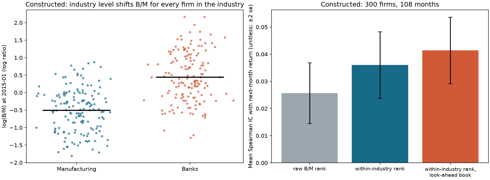
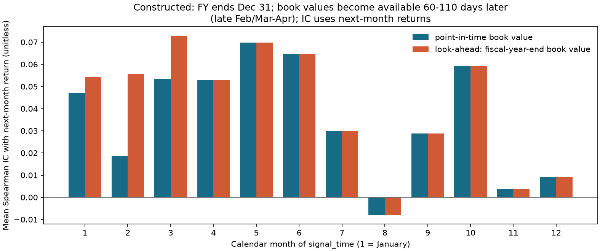
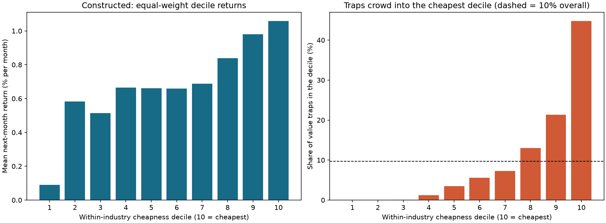
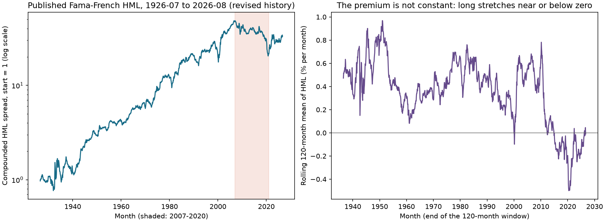

# Chapter 24 — Value Factors

> Through line: Turn “cheap relative to fundamentals” into a directionally consistent signal whose numerator and denominator use matching definitions and whose inputs were available at signal_time. Each careless step can create an illusion that a value effect exists.
> Prerequisites: Chapter 12 (financial statements), Chapter 13 (valuation), and Chapter 23 (cross-sectional research). By the end, you should be able to define the numerator, denominator, direction, and appropriate industry for book-to-market (B/M), earnings yield (E/P), free-cash-flow yield (FCF Yield), and enterprise value to EBITDA (EV/EBITDA); handle negative denominators; remove industry-level differences with same-date, within-industry percentiles; select point-in-time versions using available_at and ingested_at and detect look-ahead; explain value traps; read published HML value-factor returns; and explain why they do not test a per-stock value signal.

## 1. Chapter Objectives

Readers should be able to answer: At a given month-end, how exactly do we calculate whether a company is “cheap,” and which of those numbers were known at that time?

1. For each value ratio, state its numerator, denominator, units, and direction (does a larger ratio mean cheaper or more expensive?), and distinguish yield form from multiple form.
2. Specify clear missing-value rules for negative earnings, negative book equity, zero or negative enterprise value (EV), and nonpositive EBITDA, and explain the source of bias under each rule.
3. Explain why EV and EBITDA are unsuitable for financial firms such as banks and insurers, and why we rank within industry on the same date rather than across the whole market.
4. Use latest_available_values to select point-in-time fundamentals at each month-end from a financial-statement version table containing restatements, and give three counterexamples to using period-end or the current restated value.
5. Reproduce three effects with constructed data: dilution of IC by industry-level differences, a calendar-signal-month IC diagnostic for look-ahead book values, and value-trap concentration in the cheapest decile.
6. Read published monthly HML returns and report their mean, t-statistic, subsamples, and maximum drawdown, while explaining that they describe an aggregate factor return and do not test a per-stock value signal.

Completion criterion: Every value signal can be accompanied by a field table listing its source, period_end, available_at, ingested_at, and units, along with an explanation of the signal month in which each value becomes available.

## 2. Why Quant Needs This

Chapter 23 introduced cross-sectional tools: given a column of signals known at signal_time, we can calculate period-by-period ICs and quantile portfolios. Value is the first factor for which we must construct that column ourselves, and errors at this stage almost never trigger an error message. A ratio with a negative denominator still computes; a period-end value can still be aligned with month-end; and book-to-market ratios for banks and software companies can still be ranked together. Every mistake produces a plausible-looking number, and some make the signal appear more effective.

The logic is: define the ratios and their direction (Sections 4–5); handle boundaries and matching definitions (Sections 6.1–6.3); answer “when was this number knowable?” (Section 6.4); quantify three errors' effects on IC with a constructed panel (Sections 10–13); and then examine published value-factor returns (Section 11). Chapters 25–28 reuse these conclusions: Chapter 26's quality measures face the same denominator and availability-time problems, and Chapter 28 uses within-industry transformations in preprocessing.

## 3. Intuition

“Cheap” is a relative statement. If two companies each earn 5 per year, one selling for 50 is cheaper than the other selling for 80. Turning that statement into a signal takes four steps: choose an accounting measure of “how much is earned” (book equity, earnings, or cash flow); choose a price measure of “what it costs” (market capitalization or enterprise value); put the ratio in a consistent direction (larger means cheaper); and rank companies on the same date and within the same industry.

Each step has a trap. When an accounting measure is negative, it usually appears in the numerator of yield forms such as B/M and E/P, but may appear in the denominator of multiple forms such as P/E. A ratio may therefore be negative, but that does not mean “cheaper”; it means the company is losing money or has negative equity. The price measure and accounting measure must refer to the same claim on the company: cash flow available to shareholders is divided by equity market capitalization, while cash flow available to all capital providers is divided by enterprise value. Accounting figures come from financial statements, which may be published weeks or months after the fiscal year ends and may later be restated. Before publication, the market does not know those figures, so the signal cannot know them either. Capital structure and accounting practices also differ across industries. Banks tend to have structurally high book-to-market ratios; ranking them on the same list as software companies ranks industries rather than individual companies.

A simplifying boundary: this chapter uses a constructed panel with only two industries to demonstrate these mechanisms. Real markets have dozens of industries, thousands of stocks, quarterly statements, and many more accounting differences. Constructed data can illustrate mechanisms and magnitudes; it cannot replace research on real data.

### 3.1 First, Reconcile a Company's Capital Claims

::: {.body-example title="Complete Worked Example: The EV Bridge, Cash-Flow Pairing, and a Net-Cash Counterexample"}

Suppose the signal date is the end of March 2025. A nonfinancial company has market capitalization of 600, debt of 200, cash of 100, noncontrolling interests of 20, preferred equity of 10, and nonoperating assets of 30; all amounts are in millions of euros. Value the debt and other bridge items consistently with Chapter 13. Keep cash and nonoperating assets separate to avoid deducting them twice. The complete bridge is:

\[
V=600+200-100+20+10-30=700.
\]

Each step answers, “How much would it cost to acquire the corresponding capital claim?” The 600 is common-equity market capitalization. Debt, noncontrolling interests, and preferred equity add other claims. Cash and separately identified nonoperating assets are deducted because their value does not need to be supported by operating cash flow. EV is neither revenue nor book total assets. Every bridge item must be available at the same cutoff time. Market capitalization is a market quantity for that month; the accounting bridge items come from versions already available. The values need not originate on the same calendar day, but their respective timestamps and lags must be recorded.

Suppose annual FCFF is 56, after-tax interest is 12, and net borrowing is 4, and this simplified cash-flow bridge has no separate payment adjustment for preferred equity or noncontrolling interests (if such payments exist, adjust for their allocation separately). Cash flow available to common shareholders, FCFE, is $56-12+4=48$. The firm-level yield is $56/700=8\%$; the shareholder-level yield is $48/600=8\%$. They happen to match because of the chosen numbers; changing net borrowing or the capital structure would change them. Using $56/600=9.333\%$ incorrectly mixes the firm cash flow with the bridge multiple $700/600=1.1667$; it does not show that the company earns more.

Net-cash counterexample: market capitalization is 100, debt is 20, and cash is 80, with all other bridge items zero. Then $V=40<M=100$. With FCFF of 8, the correctly matched yield is $8/40=20\%$; the mismatched $8/100=8\%$ understates it. In general,
\[
\mathrm{FCFF}/M=(V/M)(\mathrm{FCFF}/V);
\]
for positive $M,V$, the multiplier $V/M$ exceeds 1 exactly when the total net bridge $V-M$ is positive. If EV is nonpositive, this chapter marks the EV ratio missing and calls for the bridge to be checked; it does not label the company “infinitely cheap.”

:::

## 4. Mathematical Foundations

**Notation.** Let month-end $t$ be signal_time. For asset $i$, values known at $t$ are: market capitalization $M_{i,t}$ (share price times shares outstanding, in currency units); book equity $B_{i,t}$ (book value attributable to common shareholders, from the most recent available statement, in the same units as $M$); earnings $E_{i,t}$ (net income attributable to common shareholders); free cash flow $F_{i,t}$; enterprise value $V_{i,t}$; and $\mathrm{EBITDA}_{i,t}$. Unless stated otherwise, accounting measures use the most recent available fiscal-year value. Units: $B/M$ is a stock-to-stock ratio. $E/M$, $F/M$, $F/V$, and $\mathrm{EBITDA}/V$ use cumulative flows for a fixed fiscal year; the course displays them as decimals or percentages and always states the annual window. In continuous-time terms, their dimension is year$^{-1}$. $V/\mathrm{EBITDA}$ is a multiple of annual EBITDA, expressed in years. An annual accounting yield is not a monthly investment return, and we do not multiply or divide it by 12 to convert it.

**Enterprise-value bridge.** Chapter 13 defines $V=M+\text{debt}-\text{cash}+\text{noncontrolling interests}+\text{preferred equity}-\text{nonoperating assets}$, with every item in the same currency and on the same scale. The bridge items must be nonnegative.

**Ranking and monotonic transformations.** For positive $x$, the function $x\mapsto1/x$ is strictly decreasing, so $x_i<x_j\iff1/x_i>1/x_j$. Thus the ascending rank of $V/\mathrm{EBITDA}$ is exactly the descending rank of $\mathrm{EBITDA}/V$. Reciprocals are strictly decreasing separately on the positive and negative half-lines, but the same ranking conclusion cannot be applied across zero: $-1<1$, while $1/(-1)<1/1$. The reciprocal is undefined at zero. We therefore cannot rank P/E for companies with negative earnings as though they had positive earnings.

**Same-date, within-industry percentiles.** For the $n_g$ assets with valid values in a given industry on a given date, define percentile $u_i=(\mathrm{rank}_i-1)/(n_g-1)$ (Chapter 23's definition, with average ranks for ties). If an industry has fewer than $m$ valid assets, set the percentile to NaN.

**Point-in-time (PIT) versions.** Each financial-statement version $v$ has a period_end (the end of the reporting period), available_at (when the information first became externally available), and ingested_at (when it entered the local system). Given cutoff $c$ (the final instant of month-end, in UTC), the known set is
\[
K(c)=\{v:\ \text{available\_at}_v\le c,\ \text{ingested\_at}_v\le c\}.
\]

Frequency convention: monthly; signal_time is month-end; prices and market capitalization are measured at month-end; accounting measures use fiscal years; and the signal predicts the following month's return.

## 5. Formal Definitions

**Book-to-market ratio (B/M).** $\mathrm{BM}_{i,t}=B_{i,t}/M_{i,t}$. This is a yield form: larger means cheaper. When book equity is zero or negative, the Fama–French factor construction includes only companies with positive book equity. This chapter does the same by default and sets B/M to NaN for nonpositive book equity.

**Earnings yield (E/P).** $E_{i,t}/M_{i,t}$, the reciprocal of the price-to-earnings ratio (P/E). Larger means cheaper. Negative earnings produce a negative yield, not a “cheapest” observation, so Section 6.1 makes an explicit choice about whether to retain negative values for ranking.

**Free-cash-flow yield (FCF Yield).** Shareholder-level yield: free cash flow to equity (FCFE) divided by market capitalization. Firm-level yield: free cash flow to the firm (FCFF) divided by enterprise value. These definitions must be matched (Section 6.2).

**EV/EBITDA.** A multiple form; smaller means cheaper. EBITDA is earnings before interest, taxes, depreciation, and amortization. If EBITDA is nonpositive, the multiple is meaningless and is set to NaN.

**Industry-relative value.** Transform a signal into a percentile within the same industry on the same date, so that companies are compared only with firms having similar accounting structures.

**Value trap.** An asset that looks cheap based on its ratios but whose expected return is not high and may even be negative, often because fundamentals are deteriorating (earnings are falling or debt is rising) and the price has already declined. This is not a new ratio; it describes a subset of observations for which the “cheap” signal does not hold.

**Point-in-time versions, reporting periods, and restatements.** period_end is the end of the period to which a financial figure belongs; it is not the date the figure became available. available_at is the earliest time that version could be obtained externally. A restatement is a later update to a figure for the same period. A signal month may use only versions published by that month; later restatements cannot be backfilled. Chapter 3 and Chapter 13 introduced pit_asof_join and select_pit_vintage. This chapter's latest_available_values does something different: for each month-end, it selects the latest version of the latest known reporting period.

**Value-factor return (HML).** The published High Minus Low factor is
$\mathrm{HML}=\tfrac12(\text{Small Value}+\text{Big Value})-\tfrac12(\text{Small Growth}+\text{Big Growth})$,
where Value and Growth are value-weighted portfolios formed on B/M, and Small and Big are size groups. This is an aggregate return series, not a per-stock signal.

**The difference between a characteristic and a factor return.** B/M is a characteristic belonging to company $i$ in month $t$. HML is a factor return belonging to month $t$; it does not belong to any one company. The two parts of this chapter address those two objects: the constructed panel demonstrates how to build a characteristic correctly, while the French HML series describes an aggregate return.

## 6. Derivations

### 6.1 Ratio Direction, Negative Values, and Missing-Value Rules

**Direction.** Yield forms (B/M, E/P, and FCF/EV) become cheaper as they rise; multiple forms (EV/EBITDA and P/E) become cheaper as they fall. When both numerator and denominator are positive, ascending multiple ranks correspond to descending ranks of the reciprocal yield (Section 4), but the values, z-scores, and composites are not equivalent. Before combining signals, align their ranking direction. cheapness_percentile(kind="multiple") ranks the negative of the multiple, $-x$, rather than taking a reciprocal and dividing by values close to zero.

**Nonpositive accounting benchmark.** If $B\le0$ (negative equity), B/M is nonpositive. Retaining negative values puts these companies at the “most expensive” end and hides the fact that they may be distressed. Setting them to zero forces records with no valid definition into the ranking, where their position depends on the other observations. Setting them to NaN removes them from the sample. Each rule creates a different bias: using NaN excludes potentially poor companies and can make the value portfolio look cleaner; retaining negative values mixes leverage distress into the ranking. This chapter includes only companies with positive book equity, consistent with the Fama–French construction (database description), and requires the report to state the share excluded.

**Negative earnings.** If $E<0$, E/P is negative. Retain its sign in the yield form: a loss-making company has a “negative yield” and ranks toward the expensive end, consistent with “larger means cheaper.” But P/E is negative for a loss-making company, so a naive ranking would call it the “cheapest.” The multiple form must therefore set a nonpositive denominator to NaN. yield_ratio retains the sign of the numerator; ev_to_ebitda requires both EBITDA and EV to be positive.

**Zero or negative market capitalization and enterprise value.** Nonpositive market capitalization indicates a data error. Negative enterprise value (cash exceeds market capitalization plus debt) means that the bridge's accounting definitions should be checked; the multiple is meaningless.

### 6.2 Matching Numerator and Denominator: FCFF and FCFE

Cash flow available to equity holders equals firm cash flow less net payments to creditors:
$\mathrm{FCFE}=\mathrm{FCFF}-\text{after-tax interest}+\text{net borrowing}$.
FCFF belongs to shareholders and creditors together, so it is divided by $V=M+\text{net debt}+\dots$. FCFE belongs to shareholders, so it is divided by $M$. What happens if FCFF is divided by $M$?

\[
\frac{\mathrm{FCFF}}{M}=\frac{V}{M}\cdot\frac{\mathrm{FCFF}}{V}=\Bigl(1+\frac{\text{net debt}+\text{other bridge items}}{M}\Bigr)\frac{\mathrm{FCFF}}{V}.
\]

The identity holds for positive or negative FCFF, but the size of $V/M$ depends on all net bridge items: debt minus cash plus noncontrolling interests and preferred equity minus nonoperating assets. Positive net debt alone is insufficient. For example, with $M=100$, net debt 20, nonoperating assets 50, and all other items zero, $V=70<M$. For $M,V>0$, positive total net bridge items give $V/M>1$; negative net bridge items give a ratio below 1.

For $M,V>0$, the difference is $FCFF/M-FCFF/V=FCFF(V-M)/(MV)$. The mismatched yield is higher when FCFF and the total net bridge $V-M$ have the same sign, lower when their signs differ, and equal when either is zero. Thus, for positive FCFF, a positive total net bridge raises the mismatched yield; negative FCFF reverses the direction. In Lyra's positive-FCFF example in Section 8.5, $V/M=750/480=1.5625$, so the correct 5.33% becomes a mismatched 8.33%, an amplification of about 56%. With other bridge items and operating definitions held fixed, the mismatch can introduce capital-structure exposure; its direction depends on the complete bridge and the cash-flow sign. See the net-cash counterexample in Section 3.1.

### 6.3 Why Rank Within Industry: Dilution of IC by Industry-Level Differences

Suppose each company's log book-to-market ratio is $\ell_i=\log(B_i/M_i)=a_{g(i)}+u_i$, where $a_g$ is the industry level and $u_i$ is the within-industry deviation. Assume next-period returns depend only on $u_i$ (economically: within the same industry, cheaper companies earn higher returns), so $y_i=\beta u_i/\sigma_u+\epsilon_i$. There are two equally weighted industries, with level difference $\Delta=a_{\text{banks}}-a_{\text{manufacturing}}$, so $\mathrm{Var}(a)=(\Delta/2)^2$. When we use the full-market $\ell_i$ as a Pearson signal, its correlation with $u_i$ is

\[
\mathrm{Corr}(\ell,u)=\frac{\sigma_u}{\sqrt{\sigma_u^2+(\Delta/2)^2}} ,
\]

using $\mathrm{Cov}(\ell,u)=\mathrm{Var}(u)=\sigma_u^2$ (industry levels $a_g$ and within-industry deviations $u_i$ are uncorrelated and $\mathrm{E}[u]=0$) and $\mathrm{Var}(\ell)=\sigma_u^2+\mathrm{Var}(a)$. Because returns depend only on $u_i$, the full-market signal's correlation with returns equals the within-industry signal's correlation multiplied by this factor, so it is attenuated. In the constructed panel, $\Delta=0.9$ (mean log B/M is $-0.1$ for banks and $-1.0$ for manufacturing) and $\sigma_u\approx0.55$ (including the extra displacement of trap companies). The attenuation factor is about $0.55/\sqrt{0.55^2+0.45^2}=0.77$. The constructed experiments in Sections 10 and 13 measure raw-rank IC of 0.0256 and within-industry IC of 0.0360, a ratio of 0.71, on the same order as 0.77. The measured statistic is a rank correlation, and within-industry deviations in the panel are not normally distributed, so this is a comparison of magnitudes. Within-industry ranking removes $a_g$ from the comparison and recovers information in $u_i$.

### 6.4 Point-in-Time Selection and Causality

For security identifier $s$ and signal cutoff $c$, select

\[
v^{*}(s,c)=\arg\max_{v\in K_s(c)}\bigl(\text{period\_end}_v,\ \text{available\_at}_v,\ \text{ingested\_at}_v\bigr)\quad(\text{lexicographically}),
\]

that is, among known versions, select the latest reporting period, then the latest publication for that period, then the latest ingestion. Properties: (1) Causality: adding a version whose available_at or ingested_at is later than $c$ does not change $K_s(c)$ and therefore does not change $v^*(s,c)$. The tests verify this by randomly adding future versions. (2) A restatement of an older period does not replace a newer period: if the old period's restatement arrives after the first release of a newer period, the newer period has a later period_end in $K_s(c)$, so $v^*$ remains the newer period. (3) A restatement is used only if it was published and ingested before $c$; its older reporting period does not make it available earlier. (4) Two rows for the same security, period, and available_at with different values are ambiguous; the function rejects them rather than guessing.

Three common substitutes introduce look-ahead: treat period_end as the availability date (so a December 31 fiscal-year figure is used in a January signal even though the annual report is not published until March); backfill history with the last version available today; or use download time or file-creation time instead of available_at. Sections 8.4 and 12 give numerical examples.

### 6.5 Diagnosing Look-Ahead IC by Calendar Signal Month

The specified construction puts book-value news $g$ into the look-ahead signal and a same-direction price response $\kappa g$ into the filing-month return; before publication, the PIT signal still uses the old value. A positive covariance loading alone does not guarantee a higher correlation, because correlation also divides by the signal and return standard deviations. For a counterexample, let $u,g$ be uncorrelated with unit variance, the label be $y=u+0.1g$, the PIT signal be $u$, and the look-ahead signal be $u+g$. Covariance rises from 1 to 1.1, but

\[
\mathrm{Corr}(u,y)=\frac1{\sqrt{1.01}}=0.995037,\qquad
\mathrm{Corr}(u+g,y)=\frac{1.1}{\sqrt{2\times1.01}}=0.773957.
\]

Thus this chapter's higher look-ahead IC is an observed direction for its specified mechanism, parameters, and sample, not a general inequality or a guarantee for every finite-sample repetition. An audit must compare PIT and look-ahead signals on the same valid pairs, rather than infer a higher correlation from a higher covariance.

Figure 24-2 uses signal month on the horizontal axis and next-month returns as labels. In this construction, disclosure occurs 60–110 days after a December 31 fiscal year-end (late February/March through April). The observed ICs differ for January–March signals and coincide from April onward. Interpret the actual signal/label alignment; do not call the horizontal-axis months disclosure months. Other forms of look-ahead can increase, decrease, or leave IC unchanged. Better historical performance also needs an availability-time audit.

### 6.6 The Mixture Mean for Value Traps

Suppose a share $s$ of the cheapest decile consists of trap companies, with the rest being normal companies. The portfolio's mean return is a mixture:
$\bar r=(1-s)\bar r_{\text{normal}}+s\,\bar r_{\text{trap}}$.
Given $\bar r$, $s$, and the mean return of the normal companies after removing traps, we can solve for
$\bar r_{\text{trap}}=(\bar r-(1-s)\bar r_{\text{normal}})/s$.
In the constructed panel, $s=44.7\%$; the cheapest decile earns 1.058% per month including traps and 1.361% after removing them. The implied trap mean is 0.683%. The trap share is 4.6 times the overall share of 9.7%: because their prices have already fallen, trap companies have high B/M and cluster at the “cheapest” end. This decomposition requires knowing which companies are traps, which a real researcher does not know. In practice, traps can only be identified in advance using observable fundamentals such as earnings changes, leverage, or cash-flow signs. That is why Chapter 26's quality measures and Chapter 28's factor composite matter.

### 6.7 HML Portfolio Arithmetic

HML is an arithmetic combination of four value-weighted portfolio returns: the average of two Value portfolios (Small Value and Big Value) minus the average of two Growth portfolios (Small Growth and Big Growth). This averaging balances the Small/Big bucket weights: each side contains half Small and half Big. It does not ensure that the two sides have exactly equal market capitalization or size-factor beta. If the four portfolio returns for a month are $1.4\%,\,0.8\%,\,0.4\%,\,0.6\%$, then
$\mathrm{HML}=\tfrac12(1.4+0.8)-\tfrac12(0.4+0.6)=1.10-0.50=0.60\%$.
Using only Big stocks gives $0.8-0.6=0.2\%$: this evaluates the value spread among Big stocks only, a different portfolio from the four-leg balanced construction. HML is a zero-cost long-short spread: it is the difference between two long legs and two short legs and does not deduct financing, borrow fees, or trading costs. It is not an investable net return.

## 7. Financial Interpretation

**A value signal measures the distance between price and fundamentals, not company quality.** A high B/M means the market places a low price on each unit of book equity. The reason may be that the market expects low cash flows, or that the company is temporarily undervalued. The ratio cannot distinguish these cases. Under a mispricing explanation, a subsequent price recovery requires the market to have been overly pessimistic. That is not a necessary condition for every value premium; risk compensation and proxy measurement may also generate a positive association. Value traps remind us that a low price may reasonably reflect persistently deteriorating fundamentals.

**This chapter does not decide whether a value premium exists or is stable.** Published HML averaged 0.35% per month from 1926–2026 ($t=3.43$), but averaged $-0.44\%$ per month over the 168 months from 2007–2020 ($t=-1.99$), with a maximum drawdown of about 58%. The same data contain both long-run positive returns and a more than decade-long trough. Fama and French (2015, printed pages 12–13) found that, in US data from 1963–2013, HML added little description of average returns after profitability and investment factors were included. They also noted that the value premium itself remained large and was still targeted by investment managers. So a claim about whether “the value factor is useful” must specify the sample, model, and question.

**Risk and behavioral explanations are contested; this chapter does not adjudicate them.** One view treats the value premium as compensation for some form of risk; another treats it as an underreaction of prices to information. The original sources have not been read for this chapter (see the source notes), so the text does not reproduce either side's argument. The Quant requirement is the same under either view: the signal must be constructible at signal_time, costs must be deducted, and failure modes (value traps, industry concentration, and factor crowding) must be discussed.

**Industry definitions are an economic issue, not only a technical adjustment.** For banks, “debt” is an operating input and interest is a cost, so EV and EBITDA are not meaningful. Bank book equity is constrained by regulatory capital requirements, and its B/M level is not comparable to that of a software company. Within-industry percentiles answer “Is it cheap relative to its peers?” rather than “Is it cheap across the whole market?” The tradeoff is that this discards information about value differences between industries: if the entire banking industry is cheap, within-industry ranks will not show it. Chapter 28 makes this an explicit choice through industry neutralization and industry-exposure constraints.

**When we compare matters more than which formula we use.** Two researchers may use the same B/M formula, but if one uses a new book value before the annual report is published, some signals formed before annual-report publication have higher IC against next-month returns in this chapter’s specified construction. The formulas match; the data timestamps do not. Reproducible value research must publish both the formula and the timing rule.

### 7.1 From “Cheap” to a Testable Economic Hypothesis

A ratio describes the relation between price and an accounting anchor; a hypothesis is also needed to predict return direction. The risk-compensation hypothesis says that the cheap group may face more severe operating decline or financing pressure, so investors require a higher return. It predicts not only average returns but also losses in bad states. The mispricing hypothesis says that the market may extrapolate bad news too far; later cash flows may turn out better than expected and prices may recover. It requires distinguishing expectations from later information in advance, rather than labeling winners “undervalued” after the fact. The proxy-measurement hypothesis says that high B/M may proxy for capital-intensive industries, leverage, or accounting treatment of intangible assets, so the apparent value effect may come from these differences.

These are mechanisms to test, not literature conclusions verified by reading the original papers for this chapter. Chapter 22 can preregister three questions: Are cheap-portfolio returns concentrated in compensation for bad states? Do returns vary with observable errors in cash-flow expectations? How much association remains after industry and size controls? Controls can also remove a genuine economic channel, so a “cleaner residual signal” cannot be assumed from its name. Chapter 23's IC answers only whether ranks and next-period labels are associated in the given sample; a positive IC or positive gross spread alone cannot identify a mechanism or establish net alpha (an intercept relative to a specified risk model).

Value traps make this chain concrete: falling prices mechanically raise B/M, but if fundamentals keep deteriorating, the low price may be a reasonable expectation. Quality measures add another set of observable, ex ante measures for earnings, cash flow, and leverage, but they cannot guarantee that every trap is removed. Chapter 26 discusses how those measures are formed; Chapter 28 discusses how to combine them.

## 8. Numerical Worked Examples: Calculate Each Step

All figures are produced by hand_examples() and independently checked in ch24_recompute.py using a different implementation. The companies are teaching constructions (Orion and Lyra come from Chapter 13; the others are constructed for this chapter), not real companies.

### 8.1 Four Definitions for Two Companies in the Same Industry (Orion and Lyra)

Amounts are in millions of dollars, and share counts are in millions of shares. Orion: price 60, 10 shares, market capitalization 600; debt 100, cash 50, so enterprise value is $600+100-50=650$; book equity 180, net income 30, FCFE 28, FCFF 40, and EBITDA 75. Lyra: price 24, 20 shares, market capitalization 480; debt 260, cash 30, noncontrolling interests 40, preferred equity 20, and nonoperating assets 20, so enterprise value is $480+260-30+40+20-20=750$; book equity 120, net income 20, FCFE 18, FCFF 40, and EBITDA 75.

| Definition | Orion | Lyra | Cheaper |
|---|---:|---:|---|
| B/M | 180/600 = 0.300 | 120/480 = 0.250 | Orion |
| E/P | 30/600 = 5.00% | 20/480 = 4.17% | Orion |
| FCFE/market capitalization | 28/600 = 4.67% | 18/480 = 3.75% | Orion |
| FCFF/EV | 40/650 = 6.15% | 40/750 = 5.33% | Orion |
| EV/EBITDA | 650/75 = 8.67 | 750/75 = 10.00 | Orion |

All five definitions say Orion is cheaper. Note that both companies have exactly the same EBITDA and FCFF (75 and 40); the difference is entirely in enterprise value. Lyra's leverage makes it more expensive on an EV basis, though not necessarily on a market-capitalization basis.

### 8.2 Seven Companies in Two Industries: Marketwide and Within-Industry Ranks

Manufacturing has four companies: Orion, Lyra, Forge (price 20, 30 shares, market capitalization 600, book equity 480), and Gear (price 50, 8 shares, market capitalization 400, book equity 200). Banking has three: Harbor (price 30, 20 shares, market capitalization 600, book equity 540), Summit (price 45, 10 shares, market capitalization 450, book equity 360), and Delta (price 12, 40 shares, market capitalization 480, book equity 336).

| Company | Industry | B/M | Marketwide average rank | Marketwide percentile | Within-industry percentile |
|---|---|---:|---:|---:|---:|
| Orion | Manufacturing | 0.300 | 2 | 0.167 | 0.333 |
| Lyra | Manufacturing | 0.250 | 1 | 0.000 | 0.000 |
| Forge | Manufacturing | 0.800 | 5.5 | 0.750 | 1.000 |
| Gear | Manufacturing | 0.500 | 3 | 0.333 | 0.667 |
| Harbor | Banking | 0.900 | 7 | 1.000 | 1.000 |
| Summit | Banking | 0.800 | 5.5 | 0.750 | 0.500 |
| Delta | Banking | 0.700 | 4 | 0.500 | 0.000 |

Calculation: across all $n=7$ companies, the ascending values are $0.25,0.30,0.50,0.70,0.80,0.80,0.90$. The two 0.80 observations occupy ranks 5 and 6, so each receives the average rank 5.5. Percentile is $(r-1)/6$. In manufacturing, the ascending values are $0.25,0.30,0.50,0.80$, with percentiles $(r-1)/3=0,\tfrac13,\tfrac23,1$. In banking, the ascending values are $0.70,0.80,0.90$, with percentiles $0,\tfrac12,1$. Interpretation: Forge (manufacturing) and Summit (banking) both have B/M of 0.80, so they tie marketwide. Within their industries, Forge is the cheapest manufacturer, while Summit is only in the middle of the banks. Delta is at marketwide percentile 0.5, the overall middle, but is the least cheap bank within its industry. Two of the marketwide top three (Harbor, Forge, Summit) are banks. That is an industry-level difference, not company-specific information.

### 8.3 Negative Denominators and Missing-Value Rules

Five companies (units are as above):

| Company | Net income $E$ | Book equity $B$ | Market cap $M$ | EV $V$ | EBITDA | E/P | B/M | EV/EBITDA |
|---|---:|---:|---:|---:|---:|---:|---:|---:|
| Normal | 30 | 180 | 600 | 650 | 75 | 0.050 | 0.300 | 8.67 |
| Loss-making | $-10$ | 40 | 100 | 150 | 20 | $-0.100$ | 0.400 | 7.50 |
| Negative book equity | 8 | $-25$ | 200 | 260 | 30 | 0.040 | NaN | 8.67 |
| Zero market cap (data error) | 5 | 50 | 0 | 10 | 5 | NaN | NaN | 2.00 |
| Negative EBITDA | 12 | 70 | 300 | 320 | $-4$ | 0.040 | 0.233 | NaN |

Rules: the denominator of E/P and EV/EBITDA must be positive; B/M requires both book equity and market capitalization to be positive. yield_ratio retains the sign of the numerator (the loss-making company has $-0.10$); the multiple form sets nonpositive EBITDA or nonpositive EV to NaN. In the fourth row, EV/EBITDA can still be calculated (2.0), while E/P and B/M cannot. This shows that different definitions can have different missing-value sets for the same company. When combining signals, either handle missing values separately or use a common intersection (Chapter 28).

**A positive denominator close to zero.** Strict positivity does not guarantee safety: with EV=100 and EBITDA=0.01, the multiple is 10,000; with EBITDA=-0.01, it is NaN. Two nearly identical companies land at opposite ends. The policy is to specify a lower bound or other treatment in the research plan in advance (this chapter sets no lower bound and only requires a positive denominator), report coverage excluded or missing, and run a sensitivity check after adding a threshold (for example, set the ratio to NaN when EBITDA as a share of EV is below a threshold). Ranking limits the effect of an extreme multiple's magnitude, but it does not change the fact that this company ranks at the “most expensive” end. Ranking therefore cannot substitute for this policy.

### 8.4 Point-in-Time Selection: Four Versions for One Company

Version table for security S1:

| Reporting period | Value (book equity) | available_at | ingested_at |
|---|---:|---|---|
| FY2021 | 80 | 2022-03-15 16:05 | 2022-03-15 16:12 |
| FY2022 | 100 | 2023-03-15 16:05 | 2023-03-15 16:12 |
| FY2022 restated | 90 | 2023-11-20 16:05 | 2023-11-20 16:12 |
| FY2023 | 120 | 2024-03-12 16:05 | 2024-03-12 16:12 |

Book equity used at each month-end: End of February 2023: FY2022 has not been published yet (it is not released until March 15), so use FY2021, value 80. End of March 2023: FY2022 has been published, so use 100. End of October 2023: still use 100; the restatement has not yet been published. End of November 2023: the restatement was published on November 20, so select the latest release for that period, value 90. End of February 2024: still use 90. End of March 2024: FY2023 has been published and is the latest period, so use 120. Three counterexamples: treating period_end as the availability date would use FY2022's 100 at the end of January 2023; backfilling with the last version in the full history would use 90 at the end of March 2023, although the market then knew only 100; and if the March 15, 2023 version had not entered the local system until April 2, the local system would still know only 80 at the end of March and would know 100 the following month. Test test_pit_late_ingestion_and_month_end_boundary covers the last case and the one-second month-end boundary case.

### 8.5 Leverage Amplification from Dividing FCFF by Market Capitalization

For Lyra, $V/M=750/480=1.5625$. The correctly matched value is $\mathrm{FCFF}/V=40/750=5.33\%$; the mismatched value is $\mathrm{FCFF}/M=40/480=8.33\%$, or 1.5625 times the correct value. For comparison, Orion has $V/M=650/600=1.083$, so the mismatched yield is $40/600=6.67\%$ versus the correct 6.15%, an 8.3% amplification. The mismatch changes the gap between Lyra and Orion from 0.82 percentage points under the correct definition (6.15%−5.33%) to a reversed difference of 1.67 percentage points: under the mismatch Orion is at 6.67% and Lyra at 8.33%, making Lyra appear cheaper.

### 8.6 HML Portfolio Arithmetic

Suppose the returns on the four value-weighted portfolios for a month are: Small Value 1.4%, Big Value 0.8%, Small Growth 0.4%, and Big Growth 0.6%. Then
$\mathrm{HML}=\tfrac12(1.4+0.8)-\tfrac12(0.4+0.6)=0.60\%$.
Using only Big stocks gives $0.8-0.6=0.20\%$.

### 8.7 Dilution of IC by Industry-Level Differences

Let $\Delta=0.9$ and $\sigma_u=0.5$. Then $\mathrm{Var}(a)=(0.45)^2=0.2025$, and the attenuation factor is $0.5/\sqrt{0.25+0.2025}=0.743$. If the population within-industry IC is 0.036, the full-market IC is approximately $0.036\times0.743=0.027$. The constructed panel measures 0.0256. (Here we use a pure Gaussian base deviation with $\sigma_u=0.5$ for a hand calculation; Section 6.3 includes the extra displacement of trap companies and uses $\sigma_u\approx0.55$, giving a factor of about 0.77.)

## 9. Python Implementation

The core implementation is in [factor_signals.py](../../../../src/quant_course/factor_signals.py) (value ratios and point-in-time selection) and [factor_research.py](../../../../src/quant_course/factor_research.py) (group_percentile). The Chapter 13 [valuation.py](../../../../src/quant_course/valuation.py) definitions Amount, enterprise_value, FinancialVintage, and select_pit_vintage remain unchanged; this chapter reuses their enterprise-value bridge.

| Function | Input | Output and boundaries |
|---|---|---|
| positive_denominator_ratio | Two date-by-asset tables with matching labels | Numerator divided by denominator; NaN if denominator is nonpositive or either value is missing; can require a positive numerator; mismatched labels, booleans, and infinities raise errors |
| book_to_market | Book equity and market capitalization | B/M; nonpositive book equity is NaN by default |
| yield_ratio | Cash flow or earnings and the matching claim value | Retains the sign of the numerator; denominator must be positive |
| ev_to_ebitda | Enterprise value and EBITDA | Multiple; both EV and EBITDA must be positive |
| cheapness_percentile | Ratio table, kind="yield" or "multiple" | Same-date percentile, where 1 is cheapest; multiple values are ranked in reverse rather than inverted |
| group_percentile | Signal table, industry labels (static or time-varying), minimum group size | Same-date within-industry percentile; NaN when too few valid assets are in the group or the label is missing |
| latest_available_values | Long-form version table, monthly PeriodIndex, value columns | Latest version of the latest known reporting period for each security at each month-end; requires time zones; errors on ambiguous rows; cutoff is the final instant of month-end |

Default offline entry point (run from the root of the I3 reading package):

```bash
.venv/bin/python run_notebook.py notebooks/ch24_value_factors.ipynb
```

The default is RUN_FRENCH=False. It shows hand-calculated ratios, missing-value policies, industry rankings, and PIT versions, then demonstrates a constructed panel with 300 companies, 108 months, and seed 20261031. It creates only the chapter RUN_DIR and writes no CSV, PNG, or JSON files or historical figure library. The runner separately writes an execution copy and status under `runs/execution_<stem>_<uuid>/`. The Notebook's English language layer and full-package paths are assembled in BIL23. The following are references to the historical full CLI and tests, not default offline commands:

```bash
.venv/bin/python code/ch24_value_factors.py
.venv/bin/python -m pytest tests/test_ch24_value.py tests/test_ch24_workflow.py -q
```

CLI seed: 20261031 (constructed panel). Data frequency: monthly; signal_time is the final instant of month-end in UTC; the signal predicts next month's return. French HML is a published aggregate monthly spread read after hash verification, with revised history.

Code example 1: five definitions, the EV bridge, and negative-denominator rules (Sections 8.1 and 8.3).

```python
import numpy as np
import pandas as pd

from quant_course.factor_signals import book_to_market, ev_to_ebitda, yield_ratio
from quant_course.valuation import Amount, enterprise_value

unit = "USD millions"
lyra_cap = Amount(24.0 * 20.0, "USD", unit)
lyra_ev = enterprise_value(lyra_cap, Amount(260, "USD", unit), Amount(30, "USD", unit),
                           noncontrolling_interest=Amount(40, "USD", unit), preferred_equity=Amount(20, "USD", unit),
                           nonoperating_assets=Amount(20, "USD", unit))
assert lyra_ev.value == 750.0
assert abs(40 / lyra_ev.value - 0.053333) < 1e-6 and abs(40 / lyra_cap.value - 0.083333) < 1e-6   # FCFF/EV vs the mismatched FCFF/market cap

idx = pd.period_range("2026-06", periods=1, freq="M")
cols = ["normal", "loss", "neg_book", "zero_cap", "neg_ebitda"]
earn = pd.DataFrame([[30.0, -10.0, 8.0, 5.0, 12.0]], index=idx, columns=cols)
book = pd.DataFrame([[180.0, 40.0, -25.0, 50.0, 70.0]], index=idx, columns=cols)
cap = pd.DataFrame([[600.0, 100.0, 200.0, 0.0, 300.0]], index=idx, columns=cols)
ev = pd.DataFrame([[650.0, 150.0, 260.0, 10.0, 320.0]], index=idx, columns=cols)
ebitda = pd.DataFrame([[75.0, 20.0, 30.0, 5.0, -4.0]], index=idx, columns=cols)
ep, bm, mult = yield_ratio(earn, cap).iloc[0], book_to_market(book, cap).iloc[0], ev_to_ebitda(ev, ebitda).iloc[0]
assert abs(ep["loss"] + 0.10) < 1e-12 and np.isnan(ep["zero_cap"])                      # sign of the flow kept; zero market cap -> NaN
assert np.isnan(bm["neg_book"]) and abs(bm["neg_ebitda"] - 70 / 300) < 1e-12
assert abs(mult["zero_cap"] - 2.0) < 1e-12 and np.isnan(mult["neg_ebitda"])
print(pd.DataFrame({"E/P": ep, "B/M": bm, "EV/EBITDA": mult}).round(4))
```

Code example 2: marketwide ranking and within-industry percentiles (Section 8.2).

```python
import numpy as np
import pandas as pd

from quant_course.factor_research import factor_rank, group_percentile

firms = ["Orion", "Lyra", "Forge", "Gear", "Harbor", "Summit", "Delta"]
industry = pd.Series(["Mfg"] * 4 + ["Bank"] * 3, index=firms)
bm = pd.DataFrame([[0.30, 0.25, 0.80, 0.50, 0.90, 0.80, 0.70]], index=pd.period_range("2026-06", periods=1, freq="M"), columns=firms)
raw = factor_rank(bm).iloc[0]
inside = group_percentile(bm, industry).iloc[0]
np.testing.assert_allclose(raw.to_numpy(), [1 / 6, 0, 0.75, 1 / 3, 1, 0.75, 0.5])
np.testing.assert_allclose(inside.to_numpy(), [1 / 3, 0, 1, 2 / 3, 1, 0.5, 0])
assert raw["Forge"] == raw["Summit"] and inside["Forge"] > inside["Summit"]                  # tied overall, ordered inside the industry
print(pd.DataFrame({"raw": raw, "within_industry": inside}).round(3))
```

Code example 3: point-in-time version selection, including restatements, late ingestion, and the month-end boundary (Section 8.4).

```python
import numpy as np
import pandas as pd

from quant_course.factor_signals import latest_available_values

versions = pd.DataFrame({
    "security_id": ["S1"] * 4,
    "period_end": pd.to_datetime(["2021-12-31", "2022-12-31", "2022-12-31", "2023-12-31"]),
    "available_at": pd.to_datetime(["2022-03-15 16:05", "2023-03-15 16:05", "2023-11-20 16:05", "2024-03-12 16:05"], utc=True),
    "ingested_at": pd.to_datetime(["2022-03-15 16:12", "2023-03-15 16:12", "2023-11-20 16:12", "2024-03-12 16:12"], utc=True),
    "book_equity": [80.0, 100.0, 90.0, 120.0]})
months = pd.period_range("2023-02", "2024-03", freq="M")
pit = latest_available_values(versions, months, ["book_equity"])["book_equity"]["S1"]
assert [pit[pd.Period(m)] for m in ("2023-02", "2023-03", "2023-10", "2023-11", "2024-02", "2024-03")] == [80, 100, 100, 90, 90, 120]

late = versions.copy()                                                    # filed Mar 15 but entered the local database on Apr 2
late.loc[1, "ingested_at"] = pd.Timestamp("2023-04-02 09:00", tz="UTC")
pit_late = latest_available_values(late, months, ["book_equity"])["book_equity"]["S1"]
assert pit_late[pd.Period("2023-03")] == 80 and pit_late[pd.Period("2023-04")] == 100

future = pd.concat([versions, versions.iloc[[3]].assign(book_equity=999.0, available_at=pd.Timestamp("2025-01-01", tz="UTC"),
                                                         ingested_at=pd.Timestamp("2025-01-01", tz="UTC"),
                                                         period_end=pd.Timestamp("2024-12-31"))], ignore_index=True)
changed = latest_available_values(future, months, ["book_equity"])["book_equity"]["S1"]
pd.testing.assert_series_equal(pit, changed)                              # a version published after the last signal changes nothing
print(pit.to_dict())
```

Code example 4: calendar-month diagnosis for look-ahead (Sections 6.5 and 12).

```python
import numpy as np
import pandas as pd

from quant_course.factor_research import group_percentile, ic_series, lead_return
from quant_course.factor_signals import book_to_market

rng = np.random.default_rng(5)
months, firms = 72, 200
idx = pd.period_range("2015-01", periods=months, freq="M")
cols = [f"F{i:03d}" for i in range(firms)]
cap = pd.DataFrame(np.exp(rng.standard_normal((months, firms))), index=idx, columns=cols)
book_old = pd.DataFrame(np.exp(rng.standard_normal((months, firms))), index=idx, columns=cols)
returns = pd.DataFrame(0.07 * rng.standard_normal((months, firms)), index=idx, columns=cols)
book_new = book_old.copy()
for year in sorted({p.year for p in idx}):
    news = rng.standard_normal(firms)                                     # book-value news filed in March of this year
    march, early = pd.Period(f"{year}-03", "M"), [pd.Period(f"{year}-01", "M"), pd.Period(f"{year}-02", "M")]
    if march in idx:
        returns.loc[march] += 0.05 * news                                 # the price reacts to the news in the filing month
    for p in early:
        if p in idx:
            book_new.loc[p] = book_old.loc[p] * np.exp(0.8 * news)        # look-ahead: the new book value is used before it is public
groups = pd.Series(["A"] * 100 + ["B"] * 100, index=cols)
label = lead_return(returns, 1)
ic_pit = ic_series(group_percentile(book_to_market(book_old, cap), groups), label)["ic"].dropna()
ic_look = ic_series(group_percentile(book_to_market(book_new, cap), groups), label)["ic"].dropna()
by_month = lambda s: s.groupby([p.month for p in s.index]).mean()
gap = by_month(ic_look) - by_month(ic_pit)
assert gap[2] > 0.15 and gap[2] == gap.max()                              # Feb signals predict the March filing reaction
assert np.allclose(gap.drop([1, 2]), 0.0)                                 # months with identical books give identical IC
print(gap.round(3).to_dict())
```

Code example 5: checking direction and input validation with positive_denominator_ratio.

```python
import numpy as np
import pandas as pd
import pytest

from quant_course.factor_signals import cheapness_percentile, positive_denominator_ratio

idx = pd.period_range("2026-06", periods=1, freq="M")
yields = pd.DataFrame([[0.05, 0.08, 0.02, np.nan]], index=idx, columns=list("abcd"))
multiples = pd.DataFrame([[10.0, 6.0, 20.0, np.nan]], index=idx, columns=list("abcd"))
np.testing.assert_allclose(cheapness_percentile(yields, kind="yield").iloc[0, :3], [0.5, 1.0, 0.0])
np.testing.assert_allclose(cheapness_percentile(multiples, kind="multiple").iloc[0, :3], [0.5, 1.0, 0.0])
with pytest.raises(ValueError):
    positive_denominator_ratio(yields, yields.rename(columns={"d": "z"}))               # labels must match
with pytest.raises(ValueError):
    positive_denominator_ratio(yields.where(yields < 1, np.inf), yields)                # infinity is rejected, NaN is the only missing marker
print("ok")
```

## 10. Reading the Figures

**Figure 24-1: Dilution of IC by industry levels.** The constructed panel has 300 companies (150 each in manufacturing and banking), 108 months, and fixed seed 20261031. The left panel shows each company's $\log(B/M)$ at the end of January 2015: the industry-wide levels differ by about 0.9 (black lines mark the industry means), and within-industry dispersion is on the same order as the between-industry difference. The right panel shows mean Spearman IC for three signals (error bars are ±2 standard errors): marketwide B/M rank, 0.0256; within-industry rank, 0.0360; and within-industry rank using fiscal-year-end book values (look-ahead), 0.0414. Interpretation: industry levels reduce full-market IC by about one third; look-ahead makes within-industry IC about 15% higher and therefore makes the signal look better. This uses constructed data.



**Figure 24-2: Calendar-signal-month IC diagnostic for look-ahead.** The x-axis is the calendar month of the signal (January through December); the y-axis is mean IC across all signals in that calendar month. Blue shows point-in-time book values; orange shows look-ahead book values. The two differ only in January, February, and March (in the construction, filings occur from late February through April). In February, IC is 0.0186 versus 0.0557; in March, 0.0533 versus 0.0729; from April onward the series coincide. Interpretation: look-ahead does not add the same amount to every month; it concentrates in the period after fiscal year-end but before filing. Splitting IC by calendar month is a low-cost way to detect an availability-time problem.



**Figure 24-3: Decile returns and value traps.** The left panel shows equal-weighted mean next-month returns (%) for within-industry-percentile deciles, with decile 10 the cheapest. Returns rise overall from 0.089 to 1.058 (decile 3 at 0.514 is below decile 2 at 0.583, and deciles 5 and 6 are slightly below decile 4; the pattern is not strictly monotonic). The right panel shows the trap-company share in each decile: 44.7% of the cheapest decile are traps (the overall share is 9.7%, shown by a dashed line), while the seven most expensive deciles have almost none. Interpretation: traps cluster at the “cheapest” end because prices have already fallen and B/M is high, lowering that decile's mean return. Constructed data.



**Figure 24-4: Published HML.** The left panel shows the compounded cumulative HML monthly spread (log scale, starting at 1, sample July 1926–August 2026); the shaded area marks 2007–2020. The right panel shows the rolling 120-month mean HML (% per month). Interpretation: the long-run path rises, but there is a roughly 14-year decline after 2007; the rolling mean falls to about $-0.5\%$ per month. The value premium is not constant. These are published aggregate spreads and exclude financing and trading costs.



## 11. Historical Market Example

**Data and limitations.** We use the French three-factor monthly data frozen on 2026-10-05: [Ken French Data Library: F-F Research Data Factors](https://mba.tuck.dartmouth.edu/pages/faculty/ken.french/Data_Library/f-f_factors.html). The processed CSV has SHA-256 c19770a19a0ac47ad1c29074f57234570aeaa9725212cb4fa8146a2846c52814 and contains 1,202 months (July 1926–August 2026). Units are decimal monthly spread returns. Data before August 2026 may be revised as CRSP updates its history. Publicly downloadable data are not necessarily free for unrestricted redistribution. As described in Section 6.7 and the source notes, HML uses book equity from fiscal year $t-1$, market capitalization from December of year $t-1$, forms portfolios in July, and holds them through the following June; it includes only companies with positive book equity. This is a published aggregate return, not a per-stock B/M signal, not a point-in-time version, and not an executed trade.

**Descriptive results.** Across all 1,202 months, mean HML is 0.352% per month (standard deviation 3.55%, $t=3.43$). By subsample:

| Period | Months | Mean (% per month) | $t$ | Standard deviation (% per month) |
|---|---:|---:|---:|---:|
| 1926-07 to 1963-06 | 444 | 0.450 | 2.17 | 4.37 |
| 1963-07 to 1999-12 | 438 | 0.349 | 2.83 | 2.58 |
| 2000-01 to 2026-08 | 320 | 0.218 | 1.14 | 3.43 |
| 2007-01 to 2020-12 | 168 | $-0.443$ | $-1.99$ | 2.88 |

Maximum drawdown of the compounded series is 57.8%, occurring in 2020-09. The correlation with market excess returns is 0.22 and with SMB is 0.13. The $t$-statistics treat months as independent observations; HML is serially correlated, and no Newey–West correction was applied. The 2007–2020 window was selected after the fact. Its $t=-1.99$ is not a test conclusion; it only describes the absence of positive returns in that sample. Selecting the window is itself an experiment and should be recorded in the Chapter 22 ledger.

**What we can and cannot say.** We can say that the published value spread has a significantly positive mean over 1926–2026 and was negative from 2007–2020, with substantial variation in mean and volatility across subsamples. We cannot say: (1) that per-stock B/M signals worked or failed during those years; HML is an arithmetic combination of six value-weighted portfolios, not the return from any single B/M ranking; (2) that a company will rise because its B/M is high; or (3) that Fama–French's (2015) conclusion that HML is redundant in a five-factor model applies to 1926–1963 or international data. Their original result is limited to US data from 1963–2013.

**Data needed for per-stock value research are not available here.** At minimum, per-stock point-in-time value research requires each company's financial-statement versions and available_at; price, shares, and market capitalization for every signal month; a historical stock universe including delisted stocks and delisting returns; and historical versions of industry classifications. According to the source notes read on 2026-10-06, the US Securities and Exchange Commission's (SEC) Financial Statement Data Sets provide “as filed” XBRL values from January 2009 through June 2026, with filed and accepted (acceptance date/time) fields. They are free to redistribute with attribution, subject to rate limits and a requirement to declare a User-Agent. But they contain no prices, shares, stock universe, or delisting returns; prevrpt only flags that a submission was later amended and does not provide a complete restatement chain. The data alone are therefore insufficient for per-stock value research, and XBRL is unavailable before 2009. This chapter did not download the data. The Project 4 preparation gap table lists what is missing (../../../../projects/project04/preparation/).

## 12. Common Mistakes

**Mistake 1: Letting industry differences contaminate a marketwide ranking.** Section 8.2: two of the marketwide top three are Harbor and Summit, both banks; the constructed panel's marketwide IC is 0.0256 versus 0.0360 within industries. Fix: use same-date within-industry percentiles and report small industries excluded.

**Mistake 2: Dividing FCFF by market capitalization.** Section 8.5: Lyra's FCFF yield changes from 5.33% to 8.33%, reversing its ranking relative to Orion. Fix: match the definitions: FCFF over EV, FCFE over market capitalization.

```python
import pandas as pd

from quant_course.factor_signals import yield_ratio

idx = pd.period_range("2026-06", periods=1, freq="M")
cols = ["Orion", "Lyra"]
fcff = pd.DataFrame([[40.0, 40.0]], index=idx, columns=cols)
cap = pd.DataFrame([[600.0, 480.0]], index=idx, columns=cols)
ev = pd.DataFrame([[650.0, 750.0]], index=idx, columns=cols)
right, wrong = yield_ratio(fcff, ev).iloc[0], yield_ratio(fcff, cap).iloc[0]
assert right["Orion"] > right["Lyra"] and wrong["Lyra"] > wrong["Orion"]                      # the ranking reverses
assert abs(wrong["Lyra"] / right["Lyra"] - 750 / 480) < 1e-12
print(right.round(4).to_dict(), wrong.round(4).to_dict())
```

**Mistake 3: Taking absolute values of negative numbers or setting them to zero.** Taking the absolute value of negative earnings makes a loss-making company look cheap; setting it to zero puts it in the middle. Fix: keep the sign in yield form, set nonpositive denominators to NaN in multiple form, and report the missing share.

```python
import numpy as np
import pandas as pd

from quant_course.factor_research import factor_rank

idx = pd.period_range("2026-06", periods=1, freq="M")
pe = pd.DataFrame([[12.0, 8.0, -20.0, 15.0]], index=idx, columns=list("abcd"))       # firm c has negative earnings: P/E = -20
naive = factor_rank(-pe).iloc[0]                       # cheapest = smallest P/E: the loss-maker looks cheapest
fixed = factor_rank(-pe.where(pe > 0)).iloc[0]         # non-positive P/E is missing
assert naive["c"] == 1.0 and np.isnan(fixed["c"]) and fixed["b"] == 1.0
print(naive.round(2).to_dict(), fixed.round(2).to_dict())
```

**Mistake 4: Treating period-end as the availability date.** Section 8.4: using period_end would make FY2022 available by the end of January 2023 even though it was not published until March. Fix: use available_at and ingested_at and select with latest_available_values. The calendar-month diagnosis in Figure 24-2 can reveal the error.

**Mistake 5: Backfilling history with today's restated values.** Section 8.4: the March 2023 month-end would incorrectly use 90, which was not available until November. Fix: preserve every version in the version table. Without version history, a point-in-time study is not possible; label the work as a teaching construction.

**Mistake 6: Reading “cheap” as “will rise.”** In the constructed panel, 44.7% of the cheapest decile consists of traps. Without identifying them, the cheapest leg of a value long-short portfolio is dragged down (1.058% versus 1.361%). Fix: combine the signal with Chapter 26's quality measures and Chapter 28's factor composite. A standalone value backtest should report the trap share or observable proxies such as leverage and cash-flow signs.

**Mistake 7: Applying HML conclusions to individual stocks.** See Section 11. HML is an arithmetic spread of six value-weighted portfolios; value weighting gives large companies more influence. An equal-weighted long-short portfolio of individual-stock B/M deciles can behave very differently.

## 13. Quantitative Research Application

**Project 4's value-field contract.** Every value signal needs a field table. Example (the complete table is in ../../../../projects/project04/preparation/):

| Field | Source | Time fields | Units | Missing-value rule |
|---|---|---|---|---|
| book_equity | Financial statements | period_end, available_at, ingested_at | Reporting currency | Nonpositive values become NaN, with reason recorded |
| market_cap | Price × shares | Month-end signal_time | Reporting currency | Nonpositive values become NaN |
| industry | Versioned classification | available_at | Label | Missing becomes NaN |
| ratio_bm | Calculation | signal_time | Dimensionless | Follows book_equity and market_cap |
| label_1m | Following month's return | Start and end of label interval | Decimal | Missing becomes NaN |

**Research workflow (replicating the constructed panel; the Chapter 22 ledger constraints also apply).** First freeze the plan: hypothesize that companies with higher B/M within the same industry on the same date have higher returns the following month; use within-industry percentile as the signal, next-month return as the label, the $t$-statistic of Rank IC as the primary metric, and $t\ge2$ as the criterion. Then calculate three variants: marketwide ranking, within-industry ranking, and look-ahead book values (diagnostic only, excluded from the main conclusion). Results: 108 months and 300 companies; Spearman ICs are 0.0256 ($t=4.58$), 0.0360 ($t=5.87$), and 0.0414 ($t=6.76$), respectively; hit rates are 70.1%, 73.8%, and 75.7%; within-industry decile long-short spread is 0.969% per month ($t=5.10$), while the marketwide-ranked spread is 0.478%. Calendar-month IC shows look-ahead is elevated only from January through March. Trap share is 44.7%. These numbers depend on the constructed-data parameters (industry-level difference of 0.9, value effect of 0.4% per standard deviation, and 10% traps). They would change under different parameters; their purpose is to demonstrate mechanisms, not to estimate the real-world value premium.

**Constraints for Project 4.** (1) Pass value fields through latest_available_values or Chapter 3's pit_asof_join; without a version table, label them “constructed for teaching.” (2) Put missing-value rules and exclusion shares in the configuration. (3) Report within-industry and marketwide rankings side by side. (4) Include look-ahead and calendar-month IC as data audits. (5) Report observable proxies for value traps. (6) Record all variants in the Chapter 22 ledger. Project 4 cannot be completed until Chapters 29–36; this chapter completes only the signal-layer fields and rules.

### 13.1 Current Seven-Field Interface: How This Chapter's Variables Enter Project 4

The current signal_contract.json is p04-prep-0.2; the general preprocessing rules are in frozen_rules.json, version p04-prep-0.1. The files have different responsibilities. The seven fields are three value measures (book_to_market, earnings_yield, ev_to_ebitda_cheapness), one momentum measure (mom_12_1), and three quality measures (gp_a, neg_accrual, roe_avg). FCF Yield is a teaching variable in this chapter and is not implemented among the current seven fields. OP is not a signal at this layer either.

For the constructed universe, EV is only market_cap + debt - cash. The contract explicitly sets noncontrolling interests, preferred equity, and nonoperating assets to zero. This is a construction assumption; missing fields for a real company must not be treated as zero. Real use requires complete point-in-time bridge items in consistent currencies and scales, with the full bridge checked. The clarification of the old machine-readable contract is closed; see acceptance.md. This chapter only explains that already-closed boundary.

The three chapters share the following interface table. Signal-layer neutralization and portfolio-layer projection are separate: the former changes signals, the latter changes weights. Signal neutralization does not guarantee that the resulting portfolio is tradable or neutral.

| Layer | Current action | What readers should check |
|---|---|---|
| Raw seven fields | Apply each formula; convert the EV multiple to a reverse percentile so larger means cheaper | Valid denominators and complete PIT fields; do not first set every missing value to zero |
| Same-date winsorization | Winsorize each field at the 1st/99th percentiles, requiring at least 30 valid names | Changes extreme magnitudes; does not create missing observations |
| Same-date residualization | OLS on industry dummies and log market capitalization; use residuals | Economic meaning of controlled exposures and sample coverage |
| Same-date standardization | z-scores with sample standard deviation, ddof=1, requiring at least 10 valid names | The raw EV direction change and standardization are separate steps |
| Within-style composite | Equal-weight valid fields and renormalize, requiring at least one field | A company with one field and a company with three fields have different amounts of evidence |
| Across-style composite | Equal-weight valid styles and renormalize, requiring at least two styles | Below the threshold, remain missing and report coverage loss |
| Optional portfolio | Long-short quintiles; optional industry-weight projection | C13 has corrected listed support/gross 2/60-name threshold; real eligibility and post-execution residuals still need separate checks |

How to read the small example: after same-date winsorization, neutralization, and standardization, a company's three value z-scores are $(1.2,\mathrm{NaN},0.6)$. Each of the two valid fields gets half the weight, so its value score is 0.9. Momentum is $-0.3$, quality is 0.6, and the three-style equal-weight composite is $(0.9-0.3+0.6)/3=0.4$. If quality is missing, average the two available styles: $(0.9-0.3)/2=0.3$. If only value remains, the score is missing because it falls below the two-style minimum; it is not 0.9. These are interface calculations, not return forecasts.

Older A6 records identified nonzero weights outside the listed support and loss of neutrality after clearing those columns. C13 has since granted limited acceptance to projection on the listed support (including listed hedge coordinates without alpha), restoration of gross exposure to 2, and the 60-listed-signal-name threshold; execution cancellations and closing-drift residuals are reported separately. See the [current portfolio-support interface](../../../../projects/project04/ACCEPTED_PORTFOLIO_SUPPORT_20261014.md). Real trading eligibility, borrowing, costs, capacity, and a complete real-data P4 remain unfinished. Old Notebooks and A5/A6 outputs retain their historical identity; the source correction does not mean they were rerun. General IC and time-inference methods are in Chapter 23; experiment budgeting is in Chapter 22.

## 14. Chapter Summary

A value signal divides an accounting measure by a price measure, aligns the direction, and ranks companies within the same peer group on the same date. Denominators must be positive and definitions must match; otherwise false bargains appear, as with negative book equity, nonpositive EBITDA, or FCFF divided by market capitalization. Industry levels are not company-specific information: banks and software companies have different B/M levels, and same-date within-industry percentiles remove that industry component. Every signal value needs an available_at timestamp. In the specified construction, period-end or today's restated values raise IC for some signal months; that direction is not a general guarantee, and stronger results still require a timing audit. Value traps are observations for which “cheap” fails; they cluster in the cheapest decile. Published HML is an arithmetic spread of six value-weighted portfolios; it has a positive long-run mean and was negative from 2007–2020. It describes aggregate returns, not a per-stock signal test. Scope: the constructed panel demonstrates mechanisms; HML has a revised history; this chapter has no per-stock point-in-time data, and the Project 4 data gaps remain for the user to decide whether to fill.

## 15. Exercises

**24-E01 (conceptual).** Why, for positive $x$, does the ascending rank of $V/\mathrm{EBITDA}$ equal the descending rank of $\mathrm{EBITDA}/V$, but this equivalence fail when the numerator may be negative? Are the two forms equivalent when z-scored or winsorized?

**24-E02 (calculation).** A company has price 40, 25 million shares, common book equity 700, net income attributable to common shareholders 80, FCFE 60, debt 500, cash 100, noncontrolling interests 50, preferred equity 0, nonoperating assets 30, EBITDA 200, and FCFF 90 (all amounts are in millions of dollars). Calculate enterprise value, B/M, E/P, FCFE yield, FCFF/EV, EV/EBITDA, and the mismatched FCFF/market capitalization and its amplification relative to the correctly matched value.

**24-E03 (calculation).** On one date, Industry A has four companies with B/M values $(0.6,0.4,0.4,0.9)$, and Industry B has three with values $(1.2,0.8,1.0)$. Calculate full-market average-rank percentiles and within-industry percentiles.

**24-E04 (calculation).** Security S2 has the following versions: FY2020, book equity 50, externally available 2021-03-01 16:00 and ingested the same day at 16:10; FY2021, 55, available 2022-02-20 16:00 and ingested at 16:10; restated FY2021, 48, available 2022-10-05 16:00 and ingested 2022-10-07 09:00; FY2022, 70, available 2023-03-10 16:00 and ingested 2023-04-03 09:00 (all times are UTC). Which book-equity value is used at the ends of February 2022, September 2022, October 2022, March 2023, and April 2023? Explain why.

**24-E05 (calculation).** Four value-weighted portfolio returns are: Small Value 1.4%, Big Value 0.8%, Small Growth 0.4%, and Big Growth 0.6%. Calculate HML and explain the difference between using only Big stocks and using all four portfolios.

**24-E06 (derivation and calculation).** Derive $\mathrm{FCFF}/M=(V/M)\cdot(\mathrm{FCFF}/V)$. What are the matched yields for Lyra (market cap 480, EV 750, FCFF 40, FCFE 18)? How does the mismatch change its ranking relative to Orion (market cap 600, EV 650, FCFF 40)?

**24-E07 (calculation).** There are two equally weighted industries with level difference $\Delta=0.9$ and within-industry standard deviation $\sigma_u=0.5$. Find the correlation attenuation factor for full-market versus within-industry ranking. If the within-industry IC is 0.036, what is the approximate full-market IC?

**24-E08 (calculation).** Traps make up 44.7% of the cheapest decile. Its mean monthly return is 1.058% including traps and 1.361% after removing them. Find the traps' mean monthly return. If a researcher cannot identify traps, how should the result be reported?

**24-N01 (claims and mechanisms).** Recalculate the complete EV, FCFE, two correctly matched yields, and mismatched yield from the inputs in Section 3.1, one term at a time. Then explain why the net-cash counterexample means EV need not exceed market capitalization. Give one test of risk compensation and one test of proxy measurement, and explain why a positive IC cannot distinguish them.

## 16. Programming Exercises

**24-P01.** For a version table with five companies and three filing versions per company (first FY2021, restated FY2021, and late-ingested FY2022), use latest_available_values to produce an eight-month book-equity panel. Assert that: the restatement is not backfilled; late ingestion delays availability by one month; and adding a future version does not change historical values. Acceptance: all three assertions pass.

**24-P02.** On a constructed panel (you may call value_world in [ch24_value_factors.py](../../../../code/ch24_value_factors.py)), calculate Rank IC for within-industry B/M and marketwide B/M, and check that the former is larger. Change the industry-level difference $\Delta$ by changing the bank mean in the initial log_bm0, and observe how full-market IC changes. Acceptance: explain the direction of the population Pearson attenuation factor in Section 6.3 and report finite-sample Rank ICs for each $\Delta$ under a fixed data-generating process and seed. Do not present sample monotonicity as a general claim.

**24-P03.** Implement a “calendar-month IC diagnostic”: given a signal table and next-month labels, return mean IC for all 12 calendar months. On constructed data with look-ahead, detect the anomalous month (the month with the largest point-in-time versus look-ahead difference is the month before filing). Acceptance: the detected months include February.

## 17. Challenge Problems

**24-C01 (derivation).** Let two companies have yields $y_1=0.10$ and $y_2=0.02$. Compare “average the yields” with “average the multiples, then take the reciprocal”: $\bar y$ versus $1/\overline{(1/y)}$. Explain why averaging several value ratios as yields first gives a different result from averaging the multiples first (harmonic versus arithmetic mean), and why this chapter ranks before combining. Prerequisite: mean inequalities. Scoring: calculation 30, derivation 40, discussion of combination 30.

**24-C02 (open-ended).** Design a Project 4 field contract and timeline for the Chapter 26 quality measures together with this chapter's value signals. List each field, source, period_end, available_at, ingested_at, units, and missing-value rule; draw a timeline showing the signal month, filing, restatement, and label interval; identify what data are missing for per-stock research. Scoring: field completeness 25, correct timeline 30, missing-value rules and bias discussion 25, data gaps 20.

## 18. Complete Answers and Reference Implementations

**24-E01.** If $x_i<x_j$ are both positive, then $1/x_i>1/x_j$, so the ascending and descending ranks correspond one-to-one. With negative values, for example $x=(-1,1,2)$ for a, b, and c, the ascending ranks of $x$ are $(1,2,3)$. The reciprocals are $(-1,1,0.5)$; their descending ranks are b first, c second, and a third, or $(3,1,2)$. The ranks no longer correspond (and the reciprocal is undefined when $x=0$). Z-scoring and winsorization act on different number scales in the two forms. For positive values they give opposite rankings, but the distances between values differ; reciprocal values become large when the denominator is close to zero. Under the same symmetric quantile-winsorization policy on the same positive sample, the tail members correspond in reverse rank, so one cannot generally claim that different companies will be clipped. However, nonlinear reciprocal distances, interpolated cutoffs, and post-winsorization values are usually not equivalent. Therefore z-scores and weighted composites will usually differ. Rank first (using percentiles), then combine, to avoid the numerical problems introduced by reciprocals.

**24-E02.** Market capitalization $=40\times25=1000$; enterprise value $=1000+500-100+50+0-30=1420$. B/M $=700/1000=0.70$; E/P $=80/1000=8.00\%$; FCFE yield $=60/1000=6.00\%$; FCFF/EV $=90/1420=6.34\%$; EV/EBITDA $=1420/200=7.10$. The mismatched FCFF/market cap is $90/1000=9.00\%$, or $9.00/6.338=1.42=V/M$ times the correctly matched value ($1420/1000$).

**24-E03.** The seven full-market values in ascending order are $0.4,0.4,0.6,0.8,0.9,1.0,1.2$. The two 0.4 observations occupy ranks 1 and 2 and each receive average rank 1.5; 0.6 is rank 3, 0.8 rank 4, 0.9 rank 5, 1.0 rank 6, and 1.2 rank 7. Percentile is $(r-1)/6$: 0.4 → 0.0833, 0.6 → 0.3333, 0.8 → 0.5, 0.9 → 0.6667, 1.0 → 0.8333, 1.2 → 1. Industry A has $0.4,0.4,0.6,0.9$, with ranks 1.5, 1.5, 3, and 4 and percentiles $(r-1)/3$: 0.1667, 0.1667, 0.6667, and 1. Industry B has $0.8,1.0,1.2$, with ranks 1, 2, and 3 and percentiles 0, 0.5, and 1. For companies in the order $(0.6,0.4,0.4,0.9,1.2,0.8,1.0)$, the full-market percentiles are $(0.333,0.083,0.083,0.667,1,0.5,0.833)$ and the within-industry percentiles are $(0.667,0.167,0.167,1,1,0,0.5)$. Industry B's 0.8 is in the middle of the full market (0.5) but the least cheap within its industry (0).

**24-E04.** End of February 2022: 55, because FY2021 was published and ingested on 2022-02-20. End of September 2022: 55, because the restatement on October 5 has not yet been published. End of October 2022: 48, because the restatement was available on October 5 and ingested on October 7, both before October 31; select the latest version of FY2021. End of March 2023: 48, because FY2022 was externally available on March 10 but did not enter the local system until April 3, so the local system did not know it on March 31. End of April 2023: 70, because it has been ingested and is now the latest reporting period. In each case, the known set requires both available_at and ingested_at to be no later than the cutoff; then select the latest reporting period and the latest version.

**24-E05.** $\mathrm{HML}=\tfrac12(1.4+0.8)-\tfrac12(0.4+0.6)=1.10-0.50=0.60\%$. Using only Big stocks gives $0.8-0.6=0.20\%$, a spread using only Big stocks that omits the Small Value/Small Growth difference (which is larger: $1.4-0.4=1.0\%$). Averaging all four portfolios gives each side half Small and half Big by bucket weight; it does not ensure zero market-capitalization or size beta.

**24-E06.** Since $V=M\cdot(V/M)$, multiply and divide FCFF by $V$ to get $\mathrm{FCFF}/M=(\mathrm{FCFF}/V)\times V/M$. Lyra: FCFE/market cap $=18/480=3.75\%$; FCFF/EV $=40/750=5.33\%$; mismatched FCFF/market cap $=40/480=8.33\%$; $V/M=1.5625$. Orion: FCFF/EV $=40/650=6.15\%$; mismatched yield $=40/600=6.67\%$ ($V/M=1.083$). Under the correctly matched definition, Orion's 6.15% exceeds Lyra's 5.33%, so Orion is cheaper. Under the mismatch, Lyra's 8.33% exceeds Orion's 6.67%, reversing the ranking.

**24-E07.** Attenuation factor is $\sigma_u/\sqrt{\sigma_u^2+(\Delta/2)^2}=0.5/\sqrt{0.25+0.2025}=0.5/0.6727=0.743$. Approximate full-market IC is $0.036\times0.743=0.0268$. This is an approximation for Pearson correlation of log ratios; rank correlation and nonnormality change the exact value.

**24-E08.** Solve for the trap mean:
\[
\bar r_{\text{trap}}=(1.058-(1-0.447)\times1.361)/0.447=0.683147651\%\text{ per month}.
\]
If we instead use an alternative rounded share of 44.74% while keeping the two displayed, rounded return inputs, the result is 0.683753688%, displayed as 0.684%. This explains the display difference in the old answer; it must not be mixed with the precision of the question's 44.7%. The original estimate and its monthly aggregation basis remain historical; they were not re-estimated. If traps cannot be identified, report the observed result including traps (1.058%), the trap share or observable proxies (shares with falling earnings, leverage, or negative cash flow), and that this is a “known-trap” decomposition in a constructed panel. Traps are not directly observable in a real market.

**24-P01 Reference Implementation**

The three versions are counted per company: 15 input rows, with eight signal months from August 2022 through March 2023.

```python
import numpy as np
import pandas as pd

from quant_course.factor_signals import latest_available_values

# Five companies; each has three filing versions before any future test row is added.
base = {f"S{i}": 60.0 + 20.0 * i for i in range(1, 6)}
rows = []
for sec, value in base.items():
    for period, available, ingested, book in [
        ("2021-12-31", "2022-03-15 16:00", "2022-03-15 16:10", value),
        ("2021-12-31", "2022-10-05 16:00", "2022-10-07 09:00", value - 10),
        ("2022-12-31", "2023-02-20 16:00", "2023-03-02 09:00", value + 40),
    ]:
        rows.append({"security_id": sec, "period_end": pd.Timestamp(period),
                     "available_at": pd.Timestamp(available, tz="UTC"),
                     "ingested_at": pd.Timestamp(ingested, tz="UTC"), "book_equity": book})
versions = pd.DataFrame(rows)
months = pd.period_range("2022-08", periods=8, freq="M")
table = latest_available_values(versions, months, ["book_equity"])["book_equity"]
# Restatement becomes known in October, never backfilled into August or September.
assert table.shape == (8, 5) and all(table.loc["2022-09", s] == v and table.loc["2022-10", s] == v - 10 for s, v in base.items())
# The February filing is ingested in March: February retains the old value.
assert all(table.loc["2023-02", s] == v - 10 and table.loc["2023-03", s] == v + 40 for s, v in base.items())
# Add one later version per company only for the causality check.
future = versions.groupby("security_id", sort=True).tail(1).copy()
future["period_end"] = pd.Timestamp("2024-12-31")
future["available_at"] = pd.Timestamp("2025-03-01", tz="UTC")
future["ingested_at"] = pd.Timestamp("2025-03-02", tz="UTC")
future["book_equity"] = 999.0
pd.testing.assert_frame_equal(table, latest_available_values(pd.concat([versions, future], ignore_index=True), months, ["book_equity"])["book_equity"])
print(table.to_string())
print("PASS: 5 companies, 3 versions each, 8 months; restatement, late ingestion, future invariance")
```

**24-P02 Reference Implementation**

```python
import importlib.util
from pathlib import Path

import numpy as np

from quant_course.factor_research import group_percentile, ic_series, lead_return
from quant_course.factor_signals import book_to_market, cheapness_percentile

root = Path.cwd()
spec = importlib.util.spec_from_file_location("ch24", root / "code/ch24_value_factors.py")
ch24 = importlib.util.module_from_spec(spec); spec.loader.exec_module(ch24)
world = ch24.value_world(seed=7, n_firms=200, months=60)                                    # smaller world for speed
bm = book_to_market(world["pit_book"], world["cap"])
label = lead_return(world["returns"], 1)
raw = ic_series(cheapness_percentile(bm, kind="yield"), label)["ic"].mean()
inside = ic_series(group_percentile(bm, world["industry"]), label)["ic"].mean()
assert inside > raw > 0                                                                      # industry-relative beats raw
print(round(raw, 4), round(inside, 4))
```

How to vary the industry-level difference $\Delta$: copy value_world and change -0.1 in np.where(industry == "Bank", -0.1, -1.0) to -1.0 + delta, using $\Delta\in\{0,0.45,0.9,1.5\}$ as optional constructed sensitivities. The population Pearson approximation declines as $\Delta$ rises; finite-sample Rank IC need not be monotonic, and within-industry results may also change when the panel is regenerated. Fix the seed and mechanism, report the complete results, and do not retain only a monotone run. 

**24-P03 Reference implementation:** use Code example 4 in Section 9. Rewrite gap as a function that takes two signal tables and returns the IC difference for all 12 calendar months; check that gap.idxmax()==2.

**24-C01.** With $y=(0.10,0.02)$, the arithmetic mean yield is $\bar y=0.06$. The corresponding multiples are $(10,50)$; their mean is 30, whose reciprocal is $1/30=0.0333$. This is the harmonic mean $2/(1/0.10+1/0.02)=0.0333$, below the arithmetic mean. Thus “average the multiple, then take the reciprocal” gives 3.33%, not the 6.00% from “average the yield.” Averaging multiples gives more weight to the most expensive company (the one with the largest multiple). Conclusion: convert value ratios to same-direction percentiles (rank them) before combining with weights (Chapter 28), so an extreme multiple caused by a denominator close to zero does not dominate. Score using the three original categories.

**24-C02 (scoring guidance and reference).** Example fields: book_equity (period_end, available_at as the filing acceptance time, ingested_at, reporting currency); market_cap (month-end price times shares, with point-in-time price source); EBITDA and EV bridge items (each with its own timing); industry (historical classification versions); CFO and net_income (quality measures, aligned to the same version). Timeline: fiscal year-end → acceptance (available_at) → local ingestion → signal month-end → next-month execution → label interval → possible later restatement. Data gaps: price and shares, historical stock universe and delisting returns, historical industry classifications, XBRL before 2009, and the full restatement chain. The SEC data sets cover “as filed” financial figures from 2009 through June 2026 but do not include prices. Missing-value rules: set negative book equity and nonpositive EBITDA to NaN and report the share. Score using the four original categories.

**24-N01 Complete Answer.** EV is 700 million euros; FCFE is 48; FCFF/EV and FCFE/M are each 8%; mismatched FCFF/M is 9.333%, or 1.1667 times the correctly matched firm-level yield. The net-cash company's EV is 40, below its market capitalization of 100, so the correctly matched 20% yield is higher while the mismatched yield is 8%. A risk test could compare bad-state losses and risk compensation in advance; a proxy test could report the association before and after industry/size controls, including coverage. Both require frozen definitions and a holdout period. A positive IC shows only an association in the sample; risk, mispricing, and measurement proxies can all generate it.

## 19. Further Reading

- **Must know:** Ken French Data Library, “Description of Fama/French Factors.” Read the Construction and Stocks paragraphs to understand HML's portfolio arithmetic and book-value timing.
- **Must know:** Asness, Moskowitz, and Pedersen (2013), “Value and Momentum Everywhere,” printed pages 936–937; read the discussion of value definitions and the six-month lag in book values. Chapter 25 covers momentum.
- **Should know:** Fama and French (2015), Section 7, “HML: a redundant factor”; note the sample and model to which the result is limited.
- **Should know:** SEC “Financial Statement Data Sets” documentation; read the filed, accepted, and prevrpt fields and the limits of “as filed” data.
- **Advanced:** Read the original Fama–French (1992, 1993) and Lakonishok–Shleifer–Vishny (1994) papers to check the initial design of value measures. This chapter has not read these papers.
- **Optional:** Chapter 13's valuation chapter for derivations of the EV bridge and FCFE/FCFF.

## 20. References

Citation keys and reading scope are listed in [source_notes.md](../../../zh/chapters/ch24/source_notes.md).

- CH24_FF_FACTORS_PAGE: Kenneth R. French Data Library, “Description of Fama/French Factors.” Supports HML arithmetic and the use of fiscal-year $t-1$ values, positive book equity, and July portfolio formation.
- CH24_FF5_PAGE: The same library, “Description of Fama/French 5 Factors (2x3).”
- CH24_AMP2013: Asness, C. S., Moskowitz, T. J., and Pedersen, L. H. (2013). “Value and Momentum Everywhere.” *Journal of Finance* 68(3), printed pages 936–937.
- CH24_FF2015: Fama, E. F., and French, K. R. (2015). “A five-factor asset pricing model.” *Journal of Financial Economics* 116(1), abstract, Section 7 (pages 12–13), and Table 8 note (page 14).
- CH24_SEC_FSDS: SEC DERA Financial Statement Data Sets page and documentation; SEC Accessing EDGAR Data; SEC website information policy.
- FRENCH: Frozen snapshot of French three-factor data (french_factors_2026-10-05.json).
