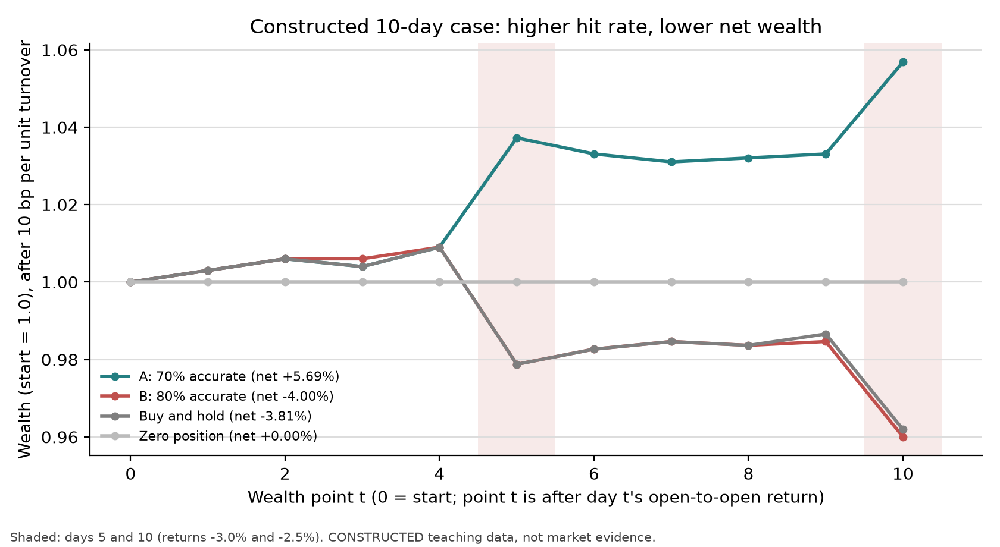
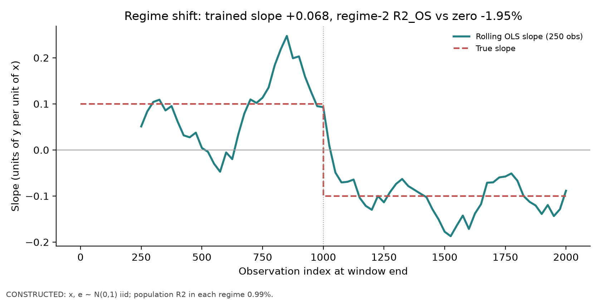
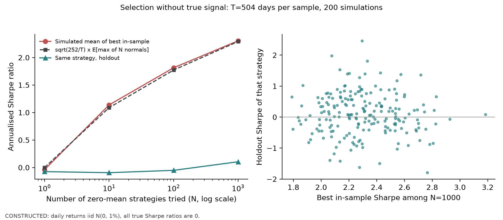

# Chapter 37. A Foundational Stance on Machine Learning for Finance

> Central point: predictive accuracy can improve while investment results after costs deteriorate; financial machine learning must evaluate prediction, decision, cost, and evidence on the same ledger.
> Prerequisites: Chapter 7, Statistical Inference; Chapter 22, Research Methods and Multiple Testing; Chapter 31, Model Validation; Chapter 35, Transaction Costs. After this chapter, you should be able to explain with a hand-computable counterexample why accuracy and net returns can diverge; state how overlapping labels, regime shifts, and multiple attempts affect the strength of evidence; and provide an evaluation checklist covering out-of-sample performance, stability, costs, tails, and economic logic.

## 1. Learning Objectives

After reading this chapter, you should be able to complete these six verifiable tasks:

1. Given a set of daily returns and long-short positions, calculate directional accuracy, gross returns, turnover, costs, and net returns by hand, and write the identity relating accuracy to returns, $\sum_t p_t r_t=\sum_t |r_t|(2c_t-1)$ ($p_t=\pm1$).
2. Explain four structural challenges in financial prediction—non-stationarity, low signal-to-noise ratio, temporal dependence, and regime shifts—and give one runnable numerical example for each.
3. Calculate the expected in-sample Sharpe ratio of the best of $N$ strategies with zero true returns, and explain why it is not a discovery.
4. Classify data leakage into five types—target leakage, look-ahead features, preprocessing leakage, selection leakage, and overlapping-label leakage—and give one erroneous implementation and its repair for each.
5. Describe how financial problems differ from Kaggle-style competitions in their data-generating process, test sets, and evaluation metrics, and choose baselines accordingly.
6. Set evaluation gates for Chapters 38–40 and Project 6: check out-of-sample performance, stability, costs, tails, and economic logic together.

Completion criteria: independently solve every question in Sections 15–17, with answers consistent with Section 18; explain the inputs, outputs, and limitations of the historical cached results in Section 9. The distinction between the default reader entry point and rerun identity is also described in Section 9; this batch does not rerun simulations.

## 2. Why Quant Needs This

Suppose you are reviewing a daily directional prediction model. The researcher reports that test-set accuracy in predicting up versus down rose from 52% to 55%. That figure might lead you to approve deployment, or it might lose you money. Accuracy treats every day as equally important, while portfolio returns are booked in proportion to each day’s return magnitude. A model can guess correctly on 100 quiet days and miss on 3 crash days, achieving high accuracy while losing money. If the model also reverses its position every day, transaction costs can consume the remaining profit.

Earlier chapters prepared the pieces. Chapter 7 covers sampling error in estimators; Chapter 22 covers freezing research plans and multiple testing; Chapter 31 covers label intervals, purging, and walk-forward evaluation; and Chapter 35 covers costs. This chapter places those pieces in a machine-learning context and asks a more fundamental question: when training a prediction model in finance, what are you optimizing, and why should you believe the result?

This chapter does not train a complex model. Chapter 38 builds a date-based pipeline with fitting confined to training data; Chapter 39 makes controlled comparisons using regularized linear models; Chapter 40 introduces tree models. The conclusions here become their acceptance gates.

### From Prediction Scores to an Account: Fix Three Tables First

Keep three tables in view as you read these chapters: an information table records what was available to read when the model was fitted and a decision was made; a prediction table records the dates, assets, and predictions; and a ledger records when trades occurred, how positions changed, and how much cost was paid. This chapter first links the last two tables; Chapter 38 completes the information table; Chapter 39 compares estimators within the same pipeline.

That path also determines the comparison order: first fix the clock and baselines, then select models with training-only validation, and finally report both prediction-level and portfolio-level results for a frozen test period. Seeing higher accuracy does not let you skip execution and costs and read the result directly as higher net returns.

## 3. Intuition

Start with a ten-day constructed example (for teaching, not market data). One asset has the following open-to-open returns (%) over ten days:

$$
r=(+0.4,\;+0.3,\;-0.2,\;+0.5,\;-3.0,\;+0.4,\;+0.2,\;-0.1,\;+0.3,\;-2.5).
$$

Days 5 and 10 are two large declines; the other eight days have small moves. Each model predicts a direction every day, and you hold one unit long ($+1$) or short ($-1$) according to that direction.

- Model B guesses correctly on all eight small-move days and predicts an increase on both large-decline days. Its accuracy is 80%.
- Model A misses on three small-move days and predicts a decline on both large-decline days. Its accuracy is 70%.

Accuracy alone would lead you to choose B. Look at the account instead: on each of the two large-decline days, B loses the full size of the decline, while A earns that amount. Correct or incorrect calls on small days are worth only a few tenths of a percentage point; on large days they are worth several percentage points. B also reverses its position on Days 3 and 8, so it turns over more than A. Section 8 calculates that, after a cost of 0.1% per unit of turnover, A earns about +5.69% compounded over ten days while B loses about 4.00%.

The example is deliberately small. Its purpose is to make the mechanism visible: accuracy and profitability aggregate the same sequence of correct and incorrect calls with different weights. In real data, fat-tailed returns let a small number of days determine much of the profit and loss, strengthening this mechanism. The simplifying boundaries should also be clear: positions are only $\pm1$, costs are linear in position changes, and there is no market impact or capacity constraint. The cost models in Chapters 35 and 36 are more complete.

## 4. Mathematical Foundations

The notation used in this chapter is as follows. All observations are daily, and returns are decimals (0.004 means 0.4%).

| Symbol | Meaning | Unit / dimension |
|---|---|---|
| $t=1,\dots,T$ | Trading-day index | Dimensionless |
| $r_t$ | Simple return from the open on Day $t$ to the open on Day $t+1$ | Decimal per day |
| $\hat d_t\in\{-1,+1\}$ | Directional prediction made by the model after the close on Day $t-1$ | Dimensionless |
| $p_t$ | Position established at the open on Day $t$ and held until the next open, as a multiple of wealth | Wealth multiple |
| $c_t=\mathbf 1\{\operatorname{sign}(p_t)=\operatorname{sign}(r_t)\}$ | Whether the direction was correct on Day $t$ | 0 or 1 |
| $\kappa$ | Cost per unit change in position | Decimal (proportion of wealth) |
| $\tau_t=\lvert p_t-p_{t-1}\rvert$, $p_0=0$ | Turnover on Day $t$ | Wealth multiple |
| $W_t$ | Wealth at the end of Day $t$, with $W_0=1$ | Currency units (normalized) |

Timing convention: the signal time is the close on Day $t-1$, the trade time is the open on Day $t$, and the return interval runs from the open on Day $t$ to the open on Day $t+1$. A signal formed at the close is not executed at that same close, consistent with the Chapter 29 ledger convention `lag>=1`. This ten-day example uses open execution to make hand calculations easy. Chapters 38 and 39 and Project 6 have only closing prices, so they use “execute at the close of the next trading day after the signal close, with the label starting at the execution close.” Both conventions are internally consistent; do not mix them.

Statistical tools used here: the variance of a sample mean, the relationship between correlation and the coefficient of determination (Chapters 7 and 8), and the maximum of normal random variables (Chapter 32; multiple-testing principles in Chapter 22). If the expression for $\operatorname{Var}(\bar x)$ under serial correlation is unfamiliar, review the Newey–West section in Chapter 32.

## 5. Formal Definitions

**Prediction and decision.** A prediction is a mapping from an information set to an estimate of a target variable, $f:\mathcal F_{t-1}\to\hat y_t$; a decision maps a prediction (and costs and risk constraints) to a position, $g:(\hat y_t,p_{t-1},\text{constraints})\to p_t$. Investment results are determined by $p_t r_t-\kappa\tau_t$, so they depend on $g$, not only on $f$. This distinction matters because the same $f$ paired with different $g$ can produce very different net returns. Model evaluation must state whether it evaluates $f$ or the combination of $f$ and $g$.

**Directional accuracy / hit rate.** On days when $p_t\neq0$ and $r_t\neq0$, $\mathrm{Acc}=\frac1{T'}\sum_t c_t$. Conditions: define it only on days with a position and nonzero returns; exclude zero-return days, where “direction” is meaningless. It carries over the output of a classification model and gives equal weight to every day.

**Magnitude-weighted accuracy.** $\mathrm{Acc}_{|r|}=\sum_t |r_t|c_t\big/\sum_t|r_t|$. This auxiliary quantity is introduced to connect accuracy with the gross return of a $\pm1$ position; the next section derives the relationship.

**Boundary of the teaching-proxy ledger.** This chapter uses the absolute change in target position, $|p_t-p_{t-1}|$, as a proxy for turnover. It does not process each trade, position drift, or target rebalancing after costs, and therefore is not equivalent to the exact self-financing ledger in Chapter 29. The return sums and compounded wealth below are calculated within this explicitly stated proxy model.

**Net returns and the wealth path.** Net return on Day $t$ is $n_t=p_tr_t-\kappa\tau_t$, and wealth evolves as $W_t=W_{t-1}(1+n_t)$. $T$ daily returns correspond to $T+1$ wealth points, $W_0,\dots,W_T$. The example in this chapter excludes the exit cost on an open position at the end of the period; if included, add $\kappa|p_T|$.

**Non-stationarity.** The process is non-stationary if the joint distribution of $(x_t,y_t)$ changes with $t$. A prediction-relevant special case is a conditional mean $E[y_t\mid x_t]$ whose shape changes over time, such as a changing linear slope $b_t$. The stationarity in Chapter 16 concerns the moments of an individual series; here the concern is whether the prediction relationship itself remains stable.

**Regime shift.** One form of non-stationarity: there is a date $t^\ast$ and the prediction relationship is a different constant before and after it, with $b_t=b^{(1)}$ for $t<t^\ast$ and $b_t=b^{(2)}$ for $t\ge t^\ast$. The change point is not known in advance.

**Signal-to-noise ratio.** For $y=bx+\varepsilon$, where $x$ and $\varepsilon$ are independent, the signal-to-noise ratio is $\mathrm{SNR}=b^2\operatorname{Var}(x)/\operatorname{Var}(\varepsilon)$; the population coefficient of determination is $R^2=\mathrm{SNR}/(1+\mathrm{SNR})=\rho^2$, where $\rho$ is the correlation between $x$ and $y$. In financial-return prediction, $\rho$ is usually only a few percent and $R^2$ is on the order of a few thousandths (see the evidence limits in Section 11).

**Temporal dependence.** Observations are correlated with one another. The positive correlation in the overlap structure studied here reduces the effective information available for estimating the mean, although under negative autocorrelation the effective sample size can also exceed the number of observations. The focus here is **overlapping labels**: computing a future $h$-day return label every day means adjacent labels share $h-1$ daily returns.

**Multiple testing and selection bias.** Try $N$ configurations and report the best one, and the expected reported value will exceed the true value of any one configuration. Chapter 22 already covers FWER, FDR, and trial ledgers; here we use the idea to explain that tuning and changing features are also trials.

**Data leakage.** Data leakage occurs when information unavailable at prediction time is used to train or select a model. This chapter classifies five routes by which the information enters: target leakage (a feature is constructed from the label itself or its future portion); look-ahead features (the feature becomes available after the signal time); preprocessing leakage (scaling, imputation, or dimensionality reduction uses test data); selection leakage (the test set is used to select a model, feature, or threshold); and overlap leakage (training-label intervals intersect test-label intervals). All five mix information unavailable at deployment into test performance.

**Baseline.** A simple rule compared with a candidate model on the same sample, under the same timing convention and costs. This book uses three defaults: a zero prediction (no position), the training-mean prediction, and a simple rule (such as buy-and-hold or the momentum rule in Chapter 25). An out-of-sample number without a baseline cannot be interpreted.

**Out-of-sample $R^2$.** For test observations $y_t$, predictions $\hat y_t$, and baseline predictions $\bar y_t^{\text{base}}$, define $R^2_{\text{OS}}=1-\sum_t(y_t-\hat y_t)^2\big/\sum_t(y_t-\bar y_t^{\text{base}})^2$. With the training mean as baseline, it compares whether “the model is better than the historical mean” (Campbell–Thompson’s definition for index returns); with zero as baseline, it compares whether “the model is better than making no prediction” (the definition for individual-stock returns in Gu–Kelly–Xiu, motivated by how noisy an individual stock’s historical mean is). The two baselines give different numbers; state which one is used.

These concepts have a logical order: the prediction–decision distinction tells you what to evaluate; non-stationarity, low signal-to-noise ratio, and temporal dependence explain why evidence is weak; multiple testing and leakage explain how evidence can be artificially inflated; and baselines and $R^2_{\text{OS}}$ provide a reference for comparison.

## 6. Derivations

### 6.1 The Identity Between Accuracy and Gross Returns

**Assumptions:** $p_t\in\{-1,+1\}$ and $r_t\neq0$.

First, write one-day gross return according to whether the direction is correct. If $c_t=1$, $p_t$ and $r_t$ have the same sign, so $p_tr_t=|r_t|$; if $c_t=0$, they have opposite signs, so $p_tr_t=-|r_t|$. Combining the two cases gives

$$
p_tr_t=|r_t|\,(2c_t-1).
$$

Second, sum over $t$:

$$
\sum_{t=1}^T p_tr_t=\sum_t|r_t|(2c_t-1)=2\sum_t|r_t|c_t-\sum_t|r_t|=\Big(\sum_t|r_t|\Big)\big(2\,\mathrm{Acc}_{|r|}-1\big).
$$

The last equality follows from the definition of magnitude-weighted accuracy. Gross returns are positive if and only if $\mathrm{Acc}_{|r|}>1/2$. When all $|r_t|$ are equal, ordinary accuracy $\mathrm{Acc}$ equals weighted accuracy for any pattern of correct and incorrect predictions. When magnitudes differ, it generally cannot substitute for weighted accuracy, although the two can happen to be equal. For example, with magnitudes $(1,2,3,4)$ and only the first and fourth predictions correct, both accuracies are $1/2$. If flat positions are allowed, both accuracy measures must be restricted to the same evaluation subset on which there is a position and a nonzero return; the identity above still applies only to $\pm1$ positions on that subset.

**Use:** This identity shows that classification loss (0–1 loss) and investment loss are not the same objective. When you train a directional model with cross-entropy or accuracy, errors on large- and small-move days receive equal weight; the investor’s cost is weighted by $|r_t|$. If you want to train a directional model, you can weight observations by $|r_t|$ in the loss or directly regress returns. **When it does not apply:** if position size varies with prediction confidence, then $p_t\neq\pm1$ and the identity does not hold; return to $\sum p_tr_t$ itself.

### 6.2 Costs Separate Net Returns

$$
\sum_t n_t=\sum_tp_tr_t-\kappa\sum_t\tau_t,\qquad \tau_t=|p_t-p_{t-1}|\in\{0,1,2\}.
$$

Reversing a $\pm1$ position from long to short gives $\tau_t=2$: first sell one unit of the long position, then sell one unit short. If directional predictions are approximately random, the probability of a reversal is about $1/2$, and average daily turnover is about 1, or about 252 units annualized. At $\kappa=0.1\%$, annual costs are about 25%. This is what Chapter 35 means when it says that “costs are a function of trading frequency.” Summation is only an approximation; the exact value uses $W_T=\prod(1+n_t)$. Their difference consists of second-order terms and is about 0.1 percentage point in the ten-day example (Section 8).

### 6.3 Signal-to-Noise Ratio and $R^2$

**Assumptions:** $y=bx+\varepsilon$, $E[\varepsilon]=0$, $\varepsilon$ is independent of $x$, $\operatorname{Var}(x)=\sigma_x^2$, and $\operatorname{Var}(\varepsilon)=\sigma_\varepsilon^2$.

$$
\operatorname{Var}(y)=b^2\sigma_x^2+\sigma_\varepsilon^2,\qquad
R^2=\frac{b^2\sigma_x^2}{b^2\sigma_x^2+\sigma_\varepsilon^2}=\frac{\mathrm{SNR}}{1+\mathrm{SNR}}.
$$

Also, $\operatorname{Cov}(x,y)=b\sigma_x^2$ and $\rho=b\sigma_x/\sqrt{b^2\sigma_x^2+\sigma_\varepsilon^2}$, so $\rho^2=R^2$. A correlation of 0.05 corresponds to $R^2=0.0025$, or 0.25%.

This does not mean the signal is useless. Chapter 23 already shows that a portfolio constructed cross-sectionally with weights $w_i=z_i/N$ on a standardized signal $z_i$ has a one-period return equal to $\mathrm{IC}_t\cdot\sigma_{y,t}$, where $\sigma_{y,t}$ is the cross-sectional standard deviation of returns at time $t$. If IC stays near 0.05 each period with little variation, portfolio returns can be stable even though each stock’s $R^2$ is only 0.25%. A low signal-to-noise ratio changes the **amount of evidence**: you need many independent cross sections and many periods to distinguish 0.05 from 0; at the same time, even small amounts of leakage or overfitting can fabricate an apparent 0.05.

### 6.4 Autocorrelation and Effective Sample Size for Overlapping Labels

**Assumptions:** Daily returns $u_t$ are independent and identically distributed with variance $\sigma^2$; the $h$-day label on Day $t$ is $Y_t=\sum_{j=1}^h u_{t+j}$.

$Y_t$ and $Y_{t+k}$ ($0\le k<h$) share $h-k$ daily returns:

$$
\operatorname{Cov}(Y_t,Y_{t+k})=(h-k)\sigma^2,\qquad \operatorname{Var}(Y_t)=h\sigma^2,\qquad \rho_k=\frac{h-k}{h}.
$$

For $k\ge h$, they no longer overlap, so $\rho_k=0$. For the sample mean $\bar Y=\frac1n\sum_{t=1}^nY_t$, its variance (when $n\gg h$) is

$$
\operatorname{Var}(\bar Y)\approx\frac{\operatorname{Var}(Y_t)}{n}\Big(1+2\sum_{k=1}^{h-1}\rho_k\Big)
=\frac{h\sigma^2}{n}\Big(1+2\sum_{k=1}^{h-1}\frac{h-k}{h}\Big)=\frac{h\sigma^2}{n}\cdot h.
$$

The second equality uses $\sum_{k=1}^{h-1}(h-k)=h(h-1)/2$, so the term in parentheses equals $1+(h-1)=h$. Compared with the independent-sample formula $h\sigma^2/n$, the variance is inflated by a factor of $h$, and the **effective sample size** is about $n/h$. With $h=5$, treating 1,000 overlapping labels as independent when calculating a $t$ statistic would inflate the $t$ statistic by about $\sqrt5\approx2.24$. Under the known construction from independent daily returns, the correction is to use the exact covariance or mean-variance formula derived here, or to keep only non-overlapping dates. Truncating at the known MA order without kernel tapering is not the same estimator as fixed-bandwidth Bartlett Newey–West. For the shared implementation with NW lag $q=h-1$, weights are $1-k/h$ and its limiting factor is $1+2\sum_{k=1}^{h-1}(1-k/h)\rho_k=(2h^2+1)/(3h)$; at $h=5$ this is 3.4, not the long-run variance factor 5. Covering all nonzero covariance lags does not guarantee that a fixed Bartlett bandwidth exactly recovers the overlap correction or is consistent; see Chapters 23 and 32 for general bandwidth and consistency conditions.

For finite $n\ge h$, the exact variance inflation factor for the sample mean is $1+2\sum_{k=1}^{h-1}(1-k/n)\rho_k=h-(h^2-1)/(3n)$; effective sample size is defined as $n$ divided by this factor. For a general series, if the sum of the weighted autocovariances is negative, the factor can be below 1 and the effective sample size can exceed $n$.

**Scope:** if daily returns themselves are autocorrelated or exhibit volatility clustering, $\rho_k$ will differ from $(h-k)/h$; the inflation factor will no longer be exactly $h$. Newey–West can still be used, but the lag choice needs separate consideration.

### 6.5 The Maximum Sharpe Ratio Across Multiple Attempts

**Assumptions:** The daily returns of $N$ strategies are independent, each has a true mean of 0, and each strategy has $T$ observations. The estimated daily Sharpe ratio $\widehat{SR}_d$ is approximately distributed as $N(0,1/T)$, and the annualized estimate $\widehat{SR}=\sqrt{252}\,\widehat{SR}_d\approx N(0,252/T)$.

$$
E\Big[\max_{1\le i\le N}\widehat{SR}_i\Big]\approx\sqrt{\frac{252}{T}}\;E\Big[\max_{1\le i\le N}Z_i\Big],\qquad Z_i\overset{iid}{\sim}N(0,1).
$$

The first approximation comes from the normal approximation. $E[\max Z]$ can be computed by numerical integration (the exact integration function in Chapter 32’s `research_protocol` module) or by the Bailey–López de Prado approximation $(1-\gamma)\Phi^{-1}(1-1/N)+\gamma\Phi^{-1}(1-1/(Ne))$, where $\gamma\approx0.5772$. With $T=504$ (two years), $\sqrt{252/504}=0.707$; for $N=100$, $E[\max Z]\approx2.51$, so the best strategy’s expected annualized Sharpe ratio is about 1.77. All strategies have a true Sharpe ratio of 0.

**Use:** when you see “the best model selected from 100 feature combinations had an annualized Sharpe of 1.8,” first compare it with 1.77. It is nearly the expected value under the zero null and is not a discovery. Chapter 32 discusses the Deflated Sharpe Ratio; trial registration and multiple-testing principles are covered in Chapter 22. The expected maximum is a reference point, not an exact post-selection $p$-value or FWER.

### 6.6 Out-of-Sample $R^2$ Under a Regime Shift

**Assumptions:** $y_t=b_tx_t+\varepsilon_t$, with $x_t,\varepsilon_t\overset{iid}{\sim}N(0,1)$ and independent; the slope is $+b$ in Regime 1 and $-b$ in Regime 2; use the OLS estimate $\hat b$ from Regime 1 (with intercept approximately 0) to predict Regime 2, with zero prediction as the baseline.

$$
E[(y-\hat bx)^2]=E[(-bx+\varepsilon-\hat bx)^2]=(b+\hat b)^2+1,\qquad E[y^2]=b^2+1.
$$

Conditional on the fitted fixed $\hat b$, the population risk ratio is $1-[(b+\hat b)^2+1]/(b^2+1)$. Finite-test-sample $R^2_{\text{OS}}$ is a ratio of two sample sums of squares, and its expectation is not equal to the population risk ratio; ignoring the fitted intercept is also an approximation. Thus, $R^2_{\text{OS}}\approx1-\dfrac{(b+\hat b)^2+1}{b^2+1}$. If $\hat b\approx b$, then $R^2_{\text{OS}}\approx-\dfrac{3b^2}{1+b^2}$; for $b=0.1$, this is about $-2.97\%$. As $\hat b$ moves from $b$ toward $-b$, $(b+\hat b)^2$ falls; $\hat b<b$ alone is not enough to ensure lower loss, and moving farther past $-b$ increases the loss again. The point is that when a prediction relationship reverses, the model performs worse than making no prediction, while in-sample $R^2$ will not warn you. A rolling window can track the change, but the shorter the window, the greater the estimation noise; Chapter 37-C01 asks you to weigh this trade-off.

## 7. Financial Interpretation

**Why large days determine profit and loss.** Daily returns are fat-tailed: the absolute returns on a small number of days are far larger than those on a typical day (Chapters 11 and 33). The sum $\sum_tp_tr_t$ is dominated by those days, while accuracy weights them the same as quiet days. A model that learns that quiet days rise slightly can have high accuracy; its errors on crisis days can cost far more than its ordinary gains. The tail losses emphasized in risk management (Chapter 33) are precisely what accuracy cannot see.

**Why a low signal-to-noise ratio is the norm.** If a publicly available signal could predict returns reliably and by a large amount, traders would buy assets predicted to rise until the expected returns were absorbed into prices. Any remaining discoverable predictability is therefore small or requires risk or costs as compensation (the factor-premium explanation in Chapters 14 and 24–27). So a “very low $R^2$” is not itself a model flaw in finance; a “very high $R^2$” should first make you suspect leakage.

**Why relationships change.** Market participants learn and exploit published patterns; regulation, market structure, and interest-rate regimes change; and capital flowing into the same strategy compresses its returns. These all make $E[y\mid x]$ move over time. Chapter 37-C01 considers the training-window length to use in response.

**How this differs from Kaggle-style competitions.** Use competitions that allow repeated public-leaderboard submissions and assume approximately identically distributed data as a simplified contrast; individual competitions may instead have time-based splits, submission limits, and distribution shifts. In finance, you have only one historical path, and a test period can truly be used only once; distributions drift over time; the objective is risk-adjusted returns after costs rather than a prediction metric; and your trades affect prices and costs (Chapters 35 and 36). Common competition techniques such as random shuffling followed by K-fold cross-validation or repeated tuning against a public leaderboard can introduce overlap leakage under the overlapping-label structure studied here, while repeated testing and tuning introduce selection leakage. Diagnose the specific problems with random splits from the information and label structure.

**Implementability.** A model’s value depends on whether its predictions can be computed before `trade_time`, traded at a reasonable cost, and scaled under capacity and borrow constraints. These are not included in the model’s loss function and must be added to the evaluation.

## 8. Numerical Example

### 8.1 Ten-Day Case: Inputs

(Constructed for teaching.) Daily returns $r$ are as in Section 3; cost is $\kappa=0.001$ (0.1% per unit of turnover); $p_0=0$. In the table, $p^B$, $p^A$, and $p^{\text{BH}}$ are the positions for Model B, Model A, and buy-and-hold, respectively.

| Day $t$ | 1 | 2 | 3 | 4 | 5 | 6 | 7 | 8 | 9 | 10 |
|---|---|---|---|---|---|---|---|---|---|---|
| $r_t$ (%) | +0.4 | +0.3 | −0.2 | +0.5 | −3.0 | +0.4 | +0.2 | −0.1 | +0.3 | −2.5 |
| $p^B$ | +1 | +1 | −1 | +1 | +1 | +1 | +1 | −1 | +1 | +1 |
| $p^A$ | +1 | +1 | +1 | +1 | −1 | −1 | −1 | −1 | +1 | −1 |
| $p^{\text{BH}}$ | +1 | +1 | +1 | +1 | +1 | +1 | +1 | +1 | +1 | +1 |

### 8.2 Hand-Calculating Accuracy and Gross Returns

$\sum_t|r_t|=0.4+0.3+0.2+0.5+3.0+0.4+0.2+0.1+0.3+2.5=7.9$ (%).

- B: wrong on Days 5 and 10, so $\sum_{\text{wrong}}|r|=3.0+2.5=5.5$. $\mathrm{Acc}=8/10=0.80$. Gross return $=(7.9-5.5)-5.5=-3.1\%$. $\mathrm{Acc}_{|r|}=2.4/7.9=0.304$.
- A: wrong on Days 3, 6, and 7, so $\sum_{\text{wrong}}|r|=0.2+0.4+0.2=0.8$. $\mathrm{Acc}=0.70$. Gross return $=(7.9-0.8)-0.8=+6.3\%$. $\mathrm{Acc}_{|r|}=7.1/7.9=0.899$.
- Buy-and-hold: wrong on the 4 down days, so $\sum_{\text{wrong}}|r|=0.2+3.0+0.1+2.5=5.8$, $\mathrm{Acc}=0.60$, and gross return $=2.1-5.8=-3.7\%$.

Check A against the identity $\sum p_tr_t=(\sum|r_t|)(2\mathrm{Acc}_{|r|}-1)$: $7.9\times(2\times0.899-1)=7.9\times0.797=6.30$.

### 8.3 Turnover and Costs

- B: $p_0=0\to+1$ (1), Day 3 $+1\to-1$ (2), Day 4 $-1\to+1$ (2), Day 8 (2), and Day 9 (2). Total: 9 units; cost: $9\times0.1\%=0.9\%$.
- A: initial position 1, Day 5 $+1\to-1$ (2), Day 9 (2), and Day 10 (2). Total: 7; cost: 0.7%.
- Buy-and-hold: 1; cost: 0.1%.

### 8.4 Net Returns: Approximate and Exact

| | Acc | $\mathrm{Acc}_{\lvert r\rvert}$ | Sum of gross returns | Turnover | Cost | Additive approximate net return | Exact compounded net return |
|---|---|---|---|---|---|---|---|
| A | 0.70 | 0.899 | +6.30% | 7 | 0.70% | +5.60% | +5.6879% |
| B | 0.80 | 0.304 | −3.10% | 9 | 0.90% | −4.00% | −3.9980% |
| Buy-and-hold | 0.60 | 0.266 | −3.70% | 1 | 0.10% | −3.80% | −3.8072% |
| Zero position | — | — | 0 | 0 | 0 | 0 | 0 |

The exact column comes from $W_{10}=\prod_{t=1}^{10}(1+n_t)$. For example, for A on Day 1, $n_1=0.004-0.001=0.003$, so $W_1=1.003$; for B on Day 3, $n_3=(-1)(-0.002)-2\times0.001=0$, so $W_3=W_2=1.006009$. The complete wealth path is stored in `course/zh/chapters/ch37/figures/ch37_results.json`; its 11 wealth points correspond to 10 daily returns. Model B, despite having the highest accuracy, loses to the zero-position baseline as well as to buy-and-hold.

### 8.5 A Hand Calculation for the Scale of $R^2$

If a feature has correlation 0.03 with next-day returns, then $R^2=0.03^2=0.0009$. If the daily return standard deviation is 2%, the standard deviation of the prediction component in a linear projection with an intercept is $|\rho|\sigma_y=0.0006=0.06\%$. This is not an upper bound on the predictable component for arbitrary nonlinear models, nor is it expected trading profit. A cost of 0.1% per unit of turnover cannot be directly subtracted from a prediction standard deviation as if they were the same kind of return; net returns also depend on the position rule, reversal probability, holding period, and threshold. Diversification across assets, smoother positions, or lower-frequency trading may improve after-cost performance, but it still has to be checked against the actual ledger.

## 9. Python Implementation

Script: `code/ch37_ml_philosophy.py`. The historical engineering script can recompute the constructed experiments; even if a new `--out` is specified, the working-tree version may overwrite the chapter’s original figures, so this chapter does not provide a direct overwrite instruction. The Chapter 37 Notebook in the default reader package recomputes the ten-day case, 100,000 overlapping days, three groups of 200 zero-signal experiments each, and the regime shift, then writes the ten-day wealth chart in a unique run directory; this batch explains that behavior only and did not execute it. Historically, the CLI calculated $N=1$ first and then $10/100/1000$, while the Notebook started at 10, so they consume random numbers differently. The same seed, 3702, does not mean the two paths produce the same individual results. The Notebook’s English-language layer is scheduled for BIL23.

Inputs consist only of teaching parameters defined inside the script and fixed seeds (3701 for the regime shift, 3702 for multiple testing, and 3703 for overlapping labels); outputs are `ch37_results.json` (which refuses to overwrite an existing file) and three figures. Data frequency is daily. In the ten-day case, `signal_time` is the previous day’s close, `trade_time` is the current day’s open, and the return interval runs from the open to the next open. Missing-data policy: if an input contains NaN or inf, raise an error; do not impute.

Core functions:

- `decision_ledger(returns, positions, cost_per_unit)`: returns daily gross returns, turnover, net returns, and $T+1$ wealth points.
- `magnitude_identity(returns, positions)`: checks the identity in Section 6.1.
- `overlap_autocorrelation(h, n_days, seed)`: sample autocorrelations and theoretical values $(h-k)/h$ for overlapping labels.
- `max_null_sharpe(n_strategies, n_days, n_sims, seed)`: best in-sample Sharpe under zero true signal and the selected strategy’s holdout Sharpe; reuses Chapter 32’s `quant_course.research_protocol.expected_max_standard_normal(_exact)`.
- `regime_shift(n_per_regime, slope, seed)`: trains in Regime 1 and evaluates in Regime 2.

Tests: `tests/test_ch37_philosophy.py`. The following snippet can be run on its own to check the ten-day case:

```python
import numpy as np

r = np.array([0.004, 0.003, -0.002, 0.005, -0.030, 0.004, 0.002, -0.001, 0.003, -0.025])
models = {
    "A": np.array([1, 1, 1, 1, -1, -1, -1, -1, 1, -1]),
    "B": np.array([1, 1, -1, 1, 1, 1, 1, -1, 1, 1]),
}
kappa = 0.001
for name, p in models.items():
    turnover = np.abs(np.diff(np.concatenate([[0], p])))
    net = p * r - kappa * turnover
    wealth = np.concatenate([[1.0], np.cumprod(1 + net)])
    acc = np.mean(np.sign(p) == np.sign(r))
    assert np.isclose((p * r).sum(), (np.abs(r) * (2 * (np.sign(p) == np.sign(r)) - 1)).sum())
    print(name, f"acc={acc:.2f}", f"turnover={turnover.sum()}", f"net={wealth[-1] - 1:+.6f}", f"points={wealth.size}")
```

Expected output: `A acc=0.70 turnover=7 net=+0.056879 points=11` and `B acc=0.80 turnover=9 net=-0.039980 points=11`.

Other values from the historically frozen run (`ch37_results.json`):

- Overlapping labels, $h=5$, 100,000 daily samples: sample autocorrelations $(0.802,0.604,0.403,0.203,0.004)$; theoretical values $(0.8,0.6,0.4,0.2,0)$.
- Multiple testing, $T=504$ days and 200 simulations: for $N=10,100,1000$, simulated mean best in-sample annualized Sharpe ratios were 1.138, 1.814, and 2.304; formula values were 1.088, 1.773, and 2.292; mean Sharpe ratios of the selected strategies in equal-length holdout periods were $-0.094$, $-0.052$, and $+0.105$. The zero-signal construction makes the population expectation for an independent holdout period 0, but finite Monte Carlo means can differ; do not characterize all three groups alike as “indistinguishable from 0.” For cached $N=1000$, the mean over 200 runs was 0.10456881, the descriptive standard error was 0.04797481, and the ordinary normal-approximation 95% interval was about [0.01054, 0.19860]. This is a post hoc description of cached results, not a new preregistered test and not market alpha.
- Regime shift, 1,000 observations per regime and $b=0.1$: the estimated Regime 1 slope was $+0.0682$; in Regime 2, $R^2_{\text{OS}}$ relative to zero prediction was $-1.95\%$; within each regime the population $R^2$ was $0.01/1.01=0.99\%$. Substituting $\hat b=0.0682$ into the formula from Section 6.6 gives $1-[(0.1682)^2+1]/1.01\approx-1.81\%$. The difference from the simulated result comes from finite-sample variation in $x$ and intercept estimation.

## 10. Visualization



Figure 37-1: The horizontal axis is the wealth-point index (0 is the starting point; point $t$ follows the return on Day $t$); the vertical axis is wealth after deducting a 0.1% cost per unit of turnover, with starting wealth 1.0. Shading marks the two large declines on Days 5 and 10. Observation: B and buy-and-hold fall together on both large-decline days, while A rises on those same two days; B has the highest accuracy and the lowest ending wealth. Constructed teaching data.



Figure 37-2: The horizontal axis is the observation index at the end of a rolling window; the vertical axis is the OLS slope of $y$ on $x$ over a 250-observation window (change in $y$ per unit of $x$). The dashed line is the true slope, which changes from +0.1 to −0.1 at observation 1,000. Observation: after the shift, the rolling estimate takes about one window length to catch up; using the old slope before then loses money. The title gives $R^2_{\text{OS}}$ for training in Regime 1 and evaluating in Regime 2. Constructed data.



Figure 37-3: In the left panel, the horizontal axis is the number $N$ of zero-return strategies tried (log scale) and the vertical axis is annualized Sharpe ratio. The red line is the mean best in-sample Sharpe over 200 simulations; the dashed line is $\sqrt{252/T}\,E[\max Z_N]$; the green line is the mean holdout Sharpe of the selected strategy. In the right panel, each dot for $N=1000$ shows one simulation’s pair (best in-sample Sharpe, holdout Sharpe). Observation: the in-sample best rises with $\log N$, while holdout Sharpe values scatter around 0 without regard to in-sample level. Constructed data; all true Sharpe ratios are 0.


## 11. Real-Market Example

This chapter reports no measured real-market results. The reason is that the course currently has no licensed daily individual-stock price panel available for internal training (the Project 5 data decision documented terms restrictions for sources such as Yahoo, Alpha Vantage, and Tiingo); the real-data status for Project 6 is blocked. Without data, this section states only how a real test should be conducted and what can be supported by the literature.

**The test to conduct once data are available.** Fix the stock universe and sample period in advance; use features available at the close to predict returns from the next trading day’s open to open; and, in a date-based walk-forward test, report together: directional accuracy, magnitude-weighted accuracy, IC and $R^2_{\text{OS}}$ (relative to both 0 and the training mean), returns of a prediction-based long-short portfolio before and after costs, turnover, maximum drawdown, and the tail (worst 1% of days). If accuracy exceeds 50% while after-cost returns are not positive, that reproduces the mechanism in this chapter’s ten-day example.

**What the literature can support.** The following are passages the author actually read in the cited papers (see `source_notes.md` for details). They use other authors’ samples and definitions; they are not measurements from this book:

- Gu, Kelly, and Xiu (2020, RFS) conduct large-scale machine-learning predictions of monthly excess returns on U.S. equities. Equation (19) (p. 2249) defines out-of-sample $R^2$ relative to a **zero prediction**, without subtracting the mean; the authors explain that for individual stocks, historical-mean predictions are typically much worse than zero predictions, and switching to the historical mean as the baseline raises monthly $R^2$ by about three percentage points for all methods. In Table 1 (p. 2250), OLS with all features has $-3.46\%$; OLS using only size, value, and momentum has 0.16%; and elastic net with Huber loss has 0.11%. The text reports that a three-layer neural network reaches about 0.40%. In the introduction, the same paper reports annualized out-of-sample Sharpe ratios of 1.35 (value-weighted) and 2.45 (equal-weighted) for a decile long-short portfolio sorted by neural-network predictions. These figures illustrate two things at once: individual-stock monthly $R^2$ is below 1%, and low $R^2$ can coexist with a substantial portfolio Sharpe ratio. These are before-cost figures; the equal-weighted result is more sensitive to small-cap stocks and costs.
- Campbell and Thompson (2008; NBER working paper w11468 version, Equation (1), p. 5) define market-index-return $R^2_{\text{OS}}$ relative to the historical mean through the previous period, and note that even a small out-of-sample $R^2$ can be economically meaningful to investors.

The two papers use different baselines: zero for cross-sectional stock predictions, and the historical mean for index timing. Chapters 38 and 39 and Project 6 in this book report both baselines and state what each means.

## 12. Common Mistakes

### 12.1 Choosing a Trading Model by Accuracy

Error: rank models on test-set accuracy and select B. Why it is wrong: accuracy weights each day equally, while trading returns are weighted by $|r_t|$ (Section 6.1).

```python
import numpy as np
r = np.array([0.004, 0.003, -0.002, 0.005, -0.030, 0.004, 0.002, -0.001, 0.003, -0.025])
A = np.array([1, 1, 1, 1, -1, -1, -1, -1, 1, -1]); B = np.array([1, 1, -1, 1, 1, 1, 1, -1, 1, 1])
acc = lambda p: np.mean(np.sign(p) == np.sign(r))
wrong_choice = max(("A", A), ("B", B), key=lambda kv: acc(kv[1]))[0]          # Wrong: choose by accuracy
pnl = lambda p: (p * r).sum() - 0.001 * np.abs(np.diff(np.concatenate([[0], p]))).sum()
right_choice = max(("A", A), ("B", B), key=lambda kv: pnl(kv[1]))[0]           # Fix: choose by after-cost return
print(wrong_choice, right_choice, round(pnl(A), 4), round(pnl(B), 4))          # B A 0.056 -0.04
```

Fix: evaluate with an objective aligned to the decision and report at least accuracy, magnitude-weighted accuracy, and after-cost returns.

### 12.2 Ignoring Turnover

Error: report only gross returns. Why it is wrong: a model that reverses direction has high turnover; in the ten-day example, B’s 0.9% cost exceeds A’s 0.7%, and an illustrative annualization must first divide the ten-day cumulative cost by 10 to obtain a daily mean, then multiply by 252. Do not multiply the ten-day cumulative difference directly by 252; this extrapolation does not guarantee a constant future turnover rate. Fix: include turnover and costs in the same evaluation table; use the cost definition from Chapter 35.

### 12.3 Selecting the Best Strategy on the Full Sample, Then Reporting It on the Same Sample

Erroneous code (zero true signal, 100 strategies; choose the best and report its in-sample Sharpe):

```python
import numpy as np
rng = np.random.default_rng(0)
ins, outs = rng.normal(0, 0.01, (504, 100)), rng.normal(0, 0.01, (504, 100))
sr = lambda x: np.sqrt(252) * x.mean(0) / x.std(0, ddof=1)
k = int(np.argmax(sr(ins)))
print("reported (in-sample) Sharpe:", round(float(sr(ins)[k]), 2))     # Wrong: about 1.5–2.2
print("same strategy, holdout:", round(float(sr(outs[:, [k]])[0]), 2))  # Fix: only holdout is evidence
```

This book’s run prints 1.92 and 0.83. The sampling standard deviation of a single holdout Sharpe is about $\sqrt{252/504}=0.71$, so 0.83 is one draw; the mean holdout value across 200 simulations in Figure 37-3 is close to 0. Why: the selection process itself creates a high Sharpe (Section 6.5). Fix: freeze the research plan and evaluate on a holdout period never used for selection; also report the number of attempts and apply Chapter 22’s multiple-testing correction and Chapter 32’s DSR evaluation.

### 12.4 Treating Overlapping Labels as Independent Observations

Error: compute a 5-day forward return every day and use $s/\sqrt{1000}$ as the standard error for 1,000 dates. Why it is wrong: adjacent labels have correlation 0.8, 0.6, … (Section 6.4), so the effective sample size is about 200. Fix:

```python
import numpy as np
rng = np.random.default_rng(1)
u = rng.normal(0.0005, 0.01, 1005)
y = np.convolve(u, np.ones(5), mode="valid")[:1000]          # 1000 overlapping 5-day labels
naive_se = y.std(ddof=1) / np.sqrt(len(y))
nonoverlap = y[::5]
honest_se = nonoverlap.std(ddof=1) / np.sqrt(len(nonoverlap))
print(round(honest_se / naive_se, 2))                        # about 2.2, close to sqrt(5)
```

When the covariance in this construction is known, use the exact mean-variance formula in Section 6.4. Chapter 23’s `ic_summary(nw_lags=h-1)` is an established Bartlett-kernel diagnostic; a fixed $h-1$ lag is not an exact overlap correction (Section 6.4).

### 12.5 Five Types of Data Leakage

| Type | Erroneous implementation | Fix |
|---|---|---|
| Target leakage | “Past 5-day return” feature is mistakenly computed with `shift(-5)` and is actually the future 5-day return | Register `available_at` for each feature and assert `available_at` ≤ the exact decision cutoff (the difference between date and time is covered in Chapter 38) |
| Look-ahead feature | Use the fiscal period-end date as the availability time for a quarterly financial statement | Use the announcement/database-ingestion time (point-in-time data in Chapters 3 and 12) |
| Preprocessing leakage | Standardize the full sample, then split into training and test sets | Fit the scaler only on training rows (the Chapter 38 pipeline) |
| Selection leakage | Inspect test results, change features, and test again | Use the test only once; for a revised design, use a new holdout and record it in the trial ledger |
| Overlap leakage | Randomly shuffle into K folds when training-label intervals cover test-label intervals | Split by date and exclude training rows according to actual label intervals (Chapters 31 and 38) |

Chapter 38 gives runnable counterexamples and numerical differences for preprocessing leakage and random K-fold splitting.

### 12.6 No Baseline

Error: report “out-of-sample $R^2=0.3\%$, so the model works.” Why it is wrong: we do not know whether 0.3% is relative to zero or the training mean, or how a simple rule would perform. Fix: report zero prediction, training mean, and a simple rule in the same table, on the same test period, and under the same costs; state the baseline for $R^2_{\text{OS}}$.

## 13. Applying This to Quant Research

Turn this chapter into an evaluation protocol and apply it in Chapters 38–40 and Project 6.

**Hypothesis.** Write a falsifiable statement, for example: “The set of features $X$ available at the close has positive predictive power for ranking cross-sectional returns over the next $h$ days, and a dollar-neutral portfolio constructed from those predictions has positive net returns at a cost of $\kappa$ per unit of turnover.”

**Design (freeze before looking at results).** Specify the asset universe, sample period, frequency, signal time / trade time, label interval, feature list, model families and hyperparameter grid, training window, rebalancing frequency, cost assumptions, evaluation metrics, and pass thresholds. Record which results were seen before freezing (Chapter 22’s `TrialLedger`).

**Check all five together.**

1. Out-of-sample: use date-based walk-forward evaluation; report prediction metrics (IC and $R^2_{\text{OS}}$ relative to both 0 and the training mean) separately from portfolio metrics (after-cost return and Sharpe).
2. Stability: report IC and returns by fold and year; check whether coefficients or feature importance keep the same sign across folds and whether the relationship reverses around regime shifts.
3. Costs: use at least two cost levels; report turnover and the difference between before- and after-cost results.
4. Tails: report maximum drawdown, the worst 1% of days, and directional accuracy on large-move days.
5. Economic logic: explain why the signal should work and who bears the cost of the return; without an answer, even a strong result remains a candidate.

**Baselines.** Zero prediction (no position), training mean (the same prediction for every asset in a cross section, yielding a flat ranking portfolio), and one simple rule. A candidate model must outperform a baseline on the same test period and under the same costs to move to the next step.

**Falsification conditions (any one means the hypothesis is not supported).** After-cost net returns are not positive; $R^2_{\text{OS}}$ relative to the training mean is not positive and the IC Newey–West $t$ statistic is not significant; results occur in only one subperiod; or results depend on significance before correcting for the number of attempts.

**Null and negative results.** Preserve and report them. In the constructed experiments in Chapter 39 and Project 6, some models lose to a zero-position baseline after costs; those results belong in the report just as much as the positive ones.

## 14. Chapter Summary

Accuracy, $R^2$, and IC measure predictions; net returns result from decisions and costs. For $\pm1$ positions, the identity $\sum p_tr_t=(\sum|r_t|)(2\mathrm{Acc}_{|r|}-1)$ connects them. Equal return magnitudes are sufficient for ordinary accuracy to substitute directly for magnitude-weighted accuracy; when magnitudes differ, it generally cannot. Financial prediction has a low signal-to-noise ratio, and an $R^2$ of a few thousandths is common; whether a portfolio is useful depends on cross-sectional breadth, turnover, and costs. Overlapping labels reduce effective sample size by about $1/h$; trying $N$ configurations raises the best Sharpe by about $\sqrt{252/T}\,E[\max Z_N]$; and a prediction relationship can reverse, making out-of-sample $R^2$ negative. Leakage has five entry paths, and every one can bring information unavailable at deployment into test performance. Therefore, evaluate a financial machine-learning model on out-of-sample performance, stability, costs, tails, and economic logic together, and always compare it with zero prediction, the training mean, and a simple rule.

## 15. Exercises

### 37-E01 (Hand Calculation: Accuracy and Net Returns)

Daily returns (%) are $r=(+1.0,\,-0.2,\,+0.3,\,-4.0,\,+0.2)$. Model C positions are $(+1,-1,+1,+1,+1)$ and Model D positions are $(-1,-1,-1,-1,+1)$. The cost is $\kappa=0.1\%$ per unit of turnover and $p_0=0$. For each model, calculate accuracy, magnitude-weighted accuracy, the sum of gross returns, turnover, and additive approximate net returns, and explain which one is better.

### 37-E02 (Turnover)

Prove that with $\pm1$ positions, if the probability of reversing direction each day is $q$ and is independent of the past, expected turnover over $T$ days is $1+2q(T-1)$. What is the expected annual cost when $q=0.5$, $T=252$, and $\kappa=0.1\%$?

### 37-E03 (Regime Shift)

In the model from Section 6.6, suppose the perfect Regime 1 estimate $\hat b=b$ is used to predict Regime 2, with $b=0.2$. Find $R^2_{\text{OS}}$ relative to zero prediction. What is the result if the true slope in Regime 2 is 0, so the relationship disappears?

### 37-E04 (Signal-to-Noise Ratio)

For $y=bx+\varepsilon$, let $\sigma_x=1$ and $\sigma_\varepsilon=2\%$. What value of $b$ yields a correlation of 0.05? What are $R^2$ and SNR in this case?

### 37-E05 (Overlapping Labels)

For overlapping labels with $h=10$, what are the theoretical autocorrelations at lags 1, 5, and 10? Approximately what is the effective sample size for 2,520 daily overlapping labels?

### 37-E06 (Multiple Testing)

There are $T=252$ days and $N=50$ zero-return strategies. Use $E[\max Z_{50}]\approx2.25$ to estimate the expected best annualized Sharpe. How would you respond if someone reported “the best strategy has an annualized Sharpe of 2.0”?

### 37-E07 (Leakage Classification)

Classify each case as a type of leakage and give a fix: (a) impute missing feature values with the full-sample feature median; (b) use test-period IC to decide which five features to keep; (c) use a post hoc revised database version for the “analyst forecast revision” feature; (d) evaluate a model with 20-day return labels using random 10-fold cross-validation.

### 37-E08 (How This Differs from Competitions)

List three differences between financial prediction and a typical machine-learning competition in data generation or evaluation, and explain which common practice each difference can invalidate.

### 37-E09 (Baselines)

For a model on a test period, $\sum(y-\hat y)^2=0.981$, $\sum y^2=0.990$, and $\sum(y-\bar y_{\text{train}})^2=0.985$. Calculate $R^2_{\text{OS}}$ relative to zero and to the training mean, and explain why they differ.

### 37-T01 (New: From Score to Three Tables)

A researcher reports 55% accuracy but does not specify data-ingestion, execution, or cost timing. Write one field that must be supplied for each of the information, prediction, and ledger tables, and explain whether the next-open example in this chapter and the next-close examples in Chapters 38–39 can directly share a label.

## 16. Programming Exercises

### 37-P01 (Decision Ledger)

Implement `decision_ledger(returns, positions, cost_per_unit)` to return daily turnover, net returns, and $T+1$ wealth points. Acceptance assertions: (1) the ten-day examples for A and B have compounded net returns of $+0.056879$ and $-0.039980$ (tolerance $10^{-6}$); (2) the number of wealth points equals the number of returns plus 1; (3) when costs are 0, $\pm1$ positions satisfy the identity in Section 6.1; (4) inputs containing NaN, inf, or unequal lengths raise `ValueError`; (5) raise an error if any day’s net return is $\le-100\%$.

### 37-P02 (Effective Sample Size)

Write a function that takes $h$ and a daily-return series, generates overlapping labels, and returns (a) sample autocorrelations through lag $h$, and (b) the ratio of the standard error from a non-overlapping subsample to that from the full overlapping sample. For $h=5$ and 100,000 daily returns drawn from $N(0,1\%)$, verify that (a) each absolute difference from $(h-k)/h$ is below 0.02 and (b) the ratio is between 2.0 and 2.5.

### 37-P03 (Selection Bias)

Simulate $N\in\{10,100,1000\}$ zero-return strategies, each with $T=504$ days, for 200 repetitions; record the best in-sample Sharpe and its holdout Sharpe. Acceptance criteria: the difference between the in-sample mean and $\sqrt{252/T}\,E[\max Z_N]$ is below 0.15, and the absolute holdout mean is below 0.25.

## 17. Challenge Problems

### 37-C01 (The Window-Length Trade-Off)

In the model in Section 6.6, the true slope changes from $b$ to $-b$ at an unknown time. You use an OLS slope estimated on the most recent $L$ observations to predict the next period. (1) Write the expected estimated slope at the $s$th period after the change ($s<L$). (2) State the effect of $L$ on estimation variance (when $\sigma_x=\sigma_\varepsilon=1$, the OLS slope variance is approximately $1/L$). (3) If a shift occurs on average every $M$ periods, discuss how to choose $L$. Additional prerequisites: Chapters 17 and 19. Scoring: correct derivations for (1) and (2), 30% each; for (3), a qualitative bias–variance trade-off and a statement of how to check robustness when $M$ cannot be known in advance, 40%.

### 37-C02 (Design an Evaluation Protocol)

Write a one-page evaluation protocol for a study that “uses 20 closing-price features to predict cross-sectional returns over the next 5 days.” Cover the five checks in Section 13, three baselines, what will be frozen, and falsification conditions. Open-ended; see Section 18 for the rubric.

\newpage

## 18. Solutions / Solution Hints

### 37-E01

The total absolute return is $1.0+0.2+0.3+4.0+0.2=5.7$. For C: it is wrong on Day 4 (position $+1$ against $-4.0$), so $\mathrm{Acc}=4/5=0.80$, $\mathrm{Acc}_{|r|}=1.7/5.7=0.298$, and gross returns are $1.7-4.0=-2.3\%$. Turnover is $0\to+1$ (1), Day 2 $+1\to-1$ (2), and Day 3 $-1\to+1$ (2), for 5 total; cost is 0.5%, and additive approximate net returns are $-2.8\%$. For D: it is wrong on Days 1 and 3, so $\mathrm{Acc}=0.60$; the absolute returns on wrong days sum to 1.3; $\mathrm{Acc}_{|r|}=4.4/5.7=0.772$; and gross returns are $4.4-1.3=+3.1\%$. Turnover is 1 initially and 2 on Day 5 when $-1\to+1$, for 3 total; cost is 0.3%, and approximate net returns are $+2.8\%$. D is better despite lower accuracy.

### 37-E02

The initial position on Day 1 has turnover 1. On each subsequent day, the position reverses with probability $q$, producing turnover 2, and otherwise turnover 0. Expected turnover is $1+\sum_{t=2}^T2q=1+2q(T-1)$. At $q=0.5$ and $T=252$, this is $1+251=252$ units; costs are $252\times0.1\%=25.2\%$ per year, on an additive basis.

### 37-E03

For $\hat b=b=0.2$, $R^2_{\text{OS}}=1-[(0.4)^2+1]/(0.04+1)=1-1.16/1.04=-11.5\%$. If the true Regime 2 slope is 0, then $y=\varepsilon$, $E[(y-\hat bx)^2]=1+\hat b^2=1.04$, and $E[y^2]=1$, so $R^2_{\text{OS}}=-4\%$. The model is worse than zero prediction even after the relationship disappears because it continues to take a position.

### 37-E04

$\rho=b\sigma_x/\sqrt{b^2\sigma_x^2+\sigma_\varepsilon^2}=0.05$, so $b^2=0.0025(b^2+0.0004)$, $b^2(1-0.0025)=10^{-6}$, and $b=0.001001$ (0.1001% per unit of $x$). $R^2=0.0025$; $\mathrm{SNR}=R^2/(1-R^2)=0.002506$.

### 37-E05

$\rho_1=0.9$, $\rho_5=0.5$, and $\rho_{10}=0$. Effective sample size is about $2520/10=252$.

### 37-E06

$\sqrt{252/252}\times2.25=2.25$. A reported value of 2.0 is below the expected best value under the zero null and cannot be treated as a discovery; require a holdout result, the number of attempts, and a Deflated Sharpe calculation (Chapter 32; multiple testing in Chapter 22).

### 37-E07

(a) Preprocessing leakage: calculate the median on training rows only, or use the cross-sectional median on each date if only that date’s data are available. (b) Selection leakage: select features within training data (inner validation) and evaluate on the test set only once. (c) Look-ahead feature: use the point-in-time version and filter by data-ingestion time. (d) Overlap leakage: 20-day labels overlap across random folds; switch to date-based walk-forward evaluation and exclude rows according to their actual label intervals.

### 37-E08

Reference answers (any three, with the invalidated practice matched to each): (1) Distribution shift: a simplified competition is approximately identically distributed, while time drift in finance means random splitting may put future regimes into training; diagnose using the actual information structure. (2) The test set can be used only once: some competitions allow repeated public-leaderboard submissions, but repeatedly inspecting a financial test period creates selection leakage. (3) The objective differs: a competition metric is the objective, while the financial objective is risk-adjusted return after costs, so high accuracy can lose money. (4) Trading affects prices: a competition prediction does not change the answer, while trading size affects costs and capacity. Scoring: 1 point for each difference and 1 point for its corresponding invalidated practice.

### 37-E09

Relative to zero: $1-0.981/0.990=0.91\%$. Relative to the training mean: $1-0.981/0.985=0.41\%$. The training mean itself explains $1-0.985/0.990=0.51\%$ (the test-period mean is nonzero and has the same sign as the training mean), so the model adds only 0.41% beyond the mean.

### 37-P01 Reference Implementation and Tests

The reference implementation is `decision_ledger` in `code/ch37_ml_philosophy.py`; tests are in `tests/test_ch37_philosophy.py` and cover the ten-day values, number of wealth points, the identity, non-finite inputs, and the $-100\%$ boundary. Run:

```bash
.venv/bin/python -m pytest tests/test_ch37_philosophy.py -q
```

Numerical check: A’s wealth at point 5 is 1.037269 and at the end is 1.056879; B’s ending wealth is 0.960020.

### 37-P02

Reference implementation: `overlap_autocorrelation`. The run in this book (seed 3703) has sample autocorrelations $(0.802,0.604,0.403,0.203,0.004)$; the ratio of standard errors from the non-overlapping and overlapping samples is about 2.2 in the Section 12.4 snippet. If the ratio is outside [2.0, 2.5], check whether the labels used `mode="valid"` and were truncated to equal lengths.

### 37-P03

Reference implementation: `max_null_sharpe`. The run in this book (seed 3702) gives in-sample means 1.138, 1.814, and 2.304; formula values are 1.088, 1.773, and 2.292, with each difference below 0.06; holdout means are $-0.094$, $-0.052$, and $+0.105$.

### 37-C01 Reference Argument

(1) The window contains $L-s$ observations from the old regime and $s$ from the new regime. With $x$ independent and identically distributed, the OLS slope is approximately a sample-count-weighted average of the two slopes: $E[\hat b]\approx\frac{(L-s)b+s(-b)}{L}=b(1-2s/L)$; it crosses zero at $s=L/2$ and fully catches up at $s=L$. (2) With a stable fixed-design scale and independent, homoskedastic errors, slope variance is about $\sigma^2/(L\sigma_x^2)$ and thus varies as $1/L$; the shorter $L$ is, the larger the variance. (3) The average bias loss after a shift is approximately proportional to $L/M$, while the variance loss is approximately proportional to $1/L$. Under the approximations of isolated shifts, independent design within the window, and no interference from adjacent shifts, if average loss is written as $A L/M+B/L$, differentiation gives $A/M-B/L^2=0$, so $L\approx\sqrt{BM/A}$. The constants depend on the signal, noise, and drift process; this is not an exact globally optimal window. If $M$ is unknown, report results for multiple $L$ values and check whether the conclusion holds only at one $L$. Scoring follows the weights in the question; a conclusion without derivation earns at most 40%.

### 37-C02 Scoring Rubric

10 points total: one point for each of the five checks (with a concrete metric, such as “Newey–West $t$ statistic for IC, lag 4”); one point for the three baselines; one for a freeze list that includes timing and costs; one for operational falsification conditions; one for stating which results were seen before freezing and recording them; and one for explaining how null and negative results will be retained. Acceptable conclusions include “insufficient evidence”; treating constructed-data results as real evidence loses 3 points.

### 37-T01 Full Answer

The information table could add feature `available_at`, label `label_available_at`, `fit_time`, or the exact signal cutoff, and check that the information was readable then. The prediction table could add signal date, asset, prediction, or evaluation-date set. The ledger could add `trade_time`, position, turnover, or cost. Any one field for each table is sufficient if its role is explained. A 55% accuracy figure does not specify these contracts and cannot imply net returns. Next-open and next-close use different return starting points, so they cannot share a label without redefining it; Chapter 38 separates exact timestamps from date indices.

## 19. Further Reading

- Must Know: Chapter 22 (research plans and multiple testing), Chapter 32 (DSR and HAC), and Chapter 31 (label intervals, purging, and walk-forward evaluation). Use these for the tools in Sections 6.4–6.5.
- Must Know: scikit-learn, “Common pitfalls and recommended practices” (`SK_PITFALLS`), especially the sections on data leakage and preprocessing within training data. Use this as a software-side counterpart to the leakage classification in Section 12.5.
- Should Know: Bailey, Borwein, López de Prado, and Zhu (2017) on the probability of backtest overfitting (`PBO`). Use this to extend the selection-bias discussion in Section 6.5 to portfolio-level overfitting probability.
- Should Know: the machine-learning asset-pricing and backtesting-protocol literature listed in Section 20; read the definitions of out-of-sample $R^2$ and the portfolio-evaluation sections.
- Optional: Chapters 35 and 36 for a review of turnover costs and execution.

## 20. References

- `SK_PITFALLS`: scikit-learn, “Common pitfalls and recommended practices.” Supports the definition of preprocessing leakage in Section 5 and the repair in Section 12.5.
- `PBO`: Bailey, D. H., Borwein, J., López de Prado, M., and Zhu, Q. J. (2017). “The probability of backtest overfitting.” Journal of Computational Finance. Background for selection bias in Section 6.5.
- `DSR`: Bailey, D. H. and López de Prado, M. (2014). “The Deflated Sharpe Ratio.” Supports the approximation for $E[\max Z]$ in Section 6.5 (implemented by Chapter 32’s `expected_max_standard_normal`).
- `CH22_HLZ2014`: Harvey, Liu, and Zhu. “…and the Cross-Section of Expected Returns.” Background on multiple testing in factor research for Section 5.
- `CH37_GKX2020`: Gu, S., Kelly, B., and Xiu, D. (2020). “Empirical Asset Pricing via Machine Learning.” Review of Financial Studies 33(5), 2223–2273. Author’s close reading: Section 1.8, Equation (19), p. 2249 ($R^2_{\text{OS}}$ relative to zero prediction and the rationale); Table 1, p. 2250 (OLS $-3.46\%$, OLS-3 0.16%, ENet+H 0.11%); Section 2.2 (NN3 0.40%); and the introduction’s long-short portfolio Sharpe ratios 1.35/2.45. Supports the baseline definition for $R^2_{\text{OS}}$ in Section 5 and the evidence limits in Section 11.
- `CH37_CT2008`: Campbell, J. Y. and Thompson, S. B. (2008). “Predicting Excess Stock Returns Out of Sample: Can Anything Beat the Historical Average?” Review of Financial Studies 21(4), 1509–1531; the author read the NBER w11468 version, Equation (1), p. 5. Supports the historical-mean baseline definition in Section 5.
- `CH37_AHM2019`: Arnott, R., Harvey, C. R., and Markowitz, H. (2019). “A Backtesting Protocol in the Era of Machine Learning.” Journal of Financial Data Science 1(1), 64–74. A source reconnaissance report had read the full text (introduction and transaction-cost section); the author did not reopen it, so it is listed only as further reading for the evaluation protocol in Section 13.
- The full academic definitions of leakage (Kaufman et al., 2012) and the paper on “accuracy versus economic returns” (Leung et al., 2021) could not be accessed; this chapter does not cite their specific conclusions. The relevant material is supported by the derivation in Section 6.1 and `SK_PITFALLS`. See `course/zh/chapters/ch37/source_notes.md` for the author’s reading record.

