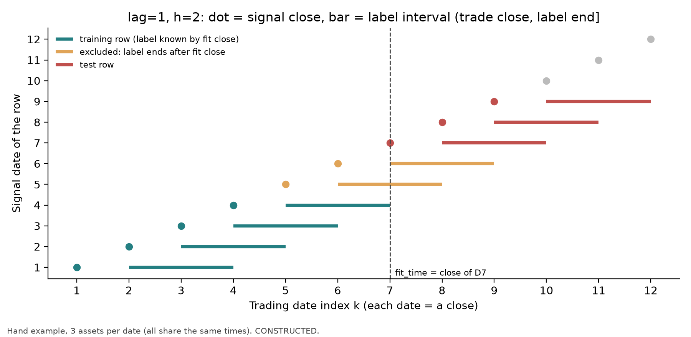
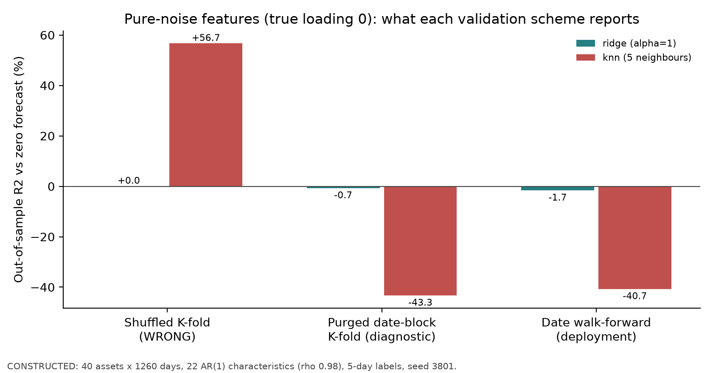
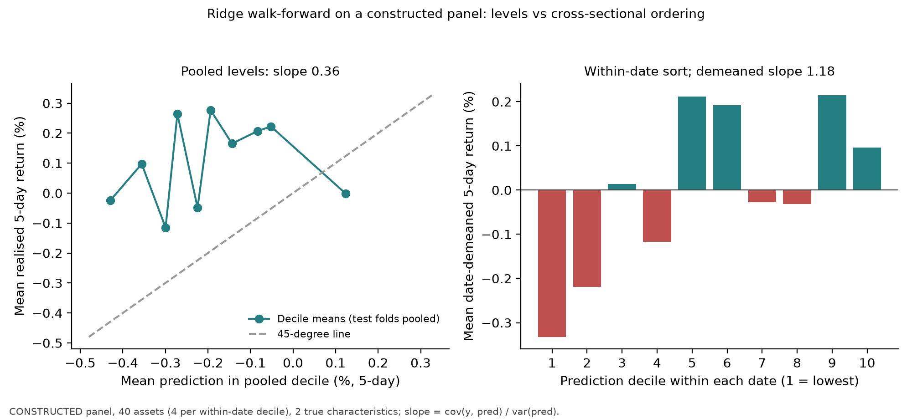

# Chapter 38: Financial ML Pipeline

> Main thread: Turn “when each feature is known, which returns the label covers, and when the model is fitted” into a contract, then make splitting, preprocessing, tuning, and evaluation follow that contract.
> Prerequisites: Chapter 23, cross-sectional research (IC, grouping, panels); Chapter 31, model validation (label intervals, purging, embargo, walk-forward); and Chapter 37. After completing this chapter, you will be able to: record signal_time, trade_time, and the label interval for every row in a daily panel; determine by hand which training rows are available at a given fit time; preprocess and tune with a training-only Pipeline; and explain why shuffled K-fold can rate pure-noise features as “effective.”

## 1. Learning Objectives

1. Record six times for every panel row: feature availability (`available_at`), `signal_time`, `trade_time`, `label_start`, `label_end`, and `label_available_at`, and use them to calculate labels by hand.
2. Prove that, at fit time $s$, a row with signal date $k$ is available for training if and only if $k+\ell+h\le s$; with no missing data, the last $\ell+h-1$ signal dates before the test date are excluded. Explain how this differs from purging based on interval overlap.
3. Split a panel with date-grouped walk-forward: all asset rows on a date must stay on the same side.
4. Distinguish transforms that use only same-day cross-sectional information (no training fit required) from transforms fitted across dates (must be fitted only on training rows); implement the latter with a `Pipeline`.
5. Place hyperparameter selection inside the outer training set and explain why inner folds must follow the same availability rule.
6. Report prediction-layer metrics ($R^2_{\text{OS}}$, IC, calibration slope) separately from portfolio-layer results (net-of-cost returns, Chapter 39 and Project 6).
7. Quantify the costs of three incorrect practices with runnable counterexamples: shuffled K-fold, full-sample feature selection, and starting the label at the signal close.

Completion criteria: Sections 15–17 can be completed independently; trace the frozen inputs and outputs in Sections 8–10 and explain the identity boundary between a fresh run of Section 9 and a frozen replay. This batch does not run or retrain.

## 2. Why Quant Needs This

A researcher brings you the following result: 40 stocks, five years of daily data, and 22 features produce an out-of-sample $R^2=56.7\%$ under five-fold cross-validation. In this constructed example, the true feature loadings are all zero, so this large positive value is not evidence of a genuinely available signal. Inspect the data-generating process and leakage paths; do not claim that a high $R^2$ is mathematically impossible in any financial problem based only on an empirical rule of thumb. The problem is the pipeline: each daily label is a five-day return, so adjacent labels share four return days; the company features change slowly, so today's value is almost the same as yesterday's; after shuffling, a test row's “neighbors” are training rows for the same stock one or two days earlier or later, with nearly identical features and heavily overlapping labels. On the test set, the model is looking up rows, not forecasting. Section 8 reproduces this 56.7% using pure-noise features.

The error is often not in the model but in the timing: when a feature becomes available, which period the label covers, and when the model is fitted. This chapter writes those times into a contract and makes every step check it. Chapter 31 introduced label intervals, purging, and walk-forward for a single series. This chapter handles panels (multiple assets on the same date) and the full preprocessing–tuning–evaluation chain, and places the implementation in `quant_course.ml_pipeline` for Chapter 39 and Project 6 to share.

## 3. Intuition

Imagine building a model after the close on Monday, March 2. You have all prices through Monday's close and want to predict the return from “buying at tomorrow's close and holding for two days.”

- The sample from the previous Wednesday ($k$) has a label covering Thursday's close through Monday's close. By Monday's close you have observed it, so this row can be used for training.
- The previous Thursday's label runs from Friday's close through Tuesday's close. Tuesday has not arrived, so the row cannot be used.
- The previous Friday's label runs from Monday's close through Wednesday's close. It is also not yet complete.

Thus, even when a sample's **signal date** is before the model date, its **label** may not have finished accruing and cannot enter training. Including it lets the model see future returns. The number of excluded dates is determined by “execution lag + holding period,” not by an interval chosen by intuition.

A panel adds another issue: there are 40 stocks on the same date. Their features are available together, and their labels cover the same period. If 20 stocks from March 2 go into training and the other 20 into testing, then at test time the model has already learned from the training stocks that “the market rose after March 2.” The split unit must therefore be the date, not the row.

## 4. Mathematical Setup

| Symbol | Meaning | Unit / dimension |
|---|---|---|
| $D_1<D_2<\dots<D_T$ | Trading dates; each date represents that day's close | date |
| $i=1,\dots,N$ | Asset | — |
| $\ell\ge1$ | Execution lag: number of trading days from signal close to execution close | trading days |
| $h\ge1$ | Prediction horizon (holding period) | trading days |
| $x_{i,k}\in\mathbb R^p$ | Features for asset $i$ available at the close on signal date $D_k$ | each feature's own unit |
| $P_{i,k}$ | Closing price | currency / share |
| $y_{i,k}=P_{i,k+\ell+h}/P_{i,k+\ell}-1$ | Label: $h$-day simple return from the execution close | decimal |
| $(D_{k+\ell},D_{k+\ell+h}]$ | Label interval (open on the left, closed on the right) | — |
| $s$ | Date index of fit time: fit the model after the close on $D_s$ and predict test rows starting with signal date $D_s$ | — |

Timing convention: `signal_time` $=D_k$; `trade_time` $=$ `label_start` $=D_{k+\ell}$; `label_end` $=$ `label_available_at` $=D_{k+\ell+h}$. This book assumes prices and features from the same close become available together after the close. If your data system ingests them a day later, move both `available_at` and `label_available_at` one day later; the derivation below still applies.

**Keep dates separate from exact decision times.** `signal_time` records the **date** of the signal, $D_k$. By default, the exact decision time $\tau_k$ is the signal cutoff after that day's closing price is finalized—for example, the close is at 16:00 and the cutoff is 16:10 in the exchange's local time zone. A feature can be used for the $D_k$ signal if and only if `available_at` $\le\tau_k$. Data released after the cutoff (for example, earnings at 16:30) cannot be used for the $D_k$ signal and can first be used for $D_{k+1}$. **After-hours signal variant:** if a study explicitly sets its cutoff later that evening (for example, 20:00) and guarantees that the data are ingested before then, the 16:30 data can be used for the $D_k$ signal. The data dictionary must state the cutoff, time zone, and mapping from `available_at`; execution still occurs at $D_{k+\ell}$. The constructed data in Chapters 38–39 and Project 6 use only the default cutoff: every feature is derived from closing prices or specified as available at the close, so the variant does not affect them.

### Intraday clock: snapshot first, then fit, then signal

The following is a standalone teaching construction in the exchange's local time zone. Except for the next-trading-day execution in the last row, all intraday and after-hours events occur on trading date $D_s$. Date indices only establish order; times such as 16:00 and 16:08 tell us whether a program can read the data. $D_s$ is not an arbitrary after-hours time.

| Time | Event | Treatment in this fit or signal |
|---|---|---|
| 16:00 | Close; a historical training row's label interval has just ended | Still wait for label ingestion; ending does not mean it can be read |
| 16:08 | The day's price-derived features are ingested | Available to the 16:10 signal; also readable in the 16:09 fit snapshot |
| 16:09 | `fit_time`: lock the training snapshot and start fitting | Use only historical features already readable and mature labels |
| 16:09:40 | Fit completes | In time for the signal cutoff; later-arriving data are not added to the fitted model |
| 16:10 | $\tau_s$: generate and freeze the signal | Apply the fitted transform to today's features, ingested at 16:08 |
| 16:20 | The label that ended at 16:00 above is ingested | After `fit_time`; it cannot enter this training run |
| 16:30 | Earnings are released (assume they are ingested at the same time) | After $\tau_s$; cannot enter this prediction |
| Close on $D_{s+1}$ | Execution point for this example with $\ell=1$ | The label starts at this execution close, not at 16:10 |

Rows used in this fit have $k<s$, a point-in-time version of each historical feature fixed according to its own signal cutoff and readable in the fit snapshot, and `label_available_at` no later than 16:09. Rows for the current date, $k=s$, are used only for prediction. The 16:08 feature for the current date is not added to a training row with no label yet, nor backfilled into the 16:09 snapshot. If another historical row's label was ingested at 15:55 and its historical features are complete, it can enter training; the row ingested at 16:20 is excluded, even if both rows' `label_end` is no later than that day's close.

Three checks guard three gates: training data must be readable by `fit_time`; prediction features must be readable by $\tau_s$; and fitting must finish by $\tau_s$. If the model finishes fitting at 16:12, it cannot produce the 16:10 signal. Follow a predeclared protocol to delay the signal or use a model that was already complete; do not backdate the runtime. Chapter 37's hand-worked example executes at the next open; this chapter, Chapter 39, and Project 6 execute at the next close. Keep the return starting points in the two sets of examples distinct.

Prerequisites used here: Chapter 31's interval-overlap condition $\max(t_1,t_2)<\min(e_1,e_2)$; the projection property of OLS in Chapter 8; and daily IC in Chapter 23.

## 5. Formal Definitions

**Feature and feature availability time (`available_at`).** A feature is a quantity $x_{i,k}$ that can be computed on the signal date. Record `available_at` for each feature; it must satisfy `available_at` $\le\tau_k$ (the decision time for signal date $D_k$; see Section 4). Features derived from closing prices (past five-day returns, past 20-day volatility) are available after the close is finalized and before the cutoff. Earnings released only after the close at 16:30 have an `available_at` equal to the release time, even if the “reporting period” predates the signal date; they cannot be used for that day's signal under the default cutoff (Chapter 12, PIT). This makes “did the feature use the future?” a rule that code can assert.

**Feature engineering.** The process of constructing features from raw data. There are two types by information source:

- **Cross-sectional transform:** uses data only from the same signal date, such as that day's cross-sectional ranks, cross-sectional z-scores, or within-industry demeaning (Chapters 23 and 28). It is computed independently on each date, requires no “training fit,” and brings in no information from other dates.
- **Pooled / time-series transform:** estimates parameters from data across multiple dates, such as full-sample mean–variance standardization, filling missing values with the full-sample median, PCA, feature selection, or quantile-clipping thresholds. Estimate its parameters using training rows only.

**Label and prediction horizon.** The label $y_{i,k}$ is the quantity the model predicts. By default in this book, it is the $h$-day simple return starting at the execution close; $h$ is the prediction horizon. The label interval is $(D_{k+\ell},D_{k+\ell+h}]$.

**Label availability time (`label_available_at`).** The time when the label value first becomes readable to the training program. In this chapter's daily construction, it is assumed to be available at the same close as `label_end`; a real system must record the ingestion time instead of assuming equality. It is different from `signal_time`: an early signal date does not mean the label is already known.

**Cross-sectional panel.** A long table keyed by (`signal_time`, `asset`). Rows with the same `signal_time` share the same set of timestamps.

**Fit time (`fit_time`) and available training set.** Fit the outer fold at the close on $D_s$. Candidate training rows have signal dates before $D_s$. With exact timestamps, historical features and labels must both be readable at or before `fit_time`. The date formula below abbreviates `label_available_at` $\le$ `fit_time` as `label_available_at` $\le D_s$ only under the constructed assumption that data are available synchronously at the close:

$$
\mathcal U(s)=\{(i,k):\;k<s,\;k+\ell+h\le s,\;x_{i,k}\text{ and }y_{i,k}\text{ are both nonmissing}\}.
$$

**Date-grouped walk-forward.** Sort the unique dates. A test block consists of consecutive dates $D_s,\dots,D_{s+m-1}$; training dates are $D_1,\dots,D_{s-1}$ (expanding window) or the most recent $L$ dates (rolling window). Move the entire block forward each time. All asset rows on a date always remain on the same side.

**Purging (excluding by label interval).** Chapter 31's purging removes training rows whose label intervals overlap test label intervals. This chapter writes the rule as availability by $k+\ell+h\le s$; Section 6.1 proves that it implies non-overlap and is stricter.

**Gap and embargo.** A gap is an additional set of dates left empty between the end of training and the start of testing. An embargo removes training rows immediately after a test block (when K-fold allows training rows after the test block) if their feature lookback windows cover the test label interval. Both should follow from the data's actual timing structure: the gap follows from label intervals and availability time; embargo length follows from the feature lookback window. Do not replace this with a uniform “leave five days” rule (Section 6.2).

**Preprocessing and Pipeline.** Preprocessing is a transform across dates applied to features before fitting a model. `sklearn.pipeline.Pipeline` chains several transforms and an estimator into one object. On `fit`, each step is fitted in sequence only to the training data passed in; on `predict`, the fitted parameters transform new data (official documentation `SK_PIPE_DOC`).

**Hyperparameter selection.** Choosing quantities such as regularization strength or number of features that are not directly estimated during training. Rule: use only outer-training rows; within those rows, run date walk-forward inner folds, each following the same availability rule; after selection, refit on all outer-training rows and predict the outer test block. Outer-test labels must not enter any fit, standardization, or selection.

**Evaluation.** Two layers. Prediction layer: $R^2_{\text{OS}}$ (against zero and the training mean), daily Spearman IC and its Newey–West $t$-statistic (lag $h-1$), and calibration slope. Portfolio layer: convert predictions to positions under an explicit rule, execute with a lag, then measure net-of-cost returns, turnover, and drawdown (Chapter 29 ledger; Chapter 39 and Project 6).

**Model calibration.** Whether predictions and realized values agree in magnitude. For regression predictions, the calibration slope is $b=\operatorname{Cov}(y,\hat y)/\operatorname{Var}(\hat y)$. When $\operatorname{Var}(\hat y)>0$, in the linear-projection sense, $0<b<1$ means forecast amplitude is too large relative to the linearly calibrated conditional mean, while $b>1$ means it is too small; $b=0$ means no linear information, and $b<0$ means a reversed relationship, not merely a confidence-scaling issue. For example, forecasts $(-1,0,1)$ and realizations $(1,0,-1)$ give $b=-1$ even though their variances are equal. Also check the intercept $a=E[y]-bE[\hat y]$. Even $a=0,b=1$ does not guarantee $E[y\mid\hat y]=\hat y$; nonlinear or group-specific bias may remain. A reliability diagram grouped by prediction compares average predictions with average realizations within each group (see `SK_CALIBRATION` for the classification-probability version).

## 6. Derivations

### 6.1 Availability Rule, Number of Excluded Dates, and Its Relation to Overlap Purging

**Assumptions:** equally spaced date indices; no missing data; $\ell,h\ge1$; fit at $D_s$; the first test row has signal date $D_s$.

First, the availability condition. The label for signal date $k$ is known at the close on $D_{k+\ell+h}$. Fit time is the close on $D_s$, so the row is available if and only if

$$
k+\ell+h\le s\iff k\le s-\ell-h.
$$

Second, the number of excluded dates. Candidate training dates are $k=1,\dots,s-1$; available rows satisfy $k\le s-\ell-h$. The excluded dates are $k=s-\ell-h+1,\dots,s-1$, a total of

$$
(s-1)-(s-\ell-h)=\ell+h-1
$$

dates, or that number times the asset count $N$ in rows. With $\ell=1,h=5$, five signal dates are excluded.

Third, availability implies non-overlap. The earliest test label interval is $(D_{s+\ell},D_{s+\ell+h}]$; all other test intervals are later. An available training row satisfies $k+\ell+h\le s<s+\ell$, so its interval ends no later than the start of any test interval. Under Chapter 31's condition $\max(t_1,t_2)<\min(e_1,e_2)$, the intervals do not overlap.

Fourth, overlap purging alone is insufficient. The training interval $(D_{k+\ell},D_{k+\ell+h}]$ overlaps the first test interval $(D_{s+\ell},D_{s+\ell+h}]$ if and only if $s+\ell<k+\ell+h$, or $k>s-h$. Overlap purging excludes only $h-1$ dates; the availability rule excludes $\ell+h-1$. The additional $\ell$ dates have labels that end before the test interval starts, but after $D_s$; their returns have not occurred by fit time.

**Use:** In implementation, filter each row by `label_available_at`; the number excluded then follows naturally from the intervals. The row-wise rule still works when dates are missing or assets have different label intervals, whereas “always leave $h$ days” can fail. `ml_pipeline.date_walk_forward` implements this and uses “training and test intervals must not overlap” as a defensive assertion.

**A more conservative convention:** If labels must be ingested by a close **before** fit time (`label_available_at` $<D_s$), exclude one additional date. Both conventions avoid leakage; this book chooses the same-close-available convention used for features.

### 6.2 When a Gap or Embargo Is Needed, and How Long It Should Be

**Walk-forward (all training is before testing):** The availability rule in Section 6.1 already handles labels that cross the boundary; no additional embargo is needed. If the system requires at least $g$ days between fitting and deployment, that is a deployment delay and belongs in `trade_time`, not in an arbitrary training-row deletion.

**scikit-learn's `TimeSeriesSplit(gap=g)`:** `gap` is the **number of samples** excluded between the end of the training set and the test set (`SK_TSS`). In a panel, a sample is a row, not a date: with 40 rows per day, `gap=5` leaves only one-eighth of a day. Even `gap=5*40` becomes misaligned with dates as soon as a stock is missing on any date. Use date rules for panels, not a row-count gap.

**Purged K-fold (training blocks may be after the test block):** First purge using the real label intervals; future training rows may also overlap test labels and cannot be skipped just because their signal dates are later. Then check the feature windows of the remaining future training rows. If a feature uses the past $L$ return increments, its support is $(D_{k-L},D_k]$. For a single test-label interval $(D_a,D_e]$, the two intervals overlap if and only if both $k>a$ and $k-L<e$. For a disjoint union of test-label intervals, check each interval; using the enclosing interval is conservative. Only when rows are explicitly restricted to $k>e$ is the latter condition alone sufficient, in which case delete $e<k\le e+L-1$. Do not call this a generally strict minimum for all future rows. If the price endpoint is also counted as shared information, or the rule uses $k\le e+L$, one additional date is deleted under a conservative protocol.

Chapter 31's window rule must use its stated coordinates and half-open endpoints. Counted relative to the last label end $e$, the finite return-increment lookback is controlled by $L$. If counted from the last test signal date instead, $e$ itself changes with $\ell,h$; the total gap cannot be said to be independent of $h$ without qualification. `rev_5` corresponds to five days; `mom_60_5` depends on prices as far back as 60 days and can use a conservative 60-day protocol. EMA has no exact finite lookback endpoint, and quarterly variables cannot simply be treated as finite return windows. Walk-forward has no training rows after the test block; label maturity handles the past-side boundary, so there is no future-side embargo.

This chapter's CLI date-block diagnostic actually passes signal-date ordinals and `label_end`; it purges using the conservative `(signal_date, label_end]` envelope, not the true `(label_start, label_end]` interval in this section. The embargo parameter defaults to zero. Its result table is an offline diagnostic, not full feature isolation or deployment evaluation; `date_walk_forward` separately filters by the true label interval and maturity time.

### 6.3 Training-Only Standardization: When It Changes Results and When It Does Not

**Claim (three levels):** With-intercept OLS and training design matrix $Z=[\mathbf 1,X]\in\mathbb R^{n\times(p+1)}$; standardize $\tilde x=S^{-1}(x-\mu)$, where $S$ is an invertible diagonal matrix and $\mu,S$ are arbitrary fixed constants. Then $\tilde Z=[\mathbf 1,\tilde X]$, with $\tilde X=(X-\mathbf 1\mu^\top)S^{-1}$.

1. **Training fitted values are always unchanged:** whether or not $Z$ has full column rank, OLS fitted values are the same under the two designs.
2. **A corresponding coefficient representation always exists:** any standardized coefficients $(\tilde a,\tilde b)$ can be written in the original coordinates as $b=S^{-1}\tilde b$ and $a=\tilde a-\mu^\top S^{-1}\tilde b$. Both representations give the same predictions at every new point.
3. **Predictions at new points: unchanged with full column rank, not guaranteed with rank deficiency:** If $Z$ has full column rank ($\operatorname{rank}Z=p+1$, so $n\ge p+1$, and no feature is an exact linear combination of other features and the intercept), the OLS solution is unique. The solutions under the two designs correspond, so they give the same prediction for every new point $x$. If $Z$ is rank deficient, the training data do not identify coefficient components in the null-space directions. The software's default solution (scikit-learn `LinearRegression` first centers using training means to handle the intercept, then returns a minimum-norm slope solution) chooses a different “minimum norm” in the two coordinate systems. Predictions generally differ for new points outside the training data's linear relationships. If a new point satisfies those same linear relationships, the predictions are guaranteed to agree; at other points they may coincide accidentally, but there is no general guarantee.

When reading these three levels, distinguish “changing coordinates for the same coefficient vector” from “letting software solve again.” Level 2 is an algebraic identity that holds at every new point. Level 3 asks whether refitting is guaranteed to select that corresponding coefficient vector. Full column rank ensures uniqueness; rank deficiency ensures only that the training projection is unique. The full-rank condition is on the augmented matrix $Z$, including the intercept, not just on the number of feature columns; invertibility of $S$ rules out zero-variance features.

**Proof:** (1) $\tilde Z=ZT$, where
$$
T=\begin{pmatrix}1&-\mu^\top S^{-1}\\0&S^{-1}\end{pmatrix}
$$
is invertible, so $\operatorname{col}(\tilde Z)=\operatorname{col}(Z)$. OLS fitted values are the orthogonal projection of $y$ onto the column space. The projection is unique and independent of the basis for that space, so fitted values are the same; full rank is not needed. (2) Substitute directly: $\tilde a+\tilde b^\top S^{-1}(x-\mu)=a+b^\top x$. (3) With full column rank, $\tilde Z^\top\tilde Z=T^\top Z^\top ZT$ is invertible, and the unique solution is $\tilde\beta=T^{-1}\hat\beta$. The coordinate correspondence in (2) gives identical predictions at new points. With rank deficiency, the normal-equation solution set is $\hat\beta+\ker Z$; the new-point prediction $z^\top\beta$ is not unique over this set unless $z$ is orthogonal to $\ker Z$ (that is, the new point satisfies the same linear relationships as the training data). `LinearRegression`'s minimum-norm solution minimizes slope norm $\|b\|$ in the original coordinates and $\|\tilde b\|=\|Sb\|$ in standardized coordinates. These norms differ, so the selected solutions generally differ. $\square$

**Rank-deficient counterexample** (constructed): Training $X=\begin{pmatrix}1&2\\2&4\\3&6\end{pmatrix}$, $y=(1,2,3)$; the second column is exactly twice the first. The new point $x=(1,5)$ does not satisfy this relationship.

```python
import numpy as np
from sklearn.linear_model import LinearRegression
from sklearn.pipeline import make_pipeline
from sklearn.preprocessing import StandardScaler

X = np.array([[1.0, 2.0], [2.0, 4.0], [3.0, 6.0]]); y = np.array([1.0, 2.0, 3.0]); new = np.array([[1.0, 5.0]])
raw = LinearRegression().fit(X, y)
std = make_pipeline(StandardScaler(), LinearRegression()).fit(X, y)
print(np.round(raw.predict(X), 6), np.round(std.predict(X), 6))     # identical training fit
print(round(raw.predict(new)[0], 4), round(std.predict(new)[0], 4))  # 2.2 1.75
```

Both models have training fitted values $(1,2,3)$. In the original coordinates, minimizing $\|b\|$ subject to $b_1+2b_2=1$ gives $b=(0.2,0.4)$, intercept 0, and new-point prediction $0.2+0.4\times5=2.20$. In standardized coordinates, the training standard deviations are $s=(0.8165,1.6330)$; minimizing $\|Sb\|$ gives $b=(0.5,0.25)$ after converting back to the original units, intercept 0, and new-point prediction $0.5+0.25\times5=1.75$. Both satisfy the only combination identified by the training data, $b_1+2b_2=1$. Their difference lies entirely in the null-space direction $(2,-1)$, about which the data contain no information. Practical implication: the statement “standardization does not change OLS predictions” holds only with full column rank. Exact collinearity is common in panel data—for example, including two units of the same feature or the dummy-variable trap—and breaks that statement. Standardization parameters must still be estimated from training rows, whether or not the design is full rank.

Thus, with full column rank, “standardize using full-sample means and variances” does not affect OLS predictions; with rank deficiency, even OLS can be affected (as above). Standardization can generally affect:

- Ridge and Lasso: the penalty $\|b\|$ depends on feature scales, so changing $\mu,S$ can change the solution (Chapter 39).
- kNN and clustering: distances depend on scale.
- Threshold rules, clipping, missing-value imputation, and feature selection: their parameters are estimated from data, so full-sample estimates directly use test-period information.

In this constructed example, **feature selection** produces substantial leakage. The size of leakage from different preprocessing methods depends on the data and design; this case does not establish a universal ranking. Section 8.3 shows that selecting 10 of 200 pure-noise features by full-sample correlation gives walk-forward $R^2_{\text{OS}}=+0.62\%$ and IC 4.8%; putting selection inside training gives $-1.21\%$. The uniform rule is: every transform with parameters estimated across dates belongs in a `Pipeline` and must be refitted in each training fold.

### 6.4 Why Shuffled K-Fold Turns Noise into a Signal

**Setup:** Features are slow AR(1) variables with daily correlation $\rho=0.98$; labels are five-day returns, with adjacent-day label correlation approximately $(h-j)/h$ (Chapter 37, Section 6.4); features and labels are truly unrelated.

After shuffling, the training set almost always contains $(i,k\pm1)$ and $(i,k\pm2)$ for a test row $(i,k)$. For each feature, the expected squared distance between two rows is $E(x_{i,k}-x_{i,k+j})^2=2(1-\rho^j)$, which is 0.04 when $j=1$; between different assets it is 2. kNN's nearest neighbors are almost all adjacent dates for the same asset, and their labels correlate 0.8 and 0.6 with the test label. The prediction is approximately the average label of “nearby dates,” and is therefore highly correlated with the test label. This is overlap leakage (Chapter 37, Section 12.5): the model uses features to identify “which stock and which dates” a row represents, then borrows overlapping labels.

A linear model (Ridge) cannot “look up” rows. On the same data, shuffled K-fold gives about $+0.05\%$, while walk-forward gives $-1.65\%$. The gap is small, but the direction is the same: random splitting lets training and test share spurious relationships from the same period. Flexible models (trees and nearest neighbors in Chapter 40) amplify this effect into the 56.7% result in Section 8.

### 6.5 Decomposing Prediction Error into “Level and Cross-Section,” and Calibration

**Assumption:** Each date $d$ has $N_d$ assets. Let the date-level means be $\bar y_d,\bar{\hat y}_d$, and define demeaned values $y^\circ=y-\bar y_d$, $\hat y^\circ=\hat y-\bar{\hat y}_d$.

$$
\sum_{d}\sum_{i}(y_{i,d}-\hat y_{i,d})^2=\sum_d N_d(\bar y_d-\bar{\hat y}_d)^2+\sum_d\sum_i(y^\circ_{i,d}-\hat y^\circ_{i,d})^2.
$$

**Derivation:** $y-\hat y=(\bar y_d-\bar{\hat y}_d)+(y^\circ-\hat y^\circ)$. The cross term after squaring is $2(\bar y_d-\bar{\hat y}_d)\sum_i(y^\circ_{i,d}-\hat y^\circ_{i,d})=0$, because the demeaned values sum to zero within each date.

**Financial interpretation:** The first term is the error in “guessing how much the whole market will rise this week”; the second is the error in “guessing which asset will do better.” The return of a dollar-neutral portfolio (weights sum to zero) depends only on the information corresponding to the second term. Spearman IC measures only ranks, which are unchanged by demeaning; cross-sectional SSE and cross-sectional $R^2$ still depend on prediction magnitudes and scale. A model may do poorly on the first term (market noise dominates the level forecast, giving negative $R^2_{\text{OS}}$) yet be useful on the second (positive cross-sectional $R^2$ and IC). The constructed panel in Section 8.4 illustrates this.

**Calibration:** A pooled calibration slope $b$ mixes the two terms. The cross-sectional slope $b^\circ=\sum\hat y^\circ y^\circ/\sum(\hat y^\circ)^2$ uses only the second. If trades are triggered when “predicted returns exceed costs” (Section 13), cross-sectional calibration is needed: estimate $b^\circ$ on the **inner validation set** first, then—if the corresponding linear calibration model holds—use $b^\circ\hat y^\circ$ as a linear approximation to expected excess return. A pooled slope cannot be read directly as the true conditional expectation for every asset or state. Estimating the calibration coefficient on the test set is selection leakage.

## 7. Financial Interpretation

**A time contract is risk control.** If a backtest uses one extra day of future returns, that day does not exist in live trading. Writing every time into the data dictionary lets code check “what did I know at time $t$?” instead of relying on a researcher's memory.

**Why group by date.** Stocks on the same date experience a common market shock. If rows from the same date are randomly split, the model learns that day's market direction from training stocks and “predicts” it for test stocks. At deployment, that information is not available from the signal-date close.

**Level and cross-section.** Many stock-selection strategies are dollar-neutral: weights summing to zero cancel a common level term in $w^\top y$. This does not ensure beta neutrality, and it does not mean every such portfolio depends only on ranks. The actual interface demeans predictions and normalizes them by their L1 absolute sum. Multiplying them by a common positive constant or adding a common constant leaves weights unchanged; an arbitrary rank-preserving transformation generally changes them. For example, predictions $(-1,0,1)$ give weights $(-1/2,0,1/2)$, while rank-preserving predictions $(-1,-0.9,1)$ give $(-7/26,-3/13,1/2)$. Spearman IC uses only ranks; cross-sectional $R^2$ also depends on squared errors and scale.

**Tuning instability is information.** The Ridge regression in Section 8.4 selects regularization strengths ranging from $10^4$ to $10^7$ across 12 outer folds. This is a reason to inspect the actual inner `inner_scores` MSE curves and stability; parameter jumps alone do not prove that the curve is flat or identify a unique cause. Treating the model as “very stable” would be a misreading. The variation is a cue to focus on IC stability and portfolio-layer results rather than one particular hyperparameter.

**Calibration and trading thresholds.** If the rule is “trade only when predicted return exceeds one-way cost,” overly dispersed forecasts ($0<b<1$) can trigger frequent trades and costs; overly conservative forecasts ($b>1$) can miss opportunities. Under an explicit linear assumption, the cross-sectional calibration slope provides a scale adjustment. The intercept, group-level bias, and actual costs implied by the rule must still be checked.

## 8. Numerical Example

### 8.1 Hand Calculation: 3 Assets × 12 Days, $\ell=1$, $h=2$

(Teaching construction.) Closing prices:

| $k$ | 1 | 2 | 3 | 4 | 5 | 6 | 7 | 8 | 9 | 10 | 11 | 12 |
|---|---|---|---|---|---|---|---|---|---|---|---|---|
| A | 100 | 101 | 103 | 102 | 104 | 106 | 105 | 107 | 110 | 108 | 111 | 112 |
| B | 50 | 50.5 | 50 | 49.5 | 49 | 49.5 | 50 | 51 | 51.5 | 52 | 51 | 52.5 |
| C | 20 | 20 | 20.2 | 20.4 | 20.2 | 20 | 20.4 | 20.6 | 20.6 | 20.8 | 21 | 20.8 |

The label is $y_{i,k}=P_{i,k+3}/P_{i,k+1}-1$, with interval $(D_{k+1},D_{k+3}]$. For example, for A at $k=1$, execution is on $D_2$ (101), the endpoint is $D_4$ (102), and $y=102/101-1=0.009901$. For B at $k=1$, $y=49.5/50.5-1=-0.019802$. For C at $k=3$, execution is on $D_4$ (20.4), the endpoint is $D_6$ (20.0), and $y=20.0/20.4-1=-0.019608$. If instead we used the signal-date close $D_3$ (20.2) as the starting price and $D_5$ (20.2) as the endpoint, we would get 0; that is the error in Section 12.4.

| Signal date $k$ | `label_end` | $y_A$ | $y_B$ | $y_C$ |
|---|---|---|---|---|
| 1 | $D_4$ | 0.009901 | −0.019802 | 0.020000 |
| 2 | $D_5$ | 0.009709 | −0.020000 | 0.000000 |
| 3 | $D_6$ | 0.039216 | 0.000000 | −0.019608 |
| 4 | $D_7$ | 0.009615 | 0.020408 | 0.009901 |
| 5 | $D_8$ | 0.009434 | 0.030303 | 0.030000 |
| 6 | $D_9$ | 0.047619 | 0.030000 | 0.009804 |
| 7 | $D_{10}$ | 0.009346 | 0.019608 | 0.009709 |
| 8 | $D_{11}$ | 0.009091 | −0.009709 | 0.019417 |
| 9 | $D_{12}$ | 0.037037 | 0.009615 | 0.000000 |
| 10–12 | beyond sample | missing | missing | missing |

**One fold:** Training dates $k=1,\dots,6$; test dates $k=7,8,9$; fit time $D_7$. The availability condition is $k+3\le7$, or $k\le4$. The available training rows are for $k=1,\dots,4$, a total of $4\times3=12$ rows; $k=5,6$ are excluded, a total of $(\ell+h-1)\times N=2\times3=6$ rows. With overlap purging alone, overlap with the first test interval $(D_8,D_{10}]$ occurs if and only if $k+3>8$, so only $k=6$ is excluded. The interval for $k=5$, $(D_6,D_8]$, does not overlap a test interval, but ends at the close on $D_8$, so it is unknown at fit time $D_7$. Figure 38-1 draws these intervals on one timeline.

### 8.2 Shuffled K-Fold, Date-Block K-Fold, and Walk-Forward (Pure Noise)

Constructed panel: 40 assets, 1,260 trading days, and 22 slow-moving features (AR(1), $\rho=0.98$), all with true loading 0; five-day labels; seed 3801. $R^2_{\text{OS}}$ relative to the zero forecast:

| Method | Ridge ($\alpha=1$) | kNN (5 neighbors) |
|---|---|---|
| Shuffled 5-fold (incorrect) | +0.05% | **+56.67%** |
| Date-block purged 5-fold (Chapter 31, diagnostic only) | −0.73% | −43.31% |
| Date walk-forward (11 folds, deployment convention) | −1.65% | −40.73% |

Date-block K-fold removes the “same-stock adjacent-date lookup” caused by shuffling, but training blocks may still come after test blocks, so it does not represent deployment. Walk-forward corresponds to “use only the past.” With pure-noise features, both date-based methods are negative: the model fits noise and performs worse out of sample than the zero forecast.

### 8.3 Full-Sample Feature Selection (Pure Noise)

30 assets, 756 days, 200 pure-noise features, select 10, Ridge, date walk-forward (seed 3802):

| Method | $R^2_{\text{OS}}$ (vs. zero) | Mean daily Spearman IC |
|---|---|---|
| Select by full-sample $\lvert\mathrm{correlation}\rvert$ (incorrect) | +0.617% | +0.0476 |
| Training-set selection inside `Pipeline` (`SelectKBest`) | −1.214% | −0.0101 |

The incorrect method produces an “IC of about 0.05” from pure noise—right in the range Chapter 37 describes as a “real but weak signal,” and difficult to spot by eye.

### 8.4 Complete Panel Case

Constructed panel: 40 assets, 1,260 days; two real features $q_1,q_2$ (daily expected-return loadings of 0.04% and 0.02% per unit), 20 noise features, and three price features (`rev_5`, `mom_60_5`, `vol_20`); $\ell=1$, $h=5$; expanding-window walk-forward, first training window of 504 dates, test blocks of 63 dates, 12 folds total (first fit date 2016-12-08); Ridge, $\alpha\in\{10^2,\dots,10^7\}$, two inner date folds with 63 validation dates per fold and at least 252 training dates; seed 3803.

- Each outer fold excludes 200 rows $=(\ell+h-1)\times N=5\times40$, consistent with Section 6.1. In the first outer fold, `mom_60_5` requires 60 days of history, so 2,400 rows are dropped as missing ($60\times40$).
- Selected $\alpha$ values: $10^6,10^7,10^6,10^7,10^7,10^5,10^5,10^4,10^5,10^4,10^7,10^5$.
- Prediction layer (30,000 test rows, 750 dates): $R^2_{\text{OS}}=-0.325\%$ relative to zero and $+0.089\%$ relative to the training mean; cross-sectional (demeaned within date) $R^2=+0.092\%$; mean daily Spearman IC 0.0255, Newey–West $t=2.46$ (lag 4); directional hit rate 49.7%.
- Calibration: pooled slope 0.36 (level forecasts are too dispersed), cross-sectional slope 1.18 (cross-sectional forecasts are slightly conservative). By within-date prediction decile, the highest-decile minus lowest-decile mean demeaned five-day return is about $0.096\%-(-0.332\%)=0.43\%$; the middle deciles are nonmonotonic.

Read these numbers using the decomposition in Section 6.5: level error makes pooled $R^2$ negative, while the cross-sectional component contains positive ranking information. The hit rate of 49.7% is below 50%, even as IC is positive. This again illustrates Chapter 37's point: directional accuracy is not the evaluation metric for this kind of strategy.

## 9. Python Implementation

Core module: `src/quant_course/ml_pipeline.py` (shared by Chapter 39 and Project 6). Main interfaces:

- `make_forward_labels(close, horizon, execution_lag=1)`: returns a long table keyed by (`signal_time`, `asset`) with `trade_time`, `label_start`, `label_end`, `label_available_at`, and `y`; labels at the end of the sample are missing.
- `date_walk_forward(signal_time, label_start, label_end, label_available_at, *, min_train_dates, test_dates, step=None, expanding=True, max_train_dates=None)`: date-grouped walk-forward; training rows satisfy `label_available_at` $\le$ `fit_time`; records `n_excluded_unavailable`. It does not accept the real vendor feature `available_at`; the caller remains responsible for point-in-time feature versions and the exact fit snapshot. Raises `RuntimeError` if training and test intervals overlap.
- `fit_select_predict(...)` / `walk_forward_predict(...)`: a Pipeline with `StandardScaler` and a linear estimator; selects hyperparameters using inner date walk-forward (minimum mean validation MSE; ties go to the earlier grid value); includes `zero` and `train_mean` baselines.
- `prediction_metrics(labels, pred, horizon, train_mean_pred=None)`: $R^2_{\text{OS}}$ (relative to zero and the training mean), IC (reuses Chapter 23's `ic_series` / `ic_summary`, `nw_lags=h-1`), and hit rate.
- `simulate_return_panel`, `price_features`, `stack_features`: construct the panel and features (for teaching).

Missing-data policy: Drop and count training rows with missing features or labels; do not predict and count test rows with missing features; raise an error if `inf` occurs.

Chapter script: `code/ch38_ml_pipeline.py`. The historical working script's default figure path may overwrite chapter figures; do not run it to validate the frozen values. The accepted I3 reader Notebook performs fresh constructed calculations, writes to a unique run directory, and generates one label-timeline figure; its English-language layer is deferred to BIL23. This batch did not run the CLI, Notebook, or course API.

Seeds 3801–3803; outputs `ch38_results.json` (refuses to overwrite) and three figures. The “incorrect” practices in Sections 8.2 and 8.3 are used only to measure bias; the code marks them `WRONG`, and they are never used to select a model. Tests: `tests/test_ml_pipeline.py` (22 cases, including row-by-row boundaries, future-data perturbation, test-label perturbation, missing values, and integration with the Chapter 29 ledger).

The hand-worked example can be reproduced as follows:

```python
import pandas as pd
from quant_course import ml_pipeline as mp

close = pd.DataFrame({
    "A": [100, 101, 103, 102, 104, 106, 105, 107, 110, 108, 111, 112],
    "B": [50, 50.5, 50, 49.5, 49, 49.5, 50, 51, 51.5, 52, 51, 52.5],
    "C": [20, 20, 20.2, 20.4, 20.2, 20, 20.4, 20.6, 20.6, 20.8, 21, 20.8],
}, index=pd.bdate_range("2026-03-02", periods=12), dtype=float)
labels = mp.make_forward_labels(close, horizon=2, execution_lag=1)
fold = mp.date_walk_forward(labels.index.get_level_values(0), labels["label_start"], labels["label_end"],
                            labels["label_available_at"], min_train_dates=6, test_dates=3)[0]
used = sorted({close.index.get_loc(d) + 1 for d in labels.index.get_level_values(0)[fold.train_rows]})
print(round(labels.loc[(close.index[0], "A"), "y"], 6), used, fold.n_excluded_unavailable)
```

Expected output: `0.009901 [1, 2, 3, 4] 6`.

## 10. Visualization



Figure 38-1: The horizontal axis is trading-date index $k$ (each date is one close); the vertical axis is the row's signal date. Dots mark signal closes; horizontal bars show label intervals (execution close, label endpoint]. The vertical dashed line is fit time at the close on $D_7$. Green marks available training rows (labels ended by $D_7$); orange marks excluded training candidates (labels end after $D_7$); red marks test rows. Observe that the orange interval at $k=5$ overlaps no red interval but is still excluded. Constructed data.



Figure 38-2: The horizontal axis shows three validation methods; the vertical axis is out-of-sample $R^2$ relative to the zero forecast (%). The two colors are Ridge ($\alpha=1$) and five-neighbor regression. True feature loadings are 0. Observe that shuffled K-fold reports +56.7% for kNN, while both date-based methods are negative. Constructed data, seed 3801.



Figure 38-3: Left: horizontal axis is the mean prediction within pooled deciles (%, five-day); vertical axis is the group's mean realized five-day return (%); the dashed line is the 45-degree line. Right: horizontal axis is prediction decile within each date (four assets per group); vertical axis is the group's mean date-demeaned five-day return (%). Observe that the left-panel points are far from the 45-degree line (level forecasts are unreliable); the high-minus-low spread on the right is about 0.43%, but the middle groups are nonmonotonic. Constructed panel, seed 3803.

## 11. Real-Market Example

This chapter contains no measured real-market results. Project 6's real-data status is blocked: the course does not yet have a licensed daily individual-stock price panel approved for internal training (see the fields and authorization requirements in `projects/project06/data_manifest.json`). Once data are obtained, applying this chapter's pipeline to real data will require three additional treatments not present in the constructed data:

1. Corporate actions: use adjusted returns for labels, but unadjusted prices plus dividend and split events for execution and the ledger (Chapters 29 and 30); do not mix the two.
2. Listings, delistings, and the stock universe: freeze the universe membership as of the signal date and include delisting returns in labels (Chapter 30, survivorship bias).
3. Asynchronous data: ingest financial features at their announcement times (Chapter 12); `available_at` may be months later than the reporting period.

Report real results separately from the constructed results. The constructed results are not evidence.

## 12. Common Mistakes

### 12.1 Using a Row-Count Gap for a Panel

```python
import numpy as np
from sklearn.model_selection import TimeSeriesSplit

n_dates, n_assets, h = 30, 4, 5
rows = np.repeat(np.arange(n_dates), n_assets)            # date id of each panel row
tr, te = list(TimeSeriesSplit(n_splits=3, gap=h).split(rows))[0]
last_d, first_d = rows[tr[-1]], rows[te[0]]
print("train rows on its last date:", int((rows[tr] == last_d).sum()), "of", n_assets)
print("date gap between train and test:", first_d - last_d)   # WRONG: 1 date, contract needs lag+h-1 = 5
```

Expected output: `train rows on its last date: 1 of 4` and `date gap between train and test: 1`. The reason is that `gap` counts rows (the local scikit-learn 1.9.1 documentation says it excludes samples from the end of each training set). In this example, the last training row, 24, belongs to date 6; the first test row, 30, belongs to date 7, so the difference in date indices is 1. The maturity condition requires the most recent training signal date to be at least 6 dates before the first test date, that is, to exclude five full signal dates in between ($\ell+h-1=5$). The code's `WRONG` comment mixes up the difference in date indices and the number of excluded dates; do not read that comparison as the contract. Only one stock from the last training date remains in training, and rows from the same date can also fall on different sides across the gap and test block. Fix: `ml_pipeline.date_walk_forward`, which groups by date and filters by `label_available_at`.

### 12.2 Full-Sample Feature Selection or Imputation

Incorrect: fit `SelectKBest(...).fit(X_all, y_all)` first, then run walk-forward. The numerical cost is in Section 8.3: pure noise gets IC 0.048. Fix: put selection in a `Pipeline` and refit it in every training fold.

### 12.3 Shuffled K-Fold

Incorrect: use `KFold(5, shuffle=True)` for a panel with overlapping labels. Cost: Section 8.2 (kNN +56.7%). Fix: date walk-forward; use date-block purged K-fold only for an explicitly diagnostic purpose and pair it with embargo (Section 6.2).

### 12.4 Starting the Label at the Signal Close

```python
import pandas as pd
close = pd.Series([20.0, 20.0, 20.2, 20.4, 20.2, 20.0])
k, lag, h = 2, 1, 2                                         # signal at index 2 (k=3 in 1-based terms)
wrong = close[k + h] / close[k] - 1                          # WRONG: starts at the signal close
right = close[k + lag + h] / close[k + lag] - 1              # starts at the trade close
print(round(wrong, 6), round(right, 6))                      # 0.0 -0.019608
```

Reason: a signal at the close cannot execute at that same close (Chapter 29, `lag>=1`). Starting the label at the signal close includes a day's return that cannot be traded. Fix: `make_forward_labels(..., execution_lag=1)`.

### 12.5 Treating a Five-Day Label as a Daily Holding Return

Incorrect: rebalance daily using five-day labels and treat the average five-day label as the portfolio's daily return. Adjacent five-day labels overlap by four days, while a portfolio rebalanced daily actually holds for one day. Fix: calculate NAV from daily prices at the portfolio layer (Chapter 29 ledger), and state the rebalancing frequency separately from the label interval. Project 6 rebalances every five signal dates and records NAV daily.

### 12.6 Calibrating or Tuning on the Test Set

Incorrect: estimate the calibration slope during the test period and use it to evaluate that same period. Fix: estimate calibration coefficients only on the inner validation set, just like hyperparameters. The test in `tests/test_ml_pipeline.py` that changes test labels to absurd values while requiring predictions to stay unchanged guards this rule.

## 13. Quant Research Application

Write this chapter as the pipeline specification for Project 6 (constructed data validate only the specification itself):

1. **Data dictionary:** `event_time`, `available_at`, units, and missing-data rules for each field; `signal_time`, `trade_time`, label interval, `label_available_at`, and frequency (`projects/project06/data_dictionary.md`).
2. **Labels:** $\ell=1$, $h=5$, simple return starting at the execution close.
3. **Splitting:** expanding-window, date-grouped walk-forward; freeze the first training window and test-block length in advance; the availability rule automatically excludes $\ell+h-1$ dates.
4. **Preprocessing:** compute cross-sectional transforms within each date; put all across-date transforms in a `Pipeline`.
5. **Tuning:** date walk-forward inside the outer training set; freeze the grid in advance and record the selection in each fold.
6. **Evaluation:** at the prediction layer, report $R^2_{\text{OS}}$ against both baselines, cross-sectional $R^2$, IC and Newey–West $t$, and calibration slope. At the portfolio layer, apply an explicit rule (cross-sectional demeaning, gross exposure 1, rebalance every five days, execution lag $\ell=1$, proportional costs) and report net-of-cost returns, turnover, and drawdown.
7. **Baselines:** zero forecast and training mean (constant across the cross-section, so the portfolio is flat).
8. **Falsification criteria:** cross-sectional IC has an insignificant Newey–West $t$; net-of-cost returns are not positive; or results depend on a single fold.

## 14. Chapter Summary

A signal date before fit time does not mean the label is known. Filter each panel row by `label_available_at` $\le$ `fit_time`; the number of excluded dates, $\ell+h-1$, follows from the intervals and is $\ell$ more than overlap-only purging. Split by date. Fit transforms that estimate parameters across dates only within training folds. With full column rank, standardization does not affect OLS; with rank deficiency, training fitted values remain unchanged but new-point predictions may change. Regularization, nearest neighbors, and feature selection are sensitive, and the feature-selection example here shows substantial leakage whose size depends on the design. Shuffled K-fold lets slowly varying features and overlapping labels “look up” each other, so pure noise can yield a large positive $R^2$. In evaluation, separate level error from cross-sectional error: dollar neutrality removes a common level, but actual continuous weights still depend on the relative magnitudes of demeaned predictions. Calibration should also be cross-sectional and estimated on the inner validation set.

## 15. Exercises

### 38-E01 (Availability Time)

Using this book's default cutoff $\tau_k$ (16:10 after the close on $D_k$ is finalized), give the `available_at` for each item and decide whether it can be used for the $D_k$ signal. Then state which conclusions change if the cutoff is moved to 20:00 that evening: (a) the $D_k$ closing price; (b) the full-day trading volume on $D_k$; (c) quarterly earnings released at 16:30 on $D_k$; (d) a constituent change announced after hours on $D_k$ and effective on $D_{k+5}$.

### 38-E02 (Hand-Calculated Labels and Available Rows)

Use the prices in Section 8.1, $\ell=1,h=2$. (a) Calculate the label and label interval for B at $k=5$ and C at $k=6$. (b) If fit time changes to $D_8$ and test dates are $k=8,9,10$, which signal-date rows can be used for training? How many rows are excluded?

### 38-E03 (Number of Excluded Dates)

For $(\ell,h)=(1,5)$, $(2,3)$, and $(1,1)$, calculate the number of dates excluded by the availability rule and by overlap purging alone. When $h=1$, why does overlap purging exclude no rows while the availability rule still excludes $\ell$ dates?

### 38-E04 (Embargo)

A study uses date-block purged K-fold and features `rev_5` (five-day lookback) and `mom_60_5` (60-day lookback), with label horizon $h=5$. How many trading days should the embargo be? Is embargo still needed if the study switches to expanding-window walk-forward?

### 38-E05 (Standardization Invariance and Its Conditions)

(a) Prove that with-intercept OLS training fitted values are invariant to affine standardization; if the training design $[\mathbf 1,X]$ has full column rank, predictions are also invariant at every new point. (b) Give a rank-deficient counterexample where training fitted values are the same but new-point predictions differ, and explain why. (c) Give a counterexample showing that Ridge predictions can change.

### 38-E06 (The Lookup Mechanism in Shuffled K-Fold)

Features are AR(1) with $\rho=0.98$ and labels are overlapping five-day returns. For a unit-variance feature, calculate the expected squared feature difference for the same asset at lags of one and three days, along with the corresponding label correlations. Explain why kNN can achieve a high $R^2$ under shuffled K-fold.

### 38-E07 (Rows in Nested Tuning)

An outer fold is fitted at $D_{600}$, with $\ell=1,h=5$ and expanding-window training dates $D_1,\dots,D_{599}$. The inner process has two validation blocks of 63 days each and a minimum of 252 training dates. Give the validation-date ranges for the two inner folds, each fit time, and the condition inner training rows must satisfy.

### 38-E08 (Level–Cross-Section Decomposition)

There are two assets on each of two dates: on date 1, $y=(0.02,0.00)$ and $\hat y=(0.03,0.01)$; on date 2, $y=(-0.01,0.01)$ and $\hat y=(0.00,-0.02)$. Calculate total squared error, the level term, and the cross-sectional term. Is the model useful for a dollar-neutral portfolio?

### 38-T01 (Added: Maturity, Snapshot, and Signal)

Use the exact timeline in Section 4. (a) Historical row A's label is ingested at 15:55 and row B's at 16:20; both rows' features were ingested the previous day. Which row can be used in the 16:09 fit? (b) A same-day feature is ingested at 16:08 and earnings at 16:30; which can be used for the 16:10 signal? (c) If fitting finishes at 16:12, what should happen to the 16:10 signal? (d) Why is checking only the date of `label_end` insufficient?

## 16. Programming Exercises

### 38-P01 (Labels and Timing)

Use `make_forward_labels` to reproduce the table in Section 8.1. Acceptance criteria: (1) `y` for the nine signal dates × three assets matches the table (tolerance $10^{-6}$); (2) rows with $k\ge10$ have missing `label_end` and missing `y`; (3) `execution_lag=0` and `horizon=True` raise `ValueError`; (4) changing any price to 0 or `inf` raises an error.

### 38-P02 (Feature Selection Inside a Pipeline)

On `simulate_return_panel(n_noise=200, signal_loading=0)`, compare full-sample selection with selection inside a `Pipeline`. Acceptance criteria: both use the same `date_walk_forward` folds; report $R^2_{\text{OS}}$ and mean IC for both methods; assert that test predictions from the Pipeline method do not change when test labels change (replace test labels with the constant 5.0 and require elementwise-identical predictions).

### 38-P03 (Counterexample to a Row-Count Gap)

Construct an unbalanced panel (one or two stocks missing on some dates) and compare the last training date and first test date from `TimeSeriesSplit(gap=h*N)` and `date_walk_forward`. Acceptance criteria: find at least one fold where `TimeSeriesSplit` puts the same date on both sides, or where the last training row's `label_end` is later than the first test signal date.

## 17. Challenge Problems

### 38-C01 (Derive the Embargo for Purged K-Fold)

Let the longest feature lookback be $L$ trading days and the label have parameters $(\ell,h)$. For a training row after the test block, state the condition under which its feature lookback window intersects any test label interval, and derive the minimum embargo length. Explain how the length depends on $L$ and $h$ when counted from the last label endpoint $e$ versus the last signal date. Then discuss whether embargo can remove leakage when features are slowly changing company variables (for example, book-to-market, updated quarterly). Prerequisite: Chapter 31. Grading: condition and derivation 50%, argument about both coordinate systems and their dependence relationship 20%, discussion of slowly changing features 30%.

### 38-C02 (Calibration and a Trading Threshold)

The cross-sectional calibration slope on the inner validation set is $b^\circ=0.6$; one-way cost is 0.10%; and, on a given date, two assets sampled from a larger cross-section have demeaned predictions of $+0.25\%$ and $-0.05\%$ (five-day). (a) What is each calibrated expected excess return? (b) Under the rule “trade only when calibrated $|\hat y^\circ|$ exceeds round-trip cost of 0.20%,” do you trade either asset? (c) Why does this rule require cross-sectional calibration when a ranking portfolio does not? Open-ended; see Section 18 for the rubric.

## 18. Solutions / Solution Hints

### 38-E01

With the default cutoff $\tau_k=16{:}10$: (a) The closing price is available after it is finalized (around 16:00), so it can be used. (b) Full-day trading volume is finalized with the close; it can be used if the vendor delivers it before 16:10, otherwise its `available_at` is the actual delivery time and it cannot be used for $D_k$. (c) `available_at` is the 16:30 release (and ingestion) time, after the cutoff, so it cannot be used for the $D_k$ signal; it can first be used for the $D_{k+1}$ signal and executed on $D_{k+2}$. (d) `available_at` is the after-hours announcement time, after the cutoff, so it cannot be used for $D_k$; $D_{k+5}$ is the effective date, not the availability time. With a 20:00 cutoff and data ingested before then, (c) and (d) become usable for the $D_k$ signal; execution remains on $D_{k+1}$. (a) and (b) do not change. Under either cutoff, record the cutoff, time zone, and `available_at` in the data dictionary; do not infer availability from the date alone.

### 38-E02

(a) B at $k=5$: execution is on $D_6$ (49.5), endpoint on $D_{5+1+2}=D_8$ (51), so $y=51/49.5-1=0.030303$, with interval $(D_6,D_8]$. C at $k=6$: price goes from $D_7$ (20.4) to $D_9$ (20.6), so $y=0.009804$, with interval $(D_7,D_9]$. (b) At fit time $D_8$, availability requires $k+3\le8$, or $k\le5$. Candidate dates are $k=1,\dots,7$; $k=1,\dots,5$ are available (15 rows), and $k=6,7$ are excluded (6 rows).

### 38-E03

The availability rule excludes $\ell+h-1$ dates: $(1,5)\to5$, $(2,3)\to4$, $(1,1)\to1$. Overlap purging excludes $h-1$: 4, 2, and 0. When $h=1$, overlap of the training interval $(D_{k+\ell},D_{k+\ell+1}]$ with the test interval $(D_{s+\ell},\dots]$ would require $k>s-1$; there is no such candidate training date. But the label for $k=s-1$ ends at $D_{s+\ell}$, after fit time $D_s$, so it is not yet known.

### 38-E04

First purge overlapping labels; then, relative to the last test `label_end`, apply a conservative embargo based on the longest 60-day feature lookback. Under the strict half-open return-increment interval, delete through $e+59$. Counting the price endpoint as shared information or using $k\le e+60$ excludes one additional date; state the coordinates explicitly (Section 6.2). Expanding-window walk-forward has only training rows before the test, so no embargo is needed; the availability rule already handles labels crossing the boundary.

### 38-E05

(a) See Section 6.3: equal column spaces imply equal training fitted values (full rank is not needed); with full column rank, the OLS solution is unique, and the coefficient correspondence implies equal predictions at new points. (b) In the rank-deficient example in Section 6.3, the second column of $X$ is twice the first; both training fits are $(1,2,3)$. At the new point $(1,5)$, the raw `LinearRegression` prediction is 2.20 and the `StandardScaler`-then-regression prediction is 1.75. The solution set is $\hat\beta+\ker Z$; the minimum-norm solutions in the two coordinate systems differ in the null-space direction $(2,-1)$. The new point does not satisfy the training relationship $x_2=2x_1$, so its prediction depends on this unidentified component. (c) For example, with one feature $x=(1,2,3,4)$, $y=(1,2,3,5)$, Ridge with $\alpha=1$ gives a different prediction at $x=5$ when fitted without standardization versus when $x$ is multiplied by 10 before fitting (the coefficient in the penalty $\alpha b^2$ changes with the unit). You can verify this with scikit-learn:

```python
import numpy as np
from sklearn.linear_model import Ridge
x = np.array([[1.0], [2.0], [3.0], [4.0]]); y = np.array([1.0, 2.0, 3.0, 5.0])
p1 = Ridge(alpha=1.0).fit(x, y).predict([[5.0]])[0]
p2 = Ridge(alpha=1.0).fit(10 * x, y).predict([[50.0]])[0]
print(round(p1, 4), round(p2, 4))   # 5.4583 5.9935 -> different
```

### 38-E06

$E(x_k-x_{k+j})^2=2(1-\rho^j)$: for $j=1$, 0.04; for $j=3$, $2(1-0.98^3)=0.1176$. Label correlation is $(5-j)/5$: 0.8 and 0.4. After shuffling, the nearest neighbors of a test row are almost all adjacent dates for the same asset (their feature distance is much smaller than 2, the distance between assets). Their labels are highly correlated with the test label, so the prediction is an average of overlapping labels.

### 38-E07

Outer training dates are $1..599$, but outer-fold rows available by fit time satisfy $k\le600-6=594$. Within these 594 dates, start at date 253 and form 63-day validation blocks: $253..315$, $316..378$, $379..441$, $442..504$, and $505..567$. The remaining $568..594$ dates are fewer than 63 and do not form a validation block. The final two inner validation blocks are $k=442..504$ and $k=505..567$, with fit times $D_{442}$ and $D_{505}$. Inner training rows must satisfy $k+6\le442$ (or $\le505$), that is, they end at $k=436$ (or $499$). Outer-test labels for $k\ge600$ never enter. These indices can be reproduced with `date_walk_forward` on a 700-day single-asset series.

### 38-E08

Total error: date 1 has $(-0.01)^2+(-0.01)^2=0.0002$; date 2 has $(-0.01)^2+(0.03)^2=0.0010$; total 0.0012. Level term: date 1 has $2\times(0.01-0.02)^2=0.0002$; date 2 has $2\times(0-(-0.01))^2=0.0002$; total 0.0004. Cross-sectional term: on date 1, demeaned $y^\circ=(0.01,-0.01)$ and $\hat y^\circ=(0.01,-0.01)$ give zero error. On date 2, $y^\circ=(-0.01,0.01)$ and $\hat y^\circ=(0.01,-0.01)$ give error 0.0008; total 0.0008. Thus $0.0004+0.0008=0.0012$. The ranking is entirely correct on date 1 and entirely reversed on date 2, so mean cross-sectional IC over these two dates is 0. With symmetric equal long–short weights, the two-date average gross advantage is 0; positive costs make it worse. These two observations do not establish that the population has no information.

### 38-P01

Complete reference method: construct the 3 × 12 prices from Section 9, then, for each asset and $k=1,\ldots,9$, independently compute `close.iloc[k+2]/close.iloc[k]-1` (here the Python loop variable $k$ is written starting at 1, and `iloc[k]` is the execution date), and compare it with the label at signal position `k-1`. Check the final three dates for missing values. The following zero-based assertions are more direct:

```python
for j in range(9):
    for asset in close:
        got = labels.loc[(close.index[j], asset)]
        expected = close[asset].iloc[j+3] / close[asset].iloc[j+1] - 1
        assert abs(got['y'] - expected) < 1e-6
        assert got['label_start'] == close.index[j+1]
        assert got['label_end'] == close.index[j+3]
assert labels.loc[(close.index[9:], slice(None)), 'y'].isna().all()
```

Then call with `execution_lag=0` and `horizon=True`, and with copies in which a price is changed to 0 or `inf`; use `try/except ValueError` to confirm that each invalid input is rejected, and explicitly `raise AssertionError` if it is not. These are reference methods for readers; this batch did not run the course API. Existing test location: `tests/test_ml_pipeline.py::test_01_hand_computed_labels`.

### 38-P02

Reference implementation: `code/ch38_ml_pipeline.py::selection_leak`. In the book's run, full-sample selection gives $+0.617\%$ / IC 0.0476; selection inside `Pipeline` gives $-1.214\%$ / IC $-0.0101$. Full method: first fix the same date folds. In the incorrect branch, fit `SelectKBest` on `X_all,y_all`, then train fold by fold. In the correct branch, build `Pipeline([StandardScaler, SelectKBest, Ridge])` in each fold and call `fit` with training rows only. Write both branches' predictions back to the original index and calculate metrics on the same valid evaluation set. For the perturbation check, keep the original folds, features, and inner rules fixed and replace only the outer-test labels in that fold:

```python
changed = labels.copy()
changed.iloc[fold.test_rows, changed.columns.get_loc('y')] = 5.0
# fitted transformations and selection use fold.train_rows only
p1 = fit_training_only_pipeline(X, labels, fold).predict(X.iloc[fold.test_rows])
p2 = fit_training_only_pipeline(X, changed, fold).predict(X.iloc[fold.test_rows])
np.testing.assert_array_equal(p1, p2)
```

Here, `fit_training_only_pipeline` means the per-fold training-only selection function described above; it reads only `X.iloc[fold.train_rows]` and the corresponding nonmissing training labels. Test labels must not be used to choose $k$ or tune hyperparameters. Existing complete engineering references are `selection_leak` and `tests/test_ml_pipeline.py::test_host_predictions_do_not_depend_on_test_labels`. This batch did not recompute the simulation.

### 38-P03

Following the correction already applied in I3: use `rows=np.repeat(np.arange(30),4)[1:]` to remove one row from date 0, leaving 119 rows. In the first fold of `TimeSeriesSplit(n_splits=3,gap=20)`, the final training row is index 11, from original date 3; the first test row is index 32, from original date 8. With $\ell=1,h=5$, the last training label does not end until date 9, so it is unknown at fit date 8 and satisfies the second failure criterion. With at most four rows per date, `gap=20` does not put the same date on both sides; do not invent that as the failure.

```python
rows = np.repeat(np.arange(30), 4)[1:]
tr, te = next(TimeSeriesSplit(n_splits=3, gap=20).split(rows))
assert len(rows) == 119
assert (tr[-1], te[0], rows[tr[-1]], rows[te[0]]) == (11, 32, 3, 8)
assert rows[tr[-1]] + 1 + 5 > rows[te[0]]
```

For the date-based version, first block by unique dates, then filter rows individually by `label_available_at <= fit_time`. Check that training and test dates do not overlap, every retained label is mature, and retained training-label intervals do not overlap test-label intervals (overlap within either set is allowed). See the interface in Section 9; do not infer maturity from a row-count gap.

### 38-C01 (Reference Argument for the Embargo Derivation)

First purge true label overlap. A remaining future training row has finite return-increment feature support $(D_{k-L},D_k]$. For a continuous test-label union $(D_a,D_e]$, the intervals overlap if and only if both $k>a$ and $k-L<e$. Only when rows are restricted to $k>e$ is the second condition alone sufficient; delete $e<k\le e+L-1$. Do not delete through this endpoint for every future row and call it a strict minimum. If the test-label union is disjoint, check each interval; using its envelope is conservative. Example: with one test signal at 0 and $\ell=h=L=1$, the test label is $(D_1,D_2]$. For future $k=1$, the label $(D_2,D_3]$ and feature window $(D_0,D_1]$ are both disjoint, so retain the row. For $k=2$, the label does not overlap, but the feature window $(D_1,D_2]$ does, so delete it. Excluding the price endpoint too, or using $k\le e+L$, deletes one additional date as a conservative protocol. Counting from the label endpoint requires only $L$; counting from the last test signal date also reflects the movement of the label endpoint with $\ell+h$, so the interval cannot be said to be independent of $h$. A quarterly company variable is not a finite return lookback, and EMA has no exact finite lookback cutoff. Check point-in-time availability and price dependence of the actual feature. Grade the condition and coordinate derivation, the difference between the two counting conventions, and the boundary for slowly changing variables.

### 38-C02 (Grading Rubric)

(a) $0.6\times0.25\%=0.15\%$ and $0.6\times(-0.05\%)=-0.03\%$. (b) Neither exceeds 0.20%, so neither asset is traded. Without calibration, the first asset would trigger a trade, induced by an overly dispersed forecast. (c) A pure rank portfolio depends only on order. Actual continuous weights are not pure rank weights, but a common positive rescaling also cancels after demeaning and L1 normalization. An arbitrary rank-preserving transform does not guarantee unchanged weights. A threshold rule compares returns with costs in common units and requires an explicit linear-calibration assumption; one slope alone does not establish full calibration. Grading: (a) and (b) 30% each, (c) 40%. Estimating $b^\circ$ on the test set loses all credit for (c).

### 38-T01 (Complete Answer)

(a) Row A satisfies 15:55 $\le$ 16:09 and its historical features are readable, so it may enter training. Row B's 16:20 ingestion is after 16:09, so it cannot enter—even though its label ended at 16:00. (b) The 16:08 feature satisfies `available_at` $\le$ 16:10 and can be used; the 16:30 earnings release cannot. The current-day feature is used only for prediction; model parameters still come from historical training rows locked at 16:09. (c) A fit completing at 16:12 cannot be described as having generated a 16:10 signal. Under a predeclared protocol, delay the signal and revise the execution convention, or use an already completed older model. Do not choose between these after seeing the result. (d) `label_end` tells when the return interval ended; `label_available_at` tells when the program could first read the label. Vendor delay separates the two. The daily rule $k+\ell+h\le s$ is equivalent to a maturity check only under the same-close-availability assumption.

## 19. Further Reading

- **Must Know:** Chapter 31 (label intervals, purging, embargo, walk-forward, and nested selection). This chapter adds panels and availability times to its single-series version.
- **Must Know:** scikit-learn's *Common pitfalls* (`SK_PITFALLS`), sections on leakage and `Pipeline`; the `Pipeline` and `GridSearchCV` user guides (`SK_PIPE_DOC`, `SK_GRID_DOC`), including the explanation that `fit` acts only on training data.
- **Should Know:** Cawley and Talbot (2010), on overfitting in model selection and selection bias (`CH38_CT2010`); read the abstract and Section 5 to understand why tuning and evaluation must be separated.
- **Should Know:** López de Prado (2018), Chapter 7 (purged K-fold and embargo, `CH38_PRADO2018`); the author checked only the publisher's table of contents, not the chapter text.
- **Optional:** scikit-learn's probability calibration guide (`SK_CALIBRATION`), for reliability diagrams for classification.

## 20. References

- `SK_TSS`: scikit-learn `TimeSeriesSplit`. Supports the statement in Section 6.2 that `gap` counts samples (the reconnaissance report read the 1.9.1 docstring; the author checked the `gap` parameter description in the local 1.9.1 version; see `source_notes`).
- `SK_PITFALLS`: scikit-learn, *Common pitfalls and recommended practices*. Supports preprocessing leakage in Section 5 and Section 12.2.
- `SK_PIPE_DOC`, `SK_GRID_DOC`: scikit-learn user guides for Pipeline / composite estimators and hyperparameter search (1.9.1). Support the Pipeline definition in Section 5.
- `SK_CALIBRATION`: scikit-learn user guide to probability calibration. Supports the classification version of reliability diagrams in Section 5.
- `CH38_CT2010`: Cawley, G. C., Talbot, N. L. C. (2010). “On Over-fitting in Model Selection and Subsequent Selection Bias in Performance Evaluation.” *JMLR* 11, 2079–2107. Supports separating tuning from evaluation in Section 5.
- `CH38_PRADO2018`: López de Prado, M. (2018). *Advances in Financial Machine Learning*. Wiley. Chapter 7 table of contents. For further reading only.
- Chapter 31, `quant_course.validation` (`intervals_overlap`, `purged_kfold_splits`, `embargo`), and Chapter 23, `quant_course.factor_research` (`ic_series`, `ic_summary`). See `course/zh/chapters/ch38/source_notes.md` for the reading record.
