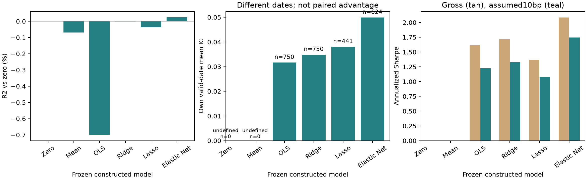

# Chapter 39 Regularized Linear Models

> The historical display follows the frozen A8-R1 results; the older A8-A accepted version is preserved. This chapter does not retrain models or fabricate historical predictions. Main thread: when features are numerous and signals are weak, OLS coefficient variance can overwhelm out-of-sample performance. Ridge, Lasso, and Elastic Net trade controlled bias for lower variance, but regularization strength must be selected within the training data, and results must be evaluated against zero-prediction and training-mean baselines and after costs.

> Prerequisites: Chapter 8 regression (OLS, standardization, introduction to regularization in software) and Chapter 38 pipelines. After this chapter, you will be able to: write the objective functions and scaling conventions for three scikit-learn estimators; hand-calculate four estimators under an orthogonal design; derive the bias, variance, and optimal strength $\alpha^\ast=\sigma^2/w^2$ for a single Ridge coefficient; explain L1/L2 geometry and their behavior under collinearity; and compare out-of-sample prediction metrics and after-cost portfolio results for six models on the Chapter 38 pipeline.

## 1. Learning Objectives

1. Write the objective functions for OLS, Ridge, Lasso, and Elastic Net; explain the scikit-learn 1.9.1 convention that Ridge does not divide by $2n$, while Lasso and Elastic Net do, and that the intercept is not penalized.
2. Hand-calculate all four estimators under the orthogonal design $X^\top X=nI$; verify the results with code.
3. Derive the closed-form Ridge solution, singular-value shrinkage factors, and the bias, variance, mean squared error, and optimal strength $\alpha^\ast=\sigma^2/w^2$ for a single coefficient.
4. Derive the Lasso soft-thresholding rule and the orthogonal Elastic Net solution; use geometry to explain why L1 produces zero coefficients while L2 does not actively produce a sparse solution.
5. Explain why standardization must be fitted within the training data and how it determines whether the penalty treats each feature equally.
6. Explain OLS sign reversals, Ridge sharing, and Lasso's choice of one feature under collinearity, and why coefficients cannot be interpreted directly as causal effects.
7. Use the date-based walk-forward and training-only tuning from Chapter 38 to compare out-of-sample and after-cost performance for zero prediction, the training mean, OLS, Ridge, Lasso, and Elastic Net on a constructed panel with more noise features than effective signals.

Completion criteria: Sections 15–17 can be completed independently; trace the frozen inputs and outputs in Sections 8–10 and explain the fresh-run versus frozen-replay boundary in Section 9; this batch does not run or retrain.

## 2. Why Quant Needs This

Cross-sectional stock-selection models often have dozens to hundreds of candidate features, of which only a few are genuinely useful, and those signals are weak. Under fixed-design and conditional zero-mean error assumptions, full-rank OLS coefficients are unbiased, but they can have very high variance. When there are many features and little effective information in the sample (Chapter 37: overlapping labels and low signal-to-noise ratio), that variance becomes out-of-sample error. Gu, Kelly, and Xiu (2020) report the following results for monthly U.S. individual-stock data: the out-of-sample $R^2$ for OLS using all features is $-3.46\%$, OLS using only three variables is 0.16%, and Elastic Net is 0.11% (see the verified reading locations in Sections 11 and 20). Regularization does not make a model “smarter”; it makes the model less prone to errors caused by noise.

Chapter 8 already demonstrated regularization selection within the training data for a single series. This chapter adds three things: exact scaling of the objective functions (the $\alpha$ values of different software packages are not interchangeable); a quantitative bias–variance derivation; and evaluation against baselines and costs in a panel pipeline.

## 3. Intuition

Consider an example with two features and four observations:

$$
X=\begin{pmatrix}1&1\\1&-1\\-1&1\\-1&-1\end{pmatrix},\qquad y=\begin{pmatrix}3\\1\\-1\\-3\end{pmatrix}.
$$

Both columns have mean 0 and population standard deviation 1, and they are orthogonal, so $X^\top X=4I$. The OLS coefficients are $(2,1)$.

- Ridge pulls both coefficients toward 0 by the same proportion: at $\alpha=4$, they become $(1,0.5)$.
- Lasso subtracts the same amount from each coefficient and stops at 0: at $\alpha=1.5$, the coefficients become $(0.5,0)$, so the second feature is removed.
- Elastic Net first subtracts an amount and then shrinks proportionally: at $\alpha=1$ and L1 ratio 0.5, the coefficients become $(1,1/3)$.

“Shrink proportionally” and “subtract a fixed amount” are the differences between L2 and L1 penalties, derived in Section 6. A simplified boundary: real features are not orthogonal, so coefficients affect one another and the closed-form solution is this simple only under orthogonality. Still, every number in this example can be reproduced exactly with scikit-learn (Section 9).

## 4. Mathematical Foundations

| Symbol | Meaning | Dimension / units |
|---|---|---|
| $n$ | Number of training sample rows | — |
| $X\in\mathbb R^{n\times p}$ | Feature matrix centered and standardized on the training set | Each column is in units of one training-set standard deviation |
| $y\in\mathbb R^n$ | Centered label | Decimal return |
| $w\in\mathbb R^p$ | Coefficient | Return (decimal) per unit of standardized feature |
| $\alpha\ge0$ | Regularization strength (scikit-learn notation) | Depends on the estimator; see below |
| $\rho\in(0,1)$ | Elastic Net L1 ratio (scikit-learn `l1_ratio`) | — |
| $X=UDV^\top$ | Singular value decomposition; $d_j$ is a singular value | — |
| $z=X^\top y/n$ | Sample covariance between each feature and the label under an orthogonal design | Return units |

Intercept: center $X$ and $y$ on the training set first; the intercept is the training mean and is not penalized. scikit-learn does the same when `fit_intercept=True`. Prerequisites: the OLS normal equations and projection in Chapter 8, and subgradients in Chapter 9 convex optimization (used in the Lasso derivation).

## 5. Formal Definitions

**OLS (ordinary least squares).** $\hat w^{\text{OLS}}=\arg\min_w\|y-Xw\|_2^2$. Every finite design matrix has a least-squares solution. When the matrix is rank deficient, the coefficients are generally not unique, but the training projection is unique. Invertibility of $X^\top X$ is the condition for unique coefficients and the ordinary inverse formula (full column rank; with a centered, intercept-inclusive design, there must also be enough residual degrees of freedom). Unbiased coefficients require separate statistical assumptions, such as fixed design and conditional zero-mean errors.

**Ridge.** In scikit-learn 1.9.1:

$$
\hat w^{\text{R}}=\arg\min_w\;\|y-Xw\|_2^2+\alpha\|w\|_2^2 .
$$

The residual sum of squares in the objective is **not divided by** $n$. The L2 penalty stabilizes coefficients when $X^\top X$ is ill-conditioned or $p$ is large.

**Lasso (least absolute shrinkage and selection operator).** In scikit-learn 1.9.1:

$$
\hat w^{\text{L}}=\arg\min_w\;\frac1{2n}\|y-Xw\|_2^2+\alpha\|w\|_1 .
$$

The residual sum of squares is divided by $2n$. The L1 penalty can shrink a coefficient to exactly 0, so it performs feature selection.

**Elastic Net.** In scikit-learn 1.9.1:

$$
\hat w^{\text{EN}}=\arg\min_w\;\frac1{2n}\|y-Xw\|_2^2+\alpha\rho\|w\|_1+\frac{\alpha(1-\rho)}2\|w\|_2^2 .
$$

It combines selection (L1) and stabilization (L2), making it useful when features are correlated and a sparse solution is desired.

**Consequences of the scaling conventions.** Rewrite Ridge in the same form as Lasso: $\|y-Xw\|^2+\alpha\|w\|^2=2n\big[\frac1{2n}\|y-Xw\|^2+\frac{\alpha}{2n}\|w\|^2\big]$. If another package writes the objective as $\frac1{2n}\|y-Xw\|^2+\frac\lambda2\|w\|^2$, then $\lambda/2=\alpha/(2n)$, or $\lambda=\alpha/n$. The same numerical value, $\alpha=1$, represents very different strengths in Ridge and Lasso. If the training sample size $n$ changes, the relative strength of the same Ridge $\alpha$ changes too. When comparing software (such as glmnet) or sample lengths, convert the scaling; do not copy values directly.

**Regularization path.** Take a sequence of $\alpha$ values from large to small to obtain a curve of coefficients as $\alpha$ changes. Coordinate descent solves along a decreasing $\alpha$ grid, using the solution at the previous $\alpha$ as the starting value for the next (warm start; Friedman, Hastie, and Tibshirani 2010, verified in the reconnaissance report).

**Scaling (standardization).** Use the training-set mean $\mu_j$ and standard deviation $s_j$ to transform a feature to $(x_j-\mu_j)/s_j$. A regularization penalty $\|w\|$ depends on coefficient units, so “treating each feature equally” has meaning only after standardization. Estimate $\mu$ and $s$ only on training rows (Chapter 38 Pipeline).

### How Scale Enters the Penalty: Converting Coefficients Back to Original Units

Let $x$ be the original feature, $b$ its slope in original units, and let the training standard deviations form an invertible diagonal matrix $S$. The standardized feature is $u=S^{-1}(x-\mu)$ and its coefficient is $w$. Since $w^\top u=b^\top(x-\mu)$, we have $b=S^{-1}w$ and $w=Sb$; the intercept absorbs centering and is not penalized. Therefore, the standardized penalties for identical predictions are

$$
\|w\|_2^2=\sum_j s_j^2b_j^2,\qquad
\|w\|_1=\sum_j s_j|b_j|.
$$

The penalty is on “the predicted contribution from a one-training-standard-deviation change,” not an equal sum of raw slopes measured in different units. Without standardization, if the recording unit for $x_2$ is multiplied by 100, preserving the same predictions requires dividing $b_2$ by 100. Its L2 penalty becomes $1/10^4$ of the original, and its L1 penalty becomes $1/100$. After standardization, $s_2$ is also multiplied by 100, so $s_2b_2$ is unchanged and the unit change cancels. A constant column with $s_j=0$ cannot be handled by this invertible-transform proof; it must be handled according to the actual preprocessing rule.

Also check the label units. Here $y$ is a decimal return, the standardized $x$ is dimensionless, and $w$ remains in return units. Under this convention, Ridge $\alpha$ is dimensionless, while Lasso $\alpha$ has return units. Elastic Net uses one numerical $\alpha$ to control both the L1 and L2 terms, so it must be interpreted with the label unit fixed; there is no single physical unit for it that suits both terms. If $y$ is multiplied by $c>0$ and predictions and coefficients must also be multiplied by $c$, Ridge keeps the same $\alpha$; Lasso needs $\alpha'=c\alpha$; Elastic Net must preserve both $\alpha'\rho'=c\alpha\rho$ and $\alpha'(1-\rho')=\alpha(1-\rho)$, which gives

$$
\alpha'=\alpha[(1-\rho)+c\rho],\qquad
\rho'=\frac{c\rho}{(1-\rho)+c\rho}.
$$

Derive this by dividing the transformed objective by $c^2$: the residual term returns to its original scale, the L1 term gains a factor of $1/c$, and the L2 term is unchanged. If $\rho$ is fixed, mechanically multiplying Elastic Net $\alpha$ by 100 does not preserve both terms. Record decimal-return and percentage-return units together with the grid. This is a unit conversion for the objective function, not retuning in this batch.

**Bias–variance.** The mean squared error of an estimator $\hat w$ is $E\|\hat w-w\|^2=\|E\hat w-w\|^2+\operatorname{tr}\operatorname{Var}(\hat w)$. Regularization increases the first term and reduces the second.

**Nested tuning.** Select $\alpha$ (and $\rho$) only on date-based walk-forward folds within the outer training rows; evaluate the outer test once (Chapter 38).

**Baselines.** Evaluate zero prediction and the training-mean prediction on the same folds, with the same portfolio rule and costs (Chapter 37).

**Sparsity and collinearity.** Sparsity means that many coefficients are exactly 0. Collinearity means that features are highly correlated and the smallest eigenvalue of $X^\top X$ is close to 0.

## 6. Derivations

### 6.1 Closed-Form Solutions for OLS and Ridge

Take the gradient of the Ridge objective and set it to 0:

$$
\nabla_w\big(\|y-Xw\|^2+\alpha\|w\|^2\big)=-2X^\top(y-Xw)+2\alpha w=0\;\Rightarrow\;\hat w^{\text{R}}=(X^\top X+\alpha I)^{-1}X^\top y .
$$

When $\alpha>0$, $X^\top X+\alpha I$ is positive definite, so a unique solution always exists, even when $p>n$. At $\alpha=0$, the optimization problem is OLS; only the ordinary inverse formula requires invertibility. When the matrix is rank deficient, the pseudoinverse can select a minimum-norm solution.

**Orthogonal design** ($X^\top X=nI$): $\hat w^{\text{OLS}}=X^\top y/n=z$, and $\hat w^{\text{R}}=X^\top y/(n+\alpha)=\frac{n}{n+\alpha}z$. Every coefficient is multiplied by the same shrinkage factor, $n/(n+\alpha)$. In the example from Section 3, $n=4$, $z=(2,1)$, and $\alpha=4$; the factor is $1/2$, giving $(1,0.5)$.

**Singular-value form for a general design:** Substituting $X=UDV^\top$ gives

$$
X\hat w^{\text{R}}=\sum_{j}u_j\frac{d_j^2}{d_j^2+\alpha}u_j^\top y .
$$

For the derivation, if we use the rank-$r$ compact SVD $X=U_rD_rV_r^\top$, then $V_r$ does not span the entire right-hand space. Therefore, when $\alpha>0$, we must write

$$
(X^\top X+\alpha I)^{-1}=V_r(D_r^2+\alpha I_r)^{-1}V_r^\top+\frac{I-V_rV_r^\top}{\alpha}.
$$

The last term acts on the null space; multiplying on the left by $X$ makes it 0. The hat matrix is therefore still $U_rD_r(D_r^2+\alpha I_r)^{-1}D_rU_r^\top$. We could also use a full right-singular basis and pad with zero singular values, but the first compact-SVD term alone is not the whole inverse matrix. Ridge multiplies fitted values in each principal-component direction $u_j$ by $d_j^2/(d_j^2+\alpha)$: directions with less variance ($d_j$ small) are shrunk the most. Under collinearity, the smallest $d_j$ is very small; this is exactly the direction in which OLS is unstable (ESL Section 3.4.1, verified in the reconnaissance report).

### 6.2 Bias, Variance, and Optimal Strength for a Single Ridge Coefficient

**Assumptions:** One standardized feature, $x^\top x=n$, $\sum x=0$; $y=wx+\varepsilon$, with independent errors $\varepsilon_i$ of mean 0 and variance $\sigma^2$.

$$
\hat w=\frac{x^\top y}{n+\alpha}=\frac{nw+x^\top\varepsilon}{n+\alpha}.
$$

Expectation: $E\hat w=\frac{n}{n+\alpha}w$, with bias $-\frac{\alpha}{n+\alpha}w$. For the variance, $\operatorname{Var}(x^\top\varepsilon)=\sigma^2x^\top x=n\sigma^2$, so $\operatorname{Var}\hat w=\frac{n\sigma^2}{(n+\alpha)^2}$. The mean squared error is

$$
\mathrm{MSE}(\alpha)=\frac{\alpha^2w^2+n\sigma^2}{(n+\alpha)^2}.
$$

Differentiate with respect to $\alpha$. The numerator is $2\alpha w^2(n+\alpha)^2-2(n+\alpha)(\alpha^2w^2+n\sigma^2)$. Set it to 0 and divide by $2(n+\alpha)$: $\alpha w^2(n+\alpha)-\alpha^2w^2-n\sigma^2=0$, hence $n\alpha w^2=n\sigma^2$,

$$
\alpha^\ast=\frac{\sigma^2}{w^2},\qquad \mathrm{MSE}(\alpha^\ast)=\frac{\sigma^2}{n+\alpha^\ast}<\frac{\sigma^2}{n}=\mathrm{MSE}(0).
$$

For the last step, substitute $\alpha^\ast w^2=\sigma^2$; the numerator becomes $\alpha^\ast\sigma^2+n\sigma^2=\sigma^2(n+\alpha^\ast)$.

This optimal formula and strict improvement require $w\ne0$ and $\sigma^2>0$. If $w=0$ and $\sigma^2>0$, MSE is $n\sigma^2/(n+\alpha)^2$ and tends to 0 as the strength increases; there is no finite optimum given by $\sigma^2/w^2$. If the noise is 0 and the signal is nonzero, the optimum is $\alpha=0$. Expectations and variances are conditional on the fixed design.

**Financial interpretation:** The weaker the signal ($w$ small) and the larger the noise ($\sigma$ large), the stronger the optimal shrinkage. $\alpha^\ast$ does not depend on $n$ because scikit-learn Ridge does not divide by $n$. **When this formula does not apply:** $w$ and $\sigma$ are unknown, so $\alpha^\ast$ cannot be calculated directly; select $\alpha$ by validation within the training data. With multiple correlated features, there is no similarly simple formula.

### 6.3 Lasso Soft Thresholding

**Assumptions:** Orthogonal design $X^\top X=nI$, with the scikit-learn convention that the squared loss is divided by $2n$.

Expand the objective: $\frac1{2n}\|y-Xw\|^2=\frac1{2n}y^\top y-z^\top w+\frac12\|w\|^2$ (using $X^\top X=nI$ and $z=X^\top y/n$). The objective separates by coordinate; each coefficient solves

$$
\min_{w_j}\;\tfrac12w_j^2-z_jw_j+\alpha|w_j| .
$$

The subgradient condition is $0\in w_j-z_j+\alpha\,\partial|w_j|$. If $w_j>0$, then $w_j=z_j-\alpha$, which requires $z_j>\alpha$. If $w_j<0$, then $w_j=z_j+\alpha$, which requires $z_j<-\alpha$. If $w_j=0$, we need $|z_j|\le\alpha$. Together,

$$
\hat w^{\text{L}}_j=S(z_j,\alpha)=\operatorname{sign}(z_j)\,(|z_j|-\alpha)_+ .
$$

In the example from Section 3, $z=(2,1)$ and $\alpha=1.5$: $S(2,1.5)=0.5$ and $S(1,1.5)=0$.

### 6.4 Orthogonal Elastic Net Solution

Expanding as before, each coordinate solves

$$
\min_{w_j}\;\tfrac12w_j^2-z_jw_j+\alpha\rho|w_j|+\tfrac{\alpha(1-\rho)}2w_j^2
=\min_{w_j}\;\tfrac{1+\alpha(1-\rho)}2w_j^2-z_jw_j+\alpha\rho|w_j| .
$$

The same subgradient argument as in Section 6.3, with the quadratic coefficient changed to $1+\alpha(1-\rho)$, gives

$$
\hat w^{\text{EN}}_j=\frac{S(z_j,\alpha\rho)}{1+\alpha(1-\rho)} .
$$

First soft-threshold, then shrink proportionally. Example: $\alpha=1$, $\rho=0.5$ gives $S(z,0.5)/1.5=(1.5/1.5,\;0.5/1.5)=(1,1/3)$.

### 6.5 Geometry: Why L1 Produces Zero Coefficients

Lasso is equivalent to minimizing the residual sum of squares subject to $\|w\|_1\le t$ (a value of $t$ corresponds to a value of $\alpha$ through Lagrangian duality). The residual-sum-of-squares contours are ellipses centered at the OLS solution. The L1 constraint set is a diamond, with corners on the coordinate axes. Expand the residual contours outward from the OLS center until they first touch the constraint set; often they touch a corner, where some coordinates are exactly 0. The L2 constraint set is a circle with no corners, so its point of tangency is generally not on a coordinate axis. Ridge therefore does not actively produce sparse support. This does not mean that a coordinate can never be 0: under an orthogonal design, Ridge also gives a zero coefficient when $z_j=0$. If the OLS solution is already inside the constraint set, the constraint is inactive. In a general design, shrinkage is along singular directions; it does not guarantee that every original coordinate decreases in absolute value or that coefficient rankings stay fixed (the classic illustration in ESL Figure 3.11, verified in the reconnaissance report). Under orthogonality, this geometry is the soft-thresholding rule from Section 6.3: coordinates with $|z_j|\le\alpha$ land on a corner.

### 6.6 Collinearity: What OLS, Ridge, and Lasso Do

**Assumptions:** Two standardized features with sample correlation $r$, such that $X^\top X/n=\begin{pmatrix}1&r\\r&1\end{pmatrix}$.

OLS variance is $\operatorname{Var}(\hat w)=\sigma^2(X^\top X)^{-1}=\frac{\sigma^2}{n(1-r^2)}\begin{pmatrix}1&-r\\-r&1\end{pmatrix}$. Each coefficient's variance is $1/(1-r^2)$ times that under orthogonality (the variance inflation factor, VIF). At $r=0.99$, VIF $=50.25$ and the standard deviation is about 7.1 times larger. The stable “sum” direction and the equal-splitting description below are for $r\approx+1$; when $r\approx-1$, the stable sum/difference directions switch. The estimated coefficients have correlation $-r$: if one is overestimated, the other is underestimated, and they are often of opposite signs, even though the sum $\hat w_1+\hat w_2$ is estimated quite precisely.

For Ridge, the eigenvalues of $X^\top X$ are $n(1+r)$ and $n(1-r)$, with eigenvectors $(1,1)/\sqrt2$ and $(1,-1)/\sqrt2$. Ridge shrinks the “sum” direction by $\frac{n(1+r)}{n(1+r)+\alpha}$ and the “difference” direction by $\frac{n(1-r)}{n(1-r)+\alpha}$. The latter is much smaller, so Ridge nearly eliminates the difference and the two coefficients become similar (an equal split). When the two features are identical ($r=1$), Ridge splits the coefficient exactly equally (proof left as 39-C01).

For Lasso, fixing the sum of same-sign coefficients keeps the L1 penalty $|w_1|+|w_2|$ constant. The entire objective is indifferent to the allocation only when the two columns are identical ($r=1$), so the fit also depends only on their sum (39-C01). With high but imperfect correlation, the residual term still distinguishes allocations. Full column rank makes the squared loss strictly convex and the Lasso solution unique, although selection can vary across samples and may retain only one variable. For example, let $X^\top X/n$ have diagonal entries 1 and off-diagonal entries 0.99, and let $y=X_1+X_2$. Coefficients $(1,1)$ and $(2,0)$ both have L1 norm 2, but the latter has a normalized squared loss higher by 0.01. Theorem 1 of Zou and Hastie (2005) gives Elastic Net's “grouping effect”: the more highly correlated the features and the larger the L2 component, the closer their coefficients are (verified in the reconnaissance report; this chapter uses only the result, which is independently illustrated by the Section 8.3 simulation).

### 6.7 What Does Ridge Predict When $\alpha$ Is Large?

When $\alpha$ is sufficiently large relative to all eigenvalues of $X^\top X$, and the cross-sectional projection direction is nondegenerate, as $\alpha\to\infty$ we have $(X^\top X+\alpha I)^{-1}\approx I/\alpha$, $\hat w^{\text{R}}\approx X^\top y/\alpha$, and $\hat y=\bar y+x^\top X^\top y/\alpha$. The prediction **level** approaches the training mean, while the direction of the **cross-sectional differences** approaches $X^\top y$ (the sample covariance of each feature with the label), with the whole vector scaled by $1/\alpha$. Thus, a purely rank-based portfolio can have approximately the same holdings if the ranks are stable; the actual demeaned/L1-normalized continuous weights also approach the same limit when their leading term is the same and nonzero. Whether finite $\alpha=10^5$ and $10^7$ are close depends on the actual eigenvalues; it is not guaranteed. MSE still penalizes magnitude and calibration errors even when ranks are unchanged. At low signal-to-noise ratios, stronger shrinkage may reduce estimation noise; actual inner validation must determine whether the grid boundary is optimal. The limit does not imply that level error dominates, and shrinking predictions does not remove the labels' cross-sectional error. For example, take three assets with $y=(-0.01,0,0.01)$, $p=(-0.02,0,0.02)$, and predictions $ap$ for $a>0$. Both means are zero, level error is zero, and Spearman IC stays at 1, but cross-sectional SSE is $2(0.01-0.02a)^2$: zero at $a=0.5$ and 0.0002 at $a=1$. Thus MSE and IC can prefer different strengths. The frequent largest-grid choice in Section 8.4 is an actual validation result; that choice alone does not identify the source of error.

## 7. Financial Interpretation

**Coefficients are not causal effects.** A standardized coefficient $w_j$ means that, holding other features constant in the training sample's joint distribution, a one-training-standard-deviation increase in feature $j$ raises the linear prediction for the label by $w_j$. It does not mean that “increasing this feature raises returns”: a feature may proxy for an omitted variable; with collinearity, a case where other features stay “constant” may scarcely occur in the data; and regularization pulls coefficients toward 0 according to the penalty, so coefficient size also depends on $\alpha$. In the Section 8.3 simulation, both true coefficients are 1, yet OLS assigns opposite signs to them in 41.8% of samples.

**Why a zero coefficient does not mean “useless.”** Lasso may set a coefficient to 0 because a feature is truly irrelevant, because it is highly correlated with another selected feature, or because its signal is weaker than the current $\alpha$. In Section 8.4, Lasso selects no features in 5 of 12 folds, leaving those portfolios in cash.

**Regularization and portfolios.** Dollar neutrality removes the common level; actual continuous weights also depend on the relative magnitudes of demeaned predictions. A common positive scaling cancels under L1 normalization. General Ridge does not multiply all original coefficients by a common factor, so it can change ranks and weights; Lasso removes features and can change ranks; large OLS coefficients on noisy features can add noise to the ranking. Thus, when the prediction-layer $R^2_{\text{OS}}$ differences are small, portfolio-level results can still differ, and the reverse can also happen.

**Costs widen the gap.** A portfolio rebalanced every 5 days has annual turnover of about 14–24 times (Section 8.4). A one-way cost of 10 basis points consumes about 1.4%–2.4% of returns per year. Models with lower turnover fare better after costs.

## 8. Numerical Example

### 8.1 Hand-Calculate Four Estimators (Constructed Teaching Example)

Use $X$ and $y$ from Section 3. We have $n=4$, $X^\top y=(8,4)$, and $z=(2,1)$.

| Estimator | Formula | Result |
|---|---|---|
| OLS | $z$ | $(2,\;1)$ |
| Ridge, $\alpha=4$ | $\frac{n}{n+\alpha}z=\frac48z$ | $(1,\;0.5)$ |
| Lasso, $\alpha=1.5$ | $S(z,1.5)$ | $(0.5,\;0)$ |
| Elastic Net, $\alpha=1,\rho=0.5$ | $S(z,0.5)/(1+0.5)$ | $(1,\;0.3333)$ |

The maximum difference between the scikit-learn 1.9.1 fits and the closed-form solutions is $2.2\times10^{-16}$. For this $X$, `StandardScaler` is the identity transformation.

### 8.2 Bias and Variance

Let $n=50$, $w=0.2$, and $\sigma=1$. Then $\alpha^\ast=\sigma^2/w^2=25$. For OLS, $\mathrm{MSE}=\sigma^2/n=0.02$. At $\alpha^\ast$, the bias is $-\frac{25}{75}\times0.2=-0.0667$, squared bias is 0.004444, and variance is $50/75^2=0.008889$, for a total of 0.013333—one-third below OLS. The mean squared errors from 4,000 simulations match the formula curve (Figure 39-2).

### 8.3 Collinearity Simulation

Settings: $n=40$, two features with correlation 0.99, true coefficients $(1,1)$, noise standard deviation 1, and 500 repetitions (seed 3902).

| Method | Mean coefficients | Coefficient standard deviations | Fraction with one coefficient equal to 0 | Fraction with a negative sign |
|---|---|---|---|---|
| OLS | (0.967, 0.982) | (1.211, 1.216) | 0 | 41.8% |
| Ridge, $\alpha=10$ | (0.866, 0.865) | (0.127, 0.126) | 0 | 0 |
| Lasso, $\alpha=0.1$ | (0.932, 0.920) | (0.745, 0.751) | 44.8% | 0 |

VIF $=1/(1-0.99^2)=50.25$. OLS averages are close to the true values (unbiased), but the sign in any one sample is unreliable. Ridge is biased (about 0.87) but stable. In nearly half of the samples, Lasso retains only one feature.

### 8.4 A Panel with More Noise Features Than Effective Signals

Constructed panel (seed 3904): 40 assets, 1,260 days; 3 true features (daily expected-return loadings of 0.04%, 0.02%, and 0.01% per unit), 40 noise features, and 3 price features, for 46 features in total. $\ell=1$, $h=5$; expanding-window date-based walk-forward, a 504-day initial training window, 63-day test blocks, 12 folds (first fit time: 2016-12-08); two inner validation blocks of 63 days each. Grids: Ridge $\alpha\in\{10^2,\dots,10^7\}$; Lasso $\alpha\in\{3\times10^{-3},10^{-3},3\times10^{-4},10^{-4},3\times10^{-5}\}$; Elastic Net $\alpha\in\{3\times10^{-3},10^{-3},3\times10^{-4},10^{-4}\}\times\rho\in\{0.2,0.5,0.8\}$. Portfolio: cross-sectional demeaning, gross exposure 1, rebalance every 5 signal days, execute at the next close, proportional one-way costs of 0 or 10 basis points; NAV recorded daily; initial capital 1 million.

| Model | $R^2_{\text{OS}}$ vs. zero | vs. training mean | Mean IC (model's own valid days) | Own valid days / candidate label days | Total return / Sharpe before costs | Total return / Sharpe after costs | Annual turnover | Maximum drawdown after costs |
|---|---|---|---|---|---|---|---|---|
| Zero prediction | 0 | +0.070% | — | 0/750 | 0 / — | 0 / — | 0 | 0 |
| Training mean | −0.070% | 0 | — | 0/750 | 0 / — | 0 / — | 0 | 0 |
| OLS | −0.699% | −0.629% | 0.0316 | 750/750 | +34.51% / 1.62 | +25.08% / 1.23 | 24.2 | −4.43% |
| Ridge | −0.001% | +0.069% | 0.0349 | 750/750 | +37.31% / 1.71 | +27.67% / 1.33 | 24.2 | −5.41% |
| Lasso | −0.037% | +0.033% | 0.0380 | 441/750 | +20.83% / 1.37 | +15.91% / 1.08 | 13.9 | −4.18% |
| Elastic Net | +0.025% | +0.095% | 0.0499 | 624/750 | +41.49% / 2.08 | +33.64% / 1.75 | 19.0 | −5.27% |

**Dates and inference display (A8-R1):** The table reports the frozen summary means of each model's IC on its own valid dates; these are not rankings on a common date set. There are 750 candidate label dates; Ridge has 750 valid dates, Lasso 441, and Elastic Net 624. Zero prediction and the training mean are constants, so their IC is undefined and must not be entered as an observed 0. Chapter 39's frozen row-level predictions are missing, so the common dates and paired mean/difference for Ridge–Lasso and Ridge–Elastic Net, as well as the reason for each daily omission, **could not be recomputed**. The summaries confirm only that each has fewer than 750 valid dates; rows from the separate P06 experiment cannot be used to fill them in. Old fold records support that some Lasso folds were all zero, but do not independently establish the reason for every missing date.

**First ask which dates are averaged.** For model $m$, define $D_m=\{d:\mathrm{IC}_{m,d}\text{ is defined}\}$. Its own-date mean is $|D_m|^{-1}\sum_{d\in D_m}\mathrm{IC}_{m,d}$. For a paired comparison with Ridge, let $D_{mR}=D_m\cap D_R$, and restrict both models to $D_{mR}$:

$$
\Delta_{mR}=\frac1{|D_{mR}|}\sum_{d\in D_{mR}}(\mathrm{IC}_{m,d}-\mathrm{IC}_{R,d}).
$$

This quantity is undefined when the common set is empty. Take the intersection first and then the difference to compare both models on the same market dates. In an independent constructed example, Ridge has ICs of 0.1, 0.9, and 0.2 on dates 1, 2, and 3; model $m$ has ICs of 0.2 and 0.3 only on dates 1 and 3. Their own-date means are 0.4 and 0.25, which makes $m$ appear worse. On the common set $\{1,3\}$, Ridge's mean is 0.15 and $m$'s is 0.25, so the paired difference is instead +0.10. This example only shows that date selection can change the question; it does not supply any of this chapter's historical paired values for 750/441/624 days. The frozen P06 rows can illustrate how to form P06's own intersection; they cannot serve as Chapter 39 row records.

The old shared implementation first dropped missing IC values and then calculated NW(4) by the remaining observation index. The fourth-observation lag can span more than four trading days and therefore cannot be called “four-trading-day HAC.” The new candidate removes the old table's t-statistic and significance judgment; the old summary/PDF still preserves the historical t-statistic. There is no new calendar-aware HAC estimate here, and inability to recompute is not stated as a proven error. Any future re-estimation needs a separate protocol and the frozen row-level data.

(Test period: 750 signal days and 756 daily returns; Sharpe is annualized with a risk-free rate of 0.)

Reading the table:

1. OLS has the worst $R^2_{\text{OS}}$ ($-0.70\%$), below the training mean, but its IC is still positive and the portfolio still makes money. Prediction-layer and portfolio-layer rankings differ.
2. Ridge's $R^2_{\text{OS}}$ is almost 0: it selects $\alpha=10^7$ in 4 folds, $10^6$ in 2 folds, and $10^5$ in 6 folds (the mechanism in Section 6.7). The prediction level approaches the training mean while ranking information remains. Its own-date mean IC and portfolio result are higher than OLS; row-by-row alignment on common dates has not been recomputed.
3. In 5 of 12 folds (folds 1–4 and 12), Lasso selects $\alpha=3\times10^{-3}$, which shrinks all coefficients to 0; predictions are constant and the portfolio stays in cash. The other folds retain 4–25 features. Its IC is calculated on only 441 dates with cross-sectional differences, so its own-date mean cannot be treated as a paired comparison with Ridge's 750 days. Elastic Net has only 624 valid days as well. The lower total return mainly reflects the all-zero folds.
4. Elastic Net has a 1.75 after-cost Sharpe on this frozen ledger. Its 0.050 IC is a descriptive mean on its own 624 valid days and does not support an IC advantage on common dates that have not been recomputed. This result is **for this constructed panel**, where the true features are independent and signal strengths were set by the author. It does not show that Elastic Net is better on real data.
5. Costs: 10 basis points one way reduces the average annualized return by about 2.4 percentage points (OLS 10.08% → 7.65%), consistent with annual turnover of 24.2 times × 0.1%.

## 9. Python Implementation

Script: `code/ch39_regularized_models.py`; shared module: `quant_course.ml_pipeline` (Chapter 38), where `backtest_predictions` connects predictions to the Chapter 29 ledger, `run_backtest` (lagged execution, proportional fees, and $N$ returns corresponding to $N+1$ wealth points). The historical engineering entrypoint can retrain, but retraining cannot be used to fabricate the missing 3904 historical row-level predictions; the working script may also overwrite the original figures. The accepted I3 default Notebook only replays the frozen summary and display figures; it does not run the historical training. This batch did not run the CLI/Notebook/API; the English Notebook language layer is deferred to BIL23.

Seeds 3901–3904; outputs: `ch39_results.json` and three figures. Daily frequency; `signal_time` is the close on $D_k$, `trade_time` is the close on $D_{k+1}$, and the label interval is 5 days; missing-value treatment follows Chapter 38. Borrow fees, financing spreads, market impact, and capacity are not modeled. Tests: `tests/test_ch39_regularized.py` (hand-calculated estimators, $\alpha^\ast$, soft thresholding) and `tests/test_ml_pipeline.py`.

Hand-calculation example:

```python
import numpy as np
from sklearn.linear_model import ElasticNet, Lasso, LinearRegression, Ridge

X = np.array([[1.0, 1.0], [1.0, -1.0], [-1.0, 1.0], [-1.0, -1.0]])
y = np.array([3.0, 1.0, -1.0, -3.0])
for name, model in [("ols", LinearRegression()), ("ridge a=4", Ridge(alpha=4.0)),
                    ("lasso a=1.5", Lasso(alpha=1.5)), ("enet a=1 r=0.5", ElasticNet(alpha=1.0, l1_ratio=0.5))]:
    print(name, np.round(model.fit(X, y).coef_, 4))
```

Expected: `ols [2. 1.]`, `ridge a=4 [1.  0.5]`, `lasso a=1.5 [0.5 0. ]`, `enet a=1 r=0.5 [1.     0.3333]`.

Single-coefficient bias–variance:

```python
import numpy as np
n, w, sigma = 50, 0.2, 1.0
mse = lambda a: (a * w / (n + a)) ** 2 + sigma ** 2 * n / (n + a) ** 2
grid = np.logspace(-1, 3, 4001)
print(round(grid[np.argmin(mse(grid))], 2), round(mse(sigma ** 2 / w ** 2), 6), sigma ** 2 / n)
```

Expected: `25.0 0.013333 0.02`.

## 10. Visualization


Figure 39-1: The horizontal axis is $\alpha$ (log scale, decreasing to the right, using each estimator's scikit-learn convention); the vertical axis is the coefficient for each standardized feature. Colored lines represent three true features (true coefficients 0.6, 0.4, and −0.3); gray lines represent 12 noise features; $n=120$, seed 3903. Observations: Ridge coefficients move smoothly away from 0 as $\alpha$ decreases, with all features entering together; Lasso coefficients enter from 0 one at a time. The first two true features enter at about $\alpha\approx0.50$, the third at 0.25, and some noise features below 0.19. As $\alpha\to0$, the estimates for the first two true features are both about 0.50 (their true values are 0.6 and 0.4): with $n=120$, the standard error of one OLS coefficient is about $1/\sqrt{120}\approx0.09$, which is sampling error. Constructed data.


Figure 39-2: The horizontal axis is Ridge $\alpha$ (log scale); the vertical axis is the mean squared error of the coefficient estimate. The solid line is the formula $(\alpha w/(n+\alpha))^2+\sigma^2n/(n+\alpha)^2$, dots are 4,000 simulations, the dotted horizontal line is OLS, and the vertical dashed line is $\alpha^\ast=25$. Observation: the curve reaches its minimum (0.0133) at $\alpha^\ast$; when $\alpha$ is too large, bias dominates, the mean squared error rises, and eventually exceeds OLS. Constructed data, seed 3901.



Figure 39-3: All three panels use the six models on the horizontal axis. Left: $R^2_{\text{OS}}$ relative to zero prediction (%). Center: the mean daily Spearman IC over each model's own valid dates, with $n$ labeled above each bar; IC is undefined for zero prediction and the training mean, so those entries are left blank and labeled $n=0$. The dates differ; no paired-advantage inference is made. Right: annualized Sharpe for dollar-neutral portfolios; light bars are before costs and dark bars are after one-way costs of 10 basis points. Zero prediction and the training mean remain in cash, so their Sharpe is undefined and left blank. Observation: the rankings in the left panel differ from those in the center and right panels; costs lower all model Sharpes by 0.3–0.4. Constructed panel, seed 3904.

## 11. Real-Market Example

This chapter reports no measured real-market numbers: Project 6 real data are blocked (see `projects/project06/data_manifest.json`). The literature results read by the author (Gu, Kelly, and Xiu 2020, Table 1, p. 2250; U.S. individual stocks, monthly, before costs) are: OLS with all features, out-of-sample $R^2=-3.46\%$; OLS using only size, value, and momentum, 0.16%; and Elastic Net with Huber loss, 0.11%, with zero prediction as the baseline (Equation 19, p. 2249). This is directionally consistent with Section 8.4: with many features, unconstrained OLS performs poorly out of sample, while regularization or dimension reduction brings $R^2$ back to a small positive value. The magnitudes are not comparable to this book's constructed results because the samples, frequencies, features, and baselines differ.

Once data are available, report all columns of the Section 8.4 table for the same frozen stock universe and sample period, and add each fold's $\alpha$, Lasso support-set size, and coefficient-sign stability.

## 12. Common Mistakes

### 12.1 Regularizing Without Standardizing

```python
import numpy as np
from sklearn.linear_model import Lasso
rng = np.random.default_rng(0)
x1 = rng.normal(size=200); x2 = rng.normal(size=200)
y = 0.5 * x1 + 0.5 * x2 + rng.normal(size=200)
X_pct = np.column_stack([x1, x2 * 100])           # x2 recorded in percent instead of decimal
coef = Lasso(alpha=0.3).fit(X_pct, y).coef_        # WRONG: penalty treats a 1-unit change equally
print(np.round(coef, 4))
X_std = (X_pct - X_pct.mean(0)) / X_pct.std(0)    # fit mean/sd on training rows only
print(np.round(Lasso(alpha=0.3).fit(X_std, y).coef_, 4))
```

The book's output is `[0.2408 0.0054]` and `[0.2243 0.2528]`. The error is that the coefficient for $x_2$, recorded in percent, is 100 times smaller for the same information, but the penalty is unchanged. In the first output, the $x_2$ coefficient 0.0054 converts to 0.54 in decimal units, so it is barely shrunk, while $x_1$ is reduced from about 0.5 to 0.24. After standardization, both are shrunk equally (second output). Fix: standardize on training rows before regularization (Pipeline); when reporting coefficients, state that they are “per training standard deviation.”

### 12.2 Comparing Ridge and Lasso $\alpha$ Directly

Incorrect: “Both models use $\alpha=1$, so the penalties are the same.” Why: scikit-learn Ridge does not divide by $2n$, while Lasso does (Section 5). Fix: tune each independently; convert to a common convention for comparison.

### 12.3 Selecting $\alpha$ on the Full Sample

Incorrect: use `RidgeCV` or `LassoCV` to select $\alpha$ with random K-fold cross-validation on the full sample, then report out-of-sample results on part of that sample. Why: selection used the test period, and random folds introduce overlap leakage (Chapter 38). Fix: outer date-based walk-forward, with inner date-based walk-forward for parameter selection (`ml_pipeline.fit_select_predict`).

### 12.4 Treating Coefficients as Causal Effects or Feature-Importance Rankings

Incorrect: “Lasso selected feature A and not B, so A drives returns and B is irrelevant.” Why: under collinearity, Lasso chooses one feature (in Section 8.3, only one of the two is retained in 44.8% of samples), and the choice changes with the sample and $\alpha$ (support sets range from 0 to 25 across folds in Section 8.4). Fix: report selection frequency and sign stability across folds; causal questions require a separate identification design.

### 12.5 Looking Only at $R^2$ or Only at Sharpe

Incorrect: select the model with the highest $R^2_{\text{OS}}$, or report only before-cost Sharpe. Why: in Section 8.4, Ridge has $R^2$ near 0 yet outperforms OLS at the portfolio layer; costs reduce Sharpe by 0.3–0.4. Fix: report metrics at both layers and under both cost levels, against the zero-prediction and training-mean baselines.

### 12.6 Fitting `StandardScaler` on All Dates in a Panel

Error: fit `StandardScaler().fit(X_all)` first, then run walk-forward. If the training design is full rank, OLS predictions are unaffected; with exact collinearity (rank deficiency), OLS predictions for new points can also change with standardization (the Chapter 38 Section 6.3 counterexample: 2.20 versus 1.75). Ridge and Lasso can usually be affected: the penalty is based on standard deviations from the full sample, including test-period information. Fix: fit inside a Pipeline.

## 13. Quant Research Application

**Hypothesis:** Among 46 features available at the close, a few weakly predict the next 5-day cross-sectional return; a regularized linear model can produce positive after-cost dollar-neutral returns and outperform zero prediction and the training mean.

**Design (frozen):** Use the panel, folds, grids, portfolio rules, and costs from Section 8.4; record the selected hyperparameters and Lasso support set for each fold.

**Tests:** Prediction layer (out-of-sample $R^2$ against both baselines, each model's own valid-date and common paired-date IC; inference on t-statistics is no longer displayed for this historical case); portfolio layer (returns, Sharpe, turnover, and drawdown before and after costs); stability (fold-by-fold IC and feature selection); two cost levels.

**Falsification conditions:** After-cost Sharpe is not positive; a paired test on dates frozen in advance shows no advantage (the missing historical row-level data in this chapter prevented evaluation); the conclusion holds in only a few folds; or the best model changes with the grid boundary (for example, Ridge always selects the largest $\alpha$, prompting a check of the inner validation curve and boundary, not a switch to IC tuning after looking at outer results; the objective and comparison protocol must be frozen in advance, see 39-C02).

**Tuning judgment:** Compare a grid boundary or a different evaluation criterion within the training data under a protocol frozen in advance; do not infer “the IC objective must be used” from outer-test performance.

**How to state the conclusion:** Elastic Net has a higher after-cost Sharpe on this chapter's frozen ledger. IC means calculated on different valid dates alone do not establish a paired prediction advantage. On real data, compare again under the same protocol and retain negative results.

## 14. Chapter Summary

Under assumptions such as fixed design and conditional zero-mean errors, OLS is unbiased but can have high variance. Under orthogonality, Ridge shrinks by $n/(n+\alpha)$; in a general design, it shrinks by $d_j^2/(d_j^2+\alpha)$. Lasso uses soft thresholding $S(z,\alpha)$ to produce zero coefficients; Elastic Net thresholds first and then shrinks. In scikit-learn, Ridge does not divide the residual sum of squares by $2n$, while Lasso and Elastic Net do, so $\alpha$ cannot be compared across estimators. For a single coefficient with $w\ne0$ and $\sigma^2>0$, Ridge's optimal strength is $\alpha^\ast=\sigma^2/w^2$; at zero signal, the optimum is the limit of infinite shrinkage, and weaker signals call for stronger shrinkage. Under collinearity, OLS signs are unstable, Ridge splits, and Lasso may choose one feature; coefficients are not causal effects. In a panel pipeline, standardization and tuning both take place within the training data. Prediction-layer and portfolio-layer rankings can differ, MSE tuning can favor heavy shrinkage, and turnover determines how costs widen the gap. Always include zero prediction and the training mean in the same table.

## 15. Exercises

### 39-E01 (OLS)
Use the $X$ from Section 3 and $y=(2,0,2,-4)$. Compute $X^\top y$, $z$, and the OLS coefficients. What is the intercept?

### 39-E02 (Ridge and Scaling Convention)
Continue from 39-E01. (a) Find the scikit-learn Ridge coefficients at $\alpha=2$ and $\alpha=12$. (b) Another package writes Ridge as $\frac1{2n}\|y-Xw\|^2+\frac{\lambda}2\|w\|^2$. What $\lambda$ is equivalent to scikit-learn $\alpha=12$?

### 39-E03 (Bias–Variance)
Let $n=250$, $w=0.05$, and $\sigma=1$. Find $\alpha^\ast$, the bias, variance, and mean squared error at $\alpha^\ast$, and compare with OLS.

### 39-E04 (Lasso Soft Thresholding)
Use the $z$ from 39-E01. Find the Lasso coefficients at $\alpha=0.5$, $1$, and $2$. At which $\alpha$ do all coefficients become 0?

### 39-E05 (Elastic Net)
Continue from 39-E01. Find the Elastic Net coefficients at $\alpha=1$ with $\rho=0.8$ and $\rho=0.2$.

### 39-E06 (Standardization)
Feature $x_2$ is recorded as a percentage (its recorded values are 100 times the decimal values). Without standardization, how do the OLS and Ridge coefficients and Lasso's selection of $x_2$ change? Which one is unaffected? Explain.

### 39-E07 (Collinearity)
Two standardized features have correlation $r=0.95$, with $n=100$ and $\sigma=1$. Find the standard deviation of one OLS coefficient, the VIF, and Ridge shrinkage in the “sum” and “difference” directions at $\alpha=10$.

### 39-E08 (Interpreting Coefficients)
Ridge estimates a coefficient of 0.002 for the standardized feature “book-to-market ratio” (5-day return per training standard deviation). The feature's training-set standard deviation is 0.4. (a) Convert this to the coefficient per unit of book-to-market ratio. (b) Give two reasons why this does not justify saying that “increasing book-to-market by 0.4 will raise 5-day return by 0.2%.”

### 39-T01 (New: Two Units and Two Penalty Terms)

(a) If the unstandardized feature $x_2$ is multiplied by 100, how do its L1 and L2 penalties change when preserving the same predictions? Why does training-set standardization cancel this effect? (b) If decimal return $y$ is multiplied by 100, how must $\alpha$ change for Ridge and Lasso to preserve the scaled predictions? (c) For Elastic Net with original $\alpha=0.01$ and $\rho=0.5$, write the $\alpha'$ and $\rho'$ that preserve both penalty terms.

### 39-T02 (New: Own-Date Mean and Paired Difference)

Using the three-day independent constructed example in Section 8.4, write $D_R$, $D_m$, and $D_{mR}$, then calculate the two own-date means and the paired difference on the common set. Can counts of valid days alone complete this calculation?

## 16. Programming Exercises

### 39-P01 (Regularization Path)
On constructed data with $n=120$ and 15 standardized features (3 true and 12 noise features), plot the Ridge and Lasso paths. Acceptance checks: (1) all Lasso coefficients are 0 at the largest $\alpha$; (2) at the smallest $\alpha$, the maximum absolute difference between the Lasso coefficients and OLS is less than 0.01; (3) report the first nonzero $\alpha$ for every feature; (4) fix the seed and label the axis with the convention used.

### 39-P02 (Panel Comparison)
Use `ml_pipeline` to reproduce the Section 8.4 table. Acceptance checks: (1) each fold's training rows satisfy label_available_at $\le$ fit_time (read `DateFold`); (2) zero prediction and the training mean have total portfolio return 0; (3) for the same predictions, after-cost NAV is no higher than before-cost NAV; when fees are positive and the wealth factor is positive, the path endpoint must be strictly lower; the zero/mean cash baselines must be equal; (4) output the hyperparameters for every fold; (5) without changing any settings, rerun with seed 3905 and report whether the conclusion changes (retain the result and do not select a seed).  

## 17. Challenge Problems

### 39-C01 (Ridge and Lasso under Perfect Collinearity)

Two features are identical ($x_1=x_2=x$, with $x^\top x=n$). Let $\alpha>0$. (1) Prove that the Ridge solution is unique and that $\hat w_1=\hat w_2=\frac{x^\top y}{2n+\alpha}$. (2) Prove that the Lasso solution set is a line segment and write it out. (3) Is the Elastic Net solution unique when $\alpha(1-\rho)>0$? What if $\alpha=0$? Additional prerequisite: Chapter 9 convexity. Scoring: one-third each for parts (1), (2), and (3).

### 39-C02 (Tune on MSE or IC?)

In Section 8.4, Ridge selects $\alpha$ using inner validation MSE and often selects the largest value. Design a tuning scheme that uses **mean daily Spearman IC** on the inner validation set as its criterion. (a) Explain how it differs from the MSE criterion under the mechanism in Section 6.7. (b) Identify risks from the new criterion (for example, more selection opportunities or sensitivity to a few dates). (c) Explain how to compare the two criteria without looking at the outer test. This is an open-ended question; the scoring guide is in Section 18.

### 39-C03 (Date and Legacy t-Statistic Display Diagnostic)

Ridge, Lasso, and Elastic Net have 750, 441, and 624 valid dates, respectively, but only summary data. Can their IC means be compared directly? Can P06 predictions fill in paired evidence for this chapter? If the valid trading-sequence indices are 0, 2, 3, 5, and 8, which two days does the fourth observation lag after dropping missing values connect?

## 18. Solutions and Solution Hints

### 39-E01
For $X^\top y$, the first column gives $2+0-2+4=4$ and the second gives $2-0+2+4=8$. Thus $z=(1,2)$ and OLS is $(1,2)$. $\bar y=0$, so the intercept is 0.

### 39-E02
(a) $\frac{4}{4+\alpha}z$: at $\alpha=2$, $(0.6667,1.3333)$; at $\alpha=12$, $(0.25,0.5)$. (b) Multiplying $\frac1{2n}\|y-Xw\|^2+\frac\lambda2\|w\|^2$ by $2n$ gives $\|y-Xw\|^2+n\lambda\|w\|^2$, so $n\lambda=\alpha$, and $\lambda=12/4=3$.

### 39-E03
$\alpha^\ast=1/0.0025=400$. Bias $=-\frac{400}{650}\times0.05=-0.03077$; squared bias is 0.000947; variance is $250/650^2=0.000592$; MSE is 0.001538 $=1/650$. OLS is $1/250=0.004$. Shrinkage lowers MSE to 38% of OLS, at the cost of an estimate whose expectation is only 38% of the true value ($250/650$).

### 39-E04
$z=(1,2)$. At $\alpha=0.5$: $(0.5,1.5)$; at $\alpha=1$: $(0,1)$; at $\alpha=2$: $(0,0)$. All coefficients are 0 when $\alpha\ge\max|z_j|=2$.

### 39-E05
At $\rho=0.8$: $S(z,0.8)/(1+0.2)=(0.2,1.2)/1.2=(0.1667,1)$. At $\rho=0.2$: $S(z,0.2)/(1+0.8)=(0.8,1.8)/1.8=(0.4444,1)$.

### 39-E06
OLS: if the training design has full column rank, the $x_2$ coefficient is divided by 100, while predictions stay the same (Chapter 38, Section 6.3). If the design is exactly collinear (rank deficient), the software's default minimum-norm solution changes with the units, and predictions for new points can differ. Ridge: the penalty on $x_2$ becomes relatively weaker (the same prediction contribution needs only 1/100 of the coefficient), so $x_2$ is shrunk less and predictions change. Lasso: similarly, $x_2$ becomes easier to select and $x_1$ relatively easier to remove. Only OLS with full column rank is unaffected. After standardizing on the training rows, all three are invariant to the recording units.

### 39-E07
VIF $=1/(1-0.9025)=10.26$; OLS coefficient standard deviation $\sqrt{10.26/100}=0.320$ (0.1 under orthogonality). In the “sum” direction, Ridge shrinks by $\frac{n(1+r)}{n(1+r)+\alpha}=\frac{195}{205}=0.951$; in the “difference” direction, by $\frac{5}{15}=0.333$.

### 39-E08
(a) $0.002/0.4=0.005$ per unit. (b) Any two: the coefficient is a conditional linear prediction in the training distribution, not an intervention effect; book-to-market may proxy for omitted risk or other features (collinearity); Ridge has shrunk the coefficient toward 0, so its magnitude depends on $\alpha$; or “increasing by 0.4” may coincide with changes in other features in the data.

### 39-P01
Reference implementation: `code/ch39_regularized_models.py::path_data`. In the book's run, the first-entry $\alpha$ values for the first three true features under Lasso are 0.4954, 0.4954, and 0.2454; the first three coefficients at the smallest $\alpha$ are 0.508, 0.501, and −0.263. Complete reference method: use a fixed seed-3903 generator, first draw 120 × 15 independent normal features and standardize them on this training set, set the first three loadings to $(0.6,0.4,-0.3)$ and the rest to 0, add noise with standard deviation 1, and center $y$. Fit Lasso on a decreasing 60-point grid from $10^0$ to $10^{-3}$ and Ridge on a 60-point grid from $10^{-1}$ to $10^4$; fit each grid on the same $X,y$ and plot each coefficient column. Coordinate descent for Lasso can update $w_j\leftarrow S(x_j^\top(y-Xw+x_jw_j)/n,\alpha)/(x_j^\top x_j/n)$, iterating until both coefficient changes and KKT residuals meet tolerance; alternatively, call `lasso_path`. Assertions and output:

```python
assert np.max(np.abs(lasso_coefs[:, 0])) < 1e-8
ols = LinearRegression(fit_intercept=False).fit(X, y).coef_
assert np.max(np.abs(lasso_coefs[:, -1] - ols)) < 0.01
for j in range(X.shape[1]):
    nz = np.flatnonzero(np.abs(lasso_coefs[j]) > 1e-8)
    print(j, None if len(nz) == 0 else alphas_l[nz[0]])
```

Distinguish the three true features from the twelve noise features in the legend, label each horizontal axis with its estimator's convention, and save the maximum/minimum grid endpoints and nonzero tolerance. This gives the method; the historical path was not rerun.

### 39-P02
Reference implementation: `panel_case` and `backtest_predictions`. The full procedure below is provided for a future explicitly authorized experiment; this batch does not run a 3904 retraining or seed 3905.

1. Fix every constructed parameter from Section 8.4; run `simulate_return_panel` → `make_forward_labels(horizon=5,execution_lag=1)` → combine `price_features` and characteristics → `stack_features`; verify the 46 columns.
2. Call `date_walk_forward` on the same label table (504/63 dates), saving each fold's fit_time, train_rows, and test_rows. Assert that each training label is mature, each training signal date precedes the fit date, and no training label interval overlaps any test label interval (overlap among five-day label intervals within the training set or within the test set is allowed).
3. Use the fixed six-model grids from Section 8.4; call `walk_forward_predict(...,inner_val_dates=63,inner_folds=2,inner_min_train_dates=252)` for each model; save row-level predictions and each fold's `chosen_params`, then calculate the two baseline $R^2$ values, each model's valid IC date set, and common date sets.
4. For each model, use the same predictions in `backtest_predictions(close,pred,rebalance_every=5,fee_rate=0.0)` and with fee 0.001; compare NAV on identical dates, costs, and turnover. Zero and training-mean predictions should have total return 0; the after-cost endpoint should be lower on paths with nonzero fees and actual trades, and equal when there is no trading. Each path must have $N+1$ wealth points for $N$ daily returns.
5. Preserve all settings exactly, then change only the seed to 3905, save in a separate unique directory, and retain both positive and negative results and parameter choices; do not return later to select a favorable seed. This new run has a new identity and cannot fill in the missing 3904 historical rows. Report its results whatever they are. If authorization to run has not been granted, as in this batch, record “not run” and do not invent results.

Use the tests beginning with `test_host_backtest` in `tests/test_ml_pipeline.py`. Displayed numbers are in Section 8.4; the own-date IC counts of 750/441/624 are from the frozen summary. Common dates and paired means could not be recomputed; the old compressed-index NW t-statistic is not a four-trading-day HAC result. Do not retrain to fabricate historical rows. Fold hyperparameters are saved in `ch39_results.json`. Step (5) must be reported whether its result is favorable or not.

### 39-C01 Reference Proof
(1) The objective is $\|y-(w_1+w_2)x\|^2+\alpha(w_1^2+w_2^2)$. Let $s=w_1+w_2$. For fixed $s$, $w_1^2+w_2^2$ is minimized at $w_1=w_2=s/2$, so the optimal solution is an equal split. Minimizing $\|y-sx\|^2+\alpha s^2/2$ over $s$ then gives $s=\frac{2x^\top y}{2n+\alpha}$ and $\hat w_j=\frac{x^\top y}{2n+\alpha}$. The objective is strictly convex, so the solution is unique. (2) The Lasso objective depends only on $s$ and $|w_1|+|w_2|$; for same-sign coefficients, $|w_1|+|w_2|=|s|$. The optimal $s^\ast=S(x^\top y/n,\alpha)$, and the solution set is $\{(w_1,w_2):w_1+w_2=s^\ast,\ w_1w_2\ge0\}$, a line segment. When $s^\ast=0$, it collapses to a point. Here $\alpha>0$ ensures that opposite-sign allocations increase the L1 cost; when $\alpha=0$, all allocations summing to $x^\top y/n$ are optimal, including opposite-sign allocations, so the set is a full line. (3) When $\alpha(1-\rho)>0$, the L2 term makes the objective strictly convex, so the solution is unique and splits equally. $\rho<1$ alone does not guarantee uniqueness when $\alpha=0$.

### 39-C02 (Tune on MSE or IC?) Scoring Guide
Full credit: 10 points. (a) State that MSE penalizes magnitude and calibration errors, while IC uses cross-sectional ranks; even when common positive scaling preserves ranks, the criteria may prefer different strengths: 3 points. (b) Identify at least two risks of the new criterion, such as high daily IC noise, selection bias from more choices, or non-unique choices when IC is insensitive to strength (tie-breaking): 3 points. (c) Compare the two criteria without looking at the outer test, using the same “select then evaluate” process on inner folds (for example, with a second-level holdout on the last portion of the outer training data), or freeze the criterion in advance: 4 points. Using the outer test to compare the criteria loses 4 points.

### 39-C03 Complete Answer

Do not treat own-date IC means calculated over different date sets as a paired advantage on common dates. Define the valid sets $D_m$ and $D_m\cap D_R$, then calculate both models' means and their difference on the common set. With summary data alone, these paired quantities could not be recomputed. P06 is a different experiment and cannot substitute. After missing dates are dropped, the fourth-observation lag connects trading-sequence index 8 to index 0, an 8-trading-day gap; this is not four-trading-day HAC. The old t-statistic remains in the old accepted summary, but is not presented as new inference; do not retrain to fabricate historical rows.

### 39-T01 Complete Answer

(a) The original slope $b_2$ is divided by 100, so L1 becomes $1/100$ and L2 becomes $1/10{,}000$ of their original values. The training standard deviation $s_2$ is multiplied by 100, so the standardized coefficient $w_2=s_2b_2$ is unchanged and the penalty is unchanged. (b) Ridge's objective and penalty are both multiplied by 10,000, so $\alpha$ is unchanged. Lasso's loss is multiplied by 10,000 but $|w|$ only by 100, so $\alpha'=100\alpha$. (c) Elastic Net: $\alpha'=0.01(0.5+100\times0.5)=0.505$, $\rho'=50/50.5=100/101$. Check that $\alpha'\rho'=0.5=100\alpha\rho$ and $\alpha'(1-\rho')=0.005=\alpha(1-\rho)$. The original-unit L1 and L2 coefficients after scaling meet the required equivalences; no new model fit is needed.

### 39-T02 Complete Answer

$D_R=\{1,2,3\}$, $D_m=\{1,3\}$, and $D_{mR}=\{1,3\}$. Ridge's own-date mean is $(0.1+0.9+0.2)/3=0.4$; $m$'s own-date mean is $(0.2+0.3)/2=0.25$. On the common set, Ridge's mean is 0.15 and $m$'s is 0.25; the paired difference is $\Delta_{mR}=[(0.2-0.1)+(0.3-0.2)]/2=0.10$. The counts give neither the date membership nor the values on those dates, so they cannot yield a paired difference. The historical row-level gap in this chapter remains unrecomputed; P06 cannot replace those data.

## 19. Further Reading

- Must know: Chapter 8 (OLS, standardization, regularization selection for a single series) and Chapter 38 (the pipeline).
- Must know: scikit-learn 1.9.1 documentation for `Ridge`, `Lasso`, and `ElasticNet` (references `CH08_DOC_08`–`CH08_DOC_10`); read the objective functions and descriptions of `alpha` and `l1_ratio`.
- Should know: Hastie, Tibshirani, and Friedman, `The Elements of Statistical Learning`, 2nd ed., Section 3.4 (reference `ESL_2ND_ED`): singular-value shrinkage for Ridge, Lasso, and L1/L2 geometry.
- Should know: the grouping effect in Theorem 1 of Zou and Hastie (2005) (reference `CH08_DOC_17`); coordinate descent and regularization paths in Friedman, Hastie, and Tibshirani (2010) (reference `CH39_FHT2010`).
- Should know: Section 2.2 and Table 1 of Gu, Kelly, and Xiu (2020) (reference `CH37_GKX2020`): out-of-sample comparisons of linear, regularized, and nonlinear models for large-scale stock prediction.
- Optional: the original papers by Hoerl and Kennard (1970) and Tibshirani (1996) (references `CH08_DOC_15` and `CH08_DOC_16`, registered in Chapter 8 as publisher records).

## 20. References

- `CH08_DOC_08`, `CH08_DOC_09`, `CH08_DOC_10`: scikit-learn `Ridge`, `Lasso`, and `ElasticNet`. The author checked the three objective functions in the docstrings for local scikit-learn 1.9.1 (see `source_notes`).
- `ESL_2ND_ED`: Hastie, T., Tibshirani, R., and Friedman, J. (2009). `The Elements of Statistical Learning`, 2nd ed., Section 3.4; the reconnaissance report records reading Equations (3.41), (3.44), and (3.47), Table 3.4, and Figure 3.11; the author did not reopen the book (the download page requires browser interaction). The derivations in Sections 6.1–6.5 are internally consistent and were checked with the Section 8.1 code.
- `CH08_DOC_17`: Zou, H., and Hastie, T. (2005). “Regularization and variable selection via the elastic net.” JRSS-B 67(2), 301–320. The grouping effect in Theorem 1 was verified in the reconnaissance report.
- `CH39_FHT2010`: Friedman, J., Hastie, T., and Tibshirani, R. (2010). “Regularization Paths for Generalized Linear Models via Coordinate Descent.” Journal of Statistical Software 33(1), 1–22. The reconnaissance report records reading Sections 1–2.
- `CH37_GKX2020`: Gu, Kelly, and Xiu (2020), Equation (19), p. 2249, and Table 1, p. 2250, read by the author.
- Reading record: `course/zh/chapters/ch39/source_notes.md`.
