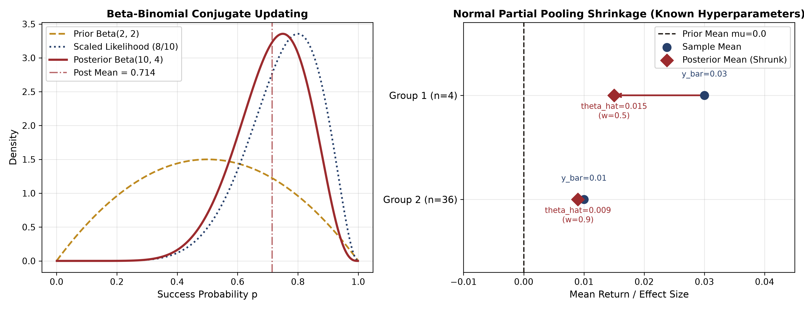
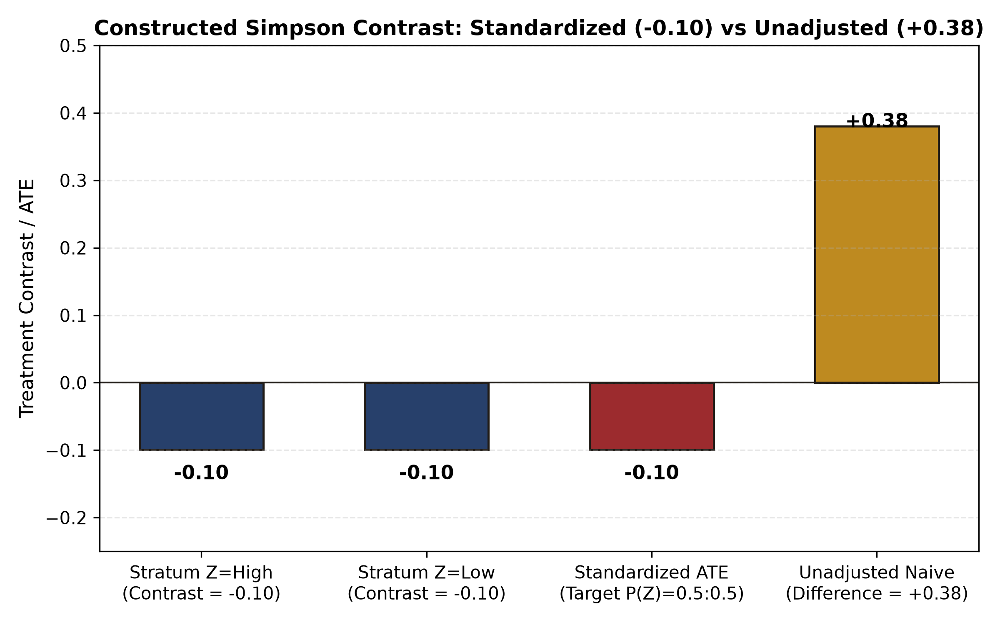
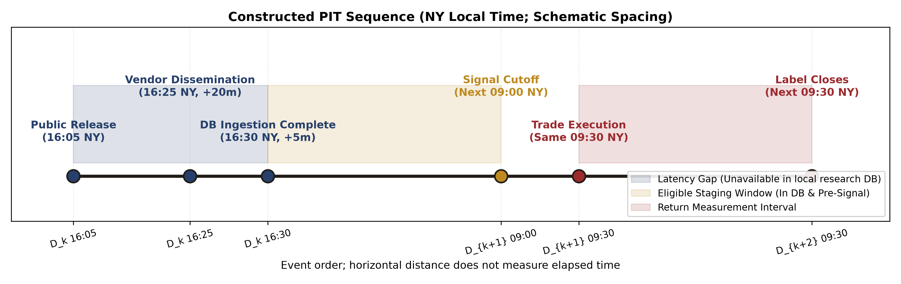
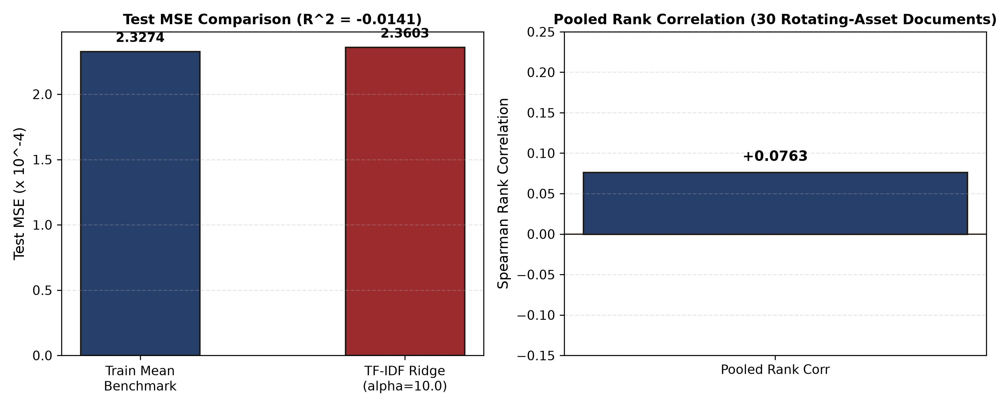
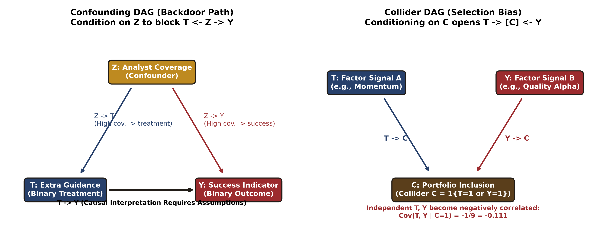

# Chapter 43: Bayesian Inference, Causal Identification, and Alternative Text Data
> This chapter starts from frozen constructed results and retains the boundaries on template generalization and trust in summaries; no training or model call was performed.

> Main thread: Prediction, probability updating, and intervention decisions in financial research have distinct mathematical foundations. Bayesian inference uses posterior probabilities to represent uncertainty with small samples and across groups; causal identification uses potential outcomes and DAGs to express confounding paths and identifies intervention effects under explicit assumptions; alternative data and large language models require feature extraction under strict contracts for point-in-time (PIT) eligibility, delayed ingestion, version revisions, and training-corpus cutoffs. Fitting a vocabulary across time, confusing retrospective smoothing with real-time prediction, or treating an LLM pretraining cutoff as historical PIT eligibility can all create fatal look-ahead bias.
> Prerequisites: [Chapter 6: Probability](../../../zh/chapters/ch06/content.md) and [Chapter 7: Mathematical Statistics](../../../zh/chapters/ch07/content.md) (conditional probability, Bayes’ theorem, expectation, and variance); [Chapter 8: Linear Regression](../../../zh/chapters/ch08/content.md) (least squares and regularization); [Chapter 12: Fundamental Quantitative Analysis and PIT](../../../zh/chapters/ch12/content.md) (financial-statement releases and point-in-time availability); [Chapter 22: Research Design](../../../zh/chapters/ch22/content.md) (causal inference and confounding bias); and [Chapter 31: Label Purging and Embargo](../../../zh/chapters/ch31/content.md) and [Chapter 38: Machine-Learning Pipelines](../../../zh/chapters/ch38/content.md) (strict time-series validation and leakage-resistant features).
> By the end, you should be able to: derive the Beta-Binomial conjugate posterior and the joint predictive covariance of two future periods; calculate by hand partial-pooling shrinkage for a normal hierarchical mean with known hyperparameters and its posterior predictive variance; build a causal DAG and identify the ATE by stratified standardization under identification assumptions, calculate the reversal mechanism in Simpson’s paradox, and diagnose violations of positivity; construct a rigorous after-hours earnings-call availability ledger and filter eligible versions under time-zone conversion and delayed ingestion; fit a TF-IDF vocabulary independently within the training window and compare text Ridge regression with a historical-mean baseline; calculate cosine similarity for dense word embeddings and illustrate sentiment reversal under negation; and design an offline LLM research ledger that includes prompt-version hashes and a review of training-corpus cutoffs.

---

## 1. Learning Objectives

1. **Master conjugate Bayesian updating and predictive distributions**: Starting from the prior and likelihood, derive the Beta-Binomial posterior parameters $(\alpha_{\mathrm{post}}, \beta_{\mathrm{post}})$ in full; derive the one-period future predictive mean $E[\tilde{y} \mid y]$ and the joint predictive probability for two future periods, $E[\tilde{y}_1 \tilde{y}_2 \mid y] = E[p^2 \mid y]$; prove that two future Bernoulli trials are conditionally independent given $p$ but correlated under the marginal posterior predictive distribution, with covariance exactly equal to the posterior variance $\operatorname{Var}(p \mid y)$.
2. **Understand shrinkage through hierarchical models and partial pooling**: Using Section 5.4 of Gelman et al. (BDA3) as a reference, derive the precision-weighted shrinkage weight for each continuous-return asset group’s posterior mean when hyperparameters $(\mu, \tau^2, \sigma^2)$ are known: $w_j = \frac{n_j / \sigma^2}{1/\tau^2 + n_j / \sigma^2}$. Calculate by hand how a small-sample group ($n=4$) and a large-sample group ($n=36$) shrink toward the whole-market prior mean $\mu=0.0$, and derive the posterior predictive variance $\operatorname{Var}_{\mathrm{pred}, j} = V_j + \sigma^2$, which includes uncertainty about the group and noise in a new observation. This chapter is limited to teaching with known hyperparameters; it does not claim to estimate unknown hyperparameters as empirical Bayes.
3. **Build causal graphs (DAGs) and a potential-outcomes framework**: Distinguish statistical association $P(Y \mid T=t)$ from causal intervention $P(Y \mid \operatorname{do}(T=t))$; list the four assumptions for identifying the average treatment effect (ATE): consistency, conditional exchangeability, positivity/overlap, and the stable unit treatment value assumption (SUTVA, including no interference between units and no hidden treatment versions); calculate the Simpson’s paradox example by hand, showing how an unadjusted difference in binary success rates of $+0.38$ (38 percentage points) becomes a negative observed difference after stratified standardization and, under the identification assumptions, an ATE of $-0.10$ (10 percentage points); stress that an adjusted association cannot be equated with unconditional true causality without the identification assumptions; and write an executable counterexample of collider bias and derive the negative covariance $-1/9$.
4. **Specify a point-in-time (PIT) contract for unstructured alternative data**: Build a multi-time-zone ledger containing `event_time`, `available_at`, `ingested_at`, `revision_time`, `signal_time`, `trade_time`, and `label_available_at`; use a U.S. after-hours earnings call at 16:05 to apply a 20-minute vendor delay and a 5-minute internal-ingestion delay, and work through daylight-saving-time (EST/EDT) and UTC conversions; implement exclusion of amended versions revised after the signal time and of records ingested too late; and distinguish public accessibility from authorization for commercial scraping, training, and redistribution.
5. **Build a leakage-resistant text-prediction pipeline aligned with its baseline**: Use 120 constructed earnings-call events generated from four repeated templates (with the `CONSTRUCTED_CALL_` prefix and an explicit teaching-only label); enforce time-series splits of 59 training documents, 29 validation documents, and 30 test documents (training and validation labels must mature strictly before the first signal time in the following block, `<`); fit the vocabulary and IDF independently within the training window and freeze them before transforming validation and test documents; keep training features unchanged when unseen or out-of-vocabulary (OOV) terms appear in the test window; compare a global-mean baseline with TF-IDF + Ridge regression on the same test set; retain the negative low-SNR result (test MSE $2.3603 \times 10^{-4}$ versus baseline $2.3274 \times 10^{-4}$, relative $R^2 = -0.0141$; time-series summary Spearman rank correlation $+0.0763$; cross-sectional IC is undefined because there is only one asset per day, and rank correlation is undefined for the constant-mean baseline); this chapter is prediction-only and specifies an interface to downstream portfolio accounting and fee calculations without inventing turnover from asset rotation.
6. **Understand the geometry beneath word embeddings and negation-based sentiment analysis**: Give the formal TF-IDF definition and a complete, step-by-step hand calculation for two teaching documents; use a hand-calculated $6 \times 3$ dense embedding matrix to explain angles between word vectors and mean pooling; and use a bag-of-words model (clarifying that bag-of-words representations do not assume statistical independence among words) to show errors under the negation terms “not” and “no,” exposing the limits of unigram-frequency features and the need for n-grams or rule-based enhancements.
7. **Maintain a rigorous offline research ledger for large language models (LLMs)**: Create an offline prompt template, version control, and a SHA-256 check of the complete actual input text; clearly mark the model as not called (`not_run / unknown`) and use the pretraining cutoff only as a hypothetical counterexample; analyze why an LLM pretraining-corpus cutoff cannot establish verifiable historical PIT eligibility; explain why zero temperature and a seed do not eliminate hardware or underlying nondeterministic drift; and assess hallucinations, reproducibility, and fact-checking in quantitative research.

All run directories must be new paths that do not already exist. Use a different trial number when rerunning an example.

Completion criteria: exercises in Sections 15–17 can be derived or run independently; `code/ch43_bayesian_text.py` runs successfully in an independent output directory and generates all figures and the complete summary.

---

## 2. Why Quant Needs This

The companies and earnings-call scenarios below are constructed teaching examples, not established market facts. Conclusions may still fail if the prior is wrong, samples are dependent, or causal assumptions do not hold.

Quantitative researchers often face three common cognitive traps and modeling failures:

The first trap is the **illusion of point estimates with small samples**. In low-frequency macro-hedging or event-driven strategies (such as defaults, CEO departures, or major acquisitions), the historical sample may be tiny, perhaps only a dozen observations or fewer. Frequentist point estimates such as the sample mean can fluctuate sharply. If only four companies in an industry report positive earnings surprises and all four rise, the sample-frequency point estimate is 100%; this does not mean that frequentist inference asserts a 100% population win rate. A small-sample interval still reflects uncertainty. Bayesian methods provide an axiomatic framework for updating uncertainty: a reasonable prior can shrink an extreme small-sample estimate toward the whole-market prior mean and yield a full posterior distribution and posterior predictive variance. Shrinkage can reduce sensitivity to small samples, but it does not guarantee stable optimizer settings; a misspecified prior can introduce bias.

The second trap is **treating a confounded association as an intervention effect**. In the constructed supplemental-call example in this chapter, the treatment group’s overall target-attainment rate is 38 percentage points higher than the control group’s. Companies with high analyst attention are more common in the treatment group and also have higher baseline attainment rates. After stratifying by attention, the observed difference is −10 percentage points within each stratum. This reversal shows how group weights affect the overall association. Interpreting the standardized difference as an ATE still requires the identification assumptions below; the table does not establish the true mechanism of management behavior or actual trading profit and loss.

The third trap is **look-ahead leakage in unstructured data and large-language-model applications**. As alternative data (news, research reports, calls, and social media) and LLMs become more common, text has become a central resource in quantitative research. Yet its time structure is fragile:
1. **Ingestion delay**: A news item is published after the close at 16:05, takes 20 minutes to reach the vendor, and another 5 minutes to enter the company’s database. Before 16:30, the local quantitative research database cannot use this text. Generating a signal at 16:15 and assuming it could be executed after hours would amount to a time-traveling trade that is infeasible in live trading;
2. **Retrospective revisions**: Earnings-call transcripts are often corrected or supplemented by the issuer the following day. Backtesting a historical signal with the latest revised version leaks information about future corrections;
3. **Pretraining-corpus contamination**: LLM pretraining corpora are collected from the internet. Suppose a model’s training cutoff is the end of 2023; its corpus could include reports published after events in 2022. The cutoff statement alone cannot prove that an output for a 2022 historical signal contains no future knowledge. Whether contamination actually occurred requires a dedicated experiment.

This chapter connects Bayesian inference with causal identification mathematically and implements a rigorous point-in-time text-processing pipeline, giving quantitative research a firm boundary around time and causality.

---

## 3. Intuition

We will build a clear mental picture from three examples in finance and statistics:

### 3.1 Bayesian Conjugate Updating and Partial Pooling of Asset Returns
- **Intuition for conjugate updating**: Let the win probability of a quantitative strategy be $p \in [0, 1]$. Before live trading, set $p \sim \operatorname{Beta}(2, 2)$ based on prior knowledge of similar strategies across the market (prior expected win rate 0.5). If 8 of 10 constructed trades are profitable, the maximum-likelihood point estimate is 80%, but this point estimate does not express small-sample uncertainty. Under the prior specified here, Bayesian updating gives a posterior mean of approximately 71.4%, balancing prior knowledge with limited evidence.
- **Partial pooling of continuous asset returns**: Consider estimating continuous excess returns across industry or style groups. Let the center of the whole-market long-run unconditional excess-return prior be $\mu = 0.0$, between-group dispersion be $\tau = 0.02$, and the observation noise for an individual trade be $\sigma = 0.04$.
  - Group 1 is a newly listed technology stock with very little history ($n_1 = 4$) and sample mean $\bar{y}_1 = +0.03$ (+3%). Because the sample is small, the model assigns it a 50% shrinkage weight, pulling the posterior mean strongly back to +0.015;
  - Group 2 is a mature large-cap blue chip with a substantial history ($n_2 = 36$) and sample mean $\bar{y}_2 = +0.01$ (+1%). Given the stronger evidence, the model assigns the sample mean a 90% weight, yielding a posterior mean of +0.009.
  Partial pooling automatically balances “be cautious about groups with little evidence” against “respect groups supported by strong data.”

### 3.2 Simpson’s Paradox and Confounding by Analyst Attention
This constructed example contains 200 company records. The treatment is “a supplemental after-hours earnings call with updated guidance” ($T=1$), and the outcome is whether the next-day opening excess return meets its target ($Y \in \{0,1\}$). In the observed table, the target-attainment rates are 64% for the treatment group and 26% for the control group, an unadjusted difference of 38 percentage points. This is only an association.
Stratify by analyst attention $Z$. In the high-attention stratum, 90 treated companies have 63 successes and 10 control companies have 8 successes, so the within-stratum difference is $0.70-0.80=-0.10$. In the low-attention stratum, 10 treated companies have 1 success and 90 control companies have 18 successes, so the difference is also $0.10-0.20=-0.10$.
Ninety percent of the treatment group comes from the high-attention stratum, while 90% of the control group comes from the low-attention stratum. The overall association therefore has the opposite sign from the within-stratum differences. Using target-population weights of 50% for each stratum gives a standardized difference of $-0.10$. It can be interpreted as the target-population ATE only under consistency, conditional exchangeability, positivity, and the stated SUTVA assumptions. The four-cell table itself cannot verify those assumptions and is not evidence of a real market intervention.

### 3.3 Time Travel in Earnings-Call Text
A listed company ends an after-hours call at 16:05. You find its text in a historical database and use it to calculate a signal for a purchase at the next day’s 09:30 open. The timeline appears to move forward, but the database text may be a version revised at 10:00 the following morning after review by the company’s legal and investor-relations teams (for example, to correct a misspoken figure). If you calculate a sentiment score from that text at 09:00, your algorithm has effectively traveled through time. Freeze the historical ingestion ledger at the signal time and reject future versions strictly.

---

## 4. Mathematical Foundations

This chapter follows the course notation standard in `notation.md`. The prerequisite symbols, dimensions, and time contract are:

| Symbol | Meaning | Dimension / unit | Conditions / interpretation |
|---|---|---|---|
| $p$ | Success probability or parameter of a binary event in one trial | Scalar, dimensionless, $[0, 1]$ | Bernoulli-trial parameter |
| $\alpha, \beta$ | Beta-distribution hyperparameters | Positive real scalars, $\mathbb{R}_{++}$ | Pseudo-successes and pseudo-failures |
| $\theta_j$ | Mean latent variable for group $j$ in a hierarchical model | Scalar, same units as observations | Follows common prior $\mathcal{N}(\mu, \tau^2)$ |
| $\mu, \tau$ | Group prior mean and prior standard deviation (hyperparameters) | Scalar, return units | Restricted to known constants for this chapter’s teaching example |
| $\sigma$ | Observation-noise standard deviation for one sample | Scalar, return units | Known constant, $\sigma > 0$ |
| $n_j, \bar{y}_j$ | Sample size and within-group sample mean for group $j$ | Integer, real number | $\bar{y}_j = \frac{1}{n_j} \sum_{i=1}^{n_j} y_{j, i}$ |
| $w_j$ | Posterior shrinkage weight for group $j$ | Scalar, $[0, 1]$ | $w_j = \frac{n_j / \sigma^2}{1/\tau^2 + n_j / \sigma^2}$ |
| $V_j$ | Posterior variance of group mean $\theta_j$ | Scalar, squared return units | $1/V_j = 1/\tau^2 + n_j/\sigma^2$ |
| $Z, T, Y$ | Confounder, treatment variable, outcome variable | Discrete or continuous scalars | $T \in \{0, 1\}, Y \in \{0, 1\}$ in the binary case |
| $Y(1), Y(0)$ | Potential outcomes | Scalars | Possible outcomes under hypothetical intervention $T=1$ or $T=0$ |
| $\operatorname{ATE}$ | Average treatment effect | Scalar, outcome units | $\operatorname{ATE} = E[Y(1) - Y(0)]$ |
| $\operatorname{event\_time}$ | Time when the real-world event occurs | UTC timestamp | Financial release, earnings-call time |
| $\operatorname{available\_at}$ | Earliest time the external vendor can provide the text | UTC timestamp | Includes transmission and transcoding delay |
| $\operatorname{ingested\_at}$ | Earliest time the local database has completed ingestion | UTC timestamp | Includes local ETL delay |
| $\operatorname{signal\_time}$ | Decision time when the strategy generates a buy or sell signal | UTC timestamp | Availability and ingestion must both be no later than the signal |
| $\operatorname{trade\_time}$ | Time an order is actually matched on the exchange | UTC timestamp | Strictly later than the signal time |
| $\operatorname{label\_available\_at}$ | Time a return target or evaluation label is fully mature and knowable | UTC timestamp | Training labels must be available before the fitting decision |

---

## 5. Formal Definitions

### 5.1 Conjugate Bayesian Updating
The prior $p(\theta)$ is a probability distribution for parameter $\theta$ before observing the data. The likelihood $p(y\mid\theta)$ is a function of the parameter for fixed data $y$; it is usually not a normalized density over the parameter. Bayes’ theorem combines them to form the posterior:
$$
p(\theta\mid y)=\frac{p(y\mid\theta)p(\theta)}{p(y)},\qquad
p(y)=\int p(y\mid\theta)p(\theta)\,d\theta>0.
$$
The denominator is the marginal likelihood, which normalizes the posterior to integrate to 1; for a discrete parameter, replace the integral with a sum. This does not conflate the probability of the data with the probability of the parameter.

In Bayesian statistics, a prior distribution $p(\theta)$ is called a **conjugate prior** for likelihood $p(y \mid \theta)$ when the posterior $p(\theta \mid y)$ belongs to the same distribution family as the prior. For a binomial likelihood $y \sim \operatorname{Binomial}(n, p)$, the conjugate prior is the Beta distribution $\operatorname{Beta}(\alpha, \beta)$. The posterior is also Beta:
$$
p \mid y \sim \operatorname{Beta}(\alpha + y, \beta + n - y)
$$

### 5.2 Posterior Predictive Distribution
The posterior predictive distribution is the marginal probability distribution of a new future observation $\tilde{y}$ after observing existing data $y$. It is obtained by integrating over posterior uncertainty about the model parameter $\theta$:
$$
p(\tilde{y} \mid y) = \int_{\Theta} p(\tilde{y} \mid \theta) p(\theta \mid y) \, d\theta
$$
**Key result**: For two future Bernoulli trials $(\tilde{y}_1, \tilde{y}_2)$ that share the same unknown parameter $p$, they are **conditionally independent** given $p$: $P(\tilde{y}_1=1, \tilde{y}_2=1 \mid p) = p^2$. After integrating out $p$, they are **correlated** under the marginal posterior predictive distribution:
$$
P(\tilde{y}_1=1, \tilde{y}_2=1 \mid y) = E[p^2 \mid y] = \operatorname{Var}(p \mid y) + (E[p \mid y])^2 \ne (E[p \mid y])^2
$$
When the posterior concentration is finite and both Beta parameters are positive, the covariance is exactly $\operatorname{Var}(p \mid y)>0$. It arises from uncertainty about the shared parameter; it does not mean one future outcome physically causes the other.

### 5.3 Normal Hierarchical Model and Partial Pooling
The closed form assumes independent group priors conditional on the known hyperparameters, and conditionally independent, homoskedastic normal observations within each group given its $\theta_j$. New-observation noise is independent of $\theta_j$ and the old observations. With within-group time dependence or heteroskedasticity, $\sigma^2/n_j$ and these fixed precision weights cannot be used directly.
Consider $J$ asset or analyst groups. The parameter for group $j$ has a common prior $\theta_j \sim \mathcal{N}(\mu, \tau^2)$, and within-group observations satisfy $y_{j, i} \sim \mathcal{N}(\theta_j, \sigma^2)$. The sampling variance of the sample mean $\bar{y}_j$ is $\sigma_j^2 = \sigma^2 / n_j$.
When the hyperparameters $(\mu, \tau^2, \sigma^2)$ are **known**, the posterior mean of group mean $\theta_j$ has the following closed-form partial-pooling solution (Equation 5.17 in Gelman et al., BDA3):
$$
\hat{\theta}_j = (1 - w_j)\mu + w_j \bar{y}_j, \quad w_j = \frac{n_j / \sigma^2}{1/\tau^2 + n_j / \sigma^2} = \frac{n_j}{n_j + \sigma^2 / \tau^2}
$$
The posterior precision is the sum of the prior and sample precisions: $1/V_j = 1/\tau^2 + n_j/\sigma^2$. The posterior predictive variance of a new observation $\tilde{y}_j$ from this group is $\operatorname{Var}_{\mathrm{pred}, j} = V_j + \sigma^2$.

### 5.4 Potential Outcomes and the Average Treatment Effect (ATE)
Let the binary treatment variable be $T \in \{0, 1\}$. For each unit, define a pair of potential outcomes:
- $Y(1)$: the potential outcome for the unit if it receives the treatment ($T=1$);
- $Y(0)$: the potential outcome for the unit if it does not receive the treatment ($T=0$).
The fundamental difficulty in causal inference is that only one of the two potential outcomes can be observed for any unit in practice: $Y = T \cdot Y(1) + (1-T) \cdot Y(0)$.
The **average treatment effect (ATE)** for the target population is defined as:
$$
\operatorname{ATE} = E[Y(1) - Y(0)]
$$

### 5.5 Four Causal Identification Assumptions
Following Hernán & Robins (2020), statistical contrasts in observed data can be interpreted as a causal ATE only if the following four foundational assumptions hold:
1. **Consistency**: If a unit actually receives treatment $T=t$, its observed outcome $Y$ equals its potential outcome $Y(t)$; that is, $Y = Y(T)$.
2. **Conditional exchangeability / no unmeasured confounding**: Conditional on adequately controlling for confounder covariates $Z$, the potential outcomes are conditionally independent of treatment assignment: $(Y(0), Y(1)) \perp T \mid Z$. In a DAG, this means that controlling for $Z$ blocks all backdoor paths connecting $T$ and $Y$.
3. **Positivity / overlap**: Within every confounder stratum $z$ in the target population (that is, where $P(Z=z) > 0$), the probabilities of receiving treatment and control must both be strictly positive:
   $$
   0 < P(T=1 \mid Z=z) < 1
   $$
Positivity means every stratum has a positive probability of receiving either treatment; it **does not** mean that variables follow a normal distribution. If everyone in a stratum receives treatment or everyone receives control, the counterfactual outcome for the missing arm cannot be identified from the data. The algorithm must report an explicit error and reject the calculation; it must never fill the missing value silently.
4. **Stable unit treatment value assumption (SUTVA)**: This includes two closely related dimensions:
   - **No interference**: One unit’s treatment does not affect another unit’s potential outcome (for example, one stock having an earnings call and being bought by a strategy does not directly change the potential excess return of a stock without a call in the parallel world);
   - **No treatment variation / no hidden versions of treatment**: For a stated treatment level $T=t$, there are no unobserved versions of treatment that lead to different potential outcomes (for example, whether a CEO or CFO leads the call, or how quickly they speak, does not make the treatment $T=1$ causally different under the declared treatment definition).

### 5.6 Stratified Standardization
When conditional exchangeability, positivity, consistency, and SUTVA all hold, the target-population causal ATE can be calculated by weighting stratum-specific conditional effects by the marginal distribution $P(Z)$ in the target population:
$$
\operatorname{ATE} = \sum_{z} \Big( E[Y \mid T=1, Z=z] - E[Y \mid T=0, Z=z] \Big) P(Z=z)
$$
Emphasize that the numerical contrast from stratified standardization can be interpreted as the target-population causal ATE only when all four identification assumptions above hold. With unmeasured confounding, a SUTVA violation, or sample-selection bias, the adjusted statistical association remains a conditional association under a particular adjustment; it cannot be unconditionally claimed as a true causal effect.

### 5.7 Point-in-Time (PIT) Availability and Delay Contract
Inputs must have nonmissing, time-zone-aware values for event, revision, availability, ingestion, signal, trade, and label times. Under valid inputs and version semantics, the teaching selector requires one decision cutoff per `source_id` and positive, increasing integer version identifiers. Duplicate versions, contradictory times, and missing text cause errors; versions ingested too late are filtered out. License fields store source notes only; the program does not determine legal authorization. These checks also run at the direct training entry point.
Alternative data must record the complete lifecycle timestamps for every version:
- Eligibility rule (iff, under the valid-input and version-semantics assumptions above): a version is eligible at the decision time if and only if $\max(\operatorname{available\_at}, \operatorname{ingested\_at}) \le \operatorname{signal\_time}$.
- Version replacement: If an event has several revised versions, use only the latest compliant version ingested by the signal cutoff; never overwrite history retrospectively.

### 5.8 Bag-of-Words (BoW) and TF-IDF Feature Representation
- A bag-of-words model treats a text as an unordered multiset of term occurrences, ignoring word order, grammar, and syntactic dependencies.
- **Important clarification**: Bag-of-words feature representation itself **does not assume that words are statistically independent**. Treating feature conditional distributions as independent is an assumption of particular models such as the Naive Bayes classifier, not of the BoW vector representation. The fundamental limitation of BoW is that it discards order, so it cannot natively capture modifiers, phrase combinations, or polarity reversals caused by negation.
- Term frequency–inverse document frequency (TF-IDF) downweights common function words and gives greater weight to domain-specific information terms, producing continuous dense or sparse vectors that reflect term importance.

### 5.9 Offline LLM Research Ledger and Defenses Against Irreproducibility
Use of large language models (LLMs) in quantitative research should be governed by an offline-auditable ledger that verifies a cryptographic digest:
- Compute a SHA-256 cryptographic hash (digest) of the complete prompt (prompt template plus actual input text);
- A hash checks only whether a digest matches and requires an independently trusted expected digest. It is not encryption or immutable timestamped evidence. If both the input and the recorded digest change, a local recomputation may still match. An independently stored trusted digest can serve as a comparison, but this teaching code does not provide a trusted custody mechanism for that digest.
- Explicitly record the model call status as not called (`model_status: not_run`) and the model identifier as `not_run / unknown`; use the training-corpus cutoff only to test a hypothetical counterexample;
- Record reproducibility limits explicitly: `temperature=0` and a fixed seed do not guarantee bit-for-bit reproducibility across hardware architectures or inference-engine versions; underlying model updates or floating-point drift can materially change text features.

---

All causal tables in this chapter are constructed association data. The generator does not observe potential outcomes and cannot test identification assumptions such as no unmeasured confounding. A standardized difference can be interpreted as an ATE only if those assumptions hold.

## 6. Derivations

### 6.1 Deriving the Beta-Binomial Conjugate Posterior and Predictive Covariance

**Step 1: Prior density and likelihood.**
Let parameter $p \in [0, 1]$ follow a Beta prior:
$$
f(p) = \frac{1}{\mathrm{B}(\alpha, \beta)} p^{\alpha - 1} (1-p)^{\beta - 1} \propto p^{\alpha - 1} (1-p)^{\beta - 1}
$$
After observing $y$ successes in $n$ Bernoulli trials that are conditionally independent and identically distributed given the shared $p$, the binomial likelihood is:
$$
L(y \mid p) = \binom{n}{y} p^y (1-p)^{n-y} \propto p^y (1-p)^{n-y}
$$

**Step 2: Calculate the posterior density.**
By Bayes’ theorem, the posterior density is proportional to the product of the prior and likelihood:
$$
f(p \mid y) \propto f(p) L(y \mid p) \propto p^{\alpha - 1} (1-p)^{\beta - 1} \cdot p^y (1-p)^{n-y} = p^{(\alpha + y) - 1} (1-p)^{(\beta + n - y) - 1}
$$
Comparing with the kernel of a Beta distribution, we identify the posterior distribution directly:
$$
p \mid y \sim \operatorname{Beta}(\alpha_{\mathrm{post}}, \beta_{\mathrm{post}}), \quad \alpha_{\mathrm{post}} = \alpha + y, \quad \beta_{\mathrm{post}} = \beta + n - y
$$

**Step 3: Posterior mean and variance.**
Using the first and second moments of the Beta distribution:
$$
E[p \mid y] = \frac{\alpha_{\mathrm{post}}}{\alpha_{\mathrm{post}} + \beta_{\mathrm{post}}}
$$
$$
\operatorname{Var}(p \mid y) = \frac{\alpha_{\mathrm{post}} \beta_{\mathrm{post}}}{(\alpha_{\mathrm{post}} + \beta_{\mathrm{post}})^2 (\alpha_{\mathrm{post}} + \beta_{\mathrm{post}} + 1)}
$$

**Step 4: Predictive probabilities and covariance.**
For a single future trial $\tilde{y} \in \{0, 1\}$:
$$
P(\tilde{y} = 1 \mid y) = \int_0^1 P(\tilde{y} = 1 \mid p) f(p \mid y) \, dp = \int_0^1 p f(p \mid y) \, dp = E[p \mid y]
$$
For two future trials $(\tilde{y}_1, \tilde{y}_2)$:
$$
P(\tilde{y}_1 = 1, \tilde{y}_2 = 1 \mid y) = \int_0^1 P(\tilde{y}_1 = 1, \tilde{y}_2 = 1 \mid p) f(p \mid y) \, dp = \int_0^1 p^2 f(p \mid y) \, dp = E[p^2 \mid y]
$$
Using the variance identity $E[p^2 \mid y] = \operatorname{Var}(p \mid y) + (E[p \mid y])^2$, substitute the second raw moment of the Beta distribution:
$$
E[p^2 \mid y] = \frac{\alpha_{\mathrm{post}} (\alpha_{\mathrm{post}} + 1)}{(\alpha_{\mathrm{post}} + \beta_{\mathrm{post}})(\alpha_{\mathrm{post}} + \beta_{\mathrm{post}} + 1)}
$$
The covariance of success in the two periods is:
$$
\begin{aligned}\operatorname{Cov}(\tilde{y}_1,\tilde{y}_2\mid y)&=P(\tilde{y}_1=1,\tilde{y}_2=1\mid y)\\ &\quad-P(\tilde{y}_1=1\mid y)P(\tilde{y}_2=1\mid y)\\ &=E[p^2\mid y]-(E[p\mid y])^2=\operatorname{Var}(p\mid y)>0\end{aligned}
$$
This proves the result. Under the finite, positive-parameter conditions above, the two trials are conditionally independent given $p$ but positively correlated after integration. If the first-period outcome is then observed to be a success, the posterior for $p$ updates and raises the conditional prediction of success in the second period. This is information updating, not a causal effect between the outcomes. The correlation in this example is $1/(10+4+1)=1/15$.

---

### 6.2 Deriving Shrinkage for a Normal Hierarchical Mean (Partial Pooling)

**Assumptions**: Retain the independent group priors and conditionally independent, homoskedastic within-group observations specified in §5.3. Hyperparameters $\mu, \tau^2, \sigma^2$ are known. Group $j$ has latent mean $\theta_j \sim \mathcal{N}(\mu, \tau^2)$, and within-group observations $y_{j, 1}, \dots, y_{j, n_j} \sim \mathcal{N}(\theta_j, \sigma^2)$. The sample mean $\bar{y}_j = \frac{1}{n_j}\sum_{i=1}^{n_j} y_{j, i}$ satisfies $\bar{y}_j \mid \theta_j \sim \mathcal{N}(\theta_j, \sigma^2 / n_j)$.

**Step 1: Combine precisions under conjugate updating.**
The sampling precision of the group mean is $n_j / \sigma^2$, and the prior precision is $1 / \tau^2$.
By conjugacy of the normal distribution, the log posterior density is quadratic:
$$
\ln p(\theta_j \mid \bar{y}_j) = -\frac{1}{2\tau^2}(\theta_j - \mu)^2 - \frac{n_j}{2\sigma^2}(\bar{y}_j - \theta_j)^2 + \text{const}
$$
Expand the coefficient of the quadratic term:
$$
-\frac{1}{2}\theta_j^2 \left( \frac{1}{\tau^2} + \frac{n_j}{\sigma^2} \right) + \theta_j \left( \frac{\mu}{\tau^2} + \frac{n_j \bar{y}_j}{\sigma^2} \right) + \text{const}
$$
Read off the posterior precision $1/V_j$ and posterior variance $V_j$:
$$
\frac{1}{V_j} = \frac{1}{\tau^2} + \frac{n_j}{\sigma^2} \implies V_j = \frac{1}{\frac{1}{\tau^2} + \frac{n_j}{\sigma^2}}
$$

**Step 2: Decompose the posterior mean into weighted terms.**
Dividing the linear coefficient by the quadratic coefficient gives the posterior mean $\hat{\theta}_j$:
$$
\hat{\theta}_j = \frac{\frac{\mu}{\tau^2} + \frac{n_j \bar{y}_j}{\sigma^2}}{\frac{1}{\tau^2} + \frac{n_j}{\sigma^2}} = \frac{1/\tau^2}{1/\tau^2 + n_j/\sigma^2} \mu + \frac{n_j/\sigma^2}{1/\tau^2 + n_j/\sigma^2} \bar{y}_j
$$
Define the shrinkage weight $w_j$:
$$
w_j = \frac{n_j/\sigma^2}{1/\tau^2 + n_j/\sigma^2} = \frac{n_j}{n_j + \sigma^2 / \tau^2}
$$
The posterior mean is then a convex combination of the prior mean and sample mean:
$$
\hat{\theta}_j = (1 - w_j)\mu + w_j \bar{y}_j
$$

**Step 3: Posterior predictive variance.**
For a new observation from the group, $\tilde{y}_j = \theta_j + \tilde{\epsilon}$, where $\tilde{\epsilon} \sim \mathcal{N}(0, \sigma^2)$ and is independent of $\theta_j$ and the old observations:
$$
\operatorname{Var}(\tilde{y}_j \mid y) = \operatorname{Var}(\theta_j \mid y) + \operatorname{Var}(\tilde{\epsilon}) = V_j + \sigma^2
$$
This proves the result.

---

### 6.3 Deriving Simpson’s Reversal and Causal Standardization

Let the binary confounder be $Z \in \{1, 2\}$, the binary treatment be $T \in \{0, 1\}$, and the binary outcome be $Y \in \{0, 1\}$.

**Step 1: Unadjusted association difference.**
By the law of total probability, the unadjusted conditional expectation is:
$$
E[Y \mid T=t] = \sum_{z} E[Y \mid T=t, Z=z] P(Z=z \mid T=t)
$$
Therefore, the unadjusted difference is:
$$
\begin{aligned}E[Y\mid T=1]-E[Y\mid T=0]&=\sum_z E[Y\mid T=1,Z=z]P(Z=z\mid T=1)\\ &\quad-\sum_z E[Y\mid T=0,Z=z]P(Z=z\mid T=0)\end{aligned}
$$
Note that $P(Z=z \mid T=1) \ne P(Z=z \mid T=0)$; a severe imbalance in weights can produce Simpson’s reversal.

**Step 2: Identification derivation for causal standardization.**
By consistency and conditional exchangeability $(Y(t) \perp T \mid Z)$:
$$
E[Y(t) \mid Z=z] = E[Y(t) \mid T=t, Z=z] = E[Y \mid T=t, Z=z]
$$
Take the marginal expectation over the target population $P(Z)$:
$$
E[Y(t)] = \sum_z E[Y(t) \mid Z=z] P(Z=z) = \sum_z E[Y \mid T=t, Z=z] P(Z=z)
$$
Under the identification assumptions above and positivity in the target population, subtracting gives the causal average treatment effect:
$$
\operatorname{ATE} = E[Y(1)] - E[Y(0)] = \sum_z \Big( E[Y \mid T=1, Z=z] - E[Y \mid T=0, Z=z] \Big) P(Z=z)
$$
In this equation, both terms use the **same** marginal target-population weights $P(Z=z)$ in every stratum. Under the stated identification assumptions, this removes the confounding bias caused by $Z$ in this DAG.

---

### 6.4 Formal TF-IDF Mathematics and a Step-by-Step Calculation for Two Documents

**Step 1: Formal definition.**
Let the corpus contain $|D|$ documents and have a vocabulary of size $M$.
1. **Term frequency (TF)**: Let $f_{t, d}$ denote the number of occurrences of term $t$ in document $d$. Standard term frequency uses the raw count, $\mathrm{tf}(t, d) = f_{t, d}$.
2. **Smoothed inverse document frequency (IDF)**: To avoid division by zero and excessive weight on rare terms that occur only once, use the standard scikit-learn smoothed log formula:
   $$
   \mathrm{idf}(t, D) = \ln\left(\frac{1 + |D|}{1 + \mathrm{df}(t)}\right) + 1
   $$
Here, $\mathrm{df}(t)$ is the number of documents in the corpus that contain term $t$.
3. **Weighted vector and L2 normalization**:
   $$
   x(t, d) = \mathrm{tf}(t, d) \times \mathrm{idf}(t, D)
   $$
To reduce differences in document-length scale, apply L2 unit normalization when $\|\mathbf x(d)\|_2>0$:
   $$
   \mathbf{v}(d) = \frac{\mathbf{x}(d)}{\|\mathbf{x}(d)\|_2} = \frac{\mathbf{x}(d)}{\sqrt{\sum_{t=1}^M x(t, d)^2}}
   $$

If a document is empty or all its terms are OOV, this implementation retains a zero vector and does not divide by zero; cosine similarity between a zero vector and another vector is undefined.

**Step 2: Hand calculation for two teaching documents.**
Suppose the training corpus contains only two miniature documents:
- Document 1: $d_1 = \text{"growth profit"}$
- Document 2: $d_2 = \text{"growth loss"}$
The corpus contains $|D| = 2$ documents.

1. **Extract the vocabulary and term frequencies**:
   The alphabetically sorted vocabulary is: `["growth", "loss", "profit"]` ($M=3$).
   - Term-frequency vector for $d_1$: $\mathrm{tf}_1 = [1, 0, 1]$
   - Term-frequency vector for $d_2$: $\mathrm{tf}_2 = [1, 1, 0]$
2. **Calculate document frequency $\mathrm{df}$ and smoothed IDF $\mathrm{idf}$**:
   - The term `"growth"` appears in both $d_1$ and $d_2$, so $\mathrm{df}=2$:
     $$
     \mathrm{idf}(\text{"growth"}) = \ln\left(\frac{1+2}{1+2}\right) + 1 = \ln(1) + 1 = 0.0 + 1.0 = 1.000000
     $$
   - The term `"loss"` appears only in $d_2$, so $\mathrm{df}=1$:
     $$
     \mathrm{idf}(\text{"loss"}) = \ln\left(\frac{1+2}{1+1}\right) + 1 = \ln(1.5) + 1 \approx 0.405465 + 1.0 = 1.405465
     $$
   - The term `"profit"` appears only in $d_1$, so $\mathrm{df}=1$:
     $$
     \mathrm{idf}(\text{"profit"}) = \ln\left(\frac{1+2}{1+1}\right) + 1 = \ln(1.5) + 1 \approx 0.405465 + 1.0 = 1.405465
     $$
3. **Calculate the unnormalized feature vector $\mathbf{x} = \mathrm{tf} \times \mathrm{idf}$**:
   - $\mathbf{x}_1 = [1 \times 1.0, 0 \times 1.405465, 1 \times 1.405465] = [1.0, 0.0, 1.405465]$
   - Magnitude $\|\mathbf{x}_1\|_2 = \sqrt{1.0^2 + 0^2 + 1.405465^2} = \sqrt{1.0 + 1.975332} = \sqrt{2.975332} \approx 1.724915$
   - Normalized vector $\mathbf{v}_1$:
     $$
     \mathbf{v}_1 = \left[ \frac{1.0}{1.724915}, 0.0, \frac{1.405465}{1.724915} \right] \approx [0.579739, 0.000000, 0.814802]
     $$
   - $\mathbf{x}_2 = [1 \times 1.0, 1 \times 1.405465, 0 \times 1.405465] = [1.0, 1.405465, 0.0]$
   - Magnitude $\|\mathbf{x}_2\|_2 \approx 1.724915$
   - Normalized vector $\mathbf{v}_2$:
     $$
     \mathbf{v}_2 = \left[ \frac{1.0}{1.724915}, \frac{1.405465}{1.724915}, 0.0 \right] \approx [0.579739, 0.814802, 0.000000]
     $$
4. **Calculate cosine similarity between the two documents**:
   $$
   \cos(\mathbf{v}_1, \mathbf{v}_2) = \mathbf{v}_1 \cdot \mathbf{v}_2 = 0.579739^2 + 0.0 \times 0.814802 + 0.814802 \times 0.0 = 0.579739^2 \approx 0.336097
   $$
Although the two documents share the common term `"growth"`, the feature terms `"profit"` and `"loss"` receive higher IDF weights and are orthogonal to one another. This lowers the cosine similarity after normalization to approximately $0.3361$.

---

### 6.5 Deriving Dense Word-Embedding Geometry and Mean Pooling

Let each word map to a unit vector in a $K$-dimensional Euclidean space, $\mathbf{e}(w) \in \mathbb{R}^K$, with $\|\mathbf{e}(w)\|_2 = 1$.
1. **Mean pooling for a phrase or sentence**:
   For a text sequence $S = (w_1, w_2, \dots, w_L)$ containing $L$ terms, the unnormalized dense sentence representation is the simple arithmetic mean of its word vectors:
   $$
   \mathbf{s} = \frac{1}{L} \sum_{l=1}^L \mathbf{e}(w_l)
   $$
2. **Projection onto the unit sphere** (requires $L>0$ and $\|\mathbf s\|_2>0$):
   $$
   \mathbf{u}_S = \frac{\mathbf{s}}{\|\mathbf{s}\|_2}
   $$
Even unit word vectors can cancel: the mean of $[1,0]$ and $[-1,0]$ is zero and cannot be normalized. Empty text also requires an explicit policy. This example is nonzero; a general pipeline should reject a zero vector or retain it explicitly and mark its cosine as undefined.
3. **Semantic similarity between two text passages** (both normalized vectors must exist):
   $$
   \operatorname{Sim}(S_A, S_B) = \mathbf{u}_{S_A} \cdot \mathbf{u}_{S_B}
   $$
Compared with sparse, high-dimensional TF-IDF, dense word embeddings map synonyms (such as `"growth"` and `"expansion"`) to nearby regions of a hypersphere, avoiding the complete orthogonality of unigram bag-of-words features. In financial applications, however, generic embeddings without domain-specific fine-tuning may incorrectly judge antonyms (such as `"profit"` and `"loss"`) to be highly similar because they often occur in the same grammatical contexts. This is a key reason to audit embedding quality carefully in quantitative finance.

## 7. Financial Interpretation

### 7.1 How Does Bayesian Shrinkage Express Uncertainty in Portfolio Inputs?
In quantitative asset allocation (for example, the Black-Litterman model or multi-factor return forecasts), directly using historical sample means in mean-variance optimization is a well-known “error maximizer.” Historical sample means are heavily affected by short-term, market-specific shocks.
The financial interpretation of a normal hierarchical model (partial pooling) is that **all assets in the market share a baseline long-run risk-premium mean $\mu$, but are heterogeneous in the cross-section, with variance $\tau^2$**. For a small-cap stock with few disclosed observations ($n_j=4$), the data contain little information, so the model shrinks its estimate strongly toward the market center (shrinkage weight $w_j=0.5$). For a large-cap stock with substantial data ($n_j=36$), the model gives more weight to its own sample ($w_j=0.9$). In posterior predictive variance $\operatorname{Var}_{\mathrm{pred}}=V_j+\sigma^2$, a small sample increases uncertainty about the group mean, $V_j$; the future observation noise $\sigma^2$ is the same for both groups. The hyperparameters here are known and group data are not used to estimate shared hyperparameters; this differs from empirical Bayes or a full hierarchical model with unknown hyperparameters. This teaching example does not demonstrate improved live returns or optimization stability.

### 7.2 Confounding and Adverse Selection in Market-Maker Strategies
Consider a possible market-microstructure mechanism: the association between active order flow $T$ and subsequent price change $Y$ may be affected by trader information and order size, among other factors $Z$. The overall correlation cannot be interpreted directly as the causal price impact of a buy order. Associations stratified by informed and uninformed traders also require real data and an identification model. This chapter does not estimate actual price impact for either group and cannot support a claim that one group has a smaller impact.

### 7.3 Alternative-Data Delays and Backtest Vanity
When reporting alternative-data backtests to management, quantitative teams can easily show a Sharpe ratio that is too high. The source is often “timestamp fabrication”: although news or text appeared at 16:05, vendor parsing may queue during network disruptions, or internal data-engineering ETL may face an after-hours concurrency bottleneck. Requiring both availability and ingestion times to be no later than the signal is necessary for the text to be available; trade timing, labels, sample selection, and model validity still require separate checks.

---

### 7.4 News Updates and Earnings-Call Revisions: Two Timing Scenarios
Constructed news item `CONSTRUCTED_NEWS_001` is published at 09:12 EDT on 2022-03-14, available from the vendor at 09:13, and ingested locally at 09:14. A 09:15 signal may use v1. Version v2, published at 09:16 and ingested at 09:18, cannot overwrite that historical signal even if it is more accurate. In UTC these times are 13:12, 13:13, 13:14, 13:15, 13:16, and 13:18 on the same date; this differs from the after-hours, cross-day earnings-call scenario in §8. The standalone code below reuses the complete field structure and changes only the constructed news record; it does not add the record to the frozen main experiment:
```python
import pandas as pd
from quant_course.bayesian_text import (
    generate_constructed_text_dataset,
    filter_pit_eligible_documents,
)
base, _ = generate_constructed_text_dataset()
v1 = base.iloc[[0]].copy()
v1["source_id"] = "CONSTRUCTED_NEWS_001"
times = {
    'event_time': '2022-03-14T13:12:00Z',
    'revision_time': '2022-03-14T13:12:00Z',
    'available_at': '2022-03-14T13:13:00Z',
    'ingested_at': '2022-03-14T13:14:00Z',
    'signal_time': '2022-03-14T13:15:00Z',
    'trade_time': '2022-03-14T13:30:00Z',
    'label_start': '2022-03-14T13:30:00Z',
    'label_end': '2022-03-15T13:30:00Z',
    'label_available_at': '2022-03-15T13:30:00Z',
}
for field, stamp in times.items():
    v1[field] = pd.Timestamp(stamp)
v1["text"] = "constructed preliminary revenue growth report"
v2 = v1.copy()
v2["version_id"] = 2
v2["revision_time"] = pd.Timestamp("2022-03-14T13:16:00Z")
v2["available_at"] = pd.Timestamp("2022-03-14T13:17:00Z")
v2["ingested_at"] = pd.Timestamp("2022-03-14T13:18:00Z")
v2["text"] = "constructed corrected revenue decline report"
selected = filter_pit_eligible_documents(pd.concat([v1, v2], ignore_index=True))
assert selected["version_id"].tolist() == [1]
print(selected[["source_id", "version_id", "text"]])
```
Whether a news vendor preserves the original version and whether an earnings-call transcript is retrospectively corrected must be verified with the specific source. PIT filtering cannot recover an old version that was never archived. Training-window TF-IDF also cannot fix the error of using a future revision as historical input.

The Bayesian example also has model boundaries: the binomial update assumes trials are conditionally independent given $p$ and that “success” is defined consistently. Dependent trades cannot simply be treated as independent coin flips. Prior sensitivity can be calculated by hand: for the same 8/10 observations, the posterior mean is 9/12=0.75 under Beta(1,1) and 28/50=0.56 under Beta(20,20). A stronger prior is harder to move with ten observations, but is not necessarily more accurate.

## 8. Numerical Example

This section inherits constructed results from the historical A8-C frozen protocols `qa/a8/ch42_ch43_batch/EXPERIMENT_PROTOCOL.json` and `EXPERIMENT_ADDENDUM_v1.json` in the same directory. Historical hand/code checks and supplemental demonstrations retain their original status; BIL20 did not rerun them.

### 8.1 Hand Calculation: Beta-Binomial Example
- **Input**: Prior $\alpha = 2, \beta = 2$; $n = 10$ trials with $y = 8$ successes.
- **Posterior parameters**:
  $$
  \alpha_{\mathrm{post}} = 2 + 8 = 10, \quad \beta_{\mathrm{post}} = 2 + 10 - 8 = 4
  $$
- **Posterior mean and variance**:
  $$
  E[p \mid y] = \frac{10}{10 + 4} = \frac{10}{14} = \frac{5}{7} \approx 0.714286
  $$
  $$
  \operatorname{Var}(p \mid y) = \frac{10 \times 4}{14^2 \times (14 + 1)} = \frac{40}{196 \times 15} = \frac{40}{2940} = \frac{2}{147} \approx 0.013605
  $$
- **Prediction for future trials**:
  - Predicted probability of success on one trial: $P(\tilde{y} = 1 \mid y) = 10/14 = 5/7 \approx 0.714286$.
  - Joint probability of success in two trials:
    $$
    E[p^2 \mid y] = \frac{10 \times (10 + 1)}{14 \times (14 + 1)} = \frac{110}{210} = \frac{11}{21} \approx 0.523810
    $$
  - Squared posterior mean: $(E[p \mid y])^2 = (10/14)^2 = 100/196 = 25/49 \approx 0.510204$.
  - Check the difference:
    $$
    E[p^2 \mid y] - (E[p \mid y])^2 = \frac{11}{21} - \frac{25}{49} = \frac{77 - 75}{147} = \frac{2}{147} \equiv \operatorname{Var}(p \mid y)
    $$
The two values agree exactly.

---

### 8.2 Hand Calculation: Normal Hierarchical Shrinkage

Returns in this example are expressed as decimals: $0.02=2\%$ and $0.03=3\%$. Means and standard deviations use decimal return units; posterior variance $V_j$ and predictive variance use squared units. For example, group 1 has $V_1=0.0002$, the uncertainty about its mean parameter; its square root is $0.014142$, or about 1.4142 percentage points on the return scale. A future individual return also has observation noise, so predictive variance is $0.0002+0.0016=0.0018$, with square root about $0.042426$ (4.2426 percentage points). If returns are expressed in percentage points instead, means and standard deviations are multiplied by 100, while variances must be multiplied by $100^2$; the shrinkage weights do not change. Hyperparameters in this example remain known constants and are not estimated here.
- **Known hyperparameters**: Prior mean $\mu = 0.0$, prior standard deviation $\tau = 0.02$, and observation standard deviation $\sigma = 0.04$.
- **Precision constants**:
  $$
  \tau^{-2} = \frac{1}{0.02^2} = 2500, \quad \sigma^{-2} = \frac{1}{0.04^2} = 625, \quad \frac{\sigma^2}{\tau^2} = \frac{0.0016}{0.0004} = 4
  $$
- **Group 1**: $n_1 = 4$, sample mean $\bar{y}_1 = 0.03$.
  - Shrinkage weight: $w_1 = \frac{4}{4 + 4} = 0.5$.
  - Posterior mean: $\hat{\theta}_1 = (1 - 0.5) \times 0.0 + 0.5 \times 0.03 = 0.015$.
  - Posterior precision: $1/V_1 = 2500 + 4 \times 625 = 5000 \implies V_1 = 1/5000 = 0.0002$.
  - Posterior standard deviation: $\sqrt{0.0002} \approx 0.014142$.
  - Posterior predictive variance: $\operatorname{Var}_{\mathrm{pred}, 1} = V_1 + \sigma^2 = 0.0002 + 0.0016 = 0.0018$.
  - Predictive standard deviation: $\sqrt{0.0018} \approx 0.042426$.
- **Group 2**: $n_2 = 36$, sample mean $\bar{y}_2 = 0.01$.
  - Shrinkage weight: $w_2 = \frac{36}{36 + 4} = \frac{36}{40} = 0.9$.
  - Posterior mean: $\hat{\theta}_2 = (1 - 0.9) \times 0.0 + 0.9 \times 0.01 = 0.009$.
  - Posterior precision: $1/V_2 = 2500 + 36 \times 625 = 2500 + 22500 = 25000 \implies V_2 = 1/25000 = 0.00004$.
  - Posterior standard deviation: $\sqrt{0.00004} \approx 0.006325$.
  - Posterior predictive variance: $\operatorname{Var}_{\mathrm{pred}, 2} = V_2 + \sigma^2 = 0.00004 + 0.0016 = 0.00164$.
  - Predictive standard deviation: $\sqrt{0.00164} \approx 0.040497$.

---

### 8.3 Hand Calculation: Simpson’s Paradox and Stratification for Causal Inference
- **Definition of the evaluation metric**: The outcome $Y \in \{0, 1\}$ in this example indicates whether the next-day opening excess return reaches a benchmark threshold. Its mean $E[Y]$ is a dimensionless **success probability**; the difference between two probabilities multiplied by 100 is a difference in **percentage points (pp)**, **not** a percentage return.
- **Contingency-table data** (total sample $N=200$):
  - High-attention stratum $Z=\mathrm{high}$ (industry leaders):
    - Treatment group $T=1$ (call held): $n=90$, with $63$ successes, so $E[Y \mid T=1, Z=\mathrm{high}] = 63/90 = 0.70$ (70%);
    - Control group $T=0$ (no call): $n=10$, with $8$ successes, so $E[Y \mid T=0, Z=\mathrm{high}] = 8/10 = 0.80$ (80%);
    - Within-stratum contrast: $0.70 - 0.80 = -0.10$ (a 10-percentage-point reduction in the success rate).
  - Low-attention stratum $Z=\mathrm{low}$ (micro-cap tail):
    - Treatment group $T=1$ (call held): $n=10$, with $1$ success, so $E[Y \mid T=1, Z=\mathrm{low}] = 1/10 = 0.10$ (10%);
    - Control group $T=0$ (no call): $n=90$, with $18$ successes, so $E[Y \mid T=0, Z=\mathrm{low}] = 18/90 = 0.20$ (20%);
    - Within-stratum contrast: $0.10 - 0.20 = -0.10$ (a 10-percentage-point reduction in the success rate).
- **Unadjusted crude contrast**:
  - Treatment group total: $n=100$, with $63 + 1 = 64$ successes, so $E[Y \mid T=1] = 64/100 = 0.64$ (64%);
  - Control group total: $n=100$, with $8 + 18 = 26$ successes, so $E[Y \mid T=0] = 26/100 = 0.26$ (26%);
  - Unadjusted crude difference: $0.64 - 0.26 = +0.38$ (the apparent success rate is 38 percentage points higher).
- **Standardized observed difference; interpreted as the ATE only under the identification assumptions in §5.5** (target-population distribution $P(Z=\mathrm{high})=0.5, P(Z=\mathrm{low})=0.5$):
  $$
  \operatorname{ATE} = 0.5 \times (-0.10) + 0.5 \times (-0.10) = -0.10
  $$
The unadjusted difference is +38 percentage points and the standardized difference is −10 percentage points; the latter is interpreted as the target-population ATE only if the identification conditions assumed in this example hold. The table demonstrates an association reversal caused by weights; it does not itself prove the true causal direction of treatment.

---

### 8.4 Side-by-Side Hand Calculation: TF-IDF for Two Documents
Based on the step-by-step derivation in §6.4, the term frequencies, smoothed inverse document frequencies, and feature vectors for $d_1 = \text{"growth profit"}$ and $d_2 = \text{"growth loss"}$ are shown below:

| Term $t$ | $\mathrm{tf}(t, d_1)$ | $\mathrm{tf}(t, d_2)$ | Document frequency $\mathrm{df}(t)$ | Smoothed $\mathrm{idf}(t)$ | Unnormalized $x_1(t)$ | Unnormalized $x_2(t)$ | L2-normalized $v_1(t)$ | L2-normalized $v_2(t)$ |
|---|---|---|---|---|---|---|---|---|
| `growth` | 1 | 1 | 2 | 1.000000 | 1.000000 | 1.000000 | 0.579739 | 0.579739 |
| `loss` | 0 | 1 | 1 | 1.405465 | 0.000000 | 1.405465 | 0.000000 | 0.814802 |
| `profit` | 1 | 0 | 1 | 1.405465 | 1.405465 | 0.000000 | 0.814802 | 0.000000 |

- Vector magnitudes: $\|\mathbf{x}_1\|_2 = \|\mathbf{x}_2\|_2 = \sqrt{1.0^2 + 1.405465^2} \approx 1.724915$
- Cosine similarity: $\cos(\mathbf{v}_1, \mathbf{v}_2) = 0.579739^2 + 0 + 0 = 0.336097$

---

### 8.5 Strict Time-Series Split and Constructed Results for Text Prediction
Under the frozen historical protocol, 120 constructed events are generated by repeating four fixed text templates; they are not 120 independent new texts. The 59 mature training, 29 validation, and 30 test documents each contain the same four templates. This tests extrapolation across time blocks only; it does not test generalization to new texts, templates, or company language. The OOV negative case checks only that the vocabulary and IDF remain unchanged; it is not a test of prediction ability on new text.

The 120 constructed earnings-call events (`CONSTRUCTED_CALL_000` through `CONSTRUCTED_CALL_119`) use a strict time-series split. A training label must be available strictly before the first signal time in the validation set (`label_available_at < next_signal_time`, `<`); a validation label must be available strictly before the first signal time in the test set.
- **Split sizes**:
  - Training: 59 eligible documents (indices 0..58; the label for index 59 matures at 09:30 on $D_{61}$, after the first validation signal at 09:00 on $D_{61}$, so it is strictly purged);
  - Validation: 29 eligible documents (indices 60..88; the label for index 89 matures at 09:30 on $D_{91}$, after the first test signal at 09:00 on $D_{91}$, so it is strictly purged);
  - Test: 30 documents (indices 90..119).
- **Training vocabulary size**: Fit strictly on the 59 training documents, yielding 42 unique terms.
- **Ridge hyperparameter tuning on validation**:
  - $\alpha = 0.1 \implies \mathrm{MSE}_{\mathrm{val}} = 0.00021835$
  - $\alpha = 1.0 \implies \mathrm{MSE}_{\mathrm{val}} = 0.00021697$
  - $\alpha = 10.0 \implies \mathrm{MSE}_{\mathrm{val}} = 0.00021133$ (best hyperparameter: $\alpha^* = 10.0$)
- **Final test-set comparison**:

| Evaluation measure | Training-set global-mean baseline | TF-IDF + Ridge regression ($\alpha=10.0$) | Economic / statistical interpretation |
|---|---|---|---|
| Test-set mean squared error (MSE) | $0.00023274$ ($2.3274 \times 10^{-4}$) | $0.00023603$ ($2.3603 \times 10^{-4}$) | Ridge prediction error is slightly larger than the naive historical constant mean |
| Relative test-set $R^2$ | $0.000000$ | $-0.014136$ ($-1.41\%$) | Negative $R^2$ relative to the mean baseline (a typical negative result) |
| Time-series summary Spearman rank correlation | Undefined (constant prediction has zero variance) | $+0.076274$ | Summary rank correlation across 30 test trading days |
| Daily cross-sectional IC | Undefined ($N=1$ asset/day) | Undefined ($N=1$ asset/day) | With one asset per day, cross-sectional covariance is mathematically undefined |
This is a **negative result** from the constructed teaching experiment: when noisy returns overwhelm a weak text signal, a complex model can easily lose to a naive constant-mean baseline on the test set. Do not fill in zero or claim a trading advantage.

---

### 8.6 Hand Examples: Negation Sentiment and Word Embeddings
Each row of the hand-specified matrix corresponds to growth, profit, loss, decline, stable, and steady. Its three columns are teaching axes (strength, momentum, and uncertainty), not estimated financial factors:
$$
E=\begin{pmatrix}0.8&0.9&0.1\\0.9&0.7&0.1\\-0.8&-0.7&0.5\\-0.7&-0.8&0.4\\0.2&0.1&-0.8\\0.3&0.2&-0.7\end{pmatrix}.
$$
First divide each row by its own norm. For example, the norms of growth and profit are $\sqrt{1.46}$ and $\sqrt{1.31}$, respectively, and their cosine similarity is:

$$\frac{1.36}{\sqrt{1.46\cdot1.31}}\approx0.9834.$$

The sentence representation is the mean of its unit word vectors followed by normalization; this example ignores the connector “and.” The code below returns all vectors and similarities:
```python
from quant_course.bayesian_text import hand_embedding_matrix, negation_sentiment_scorer
vectors, similarities = hand_embedding_matrix()
print(vectors, similarities)
print(negation_sentiment_scorer("earnings performance did not improve showing no growth"))
```

- **Negation reversal**:
  Sentence: “earnings performance did not improve showing no growth despite aggressive restructuring”
  - Naive unigram scoring with a fixed lexicon (BoW itself does not specify sentiment weights): it recognizes `"improve"` (+1) and `"growth"` (+1), giving a score of +2 (a severe error that classifies the sentence as highly positive);
  - Negation-window algorithm: `"not"` activates a three-word reversal window, flipping `"improve"` to −1; `"no"` activates the reversal window and flips `"growth"` to −1, for a total score of −2 (matching the intended negative meaning of this constructed sentence). This three-word window rule is not guaranteed to handle complex negation, double negation, sarcasm, or general financial text accurately.
- **Cosine similarities in the embedding space** (using a $6 \times 3$ manually specified, normalized embedding matrix; no real corpus was used for training):
  - Cosine similarity between `growth` and `profit`: $+0.9834$;
  - Cosine similarity between `growth` and `loss`: $-0.8595$;
  - Cosine similarity between the mean-pooled phrases $S_1$ ("growth and profit") and $S_2$ ("loss and decline"): $-0.8836$.

---

## 9. Python Implementation

The core module is `bayesian_text.py` under `src/quant_course`. The standalone script is `ch43_bayesian_text.py` under `code`; tests are in `test_bayesian_text.py` under `tests`. Historical execution counts and results are in the applicable A8-C/C19 QA records; BIL20 revises teaching only.

### 9.1 Execution Command and Run Contract
- Execution environment: the course-standard virtual environment, invoked from the course source root as `.venv/bin/python`.
- Standalone CLI invocation:
  ```bash
  .venv/bin/python code/ch43_bayesian_text.py --out build/batches/A8-C/reader/runs/ch43_trial_01
  ```
- Safety guard: if the specified `--out` directory already exists, the script immediately raises `FileExistsError` and refuses to overwrite historical experimental evidence.

### 9.2 Core Function Interfaces and Standalone Example

The code first passes in the raw 60/30/30 time slices; `train_text_prediction_models` checks PIT eligibility again internally and filters training and validation labels using `label_available_at <` the next block’s first `signal_time`. Index 59 has a label that matures at 09:30 on $D_{61}$, while the first validation signal is at 09:00 that day; index 89 is similarly later than the first test signal at 09:00 on $D_{91}$. The two rows are therefore purged separately, yielding 59/29/30 as in §8.5 and preventing immature labels from entering fitting or tuning. The test block has no following-fold fitting boundary, so its labels are used for retrospective evaluation. Equality does not satisfy the strict `<` condition.

The text-prediction path actually run in this chapter is TF-IDF + Ridge on constructed text. The $6\times3$ hand-specified embedding matrix in §8.6 is used only for a geometric calculation and was not a training feature for that predictor. The LLM section is an offline ledger and review exercise marked `not_run / unknown`. These are three distinct training and evaluation statuses.
```python
# 1. Bayesian conjugate update and prediction
from quant_course.bayesian_text import beta_binomial_posterior_predictive
res_bayes = beta_binomial_posterior_predictive(
    alpha_prior=2.0, beta_prior=2.0, successes=8, trials=10
)

# 2. Normal hierarchical partial pooling
from quant_course.bayesian_text import normal_hierarchical_partial_pooling
res_normal = normal_hierarchical_partial_pooling(
    prior_mean=0.0, prior_sd=0.02, observation_sd=0.04,
    groups=[{"n": 4, "sample_mean": 0.03}, {"n": 36, "sample_mean": 0.01}]
)

# 3. Causal stratification and strict positivity defense
from quant_course.bayesian_text import (
    compute_stratified_ate,
    PositivityViolationError,
    generate_causal_dataset,
)
df_causal = generate_causal_dataset()
ate_res = compute_stratified_ate(
    df_causal, z_col="Z", t_col="T", y_col="Y",
    target_p_z={"high": 0.5, "low": 0.5}
)

# 4. PIT text filtering and training-window TF-IDF
from quant_course.bayesian_text import (
    filter_pit_eligible_documents,
    TextFeaturePipeline,
    train_text_prediction_models,
)
from quant_course.bayesian_text import generate_constructed_text_dataset
raw_docs_df, _ = generate_constructed_text_dataset()
eligible_docs = filter_pit_eligible_documents(raw_docs_df, cutoff_col="signal_time")
train_df, val_df, test_df = (
    eligible_docs.iloc[:60], eligible_docs.iloc[60:90], eligible_docs.iloc[90:]
)
model_res = train_text_prediction_models(train_df, val_df, test_df, alpha_grid=[0.1, 1.0, 10.0])
```

---

## 10. Visualization

The historical frozen CONSTRUCTED teaching run generated and saved five figures; this round reuses the original figures from `course/zh/chapters/ch43/figures/root_r3/`.

### Figure 43-1: Bayesian Conjugate Updating and Normal Hierarchical Shrinkage

**Figure 43-1 description:**
- **Left panel (Beta-Binomial conjugate update)**: The horizontal axis is the binomial success probability $p \in [0, 1]$; the vertical axis is probability density (the scaled likelihood is used only to compare shapes and is not a probability density over the parameter). The gold dashed line is the prior $\operatorname{Beta}(2, 2)$, the blue dotted line is the scaled likelihood (8 successes in 10 trials), and the red solid line is the posterior $\operatorname{Beta}(10, 4)$. The posterior mean (red dash-dot line at $0.714$) lies between the prior mean of $0.5$ and the maximum-likelihood estimate of $0.8$, clearly showing the Bayesian compromise with the data.
- **Right panel (normal hierarchical partial-pooling shrinkage)**: The horizontal axis is group-mean return and the vertical axis lists asset groups. The black dashed line is the whole-market prior mean $\mu=0$. Blue circles are group sample means $\bar{y}$, and red diamonds are the shrunken posterior means $\hat{\theta}$. Group 1 (sample size $n=4$) is strongly shrunk by 50% (arrow from $0.03$ to $0.015$); Group 2 (sample size $n=36$) is shrunk by only 10% (from $0.01$ to $0.009$).

---

### Figure 43-2: Simpson’s Paradox and Standardization for Causal Inference

**Figure 43-2 description:**
- **Horizontal axis**: strata and evaluation measures; **vertical axis**: difference in binary success probability (0.10 corresponds to 10 percentage points).
- The first two dark-blue bars show the observed within-stratum probability differences. Within both the high- and low-attention strata, the call group is 10 percentage points below the no-call group ($-0.10$).
- The third red bar is the observed difference standardized to the target-population distribution $P(Z)$ ($-0.10$). Under the stated identification assumptions, it can be interpreted as the target-population ATE; the bar chart does not verify those assumptions.
- The fourth gold bar is the unstandardized association difference ($+0.38$). Comparing all four bars shows the reversal caused by group weights.

---

### Figure 43-3: After-Hours Earnings-Call Timeline and PIT Contract

**Figure 43-3 description:**
- **Horizontal axis**: event order (local Eastern Time; spacing does not represent elapsed duration; see §7.4/43-E05 for UTC conversion); **vertical axis**: illustrative height.
- The blue shaded area ($D_k$ 16:05 to 16:30) marks the 25-minute vendor-distribution and internal-ingestion delay. During this interval, **the local quantitative research database does not yet have the data available** (although the event became public in the external world at 16:05). Any local signal generated before 16:30 involves look-ahead leakage.
- The gold shaded area ($D_k$ 16:30 to $D_{k+1}$ 09:00) is the compliant computation window, after the data have been ingested and before the opening signal.
- The red shaded area ($D_{k+1}$ 09:30 to $D_{k+2}$ 09:30) is the one-day holding-period return measured after the opening trade; the label becomes fully mature only at the end of this interval.

---

### Figure 43-4: Test-Set Prediction Performance (Low-SNR Result)

**Figure 43-4 description:**
- **Left panel**: Test-set mean squared error (MSE $\times 10^{-4}$): $0.00023274$ for the training-set global-mean baseline and $0.00023603$ for TF-IDF + Ridge regression; relative test-set $R^2$ is $-0.0141$.
- **Right panel**: The time-series summary Spearman rank correlation over 30 test trading days is $+0.0763$. Note explicitly that daily cross-sectional IC is mathematically undefined because the dataset has only one asset per trading day ($N=1$); the training-set global-mean baseline also makes constant predictions with zero variance, so its rank correlation is undefined.
- **Observation**: In this chapter’s constructed data, strong noise ($\sigma=0.02$) greatly exceeds the weak text signal ($0.0005$). This sample has a positive summary correlation, but that is not enough to show that the model learned a reproducible ranking relationship, and its absolute mean squared error does not beat the naive mean baseline. This is a typical negative result in financial machine learning and cautions quantitative researchers against assuming that a text factor is profitable without considering the actual signal-to-noise ratio.

---

### Figure 43-5: Causal Confounding and Collider DAGs

**Figure 43-5 description:**
- **Left panel (confounding DAG and backdoor path)**:
  - Node definitions: $Z$ is a confounder (analyst attention), $T$ is a binary treatment (whether additional guidance is provided), and $Y$ is a binary success measure.
  - Directed edges: $Z \to T$ (in the constructed scenario, high-attention companies are more likely to provide additional guidance); $Z \to Y$ (in the constructed scenario, high-attention companies have a higher baseline target-attainment rate); and $T \to Y$ is the causal path to be identified. The standardized difference in this table is $-0.10$ and is interpreted as a probability effect only if the assumptions hold.
  - Blocking the backdoor path: The path $T \leftarrow Z \to Y$ creates a spurious positive association before adjustment ($+0.38$). Stratified standardization controlling for confounder $Z$ blocks this path; under the stated identification assumptions, the standardized difference can be interpreted as the treatment effect.
- **Right panel (collider DAG and sample-selection bias)**:
  - Node definitions: $T$ is a momentum-factor signal, $Y$ is a quality-alpha-factor signal, and $C$ is portfolio inclusion (a collider, defined as $C = \mathbb{I}(T=1 \lor Y=1)$).
  - Directed edges: $T \to C$ and $Y \to C$. The two factors are marginally independent in the full market ($\operatorname{Cov}(T, Y) \approx 0$).
  - Mechanism of collider bias: If a researcher incorrectly restricts the backtest universe to “holdings in the selected portfolio” ($C=1$), conditioning opens the collider path and creates a spurious negative correlation between otherwise independent factors, $\operatorname{Cov}(T, Y \mid C=1) = -1/9 \approx -0.1111$.

---

## 11. Real-Market Example

In applications to real data, selection of unstructured text is constrained by technical interfaces, coverage bias, and legal authorization.

### 11.1 Real Regulatory Interfaces and the Boundary of PIT Review
The SEC’s official API page describes public filing interfaces and processing delays. This round did not check an individual filing, field time zones, or original earnings-call text, so this is only a pointer to the interface; it is not proof of PIT eligibility or licensing for real text.
- **General API interfaces and physical latency**: When connecting to official data, quantitative engineering must distinguish the time an event physically occurs from the time it is ingested locally. External text remains unavailable until it has been parsed and stored in the local database, and therefore cannot be used before the system clock reaches that completion time.
- **Calendar and trading rules**: A real quantitative production system must use the actual exchange calendar (such as NYSE holidays and half-day sessions). The synthetic weekday calendar used in this chapter removes holiday complexity to emphasize the teaching point; it is not equivalent to a live-trading calendar with complex closure rules.

### 11.2 Alternative-Data Licensing, Coverage, and Sample-Selection Bias
Quantitative teams selecting alternative data must watch for two major nontechnical risks:
1. **Public accessibility versus legal authorization**:
   Text on a public webpage may be publicly accessible, but that does not mean it is licensed for compliant commercial scraping, feature extraction, model training, or redistribution of trades based on derived features. Training a strategy on unauthorized text may create serious compliance and legal exposure. This teaching batch records the licensing gap explicitly: no real earnings-call transcript corpus with full commercial authorization was provided, so this chapter uses constructed text with the `CONSTRUCTED_CALL_` prefix.
2. **Selection bias caused by vendor coverage**:
   Suppose an alternative-data vendor provides high-frequency earnings-call sentiment features, with an illustrative coverage scenario: 90% of high-analyst-attention (large-cap) companies are covered, but only 10% of low-attention (small- and mid-cap) companies are covered. If a researcher tests a factor only in the sample with vendor data (selection indicator $S=1$), attention $Z$ changes the sample composition because it affects both data availability $S$ and company fundamentals $Y$. If high- and low-attention firms each make up half of the population, high-attention firms make up $0.9/(0.9+0.1)=0.9$ of the covered sample. With baseline success rates of 0.8 and 0.2, respectively, the population mean is 0.5 while the covered-sample mean is 0.74. This 0.24 difference comes from selection, not from a new factor effect. The edges $Z\to S$ and $Z\to Y$ alone do not make $S$ a collider; collider status also requires two independent causes to point into $S$.

---

## 12. Common Mistakes

### Mistake 1: Confusing Causal Positivity with Normality
- **Incorrect belief**: “Causal identification requires every feature to follow a normal distribution.”
- **Correction**: Positivity/overlap means that within every confounder stratum, both the treatment and control groups have nonzero assignment probability: $0 < P(T=1 \mid Z=z) < 1$.
- **Diagnostic snippet (do not run independently)**:
  ```text
  # Faulty approach: no control group in a stratum, so fill in 0 and calculate the difference
  diff_stratum = mean_t1 - 0.0  # This seriously breaks identification of the potential outcome!
  ```
- **Corresponding repair snippet**:
  ```text
  if n_t1 == 0 or n_t0 == 0:
      raise PositivityViolationError(f"Positivity violated in stratum {z}!")
  ```

In a finite sample, the absence of one treatment arm in a stratum is a sample-support/computability safeguard; it does not by itself prove that the population treatment probability is 0 or 1. If a target-population stratum has positive weight but no observations at all, it also cannot be handled by silently dropping it or renormalizing the remaining weights.

### Mistake 2: Fitting Vocabulary and IDF on the Full Sample Leaks Information Across Time
- **Incorrect belief**: “Text is unsupervised, and TF-IDF vocabulary extraction does not look at future labels, so fitting on the full sample is not leakage.”
- **Correction**: If new test-set terms enter the IDF before training, they change the scale of the training features. More seriously, terms unique to major future events (such as a patent name or restructuring code name) can enter the vocabulary early, giving the model prior information about their future importance at historical dates.
- **Repair rule**: Fit the vocabulary and IDF on the training set only, then transform the validation and test sets; ignore unseen terms (OOV).

### Mistake 3: Treating an LLM Pretraining Cutoff as Historical PIT Eligibility
- **Incorrect belief**: “The model’s training corpus ends in December 2023, so using it to score 2022 news is strictly PIT-compliant.”
- **Correction**: That assumed cutoff is later than the historical signal, so later reports may have been absorbed into the corpus. A cutoff statement alone cannot confirm that the model memorized a particular company, nor does it establish that every output is contaminated; retain evidence about the model, corpus timing, and control experiments.

---

## 13. Quantitative Research Application

### 13.1 End-to-End Quantitative Research Design: After-Hours Text to Next-Day Execution
Build an event-driven signal-extraction workflow based on earnings calls:
1. **Monitor the event**: Begin monitoring filing feeds at 16:00 Eastern Time. The call ends at 16:05; a third-party vendor produces a transcript at 16:25 and records `available_at`; the local quantitative system finishes ingestion at 16:30 and records `ingested_at`.
2. **Check point-in-time eligibility**: At 09:00 Eastern Time the next day (the signal-generation time), call `filter_pit_eligible_documents`. Exclude any version ingested after 09:00 or revised after 09:00.
3. **Proposed extension: purged walk-forward fitting**: In future work, TF-IDF and Ridge could be fitted in rolling windows under a separately frozen protocol. The procedure actually run in this chapter uses fixed train/validation/test blocks; it is not completed rolling validation. Note: if the label for the last day in a window has not matured (`label_available_at >= next_signal_time`), it must be strictly purged.
4. **Generate the opening signal**: At 09:00 the next day, output a continuous predicted return $\hat{y}$ for each asset.

### 13.2 Prediction-Only Interface and Downstream Execution-System Specification
This chapter is strictly limited to the **prediction stage for signal generation and features**. In constructed data that rotates one asset through a time series, turnover or transaction costs cannot be calculated by simply differencing the signs of consecutive predictions; sign flips for different single assets do not form a continuous holding ledger for the same portfolio. The downstream execution system must connect to the course-standard portfolio and execution ledger (such as the standardized interface in Chapter 29):
- **Required downstream-ledger fields**: `doc_id`, `trade_time`, `asset_id`, `target_return_pred`, `allocated_weight`, `execution_price`, `one_way_fee_bps`.
- **Boundary and separation of responsibilities**: The text-prediction model outputs only a point-in-time-compliant $\hat{y}$. `one_way_fee_bps / 10000` is the `fee_rate` input expected by the existing backtest function; these fields belong to a proposed adapter, not the old function’s parameters. A complete asset-price panel and a holding policy are also required. The downstream system is responsible for mapping $\hat{y}$ to target weights across assets (accounting for concentration and risk budgets), estimating slippage with a market-impact model, and producing a complete portfolio PnL ledger subject to borrow constraints.

---

## 14. Chapter Summary

1. **The nature of inference**: Bayesian inference represents uncertainty about knowledge with probability distributions. Beta-Binomial updating shows how data move a prior; the joint prediction for two future periods is dependent because of parameter uncertainty, with covariance equal to the posterior variance. With known hyperparameters, the normal hierarchical model demonstrates adaptive shrinkage through partial pooling.
2. **The distinction between causality and statistics**: Statistical correlation is not a causal effect. Confounders can create Simpson’s paradox by changing marginal proportions in treatment assignment. Stratified standardization recovers the true ATE only under consistency, conditional exchangeability, strict positivity, and no interference.
3. **Engineering safeguards for text and PIT**: Alternative-data and LLM research must maintain a strict time boundary. Fit vocabularies only within the training window; review earnings-call ingestion and revision timestamps strictly; and record prompt hashes and training-corpus cutoff boundaries in offline LLM ledgers. Respecting negative results under low signal-to-noise conditions is a basic part of mature quantitative research.

---

## 15. Exercises

- **43-E01** (Beta-Binomial conjugate posterior and posterior prediction): Let $p \sim \operatorname{Beta}(2, 2)$ and observe 8 successes in 10 trials. Find the posterior parameters, posterior mean, and posterior variance; derive the one-period future predicted success rate and the joint success rate for two future periods, $E[p^2 \mid y]$; and explain why $E[p^2 \mid y] \ne (E[p \mid y])^2$.
- **43-E02** (Normal hierarchical partial-pooling calculation): Let the prior mean be $\mu=0$, the prior standard deviation $\tau=0.02$, and the observation standard deviation $\sigma=0.04$. Group 1 has 4 observations with mean 0.03; Group 2 has 36 observations with mean 0.01. Calculate both groups’ shrinkage weights, posterior means, posterior precisions, and posterior predictive variances for a future observation.
- **43-E03** (Simpson’s paradox and causal identification with confounding): Let $Z \in \{\mathrm{high}, \mathrm{low}\}$, with target-population probability $P(Z=\mathrm{high})=0.5$. Using the contingency table in §8.3, calculate the unadjusted difference and standardized observed difference, state the identification assumptions needed to interpret the latter as an ATE, and explain the mathematical reason for the sign reversal.
- **43-E04** (Boundary of the causal positivity assumption): Explain the positivity assumption in causal inference. Suppose stratum $z^*$ has **positive weight in the target population**. If every unit in that stratum receives treatment ($P(T=1 \mid Z=z^*)=1$), is the causal ATE identifiable? Why or why not?
- **43-E05** (Daylight-saving-time conversion for the PIT calendar): A listed company releases earnings after hours at 16:05 Eastern Time on March 14, 2022 (the day after the U.S. daylight-saving-time change). Write the corresponding UTC timestamp and, with a 25-minute ingestion delay, determine the earliest time the text can be used for a signal generated at 09:00 Eastern Time.
- **43-E06** (Negation and the limits of bag-of-words): Explain why the fixed positive/negative lexicon used in this chapter scores the unigram bag-of-words phrase `"did not improve showing no growth"` as highly positive. How could an algorithm repair this?

---

## 16. Programming Exercises

- **43-P01** (Verify predictive covariance): Write a function `test_predictive_covariance()` that accepts any legal $\alpha, \beta, y, n$ and asserts, within floating-point precision, that the numerically computed $E[p^2 \mid y] - (E[p \mid y])^2$ equals $\operatorname{Var}(p \mid y)$.
- **43-P02** (Enforce causal positivity): Write a function `compute_stratified_ate_safe()` that raises a specifically defined `PositivityViolationError` when an input stratum has no control or no treatment units, and includes the violating stratum’s name and sample counts in the error.
- **43-P03** (Implement a PIT document-version selector): Write a function `filter_pit_eligible_documents()` that takes a DataFrame with records for multiple revisions and returns the latest compliant unique record before a specified signal timestamp.
- **43-P04** (Fit TF-IDF independently within the training window): Implement `TextFeaturePipeline` so that `fit()` can be called only on training data. When the test set contains unseen terms (OOV), assert that calling `transform()` does not change the internal vocabulary or IDF.

---

## 17. Challenge Problems

- **43-C01** (Collider bias and sample-selection bias): Let $T$ and $Y$ be independent, each with distribution $\operatorname{Bernoulli}(0.5)$, with no causal effect between them. Let the inclusion rule $C=\mathbb I(T=1 \lor Y=1)$ define the DAG $T\to C\leftarrow Y$. Derive and demonstrate in code that incorrectly selecting the sample by $C=1$ induces a spurious negative correlation between $T$ and $Y$. What does this warn about in quantitative stock selection, such as selecting only within the S&P 500 constituents?
- **43-C02** (Offline LLM research ledger and defenses against irreproducibility): Design an auditable offline teaching ledger for an LLM. Write a JSON Schema that includes the prompt-template version, SHA-256 hash, and a check of the time difference between the model’s pretraining cutoff and the historical signal date. Explain why changing both the input and the digest can pass a local check, describe the role of an independently trusted reference digest, and list three engineering red lines for guarding against nondeterministic API outputs.

---

- **43-C03 (Generalization Boundary of Template Experiments)**: The 120 events contain only 4 fixed templates, and each mature training, validation, and test set contains all 4. What does a valid time split establish? Can the unchanged-vocabulary OOV test or the 30 test events be interpreted as evidence of generalization to new text?

## 18. Complete Solutions

### 43-E01 Complete Solution
1. **Calculate the posterior parameters**:
   $$
   \alpha_{\mathrm{post}} = \alpha + y = 2 + 8 = 10, \quad \beta_{\mathrm{post}} = \beta + n - y = 2 + 10 - 8 = 4
   $$
2. **Posterior mean and variance**:
   $$
   E[p \mid y] = \frac{10}{10 + 4} = \frac{10}{14} = \frac{5}{7} \approx 0.714286
   $$
   $$
   \operatorname{Var}(p \mid y) = \frac{10 \times 4}{14^2 \times (14 + 1)} = \frac{40}{196 \times 15} = \frac{40}{2940} = \frac{2}{147} \approx 0.013605
   $$
3. **One-period and two-period predictions**:
   - One-period prediction: $P(\tilde{y} = 1 \mid y) = E[p \mid y] = 10/14 = 5/7$.
   - Two-period prediction: $P(\tilde{y}_1=1, \tilde{y}_2=1 \mid y) = E[p^2 \mid y] = \frac{10 \times 11}{14 \times 15} = \frac{110}{210} = \frac{11}{21} \approx 0.523810$.
4. **Why they are unequal**:
   The squared posterior mean is $(10/14)^2 = 100/196 = 25/49 \approx 0.510204$.
   The difference $E[p^2 \mid y] - (E[p \mid y])^2 = \frac{11}{21} - \frac{25}{49} = \frac{77 - 75}{147} = \frac{2}{147} \equiv \operatorname{Var}(p \mid y) > 0$.
   Explanation: The two trials are independent conditional on $p$. Integrating over their shared uncertain parameter gives predictive covariance $\operatorname{Var}(p \mid y)>0$, so they are positively correlated under the marginal predictive distribution. If a new first-trial success is subsequently observed, the posterior for $p$ is then updated, raising the second trial’s conditional prediction given that new outcome.

---

### 43-E02 Complete Solution
1. **Group 1 calculation**:
   - Prior precision $\tau^{-2} = 2500$; observation variance $\sigma^2 = 0.0016$.
   - Sample precision $n_1 / \sigma^2 = 4 / 0.0016 = 2500$.
   - Posterior precision $1/V_1 = 2500 + 2500 = 5000 \implies V_1 = 0.0002$.
   - Shrinkage weight $w_1 = 2500 / 5000 = 0.5$.
   - Posterior mean $\hat{\theta}_1 = (1 - 0.5) \times 0.0 + 0.5 \times 0.03 = 0.015$.
   - Posterior predictive variance $\operatorname{Var}_{\mathrm{pred}, 1} = V_1 + \sigma^2 = 0.0002 + 0.0016 = 0.0018$.
2. **Group 2 calculation**:
   - Sample precision $n_2 / \sigma^2 = 36 / 0.0016 = 22500$.
   - Posterior precision $1/V_2 = 2500 + 22500 = 25000 \implies V_2 = 0.00004$.
   - Shrinkage weight $w_2 = 22500 / 25000 = 0.9$.
   - Posterior mean $\hat{\theta}_2 = (1 - 0.9) \times 0.0 + 0.9 \times 0.01 = 0.009$.
   - Posterior predictive variance $\operatorname{Var}_{\mathrm{pred}, 2} = V_2 + \sigma^2 = 0.00004 + 0.0016 = 0.00164$.

---

### 43-E03 Complete Solution
1. **Unadjusted difference**:
   $E[Y \mid T=1] = 64/100 = 0.64$, $E[Y \mid T=0] = 26/100 = 0.26$.
   Difference $= 0.64 - 0.26 = +0.38$.
2. **Stratum-specific contrasts and standardized ATE**:
   High-attention stratum: $63/90 - 8/10 = 0.70 - 0.80 = -0.10$.
   Low-attention stratum: $1/10 - 18/90 = 0.10 - 0.20 = -0.10$.
   Standardized $\operatorname{ATE} = 0.5 \times (-0.10) + 0.5 \times (-0.10) = -0.10$.
3. **Mathematical reason**: Ninety percent of the treatment group is in the high-success stratum $Z=\mathrm{high}$, while 90% of the control group is in the low-success stratum $Z=\mathrm{low}$. The different stratum composition reverses the association. The standardized difference is interpretable as a negative ATE only under assumptions such as consistency, conditional exchangeability, positivity in the target support, and SUTVA; the table does not test those assumptions.

---

### 43-E04 Complete Solution
1. **Definition of positivity**: In every stratum with $P(Z=z) > 0$, require $0 < P(T=1 \mid Z=z) < 1$.
2. **Why the effect is not identifiable**: Because $z^*$ has positive weight in the target population, if $P(T=1 \mid Z=z^*) = 1$, then every unit in that stratum receives treatment and $P(T=0 \mid Z=z^*) = 0$. The data contain no control observations in that stratum, so there is no observable term for the counterfactual outcome $E[Y(0) \mid Z=z^*]$ (its denominator is zero). Without a strong parametric extrapolation assumption, the nonparametric causal ATE is not identifiable in theory.

---

### 43-E05 Complete Solution
1. **Time-zone conversion**: U.S. markets switched to daylight saving time (EDT, UTC−4) on March 13, 2022. On March 14, 2022, 16:05 EDT converts to `2022-03-14 20:05:00 UTC`.
2. **Delay and signal**:
   - A 20-minute vendor-distribution delay gives `2022-03-14 20:25:00 UTC`;
   - A 5-minute internal-database ingestion delay gives `2022-03-14 20:30:00 UTC` (16:30 EDT);
   - The next-day signal is at 09:00 EDT (that is, `2022-03-15 13:00:00 UTC`);
   - **Compare the complete UTC dates and times**:
     $$
     2022-03-14\text{ }20:30:00\text{ UTC} < 2022-03-15\text{ }13:00:00\text{ UTC}
     $$
The time margin is 16 hours 30 minutes.
Comparison must use complete UTC dates and timestamps, such as `2022-03-14 20:30:00 UTC` and `2022-03-15 13:00:00 UTC`. If the date crossing is carelessly ignored and the within-day time strings are compared directly (`20:30 < 13:00`), availability will be judged incorrectly. The system must compare absolute timestamps with time-zone awareness.

---

### 43-E06 Complete Solution
1. **Limitation of unigram bag-of-words**: A bag-of-words model counts each term separately without order and does not assume statistical independence among terms; it loses syntactic modifiers and word-order relationships. The fixed sentiment lexicon in this example assigns positive polarity weight $+1$ to `"improve"` and `"growth"`. If negation terms such as `"not"` and `"no"` are missing from the vocabulary or filtered as stop words, naive bag-of-words addition returns $+2$ and completely reverses the strongly negative meaning, labeling it highly positive.
2. **Possible repairs for this example (none guarantees general language accuracy)**:
   - Option 1: Add n-gram features (bigrams), extracting `"not_improve"` and `"no_growth"` as separate combined terms with negative polarity;
   - Option 2: Use a sliding window (such as a three-word window). When a negation term (`"not"`, `"no"`, or `"never"`) is encountered, activate a reversal flag and multiply the polarity of subsequent modified sentiment terms by $-1$.

---

### 43-P01 Reference Implementation
```python
import numpy as np
from quant_course.bayesian_text import beta_binomial_posterior_predictive

def verify_predictive_covariance(
    alpha: float, beta: float, successes: int, trials: int
) -> dict[str, float]:
    """Verify that predictive covariance equals posterior variance for arbitrary legal parameters."""
    res = beta_binomial_posterior_predictive(
        alpha_prior=alpha, beta_prior=beta, successes=successes, trials=trials
    )
    cov = res["joint_two_successes"] - (res["single_predictive_mean"] ** 2)
    var_post = res["posterior_variance"]
    assert np.isclose(cov, var_post, atol=1e-12), f"Covariance {cov} != Variance {var_post}"
    return {
        "alpha_post": res["alpha_post"],
        "beta_post": res["beta_post"],
        "predictive_covariance": cov,
        "posterior_variance": var_post,
    }

# Example calls: supports arbitrary legal hyperparameters
test_case_1 = verify_predictive_covariance(2.0, 2.0, 8, 10)
test_case_2 = verify_predictive_covariance(1.0, 3.0, 5, 20)
assert np.isclose(test_case_1["predictive_covariance"], 2.0 / 147.0)
```

---

### 43-P02 Reference Implementation
When `target_p_z=None`, this reference function uses the empirical stratum distribution as its target; the shared core `compute_stratified_ate` defaults to equal weights of 0.5 for high and low, so these functions do not target the same population by default. They align only when the same valid weights are passed explicitly. Weights must be finite, nonnegative, and sum to 1. If a positive-weight target stratum is entirely absent, the function must raise an error rather than drop it and renormalize. The checks below guard against missing sample support; they do not prove population positivity or conditional exchangeability.
```python
import pandas as pd
from quant_course.bayesian_text import PositivityViolationError

def compute_stratified_ate_safe(
    df: pd.DataFrame,
    z_col: str = "Z",
    t_col: str = "T",
    y_col: str = "Y",
    target_p_z: dict | None = None,
) -> dict:
    """Compute stratified ATE with a strict positivity guard that raises a custom exception."""
    import math
    if df.empty:
        raise ValueError("Input DataFrame is empty.")
    for col in (z_col, t_col, y_col):
        if col not in df:
            raise KeyError(col)
    if df[[z_col, t_col, y_col]].isna().any().any():
        raise ValueError("Causal variables cannot be missing.")
    if not set(df[t_col]).issubset({0, 1}):
        raise ValueError("Treatment must be binary.")
    if not all(math.isfinite(float(y)) for y in df[y_col]):
        raise ValueError("Outcomes must be finite.")
    strata = df[z_col].unique()
    if target_p_z is None:
        p_z = {z: len(df[df[z_col] == z]) / len(df) for z in strata}
    else:
        p_z = dict(target_p_z)
    if not p_z or any(not math.isfinite(float(p)) or not 0 <= p <= 1
                      for p in p_z.values()):
        raise ValueError("Target weights must be finite probabilities.")
    if not math.isclose(sum(p_z.values()), 1.0, rel_tol=0, abs_tol=1e-12):
        raise ValueError("Target probabilities must sum to one.")
    for z, p in p_z.items():
        if p > 0 and z not in set(strata):
            raise PositivityViolationError(
                f"Missing target stratum \'{z}\': treated_count=0, control_count=0."
            )
    stratum_contrasts = {}

    for z in strata:
        sub = df[df[z_col] == z]
        treated = sub[sub[t_col] == 1]
        control = sub[sub[t_col] == 0]
        n_t1, n_t0 = len(treated), len(control)
        if n_t1 == 0 or n_t0 == 0:
            raise PositivityViolationError(
                f"Positivity violation in stratum \'{z}\': "
                f"treated_count={n_t1}, control_count={n_t0}."
            )
        stratum_contrasts[z] = treated[y_col].mean() - control[y_col].mean()

    ate = sum(p * stratum_contrasts[z] for z, p in p_z.items() if p > 0)
    return {"ate": ate, "stratum_contrasts": stratum_contrasts}

# Test: assert that a positivity violation raises the expected exception
df_fail = pd.DataFrame([
    {"Z": "stratum_a", "T": 1, "Y": 1},
    {"Z": "stratum_a", "T": 1, "Y": 0},  # stratum_a has no T=0 control
    {"Z": "stratum_b", "T": 1, "Y": 1},
    {"Z": "stratum_b", "T": 0, "Y": 0},
])

try:
    compute_stratified_ate_safe(df_fail)
    raise AssertionError("Failed to catch positivity violation!")
except PositivityViolationError as e:
    assert "Positivity violation in stratum 'stratum_a'" in str(e)
```

---

### 43-P03 Reference Implementation
The selector first checks for nonempty fields, time-zone-aware timestamps, unique source/version pairs, and one cutoff per source. It requires the time order event≤revision≤availability≤ingestion and signal<trade≤label_start<label_end≤label_available. Given these valid-input conditions, it filters using max(availability, ingestion)≤signal, then selects the complete row with the maximum `version_id`. Version identifiers must represent version order; the function does not additionally prove that revision time increases strictly with the identifier within each source. Multiple historical cutoffs must be handled by grouping in the caller; they are not supported directly by this interface. PIT eligibility does not establish data rights, model validity, or validity of the overall study.
```python
import pandas as pd
from quant_course.bayesian_text import (
    filter_pit_eligible_documents,
    generate_constructed_text_dataset,
)

def test_pit_selection_and_deduplication():
    """Verify PIT selection rejects late revisions without splicing corrupted columns."""
    base_df, invalid_df = generate_constructed_text_dataset(seed=4302, n_documents=120)
    
    # Inject a late revision (for example, version 2 published after the signal)
    late_revision = invalid_df.iloc[0:1]
    combined = pd.concat([base_df, late_revision], ignore_index=True)
    
    # Filter strictly at the signal-time cutoff
    filtered = filter_pit_eligible_documents(combined, cutoff_col="signal_time")
    
    # Assert that version 1 is retained, version 2 is fully excluded, and the total is exactly 120
    assert len(filtered) == 120
    row_10 = filtered[filtered["doc_id"] == 10]
    assert len(row_10) == 1
    assert row_10.iloc[0]["version_id"] == 1

test_pit_selection_and_deduplication()
```

---

### 43-P04 Reference Implementation
```python
import numpy as np
from quant_course.bayesian_text import TextFeaturePipeline

def test_oov_invariance_and_frozen_vocabulary():
    """Verify that a train-fitted feature extractor never changes vocabulary or IDF for test OOV terms."""
    train_texts = [
        "quarterly revenue grew strongly beating analyst consensus",
        "earnings performance contracted showing weak operating margins",
    ]
    pipeline = TextFeaturePipeline()
    pipeline.fit(train_texts)

    vocab_before = dict(pipeline.vocabulary_)
    idf_before = np.copy(pipeline.idf_)

    # Input contains entirely new, unseen terms (OOV) and a perturbation string
    test_oov_texts = [
        "completely novel unexpected synthetic jargon xyz123",
        "artificial unigram token with zero intersection",
    ]
    vec_test = pipeline.transform(test_oov_texts)

    # Assert that the internal vocabulary and IDF remain completely unchanged
    assert pipeline.vocabulary_ == vocab_before
    assert np.array_equal(pipeline.idf_, idf_before)
    # The entirely new text maps to an all-zero vector, with no NaN or unknown overflow
    assert np.allclose(vec_test, 0.0)

test_oov_invariance_and_frozen_vocabulary()
```

---

### 43-C01 Complete Solution, Executable Counterexample, and Rubric
The arrows in a DAG do not determine the sign of the association after selection; the negative sign in this problem depends on independent Bernoulli(0.5) inputs and the OR rule. If the independent inputs are retained but the rule is changed to $C=\mathbb I(T=Y)$, conditioning on $C=1$ leaves only 00 and 11, giving correlation +1. This is a counterexample under a different rule; it does not replace the original problem.
1. **Theoretical argument and algebraic derivation**:
   Let $T \in \{0, 1\}$ (a momentum breakout) and $Y \in \{0, 1\}$ (a quality-alpha signal) be two binary stock-selection factors. Assume they are independent and identically distributed across the full market, with marginal probabilities $P(T=1)=0.5$ and $P(Y=1)=0.5$.
   The four joint states $(t, y) \in \{(0,0), (0,1), (1,0), (1,1)\}$ each have unconditional prior probability $1/4$.
   The unconditional covariance is therefore $\operatorname{Cov}(T,Y)=0$.
   Suppose portfolio admission allows a stock to be selected when either factor is strong (the collider node $C=\mathbb I(T=1 \lor Y=1)$).
   When the researcher restricts the empirical analysis to the constituent universe ($C=1$):
   - State $(0,0)$ is fully excluded;
   - The remaining states $(0,1)$, $(1,0)$, and $(1,1)$ each have conditional probability $1/3$ given $C=1$.
   - Conditional expectations:
     $$
     E[T \mid C=1] = 0 \times \frac{1}{3} + 1 \times \frac{1}{3} + 1 \times \frac{1}{3} = \frac{2}{3}
     $$
     $$
     E[Y \mid C=1] = 1 \times \frac{1}{3} + 0 \times \frac{1}{3} + 1 \times \frac{1}{3} = \frac{2}{3}
     $$
     $$
     E[TY \mid C=1] = 0 \times \frac{1}{3} + 0 \times \frac{1}{3} + 1 \times \frac{1}{3} = \frac{1}{3}
     $$
   - Calculate the conditional covariance:
     $$
     \begin{aligned}\operatorname{Cov}(T,Y\mid C=1)&=E[TY\mid C=1]-E[T\mid C=1]E[Y\mid C=1]\\ &=\frac13-\left(\frac23\right)^2=\frac13-\frac49=-\frac19\approx-0.111111\end{aligned}
     $$
   - Conditional correlation:
     $$
     \operatorname{Var}(T \mid C=1) = \frac{2}{3} \left(1 - \frac{2}{3}\right) = \frac{2}{9}, \quad \operatorname{Corr}(T, Y \mid C=1) = \frac{-1/9}{2/9} = -0.5
     $$
   The two factors, originally fully independent, acquire a strong negative correlation of $-0.5$ in the selected sample solely because the researcher conditions on collider $C$. Running the code on 2,000 samples gives an empirical covariance of about $-0.1144$, close to the theoretical value $-1/9$; the finite-sample value is not the theoretical limit.
```python
from quant_course.bayesian_text import demonstrate_collider_bias
r = demonstrate_collider_bias(n=2000, seed=4301)
print(r)
assert abs(r["conditioned_on_collider_covariance"] + 1/9) < 0.03
```

2. **Warning for quantitative investing**:
   In quantitative stock selection, if a researcher tests a factor only within large-cap index constituents such as the CSI 300 or S&P 500, inclusion in the index has been jointly selected by factors such as market capitalization and profitability. If the admission mechanism has the collider structure in this example, it may induce an association between factors inside the index (for example, a spurious reversal between momentum and value among large-cap stocks). Testing only within the index does not itself prove that this structure or bias exists. Sample-selection bias (Berkson’s paradox) could otherwise be mistaken for a tradable market anomaly.
3. **Scoring rubric**:
   - Full credit (10 points): Draw the collider DAG clearly, derive conditional covariance $-1/9$ and correlation $-0.5$ in full, and explain the quantitative connection to constituent admission and survivorship bias;
   - Passing (6 points): Explain qualitatively that conditioning on a collider induces negative correlation, but omit the algebra for the three equally likely states;
   - Failing (0–5 points): Confuse a confounder with a collider.

---

### 43-C02 Open-Ended Reference Solution and Scoring Rubric
1. **Teaching JSON Schema and Python validation implementation**:
```python
import json
import hashlib
from jsonschema import validate, ValidationError

# Define the formal JSON Schema
AUDIT_LEDGER_SCHEMA = {
    "$schema": "https://json-schema.org/draft/2020-12/schema",
    "title": "LLMOfflineResearchAuditLedger",
    "type": "object",
    "required": [
        "prompt_template_version",
        "sample_input_text",
        "full_prompt_sha256_hash",
        "model_status",
        "model_slug",
        "declared_model_cutoff",
        "provenance_table",
        "reproducibility_limits"
    ],
    "properties": {
        "prompt_template_version": {"type": "string"},
        "sample_input_text": {"type": "string"},
        "full_prompt_sha256_hash": {"type": "string", "pattern": "^[a-f0-9]{64}$"},
        "model_status": {"type": "string", "enum": ["not_run", "offline_cached"]},
        "model_slug": {"type": "string"},
        "declared_model_cutoff": {"type": "string"},
        "provenance_table": {
            "type": "object",
            "required": ["source_id", "historical_signal_time", "cutoff_leakage_risk"],
            "properties": {
                "source_id": {"type": "string"},
                "license": {"type": "string"},
                "historical_signal_time": {"type": "string"},
                "cutoff_leakage_risk": {"type": "string"}
            }
        },
        "reproducibility_limits": {
            "type": "array",
            "items": {"type": "string"}
        }
    }
}

def validate_and_hash_audit_ledger(ledger_dict: dict, trusted_expected_hash=None) -> bool:
    """Check local digest consistency; optionally compare an independently trusted digest."""
    validate(instance=ledger_dict, schema=AUDIT_LEDGER_SCHEMA)
    
    # Recompute the hash and check consistency
    template = (
        "You are an offline equity research audit assistant.\n"
        'Analyze the following corporate transcript snippet under strict '
        'Point-in-Time constraints:\n'
        "Snippet: \"{transcript_snippet}\"\n"
        'Identify whether the statement reports historical performance or '
        'provides future guidance.\n'
        'Output format: JSON with keys "type" '
        '(HISTORICAL/FORWARD_LOOKING) and "polarity" (POSITIVE/NEGATIVE/NEUTRAL).\n'
        "Do not assume post-event market price reactions."
    )
    expected_prompt = template.format(transcript_snippet=ledger_dict["sample_input_text"])
    expected_hash = hashlib.sha256(expected_prompt.encode("utf-8")).hexdigest()
    
    if ledger_dict["full_prompt_sha256_hash"] != expected_hash:
        raise ValueError("Recorded prompt digest does not match the current input.")
    if trusted_expected_hash is not None and expected_hash != trusted_expected_hash:
        raise ValueError("Current prompt differs from the independently trusted digest.")
    return True

def audit_cutoff_relation(ledger):
    # Unknown means unevaluated, not PIT-pass. A later cutoff flags risk, not confirmed contamination.
    import pandas as pd
    declared = ledger["declared_model_cutoff"]
    if declared == "unknown":
        return "not_evaluated"
    cutoff = pd.Timestamp(declared)
    signal = pd.Timestamp(ledger["provenance_table"]["historical_signal_time"])
    if cutoff.tz is None or signal.tz is None:
        raise ValueError("Require full timezone-aware cutoff and signal timestamps.")
    return "potential_future_corpus" if cutoff > signal else "cutoff_only_insufficient_for_PIT"

from quant_course.bayesian_text import llm_offline_audit_ledger
valid_ledger = llm_offline_audit_ledger()
assert validate_and_hash_audit_ledger(valid_ledger)
# Teaching assumption: this digest was preserved independently before local mutation.
# This assignment illustrates a comparison; it does not create trusted timestamp custody.
trusted_baseline = valid_ledger["full_prompt_sha256_hash"]
changed_both = llm_offline_audit_ledger(sample_text="changed input and matching digest")
assert validate_and_hash_audit_ledger(changed_both)  # local consistency alone passes
assert changed_both["full_prompt_sha256_hash"] != trusted_baseline
try:
    validate_and_hash_audit_ledger(changed_both, trusted_baseline)
    raise AssertionError("Changed prompt escaped independent-baseline comparison")
except ValueError:
    pass
assert audit_cutoff_relation(valid_ledger) == "not_evaluated"
tampered = dict(valid_ledger, sample_input_text="changed input")
try:
    validate_and_hash_audit_ledger(tampered)
    raise AssertionError("Tampered input escaped hash validation")
except ValueError:
    pass
scenario = dict(valid_ledger, declared_model_cutoff="2023-12-31T00:00:00+00:00")
assert audit_cutoff_relation(scenario) == "potential_future_corpus"

# Invalid-case test: required fields are missing and the 64-character hash is invalid
invalid_ledger = {
    "prompt_template_version": "v1.2",
    "sample_input_text": "sample",
    "full_prompt_sha256_hash": "invalid_short_hash", # Fails the regular-expression pattern
    "model_status": "not_run"
}
try:
    validate(instance=invalid_ledger, schema=AUDIT_LEDGER_SCHEMA)
    assert False, "Failed to reject invalid schema!"
except ValidationError:
    pass # Correctly rejected
```

Date fields in the schema are strings only; a syntactically valid string is not necessarily a valid time. As above, each must still be parsed as a complete time-zone-aware timestamp. `unknown` returns `not_evaluated`, not a pass. The schema allows `offline_cached`, but the actual instance in this chapter remains `not_run`; no LLM was called.

2. **Three engineering safeguards and defenses against irreproducibility**:
   - **Safeguard 1 (physically isolate inputs and hash the complete prompt)**: Never provide the model with retrospective analysis or subsequent price reactions. The hash must cover the formatted “template + actual text,” not only the static template string. Changing both the input and local digest can still pass the consistency check, so compare with an independently trusted reference; do not call the hash encryption or immutable evidence.
   - **Safeguard 2 (account for determinism limits and version drift)**: In production, recognize that `temperature=0` and a fixed seed do not guarantee bit-for-bit reproducibility across GPU microarchitectures, CUDA drivers, or inference-engine versions. Silent model-service updates can shift features, so persist and archive snapshots of extracted results for important decision times.
   - **Safeguard 3 (do not equate a pretraining cutoff with PIT)**: Never treat a commercial LLM’s pretraining cutoff (such as 2023-12) as a verifiable historical point-in-time record. Training data later than the historical signal may include subsequent reports, so the cutoff statement cannot prove that historical data were free from leakage. If the model was not called, record `not_run / unknown` accurately.
3. **Scoring rubric**:
   - Full credit (10 points): Provide a standard JSON Schema and Python validation that rejects invalid inputs, explain complete-prompt digest consistency and the independent-reference boundary, demonstrate changing the input and digest together, and analyze the three engineering safeguards in depth;
   - Passing (6 points): Provide valid JSON and hashing, but omit formal Schema-validation code or show limited understanding of nondeterministic drift;
   - Failing (0–5 points): Assume that an LLM is inherently PIT-compliant and overlook look-ahead leakage from its pretraining cutoff.

---

### 43-C03 Complete Solution
This experiment tests extrapolation across time blocks with a shared template support, label maturity, and training-only preprocessing. It does not hold out new text or templates and therefore cannot demonstrate generalization to new text. The OOV check shows that `transform` does not modify the training vocabulary or IDF; it does not show predictive accuracy on unseen language. A future study of language generalization would require a separately frozen protocol that holds out text templates or company language while retaining time constraints. This batch does not change the experiment or retrain the model.

## 19. Further Reading

- **Must know**:
  - Gelman, Carlin, Stern, Dunson, Vehtari, and Rubin (2013/2025). *Bayesian Data Analysis* (BDA3), Sections 2.4, 2.5, and 5.4. Read closely on conjugate priors, posterior-predictive integration, and the closed-form normal partial-pooling solution.
  - Hernán, M. A., and Robins, J. M. (2020). *Causal Inference: What If*, Part I (Chapters 1–3). Read closely on potential outcomes, conditional exchangeability, positivity, and SUTVA.
- **Should know**:
  - Stan Development Team. *Stan User’s Guide*, the official pages on *Hierarchical Regression* and *Posterior Predictive Checks*; this round inherits the historical source check and reading scope documented in [the shared source notes](../../../zh/chapters/ch43/source_notes.md). Understand production-level ideas for Bayesian hierarchical models.
  - Official scikit-learn documentation: *Text Feature Extraction* and *Common Pitfalls in Machine Learning*. Study how to avoid leakage in text-feature extraction.
- **Advanced**:
  - Hernán and Robins, *What If*, §§6.3 and 7.3: Continue practicing identification decisions using the collider path and backdoor criterion reviewed here.
  - Glasserman, P., and Lin, C. (2023). *Assessing Look-Ahead Bias in Stock Return Predictions Generated By GPT Sentiment Analysis*. Study quantitative research on pretraining-corpus look-ahead leakage and backtest contamination.
- **Optional**:
  - Official SEC EDGAR Application Programming Interfaces guide. Learn about real regulatory-filing data interfaces.
  - OpenAI (2025). *Why Language Models Hallucinate*. Understand hallucination and irreproducibility in financial applications.

---

## 20. References

- `BDA3`: Gelman, A., Carlin, J. B., Stern, H. S., Dunson, D. B., Vehtari, A., & Rubin, D. B. (2013/2025). *Bayesian Data Analysis* (Third Edition). CRC Press. Electronic edition: `https://users.aalto.fi/~ave/BDA3.pdf`. The historical source check recorded in [the shared source notes](../../../zh/chapters/ch43/source_notes.md) is inherited in this round. [Supports derivations and examples in Sections 4, 5, 6.1, 6.2, 8.1, and 8.2]
- `STAN_UG`: Stan Development Team. (2026). *Stan User’s Guide*. `https://mc-stan.org/docs/stan-users-guide/`. The historical source check recorded in [the shared source notes](../../../zh/chapters/ch43/source_notes.md) is inherited in this round; Stan was not run. [Supports hierarchical-model design in Sections 5, 6.2, and 7]
- `HERNAN_ROBINS_2020`: Hernán, M. A., & Robins, J. M. (2020). *Causal Inference: What If*. Boca Raton: Chapman & Hall/CRC. `https://www.hsph.harvard.edu/miguel-hernan/causal-inference-book/`. The historical source check recorded in [the shared source notes](../../../zh/chapters/ch43/source_notes.md) is inherited in this round; the book was not read in full. [Supports causal-identification derivations and Simpson’s paradox in Sections 3, 4, 5, 6.3, 7, and 8.3]
- `CH43_SK_TEXT`: Scikit-learn Developers. *Text feature extraction; Common pitfalls*. Historical official-documentation check accessed 2026-10-11 and inherited in this round. `https://scikit-learn.org/stable/modules/feature_extraction.html` & `https://scikit-learn.org/stable/common_pitfalls.html`. [Supports the TF-IDF pipeline in Sections 5, 6.4, 9, and 12]
- `SEC_EDGAR_API`: U.S. Securities and Exchange Commission. (2024-06-06; updated 2025-04-08; historical source check accessed 2026-10-11 and inherited in this round). *EDGAR Application Programming Interfaces (APIs)*. `https://www.sec.gov/search-filings/edgar-application-programming-interfaces`. [A pointer to general interfaces and processing delays in Sections 7 and 11; does not prove PIT eligibility or licensing for specific text]
- `LLM_LOOKAHEAD_GLASSERMAN_LIN`: Glasserman, P., & Lin, C. (2023). *Assessing Look-Ahead Bias in Stock Return Predictions Generated By GPT Sentiment Analysis*. arXiv:2309.17322, v1 (the historical source check recorded in [the shared source notes](../../../zh/chapters/ch43/source_notes.md) reviewed only the abstract and metadata; this round inherits it). [Supports mechanisms of LLM look-ahead bias in Sections 5, 7, 12, and 13]
- `OPENAI_HALLUCINATION_2025`: OpenAI. (2025). *Why Language Models Hallucinate*. Official research explainer, 2025-09-05; historical source check inherited this round. `https://openai.com/index/why-language-models-hallucinate/`. [Supports LLM hallucination and factual-review practices in Sections 5, 12, and 18]


The historical reading scope and its inheritance in this round are recorded in shared `course/zh/chapters/ch43/source_notes.md`; BIL20 did not revisit these web pages or execute the historical protocols.
