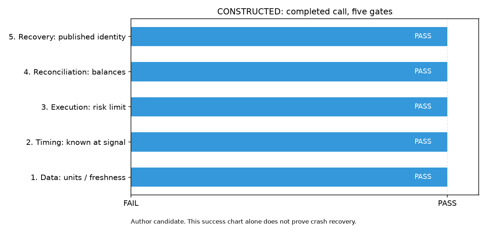
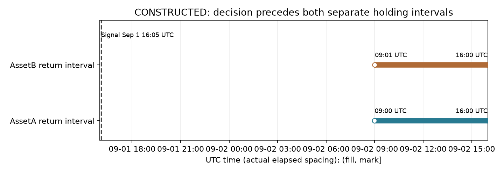
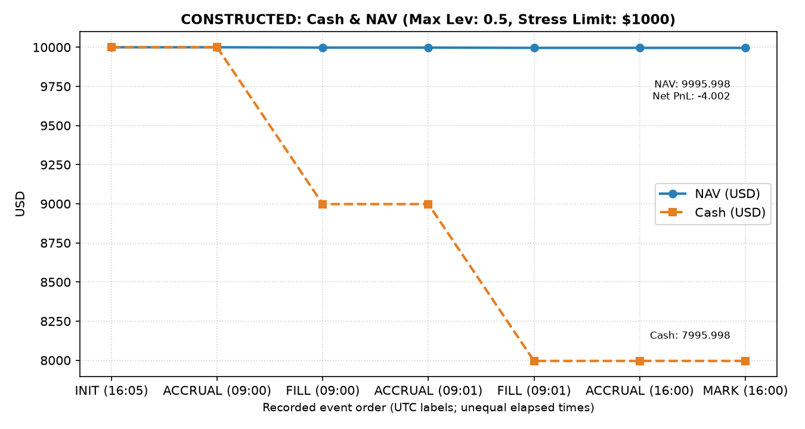

# Chapter 45 — Production Quant Pipelines

\color{qink}


> Learning thread: use the same offline constructed trades to connect five gates: data, timing, execution, reconciliation, and recovery. Check engineering facts, research design, and real-market evidence separately.
> Core thread: build a deterministic offline production quant system with strict point-in-time isolation, idempotent reruns, local transactional event accounting, residual reconciliation, and fault recovery.
> Prerequisites: Chapter 3, Chapter 29, Chapter 33, Chapter 35, and Chapter 38. After completing this chapter, you should be able to design a five-gate architecture, write a deterministic offline production pipeline with restart recovery and discrete reconciliation, and verify a causal timeline without look-ahead as well as ledger conservation.

## 1. Learning objectives

\color{qink}


1. Computational and engineering objective: implement a deterministic quant production pipeline fully decoupled from external network dependencies. Given two constructed security assets (Security A and Security B) and initial cash of 10,000.000 USD, complete data validation, momentum-feature extraction, discrete target-share generation, simulated order matching, cash and position ledger updates, portfolio NAV calculation, and multidimensional reconciliation on a standard discrete-time grid.
2. Conceptual and theoretical objective: clarify how production systems differ from offline research prototypes. Master the five-gate architecture: the data gate (schema and finite-value checks); the timing gate (point-in-time partial-order constraints and holding-period isolation); the execution gate (limits, emergency halts, and idempotent matching); the reconciliation gate (cash, positions, gross and net returns, and fees); and the recovery gate (restart recovery, fault recovery, and atomic publication).
3. Fault and diagnosis objective: use the single recovery case that runs throughout the chapter (Asset A fills and is stored before a process interruption, while Asset B has not filled) to understand the state machine that prevents duplicate fills on rerun, protects the historical ledger, completes reconciliation, and atomically publishes results. Understand the boundary between single-filesystem atomic replacement with `os.replace` and SQLite local transactions: they are not atomic across resources.
4. Deliverable and completion criteria: connect the plan's 23 topics and the controlled recovery case into a traceable workflow; verify the hand calculation to three decimal places, with a cash reconciliation tolerance of $10^{-6}$ USD; and provide complete derivations, runnable verification code, and reference answers in Section 18 for every exercise (concept questions 45-E01–E06, programming questions 45-P01–P04, and challenge questions 45-C01–C02).

## 2. Why a quant needs this

\color{qink}


Quant researchers often explore strategies in interactive Notebooks. Notebooks provide immediate feedback but lack production-grade constraints: cells can run out of order, variables share global memory, data loading can depend on dynamic network access or unversioned temporary files, and missing or exceptional values can be silently filled. When this research code goes straight into automated execution, it often exposes problems such as these:

1. Scheduling and retry jitter: a scheduled job (Cron or Airflow) can trigger the same logical-period task more than once after a timeout or network interruption. Without idempotency protection, the system may send the same-direction order to the market again within a short time and double the position.
2. Clock and information leakage: if the pipeline reads the machine's current wall clock directly while a market-data provider has push delays, code may mistake historical data for the latest quote. In a backtest, using adjusted prices that include future revisions or financial data obtained before disclosure can create irreproducible, fictitious performance.
3. Inconsistent state across systems: if a system crashes after sending a request to a trading interface but before persisting the local ledger, a restart without recovery reconciliation may be unable to determine the preceding order's status, creating a risk of uncontrolled orders.

A 2013 administrative order by the SEC records a deployment and control failure. On August 1, 2012, Knight's SMARS routing system sent millions of orders in about 45 minutes, generating more than 4 million executions across 154 stocks. The order records a final loss exceeding $460 million. The legacy Power Peg function could still be called, new code was missing from one server, and executed quantities were not correctly passed to that path. Section 11 uses this record to explain version checks and independent limits; it is not empirical evidence about a strategy in this course. Sources: SEC Release No. 34-70694, page 2 §1 and pages 5–6 §§12–17.

Data contracts must also reflect the value ranges of different financial instruments. For example, because of limited liability, ordinary listed equity shares have a theoretical and market price lower bound of 0. Physically delivered commodity futures, however, can settle below zero when delivery and storage costs are high; the May 2020 WTI crude oil contract settled at a negative price. A data system without an explicit domain contract can distort downstream model inputs by blindly assuming prices must be positive or by taking the absolute value of every negative observation.

The long-run robustness of a quant strategy depends not only on mathematical assumptions but also on the determinism, auditability, and recovery capacity of the engineering pipeline that runs on unreliable physical infrastructure.

## 3. Intuition

\color{qink}


Think of a production quant pipeline as an assembly line with five independent verification gates connected in sequence.

The data gate checks fields, units, and values. After it passes, the timing gate confirms that decision information was available. The execution gate checks risk and existing fills first. The reconciliation gate recomputes cash and positions. The recovery gate checks the identity of the publication. Each gate preserves its failure reason. The five items below explain the input, action, and next step after failure, forming one workflow.

1. Gate One (Data Gate): validate input schema completeness, strong types, and numeric bounds. Prices must be finite positive numbers (or valid values under the instrument contract), the unit must be explicitly stated as USD/share, and share quantities may be nonnegative real numbers. Invalid values stop the run; implicit imputation is prohibited.
2. Gate Two (Timing Gate): enforce point-in-time (PIT) partial-order rules. The physical event time, external publication time, local ingestion time, and business snapshot time for decision inputs must all be no later than the signal time. Execution and matching must occur after the signal time.
3. Gate Three (Execution Gate): calculate the difference using the persisted state database. If the target number of shares for an asset is already fully met, the increment is 0; after an interruption, rerun only the unfinished difference. If a risk limit or circuit breaker is triggered, stop execution immediately and preserve the event.
4. Gate Four (Reconciliation Gate): reconstruct the internal ledger after matching and calculate fill notional, embedded spread cost, explicit commission, ending position market value, and portfolio NAV. Reject the run if the absolute difference between externally reported cash and internally calculated cash exceeds the floating-point tolerance ($10^{-6}$ USD).
5. Gate Five (Recovery Gate): write calculated outputs to a separate staging directory with a run sequence (`staging_<run_key>_<attempt>`). Publication follows one of three explicit paths:
   - Path 1 (not yet published): the final directory does not exist. After the staging directory passes validation, publish it with `os.rename` on the same filesystem as the final directory and update the state to `COMPLETED`.
   - Path 2 (already published and valid): the final directory exists and passes hash validation, but the database registration is missing. Record `COMPLETED` directly; never trade again.
   - Path 3 (published but damaged): the final directory exists but fails hash validation. The system must reject explicitly and raise an alert, preserving all damaged evidence for investigation. It must never overwrite the directory or hide the damage with a retry.

Teaching boundary: this pipeline uses the Python standard library's JSON/CSV, `hashlib`, and `sqlite3`, and is limited to a single machine and process. It provides an engineering foundation for understanding the boundary between local database transactions and atomic file-system commits, which are not atomic across resources.

## 4. Mathematical foundations

\color{qink}


### 4.1 Discrete time axis and point-in-time partial order

\color{qink}


Define a discrete time axis \(\mathcal{T} \subset \mathbb{R}\). Represent every timestamp as a UTC ISO-8601 string and map them strictly monotonically.
For each asset \(i\) in the security set \(\mathcal{A} = \{A, B\}\), an input record is associated with the timestamp tuple
$$(t_{\text{event}}, t_{\text{available}}, t_{\text{ingested}}, t_{\text{as\_of}}, t_{\text{signal}}, t_{\text{trade}, i}, t_{\text{mark}})$$
and includes the permanent security identifier `permanent_security_id`, the preceding-price timestamp, and the data revision timestamp `revision_time`.

The timestamps mean:
- $t_{\text{event}}$: when the physical market event occurred (for example, the matching time of a trade).
- $t_{\text{available}}$: when an external provider made the data publicly available.
- $t_{\text{ingested}}$: when the local system received and persisted the data.
- $t_{\text{as\_of}}$: the cutoff time for the business information snapshot, not a general legal effective date.
- $t_{\text{signal}}$: when the strategy model calculates features and generates target positions.
- $t_{\text{trade}, i}$: when asset $i$ is actually filled in the simulation.
- $t_{\text{mark}}$: the accounting period's asset valuation and closing time.

The necessary temporal gating condition is
$$\max(t_{\text{available}}, t_{\text{ingested}}, t_{\text{as\_of}}) \le t_{\text{signal}} < t_{\text{trade}, i} \le t_{\text{mark}}, \quad \forall i \in \mathcal{A}$$
Note: satisfying this temporal inequality is necessary to avoid look-ahead bias, but it is not sufficient. If a data source makes a backdated historical revision after $t_{\text{signal}}$ (`revision_time` $> t_{\text{signal}}$) and the system has not retained historical snapshots, look-ahead leakage can still occur.

Place the trade clock from Section 8 and the label clock from §5.8 on the same timeline. All times in the table are UTC. The label becoming available only at 17:00 is a delayed version of the existing monitoring example; it does not change the execution configuration.

|Time|Facts in this example|Permitted action|
|---|---|---|
|09-01 16:00 to before 16:05|Quote event occurs; available, ingested, and as_of times are no later than 16:05|Check the version and freshness available at that time; no positions are held yet|
|09-01 16:05|Signal generated|Use only inputs available before the signal to generate targets; do not use next-day trade or mark prices|
|09-02 09:00 / 09:01|A / B fill respectively|Each holding interval starts after that asset's own fill|
|09-02 16:00|Mark valuation; return-label interval ends|Close the books; the interval end satisfies only the label-maturity threshold|
|09-02 17:00|Delayed label actually becomes available and is ingested|Only after this time may its error enter monitoring; it cannot be updated at 16:30|

\color{qink}


Read §6.3 alongside this table: price changes before a fill are not holding-period returns. Then read §5.8: an interval ending does not mean the label has already reached the local system. The timing gate must also retain historical versions; the ordering in the table does not replace the check for future revisions above.

### 4.2 Discrete fills, embedded costs, and cash-ledger dynamics

\color{qink}


The ledger derivation in this chapter uses the following explicit assumptions:
- Assumption A1: opening portfolio holdings are 0 (zero initial positions), so $H_{i, 0} = 0$.
- Assumption A2: all orders are buy-only spot orders with full fills and no partial fills. The configured share quantity is a finite positive real number; if there is no positive signal, the target is 0. The worked example uses integers, but imposes no broker lot-size rule.
- Assumption A3: the account has one currency (USD) and no external cash flows.
- Assumption A4: cash deposit interest, financing interest, and securities-borrow costs are all 0.
- Assumption A5: market impact cost is 0.

Let opening cash be $\text{Cash}_0 \in \mathbb{R}^+$ (unit: USD). Asset $i$ has holdings $H_{i, t} \in \mathbb{R}_{\ge 0}$ (unit: share).
At trade time $t_{\text{trade}, i}$, the market mid-price is $P_{\text{mid}, i}$ (unit: USD/share).
The buy/sell half-spread is $\phi_i \ge 0$ (a dimensionless proportion; 10 bps corresponds to $\phi_i = 0.0010$), and the explicit commission rate is $c_{\text{rate}, i} \ge 0$ (a dimensionless proportion; 10 bps corresponds to $c_{\text{rate}, i} = 0.0010$).

For a buy order with requested quantity $\Delta Q_i > 0$:
1. Fill price:
   $$P_{\text{fill}, i} = P_{\text{mid}, i} \cdot (1 + \phi_i)$$
2. Actual fill notional (unit: USD):
   $$N_i = \Delta Q_i \cdot P_{\text{fill}, i} = \Delta Q_i \cdot P_{\text{mid}, i} \cdot (1 + \phi_i)$$
3. Explicit commission (unit: USD):
   $$C_i = N_i \cdot c_{\text{rate}, i} = \Delta Q_i \cdot P_{\text{fill}, i} \cdot c_{\text{rate}, i}$$
4. Embedded spread cost (unit: USD):
   $$S_i = \Delta Q_i \cdot (P_{\text{fill}, i} - P_{\text{mid}, i}) = \Delta Q_i \cdot P_{\text{mid}, i} \cdot \phi_i$$
5. Total friction cost for one fill (unit: USD):
   $$\text{Cost}_i = S_i + C_i$$
6. Cash-ledger deduction:
   $$\Delta \text{Cash}_i = -(N_i + C_i) = -(\Delta Q_i \cdot P_{\text{fill}, i} + C_i)$$
   The spread cost $S_i$ is already reflected in the fill price being higher than the mid-price. When notional $N_i$ is deducted from cash, the spread is already embedded in that deduction. Never deduct $S_i$ from cash a second time!
   Cash after the trade:
   $$\text{Cash}_k = \text{Cash}_{k-1} + \Delta \text{Cash}_i$$
   Position update:
   $$H_{i, k} = H_{i, k-1} + \Delta Q_i$$

### 4.3 Asset valuation and the NAV conservation identity

\color{qink}


At closing time $t_{\text{mark}}$, the market mark for asset $i$ is $P_{\text{mark}, i}$.
Total ending market value of holdings (unit: USD):
$$V(\mathbf{H}, \mathbf{P}_{\text{mark}}) = \sum_{i \in \mathcal{A}} H_{i} \cdot P_{\text{mark}, i}$$
Total portfolio net asset value (NAV, unit: USD):
$$\text{NAV} = \text{Cash} + V(\mathbf{H}, \mathbf{P}_{\text{mark}})$$
Portfolio gross PnL (using the mid-price at the time of the fill as the buy-price benchmark; unit: USD):
$$\text{GrossPnL} = \sum_{i \in \mathcal{A}} H_i \cdot (P_{\text{mark}, i} - P_{\text{mid}, i})$$
Total friction cost (unit: USD):
$$\text{TotalCost} = \sum_{i \in \mathcal{A}} \text{Cost}_i = \sum_{i \in \mathcal{A}} (S_i + C_i)$$
Net PnL (unit: USD):
$$\text{NetPnL} = \text{GrossPnL} - \text{TotalCost}$$
The ledger conservation identity (it holds exactly under assumptions A1–A5):
$$\text{NAV} - \text{Cash}_0 \equiv \text{NetPnL}$$
Note the difference in dimensions: USD PnL and NAV are absolute currency amounts (USD), not dimensionless rates of return. Cash reconciliation uses a floating-point tolerance of $\epsilon_{\text{cash}} = 10^{-6}$ USD. When checking share counts, the permitted position tolerance is $\epsilon_{\text{share}} = 10^{-6}$ share.

First connect the units with the same Asset A trade, then close the portfolio ledger with the Asset B trade in Section 8:

|Step|Calculation in this example|Output units|
|---|---|---|
|Mid-price to fill price|100 × (1 + 0.0010) = 100.100; 10 bps = 0.0010|USD/share; rate is dimensionless|
|Notional to cash|10 × 100.100 = 1001.000; commission 1.001; cash change −1002.001|share × USD/share = USD|
|Mark to gross PnL|A: 10 × (102 − 100) = 20; B: 20 × (49 − 50) = −20|USD; portfolio gross PnL is 0|
|Gross to net PnL|0 − (1 + 1 + 1.001 + 1.001) = −4.002|USD; spread appears in the cost breakdown and is not deducted from cash again|
|Cash to NAV|7995.998 + 2000 = 9995.998; NAV − 10000 = −4.002|USD; this is not a decimal return|

\color{qink}


If net return normalized by opening cash is needed, this example gives $-4.002/10000=-0.0004002$, or $-0.04002\%$; it cannot be compared directly with the $10^{-6}$ USD amount tolerance. Use $10^{-6}$ share for quantity checks and $10^{-6}$ USD for amount checks.

### 4.4 Idempotency operator and execution state machine

\color{qink}


Let the system's target vector be $\mathbf{Q}^* \in \mathbb{R}_{\ge 0}^M$.
Assume input identity (`run_key` and input fingerprint) is fixed and fills recorded in the state database have been durably confirmed, with $0 \le Q_{i, \text{filled}} \le Q_i^*$.
The order-increment operator produced by the execution engine is
$$\Delta \mathbf{Q} = \max(\mathbf{0}, \mathbf{Q}^* - \mathbf{Q}_{\text{filled}})$$
The system makes no new matching call if and only if $\Delta \mathbf{Q} = \mathbf{0}$.
Applying the increment state transition twice in succession gives
$$\Gamma(\Gamma(s, \mathbf{Q}^*), \mathbf{Q}^*) = \Gamma(s, \mathbf{Q}^*)$$
Boundary condition: this idempotency proof depends strictly on confirmed fills in the local state database. It does not mean that an external broker naturally guarantees exactly-once execution when the network times out or an order's status is unknown. External idempotency depends on broker-side order-deduplication identifiers and active status queries.

### 4.5 Data lineage and cache fingerprint function

\color{qink}


Define a hash fingerprint function for configuration, data, and code:
$$\text{Fingerprint} = \text{SHA256}\Big(\text{ConfigBytes} \,\|\, \text{InputBytes} \,\|\, \text{CodeHash}\Big)$$
This equation illustrates lineage; it is not the exact character-by-character definition of the actual normalized serialization. Actual identity also includes the pipeline version and hashes of three reused historical modules; see Section 5.4. `CodeHash` includes the core module's source identity.
Note: serializing a configuration dictionary as canonical JSON (sorted keys and compact separators) and hashing it does not make the runtime Python `dict` immutable. Preventing in-place changes still depends on coding conventions or an immutable mapping type.

## 5. Formal definitions: connect the five gates into an interpretable workflow

\color{qink}


Section 4 gives the timing and cash identities. This section uses the same constructed task to explain why directories, files, state, and monitoring are kept separate. Each technique must answer three questions: what does it receive, how does it change the current decision, and what evidence does it leave for checking? The accepted engineering example uses local Python, CSV/JSON, and SQLite; optional-platform examples explain boundaries only. This bilingual revision inherits the existing evidence and does not rerun the course.

### 5.1 Project layers, installable packages, and cold-start imports

\color{qink}


Project layering addresses the question, “Can the script still calculate the same ledger if a Notebook cell is removed?” The actual call graph is: `code/ch45_production_quant.py` and `capstone/run_offline.py` read parameters and call `src/quant_course/production_pipeline.py`; that core reuses historical cost-ledger and risk functions. The Notebook also calls the same core, and tests call the same public entry point. The directory has at least these roles:

```text
pyproject.toml                  build backend, package discovery, and project dependency configuration
src/quant_course/production_pipeline.py   features, state, simulated ledger
code/ch45_production_quant.py   standalone command-line interface and companion plots
capstone/configs/offline_constructed.json   constructed configuration
notebooks/ch45_production_quant.ipynb      explanation, calls, and actual plots
tests/test_production_pipeline.py         counterexamples and boundaries
```

A source layout puts the importable package under `src/`. It is normally found by the environment after package installation; this batch reuses the existing virtual environment, and the entry point explicitly adds the course's `src` directory to the module search path, without reinstalling the package. From the course root, a reader can start a new process with `.venv/bin/python code/ch45_production_quant.py --help`; the import does not depend on memory from the previous Notebook session. A cold start rebuilds these dependencies instead of treating variables from an old kernel as inputs.

An installable package also needs build rules. Python Enhancement Proposal (PEP) 517 specifies how a build frontend calls a backend; PEP 518 specifies how build dependencies are declared in `pyproject.toml`. Neither requires a directory named `src`. This project's actual `[build-system]` selects `setuptools.build_meta`, and `[tool.setuptools]` maps package directories to `src`. The first answers “who builds?”; the second answers “where does package discovery start?” The distribution name `quant-course-a1` is also different from the import name `quant_course`. These boundaries make code identity traceable before the data gate; a successful import alone does not prove that a wheel was built or all dependencies were locked. The src-layout section of PyPA's documentation and the local configuration support this distinction.

### 5.2 Understand row-oriented and column-oriented reads with a four-row table

\color{qink}


Comma-separated values (CSV) is suitable for the few records in this chapter that can be read by eye. Consider four constructed quotes that are already available; the final column is a teaching-source label and adds no real market data:

|Asset|Event date|Price (USD/share)|Source label|
|---|---|---|---|
|AssetA|08-31|90|constructed|
|AssetB|08-31|45|constructed|
|AssetA|09-01|100|constructed|
|AssetB|09-01|50|constructed|

\color{qink}


To answer “What was the price on 09-01?”, a CSV reader scans the four rows in order, parses the date, keeps the two matching rows, and selects the price column. Parquet, a columnar-storage format, organizes columns into column chunks and divides them into row groups; a query engine can use file metadata to locate the columns it needs. Projection pushdown passes the request to “select only the price column” down to the read layer. Filter pushdown passes the date condition down as well; if available statistics show that a row group's maximum date is 08-31, the engine may skip that group. If statistics are missing or the filter is unsupported, it still has to read the group; skipping is not guaranteed every time.

To calculate the read volume by hand, suppose each field uses 8 bytes and ignore metadata, compression, and parsing costs. This is only a layout model, not the actual size of a CSV or Parquet file. The whole table is $4\times4\times8=128$ bytes. Reading only the price column is $4\times1\times8=32$ bytes. If the two-row older group is then successfully skipped, the data portion is $2\times1\times8=16$ bytes, plus the cost of reading statistics metadata. These three intermediate values explain “what data can be skipped”; they are not a performance benchmark.

DuckDB is an in-process analytical query engine, while Parquet is a file format; they occupy different layers. The optional SQL `SELECT asset,current_price FROM read_parquet('quotes.parquet') WHERE event_time <= ...` shows how to pass the timing-gate condition to the engine. There is no actual `quotes.parquet` fixture, and DuckDB/pyarrow are absent from this batch, so this statement was not run. Actual acceptance still reads the small JSON/CSV inputs and explicitly checks sets, units, and timestamps. Missing packages do not prevent understanding column projection, and they certainly do not establish correct point-in-time handling: a table with future revisions is still not an input that was available at the time, however quickly it can be read.

### 5.3 Learn SQL, keys, and transaction boundaries from two fills

\color{qink}


Structured Query Language (SQL) lets us retrieve facts from a persistent ledger with explicit conditions. The actual primary key of `fills` is the text `fill_id`, not an auto-incrementing sequence. Its fields are `asset`, `signed_quantity`, `fill_price`, and `commission`. The two rows from the default run are:

|Asset|signed_quantity (share)|fill_price (USD/share)|commission (USD)|
|---|---|---|---|
|AssetA|10|100.1|1.001|
|AssetB|20|50.05|1.001|

\color{qink}


Filter by `run_key` first, count unique fills, and then aggregate cash flows: A's outflow is $10\times100.1+1.001=1002.001$; B's is $20\times50.05+1.001=1002.001$. Total outflow is 2004.002 USD, leaving cash of $10000-2004.002=7995.998$ USD. The accepted I3 PATH09 chain is shown below in full: start the same constructed CLI once from the root of the final complete course package, then pass its `state_db` and `run_key` to a read-only query. First save the following Python block as `print_examples/I2-PATH-09.py`; it matches the I3 script with the same name. These instructions apply to a complete course package containing the shared scripts and configuration. If an entry is absent from a working checkout, consult its explicitly labeled read-only source. This is a usage example, not a record of execution in this revision.

```sh
run="runs/path09_$(.venv/bin/python -c 'from uuid import uuid4; print(uuid4().hex)')"
state_db="$run/state.db"
run_key="reader"
.venv/bin/python capstone/run_offline.py --config capstone/configs/offline_constructed.json --run-key "$run_key" --state-db "$state_db" --output-dir "$run/artifacts"
.venv/bin/python print_examples/I2-PATH-09.py "$state_db" "$run_key"
```

```python
"""Read-only cash check for the same CLI state database and run key."""
from pathlib import Path
import sqlite3,sys
state,key=Path(sys.argv[1]),sys.argv[2]
assert state.is_file(),"Complete the same constructed CLI first"
with sqlite3.connect(state.resolve().as_uri()+"?mode=ro",uri=True) as db:
    count=db.execute("SELECT COUNT(*),COUNT(DISTINCT fill_id) FROM fills WHERE run_key=?",(key,)).fetchone()
    spent=db.execute("SELECT SUM(signed_quantity*fill_price+commission) FROM fills WHERE run_key=?",(key,)).fetchone()[0]
assert count==(2,2)
assert spent is not None and abs(spent-2004.002)<=1e-6
assert abs((10000-spent)-7995.998)<=1e-6
print(count,spent,"USD; final cash",10000-spent)
```

A unique key can reject duplicate inserts, but a key alone is not enough: recovery must also check that fill times, quantities, fees, and order match the frozen target. Atomicity, consistency, isolation, and durability (ACID) describe database transactions. This core commits fill records first, then writes events and state separately; it cannot claim that fills and all audit events share one transaction. Recovery treats committed `fills` as the source of truth; a missing log row must never cause cash to be deducted again. `BEGIN IMMEDIATE` is an optional SQLite mode that requests a write transaction early, and it can still encounter `SQLITE_BUSY`; this batch does not treat it as a distributed lock or turn the system into a multi-process trading platform. Directory publication uses a different resource and requires the three recovery checks in Section 6.4.

### 5.4 Configuration, lineage, cache, and the same logical task

\color{qink}


Configuration separates initial cash of 10000 USD, a 10 bp spread, a 0.001 commission rate, and risk limits from the logic. A basis point (bp) is multiplied by $10^{-4}$ to convert it to a decimal return; this unit conversion is not the $10^{-6}$ USD amount-reconciliation tolerance. The configured share quantity may be a finite positive real number. The actual target is 0 for nonpositive momentum; 10 and 20 are integer values in this example, but 10.5 is also allowed. There is no broker lot-size or minimum-quantity check.

Data lineage associates normalized inputs, configuration, core source, and hashes of reused historical modules with the result. Sort JSON keys before serialization and calculate a SHA-256 identity; an input changed from 100 to 101, or a commission changed from 0.001 to 0.002, is a different logical input. A JSON hash does not make a Python dictionary immutable; the entry point must still avoid passing the same mutable object to a step that changes it.

Idempotency compares identity under the same `run_key`. The first constructed task writes two fills; if the scheduler triggers the same task again, A10 and B20 are already filled, the remaining amount is 0, and there are no new fills. If the key is the same but the input fingerprint differs, reject it and preserve `RUN_KEY_FINGERPRINT_MISMATCH`. A source repair also changes `code_hash` and the fingerprint; this is an expected identity change, and must not be described as byte-for-byte identical to the old revision. Cache validity must also be checked against the result hash anchored in SQLite; a mutable `checksums.json` inside the directory cannot independently prove its own integrity. The three publication-recovery cases are described in Section 6.4; a damaged published result cannot be hidden by creating a new attempt.

### 5.5 Scheduling, external APIs, and unknown outcomes

\color{qink}


Scheduling answers when a task is triggered; idempotency answers what happens after a duplicate trigger. Suppose the task's logical date is 09-02, it is scheduled for 09:00, but queue backlog delays its actual start to 09:00:03, and a retry starts it again at 09:00:05. Both processes belong to the same logical key; different wall-clock seconds do not make them separate trading tasks. Apache Airflow's logical date usually represents the start of a data interval and differs from wall-clock execution time. `sched` is an in-process event queue and cannot replace a persistent scheduler or a market trading calendar. No scheduler was installed in this batch.

Retries of an Application Programming Interface (API) call also involve external side effects. The broker-interface scenario below was not run and does not mean this chapter sent an order:

|Order|Evidence received|Permitted conclusion|Action|
|---|---|---|---|
|1|Client sends a request with a unique order ID|Request was sent; fill status is unknown|Record the identity awaiting confirmation|
|2|Wait times out and no confirmation arrives|Unknown does not mean unfilled|Stop new orders and query the original order's status|
|3a|Query confirms that 10 shares filled|The original side effect occurred|Reconcile these 10 shares; do not resend the full quantity|
|3b|Query remains unavailable|Status remains unknown|Continue preserving evidence and keep orders stopped|

\color{qink}


Reads such as data retrieval can be safely retried with a finite retry count and backoff. A write with side effects cannot be treated the same way. Offline simulation has no such network uncertainty. `after_first_fill` is a controlled interruption after the first simulated fill has been committed; it does not simulate an HTTP timeout. If B fills first, it still leaves only the first B fill. If B is the only asset with a target, recovery adds zero fills; if no target is positive, preflight rejects this fault configuration. `risk_before_second_fill` requires at least two positive targets, otherwise there is no second fill to intercept; explicitly rejecting the configuration reveals the test boundary more clearly than silently completing it.

### 5.6 Structured logs, metrics, and experiment tracking

\color{qink}


Structured logging turns “where did it fail?” into searchable fields. In this example, actual events are in SQLite: `event_time` is the time the record was written, `run_key` identifies the logical task, `event_name` identifies the branch, and `details_json` contains the asset, `fill_id`, or exception reason. For example, a risk stop after the first fill preserves both `FILL_COMMITTED` and `RISK_LIMIT_EXCEEDED`; an independent terminal reconciliation difference records `TERMINAL_RECONCILIATION_FAILED` and does not publish a summary. Record time is not quote `event_time`, and a missing log entry does not mean no fill occurred. CLI stdout is an actual JSON summary; it did not create or start a `pipeline.log` service.

A production application can use the standard-library `logging` module to separate a library's logger from the application's handler. The following example prints one credential-free teaching event in the current small process; the actual core events remain in SQLite as described above:

```python
import io
import json
import logging
from uuid import uuid4

stream = io.StringIO()
logger = logging.getLogger("ch45.teaching." + uuid4().hex)
logger.propagate = False
logger.setLevel(logging.INFO)
handler = logging.StreamHandler(stream)
logger.addHandler(handler)
logger.info(json.dumps({"run_key": "constructed", "event_name": "STOPPED",
                        "reason": "reconciliation", "contains_secret": False}))
assert json.loads(stream.getvalue())["event_name"] == "STOPPED"
print(stream.getvalue().strip())
```

Monitoring metrics compress many events. A counter accumulates attempts or unique simulated fills; a retry may increase attempts from 1 to 2 while unique fills remain at 2. A gauge can rise or fall; examples are cash of 7995.998 USD or A holdings of 10 share. A histogram accumulates observation counts by bucket: for teaching latencies of 0.02, 0.07, and 0.20 seconds and boundaries 0.05, 0.10, and $+\infty$, the cumulative counts are 1, 2, and 3. Their sum is 0.29 seconds, and their mean is $0.29/3=0.09667$ seconds. Bucket counts lose exact ordering information, so these three counts do not reveal an exact P99; the open-ended final bucket also gives no finite upper bound for P99. These are hand-calculated explanations of metrics that were not deployed.

Experiment tracking links metrics back to versions: record the run key, input/config/code hashes, state, and artifact path. Both the successful example with net PnL of −4.002 and a failed `STOPPED` run belong in the run index; do not record only profitable or completed tasks. MLflow can manage such runs, parameters, metrics, and artifacts, but this batch did not call its API or start a service. Data-gate rejection, reconciliation stops, and model alerts are different causes. Monitoring curves are interpretable only when the underlying events retain those distinctions.

### 5.7 Containers, configuration, and the lifecycle of secrets

\color{qink}


A container packages the user-space runtime and entry point into image configuration; it does not remove differences in the host kernel or hardware. The actual `capstone/Dockerfile` skeleton is:

```dockerfile
FROM python:3.14-slim
ENV PYTHONDONTWRITEBYTECODE=1 PYTHONUNBUFFERED=1 PYTHONPATH=/app/src
WORKDIR /app
RUN python -m pip install --no-cache-dir numpy pandas scipy matplotlib
COPY src/ /app/src/
COPY capstone/ /app/capstone/
COPY code/ /app/code/
ENTRYPOINT ["python", "capstone/run_offline.py"]
CMD ["--help"]
```

Read it step by step: FROM selects a base image; WORKDIR sets the relative path; RUN installs the reused core dependencies in a hypothetical build; COPY includes only the listed course directories; ENTRYPOINT points to the real Capstone entry point; and CMD displays help by default. If it is built later, the build context should be the course root, and `docker build -f capstone/Dockerfile .` will find `src`; `capstone/.dockerignore` is not the effective root ignore file for that course-root context. No image was built and no container was run here. RUN depends on package availability, so the offline data example must not be described as an offline image build.

This base tag and the unlocked pip versions can change over time, so they do not prove that the image is reproducible by digest. A future release should record the image digest, dependency lock, and platform conditions; this batch does not install another environment. Secrets management must also distinguish build-time and runtime: Docker's documentation says build ARG/ENV values persist in the image and should not carry build secrets; temporary build-secret mounts have a separate lifecycle. At runtime, a controlled credential service or secret mount can provide least-privilege values. Environment variables also require attention to access, redaction, and rotation. This example has no credentials, and the configuration snapshot and logs contain no secret values. Checking the configuration version during a model rollback does not “roll back” trades that have already occurred.

### 5.8 Model drift: calculate the statistic first, then determine when labels are available

\color{qink}


A model-drift investigation begins with the input marginal distribution $P(X)$; it cannot directly establish that the conditional relationship $P(Y\mid X)$ or alpha has deteriorated. The two-sample Kolmogorov–Smirnov test (KS) statistic is $D=\sup_x|F_0(x)-F_1(x)|$. An empirical cumulative distribution function (ECDF) is “the number of samples no greater than x divided by the total number of samples.” For a baseline $(1,2,3,4)$ and a new sample $(2,3,4,5)$, at x=1 the ECDF values are 1/4 and 0/4; at x=2 they are 2/4 and 1/4; and at x=4 they are 4/4 and 3/4. The largest difference is D=0.25, which is dimensionless. SciPy's official-documentation assumptions of independent samples from continuous distributions do not directly apply to this four-row teaching sample with autocorrelation and tied discrete values. We calculate D only; we do not report a classical p-value or financial significance.

The Population Stability Index (PSI) freezes bins first, then compares proportions. Take baseline counts $(3,4,3)$ and new counts $(2,5,3)$ from ten constructed observations. Thus $B=(0.3,0.4,0.3)$ and $A=(0.2,0.5,0.3)$. For positive proportions, $\mathrm{PSI}=\sum_k(A_k-B_k)\ln(A_k/B_k)$. The first bin is $(-0.1)\ln(2/3)=0.0405465$, the second is $0.1\ln(5/4)=0.0223144$, the third is 0, and the total is 0.0628609, dimensionless. MathWorks' official formula supports this definition; MATLAB was not run in this example. If a bin is zero, the formula may be undefined or diverge. State the bin-merging or smoothing policy and its effect in advance; do not insert a number after the fact to hide an anomaly. The empirical thresholds 0.1 or 0.25 are not universal guarantees of significance, and this example does not automatically accept a model based on either one.

The Page–Hinkley method (PH) monitors changes in the mean of errors. Let $e_t=|y_t-\hat y_t|$; both $y_t$ and its prediction are decimal returns, so $e_t$, the tolerance offset $\delta$, and the alert threshold $h$ are also decimal returns, never a USD ledger tolerance. For hand calculation, this chapter uses a PH-style fixed-baseline one-sided cumulative rule:
$S_0=M_0=0$, $S_t=S_{t-1}+e_t-\mu_0-\delta$, $M_t=\min(M_{t-1},S_t)$, with an alert when $S_t-M_t>h$.
The cumulative/running mean uses every error through t: $\bar e_0=0$ and $\bar e_t=\bar e_{t-1}+(e_t-\bar e_{t-1})/t$. For the corresponding one-sided cumulative variant, let $V_0=0$, update only $V_t=V_{t-1}+e_t-\bar e_t-\delta$ at each step, then calculate $V_t-\min_{0\le i\le t}V_i$. The current $\bar e_t$ is used only in the current increment; previously stored increments retain the $\bar e_i$ used at their own times. Do not substitute the final $\bar e_t$ into all historical increments. This is a separate, explicitly defined variant of the frozen-$\mu_0$ rule. Compare sensitivity only under specified error paths, thresholds, and calibration conditions; there is no universal performance claim.

A cumulative mean is not a fixed-window moving mean. For $(0.10,0.10,0.10,0.30)$, the fourth-step cumulative mean is $(0.10+0.10+0.10+0.30)/4=0.15$; the mean of the most recent two periods is $(0.10+0.30)/2=0.20$. The two-period window is a terminology counterexample only; this chapter neither teaches nor requires implementation of a third PH algorithm. The official River implementation also has a forgetting parameter and a two-sided option. It was not installed or called, and this example is not identical to its complete algorithm.

Freeze $\mu_0=0.10$, $\delta=0.01$, and h=0.05. Suppose mature errors arrive in order as 0.10, 0.15, and 0.18. Step one: $S=-0.01$, $M=-0.01$, $S-M=0$. Step two: $S=0.03$, $M=-0.01$, $S-M=0.04$. Step three: $S=0.10$, $M=-0.01$, $S-M=0.11$; only then does it exceed the teaching threshold. If a forecast is made at 09-01 16:05 and its return label interval ends at 09-02 16:00, that error cannot be computed at 09-02 15:59. It can be updated online after 16:00 once the label interval has ended and the label is in hand. If the label is not published or ingested until 17:00, the system must wait until 17:00. Online updates after maturity and offline replay are both possible; future returns cannot be used early.

These statistics are intermediate evidence for “save feature and mature-label versions → calculate → check for data faults or economic change → decide whether to stop orders or roll back compatibly.” Fixed thresholds must be calibrated on permitted historical blocks; they cannot be tuned by looking at final test performance. Automatic retraining is outside this batch's authorization. Paper trading usually uses virtual funds to inspect trading feedback; this batch has only offline constructed matching, with no real paper interface and no evidence of actual alpha.

## 6. Derivations

\color{qink}


### 6.1 Derivation of discrete accounting, embedded spread, and net-asset reconciliation

\color{qink}


Under assumptions A1–A5, we give a strict algebraic derivation.

Let opening cash be $\text{Cash}_0$, with initial holdings $H_{i, 0}=0$.
At time $t_{\text{trade}, i}$, buy $\Delta Q_i$ shares.
The fill price is $P_{\text{fill}, i}=P_{\text{mid}, i}(1+\phi_i)$, and explicit commission is $C_i=\Delta Q_i\cdot P_{\text{fill}, i}\cdot c_{\text{rate}, i}$.
The actual cash outflow is notional plus commission:
$$\text{Outflow}_i = \Delta Q_i \cdot P_{\text{fill}, i} + C_i$$
Expand $P_{\text{fill}, i}$ into the mid-price and spread:
$$\Delta Q_i \cdot P_{\text{fill}, i} = \Delta Q_i \cdot P_{\text{mid}, i} + \Delta Q_i \cdot P_{\text{mid}, i} \cdot \phi_i = \Delta Q_i \cdot P_{\text{mid}, i} + S_i$$
where $S_i$ is the embedded spread cost. Therefore, cash outflow is identically decomposed as
$$\text{Outflow}_i = \Delta Q_i \cdot P_{\text{mid}, i} + S_i + C_i = \Delta Q_i \cdot P_{\text{mid}, i} + \text{Cost}_i$$
After all trades, ending cash is
$$\text{Cash}_K = \text{Cash}_0 - \sum_{i \in \mathcal{A}} \text{Outflow}_i = \text{Cash}_0 - \sum_{i \in \mathcal{A}} \Delta Q_i \cdot P_{\text{mid}, i} - \sum_{i \in \mathcal{A}} \text{Cost}_i$$
At closing time $t_{\text{mark}}$, the market value of holdings is
$$V_K = \sum_{i \in \mathcal{A}} H_i \cdot P_{\text{mark}, i} = \sum_{i \in \mathcal{A}} \Delta Q_i \cdot P_{\text{mark}, i}$$
Total portfolio net asset value is
$$\text{NAV}_K = \text{Cash}_K + V_K = \text{Cash}_0 + \sum_{i \in \mathcal{A}} \Delta Q_i \cdot (P_{\text{mark}, i} - P_{\text{mid}, i}) - \sum_{i \in \mathcal{A}} \text{Cost}_i$$
Using the definitions $\text{GrossPnL}=\sum_{i \in \mathcal{A}}\Delta Q_i\cdot(P_{\text{mark}, i}-P_{\text{mid}, i})$ and $\text{TotalCost}=\sum_{i \in \mathcal{A}}\text{Cost}_i$:
$$\text{NAV}_K = \text{Cash}_0 + \text{GrossPnL} - \text{TotalCost}$$
Since net PnL is defined as $\text{NetPnL}=\text{GrossPnL}-\text{TotalCost}$, rearranging proves
$$\text{NAV}_K - \text{Cash}_0 \equiv \text{GrossPnL} - \text{TotalCost} \equiv \text{NetPnL}$$
This derivation proves that notional uses the fill price $P_{\text{fill}}$, so the cash account has naturally paid the spread already. Gross PnL must therefore use the mid-price $P_{\text{mid}}$ as the buy-price benchmark; the ledger's change in NAV then exactly matches net PnL.

### 6.2 Convergence and idempotency of the incremental execution state machine

\color{qink}


Let the system's target vector be $\mathbf{Q}^* \in \mathbb{R}_{\ge 0}^M$.
Assume input identity is fixed and the database contains the cumulative filled vector $\mathbf{Q}^{(k)} \in \mathbb{R}_{\ge 0}^M$, where $0 \le \mathbf{Q}^{(k)} \le \mathbf{Q}^*$.
Define the incremental order function as
$$\mathbf{\delta}^{(k)} = \max\left(\mathbf{0}, \mathbf{Q}^* - \mathbf{Q}^{(k)}\right)$$
A single offline execution fills the outstanding amount $\mathbf{\delta}^{(k)}$, so
$$\mathbf{Q}^{(k+1)} = \mathbf{Q}^{(k)} + \mathbf{\delta}^{(k)} = \mathbf{Q}^{(k)} + (\mathbf{Q}^* - \mathbf{Q}^{(k)}) = \mathbf{Q}^*$$
After the target is reached, every later repeated trigger $j \ge 1$ gives
$$\mathbf{\delta}^{(k+j)} = \max\left(\mathbf{0}, \mathbf{Q}^* - \mathbf{Q}^*\right) = \mathbf{0} \implies \mathbf{Q}^{(k+j+1)} = \mathbf{Q}^{(k+j)} = \mathbf{Q}^*$$
After its first complete execution, the system state converges to a fixed point, which proves idempotency mathematically.

### 6.3 Derivation of strict holding periods and execution-lag return decomposition

\color{qink}


Consider the time interval from signal generation to the closing mark:

Let $t_{\text{signal}} < t_{\text{trade}} \le t_{\text{mark}}$.
Define price-change rates:
- Execution-lag price growth (dimensionless):
  $$g = \frac{P_{\text{trade}}}{P_{\text{signal}}} - 1$$
- Actual holding-period asset return (dimensionless):
  $$r = \frac{P_{\text{mark}}}{P_{\text{trade}}} - 1$$
If the signal time $t_{\text{signal}}$ is incorrectly treated as the start of the holding period, the resulting fictitious return is
$$R_{\text{illusory}} = \frac{P_{\text{mark}}}{P_{\text{signal}}} - 1 = \frac{P_{\text{trade}}(1 + r)}{P_{\text{signal}}} - 1 = (1 + g)(1 + r) - 1$$
Expanding gives
$$R_{\text{illusory}} = 1 + g + r + g \cdot r - 1 = r + g(1 + r)$$
The algebraic difference between the fictitious and actual returns is
$$R_{\text{illusory}} - r = g(1 + r)$$
Units matter: $R_{\text{illusory}}$ and $r$ are dimensionless relative changes, while the strategy's holding PnL is an absolute monetary amount (USD):
$$\Delta \text{PnL}_{\text{illusory}} - \Delta \text{PnL}_{\text{real}} = Q \cdot (P_{\text{mark}} - P_{\text{signal}}) - Q \cdot (P_{\text{mark}} - P_{\text{trade}}) = Q \cdot (P_{\text{trade}} - P_{\text{signal}}) = Q \cdot g \cdot P_{\text{signal}}$$
This difference represents a market move that occurred while the system did not yet hold the asset. Counting it as strategy return is a look-ahead execution bias. The actual holding period must be defined strictly as $(t_{\text{trade}}, t_{\text{mark}}]$.

### 6.4 Cross-resource atomicity and crash recovery design

\color{qink}


In a single-machine operating system, SQLite and the file system are separate storage resources and do not have a cross-resource two-phase commit (2PC) mechanism.
To recover from crashes, the system defines three execution and publication paths:
1. Path 1 (not yet published): the final directory does not exist. Write the calculated output to a separate staging directory identified by the run, `staging_<run_key>_<attempt>`. After integrity and reconciliation checks pass, use the underlying `os.rename(staging, final)` system call for an atomic replacement. Finally, record the terminal state `COMPLETED` in the SQLite state database.
2. Path 2 (published and valid): after restart, the `final` directory exists and its report-file hash matches the value expected by the state database. This means the previous interruption happened after the atomic rename but before the database state write. Record `COMPLETED` in SQLite directly; do not trade again.
3. Path 3 (published but damaged): after restart, the `final` directory exists but a file is missing or its validation hash does not match. The system must reject explicitly and raise an alert, preserving the damaged files for investigation. It must not overwrite them or conceal the damage by starting a new retry.

During recovery, first ask “What evidence remains?” and then choose an action. The table follows only the local recovery rules for the same input identity and a controlled single-machine fault; it adds no new fault experiment.

|Fault point or observed state|Persisted evidence that must be checked|Recovery action|
|---|---|---|
|Interruption after the first fill, before a final directory exists|Same run_key and input fingerprint; `fills` contains A with 10 shares and B with 0|Reconcile the ledger, then fill B's 20 shares without buying A again; reconcile and publish in a new attempt|
|No final directory during a later unpublished stage|Persisted fills and input identity; staged output is not yet formally published|Calculate the difference from `fills`, finish or rebuild the staged output, and validate it; do not infer no fills merely from `RUNNING`|
|Final directory is valid, but terminal-state registration was interrupted|Output integrity/hash, database's expected identity, and persisted fills agree|Record only `COMPLETED`; do not match again|
|Final directory exists but files are missing or the hash differs|Damaged output and database records|Reject and preserve the evidence; do not overwrite it or conceal it with a new attempt|

\color{qink}


If a real broker request times out while its fill status is unknown, local `fills` may not yet contain the external fact. Use the UNKNOWN query-and-stop path in §5.5; do not apply the first row and assume “not recorded locally” means “not filled externally.” File publication and SQLite registration are still two resource operations, not a cross-resource transaction.

Physical boundary:
`os.replace` provides an atomic switch of directory-entry names within the same file-system mount point; across mount points it raises `OSError(EXDEV)` and has no automatic fallback. Namespace atomicity also does not mean that the physical storage hardware will preserve data through a power loss. The `RuntimeError` in the test is a controlled software exception, not evidence of a kill or power-loss test.

## 7. Financial interpretation

\color{qink}


1. Trading friction and capacity constraints: many factors appear to have robust positive returns in theoretical research. In real execution, however, bid–ask spreads and explicit commissions impose deterministic costs. Strategies with high turnover can easily have their gains consumed by trading friction.
2. Trading halts and missing liquidity: offline models often assume a position can be rebalanced at the mid-price at any time. In real markets, an individual stock may be halted or have no liquidity at its limit-down price. The execution gate must support rejection while preserving exposure; it cannot assume every order fills without obstruction.
3. Clock offsets and spurious market relationships: financial-data-provider timestamps include network-transfer delays and internal cache times. Without strict PIT alignment, clock offsets can reverse cause and effect and create a spurious arbitrage factor that cannot earn money in live trading.

\needspace{24\baselineskip}

## 8. Numerical example (constructed hand calculation)

\color{qink}


This section follows the root numerical contract through a hand-calculable discrete derivation. The example is constructed for teaching and checks the pipeline's logic contract; it is not evidence of real strategy alpha.

### 8.1 Initial conditions and constructed data

\color{qink}


- Initial cash: $\text{Cash}_0 = 10,000.000$ USD.
- Asset set: $\mathcal{A} = \{A, B\}$.
- Asset-set consistency check: input validation requires the observations, `simulator_execution`, and `simulator_marks` to contain exactly the same asset set, $\{A,B\}$. If any asset record is missing, reject immediately before creating a run record.
- Supported stress-test configuration: a simple-return shock must satisfy $r_{\text{shock}} \ge -1.0$ (to prevent an asset price from becoming negative). A general scenario allows positive return shocks, and loss is defined as $\text{Loss}=-\text{ScenarioPnL}$, so loss is negative when the scenario is profitable.
- Historical reference prices (one period earlier): $P_{A, \text{past}}=90.000$ USD/share and $P_{B, \text{past}}=45.000$ USD/share.
- Market prices observed at $t_{\text{obs}}=\text{2026-09-01T16:00Z}$:
  $$P_{A, \text{obs}} = 100.000 \text{ USD/share}, \quad P_{B, \text{obs}} = 50.000 \text{ USD/share}$$
- Point-in-time validity check:
  $$t_{\text{available}} \le \text{16:05Z}, \quad t_{\text{ingested}} \le \text{16:05Z}, \quad t_{\text{as\_of}} \le \text{16:05Z}$$
  Set the signal decision time to $t_{\text{signal}}=\text{2026-09-01T16:05Z}$.
  The condition $\max(t_{\text{available}},t_{\text{ingested}},t_{\text{as\_of}}) \le t_{\text{signal}}$ is satisfied, so the timing gate passes.
- Calculate the one-period momentum feature and check finiteness:
  $$R_A = \frac{100.000 - 90.000}{90.000} = +11.111\% > 0$$
  $$R_B = \frac{50.000 - 45.000}{45.000} = +11.111\% > 0$$
  Both momentum returns are finite real numbers. If a prior price is close to the floating-point underflow limit (such as $10^{-320}$) and division produces `inf`, the system detects the non-finite value immediately after feature calculation, sets the state to `STOPPED`, records a `FEATURE_VALIDATION_FAILED` event, and generates 0 fills.
- Generate target share quantities: because both asset momentum values are positive, the fixed engineering teaching rule generates fixed target quantities that are finite positive real numbers:
  $$Q_A^* = 10.0 \text{ shares}, \quad Q_B^* = 20.0 \text{ shares}$$

### 8.2 Next-day execution and fault-injection semantics

\color{qink}


Trade parameters:
Half-spread $\phi=10\text{ bps}=0.0010$;
explicit commission rate $c_{\text{rate}}=10\text{ bps}=0.0010$ (charged on actual fill notional);
market impact, financing interest, and securities-borrow costs are all 0. The cash reconciliation tolerance is $10^{-6}$ USD.

Fault-injection count semantics:
Fault configuration is based on the total number of actually committed fills, not on a hard-coded asset name:

- `fault="after_first_fill"`: interrupt after the first actual fill has been committed.
- `fault="reconcile_after_first_fill"`: inject a cash perturbation after the first fill has been committed.
- `fault="risk_before_second_fill"`: apply the risk block before the second actual fill. If fewer than two positive targets are active, reject this fault configuration before initialization.

#### Step 1: First discrete fill (Asset A)

\color{qink}

Trade time: $t_{\text{trade}, A}=\text{2026-09-02T09:00Z}$.
Mid-price: $P_{\text{mid}, A}=100.000$ USD/share.
Fill price:
$$P_{\text{fill}, A} = 100.000 \times (1 + 0.0010) = 100.100 \text{ USD/share}$$
Actual fill notional:
$$N_A = 10 \times 100.100 = 1001.000 \text{ USD}$$
Explicit commission:
$$C_A = 1001.000 \times 0.0010 = 1.001 \text{ USD}$$
Embedded spread cost:
$$S_A = 10 \times (100.100 - 100.000) = 1.000 \text{ USD}$$
Total trading friction for Asset A:
$$\text{Cost}_A = S_A + C_A = 1.000 + 1.001 = 2.001 \text{ USD}$$
Cash deduction:
$$\Delta \text{Cash}_A = -(1001.000 + 1.001) = -1002.001 \text{ USD}$$
Cash balance after the fill:
$$\text{Cash}_A = 10000.000 - 1002.001 = 8997.999 \text{ USD}$$
Position: $H_A=10$ shares. This fill is successfully persisted in the SQLite `fills` table.

#### Step 2: Inject a controlled interruption

\color{qink}

With `fault="after_first_fill"`, raise a controlled exception, `RuntimeError` (the `after_first_fill` branch), after the first actual fill has been committed.
At this point:
- Asset B has not been filled.
- The SQLite state database records the current state as `RUNNING`.
- The final output directory has not yet been created.

#### Step 3: Recover and rerun idempotently

\color{qink}

Restart the pipeline using the same `run_key`:
1. Read the state database and confirm the input fingerprint matches; allow execution to continue. `after_first_fill` is a one-time fault for this logical run, so skip it automatically during recovery.
2. The increment operator reads the `fills` table and detects 10 shares already filled for Asset A:
   $$\Delta Q_A = \max(0, 10 - 10) = 0 \text{ shares}$$
   Skip Asset A; do not buy it again.
3. Asset B has 0 shares filled:
   $$\Delta Q_B = \max(0, 20 - 0) = 20 \text{ shares}$$

#### Step 4: Second discrete fill (Asset B)

\color{qink}

Trade time: $t_{\text{trade}, B}=\text{2026-09-02T09:01Z}$.
Mid-price: $P_{\text{mid}, B}=50.000$ USD/share.
Fill price:
$$P_{\text{fill}, B} = 50.000 \times (1 + 0.0010) = 50.050 \text{ USD/share}$$
Actual fill notional:
$$N_B = 20 \times 50.050 = 1001.000 \text{ USD}$$
Explicit commission:
$$C_B = 1001.000 \times 0.0010 = 1.001 \text{ USD}$$
Embedded spread cost:
$$S_B = 20 \times (50.050 - 50.000) = 1.000 \text{ USD}$$
Total trading friction for Asset B:
$$\text{Cost}_B = S_B + C_B = 1.000 + 1.001 = 2.001 \text{ USD}$$
Cash deduction:
$$\Delta \text{Cash}_B = -(1001.000 + 1.001) = -1002.001 \text{ USD}$$
Final cash balance after the fill:
$$\text{Cash}_{\text{final}} = 8997.999 - 1002.001 = 7995.998 \text{ USD}$$
Positions: $H_A=10$ shares and $H_B=20$ shares.

### 8.3 End-of-period marks and reconciliation

\color{qink}


End-of-period valuation time: $t_{\text{mark}}=\text{2026-09-02T16:00Z}$.
Market mark prices:
$$P_{\text{mark}, A} = 102.000 \text{ USD/share}, \quad P_{\text{mark}, B} = 49.000 \text{ USD/share}$$

1. Total market value of ending positions:
   $$V(\mathbf{H}) = 10 \times 102.000 + 20 \times 49.000 = 1020.000 + 980.000 = 2000.000 \text{ USD}$$
2. Portfolio net asset value (NAV):
   $$\text{NAV} = \text{Cash} + V(\mathbf{H}) = 7995.998 + 2000.000 = 9995.998 \text{ USD}$$
3. Portfolio gross PnL (benchmarked to the mid-price at the fill):
   $$\text{GrossPnL} = 10 \times (102.000 - 100.000) + 20 \times (49.000 - 50.000) = +20.000 - 20.000 = 0.000 \text{ USD}$$
4. Total trading friction:
   $$\text{TotalCost} = \text{Cost}_A + \text{Cost}_B = 2.001 + 2.001 = 4.002 \text{ USD}$$
5. Portfolio net PnL:
   $$\text{NetPnL} = \text{GrossPnL} - \text{TotalCost} = 0.000 - 4.002 = -4.002 \text{ USD}$$
6. Closed-loop check of the NAV and reconciliation identity:
   $$\text{NAV} - \text{Cash}_0 = 9995.998 - 10000.000 = -4.002 \text{ USD}$$
   $$\begin{aligned}
\text{Residual}&=|\text{NetPnL}-(\text{NAV}-\text{Cash}_0)|\\
&=|-4.002-(-4.002)|=0.000\text{ USD}\le10^{-6}\text{ USD}.
\end{aligned}$$
   If terminal reconciliation fails (for example, after injecting a reconciliation difference), the system sets the state to `STOPPED` during the closing check. It records the event name `TERMINAL_RECONCILIATION_FAILED`, preserves committed simulated fills, rejects publication, and does not allow a retry to hide the failure.
7. Holding intervals:
   Both dates are 2026-09-02 (UTC). Asset A's interval is (09:00, 16:00]; B's is (09:01, 16:00]. The full date and timezone remain in the Section 4.1 contract and original inputs.

## 9. Python implementation

\color{qink}


The production-pipeline core is packaged in `quant_course.production_pipeline`. This section presents the standard call interface, standalone CLI, and Notebook instructions.

### 9.1 Call the same core

\color{qink}


The core is in [the production core](../../../../src/quant_course/production_pipeline.py), and the command line is in [the chapter CLI](../../../../code/ch45_production_quant.py). Run the following fragment from the course root in the existing environment. It does not copy the matching algorithm; each run creates a new demonstration directory and preserves the interruption evidence.

```python
from pathlib import Path
from uuid import uuid4
import sqlite3
from quant_course.production_pipeline import run_pipeline

work = Path("runs") / ("reader_" + uuid4().hex)
work.mkdir(parents=True)
arguments = dict(run_key="teaching-task", state_db=work / "state.db",
                 output_dir=work / "artifacts")
try:
    run_pipeline(**arguments, fault="after_first_fill")
except RuntimeError:
    with sqlite3.connect(work / "state.db") as db:
        assert db.execute("SELECT COUNT(*) FROM fills").fetchone()[0] == 1
else:
    raise AssertionError("The fault branch did not trigger")
result = run_pipeline(**arguments)
assert result["positions"] == {"AssetA": 10.0, "AssetB": 20.0}
assert abs(result["terminal_nav"] - 9995.998) < 1e-6
assert result["reconciliation"]["status"] == "PASS"
with sqlite3.connect(work / "state.db") as db:
    assert db.execute("SELECT COUNT(*) FROM fills").fetchone()[0] == 2
print(result["final_cash"], result["terminal_nav"], result["net_pnl"])
```

### 9.2 Standalone command line

\color{qink}


Run the following command from the course root. `state-db` holds the recovery state for the same logical task; `output-dir` is the final directory bound at the task's first execution. A new input requires a new task identity. The same key cannot be reused with a different input or target directory. The command below is a normal run. If `--fault after_first_fill` is added for a controlled-fault demonstration, that invocation exits nonzero; rerun with the same arguments without `fault` to check recovery.

```bash
PYTHONDONTWRITEBYTECODE=1 .venv/bin/python code/ch45_production_quant.py \
  --run-key ch45-example \
  --state-db runs/reader_cli_01/state.db \
  --output-dir runs/reader_cli_01/artifacts
```

`reader_cli_01` is the first demonstration path. For a new independent experiment, use a new directory name and preserve the original failed directory. Recovery of the same task continues with its original `state-db` and `output-dir`. The data frequency is constructed daily events; the signal is at 2026-09-01 16:05 UTC, simulated fills occur at 09:00/09:01 UTC the next day, and each return interval runs from its fill to 16:00 UTC. Freshness is checked relative to the logical `signal_time`; these historical demonstration dates are not presented as current live quotes.

### 9.3 Teaching Notebook execution rules

\color{qink}


The teaching Notebook (`notebooks/ch45_production_quant.ipynb`) follows these principles:
1. Cells call only core functions in `quant_course.production_pipeline`; they do not reimplement matching and reconciliation algorithms.
2. The accepted I3 Notebook runs a normal constructed scenario once in a separate new directory, checks cash, NAV, and the residual, reads the event ledger, and generates one new plot. Multiple ledger-event stages are not a multi-month strategy.
3. Idempotency and recovery are covered in Section 9.1, 45-P04, the standalone `capstone/check_portable.py`, and existing tests. Do not claim the Notebook runs those scenarios; that recovery entry point is currently unavailable in the working checkout.
4. Execute top to bottom from a clean kernel and produce a clean structured summary and verification plots.

## 10. Visualizations

\color{qink}


The following three figures come from a new R2 run. They use constructed data and carry no empirical meaning for market alpha or recovery success rates.

### Figure 45.1: Five-gate result for the completed task

\color{qink}




The vertical axis lists the data, timing, execution, reconciliation, and recovery gates; the horizontal axis is FAIL/PASS, not return. The figure was generated from the actual new CLI summary. All PASS means only that this normal run completed; interruption, damaged publication, and evidence from a B-first fill require separate inspection of faults and events and cannot be inferred from the success figure.

### Figure 45.2: Holding intervals by asset

\color{qink}




The horizontal axis shows UTC clock time at the actual time intervals; the vertical axis distinguishes assets rather than prices. The previous day's 16:05 signal precedes both next-day fills; hollow markers show fill times and solid markers show the 16:00 mark. A is (09:00, 16:00] and B is (09:01, 16:00]; they cannot be combined into one return window. Inputs are bound by hash, and the new figure does not overwrite the old one.

### Figure 45.3: Cash and NAV in the event ledger

\color{qink}




The horizontal axis shows actual ledger-event order and its UTC time slices; the vertical axis is USD. Orange cash falls from 10000 to 8997.999 and then 7995.998. Blue NAV also includes position value and ends at 9995.998. A fall in cash on a purchase does not mean an equal loss: most of the two cash outflows of 1002.001 USD each becomes assets. Total actual cost is 4.002 USD, gross PnL is 0, and net PnL is −4.002. See Section 8 and the independent Decimal recalculation for every intermediate amount; the amount tolerance is 1e−6 USD.

## 11. Real-market examples

\color{qink}


### 11.1 Knight Capital's 2012 market-making system incident

\color{qink}


According to facts established in the U.S. Securities and Exchange Commission's administrative order (SEC Release No. 34-70694): pages 5–6 §§12–17 state that the new RLP code was intended to replace the old Power Peg function in SMARS, but one of eight servers did not receive the new code. A parent order bearing a reuse flag triggered the old path, and executed quantities were not passed to SMARS, leading to duplicate child orders. Page 2 §1 reports more than 4 million executions, not exactly 4 million orders; the final loss exceeded $460 million. The engineering lessons extracted here concern deployment review, state propagation, and limiting additional orders; no further causal claim about the incident is made.

The following are engineering recommendations drawn from the incident facts; they are not verbatim requirements in the order:
1. Automate deployment and version checks: do not copy files manually to individual servers; cluster deployment must verify that versions are consistent.
2. Physically remove retired code: do not leave deprecated dead code in production indefinitely behind a logical switch.
3. Establish an independent, real-time risk circuit breaker: risk controls must be able to cut off order submission independently of the main business path and stop orders automatically when cumulative fills or abnormal exposure exceed limits.

### 11.2 Price floors for financial assets and domain-contract design

\color{qink}


Input validation in financial-engineering systems must match the legal and physical properties of the underlying asset:
1. Limited-liability spot equity: shareholders have limited liability, and the theoretical and market price of a share satisfies $P\ge0$. A negative spot quote can be treated as a data-source parsing error and blocked by the data gate.
2. Physically delivered commodity futures: in a specific delivery month, futures prices can be negative in theory and in practice when spot storage, transportation, and handling costs exceed the commodity's value. A data contract that rigidly assumes every instrument must have a positive price can cause quotes to fail parsing or reject a valid settlement.

Data-gate constraints must therefore be parameterized by asset class, distinguishing physical boundaries in the financial domain from data-format anomalies.

## 12. Common errors

\color{qink}


This section gives six complete, self-contained counterexamples with assertion checks and contrasting fixes.


::: {.body-pitfall title="Diagnosis and repair: complete counterexample"}

### Error 1: Look-ahead leakage in a point-in-time join

\color{qink}

- Cause: using a financial statement's period-end date as its actual public release date in the join.
- Self-contained test code:
```python
def test_pit_leakage_counterexample():
    market_records = [
        {"date": "2026-04-01", "symbol": "XYZ", "price": 100.0},
        {"date": "2026-04-30", "symbol": "XYZ", "price": 105.0}
    ]
    # The first-quarter reporting period ended on 03-31, but the filing was not made public until 04-28.
    fundamentals = [
        {"period_end": "2026-03-31", "available_at": "2026-04-28", "symbol": "XYZ", "eps": 1.50}
    ]
    # Incorrect logic: join on period_end, so data released on 04-28 appears on 04-01.
    bad_seen = None
    for m in market_records:
        if m["date"] == "2026-04-01":
            for f in fundamentals:
                if f["period_end"] <= m["date"]:
                    bad_seen = f["eps"]
    assert bad_seen == 1.50  # Look-ahead leakage occurs!

    # Correct logic: join strictly on available_at.
    good_seen = None
    for m in market_records:
        if m["date"] == "2026-04-01":
            for f in fundamentals:
                if f["available_at"] <= m["date"]:
                    good_seen = f["eps"]
    assert good_seen is None  # Correct isolation; no leakage occurred.
test_pit_leakage_counterexample()
```

:::

::: {.body-pitfall title="Diagnosis and repair: complete counterexample"}

### Error 2: Duplicate buying without idempotency

\color{qink}

- Cause: blindly submitting the full order on rerun without comparing the persisted ledger.
- Self-contained test code:
```python
def test_idempotency_counterexample():
    targets = {"A": 10, "B": 20}
    
    # Incorrect logic: a stateless loop produces a cumulative 20 shares of A across two runs.
    bad_fills = []
    for _ in range(2):
        for sym, shares in targets.items():
            bad_fills.append((sym, shares))
    assert sum(s for sym, s in bad_fills if sym == "A") == 20  # The position doubles!

    # Correct logic: compare with the persisted ledger and calculate only the difference.
    durable_fills = {"A": 10}  # Persisted fill left by the previous interrupted run.
    new_orders = []
    for sym, target_shares in targets.items():
        filled = durable_fills.get(sym, 0)
        delta = max(0, target_shares - filled)
        if delta > 0:
            new_orders.append((sym, delta))
            durable_fills[sym] = filled + delta
    assert new_orders == [("B", 20)]
    assert durable_fills == {"A": 10, "B": 20}
test_idempotency_counterexample()
```

:::

::: {.body-pitfall title="Diagnosis and repair: complete counterexample"}

### Error 3: `os.replace` fails across mount points

\color{qink}

- Cause: `os.replace` cannot perform a single atomic inode directory-entry switch across different file-system mount points.
- Self-contained test code:
```python
from pathlib import Path
from uuid import uuid4
import os

work = Path("runs") / ("rename_demo_" + uuid4().hex)
staging, final = work / "staging_attempt_01", work / "final_output"
staging.mkdir(parents=True)
(staging / "summary.json").write_text('{"status":"author_candidate"}')
assert not final.exists()
os.replace(staging, final)
assert (final / "summary.json").exists()
assert not staging.exists()  # It was renamed to final; its contents were not deleted.
print(final)
```

This demonstrates a successful rename on the same file system only; it does not establish that cross-device failure was tested. Rejection, event, and state checks for an actual rename failure are covered by the fault tests.

:::

::: {.body-pitfall title="Diagnosis and repair: complete counterexample"}

### Error 4: Direct `==` comparison of floating-point cash

\color{qink}

- Cause: binary floating-point rounding can make an exact equality check fail. `==` is an equality comparison; identity comparison uses `is`. This example uses an absolute tolerance of $10^{-6}$ USD for amounts; it is not a universal precision for accounts of every size. A hand calculation with `Decimal` constructed from decimal strings can use exact assertions; see Error 6 and 45-P03.
- Self-contained test code:
```python
def test_money_tolerance_comparison():
    v1 = 0.1 + 0.2
    v2 = 0.3
    assert v1 != v2  # Binary rounding means the values are not equal.
    assert abs(v1 - v2) <= 1e-6  # A financial tolerance correctly checks the ledger balance.
test_money_tolerance_comparison()
```

:::

::: {.body-pitfall title="Diagnosis and repair: complete counterexample"}

### Error 5: In-place configuration changes break historical traceability

\color{qink}

- Cause: a Python `dict` is a mutable reference, and editing it directly can contaminate upstream configuration.
- Self-contained test code:
```python
import copy

def test_immutable_config_copy():
    base_config = {"commission_bps": 10.0, "assets": ["A", "B"]}
    # Incorrect: reuse and modify the same reference.
    bad_cfg = base_config
    bad_cfg["commission_bps"] = 20.0
    assert base_config["commission_bps"] == 20.0  # The base configuration has been contaminated!

    # Correct: deep-copy the configuration or convert it to an immutable view.
    base_config["commission_bps"] = 10.0
    good_cfg = copy.deepcopy(base_config)
    good_cfg["commission_bps"] = 20.0
    assert base_config["commission_bps"] == 10.0  # The base configuration remains unchanged.
test_immutable_config_copy()
```

:::

::: {.body-pitfall title="Diagnosis and repair: complete counterexample"}

### Error 6: Deducting spread cost twice

\color{qink}

- Cause: fill notional already includes the spread, but spread cost is deducted once more after notional.
- Self-contained test code:
```python
from decimal import Decimal

def test_spread_double_deduction():
    cash = Decimal("10000.000")
    shares = Decimal("10")
    mid_price = Decimal("100.000")
    fill_price = Decimal("100.100")
    spread_cost = Decimal("1.000")
    commission = Decimal("1.001")
    
    # Incorrect deduction: spread_cost is deducted a second time.
    bad_cash = cash - (shares * fill_price + spread_cost + commission)
    assert bad_cash == Decimal("8996.999")  # USD 1.000 below the correct balance.
    
    # Correct deduction: notional plus explicit commission.
    good_cash = cash - (shares * fill_price + commission)
    assert good_cash == Decimal("8997.999")  # Correct ending cash.
test_spread_double_deduction()
```

:::

## 13. Quant-research applications

\color{qink}


The pipeline architecture provides underlying support for the Capstone integrated research project (Mini Quant Fund Research Project). Among its 18 research-report requirements, the pipeline supplies the following technical evidence:

1. Data dictionary and time contract (specification items 3 and 4): the data gate consumes the types, units, and timestamps defined by the data dictionary and enforces PIT rules.
2. Trading costs and reconciliation (specification item 9): spread and commission parameters are tied to matching logic, closing the accounting loop from Gross PnL to Net PnL.
3. Engineering cold start and run index: a fixed input fingerprint supports a clean-state rerun and validation of business results while preserving failed and rejected records. The Capstone technical protocol has been accepted, but actual research execution has not been authorized; out-of-sample results, the complete actual experiment set, and robustness conclusions have not been produced. A cold start in this chapter checks engineering execution only. Real paper trading and out-of-sample strategy acceptance are left for later.
4. Limitations and monitoring interface (specification item 17): the accepted engineering example records input versions, reconciliation residuals, and stop reasons. Model drift and rollback are teaching designs; no real model monitoring or retraining was run.

## 14. Chapter summary

\color{qink}


A production quant pipeline requires four core engineering principles:

1. Temporal causality: clocks move monotonically forward, information must be available no later than the signal decision, and the holding-period return is defined strictly over $(t_{\text{trade}},t_{\text{mark}}]$.
2. Idempotent state: every execution uses the persisted ledger as its sole source of truth and converges on rerun through the increment algorithm $\Delta Q=\max(0,Q^*-Q_{\text{filled}})$.
3. Ledger conservation: fill notional already embeds the spread cost, and the ending change in NAV equals gross PnL minus total friction cost within a tolerance of $10^{-6}$ USD.
4. Fault recovery: a single-machine environment has no natural cross-resource transaction. Lossless recovery relies on “write to separate staging → validate integrity → atomic replacement on the same file system → register in the state database.”

## 15. Exercises

\color{qink}


### 45-E01 (Conceptual)

\color{qink}

The temporal data gate involves seven timestamps: $t_{\text{event}}, t_{\text{available}}, t_{\text{ingested}}, t_{\text{as\_of}}, t_{\text{signal}}, t_{\text{trade}}, t_{\text{mark}}$.
Explain the meaning of $t_{\text{as\_of}}$ as the cutoff time for a business snapshot. Why is satisfying $\max(t_{\text{available}},t_{\text{ingested}},t_{\text{as\_of}})\le t_{\text{signal}}$ necessary but not sufficient to avoid look-ahead bias?

### 45-E02 (Mathematical derivation)

\color{qink}

Under assumptions A1–A5, let the buy fill price be $P_{\text{fill}}=P_{\text{mid}}(1+\phi)$ and explicit commission be $C$.
1. Write the analytic expressions for notional $N$, embedded spread cost $S$, and explicit commission $C$.
2. Derive and prove that if cash is reduced by $N+C$ and gross PnL uses $P_{\text{mid}}$ as the benchmark, then $\text{NAV}_t-\text{Cash}_0\equiv\text{GrossPnL}-(S+C)$.
3. If a system incorrectly deducts $N+S+C$ from cash, calculate the direction and value of the deviation in the reconciliation residual.

### 45-E03 (State machine)

\color{qink}

Let the target position be $\mathbf{Q}^*=(10.0,20.0)$ shares. The system is interrupted in a controlled way after matching Asset A (10.0 shares), when the database records $\mathbf{Q}_{\text{filled}}=(10.0,0.0)$.
1. Calculate the increment vector after restart: $\Delta\mathbf{Q}=\max(\mathbf{0},\mathbf{Q}^*-\mathbf{Q}_{\text{filled}})$.
2. Prove that if the system is triggered again after Asset B has filled, the increment is $\mathbf{0}$ and the system is at a fixed point.

### 45-E04 (System design)

\color{qink}

In a single-machine environment, why can `os.replace` guarantee atomic replacement of directory entries only within the same file-system mount point? Why is atomic replacement of a directory entry not the same as durability through a physical power loss?

### 45-E05 (Risk controls and secrets)

\color{qink}

1. List three different trigger dimensions for an emergency circuit breaker.
2. Explain why configuring secret credentials as environment variables does not make them absolutely secure, and state the specific requirements for log redaction.

### 45-E06 (Model monitoring)

\color{qink}

Give the full names and mathematical definitions of the Kolmogorov–Smirnov test (KS), Population Stability Index (PSI), and Page–Hinkley test (PH). Using the fixed-baseline $\mu_0$ rule in §5.8, state the zero initialization and minimum range; for $e_1=0.20$, $\mu_0=0.10$, $\delta=0.01$, and $h=0.05$, calculate by hand whether the first step triggers an alert. Explain how the increments differ between the fixed-baseline and cumulative/running-mean variants, and use $(0.10,0.10,0.10,0.30)$ to distinguish a cumulative mean from the mean of the most recent two periods. Explain why an online update can occur only after a label has matured and is actually available.

## 16. Programming exercises

\color{qink}


### 45-P01 (Reject before trading)

\color{qink}

Call the chapter's core and inject NaN, Inf, a bool price, a wrong unit, a future `as-of`, and stale data one at a time. Use a new directory for each case. Confirm that the actual exception is raised and that SQLite is absent or `fills` contains 0 rows. Do not write a weaker validator to replace the core under test.

### 45-P02 (Deduplication through persistence)

\color{qink}

Call the core with the fixed input to completion. After running again with the same run key, confirm that the fill count is still 2. Then change only the initial capital while retaining the original key and confirm that the fingerprint check rejects the run without adding fills. Read SQLite directly to verify; checking only the return value is insufficient.

### 45-P03 (High-precision Decimal hand reconciliation)

\color{qink}

Use the Python standard library's `decimal.Decimal` to independently calculate portfolio reconciliation. Use opening cash of 10000.000 USD and the fill and mark data for Assets A and B. Assert that the reconciliation residual is exactly 0.

### 45-P04 (Controlled interruption and recovery test)

\color{qink}

Write a test script that uses a controlled `RuntimeError` to simulate an interruption, then verify after restart that Asset A is not ordered again, Asset B is filled correctly, and the final holdings are 10 shares of A and 20 shares of B.

## 17. Challenge questions

\color{qink}


### 45-C01 (Distributed execution and the double-spend boundary)

\color{qink}

In a distributed quant system across hosts, why can neither SAGA nor two-phase commit (2PC) mathematically guarantee exactly-once external fills when the broker gateway lacks idempotent deduplication or an order has an unknown status after a timeout?

### 45-C02 (Online drift monitoring and adaptive rollback)

\color{qink}

Analyze why online performance monitoring based on the Page–Hinkley statistic must depend on mature labels and a frozen baseline. Derive the trade-off between false-alarm rate and detection delay.

## 18. Exercise answers and hints

\color{qink}


### 45-E01 Reference answer

\color{qink}

1. Meaning of $t_{\text{as\_of}}$: it is the cutoff time at which the data batch is treated as a business-information snapshot (for example, the 2026-09-01 closing snapshot). It defines the cutoff of the market facts reflected in that data and differs from a legal effective date.
2. Why the condition is not sufficient: the inequality $\max(t_{\text{available}},t_{\text{ingested}},t_{\text{as\_of}})\le t_{\text{signal}}$ guarantees only that some version of the data existed before $t_{\text{signal}}$. If the source later issues a historical revision (such as a revised macroeconomic indicator or financial disclosure), but a backtest reads the latest table containing the future revision without filtering by revision timestamp, the backtest has look-ahead data contamination. Timestamp ordering alone is therefore necessary, not sufficient.

### 45-E02 Reference answer

\color{qink}

1. Analytic expressions:
   $N=\Delta Q\cdot P_{\text{mid}}(1+\phi)$; $S=\Delta Q\cdot P_{\text{mid}}\cdot\phi$; $C=N\cdot c_{\text{rate}}$.
2. Derivation:
   Cash outflow is $\Delta\text{Cash}=-(N+C)$.
   Ending position value is $V=\Delta Q\cdot P_{\text{mark}}$.
   Change in net asset value:
   $$\Delta\text{NAV}=\Delta\text{Cash}+V=-N-C+\Delta Q\cdot P_{\text{mark}}=-(\Delta Q\cdot P_{\text{mid}}+S)-C+\Delta Q\cdot P_{\text{mark}}$$
   Rearranging gives
   $$\Delta\text{NAV}=\Delta Q\cdot(P_{\text{mark}}-P_{\text{mid}})-(S+C)=\text{GrossPnL}-(S+C)=\text{NetPnL}$$
   The identity is proved.
3. Analysis of the incorrect deduction: if $N+S+C$ is deducted, cash is overcharged by $S$ and ending NAV is understated by $S$, so $\text{NAV}_{\text{err}}-\text{Cash}_0=\text{NetPnL}-S$. The signed reconciliation difference is
   $$D_{\text{signed}}=\text{NetPnL}-(\text{NAV}_{\text{err}}-\text{Cash}_0)=+S.$$
   The reported residual is the absolute value: $\text{Residual}=|D_{\text{signed}}|=S$, all in USD. “Positive” describes the signed difference, not a direction for the absolute residual; cash and NAV are both too low. If spread is double-deducted on both fills, total $S=2.000$ USD, incorrect NAV is 9993.998 USD, signed difference is +2.000 USD, and reported residual is 2.000 USD.

### 45-E03 Reference answer

\color{qink}

1. Calculate the post-restart increment:
   $\Delta Q_A=\max(0,10.0-10.0)=0.0$ shares;
   $\Delta Q_B=\max(0,20.0-0.0)=20.0$ shares.
   The increment vector is $\Delta\mathbf{Q}=(0.0,20.0)$.
2. Prove the rerun fixed point:
   After Asset B's 20.0 shares fill, the database records $\mathbf{Q}'_{\text{filled}}=(10.0,20.0)$.
   On a further rerun, the increment is $\Delta\mathbf{Q}'=(\max(0,10.0-10.0),\max(0,20.0-20.0))=(0.0,0.0)$.
   The order increment is zero, the system state does not change, and it is at a convergent fixed point.

### 45-E04 Reference answer

\color{qink}

1. On a POSIX file system, `os.replace` calls `rename` underneath and changes a directory-entry pointer in the same mount's inode table without copying the data; this provides namespace atomicity. Across file-system mount points, the inode cannot be shared, so atomic rename is unavailable and raises `EXDEV`; the call has no automatic copy fallback.
2. Namespace atomicity only guarantees that another process does not see a half-renamed directory. It does not guarantee that the physical disk cache has been flushed to durable storage at the instant of a power loss (fsync/flush). Unflushed sectors can still be damaged by a hardware power failure.

### 45-E05 Reference answer

\color{qink}

1. Three circuit-breaker dimensions: excessive portfolio intraday maximum drawdown; a closing reconciliation residual above tolerance ($>10^{-6}$ USD); and continuous loss of critical market data or severe clock drift.
2. Environment-variable security limitation: in a multi-tenant environment or on a shared host, privileged processes may inspect environment values through `/proc/<pid>/environ`; plaintext may also remain in memory when a process creates a core dump. Core credentials must never be written to logs, databases, or exception traces, and printed values must be masked.

### 45-E06 Reference answer

\color{qink}

1. Full names and mathematical definitions:
   - Kolmogorov–Smirnov test (KS): measures the maximum distance between two empirical cumulative distribution functions, $D=\sup_x|F_0(x)-F_t(x)|$.
   - Population Stability Index (PSI): measures the relative entropy change in binned distributions, $\text{PSI}=\sum_{k=1}^K(A_k-B_k)\ln(A_k/B_k)$.
   - Page–Hinkley test (PH): this problem uses the fixed-baseline one-sided teaching rule in §5.8. Freeze the historical baseline $\mu_0$, set $U_0=0$, and define $U_t=U_{t-1}+e_t-\mu_0-\delta=\sum_{i=1}^t(e_i-\mu_0-\delta)$. The statistic is
     $$PH_t=U_t-\min_{0\le i\le t}U_i.$$
     Set $U_t=S_t$; then $M_t=\min_{0\le i\le t}U_i$, matching the body definitions $S_0=M_0=0$ and $M_t=\min(M_{t-1},S_t)$. Alert when $PH_t>h$. The quantities $e_t$, $\mu_0$, $\delta$, and $h$ are all decimal returns.
2. Zero-initial-value example: with $e_1=0.20$, $\mu_0=0.10$, and $\delta=0.01$, $U_1=0.09$. Including $U_0=0$, the minimum is 0 and $PH_1=0.09>0.05$, so the first step triggers an alert. If one incorrectly uses $\min_{1\le i\le1}U_i=0.09$, then $PH_1=0$ and the alert is missed.
3. Variants and terminology: the fixed-baseline rule always uses $\mu_0$. At each step, the cumulative/running-mean variant first updates $\bar e_t=\bar e_{t-1}+(e_t-\bar e_{t-1})/t$, then updates $V_t=V_{t-1}+e_t-\bar e_t-\delta$ ($\bar e_0=V_0=0$). Each historical increment uses its own $\bar e_i$, so $V_t=\sum_{i=1}^t(e_i-\bar e_i-\delta)$; do not recalculate the entire sum using the final $\bar e_t$. For $(0.10,0.10,0.10,0.30)$, the cumulative mean at step four is 0.15 and the most-recent-two-period mean is 0.20. The two-period window is only for distinguishing terms; the question does not ask for a fixed-window PH implementation. There is no unconditional sensitivity ranking between the variants.
4. Updating with mature labels: $e_t=|y_t-\hat y_t|$ requires the return interval to have ended and the label to be actually available and ingested. If the label matures at 16:00 but is not received until 17:00, it cannot update the model at 16:30. After 17:00 it can be updated online or replayed offline; there is no requirement that processing occur only in an overnight batch.

### 45-P01 Reference answer

\color{qink}

```python
from copy import deepcopy
from pathlib import Path
from uuid import uuid4
import sqlite3
from quant_course.production_pipeline import constructed_inputs, run_pipeline

work = Path("runs") / ("answer_P01_" + uuid4().hex)
work.mkdir(parents=True)
cases = [("current_price", float("nan")), ("current_price", float("inf")),
         ("current_price", True), ("price_unit", "EUR/share"),
         ("as_of", "2026-09-01T16:06:00Z"),
         ("event_time", "2026-09-01T14:00:00Z")]
for number, (field, value) in enumerate(cases):
    data = deepcopy(constructed_inputs())
    data["observations"][0][field] = value
    folder = work / str(number)
    try:
        run_pipeline(inputs=data, run_key="invalid-input",
                     state_db=folder / "state.db", output_dir=folder / "artifacts")
    except (ValueError, TypeError):
        if (folder / "state.db").exists():
            with sqlite3.connect(folder / "state.db") as db:
                assert db.execute("SELECT COUNT(*) FROM fills").fetchone()[0] == 0
    else:
        raise AssertionError((field, "Invalid input was accepted"))
print("All 6 cases were rejected before any fill")
```

For the stale-data case, keep the `as-of` snapshot at 16:00 UTC but set the current quote's `event_time` to 14:00 UTC. By the 16:05 signal it is more than one hour old; a fresh snapshot label does not make an old quote fresh. This example checks the age of both the current quote's `event_time` and the `as-of` timestamp. The prior price, which was repaired first, is a lookback input and is not rejected by the current-quote one-hour threshold.

### 45-P02 Reference answer

\color{qink}

```python
from pathlib import Path
from uuid import uuid4
import sqlite3
from quant_course.production_pipeline import default_config, run_pipeline

work = Path("runs") / ("answer_P02_" + uuid4().hex)
work.mkdir(parents=True)
arguments = dict(run_key="same-logical-task", state_db=work / "state.db",
                 output_dir=work / "artifacts")
first = run_pipeline(**arguments)
second = run_pipeline(**arguments)
assert first == second
with sqlite3.connect(work / "state.db") as db:
    assert db.execute("SELECT COUNT(*) FROM fills").fetchone()[0] == 2
changed = default_config()
changed["initial_cash"] = 20000.0
try:
    run_pipeline(config=changed, **arguments)
except ValueError:
    pass
else:
    raise AssertionError("Different configuration was not rejected for the same key")
with sqlite3.connect(work / "state.db") as db:
    assert db.execute("SELECT COUNT(*) FROM fills").fetchone()[0] == 2
print("2 fills after rerun; still 2 after rejecting different input")
```

### 45-P03 Reference answer

\color{qink}

```python
from decimal import Decimal

def reconcile_handcalc():
    initial_cash = Decimal("10000.000")
    fills = [
        {"symbol": "A", "shares": Decimal("10.0"), "fill_price": Decimal("100.100"), 
         "commission": Decimal("1.001"), "mid_price": Decimal("100.000"), "mark_price": Decimal("102.000")},
        {"symbol": "B", "shares": Decimal("20.0"), "fill_price": Decimal("50.050"), 
         "commission": Decimal("1.001"), "mid_price": Decimal("50.000"), "mark_price": Decimal("49.000")}
    ]
    cash = initial_cash
    total_cost = Decimal("0")
    gross_pnl = Decimal("0")
    holdings_val = Decimal("0")
    
    for f in fills:
        notional = f["shares"] * f["fill_price"]
        cash -= (notional + f["commission"])
        spread_cost = f["shares"] * (f["fill_price"] - f["mid_price"])
        total_cost += (spread_cost + f["commission"])
        gross_pnl += f["shares"] * (f["mark_price"] - f["mid_price"])
        holdings_val += f["shares"] * f["mark_price"]
        
    nav = cash + holdings_val
    net_pnl = gross_pnl - total_cost
    residual = abs(net_pnl - (nav - initial_cash))
    
    assert cash == Decimal("7995.998")
    assert nav == Decimal("9995.998")
    assert gross_pnl == Decimal("0.000")
    assert total_cost == Decimal("4.002")
    assert net_pnl == Decimal("-4.002")
    assert residual <= Decimal("0.000001")  # Satisfies the 1e-6 tolerance.
reconcile_handcalc()
```

### 45-P04 Reference answer

\color{qink}


The complete reference implementation is the fragment in Section 9.1. First catch the controlled `after_first_fill` exception and immediately query SQLite to prove that only one fill was committed. After recovery, assert two fills and the target positions/NAV. If the injected fault does not trigger, the `else` branch fails, preventing a normal run from being reported as successful recovery. This tests recovery after an in-process exception; it does not prove physical power-loss durability. Stronger `before_publish`, `after_publish_before_complete`, and actual rename-failure tests are in the chapter test source; failed staging directories are preserved.

### 45-C01 Reference answer

\color{qink}


In a distributed system, sending an order to a broker is an externally controlled side effect. If the local system has a network partition or times out after sending, it cannot know whether the order has already been filled at the exchange.
Even with 2PC or SAGA:
1. If the local system sends a compensating cancellation, cancellation can race with execution. If the order has already filled at the exchange, cancellation fails.
2. If the local system enters an unknown state and waits, it cannot automatically reconcile before the network recovers.
3. The system therefore needs the broker gateway to support idempotent deduplication keyed by `client_order_id` and an active order-status reconciliation interface. Without cooperation from the external interface, a one-sided distributed protocol cannot conjure an exactly-once guarantee.

### 45-C02 Reference answer

\color{qink}


The fixed-baseline PH-style rule defined in Section 5.8 is $S_0=M_0=0$, $S_t=S_{t-1}+e_t-\mu_0-\delta$, and $M_t=\min(M_{t-1},S_t)$; it alerts only when $S_t-M_t>h$. The quantities $e_t=|y_t-\hat y_t|$, $\mu_0$, $\delta$, and $h$ are decimal returns, so the USD ledger tolerance does not apply. Set $U_t=S_t$ and $U_0=0$; the same statistic is $PH_t=U_t-\min_{0\le i\le t}U_i$, so the minimum must include the zero initial value. This question discusses the fixed-baseline relationship; the cumulative/running-mean variant uses the current $\bar e_t$ for the current increment and does not recalculate earlier increments. It differs from a fixed-window moving mean and has no unconditional sensitivity advantage. River's implementation has other options for forgetting and two-sided detection and is not the same algorithm.

1. Wait until both the return interval ends and the label is actually available and ingested; both times must precede the update. The error can be calculated only then. A label that matures at 09-02 16:00 but arrives at 17:00 is still unavailable at 16:30. After 17:00 it may be updated online or replayed offline; it need not wait for an overnight batch.
2. For a fixed error path, if $h_2>h_1$, the first time the larger threshold is crossed cannot precede the first time the smaller threshold is crossed; over a fixed observation period, the trigger set shrinks as the threshold rises. The actual false-alarm rate still needs calibration on permitted historical time blocks. If the persistent mean increment is $\Delta\mu>\delta$, a rough detection-delay approximation, ignoring noise and overshoot, is $h/(\Delta\mu-\delta)$ mature-label update periods; this is not a guarantee. Heavy tails, dependence, and repeated monitoring of multiple metrics can all change the actual false-alarm rate.
3. After an alert, first check data versions, freshness, transformations, and units; then decide whether to stop new orders or roll back compatibly. Existing cash and fills cannot be erased. This batch does not train, automatically retrain, or tune thresholds on the final test.

Open-question rubric: mature labels and units/frozen baseline (30%); path relationship and approximation conditions (30%); false-alarm calibration and multiple monitoring (20%); stopping orders and state-compatible rollback (20%).

## 19. Further reading

\color{qink}


- Must Know:
  - The Twelve-Factor App: Config (<https://12factor.net/config>): practices for separating configuration and sensitive secrets.
  - Python sqlite3 Documentation (<https://docs.python.org/3.14/library/sqlite3.html>): standard-library explicit transaction control.
  - Python os.replace Documentation (<https://docs.python.org/3.14/library/os.html>): atomic rename on a single file system.
- Should Know:
  - Python Logging HOWTO (<https://docs.python.org/3/howto/logging.html>): separation of module loggers and application handlers.
  - PyPA Packaging Projects (<https://packaging.python.org/en/latest/tutorials/packaging-projects/>): standard buildable Python package layouts.
  - Apache Parquet Overview (<https://parquet.apache.org/docs/overview/>): columnar storage and encoding format.
- Advanced:
  - SEC Administrative Release No. 34-70694 (*In the Matter of Knight Capital Americas LLC*, <https://www.sec.gov/litigation/admin/2013/34-70694.pdf>): a major systems-engineering incident and missing automated risk controls.
  - SQLite Transaction Control (<https://www.sqlite.org/lang_transaction.html>): locking and write-lock concurrency.
- Optional:
  - DuckDB Parquet Overview (<https://duckdb.org/docs/current/data/parquet/overview>): in-process columnar queries and predicate pushdown.
  - Apache Airflow DAG Runs (<https://airflow.apache.org/docs/apache-airflow/stable/core-concepts/dag-run.html>): scheduling intervals and idempotent rerun concepts.

## 20. References

\color{qink}


1. [CH45_PYPA_PACKAGING] Python Packaging Authority. *Packaging Python Projects*. URL: <https://packaging.python.org/en/latest/tutorials/packaging-projects/>. (Source read by the root reviewer: supports the `build-system` configuration and modern Python project packaging structure.)
2. [CH45_PYPA_SRC_LAYOUT] Python Packaging Authority. *Discussions: src-layout vs flat-layout*. URL: <https://packaging.python.org/en/latest/discussions/src-layout-vs-flat-layout/>. (Source read by the root reviewer: supports physical separation of the project root and package source.)
3. [CH45_PY_LOGGING] Python Software Foundation. *Logging HOWTO (Python 3 Documentation)*. URL: <https://docs.python.org/3/howto/logging.html>. (Source read by the root reviewer: supports the separation of structured logging and the responsibilities of application handlers.)
4. [CH45_PY314_LOGGING_COOKBOOK] Python Software Foundation. *Logging Cookbook (Python 3.14 Documentation)*. URL: <https://docs.python.org/3.14/howto/logging-cookbook.html>. (Source read by the root reviewer: explains the limits of writing to one file from multiple processes.)
5. [CH45_PARQUET_OVERVIEW] Apache Software Foundation. *Apache Parquet Documentation: Overview*. URL: <https://parquet.apache.org/docs/overview/>. (Source read by the root reviewer: supports the principles of columnar storage and separation from the file engine.)
6. [CH45_DOCKERFILE] Docker Inc. *Dockerfile reference and concepts*. URL: <https://docs.docker.com/build/concepts/dockerfile/>. (Source read by the root reviewer: supports basic container-image instructions and environment-reproducibility practice.)
7. [CH45_DOCKER_SECRETS] Docker Inc. *Docker Build Secrets*. URL: <https://docs.docker.com/build/building/secrets/>. (Source read by the root reviewer: supports separating build ARG/ENV from runtime credentials.)
8. [CH45_DUCKDB_PARQUET] DuckDB Foundation. *DuckDB Parquet Overview and Partial Reading*. URL: <https://duckdb.org/docs/current/data/parquet/overview>. (Source read by the root reviewer: supports teaching columnar predicate pushdown and vectorized in-memory queries.)
9. [CH45_PY314_SQLITE] Python Software Foundation. *sqlite3 — DB-API 2.0 interface for SQLite databases (Python 3.14 Documentation)*. URL: <https://docs.python.org/3.14/library/sqlite3.html>. (Source read by the root reviewer: supports explicit transaction control and atomic accounting.)
10. [CH45_PY314_OS_REPLACE] Python Software Foundation. *os.replace (Python 3.14 Documentation)*. URL: <https://docs.python.org/3.14/library/os.html>. (Source read by the root reviewer: supports single-file-system atomic rename and staged publication.)
11. [CH45_PY314_SCHED] Python Software Foundation. *sched — Event scheduler (Python 3.14 Documentation)*. URL: <https://docs.python.org/3.14/library/sched.html>. (Source read by the root reviewer: explains the general in-process scheduler.)
12. [CH45_PY314_URLLIB] Python Software Foundation. *urllib.request — Extensible library for opening URLs (Python 3.14 Documentation)*. URL: <https://docs.python.org/3.14/library/urllib.request.html>. (Source read by the root reviewer: explains the HTTP external-I/O boundary and offline teaching.)
13. [SK_PITFALLS] scikit-learn developers. *Common Pitfalls and Recommended Practices: Data Leakage*. URL: <https://scikit-learn.org/stable/common_pitfalls.html>. (Source read by the root reviewer: supports strict feature-transform and test-set isolation.)
14. [CH45_GOOGLE_ML_RULES] Martin Zinkevich. *Rules of Machine Learning: Best Practices for ML Engineering*. URL: <https://developers.google.com/machine-learning/guides/rules-of-ml>. (Source read by the root reviewer: supports reducing training-serving skew and monitoring data freshness.)
15. [CH45_12FACTOR_CONFIG] Adam Wiggins. *The Twelve-Factor App: III. Config*. URL: <https://12factor.net/config>. (Source rechecked by the root reviewer: supports separating secret credentials from environment configuration.)
16. [CH45_PYTEST_DOCS] Holger Krekel et al. *pytest: Simple powerful testing for Python*. URL: <https://docs.pytest.org/en/stable/>. (Source rechecked by the root reviewer: supports deterministic unit tests and fixed-asset isolation.)
17. [CH45_SQLITE_TRANSACTIONS] D. Richard Hipp et al. *SQLite Language: Transaction Control*. URL: <https://www.sqlite.org/lang_transaction.html>. (Source rechecked by the root reviewer: supports single-database ACID state persistence and lock-state explanation.)
18. [CH45_AIRFLOW_DAGRUN] Apache Software Foundation. *Apache Airflow: DAG Runs*. URL: <https://airflow.apache.org/docs/apache-airflow/stable/core-concepts/dag-run.html>. (Source rechecked by the root reviewer: supports task-scheduling intervals and idempotent rerun concepts.)
19. [CH45_PROMETHEUS_METRICS] Prometheus Authors. *Prometheus Metric Types*. URL: <https://prometheus.io/docs/concepts/metric_types/>. (Source rechecked by the root reviewer: supports production-monitoring Counter/Gauge/Histogram primitives.)
20. [CH45_MLFLOW_TRACKING] Databricks / Linux Foundation. *MLflow Tracking Concepts*. URL: <https://mlflow.org/docs/latest/ml/tracking/tracking-api/>. (Source rechecked by the root reviewer: supports associating experiment tracking, complete runs, and artifacts with version lineage.)
21. [CH45_SEC_KNIGHT_CAPITAL] U.S. Securities and Exchange Commission. *In the Matter of Knight Capital Americas LLC (Release No. 34-70694)*. URL: <https://www.sec.gov/litigation/admin/2013/34-70694.pdf>. (Source rechecked by the root reviewer: supports evidence on legacy dead-code risk and independent real-time risk circuit breakers.)
22. [CH45_R2_KS] SciPy. *ks_2samp*, statistic/Notes. URL: <https://docs.scipy.org/doc/scipy/reference/generated/scipy.stats.ks_2samp.html>. The root reviewer read the definition of D and the independent-continuous-sample assumption; webpage version 1.18.0 is not evidence of the local version.
23. [CH45_R2_PSI] MathWorks. *risk.validation.populationStabilityIndex*, More About. URL: <https://www.mathworks.com/help/risk/risk.validation.populationstabilityindex.html>. The root reviewer read the formula and input description; MATLAB was not run, and the empirical threshold is not treated as a universal guarantee.
24. [CH45_R2_PH] River. *PageHinkley*, definition/parameters/update. URL: <https://riverml.xyz/dev/api/drift/PageHinkley/>. The root reviewer read about online updates, running mean, forgetting, and two-sided options; this chapter's fixed-baseline example is not the library's complete implementation.
25. [CH45_R2_SRC] PyPA. *src layout vs flat layout*. URL: <https://packaging.python.org/en/latest/discussions/src-layout-vs-flat-layout/>. The root reviewer read the sections on directories, installation, and source CLI paths.
26. [CH45_R2_PEP517] Python. *PEP 517*, Abstract/Source trees/backend interface. URL: <https://peps.python.org/pep-0517/>.
27. [CH45_R2_PEP518] Python. *PEP 518*, Abstract/build-system. URL: <https://peps.python.org/pep-0518/>. This batch did not build or install the package.

The newly added R2 source scope for this chapter is recorded in `source_notes`. The original Page (1954) paper was not read directly; the fixed-baseline PH rule is an explicitly defined teaching variant in this chapter. Source references and review notes are inherited from the candidate and were not freshly web-verified during this translation.
