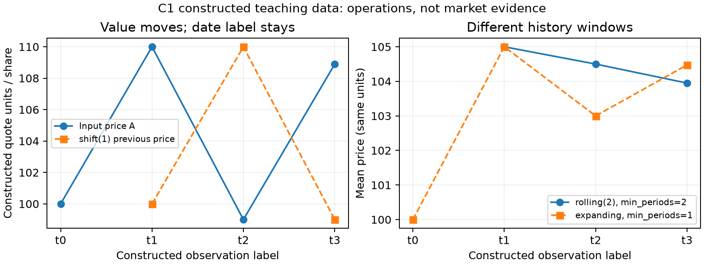
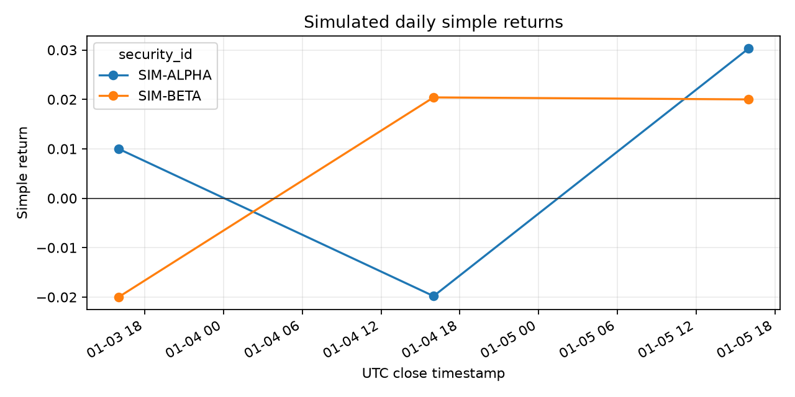

# 第2章 — 量化研究中的Python：用时间索引写对收益计算

> 先修：第 1 章。完成后你能：在命令行与 Notebook 中复跑同一份收益分析，解释缺失值、标签对齐、滚动窗口和交易时点，并能拒绝乱序、重复索引和非正价格。

本章时间标签用协调世界时（Coordinated Universal Time, UTC）；NaN是非数值（Not a Number）的数值标记，本例用它表达缺失。它本身不说明缺失原因。

## 1. 本章目标

学完本章，你应能完成这些可核验的工作：

1. 用 Python 的基本类型、条件、循环、函数、类型标注、模块导入和异常处理，组织一段可重复运行的分析。
2. 用数值数组库（NumPy）的数组、维度、向量化（vectorization）和广播（broadcasting）计算同一批收益，并说明每个轴代表什么。
3. 用表格数据分析库（pandas）的日期索引执行收益、排序、滚动统计（rolling）、扩展统计（expanding）、分组（groupby）、月度重采样（resample）和缺失值检查。
4. 用 Polars 数据框架的立即执行（eager）与延迟执行（lazy）操作表达筛选、列变换和分组聚合；知道何时调用 collect 执行查询。
5. 用科学算法库（SciPy）的常见数值方法，读懂输入条件与收敛结果；用绘图库（Matplotlib）绘制有单位、有样本说明的图。
6. 用交互式计算笔记本（Jupyter Notebook）和命令行重跑分析，使用分布式版本控制系统（Git）记录代码变化，并避免把密钥和本地数据推送到共享仓库。

验收时，请从一列价格得到正确收益，说明首个收益为何缺失；对乱序日期、重复索引和非正价格给出明确处理；对 NaN 验证它会留在结果中，不会被函数悄悄填成零；再证明产生信号的时点早于它所使用的持有期收益。

## 2. 为什么 Quant 需要它

量化研究的错误常来自普通计算在时间轴上的错位。一个收益率数字即使算术正确，只要分子分母跨了不同频率、不同资产或不同日期，它就回答了错误的问题。

Python 为数据读取、数值计算、统计方法、绘图和实验记录提供共同环境。你可以先在脚本里定义函数，再让 Notebook 调用函数探索数据；修复之后，从空白进程重跑就能得到同一结果。NumPy 和 pandas 各自使用数组与带标签的数据表。两者都会进行批量运算，pandas 还会按索引标签对齐数据。标签使时间序列处理更清楚，也要求你明确检查索引。

本章从 100、110、99 三个教学价格开始。你先手算两个区间收益，再让库逐项给出相同结果。此例只验证运算和时间标记，不代表可交易策略，也不代表真实市场观察。

## 3. 直觉

假设同一项资产的三个观测价格依次是 100、110、99。第一段上涨、第二段下跌；如果只加价格变化或直接相加两个百分数，都会丢掉“第二段收益作用于第一段之后的财富”这一点。第 8 节用这三个数逐项核算。

量化研究会把每条数据附上资产和观测时间。某天的价格对应一个指定口径，例如收盘价或总回报指数；某个收益对应明确的开始与结束区间。我们不能只看数组里的“第 4 个数”，还得问它属于哪个资产、哪个时点、哪个区间。

索引（index）像贴在每一行的标签。pandas 在相加两条一维数据序列（Series）时，先按日期等索引标签（index label）寻找对应值，再执行运算。若一列以周一、周二为标签，另一列以周二、周三为标签，周一与周三没有配对观测，结果保留缺失值。这个行为能揭露错位，也可能悄悄让研究样本变小。计算后需要检查结果行数、缺失位置和参与日期。

## 4. 数学基础

令 \(P_t\) 表示日期 \(t\) 上的指定价格，单位为“报价货币/份”。简单收益（simple return）\(R_t\) 无量纲，定义为

\[
R_t=\frac{P_t}{P_{t-1}}-1,\qquad P_{t-1}>0.
\]

这里的 \(t-1\) 指数据序列中的上一项；若交易日不连续，它未必是前一个日历日。价格序列有 \(T\) 个观测点时，相邻简单收益最多有 \(T-1\) 个，首行没有前值，因此函数应留下缺失值（Missing Value），以非数值（Not a Number, NaN）标记，而非臆造为 0。

若一维价格序列有 \(T\) 个观测，相邻收益数组形状仍为 \((T,)\)，首个元素为空；从第二个观测开始最多有 \(T-1\) 个有效收益。把 \(N\) 个资产放在列、\(T\) 个日期放在行，价格矩阵 \(P\) 的形状为 \((T,N)\)，沿时间轴相邻运算后收益形状仍为 \((T,N)\)。

简单收益的累计财富以乘法连接：

\[
1+R_{0:K}=\prod_{t=1}^{K}(1+R_t).
\]

这里另用 \(K\) 表示持有区间数：完整的 \(T\) 个价格观测对应 \(K=T-1\) 段相邻收益，端点记为 \(P_0,\ldots,P_K\)。\(R_{0:K}\) 是整个区间的简单收益；每个 \(R_t\) 对应一段不重叠持有区间。累计值要乘财富因子，不能把各期百分比直接相加；第 8 节将用具体数值检查这一点。

在价格都为正时，对数收益（log return）\(r_t=\ln(P_t/P_{t-1})\) 可以跨期相加，且 \(r_{0:K}=\sum_{t=1}^K r_t=\ln(P_K/P_0)\)。对数收益不等于简单收益；建仓和组合权重等金融解释通常使用简单收益。不要把两种口径混写。

计算机用有限位二进制近似表示多数十进制小数，因此 0.1 加 0.2 的机器结果不一定与 0.3 精确相同。输出多出末尾几位不自动说明公式错误。比较浮点数时用容差；在需要精确十进制金额的会计场景，应另选十进制表示及舍入规则。价格收益通常使用浮点数，但要保留原始单位、数据类型和容差约定。

## 5. 正式定义

Python 是解释型通用语言。本章把表达式（expression）看成返回值的运算，把语句（statement）看成控制执行或绑定名称的动作。变量（variable）名绑定一个对象；名称本身不固定对象的类型。整数 **int**、浮点数 **float**、布尔值 **bool**、字符串 **str**、列表 **list**、元组 **tuple**、字典 **dict**、集合 **set** 和空值 **None** 是常见内建对象。价格数组通常用同类型数值，不要把日期、备注和数字混进同一列而不设类型。

条件分支（conditional）用 if/elif/else 选择路径；循环（loop）用 for 逐个处理项目或用 while 重复检查。函数（function）为有名称的输入输出逻辑。模块（module）是可导入的 Python 文件或库。异常（exception）让程序把失败作为可识别事件处理。类型提示（type hint）说明程序接口期望的类型，供人、集成开发环境（Integrated Development Environment, IDE）和静态检查器使用；Python 运行时不会因为提示而自动拒绝不合类型的输入。

::: {.body-definition title="定义：形状、轴与业务含义"}

NumPy 是数值 Python 的数组库。多维数组（ndarray）保存同一类型的元素；形状（shape）表示各维长度，元素类型（dtype）说明存储值的类型。轴（axis）是某一维的编号。一个数组表达式可一次作用于许多元素，减少 Python 层的逐项循环。兼容形状的数组可按元素运算，但广播不会改变“每个值代表什么”的业务含义。

:::

pandas 提供二维带行列标签的数据表（DataFrame）。行标签决定标签对齐；行位置决定 iloc 的位置选择。这两套规则不可互换。时间序列索引（time-series index）可用时间戳对象（Timestamp）、日期时间索引（DatetimeIndex）或期间索引（PeriodIndex）记录时间点或时间段。

### 先读懂对象和括号

`import pandas as pd` 导入模块并给它简称 `pd`；点号访问模块的函数或对象的方法，括号 `()` 调用它。`=` 把右侧结果绑定到左侧名称，`==` 比较是否相等；`assert 条件` 在条件不成立时停止例子。`[100, 110]` 是有顺序的列表；`{"A": [100, 110]}` 是字典，冒号左边的字符串是键，右边是对应的值。`index=dates` 是命名参数，告诉构造函数用哪个对象做行标签。

单列序列（Series）包含一列值和同长度的索引（Index）；数据表（DataFrame）同时包含行标签和列标签。`df["A"]` 选A列，返回Series；`df[["A"]]` 用列名列表选择，仍返回二维DataFrame。`df.iloc[1, 0]` 按从0开始的位置选第二行第一列；`df.loc[dates[1], "A"]` 按标签选同一个格子。位置相同不证明标签相同，读入别人的表后要核对。

形状 \((T,N)\) 表示T行、N列，不是T乘N个可随意交换的值。轴0对应行维，轴1对应列维。对时间×资产的表，`mean(axis=0)` 消去时间维，给每只资产一个均值；`mean(axis=1)` 消去资产维，给每个日期一个截面均值。`rank(axis=1)` 在每行内排名；`rolling(2).mean()` 默认沿各列的行顺序滑动，保留输出的日期行。相同轴编号下，不同操作的输出形状仍须具体核对。

数组切片 `prices[1:, :]` 取第二行起的全部行和全部列；`prices[:-1, :]` 取末行以前的全部行。冒号表示切片，逗号分开行/列选择。因此两个切片在同一列配相邻端点，产生 \((T-1,N)\) 收益；pandas移位保留原T行，把无前值的首行留下NaN。这是两种输出布局，不是两种收益定义。


### 核心操作的严格定义

1. **移位（shift）**：将数据沿指定轴移动指定的步长。在时间序列上，`shift(1)` 将上一行的数值映射到当前行标签。首行因没有历史可取而成为 `NaN`。移位只改变数值对齐，不修改索引标签本身。
2. **滚动窗口（Rolling Window）**：在每个当前位置取包含该位置在内的固定长度历史窗口。若窗口大小为 $W$，默认要求窗口内至少包含 $W$ 个非缺失观测（即 `min_periods=W`），不足者输出 `NaN`。
3. **扩展窗口（Expanding Window）**：在每个当前位置取从样本起点至当前位置的全部累积历史。常设 `min_periods=1`，首行即有结果，后续各行样本量逐步增大。
4. **分组运算（groupby）**：按指定的离散键（如证券代码 `asset`）将表分割为互不重叠的独立子表，在每个子表内独立执行计算（如组内 shift、组内 rolling），再合并回统一结构。它隔离分组，但不替你排序；组内仍须先按时间升序且检查重复键。
5. **时间重采样（resample）**：将带时间索引的数据按规则的时间间隔（如周、月）划分为区间桶（bins），再对每个桶内的观测执行聚合（如 `.last()`、`.mean()`）。桶的标签通常代表区间边界，不代表该时刻真实开市。
6. **横截面排序（rank）**：在同一时间切片上，沿资产轴（`axis=1`）对各资产的特征或收益按大小计算名次。可选用百分位形式（`pct=True`）将排名归一化至 $(0, 1]$ 之间。

Polars 的表达式应用程序接口（Application Programming Interface, API） 用列运算构造变换。立即执行模式（eager）在每一步计算；延迟执行模式（lazy）先构造查询计划（query plan），再统一优化并执行。SciPy 提供建立在 NumPy 之上的科学算法，例如统计分布、线性代数、优化、插值和积分。Matplotlib 把数值映射到图形元素。Jupyter Notebook 用代码单元（cell）与计算内核（kernel）提供交互环境。Git 记录可恢复的提交历史。

## 6. 推导

若没有外部现金流，持仓财富每期按简单收益乘以增长因子：

\[
W_t=W_{t-1}(1+R_t).
\]

递归展开便得到 \(W_K=W_0\prod_{t=1}^{K}(1+R_t)\)，累计简单收益为 \(W_K/W_0-1\)。这里仍用 \(K\) 计真实持有区间，初始资本不另产生一个零收益观测。这个推导解释了为什么多期收益要连乘；数值核对留在第 8 节。

这里假设价格序列同口径、没有外部现金流，且比较的是同一份持仓。若价格序列未包含分红，而目标是总回报，单用收盘价比值会低估持有收益。若资产拆股或数据供应商修订历史价格，研究者必须说明使用原始价格、复权价格还是总回报序列。

由定义可见，收益率运算要求分母为正。如果价格为 0，除法没有定义；价格为负也不符合本例的普通现货资产价格语义。底层函数 **compute_returns** 对索引和有效价格作严格检查：价格索引须为升序且唯一的带时区 DatetimeIndex，非缺失价格须为正且有限。遇到 NaN，函数保留并传播，不自动填补；数据清理策略由调用者决定并留痕。

## 7. 金融解释

一行收益首先是区间的统计量。若标记为 2026-02-28 的收益，必须说明它代表哪个开始时点到哪个结束时点。收益行日期常按区间结束时间标记；仅看日期无法判断信号何时可用。

本课程使用以下时间字段：事件时间（event_time）；该版本数据最早可得时间（available_at）；本系统实际接收并保存该版本的时间（ingested_at）；策略信号形成时间（signal_time）；可成交时刻（trade_time）；持仓收益开始与结束时间（return_start、return_end）。可用数据须同时满足 \(\text{available\_at}\leq\text{signal\_time}\) 和 \(\text{ingested\_at}\leq\text{signal\_time}\)，成交时点另须晚于信号时点。公开但未入库的数据不能参与本系统的历史信号；同一时戳不能证明先后时应排除该版本或保留更细接收顺序，详见第3章。若信号在当日收盘价确定，就不能假设自己也按同一收盘价成交，除非研究设计证明订单提交、撮合和延迟安排可行。常见教学做法是用收盘信息生成信号，再在下一个可执行时点成交，并从成交后起算收益。

简单收益可以按期复利，多个资产同一期间的简单收益可按区间开始时已生效的资金权重加权（期内不再平衡、无额外现金流或融资）。log return 适合跨时间相加的数学表示，却不能直接替代简单收益做普通资金权重组合。日度、月度和年化数字也不能混合；年化因子须按市场日历和频率定义。缺失的交易日不等于零收益，填零会改变波动、累计收益与相关性。

滚动统计适合描述信号时点之前的历史。例如，收盘 \(t\) 时可用过去 20 个观测构造信号，再把信号用于之后的持有期。如果把整段样本的均值、排名或标准差先算好再回填历史，计算就读到了未来信息。每个特征都要写清窗口端点、最少观测数和可用时间。

## 8. Numerical Example

下面是一组**教学构造**的基准小价格表，包含两只资产 A 与 B 在4个按UTC标记的构造观测日（不是已验证真实交易日）的价格：

| 时间索引 $t$ | 资产 A 价格 $P_A$ | 资产 B 价格 $P_B$ | 维度与语义说明 |
|---|---:|---:|---|
| $t_0$ (2026-01-05 UTC) | 100.0 | 50.0 | 宽表形状 $(4, 2)$；行标签为带时区 DatetimeIndex |
| $t_1$ (2026-01-06 UTC) | 110.0 | 52.0 | 列标签为资产代码 `Index(['A', 'B'])` |
| $t_2$ (2026-01-07 UTC) | 99.0 | 51.0 | 单列提取为 Series，形状 $(4,)$ |
| $t_3$ (2026-01-08 UTC) | 108.9 | 54.0 | 纯数值矩阵 ndarray，形状 $(4, 2)$，无标签 |

### 8.1 核心运算的逐步输入、中间值与输出拆解

#### 1. 移位与收益率（shift & returns）
- **输入**：$P$ 矩阵。
- **操作**：`P.shift(1)` 沿行方向（`axis=0`）下移一行。
- **中间值表**：

| 时间 | $P_A$ | $\text{shift}_A$ | $R_A = P_A/\text{shift}_A - 1$ | $P_B$ | $\text{shift}_B$ | $R_B = P_B/\text{shift}_B - 1$ |
|---|---:|---:|---:|---:|---:|---:|
| $t_0$ | 100.0 | NaN | NaN（首行无前值） | 50.0 | NaN | NaN（首行无前值） |
| $t_1$ | 110.0 | 100.0 | $110/100 - 1 = +10.0\%$ | 52.0 | 50.0 | $52/50 - 1 = +4.0\%$ |
| $t_2$ | 99.0 | 110.0 | $99/110 - 1 = -10.0\%$ | 51.0 | 52.0 | $51/52 - 1 \approx -1.923\%$ |
| $t_3$ | 108.9 | 99.0 | $108.9/99 - 1 = +10.0\%$ | 54.0 | 51.0 | $54/51 - 1 \approx +5.882\%$ |

- **为什么产生 NaN**：$t_0$ 之前在样本内没有任何观测，无法确定增长基数。该空值是真实的统计边界，不能填 0。

#### 2. 滚动窗口均值（rolling, window=2）
- **输入**：$P_A$ 序列 $[100.0, 110.0, 99.0, 108.9]$。
- **操作**：`rolling(window=2).mean()`。
- **中间值拆解**：
  - $t_0$：窗口仅含 $\{100.0\}$，观测数 1 < 2，由于 `min_periods=2`，输出 **NaN**。
  - $t_1$：窗口包含 $\{100.0, 110.0\}$，均值 $(100.0 + 110.0)/2 =$ **105.0**。
  - $t_2$：窗口包含 $\{110.0, 99.0\}$，均值 $(110.0 + 99.0)/2 =$ **104.5**。
  - $t_3$：窗口包含 $\{99.0, 108.9\}$，均值 $(99.0 + 108.9)/2 =$ **103.95**。

#### 3. 扩展窗口均值（expanding, min_periods=1）
- **输入**：$P_A$ 序列 $[100.0, 110.0, 99.0, 108.9]$。
- **操作**：`expanding(min_periods=1).mean()`。
- **中间值拆解**：
  - $t_0$：累积窗口 $\{100.0\}$，均值 **100.0**。
  - $t_1$：累积窗口 $\{100.0, 110.0\}$，均值 $(100.0 + 110.0)/2 =$ **105.0**。
  - $t_2$：累积窗口 $\{100.0, 110.0, 99.0\}$，均值 $(100.0 + 110.0 + 99.0)/3 =$ **103.0**。
  - $t_3$：累积窗口 $\{100.0, 110.0, 99.0, 108.9\}$，均值 $(100.0 + 110.0 + 99.0 + 108.9)/4 =$ **104.475**。
- **对比**：rolling 固定回看长度；expanding 不断吸纳全部历史。

#### 4. 分组运算（groupby on long format）
- 若将上述数据展平为包含 `asset`、`date`、`price` 的长表（8行）。
- **错误操作**：直接 `df['price'].shift(1)`。按日期交错排列时，某行上一行可能属于另一证券；按资产块排列时，B首行也可能引用A末行。
- **正确操作**：`df.groupby('asset')['price'].shift(1)`。在分组内部独立下移，A 与 B 各自的首行严格输出 NaN。

先用本表前两日期的长表逐行核对，行按日期、资产排序：

| 行 | date/asset/price | 全局shift前值 | 组内shift前值 | 正确收益 |
|---|---|---:|---:|---:|
| 0 | t0/A/100 | NaN | NaN | NaN |
| 1 | t0/B/50 | 100（A） | NaN | NaN |
| 2 | t1/A/110 | 50（B） | 100（A） | 0.10 |
| 3 | t1/B/52 | 110（A） | 50（B） | 0.04 |

全局算法在行1算出50/100−1=−50%，行2算出110/50−1=120%；这些不是B或A的相邻收益。组内处理前仍要排序，不把groupby当作排序函数。

#### 5. 重采样（resample）
- 对日频序列应用 `.resample('W-FRI').last()`。
- 2026-01-05（周一）至 2026-01-08（周四）全部落入截至 2026-01-09（周五）的周分箱内。
- 输出的时间标签为 `2026-01-09`（分箱右端点），对应的聚合取值为 `108.9`（最后一条真实观测）。标签是日历分箱定义，该日市场未必有交易。

#### 6. 横截面百分位排序（rank, axis=1）
- **输入**：收益率表在 $t_1$ 的切片：$R_A = +10.0\%, R_B = +4.0\%$。
- **操作**：`returns.rank(axis=1, pct=True)`（`axis=1` 表示在同一日期横截面上比较资产）。
- **中间结果**：$R_B (4.0\%) < R_A (10.0\%)$。名次：B 为第 1 名，A 为第 2 名。
- **输出**：归一化百分比排名：B 输出 $1/2 = 0.5$；A 输出 $2/2 = 1.0$。

本表按轴输出也能逐格核对：`P.mean(axis=0)` 输出A均价104.475、B均价51.75，形状(2,)；`P.mean(axis=1)` 输出75、81、75、81.45，形状(4,)。前者各列沿时间平均，后者各行跨资产平均。不同证券价格均值没有自然投资含义，这里只用于检查轴；第9节旧数组代码另外使用三行价格与明确权重，不能混为本表的投资结论。

标签对齐例的逐格结果为：1月5日0.01+缺项=NaN，1月6日0.02+0.03=0.05，1月7日缺项+0.04=NaN。`shift(1)`保留1月5/6/7/8标签，A值成为NaN/100/110/99；`shift(1,freq="D")`保留100/110/99/108.9四个值，标签成为1月6/7/8/9。二者不自动证明某时点可成交。

默认平均并列名次时，同日两项收益都是1%，名次都是1.5，百分位都是1.5/2=0.75；若只有A有效、B缺失，A按一项有效值归一为1，B仍NaN。不同截面有效数量影响排名尺度，应报告覆盖。



横轴t0–t3为构造观测标签，纵轴为报价单位/份。左图把当前价格与前值配对，首个前值不存在；右图同一输入的rolling2与expanding1在t2后分离。图展示运算规则，没有订单或市场效果。

```{=latex}
\needspace{18\baselineskip}
```

### 8.2 三个价格观测、两期复利核算（沿用原例）

::: {.body-example title="完整例题：三个价格与两期复利"}

考虑资产A的前三个价格观测：100、110、99，对应两个相邻持有区间。
- 价格变化是 \(+10\) 与 \(-11\)，合计 \(-1\) 个报价单位。
- 简单收益是 \(+10\%\) 与 \(-10\%\)，直接相加得到 0%，这不是累计收益。
- 财富路径是 \(100\to110\to99\)，累计结果为 \(99/100-1=-1\%\)。
- 对数收益相加满足 \(\ln(1.1)+\ln(0.9)=\ln(0.99)\)，与累计财富比对应。

机器输出可能显示 0.10000000000000009 等浮点尾数。手算值与机器值在容差内相同。判断前先检查输入单位和日期，再检查精度。

:::

### 8.3 形状恰好兼容：逐日期与逐资产不是同一件事

::: {.body-conditions title="输入条件：时间轴与资产轴"}

考虑两个构造持有期、两资产的简单收益矩阵
\[
R=\begin{pmatrix}0.10&-0.05\\-0.10&0.10\end{pmatrix},
\qquad w=(0.20,0.80),\qquad g=(1.00,0.50).
\]
行是持有期，列是资产A/B。\(w\) 是每期风险资产基准权重，\(g\) 是事先给定的逐日期风险资产投入比例；其余资金放在零收益现金，无费用，期初设定各期权重，不以期末信息决定\(g\)。本例只核轴与资金口径，不是风险调节策略证据。

:::

逐资产乘\(w\)时，\((2,)\)沿最后的列维广播，每一行各列都乘同一资产权重：
\[
R\odot w=\begin{pmatrix}0.02&-0.04\\-0.02&0.08\end{pmatrix}.
\]
符号\(\odot\)表示逐元素相乘；按行相加得每期组合收益\((-0.02,0.06)\)，即−2%、6%。

若每期风险资产投入比例为\(g\)，正确做法先将它写成两行一列\(g_{\rm col}=(1,0.5)^\top\)，逐行缩放：
\[
R\odot g_{\rm col}=
\begin{pmatrix}0.10&-0.05\\-0.05&0.05\end{pmatrix},
\qquad
(R\odot g_{\rm col})\odot w=
\begin{pmatrix}0.02&-0.04\\-0.01&0.04\end{pmatrix}.
\]
按行相加为−2%、3%。第二期有效资产权重是0.10/0.40，现金0.50，预算仍为1。

错误的\(R\odot g\)同样能运行，因为日期数恰好等于资产数，NumPy仍把一维\(g\)沿列广播：
\[
R\odot g=
\begin{pmatrix}0.10&-0.025\\-0.10&0.05\end{pmatrix}.
\]
它把B列在两期都减半，并没有只把第二期的风险投入减半；再乘\(w\)并求行和得到0%、2%，与目标−2%、3%不符。正确二维形状是\((2,1)\)，而非仅断言长度为2。代码用\(g[:,None]\)显式保留时间轴；资产权重则按资产标签对齐后核列序。T与N相等时，shape检查尤其不能替代轴语义。

```python
import numpy as np
r = np.array([[0.10, -0.05], [-0.10, 0.10]])
w = np.array([0.20, 0.80])
g = np.array([1.00, 0.50])
asset_contributions = r * w
date_contributions = (r * g[:, None]) * w
wrong_contributions = (r * g) * w
assert np.allclose(asset_contributions.sum(axis=1), [-0.02, 0.06])
assert np.allclose(date_contributions.sum(axis=1), [-0.02, 0.03])
assert np.allclose(wrong_contributions.sum(axis=1), [0.00, 0.02])
```

## 9. Python Implementation

### 接受读者包的默认入口

本样章使用读者包中的共享实现。按[读者安装说明](../../../../editions/zh/README.md)建立环境，从读者包根运行：

```bash
.venv/bin/python run_notebook.py notebooks/ch02_python.ipynb
```

默认 Notebook 调用随包共享逻辑，不读取未随包提供的 French 数据，也不下载数据；新执行结果写入唯一 `runs/` 子目录。French 历史数据须按[可选数据契约](../../../../editions/zh/OPTIONAL_DATA.md)由读者自行提供获准使用的输入。读者 CLI 为每次运行创建新的 UUID 目录并避免覆盖已有结果。构造数据运行不等于市场数据或成交验证。


下面代码展示 Python 语法结构，不重复核心收益函数。价格清洗和正式收益计算由 [src/quant_course/timeseries.py](../../../../src/quant_course/timeseries.py) 提供；本章教学脚本调用同一核心逻辑，Notebook 也调用库函数。交付链接为 [脚本](../../../../code/ch02_python.py) 与 [Notebook](../../../../notebooks/ch02_python.ipynb)。

```python
prices = [100.0, 110.0, 99.0]
first_return = prices[1] / prices[0] - 1.0
second_return = prices[2] / prices[1] - 1.0
wealth = 100.0 * (1.0 + first_return) * (1.0 + second_return)
assert abs(wealth - 99.0) < 1e-12
print(first_return, second_return, wealth)
```

函数让调用者给输入、函数体计算、return 把值交回调用者。以下独立代码演示类型标注和异常边界：

```python
from collections.abc import Sequence
from math import isfinite
from numbers import Real


def final_wealth(initial: float, returns: Sequence[float]) -> float:
    if isinstance(initial, bool) or not isinstance(initial, Real):
        raise TypeError("initial must be a real number")
    if not isfinite(initial) or initial <= 0.0:
        raise ValueError("initial must be positive and finite")
    wealth = initial
    for value in returns:
        if isinstance(value, bool) or not isinstance(value, Real):
            raise TypeError("returns must be real numbers")
        if not isfinite(value) or value < -1.0:
            raise ValueError("simple return must be finite and at least -100%")
        wealth *= 1.0 + value
        if not isfinite(wealth):
            raise ValueError("wealth exceeds finite numeric range")
    return wealth


assert abs(final_wealth(100.0, [0.10, -0.10]) - 99.0) < 1e-12
for invalid in ([float("nan")], [float("inf")], [-1.01], [True], ["0.1"]):
    try:
        final_wealth(100.0, invalid)
    except (TypeError, ValueError):
        pass
    else:
        raise AssertionError("invalid return was accepted")
print(final_wealth(100.0, [0.10, -0.10]))
```

该函数用于展示分支、循环与异常；它拒绝非实数、布尔值、NaN、无穷及低于−100%的收益，也检查复利溢出。正式向量接口仍复用第11章的 wealth_index，不另建一套研究指标。允许−100%归零不表示破产后账户收益仍有定义。类型标注帮助工具检查接口，但不阻止调用者传入错误数据。ValueError 让函数拒绝明确不满足条件的输入。捕获异常时，只捕获能采取处理动作的类型；不要用 except Exception: pass 隐藏数据问题。

import 绑定可复用模块。常见写法是 import numpy as np、import pandas as pd，或从模块导入单个函数。避免把本地脚本命名为 pandas.py、scipy.py 或 statistics.py，否则导入可能加载错误文件。把入口写在 if __name__ == "__main__": 下，可让脚本既能命令行运行，也能被 Notebook 导入。

建立隔离环境可减少不同项目依赖冲突。本课程的解释器和依赖版本已锁定，正式分析按 [环境安装说明](../../../../editions/zh/README.md) 中的项目环境安装；从课程根目录执行：

```bash
python3 -m venv .venv
.venv/bin/python -m pip install -r requirements-a1-lock.txt
.venv/bin/python -m pip install -e . --no-deps
.venv/bin/python -m pytest tests -q
.venv/bin/python tools/run_a1.py
```

锁定文件记录课程快照中的依赖版本；必要时可在一次性探索环境临时安装单个包，但正式结果要回到此项目环境并从头复跑。命令行和 Notebook 共用该 .venv；Notebook 选择其 Python kernel。项目采用 src 布局，editable install 让两种入口导入同一份核心函数。

正式 API 为 **compute_returns(prices: pd.Series, kind: Literal["simple", "log"] = "simple") -> pd.Series**，由 **from quant_course import compute_returns** 导入。prices 必须带升序且唯一的时区 DatetimeIndex；非缺失价格须为正且有限。NaN 保留并传播：当前价格缺失时当前收益缺失，下一行也因缺少前一期价格而缺失。函数返回首项 NaN，不做填补。对输入及输出显式核对，别用零替换空值。 将这条序列送入第11章wealth_index时，仅排除没有前价的首项位置；剩余区间必须完整且采用simple口径，再传初始资本。不能用dropna()删掉中间未知持有期；第11章第9节给出可运行桥接。

在课程根目录运行脚本或启动 Notebook：

```bash
.venv/bin/python code/ch02_python.py
.venv/bin/jupyter lab
```

脚本从自身位置定位课程根目录，再加入 src 导入路径；Notebook 也按当前工作目录向上寻找该目录。两个入口都调用同一函数，避免另写一份收益实现。

Git 让你查看某次分析采用的代码，并把代码演进记录为本地提交。在已初始化的课程仓库根目录查看状态、暂存明确的文件、检查暂存差异，再提交：

```bash
git status
git add code/ch02_python.py notebooks/ch02_python.ipynb
git diff --staged
git commit -m "Add Chapter 2 Python examples"
git log --oneline -1
```

暂存区让你选择下一条提交包含哪些修改；提交只保存在本地，推送远端是另一项操作。把依赖环境、编辑器缓存和本地密钥排除在版本库外：

```gitignore
.venv/
.env
*.ipynb_checkpoints/
```

不要把 API key、密码或访问令牌写入脚本、Notebook 输出或提交记录。用环境变量或受管理的凭据存储注入密钥，并在运行记录里删去敏感值。.gitignore 只能阻止尚未跟踪的文件进入新提交；若密钥已经提交，立即撤销并轮换该密钥，不能把后来删除文件当作泄露已经处理完毕。

NumPy 让同一表达式作用于数组。以下示例用行表示日期、列表示资产；长度为 N 的权重数组沿最后一轴广播：

```python
import numpy as np

prices = np.array([[100.0, 200.0], [110.0, 190.0], [99.0, 209.0]])
returns = prices[1:, :] / prices[:-1, :] - 1.0
weights = np.array([0.5, 0.5])
weighted_asset_returns = returns * weights
portfolio_returns = weighted_asset_returns.sum(axis=1)
assert prices.shape == (3, 2)
assert returns.shape == (2, 2)
assert np.allclose(portfolio_returns, [0.025, 0.0])
print(returns, portfolio_returns)
```

广播规则只检查形状。它不会检查两列资产的次序是否与权重一致；把权重附上资产标签并核对顺序，才能保证组合含义正确。

pandas 用索引标签而非当前行号对齐 Series。下面三日期示例产生 A、B、C 三个标签；没有另一侧对应值的日期保留 NaN：

```python
import pandas as pd

dates = pd.to_datetime(["2026-01-05", "2026-01-06", "2026-01-07"], utc=True)
left = pd.Series([0.01, 0.02], index=dates[:2], name="left")
right = pd.Series([0.03, 0.04], index=dates[1:], name="right")
combined = left + right
assert abs(combined.loc[dates[1]] - 0.05) < 1e-12
assert pd.isna(combined.loc[dates[0]])
assert pd.isna(combined.loc[dates[2]])
print(combined)
```

### 小价格表的自包含执行与断言

下列独立可运行代码完整再现第 8 节小价格表中的六种核心运算（`shift`、`rolling`、`expanding`、`groupby`、`resample`、`rank`），并以严格断言锁定数值与中间值行为：

```python
from math import isclose
import pandas as pd

dates = pd.to_datetime(["2026-01-05", "2026-01-06", "2026-01-07", "2026-01-08"], utc=True)
df_small = pd.DataFrame(
    {"A": [100.0, 110.0, 99.0, 108.9], "B": [50.0, 52.0, 51.0, 54.0]},
    index=dates,
)

# 1. shift 与收益率
df_shifted = df_small.shift(1)
df_returns = df_small / df_shifted - 1.0
assert pd.isna(df_shifted.iloc[0, 0])
assert isclose(df_returns.loc[dates[1], "A"], 0.10, rel_tol=1e-12)
assert isclose(df_returns.loc[dates[2], "A"], -0.10, rel_tol=1e-12)

# 2. rolling(2)
rolling_mean = df_small.rolling(window=2).mean()
assert pd.isna(rolling_mean.iloc[0, 0])
assert rolling_mean.loc[dates[1], "A"] == 105.0
assert rolling_mean.loc[dates[2], "A"] == 104.5

# 3. expanding(1)
expanding_mean = df_small.expanding(min_periods=1).mean()
assert expanding_mean.loc[dates[0], "A"] == 100.0
assert expanding_mean.loc[dates[1], "A"] == 105.0
assert isclose(expanding_mean.loc[dates[2], "A"], 103.0)

# 4. 横截面 rank(axis=1)
ranks = df_returns.rank(axis=1, pct=True)
assert ranks.loc[dates[1], "B"] == 0.5
assert ranks.loc[dates[1], "A"] == 1.0

# 5. 长表 groupby shift
df_long = (
    df_small.reset_index()
    .melt(id_vars="index", var_name="asset", value_name="price")
    .rename(columns={"index": "date"})
    .sort_values(["asset", "date"])
    .reset_index(drop=True)
)
df_long["prev_price"] = df_long.groupby("asset")["price"].shift(1)
df_long["ret"] = df_long["price"] / df_long["prev_price"] - 1.0
assert pd.isna(df_long.loc[0, "ret"])  # A 组首行
assert pd.isna(df_long.loc[4, "ret"])  # B 组首行
assert isclose(df_long.loc[1, "ret"], 0.10, rel_tol=1e-12)
assert isclose(df_long.loc[5, "ret"], 0.04, rel_tol=1e-12)

# 6. resample 周末聚合
weekly_last = df_small.resample("W-FRI").last()
assert weekly_last.index[0] == pd.Timestamp("2026-01-09", tz="UTC")
assert weekly_last.loc[pd.Timestamp("2026-01-09", tz="UTC"), "A"] == 108.9
```

Polars eager 计算立即返回 DataFrame；lazy 先建立计划，到 collect 时才执行。过滤与选列可让优化器尝试减少从文件读取的行列：

```python
import polars as pl

data = pl.DataFrame(
    {
        "asset": ["A", "A", "B"],
        "date": [1, 2, 2],
        "return": [0.01, 0.02, -0.01],
    }
)
eager_result = (
    data.filter(pl.col("date") >= 2)
    .group_by("asset")
    .agg(pl.col("return").mean().alias("mean_return"))
)
lazy_query = (
    data.lazy()
    .filter(pl.col("date") >= 2)
    .select("asset", "return")
    .group_by("asset")
    .agg(pl.col("return").mean().alias("mean_return"))
)
print(lazy_query.explain())
lazy_result = lazy_query.collect()
assert lazy_result.height == eager_result.height
print(lazy_result)
```

查询优化由 Polars 的计划和数据来源决定。你仍须检查输出 schema、缺失值与分组排序；分组结果不保证保留输入顺序。

SciPy 提供数值算法，但算法收敛不证明金融建模假设正确。以只含两年后现金流的简化贴现方程为例，现值 90 元对应未来收款 100 元；若每年复利一次，求解未知年收益率：

```python
from scipy.optimize import brentq


def pricing_error(rate: float) -> float:
    return 100.0 / (1.0 + rate) ** 2 - 90.0

rate = brentq(pricing_error, 0.0, 1.0)
assert abs(pricing_error(rate)) < 1e-10
print(rate)
```

brentq 要求括区间两端的函数值异号，并在区间中寻找根。这个例子假设现金流时间、年复利和无违约口径已给定；实际证券收益率还受日计数、现金流、日历、价格含息口径和可赎回条款影响，不能把数值求根函数当作收益定义。

## 10. Visualization

本章沿用的实际图为 。图使用两条教学构造证券序列，横轴是 UTC 收盘时间戳，纵轴是无量纲简单收益小数。线条颜色区分 SIM-ALPHA 与 SIM-BETA。首个收益因没有前一期价格而为 NaN，绘图不连首个空值。图题注明 simulated，样本来源是本地 fixture；它不是市场观测，也不是第 8 节手算例的图。

图注应同时说明“模拟数据”、日频观测、收益按 UTC 收盘时点标记。它不能用市场数据的视觉样式，也不能把空首值画成零。图对象（Figure）表示整张图，坐标区对象（Axes）表示一个绘图区。设置轴标签、单位、图例、标题和来源后再保存图片；读者应能仅凭图注判断它画了什么。真实 French 月度数据图要另标数据版本、月度频率和收益单位。

## 11. Real Market Example

Kenneth R. French Data Library 提供按月或按日发布的研究组合收益数据。本章快照选择 10 Industry Portfolios 的月度平均市值加权收益（Average Value Weighted Returns -- Monthly）区块。官方说明给出月度样本为 1926 年 7 月至 2026 年 8 月；本地整理文件含 1202 个月和 10 个行业列。原始 CSV 的 YYYYMM 行以百分数记录，整理文件已将百分数除以 100，月份仍保留 YYYYMM 字符串。该原始文件还含年度、等权等其它区块，不能把它们混入月度市值加权序列。日度收益由官方另列的数据文件提供，不在本章选择的文件中。

本地处理结果为 月度行业收益 CSV，对应 数据 manifest。下载 UTC 时间为 2026-10-05 19:18:24；压缩快照 SHA-256 为 ebd937a4b995d821867aeb956a96f09a666386f38fa82516b7d1767ee4a49ae5，整理文件 SHA-256 为 3b097d810c295d64eedfa1ece7067ff2a0707f5ca90e33935df9949251f70950。来源页说明历史收益会随 CRSP 修订而改变；分析应保留快照、下载日期和哈希。版权归 Fama 与 French；可公开下载不等于可无限制再分发，发布衍生数据前应核对使用条件。

原始文件的 monthly 区块从文件第 12 行附近开始，区块标题为“Average Value Weighted Returns -- Monthly”。原始缺失码为 -99.99 和 -999。处理者只选该月度表，将缺失码标记为 NaN，按 YYYYMM 生成月度 PeriodIndex，把百分数除以 100；manifest 保存原始压缩、解压文本和处理后 CSV 的哈希。整理文件第一行 192607 中 NoDur 为 0.0144，Durbl 为 0.1558。

读取整理文件并转换月份索引：

```python
import pandas as pd

raw = pd.read_csv(
    "data/processed/french_10_industries_monthly.csv",
    dtype={"month": "string"},
)
month = pd.PeriodIndex(raw.pop("month"), freq="M")
monthly_returns = raw.set_axis(month, axis="index")
assert abs(monthly_returns.loc[pd.Period("1926-07", freq="M"), "NoDur"] - 0.0144) < 1e-12
assert abs(monthly_returns.loc[pd.Period("1926-07", freq="M"), "Durbl"] - 0.1558) < 1e-12
print(monthly_returns.index.min(), monthly_returns.index.max())
```

数据记录投资组合收益，不是含开盘价、最高价、最低价、收盘价和成交量（OHLCV）的日线。它可用于练习频率对齐、索引操作、排名和分组分析，不能说明某只股票的每日价格，也不能提供公司级财报的可得时间、历史成分或退市记录。French 月度投资组合收益不得伪装成价格序列或未来可用投资时点。此处只说明数据格式与读取规则，不据此声称任何收益预测、超额回报或策略表现。

## 12. Common Mistakes

**把两期百分数相加。** 对 100、110、99，错误写法 0.10 + (-0.10) 得 0；复利结果为 -1%。用财富因子相乘。

**用 shift(-1) 生成可用特征。** 对序列 [100, 110, 99]，负方向移位会把未来值放到当前标签上。它适合构造研究目标，不能作为同一时点已知输入。画一条时间轴，验证每个输入在 signal_time 前可用。

**在多资产长表上先整体 shift。** 如果数据按日期交错排列，资产 A 的前值可能误配资产 B。先按 asset 分组，再组内按时间排序和 shift；或者先转成日期为行、资产为列的明确宽表，再检查列语义。

**忽略标签对齐。** 给 DataFrame 指派一条索引不同的 Series 时，pandas 按标签匹配而非按当前位置填入。修复方法是确认两个索引相同，或显式 reindex 到目标索引。若要按位置赋值，先证明两边行序一致。

**用滚动均值解释未来收益。** returns.rolling(20).mean() 的结果与输入同日期标签，窗口默认含当前行。若这个估计对应收盘 \(t\) 发出的信号，就必须将信号映射到之后的收益区间。课程示范中 signal.shift(1) * returns 把上一个日期的信号与当前结束日期收益相乘；实际研究还须按可成交时间定义区间。

**按日历月末造观察。** .resample("ME").last() 会按月分箱并标记月末，值来自该月最后一个可用观测。它不意味着该日一定开市。每只资产最后有效日期可能不同，合并数据前要核对观测日期。若输入是月收益，应在月度期间上直接分析，别再次用价格公式求收益。

**把缺失当零。** 首行收益没有前一期价格；供应商缺数、停牌或无交易也不等于零回报。compute_returns 保留 NaN，后续清理和样本筛选必须显式执行。用 fillna(0) 后直接累计会把数据空洞解释成真实的零收益。

**链式赋值修改不确定。** 写 df["ret"][mask] = 0 会把两次索引串在一起。pandas 3.0 的 Copy-on-Write 语义下，这种链式赋值不会修改原对象。用 df.loc[mask, "ret"] = 0，再单独检查结果。

**把 pct_change 的小数叫百分数。** pandas 返回比例，例如 0.01 表示 1%，不是 0.01%。图轴写 % 时转换为百分数展示，计算内部仍可保留小数。

::: {.body-pitfall title="常见误区：形状兼容而轴错误"}

**广播形状恰好兼容却业务含义错误。** (T, N) 价格矩阵和 (N,) 资产权重沿最后一个维度广播，这符合“每个资产一个权重”；如果 (T,) 恰好与列数相同，代码也可能运行，却把日期值乘到资产列。打印并断言 shape，按轴写注释。

:::

**把一次运行的 Notebook 当作可复现结果。** cell 可乱序执行，内存变量可能来自旧代码。保存文件、重启 kernel、从上到下运行全部 cell；命令行脚本也从新进程运行，并记录库版本、输入路径与参数。

## 13. Quant Research Application

一个可复核的收益分析从原始数据到报告按固定顺序进行。

首先选定对象与数据口径：资产 ID、价格类型、计价币种、频率、来源和版本。保留原始数据副本或可校验快照，不在研究函数里悄悄修改数据。读取后检查时间区间、重复标签、排序、dtype、单位和缺失值。时间戳含时区时不要丢掉时区，再按市场日历定义交易日。

其次用共同核心函数得到收益。先用第 8 节的手算输入作为单元示例，再给函数乱序、重复日期、零价和负价输入，确认它们按契约失败；给函数中间含 NaN 的价格序列，确认缺失当前值及依赖该值的下一期收益仍为空。若下游要求完整观察，就由调用者显式筛选并记录删除数量。不要自动排序或填零来掩盖失败。

然后定义信号。如果要对每个日期的资产收益做横截面排序，先确认该日期哪些资产有可用数据。对宽表可使用按行 rank；对长表可按时间 groupby 后在资产之间 rank。滚动特征按每只资产的历史收益分组计算。价格和收益的 shift 要在同一资产内进行。每个信号附 signal_time，每个持有收益附 trade_time、return_start 和 return_end。

最后把信号向后对齐到实际可实现收益，扣除可解释的交易成本和融资费用，与简单基准比较。报告样本期、可用观测数、缺失规则、年度化因子、换手定义和参数。训练期选择窗口，验证期检验决定，测试期只做最终评估。将脚本、Notebook、环境版本、配置、图和数据 manifest 一起保存。若测试结果不支持预设方向，报告这个结果；不要凭一张累计收益图宣称因果关系或持久优势。

简单基准可以是等权持有同一资产池，也可以是单个清楚定义的被动组合。反证条件包括收益与基准相近、加入成本后消失、信号依赖未来或某一小段样本、轻微参数变化就改方向。Python 能保证运算可重复，却不能替研究假设提供证据。

## 14. Chapter Summary

代码给出运算步骤，标签给出运算对象和时间。NumPy 依据形状广播；pandas 依据标签对齐；Polars lazy API 延迟执行查询计划。它们都不会自动判断你的金融口径是否合适。

对价格计算简单收益，要检查正值、排序、唯一索引、频率和缺失。收益按区间结束时间标记，信号按可用时间计算，再按可执行时间对齐未来持有期。简单收益跨期复利；滚动统计只能使用信号时点可见的数据。命令行、Notebook、图和 Git 记录应指向同一代码、依赖、数据快照与参数。

## 15. Exercises

每题答案在第 18 节。前七题不要求安装新包。

**2-E01 概念。** Python 类型提示在运行时会自动验证传入值吗？给出一个你会放进金融函数的输入检查。

**2-E02 概念。** NumPy 数组 shape 为 (5, 3)，列代表资产，shape 为 (3,) 的权重沿哪个轴广播？如何验证列含义与权重顺序一致？

**2-E03 概念。** pandas 将两条不同日期索引的 Series 相加时，怎样配对观测？写出一个因索引错位而产生 NaN 的原因。

**2-E04 概念。** shift(1) 和 shift(1, freq="D") 的效果有何不同？哪个操作会移动数值，哪个会改时间标签？

**2-E05 手算。** 价格从 80 变为 100，再变为 90。计算两期简单收益、累计简单收益和两期价格变化之和；解释结果之间的差别。

**2-E06 手算。** 一个按 close-to-close 收益索引的 \(R_t\) 序列上，信号 \(S_t\) 在收盘 \(t\) 形成。表达式 S.shift(1) * R 在日期 \(t\) 使用哪个信号、对应哪段收益？执行假设是什么？

**2-E07 手算。** 某月交易日收盘价依次为 20、21、19；下月第一个交易日为 20。月度收盘观测和该月收益分别是什么？为何不能把非交易日月末补成 19？

**2-N01（识别）**：在对量化数据表进行数值处理时：
1. 解释 pandas 的 `axis=0` 与 `axis=1` 分别代表什么方向？在截面面板（宽表）上，计算资产的时序 20 日均线应沿哪个轴？计算某日所有资产的横截面排名应沿哪个轴？
2. 解释为什么 `shift(1)` 在时间序列首行产生 `NaN` 是数学必然，而将其使用 `fillna(0)` 会在量化研究中引入何种虚假假设？
3. 区分 `rolling(window=3)` 与 `expanding(min_periods=1)` 在历史信息利用机制上的本质差异。

**2-N02（单步）**：给定单只资产的 4 个连续交易日价格：$[100.0, 110.0, 99.0, 108.9]$。
1. 单步写出执行 `shift(1)` 后的前值序列；
2. 单步写出执行 `rolling(window=2).mean()` 的每个中间窗口元素与输出结果；
3. 单步写出执行 `expanding(min_periods=1).mean()` 的每个累积窗口元素与输出结果；
4. 明确指出哪些位置包含 NaN 及其原因。

**2-N03（完整演算）**：使用第 8 节中两只资产 A 与 B 在 4 个时点的基准价格宽表（A: $[100, 110, 99, 108.9]$；B: $[50, 52, 51, 54]$）：
1. 完整演算两资产在 $t_1, t_2, t_3$ 的简单收益率表格；
2. 在收益率表格上演算横截面百分位排名 `rank(axis=1, pct=True)`，给出 $t_1, t_2, t_3$ 的完整矩阵；
3. 假设研究员构建长表并按 `asset` 分组计算，演算长表组内收益率与宽表计算结果的严格一致性。

**2-B01（广播轴）**：按第8.3节矩阵，逐格计算资产权重乘积、逐日期缩放乘积及一维日期因子错沿列广播的乘积，比较三组组合收益。说明第二期现金权重、g[:,None]的形状以及为何T=N时长度检查不充分。

## 16. Programming Exercises

**2-P01 价格收益与失败条件。** 调用本章 compute_returns。输入带 UTC 日期索引的价格 [100, 110, 99]，检查 simple 收益、首项 NaN 和累计结果。另对乱序索引、重复索引、0 和负价各构造一个失败断言。再构造含 NaN 的输入，断言函数保留缺失并让相邻收益缺失；另断言将 NaN 静默填成 0 会被你的完整样本检查拒绝。

**2-P02 多资产时间序列。** 构造至少两个资产的长表，至少 6 个日期，且行顺序刻意打乱。先排序，再在每个资产内 shift 价格并计算收益；计算 3 期滚动收益均值和按时点横截面 rank。断言任一资产首个收益为空，A 的计算没有引用 B 的价格，并且日期 \(t\) 的预测特征只使用当时及以前的数据。

**2-P03 月末与 French 格式。** 在课程根目录读取整理后的 French CSV 快照。以 YYYYMM 生成 PeriodIndex；确认文件中收益已是小数，不要再除以 100。断言 1926-07 的 NoDur 为 0.0144、Durbl 为 0.1558，并显示月度起止期和缺失数。用三个合成营业日价格验证月末 .last() 选中该月最后一条真实输入观测，而月度回报序列不被重复计算。

**2-N04（代码诊断）**：某量化实习生编写了如下处理长表面板数据的特征工程代码：
```python
# 待诊断长表特征代码
import pandas as pd
df = pd.DataFrame({
    'asset': ['B', 'A', 'B', 'A', 'B', 'A'],
    'date': ['2026-01-02', '2026-01-01', '2026-01-01', '2026-01-03', '2026-01-03', '2026-01-02'],
    'price': [52.0, 100.0, 50.0, 99.0, 51.0, 110.0]
})
# 实习生直接按全局下移并填充0
df['lag_price'] = df['price'].shift(1).fillna(0.0)
df['return'] = (df['price'] - df['lag_price']) / df['lag_price']
```
指出该代码中的两处严重机制错误（排序混乱与跨资产错配、除零与虚假收益），给出修复后的自包含代码，并使用断言验证组内 shift 的隔离性。

## 17. Challenge Problems

**2-C01 可执行信号设计。** 设计一个按过去 20 个观测平均收益排序的月度横截面信号。写出可用时间、signal_time、trade_time、return_start、return_end；说明收盘数据怎样映射到下一交易时点，遇到停牌、缺失收益、月末非交易日和并列 rank 时如何处理。额外先修：交易日历与组合权重。满分 10 分，按时间契约 4 分、缺失和并列处理 2 分、区间计算 2 分、成本和基准 2 分评分。

**2-C02 NumPy 内存与 Polars 查询计划。** 给定 T=1,000,000、N=500 的矩阵，估算 float64 价格矩阵字节数；解释构造一个额外同形差分矩阵的内存影响。再用 Polars lazy API 写出筛选日期、选必要列、计算一列并按 asset 聚合的查询，说明过滤/投影下推如何影响读取。额外先修：数组字节数、schema 与 lazy plan。满分 10 分，按内存估算 3 分、lazy 与 collect 3 分、优化作用 2 分、列出内存或排序限制 2 分。

**2-N05（研究判断）**：某研究员使用 `df['price'].resample('ME').last()` 聚合日频股票价格以生成“月度换仓信号”，并在回测报告中声称：“我们在每月最后一天收盘时获取月度收益，并以该月末收盘价立即完成再平衡成交”。
作为量化审计员，请从以下三个维度论证该回测设计存在的致命缺陷：
1. 日历月末（Calendar Month End）与真实交易日（Trading Day）的时间错位；
2. 信号生成与成交执行的“零延迟同价假说”在撮合机制上的不可行性；
3. 当某只股票在月末前数日提前停牌时，`.last()` 选取的观测值产生的时间跨度失真。

## 18. Solutions / Solution Hints

**2-E01** 类型提示为静态工具提供期望类型，Python 解释器不会自动校验。价格函数可显式验证 prices.index.is_monotonic_increasing、索引唯一、价格有限且大于零；违约时抛 ValueError。还要检查 NaN，类型标注无法替代运行时数据检查。

**2-E02** (3,) 对应三列，广播沿行方向重复，每行各资产乘一份权重。先确认列标签顺序，再用 weights.reindex(prices.columns) 对齐权重，并检查没有缺失权重。可以断言 prices.shape[1] == len(weights) 和两组标签相同。

**2-E03** pandas 按 index label 配对。左侧有日期 A、B，右侧有日期 B、C，相加后的标签集合是 A、B、C；A、C 没有另一侧对应值，因此是 NaN。不要把“行号相同”当作匹配条件。

**2-E04** shift(1) 保留原 index 并把上一行的值放到当前标签；shift(1, freq="D") 保留值和顺序，把时间标签向后移动一个日历日。交易序列的上一行不一定是前一日历日。

**2-E05** 第一期 100/80-1=25%，第二期 90/100-1=-10%。累计收益 1.25×0.90-1=12.5%。价格变化为 +20 和 -10，合计 +10 个价格单位；该和没有用起始财富作比例，也不等于收益和。财富路径是 80 元至 100 元，再至 90 元。

**2-E06** 在日期 \(t\)，S.shift(1) 的值是 \(S_{t-1}\)，乘以 \(R_t\)。若 \(R_t\) 代表从 close \(t-1\) 到 close \(t\) 的区间收益，表达式对应上一期已形成的信号持有一个区间。它隐含能在区间起点执行的简化假设。若信号 \(S_{t-1}\) 用到 close \(t-1\) 的最终价格，研究者仍须证明实际成交时间，并改用从真实成交时点开始的收益数据。

**2-E07** 该月最后一条输入观测为 19，因此该月月度收盘观测值是 19；题目没有给出上月末价格，所以不能计算完整月收益。若把本月第一日价格 20 当作区间起点，只能算从该点至 19 的区间收益 -5%。非交易日没有新收盘观测，不能人为生成一行或重复填值。

**2-N01 解答**：
1. **轴方向定义**：`axis=0` 是跨行（沿时间序列方向纵向聚合），计算资产的时序 20 日均线必须使用 `axis=0`；`axis=1` 是跨列（在同一时戳上沿资产横截面横向计算），计算某日所有资产的横截面排名必须使用 `axis=1`。
2. **NaN 的必然性与填零风险**：价格序列首行缺乏 $P_{-1}$ 的前置基准，收益率分母不存在，因此首行必须为 `NaN`。若用 `fillna(0.0)` 替换，相当于人为假设首日存在一笔收益为 $0.0\%$ 的实际交易，它会把有效收益样本数从T−1改成T，影响均值和波动；乘以1不会改变终财富，但不能把首个端点计作已观察收益区间。
3. **rolling 与 expanding 的机制差异**：`rolling(window=W)` 仅保留最近固定 $W$ 个观测的局部时空窗口，旧数据随时间推移移出窗口，适合刻画时变动态；`expanding` 则从样本首日开始不断吸收所有可用历史信息，窗口单调扩张，适合刻画无遗忘的历史累积统计量。

**2-N02 解答**：
1. `shift(1)` 前值序列：$[\text{NaN}, 100.0, 110.0, 99.0]$。
2. `rolling(window=2).mean()` 过程：
   - $t_0$：窗口 $\{100.0\}$，样本数 $1 < 2$，输出 **NaN**；
   - $t_1$：窗口 $\{100.0, 110.0\}$，均值 $(100+110)/2 = \mathbf{105.0}$；
   - $t_2$：窗口 $\{110.0, 99.0\}$，均值 $(110+99)/2 = \mathbf{104.5}$；
   - $t_3$：窗口 $\{99.0, 108.9\}$，均值 $(99+108.9)/2 = \mathbf{103.95}$。
3. `expanding(min_periods=1).mean()` 过程：
   - $t_0$：累积 $\{100.0\}$，均值 $\mathbf{100.0}$；
   - $t_1$：累积 $\{100.0, 110.0\}$，均值 $\mathbf{105.0}$；
   - $t_2$：累积 $\{100.0, 110.0, 99.0\}$，均值 $\mathbf{103.0}$；
   - $t_3$：累积 $\{100.0, 110.0, 99.0, 108.9\}$，均值 $\mathbf{104.475}$。
4. 缺失位置：`shift(1)` 在 $t_0$ 缺失；`rolling(2)` 在 $t_0$ 缺失。原因均是缺少满足窗口最小长度的前置观测。

**2-N03 解答**：
1. 简单收益率矩阵（保留 4 位小数）：
   - $t_0$：$R_A = \text{NaN}, R_B = \text{NaN}$。
   - $t_1$：$R_A = 110/100 - 1 = +0.1000$；$R_B = 52/50 - 1 = +0.0400$。
   - $t_2$：$R_A = 99/110 - 1 = -0.1000$；$R_B = 51/52 - 1 = -0.0192$。
   - $t_3$：$R_A = 108.9/99 - 1 = +0.1000$；$R_B = 54/51 - 1 = +0.0588$。
2. 横截面百分位排名矩阵（`rank(axis=1, pct=True)`）：
   - $t_1$：$R_B (0.04) < R_A (0.10)$，则 B 为第 1 名（$0.5$），A 为第 2 名（$1.0$）。
   - $t_2$：$R_A (-0.10) < R_B (-0.0192)$，则 A 为第 1 名（$0.5$），B 为第 2 名（$1.0$）。
   - $t_3$：$R_B (0.0588) < R_A (0.1000)$，则 B 为第 1 名（$0.5$），A 为第 2 名（$1.0$）。
3. 长表验证：若将长表按 `['asset', 'date']` 严格升序排序，并在 `groupby('asset')` 内按无隐式填补的价格比值（或 `pct_change(fill_method=None)`）计算，则 A 资产序列提取出 $[0.10, -0.10, 0.10]$，B 资产提取出 $[0.04, -0.0192, 0.0588]$，首行均为 NaN，与宽表逐列结果完全一致。

**2-B01 解答。** 基准贡献两行为(0.02,−0.04)/(−0.02,0.08)，组合收益−2%/6%；正确日期缩放贡献为(0.02,−0.04)/(−0.01,0.04)，收益−2%/3%。错误列缩放后乘权重为(0.02,−0.02)/(−0.02,0.04)，收益0%/2%。正确第二期资产权重0.10/0.40、现金0.50。g[:,None]形状(2,1)，第一维明确为日期；一维(2,)默认对齐最后一维，长度碰巧相同不能证明业务轴一致。

**2-P01 参考实现。** 以下代码可从课程根目录运行，导入课程核心 API。它验证无缺失案例、无效索引、非正价格与 NaN 传播：

```python
import pandas as pd
from quant_course import compute_returns

dates = pd.date_range("2026-01-02", periods=3, freq="B", tz="UTC")
prices = pd.Series([100.0, 110.0, 99.0], index=dates, name="price")
got = compute_returns(prices, kind="simple")
assert pd.isna(got.iloc[0])
assert abs(got.iloc[1] - 0.10) < 1e-12
assert abs(got.iloc[2] + 0.10) < 1e-12
assert abs((1.0 + got.iloc[1]) * (1.0 + got.iloc[2]) - 0.99) < 1e-12

def must_raise_value_error(bad):
    try:
        compute_returns(bad, kind="simple")
    except ValueError:
        return
    raise AssertionError("invalid index or price was accepted")

must_raise_value_error(prices.iloc[::-1])
duplicated = pd.Series([100.0, 110.0], index=[dates[0], dates[0]])
must_raise_value_error(duplicated)
must_raise_value_error(pd.Series([100.0, 0.0], index=dates[:2]))
must_raise_value_error(pd.Series([100.0, -1.0], index=dates[:2]))

with_missing = pd.Series([100.0, float("nan"), 99.0], index=dates)
missing_returns = compute_returns(with_missing, kind="simple")
expected_valid = with_missing.notna() & with_missing.shift(1).notna()
expected_valid.iloc[0] = False
assert missing_returns.notna().equals(expected_valid)
silently_filled = missing_returns.fillna(0.0)
assert not silently_filled.notna().equals(expected_valid)
```

本例有两个有效收益，依次为 0.10 与 -0.10，累计简单收益 -0.01。中间价格缺失时，该行收益和下一行收益都缺失，因为下一行没有有效前值。最后几行演示为什么“填零后没有 NaN”是危险信号；真实分析必须把样本筛选和缺失处理单独写出，不能把该行填补用在研究结果中。

**2-P02 参考实现。** 以下代码用人工长表逐资产计算收益和信号。六个日期使三期滚动均值及其滞后值至少出现一个有效结果：

```python
import pandas as pd

rows = [
    ("A", "2026-01-06", 104.0), ("B", "2026-01-01", 50.0),
    ("A", "2026-01-01", 100.0), ("B", "2026-01-06", 58.0),
    ("A", "2026-01-02", 101.0), ("B", "2026-01-02", 52.0),
    ("A", "2026-01-03", 103.0), ("B", "2026-01-03", 53.0),
    ("A", "2026-01-05", 105.0), ("B", "2026-01-05", 55.0),
    ("A", "2026-01-04", 102.0), ("B", "2026-01-04", 54.0),
]
df = pd.DataFrame(rows, columns=["asset", "date", "price"])
df["date"] = pd.to_datetime(df["date"], utc=True)
df = df.sort_values(["asset", "date"]).reset_index(drop=True)

df["previous_price"] = df.groupby("asset", sort=False)["price"].shift(1)
df["return"] = df["price"] / df["previous_price"] - 1.0
df["mean_3"] = (
    df.groupby("asset", sort=False)["return"]
    .rolling(window=3, min_periods=3)
    .mean()
    .reset_index(level=0, drop=True)
)
df["signal"] = df.groupby("asset", sort=False)["mean_3"].shift(1)

cross_section = df.pivot(index="date", columns="asset", values="return")
rank = cross_section.rank(axis=1, pct=True, method="average")
assert df.groupby("asset").head(1)["return"].isna().all()
a = df.loc[df["asset"].eq("A")].reset_index(drop=True)
b = df.loc[df["asset"].eq("B")].reset_index(drop=True)
assert a.loc[1, "previous_price"] == 100.0
assert b.loc[1, "previous_price"] == 50.0
assert df.groupby("asset")["signal"].apply(lambda s: s.notna().any()).all()
print(df)
print(rank)
```

每组先排序再 shift。rolling 窗口在每组内保留 3 个有效收益；因此前三个收益不足以形成 3 期均值。signal 再向后移一行，防止把同一行估计误配到该行区间收益。rank 只比较同一日期的资产，不把资产 A 的多个日期排进 B 的横截面。

**2-P03 参考实现。** 从课程根目录启动 Python。整理文件已转成小数，不再做百分数转换：

```python
from pathlib import Path
import pandas as pd

path = Path("data/processed/french_10_industries_monthly.csv")
raw = pd.read_csv(path, dtype={"month": "string"})
month = pd.PeriodIndex(raw.pop("month"), freq="M")
monthly = raw.set_axis(month, axis="index")
assert abs(monthly.loc[pd.Period("1926-07", freq="M"), "NoDur"] - 0.0144) < 1e-12
assert abs(monthly.loc[pd.Period("1926-07", freq="M"), "Durbl"] - 0.1558) < 1e-12
print(monthly.index.min(), monthly.index.max(), int(monthly.isna().sum().sum()))
```

文件的月度索引应从 1926-07 到 2026-08。源占位缺失码已在整理步骤转为 NaN；manifest 记录数据快照、哈希及转换。以下独立构造验证 resample("ME").last() 返回月分箱中最后一个输入观测。月末日不是观测日：

```python
import pandas as pd

prices = pd.Series(
    [20.0, 21.0, 19.0],
    index=pd.to_datetime(["2026-01-28", "2026-01-29", "2026-01-30"]),
)
month_end = prices.resample("ME").last()
assert month_end.iloc[0] == 19.0
assert month_end.index[0] == pd.Timestamp("2026-01-31")
```

标签是日历月末 1 月 31 日，数值来自 1 月 30 日最后一条输入记录。更大样本里须检查各资产的实际观测日期；月度收益应从月度价格或源月度收益按正确区间定义，不能对月收益重复求比值。

**2-N04 解答**：
诊断错误：
1. **长表未排序与全局 shift 跨资产污染**：长表行顺序混乱，直接 `shift(1)` 导致资产 A 的行错用了资产 B 的历史价格；
2. **除零与虚假收益填充**：使用 `fillna(0.0)` 导致首行分母为 0 产生 `inf`，或者生成了荒谬的极大收益率，且掩盖了首行本该缺失的客观事实。
修复自包含代码如下：
```python
from math import isclose
import pandas as pd

df = pd.DataFrame({
    'asset': ['B', 'A', 'B', 'A', 'B', 'A'],
    'date': ['2026-01-02', '2026-01-01', '2026-01-01', '2026-01-03', '2026-01-03', '2026-01-02'],
    'price': [52.0, 100.0, 50.0, 99.0, 51.0, 110.0]
})

# 1. 显式时序转换与双键排序
df['date'] = pd.to_datetime(df['date'], utc=True)
df = df.sort_values(['asset', 'date']).reset_index(drop=True)

# 2. 组内 shift 与收益计算，保留 NaN
df['lag_price'] = df.groupby('asset')['price'].shift(1)
df['return'] = df['price'] / df['lag_price'] - 1.0

# 断言组内隔离性与首行缺失
assert pd.isna(df.loc[0, 'return'])  # A 首行
assert pd.isna(df.loc[3, 'return'])  # B 首行
assert isclose(df.loc[1, 'return'], 0.10, rel_tol=1e-12)
assert isclose(df.loc[4, 'return'], 0.04, rel_tol=1e-12)
```

**2-C01 参考论证与评分。** 一个合格方案在每月最后可得的组合信息公布后构造历史均值和 rank，明确这项输入何时进入系统；signal_time 不早于 available_at 和 ingested_at；时戳相同须能证明数据已被接收并处理。研究者在下一可交易时点提交并成交，trade_time 晚于 signal_time，return_start 从成交后定义，return_end 按目标持有期确定。月末不是交易日时用交易所日历找到前一实际交易点；缺失收益保留并说明样本条件；并列排名使用确定的平均名次或稳定规则；下一期收益与决策信号按时间标签对齐。至少写出一个成本后基准比较和反证条件。评分按题目给定 4+2+2+2 分；把信号按同一收盘成交计满分的答案不得获得时间契约分。

**2-C02 参考论证与评分。** 纯 float64 矩阵需要 \(1{,}000{,}000\times500\times8=4{,}000{,}000{,}000\) 字节，约 4.0 GB（十进制）或 3.73 GiB（二进制）。若差分数组完整物化，再至少增加同等大小；临时数组、返回值、副本和解释器开销还会继续占内存。Polars 可以先 scan 文件建立 LazyFrame，按日期 filter，select 必要列，用表达式 with_columns 建新列，再 group_by("asset").agg(...)，最终 collect 执行。谓词下推可尽早筛行，投影下推可减少读取列。explain() 可检查实际计划。评分按 3+3+2+2 分；完整计划还要说明排序需求及优化不消除最终结果本身的内存成本。

具体查询沿用第9节三行构造长表，schema为asset字符串、date整数、return小数；它不是内存题中的百万×500宽矩阵。筛选date≥2，保留所需列，派生百分数列100×return，再按资产取均值：

```python
import polars as pl

data = pl.DataFrame({
    "asset": ["A", "A", "B"],
    "date": [1, 2, 2],
    "return": [0.01, 0.02, -0.01],
})
query = (
    data.lazy()
    .filter(pl.col("date") >= 2)
    .select("asset", "date", "return")
    .with_columns((100.0 * pl.col("return")).alias("return_pct"))
    .group_by("asset")
    .agg(pl.col("return_pct").mean().alias("mean_return_pct"))
)
print(query.explain())
result = query.collect().sort("asset")
assert result["asset"].to_list() == ["A", "B"]
assert result["mean_return_pct"].to_list() == [2.0, -1.0]
print(result)
```

只留下A的date=2收益0.02与B的date=2收益−0.01；派生列为2与−1，最终均值A=2%、B=−1%。文件版可从scan_csv等带明确schema的入口建lazy查询，用explain核实际优化；本例不建巨型矩阵，也不以小表耗时证明大表性能。

**2-N05 解答**：
1. **日历月末与真实交易日的时间错位**：公历月末（如 1 月 31 日、2 月 28 日）经常是周六、周日或法定假日，交易所根本不开放。将日历月末标记为成交时点属于虚构交易时钟，无法生成真实订单。
2. **撮合机制的“零延迟同价假说”悖论**：月度收盘价必须在竞价结束（如 16:00 ET）并向本系统发布后才能确立。策略若在收盘时才生成信号，不可能同时以该收盘价完成撮合（违反因果先后顺序）。实际执行时刻要晚于信号，并由市场开放状态、订单类型及延迟决定；不能仅靠月末标签或shift证明成交。
3. **提前停牌导致的时间跨度失真**：若某股票在月末前数日停牌，`.last()` 会静默拾取停牌前的历史旧价，将其错误贴上月末标签。与其他正常交易的资产合并计算时，该股票的实际持有期跨度与其他资产不同，直接破坏了横截面可比性。

## 19. Further Reading

**Must Know：** Python 官方教程的控制流、函数、模块、异常、虚拟环境和浮点数章节；NumPy 用户指南的数组基础与 broadcasting；pandas 的索引、时间序列、窗口、GroupBy、重采样与 Copy-on-Write；Git Book 的基本记录变化流程。读这些部分可支持你独立维护一个小型收益分析项目。

**Should Know：** Polars User Guide 的 DataFrame、Expressions、Lazy API、CSV scan 与 query plan；Matplotlib Quick Start 的 Figure/Axes 生命周期；Jupyter 文档关于 kernel 与执行的说明；SciPy User Guide 的 stats、optimize 和 linalg。学习前先对照安装版本检查 API。

**Advanced：** NumPy broadcasting 内存说明、Polars predicate/projection pushdown 机制、浮点误差累计与稳定算法。广播能省掉某些复制，也会创建很大的输出；先估算数组形状和字节数。

**Optional：** Pro Git 全书的分支、远程库和回退章节。第一次读到 staging area、working tree 与 commit 即可开始记录研究改动；需要协作时再深入分支和合并。

\clearpage

## 20. References

本章参考资料见 [source_notes.md](source_notes.md)。基础来源键 NUMPY、PANDAS、POLARS、SCIPY 见课程 [references.md](../../../../references.md)。下列页面直接支持本章中的 API 行为和术语；Real Market Example 使用 French 官方数据页及课程本地快照。

- Python 官方文档：控制流、异常、模块、类型提示、venv、浮点算术。
- NumPy 官方用户指南：数组基础和广播规则。
- pandas 官方用户指南：索引标签对齐、时间索引、移位、重采样、窗口和 Copy-on-Write。
- Polars 官方用户指南：eager 与 lazy、CSV scan、优化与 collect。
- SciPy 官方用户指南：数值算法分类、统计和优化。
- Matplotlib 官方 Quick Start：Figure 与 Axes、标注与保存。
- Project Jupyter 官方文档：Notebook、IPython 与 kernel 入口。
- Pro Git：工作树、暂存区、提交与恢复。
- Kenneth R. French Data Library：10 Industry Portfolios 定义、频率、时间范围、修订与缺失标记。
