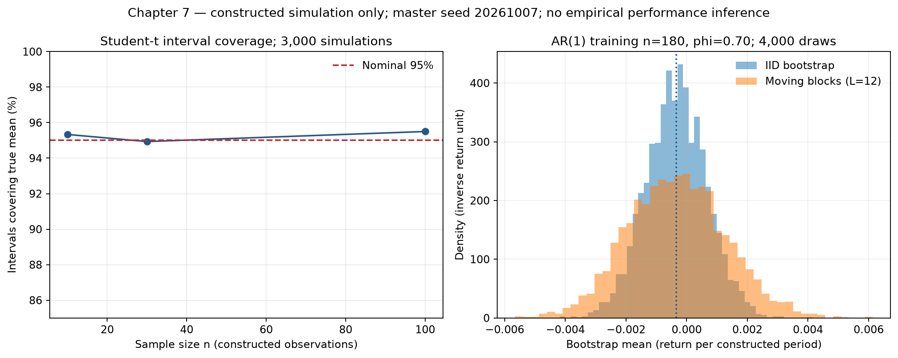

# 第7章 — 统计推断（Statistical Inference）：让研究结论带上不确定性

## 1. 本章目标

读完本章，你应能从未知总体参数提出问题，用样本统计量作估计量，再解释本次估计值；从独立正态模型推导均值与方差的最大似然估计（Maximum Likelihood Estimation, MLE）；计算并解释置信区间（Confidence Interval）、p 值（p-value）和检验错误；区分偏差、方差、一致性与似然各自回答的问题；为时间依赖数据选择重采样方式；完成一个小型贝叶斯更新，并说明各输出能支持什么结论。

你还要会做一件比按下检验按钮更重要的事：把“想估计的对象”“观察是怎么来的”“检验依赖哪些假设”写在结果旁边。先修第6章的期望、条件概率、大数定律和中心极限定理，以及第4章求导。第8章再把这里的推断扩展到回归系数。

本章脚本是[统计实验](../../../../code/ch07_statistics.py)，核心函数在[statistics_tools.py](../../../../src/quant_course/statistics_tools.py)，历史课程根的可交互版本为[Notebook](../../../../notebooks/ch07_statistics.ipynb)。模拟数据明确标成构造样本；真实行业收益来自第2章保存的 French 数据快照。它们用于学习统计方法，尚未构成可交易策略。

## 2. 为什么 Quant 需要它

某策略回测日均收益为 0.03%，另一策略为 0.04%。第二个数字更大，但如果它只来自20天，且这20天里同一条新闻持续发酵，就没有理由把差额直接当成可重复的优势。统计学研究的不是怎样让结果表格看起来精确，而是怎样判断有限、带噪声的观察能支持多强的结论。

量化研究通常同时面对三个问题。第一，样本均值本身会变；第二，产生数据的机制可能会变；第三，研究者可能已试过很多版本，最后只展示一个最好看的。经典区间主要处理第一类不确定性。它不会自动解决市场机制改变，也不会替你记住被丢弃的实验。

例如，区间估计可以告诉你某一固定规则在指定模型下的均值估计有多不稳定。能否买卖、成本有多大、数据是否当时可用、规则是否提前冻结，仍须由金融和实验设计回答。第22、30–32章将逐步完成这些环节。

## 3. 直觉

### 3.1 历史只有一条，抽样分布却讨论“如果重做”

把研究想成从一箱持续供货的苹果中随机抽取一批称重：整箱平均重量是未知总体参数，一批苹果是样本；同样规则再抽一批，样本均值会改变。“这批平均数是多少”是计算问题；“换一批后平均数怎样变化”是推断问题。这个比喻只解释重复抽样。真实市场观察按时间排列，会有相邻依赖，也会遇到制度变化，因此不能把交易日当作可随意交换的苹果。

统计量（Statistic）是样本的函数，例如样本均值。对已经拿到的数据，它是一个确定的数；在观察之前，它随着随机样本而变化，因此有抽样分布（Sampling Distribution）。把这两个视角分开，后面的区间和检验才不容易读反。

### 3.2 标准差与标准误不是同一件事

收益标准差（Standard Deviation）刻画单期收益的波动。标准误（Standard Error, SE）刻画一个估计量在重复抽样中的波动。独立样本均值的标准误随样本量增加而减小，但市场自身的每日波动并不会因为你多下载了十年数据而变小。

例如，每日收益标准差为2%，100个独立观察的均值标准误约为0.2%。这不表示明天收益只波动0.2%。它表示在所设模型下，100日平均收益这个估计量的抽样波动约为0.2%。

### 3.3 看见“不显著”，不要自动翻译成“没有效果”

如果噪声大、样本小，一个真实但很小的均值差也可能检测不出来。“未拒绝零均值”只说明当前检验没有足够证据拒绝它。要声称效果小到可以忽略，需要另外预定经济容忍区间，并研究等效性或区间边界；一个很大的 p 值本身不能完成这个任务。

## 4. 数学基础

### 4.1 样本、参数与目标对象

::: {.body-definition title="定义：参数、估计量与本次估计值"}

先定总体、目标参数和抽样单位。总体（Population）是研究所指的数据生成范围；参数（Parameter）\(\theta\) 是该总体分布的未知特征，例如总体均值（Population Mean）\(\mu\)、总体方差（Population Variance）\(\sigma^2\) 或总体标准差（Population Standard Deviation）\(\sigma=\sqrt{\sigma^2}\)。均值、标准差与观察使用相同单位，方差使用单位平方。若研究固定规则的日收益，一个抽样单位是按预先规则界定的一个交易日，而不是事后挑出的成交记录。\(n\) 表示抽样单位数，不带收益单位。

把第 \(i\) 个单位的随机结果写作随机变量（Random Variable）\(X_i\)；拿到数据后，已实现的数值写作 \(x_i\)。在独立同分布（Independent and Identically Distributed, IID）模型中，各单位来自同一个分布 \(F_\theta\)。样本统计量（Statistic）是样本的函数，例如样本均值 \(\bar X=n^{-1}\sum_iX_i\)；观察前它会随抽样改变。用来估计 \(\theta\) 的统计量叫估计量（Estimator），例如估计 \(\mu\) 的 \(\bar X\)；代入这次观察后得到估计值（Estimate）\(\bar x=n^{-1}\sum_ix_i\)。大写符号表示抽样前的随机对象，小写符号表示本次实现。重复抽样指按同一已声明机制再抽取 \(n\) 个单位，研究估计量的分布；若日收益有依赖，这个机制必须保留其时间结构。

:::

估计目标（Estimand）还要说清楚：是某一时期的无条件平均超额收益，还是给定市场状态的条件均值？是存活证券的平均数，还是当时完整证券总体的平均数？最终报告中的均值须与目标、单位、样本窗口和抽样单位对应；API不能替研究者作出这些选择。

### 4.2 均值和样本方差

\[
\bar X=\frac1n\sum_{i=1}^{n}X_i,
\qquad
S^2=\frac1{n-1}\sum_{i=1}^{n}(X_i-\bar X)^2.
\]

\(\bar X\) 是样本均值估计量，与 \(X_i\) 单位相同；\(S^2\) 是采用 \(n-1\) 分母的样本方差估计量，单位为观察单位的平方；样本标准差（Sample Standard Deviation）\(S=\sqrt{S^2}\) 与观察单位相同。要求 \(n\ge2\)。相应估计值为 \(\bar x,s^2,s\)。在 IID、有限二阶矩条件下，\(\mathbb E[\bar X]=\mu\)，且 \(\operatorname{Var}(\bar X)=\sigma^2/n\)。第6节解释 \(n-1\) 的来历。

### 4.3 从 IID 到时间依赖：均值方差的完整表达

不假设独立时，仍有

\[
\operatorname{Var}(\bar X)
=\frac1{n^2}\sum_{i=1}^{n}\sum_{j=1}^{n}
\operatorname{Cov}(X_i,X_j).
\]

其中 \(\operatorname{Cov}(X_i,X_j)\) 是第 \(i,j\) 个观察的协方差。若弱平稳（Weak Stationarity），均值不随时间变，滞后 \(k\) 的自协方差（Autocovariance）为 \(\gamma_k=\operatorname{Cov}(X_t,X_{t-k})\)，则

\[
\operatorname{Var}(\bar X)
=\frac1n\left[\gamma_0+2\sum_{k=1}^{n-1}
\left(1-\frac{k}{n}\right)\gamma_k\right].
\]

\(\gamma_0\) 是单期方差。每个滞后 \(k\) 有 \(n-k\) 对观察，且上下两个三角各出现一次，因此得到系数2和 \(1-k/n\)。非零滞后自协方差全为零，是该式缩成 \(\sigma^2/n\) 的充分条件；固定 \(n\) 时，非零项也可能加权抵消。零协方差本身也不一般等于独立。

在绝对可和的自协方差和适当弱依赖条件下，定义长期方差（Long-run Variance）\(\Omega=\gamma_0+2\sum_{k=1}^\infty\gamma_k\)，大样本均值方差近似为 \(\Omega/n\)。第8章学习异方差与自相关一致（Heteroskedasticity and Autocorrelation Consistent, HAC）标准误。这里先明确：把标准误写成 \(s/\sqrt n\) 已经使用了一个重要假设。

## 5. 正式定义

### 5.1 偏差、方差和均方误差

\[
\operatorname{Bias}_\theta(\hat\theta)
=\mathbb E_\theta[\hat\theta]-\theta,
\qquad
\operatorname{MSE}_\theta(\hat\theta)
=\mathbb E_\theta[(\hat\theta-\theta)^2].
\]

\(\hat\theta=T(X_1,\ldots,X_n)\) 是估计量；下标 \(\theta\) 表示在参数值为 \(\theta\) 的模型下取期望；MSE 是均方误差（Mean Squared Error）。本节讨论标量参数，矩阵参数需要另指定损失函数。若偏差为零，称无偏（Unbiased）。

一致性（Consistency）则是样本量趋于无穷时，估计量依概率靠近真实参数：对任意 \(\varepsilon>0\)，

\[
\Pr_\theta(|\hat\theta_n-\theta|>\varepsilon)\longrightarrow0.
\]

无偏讨论每个有限样本量的期望；一致讨论一个估计量序列的极限。二者不能互相替代。研究市场数据时，还得问：这段时间增加的观察，是否继续符合使极限成立的机制？

偏差回答重复抽样下估计的平均偏离；方差回答估计量在样本间散布多大；一致性回答增加样本后误差是否依概率趋于零；均方误差（Mean Squared Error, MSE）把方差与偏差平方合在同一损失尺度上。它们分别描述有限样本的中心、分散、极限行为和平方损失。

### 5.2 似然与最大似然

对 IID 连续观察，似然函数（Likelihood Function）为

\[
L(\theta;x)=\prod_{i=1}^{n}f_\theta(x_i),
\qquad
\hat\theta_{\mathrm{MLE}}
=\operatorname*{arg\,max}_{\theta\in\Theta}L(\theta;x).
\]

\(f_\theta\) 是模型密度；\(x\) 是固定观察；\(\Theta\) 是允许的参数空间。离散数据把密度改为概率质量函数。似然把数据固定、让参数变化。连续变量在某个精确点的概率为零，所以这里比较的是密度，不是“恰好出现这串小数的概率”。似然也不是参数的后验概率。

存在依赖时必须使用联合分布或条件分布，例如 \(f_\theta(x_1)\prod_{t=2}^n f_\theta(x_t\mid x_{1:t-1})\)。直接把边际密度相乘，相当于主动换了模型。

放在一起看，偏差、方差和一致性分别描述估计量的平均偏离、重复抽样散布和大样本收敛；似然用于固定观察下比较参数值的相对拟合。似然值本身不是参数概率，也不描述估计量的抽样波动。

### 5.3 置信区间、检验与错误

区间程序 \([L(X),U(X)]\) 的置信水平为 \(1-\alpha_{\mathrm{sig}}\)，若其覆盖性质满足

\[
\Pr_\theta\{L(X)\le\theta\le U(X)\}
=1-\alpha_{\mathrm{sig}}
\]

或在适用情形下至少达到目标水平。这里 \(L,U\) 是随机区间端点；\(\theta\) 是固定参数；\(\alpha_{\mathrm{sig}}\) 是显著性水平（Significance Level），不是资产定价的 alpha。近似区间的覆盖率可能偏离标称值，需要检验。

假设检验（Hypothesis Testing）先写原假设（Null Hypothesis）\(H_0\) 与备择假设（Alternative Hypothesis）\(H_1\)，再规定统计量和拒绝域。第一类错误（Type I Error）是在 \(H_0\) 真时错误拒绝；第二类错误（Type II Error）是在指定备择真时未拒绝。功效（Power）是指定备择下拒绝 \(H_0\) 的概率，即1减第二类错误概率。它依赖效果大小、噪声、样本量和规则，并非检验自带的一个固定常数。

对于本章双侧 t 检验，p 值是零假设模型下得到至少同样极端统计量的概率。它不是 \(H_0\) 为真的概率，也不是策略失败的概率。

### 5.4 Bootstrap 与贝叶斯推断

自助重采样（Bootstrap）用观察数据近似未知生成分布，再重复计算统计量，以近似其抽样波动。重采样机制必须保留当前问题相关的结构。

贝叶斯推断（Bayesian Inference）把参数的不确定性表示为概率分布。先验（Prior）、似然与后验（Posterior）满足

\[
\pi(\theta\mid x)
=\frac{L(\theta;x)\pi(\theta)}{\int_\Theta L(u;x)\pi(u)\,du}.
\]

\(\pi(\theta)\) 是先验密度；分母是数据的边际密度；\(u\) 是积分变量。参数离散时改为求和。一个后验概率陈述始终以模型和先验为条件。可信区间（Credible Interval）则是后验质量达到给定概率的区间，含义不同于频率学派（Frequentist）置信区间。

频率学派让参数固定、数据随重复抽样变化，置信水平描述区间程序的长期覆盖率；贝叶斯方法在给定模型、先验和已观察数据后，为参数给出后验概率。后验概率与覆盖率来自不同的不确定性定义。

## 6. 推导

### 6.1 为什么样本方差除以 \(n-1\)

从代数恒等式开始：

\[
\sum_i(X_i-\bar X)^2
=\sum_i(X_i-\mu)^2-n(\bar X-\mu)^2.
\]

\(\mu\) 是共同总体均值。展开 \(X_i-\bar X=(X_i-\mu)-(\bar X-\mu)\)，交叉项的和为 \(-2n(\bar X-\mu)^2\)，再加上 \(n(\bar X-\mu)^2\)，就得到上式。

在 IID 且方差有限时，右边第一项的期望为 \(n\sigma^2\)，第二项的期望为 \(n\operatorname{Var}(\bar X)=\sigma^2\)。所以平方离差和的期望是 \((n-1)\sigma^2\)，除以 \(n-1\) 才得到方差的无偏估计。直觉上，先用样本估计了共同中心，残差必须加总为零，剩下 \(n-1\) 个自由变化方向。

如果观察相关，\(\operatorname{Var}(\bar X)\) 一般不等于 \(\sigma^2/n\)，这段无偏性推导就不能原样套用。`ddof=1` 是明确的计算约定，不是数据满足 IID 的证明。

### 6.2 高斯均值和方差的 MLE

设 \(X_i\overset{\mathrm{IID}}\sim N(\mu,v)\)，其中 \(v=\sigma^2>0\)。对数似然（Log-likelihood）为

\[
\ell(\mu,v)
=-\frac n2\log(2\pi)-\frac n2\log v
-\frac1{2v}\sum_i(x_i-\mu)^2.
\]

\(\ell\) 是似然的自然对数；用正单调的对数不改变最大值位置。对 \(\mu\) 求导：

\[
\frac{\partial\ell}{\partial\mu}
=\frac1v\sum_i(x_i-\mu)=0
\quad\Rightarrow\quad\hat\mu=\bar x.
\]

将 \(\bar x\) 代回，再对 \(v\) 求导：

\[
\frac{\partial\ell(\bar x,v)}{\partial v}
=-\frac n{2v}+\frac{\sum_i(x_i-\bar x)^2}{2v^2}=0
\quad\Rightarrow\quad
\hat v_{\mathrm{MLE}}=\frac1n\sum_i(x_i-\bar x)^2.
\]

当平方离差和为正，剖面似然随 \(v\to0\) 和 \(v\to\infty\) 都趋于负无穷，驻点就是最大值。若所有 \(x_i\) 完全相同，离差和为零；取共同值为 \(\mu\) 后，\(v\downarrow0\) 会让似然无界增大。在 \(v>0\) 的常规高斯模型中不存在有限 MLE，不能把描述性零方差称为合法的常规高斯 MLE。核心函数对此明确报错。

注意

\[
\mathbb E[\hat v_{\mathrm{MLE}}]
=\frac{n-1}{n}\sigma^2.
\]

因此方差 MLE 有向下偏差，但在 IID、有限二阶矩及相应大数定律下仍一致。MLE 不等于无偏，有限样本性质与大样本性质也不同。

### 6.3 MSE 的偏差—方差分解

把误差写成

\[
\hat\theta-\theta
=(\hat\theta-\mathbb E\hat\theta)
+(\mathbb E\hat\theta-\theta).
\]

平方后取期望。交叉项含有 \(\mathbb E[\hat\theta-\mathbb E\hat\theta]=0\)，于是

\[
\operatorname{MSE}(\hat\theta)
=\operatorname{Var}(\hat\theta)+\operatorname{Bias}(\hat\theta)^2.
\]

这解释了为什么收缩估计（Shrinkage Estimation）可以有用。故意把极端估计往共同中心拉一点，会引入偏差，但若大幅降低方差，总误差可能更小。第8章正则化回归、第21章协方差收缩会具体使用这一思想。

### 6.4 正态 IID 均值的 t 区间

::: {.body-conditions title="条件与枢轴：IID高斯均值"}

正态样本下，标准化均值 \(Z=(\bar X-\mu)/(\sigma/\sqrt n)\) 为标准正态；\(V=(n-1)S^2/\sigma^2\) 为自由度 \(n-1\) 的卡方变量，且与 \(Z\) 独立。因此

\[
T=\frac{\bar X-\mu}{S/\sqrt n}
=\frac{Z}{\sqrt{V/(n-1)}}\sim t_{n-1}.
\]

:::

\(t_{n-1}\) 是 Student t 分布，自由度（Degrees of Freedom）为 \(n-1\)。未知波动率也要估计，额外不确定性使小样本 t 分布比正态分布尾部更厚。正态样本均值与离差平方和的独立性来自正交高斯分量；本章不完整证明卡方密度，但不把这一前提藏起来。

取临界值 \(q=t_{n-1,1-\alpha_{\mathrm{sig}}/2}\)，使 \(\Pr(-q\le T\le q)=1-\alpha_{\mathrm{sig}}\)。由于 \(S/\sqrt n>0\)，移项得

\[
\mu\in\left[\bar X-q\frac S{\sqrt n},\;
\bar X+q\frac S{\sqrt n}\right].
\]

这里 \(q\) 无量纲，\(S/\sqrt n\) 是均值标准误，端点与收益单位相同。这是 IID 高斯下的精确区间。非正态独立样本需要另外的大样本近似条件与有限样本检查；依赖数据更不能仅凭“样本多”恢复这个精确结论。

检验 \(H_0:\mu=\mu_0\) 时用 \(t_{\mathrm{obs}}=(\bar x-\mu_0)/(s/\sqrt n)\)。双侧 p 值为 \(2\Pr(t_{n-1}\ge |t_{\mathrm{obs}}|)\)。同一假设、同一双侧水平下，\(\mu_0\) 落在对应区间外，等价于拒绝 \(H_0\)。如果区间与检验使用了不同标准误、不同单双侧规则，就没有这个直接对应。

::: {.body-example title="完整例题：单侧z检验、区间与两类错误"}

下面用已知标准差的正态样本手算右侧检验。每个抽样单位是一次独立测量，所有值用同一输出单位计；四个教学观测为 \((1,1,3,3)\)，抽样单位数 \(n=4\)，已知 \(\sigma=2\)，检验 \(H_0:\mu=0\) 对 \(H_1:\mu>0\)，显著性水平（Significance Level）\(\alpha=0.05\)。精确临界值是 \(c=z_{0.95}=\Phi^{-1}(0.95)\)，手算时用四舍五入值 \(c\approx1.645\)。先算 \(\bar x=2\)、标准误 \(\sigma/\sqrt n=1\)，再得 \(z=(\bar x-0)/1=2\)。标准正态累积分布函数（Cumulative Distribution Function）记作 \(\Phi\)，给定的近似表值为 \(\Phi(1.645)\approx0.9500\)、\(\Phi(2)\approx0.9772\)、\(\Phi(1)\approx0.8413\)。单侧 p 值约为 \(1-\Phi(2)=0.0228\)，小于0.05，所以按预定规则拒绝 \(H_0\)。单侧95%下置信限约为 \(2-1.645\times1=0.355\)，区间约为 \([0.355,\infty)\)，不含零。用精确临界值时，固定任意真实 \(\mu\)，区间程序满足 \(\Pr_\mu(\bar X-c\sigma/\sqrt n\le\mu)=0.95\)；观察后端点已固定，0.95描述的是重复抽样覆盖率。

同一规则下，第一类错误（Type I Error）是 \(H_0\) 为真却拒绝它。精确阈值 \(c=z_{0.95}\) 的错误概率为 \(1-\Phi(c)=0.05\)；若把阈值舍入为1.645，错误率约为0.049985，仍约等于0.05。第二类错误（Type II Error）须指定备择值。取近似值 \(\mu_1=2.645\)，用手算阈值1.645得到 \(\beta\approx\Phi((1.645-2.645)/1)=\Phi(-1)\approx0.1587\)，功效约为0.8413。若对同一 \(\mu_1=2.645\) 使用精确分位数，\(\beta\approx0.15862\)。第一类错误由零假设与阈值确定；第二类错误随备择效果与噪声变化。

:::

### 6.5 百分位 Bootstrap 怎么做

观察 \(x_1,\ldots,x_n\) 后，经验分布（Empirical Distribution）在每个观察点放质量 \(1/n\)。IID 重采样每次有放回抽取 \(n\) 项，计算均值 \(\bar x^{*(b)}\)，\(b=1,\ldots,B\)。星号表示重采样，\(B\) 是重采样次数。百分位区间（Percentile Interval）取这些均值的 \(\alpha_{\mathrm{sig}}/2\) 和 \(1-\alpha_{\mathrm{sig}}/2\) 分位数。

这个程序的想法是用经验分布近似未知总体，再用经验样本的重复实验近似真实估计量的抽样波动。它有有限样本偏差，偏斜、重尾、非光滑统计量或边界参数可能导致覆盖差。增加 \(B\) 主要减少重采样计算的蒙特卡洛误差（Monte Carlo Error），不会创造新的原始市场观察。

逐日独立重采样会打散金融序列的相邻关系。对于均值推断，这会漏掉时间协方差对标准误的影响；因此金融数据使用独立 Bootstrap 前，要先说明 IID 近似为何适用。

时间序列可改为抽取相邻观察块。本章采用固定长度 \(L\) 的循环区块自助法（Circular Block Bootstrap）：随机选起点，保留块内顺序，越过样本末尾时回到开头，拼接后截取 \(n\) 项。它在块内部保留短期依赖，但块连接处会切断关系，循环边界本身也是假设近似。过短块可能遗漏依赖，过长块又使有效重组较少。不能看到区间变宽，就宣布它一定正确。

区块方法的渐近有效性需要平稳性、相应矩条件和足够衰减的依赖等前提；常见理论还要求 \(L\to\infty\) 且 \(L/n\to0\)。这两条比例条件不是全部定理条件，也不是对固定 \(L=12,n=180\) 的有效性保证。Künsch 的原始研究讨论了对一般平稳观察的区块重采样，见第20节；本章实现是用于理解结构的循环固定块变体。

### 6.6 Beta–Binomial 更新

设 \(Y_i\mid p\overset{\mathrm{IID}}\sim\operatorname{Bernoulli}(p)\)，观察 \(s\) 次成功、\(f\) 次失败。先验 \(p\sim\operatorname{Beta}(a,b)\)，\(a,b>0\)，其密度核为 \(p^{a-1}(1-p)^{b-1}\)。似然核为 \(p^s(1-p)^f\)。相乘后

\[
\pi(p\mid y)\propto
p^{a+s-1}(1-p)^{b+f-1},
\qquad
p\mid y\sim\operatorname{Beta}(a+s,b+f).
\]

\(p\) 是成功概率，\(a,b\) 是无量纲先验形状参数，\(s,f\) 是次数。这种后验仍属同一分布族的结构称共轭（Conjugacy）。后验均值为

\[
\mathbb E[p\mid y]
=\frac{a+s}{a+b+s+f}
=\frac{a+b}{a+b+n}\frac a{a+b}
+\frac n{a+b+n}\frac sn,
\]

其中 \(n=s+f>0\)。它是先验均值与样本成功率的加权平均。它不是“先验已经观察到真实的 (a+b) 笔交易”；这是代数上的权重解释。选择先验需要明确其经济依据并检查敏感性。

### 6.7 功效与样本量：小效果需要多少观察

为便于看清功效，暂设 IID 高斯且单期标准差 \(\sigma\) 已知，预先选择单侧检验 \(H_0:\mu=0\)、\(H_1:\mu>0\)。只有在研究前有方向假设时，才能这样选择；不能看了样本均值为正，才从双侧换成单侧。

令 \(c=z_{1-\alpha_{\mathrm{sig}}}\)，拒绝规则为 \(\sqrt n\bar X/\sigma>c\)。在指定备择 \(\mu=\delta>0\) 下，这个统计量分布为 \(N(\sqrt n\delta/\sigma,1)\)，因此

\[
\operatorname{Power}(\delta)
=1-\Phi\!\left(c-\frac{\sqrt n\delta}{\sigma}\right).
\]

\(\Phi\) 是标准正态分布函数；\(\delta\) 是预定效果，和单期收益同单位；\(n\) 是独立观察数。固定显著性水平时，效果更大、噪声更小或独立样本更多，功效提高。第二类错误概率是对应备择下的1减功效，而不是“未拒绝后策略无效的概率”。

若目标功效为 \(1-\beta_{\mathrm{II}}\)，由上式移项得到最小整数样本量近似设计：

\[
n\ge\left[\frac{\sigma}{\delta}
\left(z_{1-\alpha_{\mathrm{sig}}}+z_{1-\beta_{\mathrm{II}}}\right)\right]^2.
\]

\(\beta_{\mathrm{II}}\) 是第二类错误目标，不是市场 beta。取单期标准差2%、目标均值0.1%、单侧水平5%、功效80%，需向上取整到2474个独立观察。如果把观察当交易日，这已跨越多年；“多收集一些数据”可能同时加剧机制变化，所以这个理想模型样本量不是可直接执行的市场研究保证。

```python
import numpy as np
from scipy import stats

sigma, delta, significance, target_power = 0.02, 0.001, 0.05, 0.80
critical = stats.norm.ppf(1.0 - significance)
required = int(np.ceil((sigma / delta * (critical + stats.norm.ppf(target_power)))**2))
for n in (100, 1000, required):
    power = stats.norm.sf(critical - np.sqrt(n) * delta / sigma)
    print("known-sigma IID Gaussian, one-sided", n, "power", power)
assert stats.norm.sf(critical - np.sqrt(required) * delta / sigma) >= target_power
```

本节用于理解设计，不使用未知标准差的 t 功效，也未考虑依赖或多重试验。真实研究需要根据目标模型重新计算或模拟，而非直接把2474写进任何策略的验收规则。

## 7. 金融解释

### 7.1 你测的是收益，不只是胜率

假设每次盈利赚1单位，每次亏损亏2单位，每次还付0.1单位成本，成功概率为 \(p\)。每次期望净收益为

\[
\mathbb E[G]=p\times1-(1-p)\times2-0.1=3p-2.1.
\]

\(G\) 是每次净损益；因此净收益转正需要 \(p>0.7\)。即使后验认为 \(p\) 大于0.5很有可能，也无法因此宣布策略有正期望。这一简化案例还假定损益金额固定；实际收益金额、持有时间和尾部风险需要另外建模。

### 7.2 效果大小、统计显著性与经济显著性

统计显著性问估计值是否与检验假设不相容；经济意义问扣除成本并考虑风险、容量后，效果是否值得承担。

日均毛收益0.02%、成本0.03%，即使你有足够样本把毛均值测得很精确，净均值依旧为负。相反，一个估计区间很宽的正均值，可能暂时无法判断经济价值。研究报告应同时展示效果大小（Effect Size）、区间、成本口径和风险承担；p 值不是排序策略的单一评分。

同样，“均值显著不为零”没有剥离市场 beta。市场上涨期间，一项多头风险暴露可能呈现正均值，却不存在独立 alpha。第14–15章用资产定价和因子回归明确基准。

### 7.3 有效样本量的直觉与边界

对平稳一阶自回归（First-order Autoregression, AR(1)）\(X_t-\mu=\phi(X_{t-1}-\mu)+\varepsilon_t\)，假设 \( |\phi|<1\)、创新独立零均值且方差有限，\(\gamma_k=\gamma_0\phi^{|k|}\)。将几何级数代入长期方差得

\[
\Omega=\gamma_0\frac{1+\phi}{1-\phi},
\qquad
n_{\mathrm{eff}}\approx n\frac{1-\phi}{1+\phi}.
\]

\(n_{\mathrm{eff}}\) 是使独立均值方差近似相同的有效样本量（Effective Sample Size），不是实际独立交易数。它是平稳 AR(1) 大样本、针对均值估计的近似；不能拿去自动替代每一个模型的自由度。若 \(n=180,\phi=0.7\)，近似值31.76，解释了为何180行并不一定提供180个独立信息单位。若相关为负，均值方差还可能降低，\(n_{\mathrm{eff}}>n\) 并非数学错误。

## 8. Numerical Example

### 8.1 四个手算收益

::: {.body-example title="完整例题：四个收益的估计与t推断"}

以下区间和检验按IID高斯参考模型计算；指定的四个数字本身不证明正态或独立。

取教学日收益小数 \(x=(-0.01,0.01,0.02,0.02)\)。均值为0.01，即1%；围绕均值的偏差为 \((-0.02, 0, 0.01, 0.01)\)，平方和为0.0006。因此高斯模型方差 MLE 为0.00015，无偏样本方差为0.0002；\(s\approx0.0141421\)，均值标准误 \(s/\sqrt4\approx0.0070711\)。

95% t 区间的自由度为3，临界值约3.182446；区间约为 \([-0.0125033,0.0325033]\)，即日均收益 \([-1.2503\%,3.2503\%]\)。检验零均值得到 \(t\approx1.414214,p\approx0.252215\)。正样本均值与证据不足可以同时出现。这四个数不是真实市场收益，也不能靠“复利年化”制造可信的策略表现。

:::

### 8.2 固定种子的实验输出

[完整脚本](../../../../code/ch07_statistics.py)使用种子20261007，并以独立子随机流分开实验。40个 IID 高斯构造观察的模型真均值是0.002、标准差0.02；本次实现得到样本均值约−0.001500，高斯方差 MLE 约0.00045812，无偏方差约0.00046987，95%区间约 \([-0.008432,0.005432]\)，零均值检验 p 值约0.664051。真均值和样本估计值不同，正是这个实验要展示的现象。

重复3000次正确模型实验，样本量10、30、100的95% t 区间覆盖率分别约95.3333%、94.9333%、95.5%。不要求每次有限模拟恰好95%；在真实覆盖率0.95下，3000次覆盖指示的模拟标准误约 \(\sqrt{0.95\times0.05/3000}=0.003979\)，即0.398个百分点。这是对模拟覆盖率的计算误差，不是市场收益标准误。

平稳 AR(1) 构造样本共240个观察，前180个用于估计，后60个不进入重采样。\(\phi=0.7\)，创新标准差0.01；4000次重采样下，IID百分位区间约 \([-0.002327,0.001643]\)，循环块长12区间约 \([-0.003428,0.002961]\)。这个特定例子中区块区间更宽；“更宽”不是普遍定理，也不等于已经验证其真实覆盖率。应另外做重复生成实验和块长敏感性。

最后，先验Beta(2,2)，观察6赢4输，后验Beta(8,6)，后验成功率均值为 \(8/14=4/7\approx0.571429\)。如果损益结构沿用第7节，后验期望净损益为 \(3\times4/7-2.1\approx-0.385714\) 单位/次。

## 9. Python Implementation

### 本读者版的默认运行入口

从接受I3读者包的根目录，按其[README](../../../../editions/zh/README.md)建立独立环境后运行：

```bash
.venv/bin/python run_notebook.py notebooks/ch07_statistics.ipynb
```

该Notebook调用随包共享实现，不读取未随包提供的French数据、不下载数据；每次写入唯一UUID的runs子目录，并打印实际输出位置。旧制作测试与下面的历史课程根命令属于原工作项目；读者默认运行使用上述包根Notebook及其断言。可选历史French路径需遵守读者包的[数据契约](../../../../editions/zh/OPTIONAL_DATA.md)，本批未重跑。

### 历史课程根路线

运行以下各块时，以课程根目录为工作目录，使用[课程环境](../../../../editions/zh/README.md)。每块都包含自己的导入和数据，可独立运行。核心函数要求一维有限数值；NaN不自动丢弃，以免无声改变观察区间。删除缺失值前，应按第3章追查原因和日期，并在报告中记录。

### 9.1 同时核对估计、区间和检验

```python
import numpy as np
from scipy import stats
from quant_course.statistics_tools import (
    normal_mle_estimates, mean_t_confidence_interval, one_sample_t_test,
)

sample = np.array([-0.01, 0.01, 0.02, 0.02], dtype=float)
estimates = normal_mle_estimates(sample)
interval = mean_t_confidence_interval(sample, confidence_level=0.95)
test = one_sample_t_test(sample, null_mean=0.0)
assert np.isclose(estimates.mean, 0.01)
assert np.isclose(estimates.variance_mle, 0.00015)
assert np.isclose(estimates.variance_unbiased, 0.0002)
reference = stats.ttest_1samp(sample, popmean=0.0)
assert np.isclose(test.p_value, reference.pvalue)
assert (interval.lower <= 0.0 <= interval.upper) == (test.p_value >= 0.05)
print(estimates)
print(interval)
print(test)
```

这里算的是单期均值，不是年化收益；没有信号或订单时间。区间对象的 `standard_error` 是均值标准误，不能拿去当每日收益波动率。SciPy 参考接口核对的是计算，模型假设仍由研究者负责。

### 9.2 常数样本和缺失值显式失败

```python
import numpy as np
from quant_course.statistics_tools import normal_mle_estimates

constant = np.array([0.01, 0.01, 0.01])
assert constant.var(ddof=0) == 0.0
for invalid in (constant, np.array([0.01, np.nan, 0.02])):
    try:
        normal_mle_estimates(invalid)
    except ValueError as error:
        print(type(error).__name__, str(error))
    else:
        raise AssertionError("invalid input must not produce a regular Gaussian MLE")
```

常数样本的描述性方差可以为零；参数空间 \(v>0\) 下的常规 Gaussian MLE 却不存在。两句话并不冲突。报错也不应该被改成“填零继续算”。

### 9.3 保留依赖的重采样

```python
import numpy as np
from quant_course.statistics_tools import (
    simulate_stationary_ar1, bootstrap_mean_draws,
    moving_block_bootstrap_mean_draws, bootstrap_mean_confidence_interval,
)

streams = [np.random.default_rng(s) for s in np.random.SeedSequence(20261017).spawn(3)]
observations = simulate_stationary_ar1(
    n=240, phi=0.7, innovation_std=0.01, rng=streams[0],
)
train = observations[:180]
holdout = observations[180:]
assert len(holdout) == 60
point_estimate = float(train.mean())
iid = bootstrap_mean_draws(train, n_resamples=2000, rng=streams[1])
blocks = moving_block_bootstrap_mean_draws(
    train, block_length=12, n_resamples=2000, rng=streams[2],
)
for name, draws in (("IID", iid), ("circular fixed blocks", blocks)):
    interval = bootstrap_mean_confidence_interval(draws)
    print(name, "original mean", point_estimate, "interval", interval)
```

本块两种方法各重采样2000次；第8节所报4000次属于完整脚本。本块种子不同于完整脚本，输出不应被强行调到第8节相同。上面的百分位区间函数返回的 `estimate` 是有限重采样均值的平均数，可能与原样本均值略有差别。因此代码另存原样本均值 `point_estimate`。第8节完整脚本的4000个重采样均值的标准差用来估计均值的抽样标准误；不要再把它除以 \(\sqrt{4000}\) 当作原样本均值标准误，那会把计算次数误当市场样本量。

### 9.4 贝叶斯更新与后验区间

```python
import numpy as np
from scipy import stats
from quant_course.statistics_tools import beta_binomial_posterior

posterior = beta_binomial_posterior(
    successes=6, failures=4, prior_alpha=2.0, prior_beta=2.0,
)
a, b = posterior.posterior_alpha, posterior.posterior_beta
credible_interval = stats.beta.ppf([0.025, 0.975], a=a, b=b)
probability_above_half = stats.beta.sf(0.5, a=a, b=b)
expected_net_payoff = 3.0 * posterior.posterior_mean - 2.1
assert np.isclose(posterior.posterior_mean, 4.0 / 7.0)
assert expected_net_payoff < 0.0
print("posterior", posterior)
print("95% equal-tail credible interval", credible_interval)
print("posterior P(p > 0.5)", probability_above_half)
print("posterior expected net payoff, units per trade", expected_net_payoff)
```

这是95%等尾可信区间（Equal-tail Credible Interval），两端各留2.5%后验质量；不是保证覆盖的频率置信区间，也不是最高后验密度区间。`.sf(0.5)` 给的是指定Beta–Binomial模型和先验下的后验概率，含义确实不同于 t 检验 p 值。

## 10. Visualization



左图横轴是每次模拟的样本量，纵轴是3000次独立实验中覆盖真均值的比例；虚线是标称95%。应观察有限模拟围绕标称值波动，而不是把某一个点略高于95%称为方法更优。这个图只验证所设 IID 高斯实验，不验证真实收益中的正态性或独立性。

右图横轴是前180个 AR(1) 观察产生的重采样均值，以收益率小数表示；纵轴是密度（Density），单位为收益率单位的倒数。两类直方图各自面积近似为1。区块重采样在本次样本中更分散，因为它保留了部分正序列依赖；它没有加入未来60个观察，也没有根据留出结果调块长。

读者应区分三个对象：原始收益的分布、均值的抽样分布、有限样本产生的 Bootstrap 近似分布。图中画的是第三个对象，不是下一期收益预测区间。

## 11. Real Market Example

用已保存的 French 10行业月度收益，预定2010年1月至2019年12月作为描述窗口，取非耐用品（Non-durables, NoDur）行业。先固定时间范围、检查连续月份，再计算样本均值与 IID 参考区间。之所以称“参考”，是因为这份真实市场序列没有因程序执行而自动满足独立正态假设。

```python
from pathlib import Path
import numpy as np
import pandas as pd
from quant_course.statistics_tools import mean_t_confidence_interval

raw = pd.read_csv(
    Path("data/processed/french_10_industries_monthly.csv"), dtype={"month": "string"},
)
monthly = raw.set_axis(pd.PeriodIndex(raw.pop("month"), freq="M"), axis="index")
series = monthly.loc["2010-01":"2019-12", "NoDur"]
expected = pd.period_range("2010-01", "2019-12", freq="M")
assert series.index.equals(expected)
assert np.isfinite(series.to_numpy()).all()
reference = mean_t_confidence_interval(series.to_numpy())
print("published monthly industry snapshot; not a PIT tradable security")
print("n", len(series), "sample mean", float(series.mean()))
print("IID Gaussian reference interval; assumptions unverified", reference)
print("lag-one sample correlation, diagnostic only", float(series.autocorr(lag=1)))
```

这里没有自动执行 `.dropna()`，缺失即触发检查；月度标签对应公布组合的收益月份，不能推断数据在当月末就已公开。本次真实快照计算得到月均收益约1.009917%、IID参考95%区间约[0.428369%,1.591465%]、一阶样本相关约−0.188911，输出见独立片段记录。这些是当前窗口的计算结果，不把相关诊断提升为独立性证明。单个样本滞后相关接近零也不证明独立，且波动聚集可能使收益在其他层面依赖。第16–18章会进一步检查时间序列和波动结构，第8章给出 HAC 推断的入口。

该行业组合收益不是主动策略超额收益；数据也没有扣除本教程设定的真实交易成本。应将运行输出记为指定窗口的描述性统计与参考模型计算，不能把区间端点改写成“未来月均收益将落在其中”。当前下载版本可能修订历史，时点可得（Point-in-Time, PIT）条件仍未成立。数据来源与哈希见缓存说明。

## 12. Common Mistakes

### 12.1 把 p 值当原假设概率

错误表述：“p=0.03，所以零收益假设只有3%概率正确。”检验先假定零假设成立，再问样本统计量的尾部概率；并没有给出原假设和备择的先验或后验。正确报告应写检验模型、统计量、双侧规则、p 值、效果估计及区间。

### 12.2 把区间读成明天收益范围

均值置信区间估计的是参数；预测区间（Prediction Interval）还要包含新观察自身的波动。即使均值估计越来越精确，明天收益的分布仍然很宽。混淆两者会严重低估单期亏损可能性。

### 12.3 把更多 Bootstrap 次数当更多数据

::: {.body-pitfall title="常见误区：重采样次数不是市场样本量"}

同一段180日数据重复抽样十万次，信息仍来自这180个观察。重采样数增加只让近似分位数更稳定。若原样本遗漏退市股票、错用未来财报或经历未建模的制度变化，再多重采样也不能修复。

:::

### 12.4 只丢 NaN，不报告选择条件

某家公司危机时缺价格，删掉相关日后均值可能提高。缺失机制（Missingness Mechanism）本身可能和收益相关。在金融数据上，`dropna()` 是一个样本选择动作，必须记录丢弃日期、比例和原因；不是一个无经济含义的清洁按钮。

### 12.5 100次试验只报一次显著

假设100个检验互相独立、所有零假设为真、每次第一类错误率恰为5%，至少一次误拒绝的概率为

\[
1-(1-0.05)^{100}\approx0.994079.
\]

这里100是尝试数，不是观察数；独立性是演示假设，实际策略检验相关时不能直接使用该等式。即使不能准确算出总体错误率，挑出最小 p 值后仍按单次检验解读，也已经改变了研究程序。

```python
import numpy as np
from scipy import stats

rng = np.random.default_rng(20261027)
null_samples = rng.normal(0.0, 1.0, size=(100, 60))
p_values = stats.ttest_1samp(null_samples, popmean=0.0, axis=1).pvalue
raw_rejections = int((p_values < 0.05).sum())
bonferroni_rejections = int((p_values < 0.05 / len(p_values)).sum())
assert bonferroni_rejections <= raw_rejections
print("100 independent null experiments; simulation only")
print("unadjusted rejections", raw_rejections)
print("Bonferroni rejections", bonferroni_rejections)
print("all-null independent probability of at least one raw rejection", 1 - 0.95**100)
```

Bonferroni 校正（Bonferroni Correction）把每项水平降到总体目标水平除以尝试数，利用并集概率上界控制至少一次第一类错误；它不要求检验独立，但可能保守。这里演示的是预先定义的一组检验。若实际还试过未记录的特征、窗口和证券池，不能只用最后保留的100项作为完整尝试数。第32章讨论多重检验（Multiple Testing）、偏差修正的绩效与过拟合概率。

## 13. Quant Research Application

### 13.1 在实验开始前写一份“推断合同”

以研究固定信号的平均净收益为例，先写下：研究总体、证券池形成规则、起止日期、收益区间、数据可用时间、交易时点、成本口径、检验目标、单侧或双侧规则、依赖处理、参数选择范围。然后冻结数据切分，记录每次尝试。这样读者可以判断检验结果到底针对什么问题。

本章纯推断示例没有产生持仓，因此 `signal_time`、`trade_time` 不适用；若把样本换成策略收益，收益必须来自先已确定、可执行的持仓和成本模型。统计模块不会检查一个上游信号有没有前视偏差，第29–31章的回测与验证模块承担该责任。

### 13.2 拒绝域不能代替投资决策规则

一个投资决策至少需要估计的净效果、效果不确定性、尾部与流动性风险、资源约束。即使统计检验没有拒绝零假设，也可以决定继续收集数据；即使拒绝，也可能因为容量不足、风险暴露或不可复现而停止。报告应区分“统计程序的输出”和“研究团队的判断”。

如果原模型只关注均值，不能让它顺便证明极端回撤安全。对尾部风险估计，不仅样本更稀少，重采样还可能反复重放同几个极端事件。第33章将讨论 VaR、Expected Shortfall 与压力情景。

### 13.3 把鲁棒性作为研究，不作为找最优 p 值

可以预先检查多个合理块长、多个经济子时期和多种成本情景，并完整报告。不要逐一试到某个区间刚好离开零，再只公布那个设定。敏感性分析（Sensitivity Analysis）回答结论依赖什么假设；如果它被用于挑选最好看的结论，便变成新的参数搜索。

## 14. Chapter Summary

参数是我们想研究的对象，统计量是样本的函数，估计值是这批数据上的数字。无偏性、一致性和低 MSE 回答不同问题；方差 MLE 的分母为 \(n\)，无偏样本方差的分母为 \(n-1\)，后者的无偏性使用了 IID 条件。

置信区间描述程序覆盖，p 值描述零假设下统计量的极端程度。精确 t 推断依赖独立正态模型。时间依赖会改变均值的抽样方差，适当的区块重采样或 HAC 可以处理部分依赖，但都需要前提和诊断。贝叶斯后验提供另一种有条件的不确定性表达，胜率的后验也不能直接替代净收益分析。

完成本章的标准是：你能给一个数字写出对象、单位、数据窗口、假设和解释边界，而不只是让检验函数返回结果。

## 15. Exercises

**7-E01 — 对象辨认。** 研究者说“某行业2010–2019年的120个月收益平均为1%”。请分别指出观察、估计量、估计值、可能的估计目标。这个样本平均数是否自动等于未来的总体均值？

**7-E02 — 手算。** 对 \((-0.01,0.01,0.02,0.02)\)，计算均值、平方离差和、方差 MLE、无偏方差、均值标准误和95% t 区间。为什么方差两个答案不同？

**7-E03 — MSE。** 两个标量估计量的偏差/方差分别为 \((0,0.04)\)、\((0.10,0.01)\)。按平方误差选择哪一个？是否能因此说无偏估计总是不值得用？

**7-E04 — 区间语言。** 解释为什么“95%的参数会落在已计算区间中”和“区间程序在重复抽样时约95%覆盖固定参数”不是同一个陈述。再区分均值区间与新收益预测区间。

**7-E05 — 有效样本量。** 平稳 AR(1) 中 \(n=180,\phi=0.7\)，按大样本均值方差近似计算有效样本量与标准误相对 IID 的放大倍数。若 \(\phi=-0.3\) 又如何？说明适用前提。

**7-E06 — 多次检验。** 20次互相独立、所有零假设都为真、单次水平5%的检验，至少一次误拒绝概率多少？总体5%的 Bonferroni 单次水平多少？哪些结论不要求独立？

**7-E07 — 先验与收益。** Beta(2,2)先验加6赢4输后，后验分布和均值是多少？若每次赢1、输2、成本0.1，后验期望净损益多少？净期望为正需要什么胜率？

**7-N01 — 识别对象。** 研究固定规则在指定窗口内的平均日收益。请辨认未知总体参数、随机变量、已实现观察、估计量、估计值和抽样单位；说明“重复抽样”在这个问题中代表什么。若日收益相邻相关，指出抽样机制要保留哪类信息。

**7-N02 — 单步计算。** 预先设定右侧检验，已观察到标准化统计量 \(z=1.50\)，且 \(\Phi(1.50)=0.9332\)。计算单侧 p 值，并在 \(\alpha=0.05\) 下作出决定。这个 p 值对原假设概率说了什么？

**7-N03 — 完整计算。** 每个抽样单位是一次独立测量，值以同一输出单位计。已知四个 IID 正态观察为 \((1,1,3,3)\)，总体标准差 \(\sigma=2\) 已知。检验 \(H_0:\mu=0\) 对 \(H_1:\mu>0\)，取 \(\alpha=0.05\)，精确临界值为 \(z_{0.95}\approx1.645\)。给定近似表值 \(\Phi(1.645)\approx0.9500\)、\(\Phi(2)\approx0.9772\)、\(\Phi(1)\approx0.8413\)，依次求均值、标准误、统计量、p 值、单侧95%下置信限、第一类错误率；再在指定近似备择 \(\mu_1=2.645\) 下求第二类错误率和功效。

**7-N04 — 代码诊断。** 研究者已预先指定右侧正态检验，却写成 `p = 2 * (1 - Phi(z))`。指出该式何时等于双侧 p 值、何时会出错；改成右侧 p 值公式，并用 \(z=1.50\)、\(\Phi(1.50)=0.9332\) 算出正确结果。若观察到负的 \(z\)，两种公式分别会怎样？

**7-N05 — 研究判断。** 一个研究者从40个策略版本中选出表现最好的版本，报告其 IID 右侧检验 \(p=0.03\)、毛日均收益0.02%、日均交易成本0.03%；原始日收益有正序列相关。哪些描述成立，哪些结论仍无依据？写出至少三项后续报告或复核要求。

## 16. Programming Exercises

**7-P01 — 计算交叉核验。** 独立生成80个正态观察，固定种子20261037、均值0.001、标准差0.02。用核心函数计算95% t 区间和零均值检验，再与 SciPy 核对；断言检验与区间的双侧对应。不要让断言依赖本次模拟恰好显著或不显著。

**7-P02 — 块长敏感性。** 固定种子20261047，生成300个平稳 AR(1) 观察，前240个作为训练，余下60个不用。对块长4、12、24分别做2000次循环区块重采样，记录区间和宽度。每种设定用独立随机流；不要按是否拒绝零均值选择块长。

**7-P03 — 后验先验敏感性。** 保持6赢4输不变，分别用Beta(1,1)、Beta(2,2)、Beta(10,10)先验，计算后验均值、95%等尾可信区间及期望净损益。说明为何先验更强时均值更接近0.5，而可信区间变化不能被解释成新增交易证据。

## 17. Challenge Problems

**7-C01 — 相关序列的有限样本公式。** 从本章双重求和出发，推导平稳 AR(1) 均值方差的有限 \(n\) 表达，并对 \(n=180,\phi=0.7\) 比较有限样本标准误放大倍数与长期近似。解释长期公式为何省掉边界权重；不允许把有效样本量当所有模型的统一自由度。

**7-C02 — 设计覆盖实验。** 比较 IID t 区间、IID Bootstrap、循环块长12 Bootstrap 在 IID 高斯与平稳 AR(1) 下的覆盖。写出实验方案，明确真实均值、样本量、重复数、重采样数、随机流、覆盖与宽度指标、模拟误差和不可支持的真实市场结论。不要求某方法按预想顺序获胜。

## 18. Solutions / Solution Hints

### 7-E01

观察是120个指定月份的行业组合收益；估计量是 \(\bar X=(1/120)\sum_{t=1}^{120}X_t\)，估计值是这次计算的0.01。可能的估计目标是某个平稳生成模型下的行业月均收益，也可能只是该固定历史窗口的描述性平均值，二者需要报告者选择并说明。未来分布若不同，样本平均数不自动估计未来均值；行业组合、证券总体和可交易策略也不是同一对象。

### 7-E02

总和0.04，除以4得0.01。偏差为−0.02、0、0.01、0.01，平方和0.0006。除以4得 MLE 方差0.00015，除以3得样本方差0.0002。标准差 \(\sqrt{0.0002}\approx0.0141421\)，均值标准误除以2约0.0070711。乘自由度3的临界值3.182446，半宽约0.0225033，区间约[−0.0125033,0.0325033]。MLE 最大化给定模型的密度；除以 \(n-1\) 的估计追求 IID 有限二阶矩下的无偏性，所以分母和目的不同。

### 7-E03

第一项 MSE 为0.04，第二项为 \(0.01+0.10^2=0.02\)，本题选择第二项。这个比较只针对给定参数下的平方误差；若损失函数、偏差方向或参数空间不同，结论可能改变。它推翻的是“无偏一定最好”，不是“无偏一定不好”。

### 7-E04

频率区间中参数固定、抽样数据及端点随机；重复的是区间生成程序。观察后已有一个确定区间，不能在未加入参数概率模型时对固定参数赋予95%概率。贝叶斯后验可以作参数概率陈述，但需注明模型与先验。均值区间关注平均值参数的估计误差；新收益预测区间还含新观察的随机波动，因此通常更宽。若数据机制会变，两种区间也都不能凭数学表达保证未来有效。

### 7-E05

\(n_{\mathrm{eff}}\approx180\times0.3/1.7=31.7647\)。标准误放大约 \(\sqrt{(1+0.7)/(1-0.7)}\approx2.38048\)。若 \(\phi=-0.3\)，有效样本量近似 \(180\times1.3/0.7\approx334.286\)，标准误比例约 \(\sqrt{0.7/1.3}\approx0.733799\)。这不是凭空新增独立观察，而是负相关降低均值波动。要求平稳 AR(1)、有限二阶矩与大样本近似，不能用于无条件替换 t 自由度。

### 7-E06

独立时至少一次错误概率 \(1-0.95^{20}\approx0.641514\)。Bonferroni 每项水平 \(0.05/20=0.0025\)。前一个等式使用独立性；后者利用任意事件的并集概率不超过各概率之和，因此总体第一类错误率上界不要求独立，但每项检验必须本身有效，尝试集合与数量也要正确记录。

### 7-E07

后验Beta(8,6)，均值 \(8/14=4/7\)。期望净损益 \(3\times4/7-2.1=-0.385714\) 单位/次。固定损益与成本模型下，盈亏平衡胜率0.7，严格正期望要求 \(p>0.7\)。胜率超过一半不足以弥补亏损金额更大与交易成本。

### 7-P01

参考实现如下；如果更换种子，显著性结果可以变化，计算一致性应保留。

```python
import numpy as np
from scipy import stats
from quant_course.statistics_tools import mean_t_confidence_interval, one_sample_t_test

sample = np.random.default_rng(20261037).normal(0.001, 0.02, size=80)
interval = mean_t_confidence_interval(sample)
test = one_sample_t_test(sample)
reference = stats.ttest_1samp(sample, popmean=0.0)
assert np.isclose(test.t_statistic, reference.statistic)
assert np.isclose(test.p_value, reference.pvalue)
assert (interval.lower <= 0.0 <= interval.upper) == (test.p_value >= 0.05)
print(interval, test)
```

评分要点：数据和代码可独立运行；使用 `ddof=1` 对应的 t 统计量；结果单位是日收益；不把 p 值称为策略有效概率。

### 7-P02

```python
import numpy as np
from quant_course.statistics_tools import (
    simulate_stationary_ar1, moving_block_bootstrap_mean_draws,
    bootstrap_mean_confidence_interval,
)

streams = [np.random.default_rng(s) for s in np.random.SeedSequence(20261047).spawn(4)]
series = 0.001 + simulate_stationary_ar1(
    n=300, phi=0.7, innovation_std=0.01, rng=streams[0],
)
train, holdout = series[:240], series[240:]
assert len(holdout) == 60
for length, rng in zip((4, 12, 24), streams[1:]):
    draws = moving_block_bootstrap_mean_draws(
        train, block_length=length, n_resamples=2000, rng=rng,
    )
    interval = bootstrap_mean_confidence_interval(draws)
    print(length, interval.lower, interval.upper, "width", interval.upper - interval.lower)
```

答案不规定区间宽度必须单调。有限样本和重采样随机性可能改变顺序。合格讨论应报告三个预定设定，解释短块遗漏依赖、长块重组较少；不查看留出均值来决定哪个设定有效，也不把非零区间作为选块规则。

### 7-P03

```python
from scipy import stats
from quant_course.statistics_tools import beta_binomial_posterior

for prior in (1.0, 2.0, 10.0):
    posterior = beta_binomial_posterior(
        successes=6, failures=4, prior_alpha=prior, prior_beta=prior,
    )
    ci = stats.beta.ppf(
        [0.025, 0.975], a=posterior.posterior_alpha, b=posterior.posterior_beta,
    )
    payoff = 3.0 * posterior.posterior_mean - 2.1
    print("prior", prior, "posterior mean", posterior.posterior_mean, "CI", ci, "payoff", payoff)
```

后验分别Beta(7,5)、Beta(8,6)、Beta(16,14)，均值约0.583333、0.571429、0.533333，期望净损益约−0.35、−0.385714、−0.50。三个区间按代码计算。更强对称先验增加了模型中对0.5附近概率的权重；观察始终只有同样的10次，因此不能把区间收窄称为获得更多市场数据。

### 7-C01

同一滞后有 \(n-k\) 对观察，AR(1) 自协方差为 \(\gamma_0\phi^k\)，故精确有限二阶矩表达为

\[
\operatorname{Var}(\bar X)
=\frac{\gamma_0}{n}\left[1+2\sum_{k=1}^{n-1}
\left(1-\frac kn\right)\phi^k\right].
\]

相对 IID 均值方差 \(\gamma_0/n\) 的比率就是方括号；标准误比例是其平方根。长期近似省略边界权重并延伸到无穷和，得到 \((1+\phi)/(1-\phi)\)。对固定 \(|\phi|<1\) 和足够大 \(n\)，这些误差趋于零；接近单位根时依赖衰减慢，180个观察不一定够大。

```python
import numpy as np

n, phi = 180, 0.7
lags = np.arange(1, n)
finite_ratio = 1.0 + 2.0 * np.sum((1.0 - lags / n) * phi**lags)
long_run_ratio = (1.0 + phi) / (1.0 - phi)
assert finite_ratio > 0.0
print("finite variance ratio", finite_ratio, "SE ratio", np.sqrt(finite_ratio))
print("long-run variance ratio", long_run_ratio, "SE ratio", np.sqrt(long_run_ratio))
```

有限样本方差比约5.580247、SE比例约2.362255；长期比约5.666667、SE比例约2.380476。差别来自有限样本中高滞后配对较少。此计算比较的是已知参数下的均值方差，不是一个估计依赖参数后的精确 t 参考分布。

### 7-C02

合格方案应固定真均值例如0.001、单期标准差目标、\(n=180\)，分别生成 IID 高斯与平稳 AR(1)。若要求两种模型单期方差相同，应设置 AR 创新标准差为单期标准差乘 \(\sqrt{1-\phi^2}\)，不能把创新波动误当单期波动。每个生成模型独立重复例如1000次，每次分别计算三种区间；Bootstrap 每次例如1000次且使用独立随机流。先记录区间方法、块长12和置信水平95%，再运行，不能事后调整目标。

记录覆盖指示与区间宽度，对每个模型/方法报告覆盖均值、平均宽度和覆盖率的模拟标准误 \(\sqrt{\hat c(1-\hat c)/M}\)，其中 \(\hat c\) 为模拟覆盖率、\(M\) 为独立外层实验次数。方法比较使用同一外层样本时，覆盖差的误差宜按配对差计算，而非假装两组完全独立。保留所有结果，包括块法覆盖不足或较宽但仍偏差的情况。

评分：模型与参数20%；原始/重采样两层随机性20%；覆盖和宽度及模拟误差20%；预先固定方法并完整报告20%；解释范围20%。这个实验至多说明所设生成机制下的有限样本行为，不能验证真实市场可交易性、机制稳定性或某策略未来收益。

### 7-N01

未知总体参数是该固定规则在指定目标总体中的平均日收益 \(\mu\)。第 \(i\) 个预定义交易日的随机收益是 \(X_i\)，观察后得到 \(x_i\)。样本均值随机变量 \(\bar X=n^{-1}\sum_iX_i\) 是估计 \(\mu\) 的估计量；本次的 \(\bar x=n^{-1}\sum_ix_i\) 是估计值。抽样单位是一个按固定规则界定的交易日，不是任意成交行。重复抽样是在同一抽样模型下再次取得一段同长度观察，再看 \(\bar X\) 如何变化。若日收益相关，模拟或重采样须保留相邻时间顺序及其依赖结构；独立抽取单日会改变该抽样机制。

### 7-N02

单侧 p 值为 \(1-\Phi(1.50)=1-0.9332=0.0668\)。因为 \(0.0668>0.05\)，本次不拒绝 \(H_0\)。这个数是在原假设及检验模型成立时，得到不小于当前统计量的右尾概率；它不是 \(H_0\) 为真的概率，也不证明效果为零。

### 7-N03

样本均值为 \((1+1+3+3)/4=2\)。已知标准差下，均值标准误为 \(2/\sqrt4=1\)，所以 \(z=(2-0)/1=2\)。右侧 p 值约为 \(1-\Phi(2)=1-0.9772=0.0228\)，小于0.05，故拒绝 \(H_0\)。单侧95%下置信限约为 \(2-1.645(1)=0.355\)，区间约是 \([0.355,\infty)\)，与该单侧检验作出相同决定。

在 \(H_0\) 下，\(\bar X\sim N(0,1)\)。使用精确临界值 \(z_{0.95}\) 时，第一类错误率为 \(1-\Phi(z_{0.95})=0.05\)；若用舍入阈值1.645，错误率约为0.049985，按两位小数报告为0.05。指定 \(\mu_1=2.645\) 后，第二类错误率为

\[
\Pr_{\mu_1}(\bar X\le1.645)
=\Phi\!\left(\frac{1.645-2.645}{1}\right)
=\Phi(-1)=1-\Phi(1)\approx0.1587.
\]

用手算阈值1.645时，功效约为 \(1-0.1587=0.8413\)；使用精确分位数且保持 \(\mu_1=2.645\) 时，\(\beta\approx0.15862\)，功效约为0.84138。第二类错误的数值依赖指定备择值，不能只报一个不带效果大小的“检验功效”。

### 7-N04

正确的标准正态双侧公式是 \(2[1-\Phi(|z|)]\)。代码中的 `2 * (1 - Phi(z))` 只有在 \(z\ge0\) 时才与它相等；若 \(z<0\)，该式大于1，不是合法概率。预先指定右侧备择时始终使用 \(1-\Phi(z)\)：当 \(z=1.50\)，p值为0.0668；当 \(z<0\)，右侧 p 值会上升到0.5以上。不能看过数据后再决定单双侧。

### 7-N05

若0.03是已按预设 IID 检验算出的毛收益单侧 p 值，它只表示在该零假设和模型下毛均值检验的单次右尾概率；它未校正40个版本的选择，也未处理序列相关。成本口径有效时，点估计净日均收益为 \(0.02\%-0.03\%=-0.01\%\)，因此给定数字不支持正的点估计净收益；毛收益的 p 值也不是净收益的 p 值。序列相关可能使 IID 标准误和 p 值失准。

报告应列出全部40个版本及选择规则；在40项测试都构成预定检验族时，可把 Bonferroni 单项阈值写为 \(0.05/40=0.00125\)，并说明它控制家族错误率的条件与保守性。研究者还应在冻结版本和目标后，以依赖稳健方法复核净收益不确定性，并用未参与选择的样本外窗口评价。仅凭给出的毛均值、成本和 IID p 值，不能宣称正的净 alpha、未来收益或可交易性。

## 19. Further Reading

先读 MIT 18.05 的似然、正态数据区间和贝叶斯共轭先验专题，手工重做两个小样本。区间熟悉后再阅读该课程 Bootstrap 材料，注意不同区间构造不能混称为同一种方法。

有时间序列兴趣的读者可读 Künsch 1989 的平稳观察重采样研究；不要只记“用区块就安全”，应追问其依赖、矩和渐近块长条件。该论文在这里作为原始方法来源，不把本章循环固定块实现说成论文所有理论结论的直接实例。第16–18章提供序列模型基础后再深入更合适。

下一章使用回归把均值问题扩展为条件关系与因子暴露；第31–32章把单次推断置于实际模型选择、多重尝试和样本外评价之中。

## 20. References

- [MIT 18.05：课程专题与阅读材料](https://ocw.mit.edu/courses/18-05-introduction-to-probability-and-statistics-spring-2022/pages/classes-reading-and-in-class-materials/)：统计与概率的课程结构。
- [Orloff & Bloom：Maximum Likelihood Estimates](https://ocw.mit.edu/courses/18-05-introduction-to-probability-and-statistics-spring-2022/mit18_05_s22_class10-prep-b.pdf)：似然与参数估计。
- [Orloff & Bloom：Confidence Intervals Based on Normal Data](https://ocw.mit.edu/courses/18-05-introduction-to-probability-and-statistics-spring-2022/mit18_05_s22_class22-prep.pdf)：正态均值区间与解释。
- [Orloff & Bloom：Conjugate Priors, Beta and Normal](https://ocw.mit.edu/courses/18-05-introduction-to-probability-and-statistics-spring-2022/mit18_05_s22_class15-prep.pdf)：Beta共轭更新。
- [MIT 18.05：Bootstrap Confidence Intervals](https://ocw.mit.edu/courses/18-05-introduction-to-probability-and-statistics-spring-2022/mit18_05_s22_class24-prep.pdf)：重采样区间的课程材料。
- [SciPy `ttest_1samp`](https://docs.scipy.org/doc/scipy/reference/generated/scipy.stats.ttest_1samp.html)、[Beta 分布](https://docs.scipy.org/doc/scipy/reference/generated/scipy.stats.beta.html)、[Bootstrap 接口](https://docs.scipy.org/doc/scipy/reference/generated/scipy.stats.bootstrap.html)：API与计算约定；默认区间方法不等于本章显式百分位方法。
- [Künsch (1989), The Jackknife and the Bootstrap for General Stationary Observations](https://projecteuclid.org/journals/annals-of-statistics/volume-17/issue-3/The-Jackknife-and-the-Bootstrap-for-General-Stationary-Observations/10.1214/aos/1176347265.full), *The Annals of Statistics*, 17(3), 1217–1241，DOI 10.1214/aos/1176347265：已核对出版社摘要及作者发表目录，尚未将全文定理作为本章已验证结论。
- [Kenneth French：10行业组合说明](https://mba.tuck.dartmouth.edu/pages/faculty/ken.french/Data_Library/det_10_ind_port.html)：真实月度收益缓存的来源；不是 PIT 逐股交易数据库。

具体核验范围与程序记录见[本章来源说明](source_notes.md)。
