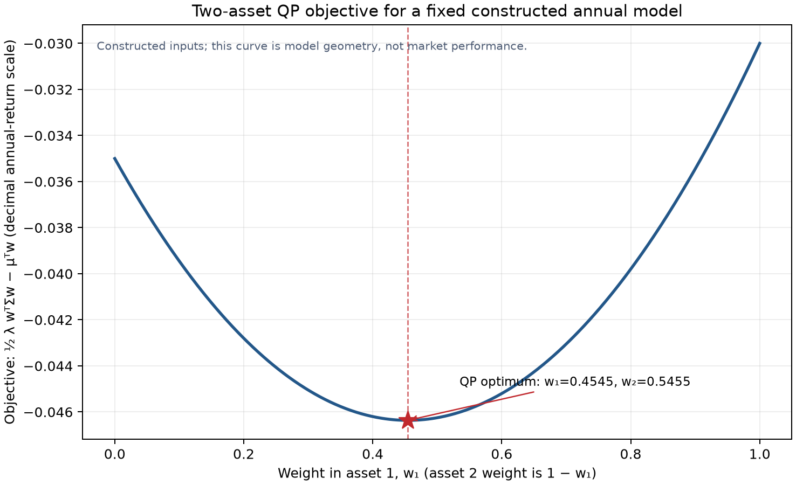

# 第9章 — 优化（Optimization）

> 情境主线：两项资产的可行权重如何在预算、杠杆和长仓下界之间变化，最后怎样用目标函数与 KKT 条件核对一个解。

先看一年期的构造输入。资产 1、2 的预期总收益为 \((0.05,0.08)\)，协方差矩阵为

\[
\Sigma=\begin{bmatrix}0.04&0.01\\0.01&0.09\end{bmatrix}.
\]

令 \(w_1=x\)、\(w_2=1-x\)，在预算 \(w_1+w_2=1\) 与长仓下界 \(w_1,w_2\geq0\) 下，\(x\in[0,1]\)。用 \(J(w)=\tfrac12\lambda w^\top\Sigma w-\mu^\top w\) 比较可行点（\(\lambda=1\)）：

| \(w_1\) | \(w_2\) | 预期总收益（年，小数） | 方差（年收益小数\(^2\)） | 目标 \(J(w)\) |
|---:|---:|---:|---:|---:|
| 0 | 1 | 0.08000 | 0.09000 | −0.03500 |
| 0.5 | 0.5 | 0.06500 | 0.03750 | −0.04625 |
| 1 | 0 | 0.05000 | 0.04000 | −0.03000 |

这三行都满足预算与长仓限制；它们只用于看方向，不能代替连续区间上的最优性证明。变量 \(w\) 是无量纲权重，\(\mu\) 是同一年度持有期的预期总收益，\(\Sigma\) 的单位是收益小数平方，风险系数 \(\lambda\) 的单位是每单位收益小数的倒数，目标两项因此都以年度收益小数计。下面从这组可行点回到完整模型，推导为什么最优点落在哪里。

先修：第 4 章微积分、第 5 章线性代数、第 8 章回归。完成后，你能证明二次目标何时凸，写出最小二乘、线性规划和均值—方差二次规划，区分 KKT 的必要与充分条件，解释对偶变量的局部影子价格，并用 CVXPY 检查状态与约束残差。

## 1. 本章目标

本章把决策问题分成四层。第一层是变量：真正可以选择什么、变量的维度和单位是什么。第二层是目标：怎样把收益、风险或拟合误差压成一个标量。第三层是可行集合：预算、长仓、产能等限制如何描述。第四层是证据：求解器返回的状态、原始可行性、对偶变量和残差是否足以支持所写的结论。

完成本章后，你应能：

1. 区分目标函数（objective function）、决策变量（decision variable）、约束（constraint）、可行点（feasible point）与最优点（optimal point）；
2. 通过定义、二阶导数或海森矩阵（Hessian Matrix） 证明集合和目标的凸性，并指出正定只是严格凸的充分条件之一；
3. 将最小二乘写成凸二次问题（quadratic program, QP），并说明唯一解还需要什么秩或切空间条件；
4. 写出线性规划（linear program, LP）和组合均值—方差 QP，并追踪每个输入、输出、目标与对偶量的单位；
5. 从拉格朗日函数（Lagrangian）推导弱对偶（Weak Duality）、互补松弛（Complementary Slackness）、卡鲁什—库恩—塔克条件（Karush–Kuhn–Tucker Conditions, KKT）与约束右端的影子价格；
6. 准确说明斯莱特条件（Slater Condition）对强对偶的作用，区分 KKT 在一般非凸问题与凸问题中的逻辑地位；
7. 通过 CVXPY 读取 solver status、可行残差和 KKT 诊断，并识别 `optimal_inaccurate`、不可行、无界以及协方差矩阵轻微负特征值的处理边界。

本章数值验收以固定构造输入为准：两资产风险—收益 QP 的最优权重为 \([5/11,6/11]\)，最小方差权重为 \([8/11,3/11]\)；二资产每项权重上限 \(0.4\) 不可行；当风险厌恶系数为 \(0.2\) 时最优解落在边界 \([0,1]\)，第一项长仓约束的对偶量为 \(0.014\)；构造 LP 的最优产量为每天 40 批 A 和 20 批 B，贡献为每天 160 千欧元。它们是教学数字，不是市场估计或回测收益。

## 2. 为什么 Quant 需要它

统计模型回答“根据已有观测，某个量可能是多少”，优化回答“给定这些估计和可行选择，采取哪个组合、订单或资源分配方案”。两者相连，却不能互相替代。比如均值—方差优化需要预期收益 \(\mu\) 和协方差矩阵 \(\Sigma\)，优化器能按给定输入求权重，但不能证明这两个输入估得准确，更不能从数学最优推出未来能按这些权重成交。

如果没有显式目标，研究者可能在代码里把“风险”混成波动率、方差、绝对损失和回撤。如果没有可行约束，算法可能输出不可执行的负仓、超额总仓或资源超限。如果没有求解状态与独立残差检查，则 `x.value` 中一个浮点向量很容易被误读为有效策略。优化问题必须先由研究者完整定义，数值求解器才有清楚的工作对象。

本章沿三类结构建立联系。最小二乘把第 8 章的误差平方和写成无约束凸 QP；LP 用直线目标在多面体可行域里分配有限资源；均值—方差 QP 在收益和风险之间选择组合。三者共享“目标 + 可行集 + 最优性检查”，但目标单位、求解方式和经济含义不同。

## 3. 直觉：先画可选范围，再找更好的点

设想在二维图上，横轴是资产 1 的组合权重，纵轴是资产 2 的权重。完全投资给出一条直线 \(w_1+w_2=1\)；长仓要求两者都非负，于是可行部分只剩从 \((0,1)\) 到 \((1,0)\) 的线段。每个点代表一个允许的组合。均值—方差目标沿该线段给出一条二次函数曲线；优化是在可行线段上找到目标最低处，而不是在整张平面上任意找梯度为零的点。

凸性让这个几何搜索更可信。凸集合中两点之间的线段仍留在集合里；凸函数在凸可行域上不会出现严格劣于全局最优的局部最优点。若目标凸、可行域凸，一个可行的局部最优就是全局最优。若目标严格凸，则在凸可行集上至多有一个最优点。优化算法可能仍使用迭代和浮点近似，但它搜索的数学结构已排除了多个互相隔绝的局部谷底。

LP 的图形更简单：等高线是平行直线，线性目标沿一个方向改善，通常会一直推到多边形顶点。QP 的等高线是椭圆或退化椭圆，最优点可能在内部，也可能被推到可行域边界。边界处全空间梯度一般不为零；正确的问题是“沿着所有可行方向还能不能下降”，这正是约束最优性和 KKT 条件要表达的内容。

这些几何解释也有边界。非凸目标可以有多个局部极值；非凸约束可能让可行域断裂；凸优化器不能让一个错误的目标自动变成正确研究问题。

## 4. 数学基础：维度、单位和有限选择

::: {.body-definition title="定义：变量、约束与最优值"}

以一般最小化问题为起点：

\[
\begin{array}{ll}
\text{minimize}_{x} & f_0(x) \\
\text{subject to} & f_i(x)\leq 0,\quad i=1,\ldots,m,\\
& h_j(x)=0,\quad j=1,\ldots,p.
\end{array}
\]

这里 \(x\in\mathbb{R}^n\) 是 \(n\) 个决策量组成的列向量；\(f_0\) 是标量目标；\(f_i\) 是不等式限制；\(h_j\) 是等式限制。一个可行点必须同时满足全部限制。最优值 \(p^\star\) 是所有可行点目标值的下确界；若没有可行点，问题不可行，若目标可以沿可行点降至 \(-\infty\)，问题无界。

:::

量纲检查可以提前发现建模错误。若 \(x\) 是生产批次/日，\(Ax\leq b\) 中 \(A_{ij}\) 应是资源小时/批次，\(b_i\) 是资源小时/日；于是 \(Ax\) 和 \(b\) 同单位。若目标系数 \(c_j\) 是千欧元/批，\(c^\top x\) 的单位是千欧元/日。组合问题中权重 \(w\in\mathbb{R}^n\) 是无量纲比例，预期收益 \(\mu_i\) 是同一持有期收益的小数，\(\Sigma_{ij}\) 是相同持有期收益的协方差，单位为收益小数平方；\(w^\top\Sigma w\) 是组合收益方差。

本章组合案例取一年为一个持有期。它把 \(0.05\) 解释为一年预期简单收益 \(5\%\)，协方差矩阵为年度收益小数的协方差，未年化/缩放任意一项。风险厌恶系数 \(\lambda\) 的单位是“每单位收益小数的倒数”，所以 \(\lambda w^\top\Sigma w\) 与 \(\mu^\top w\) 都以年度收益小数计。权重总和为 1 是预算恒等式，不是收益观测或交易时点。

在求解层面应分开四种状态：可行表示至少存在一个满足约束的点；有界表示目标在可行域上存在有限的最好值；可达表示这个最好值由某个可行点取得；数值可核验表示实际返回的浮点解满足所需精度与模型契约。一个问题可以不可行，也可以可行但无界；`optimal_inaccurate` 表示求解器以较低精度报告候选结果，不等同于 `optimal` 状态。即使状态为 `optimal`，返回的仍是浮点求解结果，还要检查残差与应用所需精度。这四层不能只靠打印一个权重向量来代替。

## 5. 正式定义：凸问题、LP、QP 与可行性

集合 \(C\) 是凸集（convex set），如果对任意 \(x,y\in C\) 和 \(\theta\in[0,1]\)，都有 \(\theta x+(1-\theta)y\in C\)。向量的凸组合是非负且总和为 1 的加权平均；长仓完全投资的权重集合就是凸单纯形。半空间 \(a^\top x\leq b\)、仿射等式 \(Ax=b\) 的解集及它们的交集都凸。凸函数（convex function）满足

\[
f(\theta x+(1-\theta)y)\leq \theta f(x)+(1-\theta)f(y).
\]

几何上，函数在弦的下方。若对所有互异 \(x,y\) 和 \(0<\theta<1\) 都严格小于右边，则函数严格凸。凸优化问题要求最小化凸目标并在凸可行域上求解；等价表达可以最大化凹目标。凸问题的局部最优是全局最优。严格凸目标在凸可行集上至多有一个最优点，但“至多一个”不保证最优点一定存在。

二次函数

\[
q(x)=\frac12 x^\top P x+c^\top x+r,
\]

中，\(P\in\mathbb{R}^{n\times n}\) 可取对称矩阵，\(c\in\mathbb{R}^n\)、\(x\in\mathbb{R}^n\)，\(r\in\mathbb{R}\)。其 Hessian 是 \(P\)。若 \(P\succeq0\)，则对任意方向 \(d\)，二阶曲率 \(d^\top P d\geq0\)，所以 \(q\) 凸；若 \(P\succ0\)，则任意非零方向曲率严格为正，\(q\) 严格凸。正定是便于检查的充分且对全空间二次函数也必要的条件；在预算切面上，即使 \(P\) 奇异，只要它在所有非零可行方向上给出正曲率，限制后的目标仍可严格凸。

线性规划（linear program, LP）以线性目标和仿射约束描述，例如

\[
\begin{array}{ll}
\text{maximize}_{x} & c^\top x \\
\text{subject to} & Ax\leq b,\quad x\geq0.
\end{array}
\]

若变量 \(x\in\mathbb{R}^n\)，资源限制行数为 \(m\)，则 \(A\in\mathbb{R}^{m\times n}\)、\(b\in\mathbb{R}^m\)、\(c\in\mathbb{R}^n\)。线性目标既凸又凹；线性可行域是多面体。LP 是 QP 的特例，即二次项 \(P=0\)。

一般二次规划可含非凸二次目标；本章只讨论凸二次规划（convex quadratic program），其二次目标矩阵半正定，约束为线性等式/不等式：

\[
\begin{array}{ll}
\text{minimize}_{x} & \frac12x^\top P x+c^\top x \\
\text{subject to} & Gx\leq h,\\
& Ax=b,
\end{array}
\qquad P\succeq0.
\]

其中 \(G\in\mathbb{R}^{m\times n}\)、\(h\in\mathbb{R}^m\)、\(A\in\mathbb{R}^{p\times n}\)、\(b\in\mathbb{R}^p\)。约束数量和变量数量都有限时，线性约束的可行集是闭多面体。目标在可行集上强制趋向无穷远时达到最小值，或可行集紧时连续目标达到最小值，是两种常见的充分存在条件，并非必要条件；闭多面体上的凸二次规划在其最优值有限时也有解，细节超出本章范围。不要把“问题凸”误说成“解必存在”或“solver 一定在默认精度内收敛”。

CVXPY 采用遵循规则的凸优化建模（disciplined convex programming, DCP）检查。其规则允许最小化可证为凸的表达式、最大化可证为凹的表达式，并对仿射等式和方向正确的凸/凹不等式作组合。DCP 检查若通过，说明建模表达式遵守所选凸规则；它不证明数据单位正确、模型符合经济问题或估计值可靠。DCP 若无法证明一个数学上凸的表达式，也不一定说明数学问题非凸，可能是表达式写法超出规则，需要等价改写。

## 6. 推导：从二阶曲率到 KKT 和对偶

### 6.1 半正定 Hessian 如何保证二次目标凸

设 \(P=P^\top\succeq0\)，并取两个点 \(x,y\) 与 \(\theta\in[0,1]\)。展开二次函数后，线性项 \(c^\top x\) 和常数 \(r\) 在凸组合差中抵消，得到

\[
\theta q(x)+(1-\theta)q(y)-q(\theta x+(1-\theta)y)
=\frac12\theta(1-\theta)(x-y)^\top P(x-y)\geq0.
\]

最后一步直接来自半正定定义。故目标满足凸函数不等式。反过来，如果有方向 \(d\) 满足 \(d^\top P d<0\)，沿 \(x+td\) 的二阶曲率向下，该二次函数就不可能全局凸。矩阵对称化不是修复坏协方差的万能步骤；协方差理论上对称半正定，浮点输入的轻微非对称可以在明确容差内平均，但明显不对称或负特征值必须查数据与估计流程。

### 6.2 最小二乘为何是 QP

令 \(A\in\mathbb{R}^{m\times n}\) 是设计矩阵，\(y\in\mathbb{R}^m\) 是观测向量，\(\beta\in\mathbb{R}^n\) 是待选系数。最小二乘（least squares）目标为

\[
\min_\beta \|A\beta-y\|_2^2.
\]

平方展开为

\[
\beta^\top A^\top A\beta-2y^\top A\beta+y^\top y.
\]

矩阵 \(A^\top A\) 半正定，因为对任意 \(z\)，有 \(z^\top A^\top A z=\|Az\|_2^2\geq0\)。所以残差平方和是凸二次目标。对 \(\beta\) 求导得到 \(2A^\top(A\beta-y)\)，驻点满足正规方程 \(A^\top A\beta=A^\top y\)。若 \(A\) 满列秩，则 \(A^\top A\succ0\)，系数解唯一；若不满秩，样本内最小二乘拟合值唯一而系数不唯一。显式计算 \((A^\top A)^{-1}\) 会放大病态矩阵的数值误差，实际应优先用 `numpy.linalg.lstsq`、QR/SVD，或可靠的最小二乘求解器。

这里不重复第 8 章回归推断。优化视角只告诉我们 OLS 是在所有系数中寻找平方误差最小点；它不提供标准误、假设检验、误差结构诊断或可预测时点证据。

### 6.3 拉格朗日函数、弱对偶与 Slater 条件

考虑第 4 节的一般约束最小化问题。对每个不等式 \(f_i(x)\leq0\) 引入乘子 \(\lambda_i\geq0\)，对每个等式引入不受符号限制的乘子 \(\nu_j\in\mathbb{R}\)。拉格朗日函数为

\[
L(x,\lambda,\nu)=f_0(x)+\sum_{i=1}^{m}\lambda_i f_i(x)+\sum_{j=1}^{p}\nu_j h_j(x).
\]

若 \(x\) 可行，则 \(\lambda_i f_i(x)\leq0\)，且等式项为 0，所以 \(L(x,\lambda,\nu)\leq f_0(x)\)。对 \(x\) 取下确界得到对偶函数 \(g(\lambda,\nu)=\inf_x L(x,\lambda,\nu)\)，它仍是任意可行原问题目标值的下界。最大化此下界得到拉格朗日对偶问题，最优对偶值 \(d^\star\) 总不大于原问题最优值 \(p^\star\)：\(d^\star\leq p^\star\)。这叫弱对偶，非凸时也成立。

若两值相等，称强对偶。对凸问题，斯莱特条件（Slater condition）是一个足以保证强对偶的约束资格条件；原始最优值有限时，它也保证对偶最优解可达；它不是必要条件。标准 Slater 条件要求在目标与约束函数共同定义域的相对内部（relative interior）存在一点，满足仿射等式并严格满足全部凸不等式。精炼版本允许仿射不等式不严格满足，但非仿射凸不等式仍须严格满足。若本章二次规划中的不等式全是仿射约束，可以使用较弱版本：只要求存在一个位于定义域相对内部、满足等式与不等式的可行点，而不必仿射不等式严格小于；本章这类二次目标的定义域是整个 \(\mathbb{R}^n\)。没有满足 Slater 版本的点不表示一定没有强对偶；它只表示不能依这项充分条件作保证。

### 6.4 KKT 条件何时必要、何时充分

在可微情形，卡鲁什—库恩—塔克条件（Karush–Kuhn–Tucker Conditions, KKT）由四组关系组成：

\[
\begin{aligned}
&f_i(x^\star)\leq0,\quad h_j(x^\star)=0 &&\text{（原始可行）},\\
&\lambda_i^\star\geq0 &&\text{（对偶可行）},\\
&\lambda_i^\star f_i(x^\star)=0 &&\text{（互补松弛）},\\
&\nabla f_0(x^\star)+\sum_i\lambda_i^\star\nabla f_i(x^\star)
+\sum_j\nu_j^\star\nabla h_j(x^\star)=0 &&\text{（驻点）}.
\end{aligned}
\]

驻点式说各类约束的边际作用与目标梯度平衡；互补松弛说未绑定的不等式其乘子为零，而正乘子必对应活动约束。反过来，活动约束的乘子仍可能为零，所以“在边界上”不代表一定有正影子价格。

::: {.body-conditions title="适用条件：KKT的必要性与充分性"}

在一般非凸问题中，局部最优点满足 KKT 通常还需合适的约束资格条件（例如线性无关约束条件）；KKT 点仍可能是局部极大、鞍点或其他驻点，不能由 KKT 单独推出全局最优。对凸、可微问题，任何满足完整 KKT 条件的可行原始—对偶点都是全局原始最优点与全局对偶最优点。反向从最优点推出相应乘子存在，则需要约束资格条件；凸问题中的 Slater 条件能保证强对偶与对偶最优值可达，是一项充分条件，不是必要条件，也不是唯一可用的条件。

:::

### 6.5 影子价格与扰动

对资源上限 \(Ax\leq b\)，对偶乘子 \(\lambda^\star\geq0\) 关联每项资源限制。在线性规划的规则基底附近，若将第 \(i\) 项资源上限 \(b_i\) 放宽一个小量 \(\Delta b_i\)，最大贡献的改变量约为 \(\lambda_i^\star\Delta b_i\)。乘子单位是“目标单位 / 资源单位”，这让稀缺产能可以和新增贡献比较。这个一阶解释依赖当前约束结构稳定；跨过另一个顶点、改变活跃集或遇到不可微最优值时，影子价格不保证远距离线性外推。

最小化问题中若扰动写成 \(f_i(x)\leq u_i\)，且最优值函数在当前参数可微，则 \(\partial p^\star/\partial u_i=-\lambda_i^\star\)。放宽上限 \(u_i\) 通常降低最小化成本，负号来自这个不等式方向。最大化 LP 使用 \(Ax\leq b\) 的常见原始形式时，资源价值导数则是非负的 \(\lambda_i^\star\)。必须先写清目标是最小化还是最大化、右端怎样扰动，才能解释符号。

## 7. 金融解释：优化的是估计模型，不是未来收益

均值—方差（mean–variance）组合把权重 \(w\in\mathbb{R}^n\)、同一预测期的预期收益 \(\mu\in\mathbb{R}^n\) 和协方差 \(\Sigma\in\mathbb{R}^{n\times n}\) 合成一个二次规划：

\[
\begin{array}{ll}
\text{minimize}_{w} & \frac12\lambda w^\top\Sigma w-\mu^\top w \\
\text{subject to} & \mathbf{1}^\top w=1,\\
& w\geq0.
\end{array}
\]

第一项惩罚方差，第二项奖励预期收益；负号表示最大化收益等价于在此写法中最小化负收益。若所有预期值与协方差都对应一年，且简单收益以小数表示，则 \(w\) 无量纲，\(\mu^\top w\) 是年度预期收益小数，\(w^\top\Sigma w\) 是年化方差小数平方，\(\lambda\) 取每单位收益小数的倒数后，两个目标项才同单位。

随着 \(\lambda\) 增大，模型更重视方差，相对降低对均值的追逐；当 \(\lambda\) 缩小，收益项更强，容易把权重推向均值估计较高的资产或约束边界。这些权重是输入估计条件下的模型决策，不是未来收益的估计误差区间。均值估计通常噪声很大；协方差轻微变化也会改变最优权重。长期研究要对估计窗、收缩估计、权重上限、换手、交易成本、借券和风险预算做敏感性分析。

最大夏普比率（maximum Sharpe ratio）使用预期超额收益。令 \(r_f\) 是与风险资产收益同一持有期、同一货币的无风险基准，并定义 \(\mu^{ex}=\mathbb{E}[R]-r_f\mathbf{1}\)。如果输入是预期总收益，就先减去同持有期的 \(r_f\)；若模型没有无风险基准，须明说采用 \(r_f=0\)。不能把月度预期超额收益与年度无风险收益混用。目标写作

\[
\max_w\frac{(\mu^{ex})^\top w}{\sqrt{w^\top\Sigma w}}
\]

这是分式目标，不能直接作为普通 QP 的二次目标交给 DCP。令 \(C\) 为预算、长仓及可选线性权重上限组成的凸可行集，先确认有限比率的候选域
\[
D_w=\{w\in C:(\mu^{ex})^\top w>0,\ w^\top\Sigma w>0\}
\]
非空；\(\Sigma\succeq0\) 本身不保证非空性。若原域为空，就没有本节所讨论的有限正 Sharpe 候选。

预算 \(\mathbf1^\top w=1\) 本身不随缩放保持不变。对 \(w\in D_w\)，令 \(y=w/((\mu^{ex})^\top w)\)，则 \(y\ge0\)、\((\mu^{ex})^\top y=1\)，且
\[
y^\top\Sigma y=\frac{w^\top\Sigma w}{((\mu^{ex})^\top w)^2}>0.
\]
反向也必须保留正方差：给定 \(y\ge0\)、\((\mu^{ex})^\top y=1\)、\(y^\top\Sigma y>0\)，令 \(t=\mathbf1^\top y>0\)、\(w=y/t\)，就有 \((\mu^{ex})^\top w=1/t>0\) 及 \(w^\top\Sigma w=y^\top\Sigma y/t^2>0\)。权重上限 \(w_i\le c_i\) 对应 \(y_i\le c_i\mathbf1^\top y\)，两方向都保留该限制。记不加正方差条件的闭多面体为 \(\overline D_y\)，严格对应域为 \(D_y=\{y\in\overline D_y:y^\top\Sigma y>0\}\)。上述双向映射仅在 \(D_w\) 与 \(D_y\) 之间成立，且保持 Sharpe 排序：
\[
S(w)=\frac{1}{\sqrt{y^\top\Sigma y}}.
\]

实际可求解的闭凸 QP 是在 \(\overline D_y\) 上最小化 \(q(y)=y^\top\Sigma y\)，它与严格域要分开解释。假设该闭 QP 的最小值可达：若 \(q^\star>0\)，其最优解属于 \(D_y\)，回转后得到有限最大 Sharpe \(1/\sqrt{q^\star}\)；若 \(q^\star=0\)，零方差最优解不属于 \(D_y\)，不能回转并报告原有限比率最优。还需用已经确认的 \(D_w\ne\varnothing\) 找一个正方差可行点；在当前预算、长仓、线性上限的凸结构中，将它与零方差点混合，可得到有限 Sharpe 趋于无穷的序列。第18节证明其上确界为 \(+\infty\)，而零方差点自身的比率未定义。原域为空时不作这个结论。

\(\Sigma\succ0\) 是保证非零变换向量正方差的简明充分条件，不是有限最优的必要条件。也不能把严格条件 \(q(y)>0\) 直接加到求解器中就称为普通凸 QP：凸二次函数的严格超水平集一般不凸。费用、固定金额或其他复杂限制须逐项另证变换与混合是否仍保留可行性。

## 8. Numerical Example

::: {.body-example title="完整例题：两资产收益—风险问题的内点解、边界解与KKT核对"}

所有输入是教学构造，持有期为一年。给定两项资产的年度预期收益小数、年度协方差与风险系数：

\[
\mu=\begin{bmatrix}0.05\\0.08\end{bmatrix},\qquad
\Sigma=\begin{bmatrix}0.04&0.01\\0.01&0.09\end{bmatrix},\qquad
\lambda=1.
\]

资产 1 年预期收益 \(5\%\)，资产 2 为 \(8\%\)；对角元素是年度方差，非对角元素是协方差。两项资产的完全投资长仓权重设为 \(w=(x,1-x)^\top\)，其中 \(x\in[0,1]\)。

组合预期收益为

\[
\mu^\top w=0.05x+0.08(1-x)=0.08-0.03x.
\]

组合方差为

\[
w^\top\Sigma w=0.04x^2+2(0.01)x(1-x)+0.09(1-x)^2
=0.11x^2-0.16x+0.09.
\]

代入目标后得到一元凸二次函数

\[
J(x)=\tfrac12(0.11x^2-0.16x+0.09)-(0.08-0.03x)
=0.055x^2-0.05x-0.035.
\]

导数 \(J'(x)=0.11x-0.05\)，令导数为零得 \(x=5/11\approx0.454545\)，故 \(w=(5/11,6/11)\approx(0.454545,0.545455)\)。二阶导数 \(J''(x)=0.11>0\)，且此点位于可行区间内部，所以是唯一全局最小值。计算得到组合预期收益 \(0.066363636\)，年度方差 \(0.040000000\)，目标值 \(0.5(0.04)-0.066363636=-0.046363636\)。这与求解器数值一致。

若只最小化方差且令预期收益向量为零，则令 \(0.22x-0.16=0\)，得到 \(x=8/11\approx0.727273\)、\(w=(8/11,3/11)\)。方差为 \(0.031818182\)，比收益—风险目标的方差小，但该解没有在目标中奖励资产预期收益。

风险厌恶系数改为 \(\lambda=0.2\) 时，约束逐步改变解。先去掉预算与权重界限，驻点条件 \(\lambda\Sigma w-\mu=0\) 给出
\[
w=(\lambda\Sigma)^{-1}\mu=(37/7,27/7),\qquad \mathbf{1}^\top w=64/7.
\]
权重和远大于 1，说明目标本身没有规定投资规模。加入预算 \(w_1+w_2=1\)，令 \(w=(x,1-x)\)，目标变为 \(J_{0.2}(x)=0.011x^2+0.014x-0.071\)，导数为 \(0.022x+0.014\)。若允许卖空但不给总杠杆上限，驻点 \(x=-7/11\) 对应 \(w=(-7/11,18/11)\)，总敞口 \(\lVert w\rVert_1=25/11\)。再加凸杠杆约束 \(\lVert w\rVert_1\leq1.5\)，预算线上的完整可行范围为 \(x\in[-1/4,5/4]\)：在 \(x<0\) 时杠杆约束给出 \(1-2x\leq1.5\)，在 \(x>1\) 时给出 \(2x-1\leq1.5\)，而 \([0,1]\) 全部可行。导数在整个区间的最小值是 \(J'_{0.2}(-1/4)=0.0085>0\)，故最优点为左端点 \((-1/4,5/4)\)。加上长仓下界 \(w\geq0\) 后，范围收窄为 \(x\in[0,1]\)，最优点变为 \((0,1)\)。预算控制净权重和，杠杆约束控制多空总敞口，下界禁止负持仓；三种约束作用不同。杠杆变式仅作解析比较，现有 helper 不接受总敞口上限参数。

下面逐项核对内点与边界点的 KKT 条件。对 \(\lambda=1\) 的内点解 \(w^\star=(5/11,6/11)\)，目标梯度
\[
\nabla J(w^\star)=\Sigma w^\star-\mu=(-29/1100,-29/1100)^\top.
\]
把预算写成 \(h(w)=\mathbf{1}^\top w-1=0\)，长仓写成 \(-w_i\leq0\)，拉格朗日函数为 \(L=J+\nu h-\ell^\top w\)。取预算乘子 \(\nu=29/1100\)、下界乘子 \(\ell=(0,0)\)，驻点向量为 \(\nabla J+\nu\mathbf{1}-\ell=(0,0)\)。预算残差为0，权重均正，乘子非负，互补项 \(\ell_iw_i=0\)。目标严格凸且可行集凸，所以这个 KKT 点是唯一全局最优点。

对 \(\lambda=0.2\) 的长仓边界 \(w^\star=(0,1)\)，
\[
\nabla J(w^\star)=0.2\Sigma w^\star-\mu=(-0.048,-0.062)^\top.
\]
取 \(\nu=0.062\)、\(\ell=(0.014,0)\)，则驻点向量为 \((-0.048,-0.062)+(0.062,0.062)-(0.014,0)=(0,0)\)。预算残差为0，权重非负，\(\ell\geq0\)，互补项为 \((\ell_1w_1,\ell_2w_2)=(0,0)\)。全空间梯度不为零，但沿预算线向内的方向 \((1,-1)\) 的导数是 \(0.014>0\)，所以长仓可行方向不能降低目标。点 \((0.5,0.5)\) 满足预算并严格满足两个长仓不等式，Slater 条件成立；本例的凸性使可行 KKT 点充分，Slater 又保证最优点的乘子存在。下界乘子的单位是年度目标收益小数/单位权重，不是资产收益、未来超额收益或投资金额。

若同时规定每项权重不超过 \(0.4\)，则 \(w_1+w_2\leq0.8\)，与完全投资 \(w_1+w_2=1\) 矛盾，问题不可行。这个错误不是求解器“找不到好解”，而是没有任何合法权重。

:::

### 8.2 最小二乘与资源 LP 的手算核对

构造解释变量 \(x=(0,1,2,3)\)，响应 \(y=(1,2,4,5)\)，二者只用任意教学单位，不是市场收益。含截距的设计矩阵 \(A\) 每行是 \((1,x_i)\)。因此

\[
A^\top A=\begin{bmatrix}4&6\\6&14\end{bmatrix},
\qquad A^\top y=\begin{bmatrix}12\\25\end{bmatrix}.
\]

正规方程给出 \(4\beta_0+6\beta_1=12\)、\(6\beta_0+14\beta_1=25\)。第一式乘1.5后从第二式相减，得 \(5\beta_1=7\)，所以斜率 \(\beta_1=1.4\)、截距 \(\beta_0=0.9\)。拟合值是 \((0.9,2.3,3.7,5.1)\)，残差为 \((0.1,-0.3,0.3,-0.1)\)，平方和为 \(0.2\)。因为 \(A\) 满列秩，平方损失严格凸，此系数是唯一最优解；这仍不推导任何统计显著性。

::: {.body-example title="完整例题：资源LP与可行对偶上界"}

再构造生产 LP：令 \(a,b\) 分别为两类产品的批次/日，每批贡献为3与2千欧元。两项产能限制为机器小时 \(2a+b\leq100\) 与人工小时 \(a+2b\leq80\)，且 \(a,b\geq0\)。两约束交点由第二式减第一式的一半求得 \(b=20\)，于是 \(a=40\)，贡献 \(3a+2b=160\) 千欧元/日。

只检查交点还不够；用可行对偶给全局上界。将机器限制乘 \(4/3\)、人工限制乘 \(1/3\) 再相加：

\[
3a+2b\leq \frac43(100)+\frac13(80)=160.
\]

任意可行生产量都不可能超出160，而交点达到160，故已证明全局最优。两个非负乘子分别是当前资源的局部影子价格。若只把机器上限改成 \(100+\delta\)，两活动约束的解为 \(a=40+2\delta/3\)、\(b=20-\delta/3\)，贡献为 \(160+4\delta/3\)。当 \(-60<\delta<60\) 时两产量仍为正，原基底保持；这个区间外需重新检查活动约束，不能沿用同一线性边际贡献。

:::

## 9. Python Implementation

### 本读者版的默认运行入口

从随包读者包的根目录，按其[README](../../../../editions/zh/README.md)建立独立环境后运行：

```bash
.venv/bin/python run_notebook.py notebooks/ch09_optimization.ipynb
```

Notebook 调用随包共享实现；默认不读取未随包提供的 French 数据，也不下载数据。每次执行与图表写入唯一 UUID 的 `runs/` 子目录，终端打印实际输出位置。读者默认路线采用包根 Notebook 及其断言。可选历史数据遵守读者包的[数据契约](../../../../editions/zh/OPTIONAL_DATA.md)。

读者包另外保留 `code/ch09_optimization.py`，但本章默认入口仍为上面的 Notebook。

### 历史课程根路线

验证过的核心函数见 [`optimization_tools.py`](../../../../src/quant_course/optimization_tools.py)，独立示例脚本见 [`ch09_optimization.py`](../../../../code/ch09_optimization.py)。从课程根目录运行：

```bash
.venv/bin/python code/ch09_optimization.py
```

脚本使用 CVXPY 1.9.3；本机当时安装的 solver 为 `CLARABEL`、`SCS`、`SCIPY`、`HIGHS`、`OSQP`，本次凸 QP 由 OSQP 返回 `optimal`，LP 使用 CLARABEL。环境中的默认 solver 选择可能不同，报告实际 `problem.solver_stats.solver_name`，不要假设所有安装都有同一个 solver。

从项目根目录独立运行下面的最小组合示例：

```python
import sys
sys.path.insert(0, "src")
import numpy as np
from quant_course.optimization_tools import solve_mean_variance

mu = np.array([0.05, 0.08])
sigma = np.array([[0.04, 0.01], [0.01, 0.09]])
result = solve_mean_variance(mu, sigma, risk_aversion=1.0, solver="OSQP")
minimum_variance = solve_mean_variance([0.0, 0.0], sigma, solver="OSQP")
print(result.solver_status, result.solver_name, result.weights)
print(result.expected_return, result.variance, result.objective)
print("primal residuals", result.budget_residual, result.nonnegativity_violation)
print("KKT diagnostics", result.stationarity_residual, result.complementarity_residual)
print("min-variance", minimum_variance.weights, minimum_variance.variance)
assert np.allclose(result.weights, [5 / 11, 6 / 11], atol=1e-7)
```

封装要求预期收益为有限实数向量，协方差为同维度、近似对称、有限的半正定矩阵，风险系数和可行性容差为正，权重上限若给出须在 \((0,1]\)。不满足维度、有限值、对称性或半正定检查时会报错。它用特征分解检查协方差：容差为 \(10^{-10}\max_i|d_i|\)，其中 \(d_i\) 是特征值；若最小特征值低于负容差则拒绝，若仅在容差内略小于零则截为零并重构矩阵。这个数值修正只容许相对谱尺度足够小的负曲率；它不证明负值来自舍入。零矩阵的谱尺度与容差均为0，不额外加绝对容差下限。对称性也按矩阵最大元素绝对值的相对容差检查。这项策略不应被当成修复经济估计错误的通用手段；返回对象没有单独的“已裁剪”旗标。

模型建立后先检查 `problem.is_dcp()`，执行求解，再检查状态。

- `optimal`：进入独立可行性检查。
- `optimal_inaccurate`：拒绝作为已通过结果。

封装独立重算预算、长仓及上限违反量，只要这些原始残差的最大值超过默认 \(10^{-6}\) 就报错。它还返回驻点条件（stationarity）和互补松弛（complementarity）残差供报告，并检查这些值有限；**它没有**给这两个 KKT 残差设置通过阈值，也没有检查对偶符号、对偶间隙或数值精度收敛证书。读者应把它们看作诊断值，不能据此声称每次求解都通过完整 KKT 证书。目标中使用的是通过特征值检查后的协方差矩阵；容差内的负特征值若被裁剪，诊断也针对修正后的模型。

脚本中的金融输入频率固定为一年。它没有真实价格序列、数据发布日期、信号时间、成交时间或实现收益区间。因此没有 `available_at`、`signal_time` 和 `trade_time` 字段可供检查，也没有使用期初信号去预测之后的实现收益。真实研究应保证估计窗口全部在信号发出前可得，并定义 \(\text{signal\_time}<\text{trade\_time}\leq\text{return interval start}\)；其持有区间长度应与 \(\mu\)、\(\Sigma\) 的单位一致。

## 10. Visualization

脚本生成的目标函数曲线如下。



横轴是资产 1 权重 \(w_1\in[0,1]\)，资产 2 权重自动为 \(1-w_1\)；纵轴是年度收益小数尺度下的目标 \(\frac12\lambda w^\top\Sigma w-\mu^\top w\)。曲线来自本节固定构造数据，红星及虚线标记 \(w_1=5/11\)、\(w_2=6/11\) 的内点最优权重。目标曲线呈向上开的碗状，显示二阶导数为正；向左端与右端移动都会增加目标值。

这张图表现的是模型几何，不是资产收益走势图、有效前沿实证图或业绩图。图上的最小值 \(-0.04636\) 是目标函数值；由于其中含方差惩罚，它不能直接解读为预期收益、年化 Sharpe 或组合净收益。纵轴、曲线与脚本输出的最优目标一致。

## 11. Real Market Example

本章没有读取真实资产价格或收益数据，也不报告真实市场组合、最优权重或样本外绩效。两资产输入 \(\mu\)、\(\Sigma\)，LP 的单位利润和资源上限，OLS 的四个点都明确是构造例子。此处给出的是把统计估计转成决策并检查求解结果的方法，不是市场实证。

迁移到真实研究时，应固定证券池和退市处理，指定总回报或价格收益、无风险利率、货币、复权及预测频率，并保存数据版本、下载时间、样本窗和哈希。预期收益、协方差和任何特征都须按点时可用信息估计；调参或风险预算需只用训练期。随后以信号生成时点、订单提交/成交规则及成交后的持有期收益来验证预测或组合表现，并与简单基准、换手、费用、滑点、容量和稳健参数区间比较。

## 12. Common Mistakes

**把最大化凸风险说成 DCP 问题。** 对半正定 \(\Sigma\)，\(w^\top\Sigma w\) 是凸函数；DCP 规则允许最小化凸函数，不允许最大化凸函数。正确修复是写清楚你要最小化的风险—收益目标并核实可行约束。

```python
import cvxpy as cp
import numpy as np

mu = np.array([0.05, 0.08])
sigma = np.array([[0.04, 0.01], [0.01, 0.09]])
w = cp.Variable(2)
constraints = [cp.sum(w) == 1, w >= 0]
wrong = cp.Problem(cp.Maximize(cp.quad_form(w, sigma)), constraints)
print("wrong problem follows DCP:", wrong.is_dcp())
try:
    wrong.solve(solver="OSQP")
except cp.error.DCPError as error:
    print(type(error).__name__)
correct = cp.Problem(
    cp.Minimize(0.5 * cp.quad_form(w, sigma) - mu @ w), constraints
)
print("correct problem follows DCP:", correct.is_dcp())
correct.solve(solver="OSQP")
print(correct.status, w.value)
```

这个例子中错误模型的 DCP 检查为 `False`，求解触发 `DCPError`；修正后为 `True` 并返回 `optimal`。如果真实研究目标确实是最大化风险，那可能是风险定义反了；把错误方向换成最小化不是纯语法修补，而要回到研究假设。

**用不同期限的预期收益和协方差。** 例如把一年预期收益放进目标，却把月协方差直接当成年协方差，风险项会因期限缩放错误而失真。必须先统一持有期和 return scale；若把月度独立增量累积成年，协方差缩放依赖独立/弱相关等假设，不能用“乘 12”替代对真实频率结构的核验。本章一年期输入仅为教学构造，不是数据年化流程。

**把低精度状态当成正常通过。** 状态为 `optimal_inaccurate` 时，只报告低精度最优候选。状态为 `infeasible_inaccurate` 时，不可行结论的数值精度有限。把一个 `value` 非空误当作成功，会掩盖边界违反。下列检查复现 API 的保守行为：不可行上限引发 `OptimizationError` 并保留 solver status；明显非半正定协方差在建模前报错。

```python
import sys
sys.path.insert(0, "src")
from quant_course.optimization_tools import OptimizationError, solve_mean_variance

mu = [0.05, 0.08]
sigma = [[0.04, 0.01], [0.01, 0.09]]
try:
    solve_mean_variance(mu, sigma, max_weight=0.4, solver="CLARABEL")
except OptimizationError as error:
    print("cap result:", error.solver_status)
try:
    solve_mean_variance(mu, [[1.0, 2.0], [2.0, 1.0]], solver="CLARABEL")
except ValueError as error:
    print("covariance rejected:", str(error))
valid = solve_mean_variance(mu, sigma, solver="CLARABEL")
print(valid.solver_status, "budget residual", valid.budget_residual)
print("reported KKT diagnostics", valid.stationarity_residual, valid.complementarity_residual)
```

运行结果依次指出状态 `infeasible`、非半正定矩阵被拒绝、有效 QP 的状态 `optimal`。在数值不稳定时，应报告状态，检查单位缩放、条件数、PSD、原始约束和 solver log，必要时改写问题或比较已安装的其他 solver；不可默默把候选权重当成可用解。

**把一个非零对偶量说成大额收益保证。** 对偶量只在当前目标、约束写法、当前活跃集和局部扰动下解释。若加减一个约束右端改变了最优顶点、误差结构或收益单位，原影子价格不能外推到远处。还要注意 CVXPY 不等式方向和自定义拉格朗日符号：`w >= 0` 对应的下界 multiplier 在 stationarity 中是减项。

**看到非零全空间梯度就认定边界解错了。** 无约束内点的一阶条件是梯度为零；边界上可行方向受限，KKT 要将目标梯度与预算、下界、上界等约束梯度一并平衡。对 \(\lambda=0.2\) 的两资产例子，原始梯度不为零，但其沿预算可行线向内的方向导数为正，故边界解是最优。

**把最大 Sharpe 比率一律交给 QP。** 目标是分式且依赖 \(\sqrt{w^\top\Sigma w}\)，直接 `Maximize` 不符合普通 QP/DCP。先限定正超额收益与正方差，再证明变换前后的双向可行性；预算通过回转规范化处理，固定权重上限需要同步变为线性齐次约束。

## 13. Quant Research Application

从研究问题开始：要选组合、构造执行计划，还是只分析一个拟合目标？固定时域和单位后，列出决策变量、目标、等式限制、上下界及不可违反的风险预算。对投资组合要写清资产身份、总回报、货币、无风险收益、复权、退市、协方差估计窗和均值估计方法，并按 `available_at`、数据版本与信号时点做信息集审计。先验证目标的凸性和可行域，再创建 CVXPY 模型。

求解后不要直接把 \(w^\star\) 写进一份业绩报告。先检查 solver status，确认它返回了哪些变量、哪一个 solver 实际运行；独立计算 \(\mathbf{1}^\top w-1\)、最小权重、最大权重、预算与风险限制残差；查看约束乘子、活跃约束及驻点条件/互补松弛诊断。对最优输入再做敏感性分析：均值轻微扰动、协方差收缩、资产删减或风险系数变化会不会使组合完全翻转？影子价格只解释当前局部瓶颈，不能取代这项压力测试。

每个真实回测时期都应只用在当时可得的过去样本估计 \(\mu\) 与 \(\Sigma\)，随后先生成 `signal_time`，再排队到可实现的 `trade_time`，将该次权重映射到交易之后明确的 `return interval`。持有期、估计频率、风险矩阵和成本时间尺度须一致。优化步骤不能访问后续修订、未来价格或留出目标值；组合评价要记录基准、换手、费率、滑点、借券、容量与重平衡。应预先列出反证条件，例如合理的均值估计扰动使仓位翻转、样本外风险超限、费用后无法改善基准、或约束和成交规则互相矛盾。

本章脚本没有任何可用的点时数据、signal、trade 或持有期业绩。因此它只能说明数学目标、凸性、求解器输出和结构检查，不能报告实证策略效果。

下一步的研究边界见[第20章：现代组合理论](../ch20/content.md)与[第21章：实用组合构建](../ch21/content.md)。第20章区分总体矩与估计矩，并把代入估计值的前沿视为样本内对象；第21章处理均值和协方差的估计误差、真实持仓限制、换手与成本账本及样本外评价。只有本章的构造解，不能支持真实收益提高或策略可执行的结论。

## 14. Chapter Summary

优化把目标与可行域一起定义。凸函数在凸可行域上的局部最优就是全局最优；二次目标半正定 Hessian 是凸 QP 的典型来源。最小二乘的 Gram 矩阵 \(A^\top A\) 半正定，LP 用线性资源约束，均值—方差组合用凸风险与预期收益构造 QP。

拉格朗日乘子让限制进入目标，也建立原始—对偶关系。弱对偶始终提供界；凸性配合 Slater 这类约束资格可保证强对偶；可行 KKT 对凸问题充分，而在一般非凸问题里 KKT 多为需正则性的必要驻点条件。对偶量可做局部敏感度解释，但符号、单位和扰动方向都由约束形式决定。

求解器状态是计算证据的一部分，不是经济证据。报告 solver、状态、目标、原始残差、KKT 诊断与输入缩放，并保留所有数据可得时间和评价区间。

## 15. Exercises

### 递进短题

**9-T01（对象识别）** 在本章两资产模型中，指出决策变量、目标、预算等式、长仓下界和可行集。写出 \(w\)、\(\mu\)、\(\Sigma\)、\(\lambda\) 的含义与单位；如果再加 \(\lVert w\rVert_1\leq L\)，它限制什么？

**9-T02（单步计算）** 取 \(w=(0.5,0.5)\)、\(\lambda=1\)。计算同一年度的预期收益、方差与目标值，并说明哪一个量的单位是收益小数平方。

**9-T03（完整计算）** 令 \(\lambda=0.2\)、\(w=(x,1-x)\)。先在预算等式之外求无约束驻点；再依次加预算、总杠杆上限 \(\lVert w\rVert_1\leq1.5\)、长仓下界 \(w\geq0\)。每次写出解，并解释是哪条约束改变了解。

**9-T04（代码诊断）** 求解器返回非空 weights.value，代码立即按权重和归一化后输出；状态可能是 optimal_inaccurate 或 infeasible。列出你接受候选解前必须检查的状态与数值量，并说明为什么归一化不能修复失败的原问题。

**9-T05（研究判断）** 仅凭本章构造输入上的 optimal 权重与较低目标值，能否写“优化提高了真实收益”或“权重可直接实盘”？还需要哪些证据？指出相关后续章节。

**9-E01（定义）** 用凸组合定义说明：为什么半空间、仿射等式解集及其交集形成凸可行域？给出一个不凸的可行域反例，并解释局部最优变成全局最优依赖哪项性质。

**9-E02（数学）** 对 \(q(x)=\frac12x^\top P x+c^\top x+r\)，推导 Hessian 并证明 \(P\succeq0\) 足以保证 \(q\) 凸。为什么 \(P\succ0\) 在完全空间内是严格凸的充分条件？在限制到仿射预算集合后，还可以用什么方向条件判断严格凸？

**9-E03（建模）** 写出最小二乘的 QP 形式，说明 \(A^\top A\) 为什么半正定；系数唯一需要什么条件？残差平方和的单位与响应变量单位有什么关系？

**9-E04（手算）** 使用第 8 节 \(\mu,\Sigma\)，令 \(w=(x,1-x)\)、\(\lambda=1\)。手算预期收益、方差、目标和权重；说明为什么这里是全局最小而非仅一个驻点。

**9-E05（对偶）** 说明弱对偶和强对偶的差别；Slater 在凸问题中提供什么保证？为什么 Slater 不是必要条件？区分 KKT 对一般非凸和凸可微问题的逻辑地位。

**9-E06（影子价格）** 对生产 LP 的机器时与人工时约束，推导影子价格 \(4/3\) 和 \(1/3\) 千欧元/额外资源小时的来源，并解释外推时限。

**9-E07（状态）** `optimal_inaccurate`、`infeasible` 和 `unbounded` 代表什么？为什么“有 `variable.value`”不能单独证明可用解？指出课程 helper 哪些残差做了阈值检查，哪些只作为诊断返回。

## 16. Programming Exercises

**9-P01（均值—方差 QP）** 使用 `solve_mean_variance` 求两资产基准与最小方差组合，断言目标、收益、方差、budget 残差和权重符合解析值。输入使用年度十进制收益口径。

**9-P02（LP 与对偶）** 用 CVXPY 建模每日生产 A、B 两类产品；每批 A 用 2 小时机器与 1 小时人工、每批 B 用 1 小时机器与 2 小时人工；每日上限分别为 100 与 80 小时，每批净贡献分别是 3 与 2 千欧元。求最优量、总贡献、两个资源对偶值，并验证原始资源残差。

**9-P03（边界 KKT 与不可行）** 求 \(\lambda=0.2\) 的两资产组合，报告边界、下界对偶量、全空间梯度、预算/驻点/互补残差；然后将两个上限都设成 0.4，记录不可行状态，不能使用一个部分解继续分析。

## 17. Challenge Problems

**9-C01（Sharpe 变换）** 从最大 Sharpe 分式目标推导 \(y=w/((\mu^{ex})^\top w)\)。明确 \(\mu^{ex}_i=\mathbb E[R_i]-r_f\)，资产与无风险基准采用同一持有期、同一货币；若取 \(r_f=0\) 须说明。先检查预算、长仓、可选权重上限下的正超额收益与正方差候选域是否非空，再写出保留正方差的双向映射与上限变换。区分严格对应域和不加正方差条件的闭 PSD QP：最优方差为正或为零时，怎样解释回转？用 \(\Sigma=\operatorname{diag}(0,1)\)、\(\mu^{ex}=(1,0)^\top\)、\(w=(x,1-x)^\top\) 检查 \(0<x<1\) 与 \(x=1\)，并以可行混合说明何时上确界无穷、何时原域为空。解释正定为什么不是必要条件、严格正方差限制为什么不能直接当普通凸 QP 约束。给10分评分标准：同期超额收益与原域非空性2分，双向正方差映射2分，上限变换1分，闭QP正/零最优值与可行混合3分，正定仅充分及严格域的凸性边界2分。

**9-C02（可行集上的严格凸性）** 假设 \(\Sigma\succeq0\) 但奇异，考虑 \(\mathbf{1}^\top w=1\) 的预算超平面。给出其切空间的曲率条件；据此判断 \(w^\top\Sigma w\) 是否可能在全空间不严格凸、却在预算可行方向上严格凸。评分标准：正确写出 \(\{d:\mathbf{1}^\top d=0\}\) 2 分，条件 \(d^\top\Sigma d>0\) 对所有非零可行方向 3 分，解释零空间交集及唯一性 3 分，区分充分条件和存在性 2 分。

## 18. Solutions / Solution Hints

**9-E01 答案。** 半空间可写成 \(f(x)=a^\top x-b\leq0\)，其中 \(f\) 仿射，因此凸。若 \(x,y\) 都满足约束，其凸组合的函数值仍不大于 0。仿射等式的两个解的凸组合仍满足 \(A(\theta x+(1-\theta)y)=\theta Ax+(1-\theta)Ay=b\)。交集中的任意两点属于每个集合，因此它们的线段也属于每个集合，交集仍凸。反例是两个彼此分离的闭圆盘的并集；圆盘分别凸，但并集通常不凸。凸问题的全局结论依赖目标凸和可行域凸：局部可行点若还有更优点，连接两点的线段会给出任意接近当前点的下降可行点，和局部最优矛盾。

**9-E02 答案。** 对称 \(P\) 下，\(\nabla q(x)=Px+c\)，\(\nabla^2q(x)=P\)。二次凸组合差为 \(\frac12\theta(1-\theta)(x-y)^\top P(x-y)\)，半正定使其非负，因此 \(q\) 凸。全空间 \(P\succ0\) 使每个非零差方向有严格曲率，故严格凸。限制在 \(Ax=b\) 上的可行切向量满足 \(Ad=0\)；若所有非零 \(d\in\ker A\) 均有 \(d^\top P d>0\)，则目标在该仿射集合内严格凸，即使 \(P\) 在整个 \(\mathbb{R}^n\) 上奇异。若还有限制不等式，应逐个可行面检查可行方向集合。严格凸保证至多一个最优点，不保证最优点存在。

**9-E03 答案。** 最小二乘为 \(\min_\beta\|A\beta-y\|_2^2=\min_\beta(\beta^\top A^\top A\beta-2y^\top A\beta+y^\top y)\)。对任意 \(z\)，\(z^\top A^\top A z=\|Az\|_2^2\geq0\)，所以二次项矩阵半正定。正规方程为 \(A^\top A\beta=A^\top y\)。若 \(A\) 满列秩，\(A^\top A\) 正定且系数唯一；不满列秩会导致某些系数方向无法由样本区分。若 \(y\) 单位是每日收益小数，残差同单位，RSS 单位是收益小数平方；若 \(y\) 是欧元，RSS 是欧元平方。

**9-E04 答案。** \(w=(x,1-x)\)，组合收益 \(0.08-0.03x\)，方差 \(0.11x^2-0.16x+0.09\)。

\[
J(x)=0.055x^2-0.05x-0.035,\qquad J'(x)=0.11x-0.05,\qquad J''(x)=0.11>0.
\]

驻点 \(x=5/11\in[0,1]\)，因此是区间内唯一全局最小。预期收益 \(0.066363636\)，方差 \(0.04\)，目标 \(-0.046363636\)。凸性与可行域共同支持全局结论。

**9-E05 答案。** 弱对偶是所有可行原问题值不小于任一可行对偶下界，故 \(d^\star\leq p^\star\)；强对偶是两边最优值相等。Slater 是凸问题的一项约束资格：在共同定义域的相对内部满足仿射等式，并严格满足全部不等式，足以保证强对偶；若原始最优值有限，对偶最优值也能达到。精炼版本对仿射不等式只要求可行，但仍保留定义域相对内部条件。Slater 是充分条件，不是必要条件：某些不严格可行的问题仍然没有对偶间隙。非凸问题里 KKT 通常需约束资格才是局部最优的必要条件，但不充分；可微凸问题中，可行 KKT 点足以保证全局原始—对偶最优。若要从“任何原始最优点”反推出乘子存在，还需要强对偶和乘子可达，Slater 是一项充分条件。

**9-E06 答案。** 最大化 \(3a+2b\)，约束 \(2a+b\leq100\)、\(a+2b\leq80\)、\(a,b\geq0\)。两项生产量均为正，最优顶点上两种资源都绑定。对偶约束等式为 \(2\lambda_m+\lambda_l=3\)、\(\lambda_m+2\lambda_l=2\)。解得 \(\lambda_m=4/3\)、\(\lambda_l=1/3\)。它们单位是千欧元/日除以资源小时/日，即每增加一个每日可用资源小时的边际千欧元贡献。只在同一基底与局部可行扰动范围内，这些数值才是可靠的一阶近似；跨到新顶点后应重新求解。

**9-E07 答案。** `optimal_inaccurate` 表示求解器返回低于其目标精度的候选，`infeasible` 表示未找到任何满足所有限制的点并判定问题不可行，`unbounded` 表示沿可行方向目标可趋向正/负无穷（符号取决于最大化或最小化）。CVXPY 可能保留不准确状态下的变量值，因此非空 `value` 不是通过证明。helper 仅对重算的预算、长仓及上限违反量使用 \(10^{-6}\) 阈值；stationarity 与 complementarity 只重算、检查有限并返回，没有阈值接受规则，也未算对偶间隙或对偶符号条件。

**9-T01 答案。** \(w=(w_1,w_2)\) 是无量纲决策权重；目标是 \(\frac12\lambda w^\top\Sigma w-\mu^\top w\)；预算为 \(w_1+w_2=1\)，长仓下界为 \(w_i\geq0\)，可行集是满足这些等式与不等式的权重集合。年度 \(\mu\) 是预期总收益小数，\(\Sigma\) 是年度收益小数的协方差，单位为收益小数平方；\(\lambda\) 用每单位收益小数的倒数计，使两项目标同单位。约束 \(\lVert w\rVert_1\leq L\) 限制多空头寸的总敞口，不替代净权重预算。

**9-T02 答案。** \(\mu^\top w=0.5(0.05)+0.5(0.08)=0.065\)。组合方差为 \(0.25(0.04)+2(0.25)(0.01)+0.25(0.09)=0.0375\)，所以 \(J=0.5(0.0375)-0.065=-0.04625\)。方差单位是年度收益小数平方；乘以 \(\lambda=1\)（每收益小数）后才与收益项同单位。

**9-T03 答案。** 没有预算或权重界限时，驻点 \(\lambda\Sigma w-\mu=0\) 给 \(w=(\lambda\Sigma)^{-1}\mu=(37/7,27/7)\)。加预算后，\(J_{0.2}(x)=0.011x^2+0.014x-0.071\)，故 \(J'_{0.2}(x)=0.022x+0.014\)；预算线上但无长仓界限时，唯一驻点 \(x=-7/11\)，权重为 \((-7/11,18/11)\)，总敞口 \(25/11\)。加入 \(\lVert w\rVert_1\leq1.5\) 后，预算线上的完整可行区间为 \([-1/4,5/4]\)，因为负区间要求 \(1-2x\leq1.5\)，正区间要求 \(2x-1\leq1.5\)；导数在区间内为正，最优点是 \((-1/4,5/4)\)。加入 \(w\geq0\) 后可行区间为 \([0,1]\)，最优点改为 \((0,1)\)。预算限制净权重和，杠杆上限限制总敞口，下界排除卖空，三者切掉不同的可行点。

**9-T04 答案。** 先检查实际 solver 状态；课程 helper 只接受名为 `optimal` 的状态，但这仍是浮点求解结果，不是数学精确证书；它不会把 `optimal_inaccurate` 当成通过，也不会用不可行解的变量值继续计算。再确认权重有限，并按原模型重算预算、长仓、上限及本任务指定的其他约束残差；核对原始目标与输入单位。归一化会改写返回向量，可能破坏上限和其他约束，不能把失败状态变成原问题的可行最优解。此 helper 对预算、长仓和均匀上限违反量应用 \(10^{-6}\) 阈值；驻点与互补残差只作有限值诊断，没有通过阈值，也不构成完整 KKT 证书。

**9-T05 答案。** 不能。构造的 \(\mu,\Sigma\) 只是固定输入，optimal 只说明求解器对写下的模型返回了候选最优解，不验证估计精度、未来收益或成交可行性。真实研究还需点时可得的训练数据、样本外评价、真实约束与融资规则、换手/费用/滑点账本及稳健性分析。第20章讨论均值—方差理论与估计矩的样本内边界；第21章进一步处理估计误差、实务约束、成本和样本外表现。

**9-P01 参考实现。**

```python
import sys
sys.path.insert(0, "src")
import numpy as np
from quant_course.optimization_tools import solve_mean_variance

mu = np.array([0.05, 0.08])
sigma = np.array([[0.04, 0.01], [0.01, 0.09]])
result = solve_mean_variance(mu, sigma, risk_aversion=1.0, solver="CLARABEL")
minimum_variance = solve_mean_variance([0.0, 0.0], sigma, solver="CLARABEL")
assert result.solver_status == "optimal"
np.testing.assert_allclose(result.weights, [5 / 11, 6 / 11], atol=1e-7)
np.testing.assert_allclose([result.expected_return, result.variance, result.objective],
                           [0.06636363636363636, 0.04, -0.04636363636363636], atol=1e-7)
np.testing.assert_allclose(minimum_variance.weights, [8 / 11, 3 / 11], atol=1e-7)
np.testing.assert_allclose(minimum_variance.variance, 0.031818181818181815, atol=1e-7)
assert result.budget_residual < 1e-6 and result.nonnegativity_violation < 1e-6
print("QP status", result.solver_status, result.solver_name)
print("weights", result.weights, "return", result.expected_return,
      "variance", result.variance, "objective", result.objective)
print("minimum variance", minimum_variance.weights, minimum_variance.variance)
```

参考输出权重约为 \([0.45454545,0.54545455]\)，预期收益约 \(0.066363636\)，方差 \(0.04\)，目标 \(-0.046363636\)。最小方差权重约 \([0.72727273,0.27272727]\)，方差约 \(0.031818182\)。小量级差异来自数值容差。

**9-P02 参考实现。**

```python
import cvxpy as cp
import numpy as np

lots = cp.Variable(2, nonneg=True, name="lots_per_day")
machine = 2 * lots[0] + lots[1] <= 100
labor = lots[0] + 2 * lots[1] <= 80
problem = cp.Problem(cp.Maximize(np.array([3.0, 2.0]) @ lots), [machine, labor])
problem.solve(solver="CLARABEL")
assert problem.status == cp.OPTIMAL
np.testing.assert_allclose(lots.value, [40.0, 20.0], atol=1e-5)
np.testing.assert_allclose(problem.value, 160.0, atol=1e-5)
np.testing.assert_allclose([machine.dual_value, labor.dual_value], [4 / 3, 1 / 3], atol=1e-5)
assert 2 * lots.value[0] + lots.value[1] <= 100 + 1e-6
assert lots.value[0] + 2 * lots.value[1] <= 80 + 1e-6
print("status", problem.status, "solver", problem.solver_stats.solver_name)
print("lots/day", lots.value, "contribution kEUR/day", problem.value)
print("shadow values kEUR per additional resource-hour/day",
      machine.dual_value, labor.dual_value)
```

参考解为 A 每日 40 批、B 每日 20 批，总贡献 160 千欧元/日。机器时对偶量 \(4/3\)，人工时对偶量 \(1/3\)，分别表示当前基底附近增加一个对应资源小时/日的边际贡献。

**9-P03 参考实现。**

```python
import sys
sys.path.insert(0, "src")
import numpy as np
from quant_course.optimization_tools import OptimizationError, solve_mean_variance

mu = [0.05, 0.08]
sigma = [[0.04, 0.01], [0.01, 0.09]]
boundary = solve_mean_variance(mu, sigma, risk_aversion=0.2, solver="CLARABEL")
np.testing.assert_allclose(boundary.weights, [0.0, 1.0], atol=1e-6)
np.testing.assert_allclose(boundary.lower_bound_duals, [0.014, 0.0], atol=1e-6)
gradient = 0.2 * np.asarray(sigma) @ boundary.weights - np.asarray(mu)
assert not np.allclose(gradient, 0.0, atol=1e-3)
assert boundary.stationarity_residual < 1e-6
assert boundary.complementarity_residual < 1e-6
print("weights", boundary.weights, "lower duals", boundary.lower_bound_duals)
print("full-space gradient", gradient, "stationarity", boundary.stationarity_residual)
try:
    solve_mean_variance(mu, sigma, max_weight=0.4, solver="CLARABEL")
except OptimizationError as error:
    assert error.solver_status == "infeasible"
    print("infeasible cap confirmed:", error.solver_status)
else:
    raise AssertionError("two 0.4 caps cannot sum to a fully invested portfolio")
```

参考输出边界权重约为 \([0,1]\)，第一项下界乘子约 \(0.014\)，全空间梯度约 \([-0.048,-0.062]\)；KKT 将梯度投影到预算与活动下界法向上后，stationarity residual 接近零。每项上限 0.4 的组合没有可行点。

**9-C01 参考推导。** 记 \(m=\mu^{ex}\in\mathbb R^n\)，\(m_i=\mathbb E[R_i]-r_f\)，收益与无风险基准采用同一持有期、货币；假设 \(\Sigma\succeq0\)。预算长仓可行集 \(C\) 可以含线性上限 \(w_i\le c_i\)。首先找出满足 \(w\in C\)、\(m^\top w>0\)、\(w^\top\Sigma w>0\) 的组合，确认 \(D_w\ne\varnothing\)。只证明预算可行或正超额收益存在，仍不足以确认原域非空。

令 \(y=w/(m^\top w)\)，则 \(y\ge0\)、\(m^\top y=1\)，正方差变为 \(q(y)=w^\top\Sigma w/(m^\top w)^2>0\)。若有上限，还满足 \(y_i\le c_i\mathbf1^\top y\)。反向给定这些条件，尤其 \(q(y)>0\)，由 \(m^\top y=1\) 知 \(y\ne0\)，所以 \(t=\mathbf1^\top y>0\)。回转 \(w=y/t\) 给出
\[
\mathbf1^\top w=1,\quad w\ge0,\quad
m^\top w=1/t>0,\quad w^\top\Sigma w=q(y)/t^2>0.
\]
上限也恢复为 \(w_i\le c_i\)，前向变换恢复同一 \(y\)。因此 \(D_w\) 与 \(D_y\) 一一对应，且 \(S(w)=1/\sqrt{q(y)}\)；在严格正方差域内最小化方差保持最大 Sharpe 排序。例如两资产上限均为0.4时，相加得 \(t\le0.8t\)，与 \(t>0\) 矛盾，两个对应域均为空。零或负超额收益不属于该归一化推导。

将正方差条件去掉，得到闭凸 QP：
\[
\min_{y\in\overline D_y}q(y),\qquad
\overline D_y=\{y\ge0:m^\top y=1,\ y_i\le c_i\mathbf1^\top y\},
\]
其中无上限时省略最后一组限制。假设闭 QP 最小值可达。若 \(q^\star>0\)，最优 \(y^\star\) 自动落在严格域中，回转合法，原问题最大值为 \(1/\sqrt{q^\star}\)。若 \(q^\star=0\)，相应 \(y_0\) 虽是闭 QP 最优点，回转权重却有零方差，不能成为原有限比率问题的可行最优。

此时原域非空意味着存在 \(y_1\in\overline D_y\) 且 \(q(y_1)>0\)。对 \(0<\theta\le1\)，令 \(y_\theta=(1-\theta)y_0+\theta y_1\)。线性归一化、非负与上限约束都在凸混合下保留。PSD矩阵满足 \(y_0^\top\Sigma y_0=0\Rightarrow\Sigma y_0=0\)：例如写 \(\Sigma=B^\top B\)，零方差即 \(\|By_0\|^2=0\)。因此
\[
q(y_\theta)=\theta^2q(y_1)>0,\qquad
S(w_\theta)=\frac{1}{\theta\sqrt{q(y_1)}}\longrightarrow+\infty,
\quad w_\theta=\frac{y_\theta}{\mathbf1^\top y_\theta}.
\]
每个 \(w_\theta\) 都在原域且比率有限；原问题的上确界为 \(+\infty\)，没有有限最大化权重。零方差端点的比率未定义，不能称它“取得无穷Sharpe”。如果原域为空，找不到上述 \(y_1\)，就不能用该混合论证宣称上确界无穷。

具体反例取 \(\Sigma=\operatorname{diag}(0,1)\)、\(m=(1,0)^\top\)，没有权重上限。\(0<x<1\) 时 \(w=(x,1-x)^\top\) 的超额收益为 \(x\)，方差为 \((1-x)^2>0\)，证明原域非空；Sharpe为 \(x/(1-x)\)。当 \(x=1/2,9/10,99/100,999/1000\) 时，比率分别为1、9、99、999。变换为 \(y=(1,(1-x)/x)^\top\)；闭 QP 则允许 \(y_0=(1,0)^\top\)、最优方差0，回转 \(w_0=(1,0)^\top\) 被原域排除。取 \(y_1=(1,1)^\top\)，混合 \(y_\theta=(1,\theta)^\top\) 即给出 \(S=1/\theta\)。对照 \(\Sigma=0\)、\(m=(1,0)^\top\)：闭QP仍可行且目标为0，但所有权重方差为0，原域为空，没有这组有限比率序列。

正定是充分条件而非必要条件。仍取奇异PSD矩阵 \(\operatorname{diag}(0,1)\)，改用 \(m=(0,1)^\top\)，则变换约束固定 \(y_2=1\)，闭 QP 最优方差为1；原域 \(w_2>0\) 上的Sharpe恒为1，有限最大值可达。最后，严格域不一定凸：取 \(\Sigma=\begin{pmatrix}1&-1\\-1&1\end{pmatrix}\)、\(m=(1,1)^\top\)，归一化长仓域的端点 \((1,0)\)、\((0,1)\) 方差均为1，中点方差为0。故加入 \(q(y)>0\) 后中点不再可行，不能把这个严格限制直接当普通凸 QP 约束。费用和其他非线性限制需逐项另证，不能套用此混合结论。

**9-C02 参考论证。** 预算等式的切空间是 \(T=\{d\in\mathbb{R}^n:\mathbf{1}^\top d=0\}\)。若 \(\Sigma\succeq0\) 且对所有非零 \(d\in T\) 有 \(d^\top\Sigma d>0\)，则任意两个不同预算可行权重 \(w,v\) 的差 \(d=w-v\in T\) 上都有正二次曲率，所以 \(w^\top\Sigma w\) 在预算超平面严格凸，预算面与长仓单纯形内至多有一个最小方差点。该情形允许存在非零零空间方向，只要它不与 \(T\) 相交。全空间正定是充分条件但不是预算切面严格凸的唯一方式；若存在非零 \(d\in\ker\Sigma\cap T\)，沿该方向二次目标不变，严格凸性失败，不过线性预期收益项仍可能通过单纯形边界选出唯一解。开放题应区分“目标严格凸保证唯一”与“解唯一的其他可能来源”。

## 19. Further Reading

- **Must Know**：Boyd 与 Vandenberghe《Convex Optimization》§§3.1.4、4.1–4.4、5.1–5.2.3、5.5.3、5.6.1–5.6.3、9.1.1。依次查 Hessian 判别、凸优化问题/LP/QP、拉格朗日对偶与 Slater、KKT 必要与充分条件、扰动敏感度、最小二乘正规方程。书目与链接见 [`source_notes.md`](source_notes.md)。
- **Should Know**：CVXPY 官方 [DCP 指南](https://www.cvxpy.org/tutorial/dcp/) 与 [Quadratic program 示例](https://www.cvxpy.org/examples/basic/quadratic_program.html)，对照凸曲率规则、组合均值—方差标准式与 `dual_value` 的映射。
- **Advanced**：CVXPY [LP 示例](https://www.cvxpy.org/examples/basic/linear_program.html)、[least-squares 示例](https://www.cvxpy.org/examples/basic/least_squares.html)、[solver guide](https://www.cvxpy.org/tutorial/solvers/index.html) 和 [problem status guide](https://www.cvxpy.org/tutorial/intro/index.html)。用于核对标准形式、状态标签、solver statistics 及不可行/无界语义。
- **Optional**：若需要进一步讨论非凸数值方法，可读 Boyd §9 的无约束最小化章节；它不是本章凸 QP 解保证的来源，也不能替代 Sharpe 变换的条件证明。

## 20. References

来源库键：[`BOYD`](../../../../references.md) 指向作者维护的 Stanford 教材页面；[`CVXPY`](../../../../references.md) 指向 CVXPY 官方 QP 文档。本章具体使用 Boyd 与 Vandenberghe 的《Convex Optimization》：§3.1.4（p. 71，二阶凸性条件与二次函数）、§4.1–4.4（pp. 127–153，问题定义、凸优化、LP 与 QP）、§5.1–5.2.3（pp. 215–227，拉格朗日对偶、弱/强对偶与 Slater）、§5.5.3（pp. 243–244，KKT 必要与充分条件）、§5.6.1–5.6.3（pp. 249–252，约束扰动与敏感度）、§9.1.1（p. 458，二次最小化与最小二乘正规方程）。在线官方 PDF：[Boyd and Vandenberghe, *Convex Optimization*](https://web.stanford.edu/~boyd/cvxbook/bv_cvxbook.pdf)。

软件建模来源为 CVXPY 官方 [DCP](https://www.cvxpy.org/tutorial/dcp/)、[QP](https://www.cvxpy.org/examples/basic/quadratic_program.html)、[LP](https://www.cvxpy.org/examples/basic/linear_program.html)、[least-squares](https://www.cvxpy.org/examples/basic/least_squares.html)、[problem status](https://www.cvxpy.org/tutorial/intro/index.html) 和 [solver features](https://www.cvxpy.org/tutorial/solvers/index.html) 文档。软件页仅支持表达式规则、API、状态字段和约束对偶值等软件事实，不支持任何真实市场数据、估计方法优劣或策略绩效结论。
