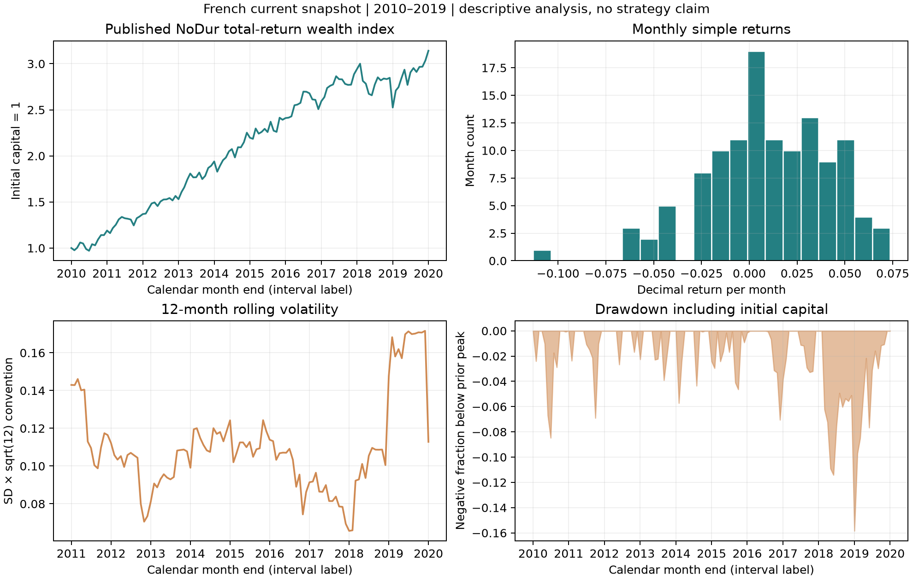

# 第11章 — 收益率与复利（Returns and Compounding）

<!-- C5 draft candidate; pending independent review. -->

> 主线：先确定账户里发生了什么，再决定应计算哪一种收益。先修第2章Python、第6章概率和第10章市场工具。总收益、简单收益、对数收益、均值、增长率和夏普比率回答不同问题；本章从财富递推开始，推到同一区间的金融数据计算。所有构造案例明确标注，真实案例使用冻结的French月度发布快照。

## 1. 本章目标

完成本章，你应能从现金与证券价值计算简单收益（Simple Return）和总回报（Total Return），把连续区间的收益变成财富路径，解释对数收益（Log Return）为什么在时间上可加、却不能直接按资产权重相加。你还应能区分算术平均（Arithmetic Mean）、几何平均（Geometric Mean）与复合年增长率（Compound Annual Growth Rate, CAGR）。

程序目标包括：保留初始资本，处理−100%损失与缺失值，按同月无风险收益（Risk-free Return）计算超额收益（Excess Return），独立核对回撤（Drawdown），并明确波动率（Volatility）及夏普比率（Sharpe Ratio）的年化约定和适用条件。最后阅读一张真实历史图，写出数据能够支持的描述及尚不能支持的交易结论。

## 2. 为什么Quant需要它

价格上涨10%与账户赚了10%并不总是同一件事。股息、拆股、融资、汇率、外部入金和期内交易都会影响分子或分母。股票跌到98元但派发2元股息，原价从100降至98不意味着持有人损失2%；一份期货的名义敞口和保证金也不是同一种收益分母。第10章先建立工具现金流，本章再把现金流放进统一计量框架。

研究信号需要明确预测目标：下一月价格收益、总回报、超额收益还是对数收益？组合模块通常使用简单收益；统计建模有时使用对数收益；评价长期账户增长又需要复利。把这些对象混在一起，即使回归和优化程序都运行正常，也可能优化了错误目标。

本章先建立无外部现金流、单一计价货币、区间末估值的基准账户。随后逐个指出哪些现实情况使该基准需要扩展。这样读者能知道公式依赖什么，而不是在同一段代码里隐含多个假设。

## 3. 直觉：百分比的分母会变化

100元先涨50%，变成150元；再跌50%，损失的是150的一半，最后只剩75元。两期百分比相加为0，账户却亏25%。后一次跌幅乘在变化后的资本上，不能直接抵消前一次涨幅。

若每期都按照固定的初始100元报货币损益，两个区间可以相加；但那是另一个分母约定。研究报告必须先说每个收益率是相对哪一笔资本，才能讨论可加性。

对数把乘法变成加法，这使多期增长容易表示。它不是让风险消失，也不是把简单收益改一个名字。100变150对应 \(\log(1.5)\)，150变75对应 \(\log(0.5)\)，两者相加为 \(\log(0.75)<0\)，正确保留了25%的总损失。

## 4. 数学基础：账户、区间与单位

::: {.body-definition title="定义与条件：账户收益与对数定义域"}

令 \(V_{t-1}>0\) 为区间开始时账户财富，\(V_t\geq0\) 为同一计价货币下区间末财富。先假定没有外部入金或提款，所有投资现金流都正确归入账户。简单收益定义为

\[
R_t=\frac{V_t-V_{t-1}}{V_{t-1}},\qquad V_t=V_{t-1}(1+R_t).
\]

\(V\) 有货币单位，\(R_t\) 无量纲。小数0.01表示1%，不是0.01%；1基点（Basis Point, bp）是0.0001。下标 \(t\) 标签的是一个测量区间的终点，不是任意一条CSV记录的行号。

对无杠杆正初始财富，损失100%意味着 \(R_t=-1\)、\(V_t=0\)。对数收益要求更严格：

\[
g_t=\log\frac{V_t}{V_{t-1}}=\log(1+R_t),\qquad R_t>-1.
\]

这里 \(\log\) 为自然对数。零终值没有有限实数对数；负财富涉及负债和杠杆模型，不能继续套正财富公式。实现中必须显式拒绝超出模型范围的输入。

:::

月度标签2010-01通常表示2010年1月的收益区间，不能据此断言行情、信号或订单在某个日内时刻已知。本章真实案例只有月度发布收益和当前快照，不包含信号或成交。对于策略回测，区间左端估值、持仓生效时点、区间末估值、现金流归属及数据可用/入库时点都要另外规定。

## 5. 正式定义：不要用一个“收益”覆盖所有对象

### 5.1 价格收益与总回报

设 \(P_{t-1}\) 与 \(P_t\) 为一份证券在两端的价格，\(D_t\) 为该区间属于持有人的现金分派。在数量不变、现金分派按区间末计入且期内再投资效应可以忽略或另行记账的简化例子中，

\[
R_t^{\mathrm{price}}=\frac{P_t-P_{t-1}}{P_{t-1}},\qquad
R_t^{\mathrm{total}}=\frac{P_t+D_t-P_{t-1}}{P_{t-1}}.
\]

这里要求 \(P_{t-1}>0\)。价格和现金分派都用相同货币与每份单位。若拆股使份数变化，必须先保持经济头寸的一致性；若数据供应商的总回报序列已计入股息，不能再次加 \(D_t\)。期内再投资、税费或多次分派应使用完整财富账本，不把这个两端简式推广为所有公司行动的万能公式。

### 5.2 算术均值、几何均值与CAGR

\(T\) 个等长度区间的简单收益为 \(R_1,\ldots,R_T\)。样本算术均值为

\[
\bar R=\frac1T\sum_{t=1}^TR_t.
\]

它描述单期收益样本的平均，不直接给出一条路径的复合增长。几何均值为

\[
G=\left[\prod_{t=1}^T(1+R_t)\right]^{1/T}-1
=\exp\left(\frac1T\sum_{t=1}^Tg_t\right)-1.
\]

第二个表达式要求所有 \(R_t>-1\)。如果某一期等于−1且没有后来外部注资，终财富为0，几何平均可以按乘积定义为−1；不能用有限对数实现这个边界。

若财富从 \(V_0>0\) 到 \(V_T\geq0\)，测量跨度为 \(Y>0\) 年，没有外部现金流，定义

\[
\mathrm{CAGR}=\left(\frac{V_T}{V_0}\right)^{1/Y}-1.
\]

\(Y\) 是明确的时间约定。规则月度样本可报“\(T/12\)年的月区间约定”；精确日历跨度需说明日期与年长约定。用不规则数据的行数除252，不能代替时间定义。

### 5.3 超额收益、波动率与夏普

在相同区间、同一货币下，资产简单总回报为 \(R_t\)，无风险简单收益为 \(R_{f,t}\)，算术超额收益为

\[
e_t=R_t-R_{f,t}.
\]

它是同一资本分别投资资产与无风险账户的收益差。相对无风险财富增长则为 \((1+R_t)/(1+R_{f,t})-1\)，通常不等于 \(e_t\)。后者不能与普通夏普分子混用。

样本标准差（Sample Standard Deviation）使用 \(T\geq2\)：

\[
s(R)=\sqrt{\frac1{T-1}\sum_{t=1}^T(R_t-\bar R)^2}.
\]

单期样本夏普为 \(\widehat{SR}=\bar e/s(e)\)。使用的是**超额收益**标准差，不是未经说明的资产收益标准差。若 \(s(e)=0\)，样本夏普未定义；不返回无穷并将其称为理想策略。该估计的抽样不确定性和选择偏差留到第32章系统讨论。

## 6. 推导：从财富递推到聚合风险

### 6.1 复利与对数可加性

把 \(V_t=V_{t-1}(1+R_t)\) 依次代入：两期为 \(V_2=V_0(1+R_1)(1+R_2)\)，继续归纳得到

\[
\frac{V_T}{V_0}=\prod_{t=1}^T(1+R_t),\qquad
R_{0:T}=\prod_{t=1}^T(1+R_t)-1.
\]

总收益 \(R_{0:T}\) 使用初始财富为分母。对正财富取对数，由乘积的对数法则，

\[
\log(V_T/V_0)=\sum_{t=1}^T\log(1+R_t)=\sum_{t=1}^Tg_t.
\]

这是恒等式，不需要独立同分布（Independent and Identically Distributed, IID）、正态或平稳假设。需要的是相同账户路径、现金流归属一致且财富为正。

### 6.2 为什么几何均值不超过算术均值

对正的 \(1+R_t\)，自然对数是严格凹函数（Strictly Concave Function）。詹森不等式（Jensen's Inequality）给出

\[
\frac1T\sum_t\log(1+R_t)\leq
\log\left(1+\frac1T\sum_tR_t\right).
\]

指数函数单调递增，故 \(G\leq\bar R\)。各期收益都相等时取等号。此处是同一组实现值的样本不等式，不能据此说每一个高波动资产都必然比任意低波动资产增长慢；均值和分布可能同时变化。

对较小的 \(|R|\)，第4章Taylor展开给出 \(\log(1+R)\approx R-R^2/2\)。于是样本平均对数收益近似为

\[
\bar g\approx\bar R-\frac12\overline{R^2}.
\]

平方项包含样本方差与均值平方；“波动拖累”（Volatility Drag）是局部近似的解释，不是对任意分布精确地减掉一半方差。大跌、厚尾及接近−100%的收益会使低阶近似失效。

### 6.3 截面组合必须先用简单收益

两项资产的期初资金权重为 \(w_1,w_2\)，和为1，期内不再平衡、没有额外现金流或融资，区间末财富为

\[
V_t=V_{t-1}\sum_iw_i(1+R_{i,t}),\qquad
R_{p,t}=\sum_iw_iR_{i,t}.
\]

\(w_i\) 是区间开始的资金权重，不是经过收益漂移后的期末权重。组合对数收益应为

\[
g_{p,t}=\log\left(1+\sum_iw_iR_{i,t}\right).
\]

一般不等于 \(\sum_iw_i\log(1+R_{i,t})\)。例如等权两资产分别涨50%和跌50%，同一区间组合简单收益为0、对数收益为0；加权资产对数收益却是 \(\frac12\log(0.75)\approx-0.143841\)。这是“跨资产”与“跨时间”的差异，不能交换。

### 6.4 平方根年化到底用了什么

::: {.body-conditions title="适用条件：固定期限与所有期限的平方根缩放"}

若增量弱平稳，因此每期增量方差相同为 \(\gamma_0\)，且一个给定的 \(q\) 满足加权协方差和为零，则 \(q\) 期和的方差恰为 \(q\gamma_0\)，标准差恰为 \(\sqrt q\) 倍。对这个固定 \(q\)，充要条件是

\[
\sum_{k=1}^{q-1}(q-k)\gamma_k=0.
\]

各滞后协方差全为零是充分条件，却不是固定期限下的必要条件；正负项可以抵消。若要求每个期限 \(q\) 都满足平方根缩放，在弱平稳条件下才必须有所有非零滞后协方差均为零。独立是后者的充分条件，但比零协方差更强。

:::

更一般地，设弱平稳增量（Weakly Stationary Increments） \(X_t\) 有均值 \(\mu\)、有限方差 \(\gamma_0\) 和滞后协方差 \(\gamma_k\)。展开双重和：

\[
\begin{aligned}
\operatorname{Var}\left(\sum_{j=1}^qX_j\right)
&=\sum_{i=1}^q\sum_{j=1}^q\operatorname{Cov}(X_i,X_j)\\
&=q\gamma_0+2\sum_{k=1}^{q-1}(q-k)\gamma_k.
\end{aligned}
\]

对角有 \(q\) 项方差；相距 \(k\) 的观测有 \(q-k\) 对，反向再贡献同样协方差，所以有系数2。正相关通常增加聚合方差，负相关可降低它；需看完整滞后结构，不只一个相关系数。

这条式子精确描述**增量的和**。对数收益可按时间求和，但复利简单收益是乘积再减1，不能把二者的标准差视为同一个精确对象。常见“月收益标准差乘 \(\sqrt{12}\)”可报告为约定年化度量，必须说明适用模型及近似边界。

在同一加法模型下，\(q\) 期均值为 \(q\mu\)，风险分母由上式决定；固定期限的加权协方差和为零时，均值/标准差比例才化为 \(\sqrt q\,\mu/\sqrt{\gamma_0}\)。对真实非平稳、串行相关、复利收益及不同频率RF，不能只换一个频率常数就声称得到精确年夏普。

## 7. 金融解释：增长、风险和机会成本

算术均值适合回答“单期平均多少”；几何均值适合描述一条等区间路径怎样增长；CAGR压缩初末财富与时间跨度。CAGR不保留期间顺序：同一组收益换顺序，终财富和几何平均不变，但回撤与流动性压力可以改变。投资者能否坚持到终点取决于这条路径。

无风险账户是机会成本基准。要比较一月资产收益，就使用同月RF，不能拿全年4%直接从每个月收益扣4%。若给定的是年有效利率4%，并额外假定同一复利率适用于每月，则月有效利率是 \(1.04^{1/12}-1\)，约0.327374%；如果给的是货币市场单利报价、日数基准或某月实际国库券收益，转换需用相应条款，不能套同一指数公式。

本币投资海外资产还涉及汇率。令 \(S_t\) 为每单位外币的本币价格，外币资产总回报为 \(R_t^{F}\)，忽略税费和对冲，则

\[
1+R_t^{H}=(1+R_t^{F})\frac{S_t}{S_{t-1}}.
\]

\(H\) 为本币、\(F\) 为外币；报价方向决定汇率因子。外币资产涨10%、外币相对本币跌10%时，本币收益为 \(1.1\times0.9-1=-1\%\)，不是0%。对冲成本与远期现金流需要另建账本。

## 8. Numerical Example

### 8.1 涨跌对称不是财富对称

构造两年：第一年+50%，第二年−50%，初始100，终值75。算术年均0%，两年总收益−25%，几何年均/CAGR均为−13.3974596%。第二年相对历史峰值150的回撤为−50%；总损失与峰值回撤使用不同分母。

### 8.2 股息和外部入金

构造价格100到98，区间末支付2元股息，不再投资且无税费：价格收益−2%，总回报0%。若使用已含股息的总回报数据再加2元，会重复计入现金流。

另一个账户起始100，一期投资赚10%变110，再收到外部入金90，期末价值200。净值从100到200的100%增长不是投资收益；扣除期末入金后的投资收益仍为10%。入金发生在区间内时，不能把它假定发生在区间末；分段时间加权收益和资金加权收益在后面挑战题说明。

### 8.3 加法增量的串行相关反例

构造弱平稳增量，月标准差0.02，滞后协方差为 \(\gamma_k=0.0004(0.5)^k\)。这是理论教学输入，不是某证券实际收益。12期和的方差系数为

\[
12+2\sum_{k=1}^{11}(12-k)(0.5)^k=32.0009765625.
\]

其标准差为0.1131388113，而忽略相关的平方根12年化为0.0692820323。前者约大63.30%。这个例子只核对增量和的风险聚合，未将它当作复利账户或实证夏普。

### 8.4 固定期限的协方差抵消

::: {.body-example title="完整反例：固定三期的协方差抵消"}

再看三个方差均为1的增量，其协方差矩阵为

\[
\Sigma=\begin{pmatrix}
1&0.1&-0.2\\
0.1&1&0.1\\
-0.2&0.1&1
\end{pmatrix}.
\]

该矩阵的顺序主子式为 \(1\)、\(0.99\)、\(0.936\)，均为正，因此它是合法的正定协方差矩阵。对固定 \(q=3\)，\(\gamma_1=0.1\)、\(\gamma_2=-0.2\)，加权和为 \(2(0.1)+1(-0.2)=0\)，所以

\[
\operatorname{Var}(X_1+X_2+X_3)=3+2[2(0.1)-0.2]=3.
\]

于是这个三期总和的标准差正好是单期标准差的 \(\sqrt3\) 倍，尽管跨期协方差并非全为零。期限改为2时，方差为 \(2+2(0.1)=2.2\)，平方根缩放不再成立。抵消只回答指定期限的方差问题，不表示增量独立，也不支持其他期限的缩放。

:::

### 8.5 用端点账本计算收益与路径风险

::: {.body-example title="完整例题：端点、区间与峰值回撤"}

下表是教学构造的账户路径，每一行先记录一个估值端点，再由相邻端点计算一段持有收益；它不是市场历史。财富用元表示，收益和回撤用小数表示。

| 端点 | 财富 | 本段简单收益 | 历史峰值 | 回撤 |
|---|---:|---:|---:|---:|
| \(t_0\) | 100 | — | 100 | 0 |
| \(t_1\) | 150 | 0.50 | 150 | 0 |
| \(t_2\) | 75 | −0.50 | 150 | −0.50 |
| \(t_3\) | 120 | 0.60 | 150 | −0.20 |

四个端点只有三段收益。最终财富比为 \(120/100=1.2\)，累计简单收益为20%；算术均值为20%，几何均值为 \(1.2^{1/3}-1\approx6.2659\%\)，最大回撤为−50%。最大回撤从历史峰值150作分母，不能与从初始财富100计算的累计损失混为一谈。初值100保留在财富与回撤路径中，但没有前一端点，不能伪造为一条0%收益，也不能计入收益均值、波动、夏普或时间跨度。

若随后出现真实持有区间且两个端点都为100，该区间收益就是0%，必须保留在样本中。账本展示时若把初始行的 `ret` 填成0，应给它标记为结构性基准行，并在统计前排除；这个展示哨兵与真实区间的零收益有不同含义。

:::

## 9. Python Implementation

### 本读者版的默认运行入口

从接受I3读者包根目录，按其[环境说明](../../../../editions/zh/README.md)建立独立环境后运行：

```bash
.venv/bin/python run_notebook.py notebooks/ch11_returns.ipynb
```

Notebook调用随包共用实现。第11章默认执行构造财富路径；French历史读取、绘图与缓存核对保留为被跳过的说明单元，不是本次默认执行。运行器将新内核执行记录写入唯一的runs/execution_*目录，Notebook新生成的图表写入另一唯一UUID子目录；终端打印实际位置。未随包提供的French数据不默认读取，也不下载。下面的旧课程制作测试与历史CLI按课程工作根说明；读者采用上方Notebook内断言。可选历史数据另遵守[数据契约](../../../../editions/zh/OPTIONAL_DATA.md)，本批未重跑。

### 历史课程工作根与原实现

核心函数在 [performance.py](../../../../src/quant_course/performance.py)，冻结月度输入读取在 [market_data.py](../../../../src/quant_course/market_data.py)，独立运行入口是 [ch11_returns.py](../../../../code/ch11_returns.py)。历史缓存已是收益小数，读取函数不再次除100。以下CLI依赖课程根的French冻结文件及manifest，不是上方离线默认入口；原路线为：

```bash
.venv/bin/python code/ch11_returns.py
```

下面的构造案例可在课程根目录独立运行：

```python
import sys
sys.path.insert(0, "src")
import numpy as np
from quant_course.performance import (
    wealth_index, geometric_mean_return, cagr, drawdown_path
)

returns = np.array([0.5, -0.5])
wealth = wealth_index(returns, initial_capital=100.0)
print(wealth)
print(returns.mean(), geometric_mean_return(returns))
print(cagr(100.0, wealth[-1], elapsed_years=2.0))
print(drawdown_path(wealth))
np.testing.assert_allclose(wealth, [100.0, 150.0, 75.0])
np.testing.assert_allclose(drawdown_path(wealth), [0.0, 0.0, -0.5])

# Bridge from chapter2: exclude only the structural initial position.
import pandas as pd
from quant_course import compute_returns
prices = pd.Series([100.0, 110.0, 99.0],
    index=pd.date_range("2026-01-02", periods=3, freq="B", tz="UTC"))
price_returns = compute_returns(prices, kind="simple")
assert pd.isna(price_returns.iloc[0])
interval_returns = price_returns.iloc[1:]
if interval_returns.isna().any():
    raise ValueError("unknown holding interval; do not drop gaps")
price_path = wealth_index(interval_returns.to_numpy(), prices.iloc[0])
np.testing.assert_allclose(price_path, prices.to_numpy())
assert len(price_path) == len(prices) == len(interval_returns) + 1
```

上述桥接只用于无遗漏现金流、同口径完整价格的教学路径：compute_returns保留首项NaN，而wealth_index只接收真实区间的简单收益向量。仅按位置排除首项，再明确检查剩余缺失；不能用dropna()删除中间未知区间。用起始价格作为初始资本只是让本例财富路径重建价格数值，不将原价收益自动升级成总回报。第2章以r表示对数收益，本章以g表示同一变换，均为自然对数，不能将其传给要求简单收益的wealth_index。

计数时区分端点和区间：财富路径100、150、75、120包含4个估值端点，但只有3段真实收益，依次为50%、−50%、60%。初始100没有前值，不是一条市场零收益；它须保留在财富/回撤路径中，却不能加入收益均值、波动或夏普的样本，也不增加CAGR的时间跨度。若账本为展示附一行初始 ret=0，统计入口要显式排除这条基准行；真实持有区间的0%收益仍须保留。缺失则另按未知区间处理，不能靠删首行规则消除。

财富输出长度是收益观测数加1。第一点是实际声明的初始资本，而不是伪造一条市场价格。−100%收益允许财富归零；该账户若没有注资，后续乘法不能把0变回正数。财富归零后，该账户自身收益的分母为零，后续收益未定义；程序继续乘假设增长因子只演示零财富不恢复，不能视作真实账户收益。新增drawdown_path允许零财富；timeseries.py中的带时间索引compute_drawdown仍保留正财富契约（第2章没有展开该函数），两者不暗中混用。

所有度量拒绝NaN/无穷和非法数值类型，不自动dropna。缺失收益可能对应未知的财富变化，删除它会把非连续区间拼在一起。只有研究者声明并论证的子样本选择才能改变路径；程序不能用“样本量还够”替代这个决定。

RF要求显式同长度同区间向量，不能自动广播一个年利率。零超额波动率使夏普未定义。极大数值可能使float64方差溢出，函数拒绝该结果，避免把无穷标准差误报成夏普0。函数不识别交易日历与数据公布时点；月度加载器核验哈希、索引与连续性，研究者再负责信息时钟和成交契约。

## 10. Visualization



四幅图来自同一份2010-01至2019-12月度样本与同一计算代码。

- 左上横轴为日历月末标签，纵轴为初始资本1的总回报财富指数；2009-12的第一点是选择的初始资本，不是2009年的真实股价。观察长期增长与中间停滞，不能仅凭终值评价风险。
- 右上横轴为每月简单收益小数，纵轴为落在各区间的月份数。它是120个月的频数直方图，不是总体密度证明；极端跌幅与不对称性需更多数据和统计检验。
- 左下横轴为月末，纵轴为过去12个月样本标准差乘平方根12的约定年化度量。必须先有12个观测，曲线才开始；它没有使用未来窗口，也不表示下一年的波动率已知。
- 右下横轴为月末，纵轴为相对截至当月历史峰值的负回撤。0表示创新高或与峰值相等；2018年的较深下探使读者看到终财富增长不能消除期间压力。

这里的财富指数是从发布的组合收益复合而来，不是基金净值、逐股价格、扣费策略或可立即买入的产品。

## 11. Real Market Example

数据来源为Kenneth R. French Data Library的 [10 Industry Portfolios](https://mba.tuck.dartmouth.edu/pages/faculty/ken.french/Data_Library/det_10_ind_port.html) 与 [Fama/French 3 Factors](https://mba.tuck.dartmouth.edu/pages/faculty/ken.french/Data_Library/f-f_factors.html)。选择NoDur列的发布月度价值加权行业组合收益；RF使用FF3同月的国库券收益基准代理（Treasury-bill Return Proxy），不假定它等于每个投资者都能获得的无摩擦现金利率。NoDur表示非耐用消费品行业组合，不是一个证券代码。

两份处理后缓存的月份标签与哈希由各自manifest核验。取2010-01至2019-12并按月份一对一连接，共120个月，没有填补缺失或把其他频率混入。初始资本设1。脚本实际计算如下，收益单位均为小数：

| 指标 | 实算值 | 解释 |
|---|---:|---|
| 终财富指数 | 3.141190295 | 120月累计总回报财富，未扣可执行策略费用 |
| 月算术均值 | 0.010099167 | 约1.009917%每月 |
| 月平均对数收益 | 0.009538348 | 不能直接叫月简单收益 |
| 月几何均值 | 0.009583983 | 约0.958398%每月 |
| CAGR（月区间约定10年） | 0.121267992 | 约12.126799%每年 |
| 月样本标准差 | 0.032172825 | 约3.217283%每月 |
| 标准差乘平方根12 | 0.111449935 | 约11.144994%的约定年化度量 |
| 月RF均值 | 0.000426667 | 按同月实值对齐，不是固定年利率 |
| 月超额收益均值 | 0.009672500 | 约0.967250%每月 |
| 夏普乘平方根12 | 1.039249824 | 未做串行相关或选择偏差修正 |
| 最大回撤正损失幅度 | 0.158392214 | 月末财富峰谷约15.839221% |

这组数值只是该指定区间、该当前发布版本的历史描述。2010–2019是教学窗口，不是经过独立验证的优选投资阶段；没有定义出场规则、信号、订单或成本。行业组合的成分处理、收益方法和历史修订来自发布方，不等于本项目建立了逐股历史股票池。

manifest记录2026-10-05的下载时间和文件哈希。2026年下载的历史数据不证明它与2010年研究者当时拿到的版本相同；公告和入库的完整点时序列尚未建立。当前只做事后描述统计，因而不宣称前视偏差已被交易层面消除。

## 12. Common Mistakes

**先把收益相加，再称为总收益。** 错误计算+50%−50%=0忽略了变化后的分母。正确总收益为 \((1.5)(0.5)-1=-25\%\)。若想加货币损益，就必须使用一致的计价资本并说明账户现金流。

**把总回报再加股息。** 复权价格不一定代表同一种总回报处理。先读供应商定义与第3章公司行动契约；已计入的分派不能第二次入账。拆股调整保持份数和价格关系，并不会创造经济收益。

::: {.body-pitfall title="常见误区：期末漂移权重不能倒用"}

**按期末权重乘本期收益。** 收益已经使权重漂移，期末权重不是本期资本配置。两资产各投入50，本期分别+50%、−50%，期末价值75与25，权重75%与25%；用期末权重计算得到25%，而账户实际收益为0%。

```python
import numpy as np
weights_at_start = np.array([0.5, 0.5])
asset_returns = np.array([0.5, -0.5])
values_at_end = weights_at_start * (1 + asset_returns)
weights_at_end = values_at_end / values_at_end.sum()
correct = weights_at_start @ asset_returns
wrong = weights_at_end @ asset_returns
print("correct simple return", correct, "wrong end-weight return", wrong)
assert np.isclose(correct, 0.0)
assert np.isclose(wrong, 0.25)
```

:::

**把空白月份删掉再复利。** 缺失不等于0，也不等于市场暂停。若账户财富变化未知，路径的终值与最大回撤就未完全确定。当前核心函数直接报错，避免把两个不相邻区间静默连接。

**把年化输出叫下一年风险预测。** 乘平方根时间依赖风险聚合条件；滚动样本反映历史窗口。预测下一年还需要模型、估计误差和样本外评价。第18章会进一步建立动态波动模型。

**把净入金当投资利润。** CAGR只适用于声明的无外部现金流路径。存在流入/流出时，分段时间加权收益和资金加权收益回答不同问题；记录现金流时点比选择一个更漂亮的百分比更重要。

## 13. Quant Research Application

先定义标签的对象、频率和区间。若要预测下一月总回报，应把特征时间和标签结束时间分开；训练样本的标签只有区间结束并可获取时才完整。若预测对数收益，输出转成简单收益时需要考虑分布与估计目标：\(\exp(E[g])-1\)一般不是 \(E[\exp(g)-1]\)，不能仅取指数把均值预测当成期望简单收益。

接着确定账户分母。组合回测用期初生效资金权重与之后的资产总回报，扣费用和融资后形成净财富；自融资约束、现金头寸、借券与衍生品名义敞口需要账本。年度RF与不同货币基准必须先按同区间口径转换，不能仅按列名做差。

评价中同时报告均值、增长、波动、回撤、样本范围与成本。用小数保存计算值，在展示时转百分比；保留源数据和处理后数据的版本、哈希、缺失规则及时间区间。Project 1用这些步骤形成描述性金融数据报告，第29章才进一步建立成交和持仓账本。

## 14. Chapter Summary

简单收益连接相邻财富，对数收益在正财富路径上把时间乘积变成和；跨资产组合仍从期初资金权重的简单收益开始。算术均值是单期样本平均，几何均值与CAGR概括复合增长，回撤保留峰谷路径信息。

年化不是换一个显示单位那么简单。增量和的方差由各滞后协方差共同决定；平方根时间是特定条件下的缩放或明确约定。RF、现金分派、外部入金、币种和测量时钟决定指标含义，先把这些定义清楚，再解释图和数值。

## 15. Exercises

**11-E01（概念）** 解释简单收益、对数收益、价格收益与总回报的差别，列出各自适用的账户或现金流条件。

**11-E02（手算）** 初始100，先+50%再−50%，每期一年。计算终财富、总收益、算术平均、几何平均、CAGR与最大回撤。

**11-E03（组合）** 同一期等权两资产分别+50%与−50%。计算组合简单/对数收益、加权资产对数收益与期末资金权重，说明时间和截面聚合差异。

**11-E04（RF）** 月资产收益2%，月RF0.3%。计算算术超额收益与相对无风险财富的增长；年有效利率4%在恒定月复利假设下对应什么月有效利率？

**11-E05（币种）** 外币资产涨10%，每单位外币的本币价格下降10%。计算本币总回报，解释报价方向为何重要。

**11-E06（年化）** 从协方差双重和推导 \(q\) 期增量和的方差。平方根时间需要什么条件？为何不能称其为复利简单收益的精确风险公式？

**11-E07（路径）** 比较三期收益 \((50\%,-40\%,-20\%)\) 与 \((-40\%,50\%,-20\%)\)，初始100。终财富、CAGR和最大回撤是否相同？

## 16. Programming Exercises

**11-P01（财富边界）** 用核心函数复核涨跌50%、一期−100%以及NaN输入。初始点是什么？为什么破产后正百分比不能恢复财富？

**11-P02（风险聚合）** 对第8.3节 \(\gamma_k=0.0004(0.5)^k\)，编程计算12期和的标准差与忽略串行相关的缩放；不能把结果叫真实策略年夏普。

**11-P03（真实缓存）** 运行冻结缓存分析，核验NoDur与RF同月连接、120个连续月份、终财富与指标；输出至少一张图并写三句有依据的解读与两项局限。

## 17. Challenge Problems

**11-C01（近似与不等式）** 证明等区间几何平均不超过算术平均。解释何时相等，说明 \(\bar g\approx\bar R-\overline{R^2}/2\) 的条件，以及为何“几何平均等于均值减一半方差”不是精确公式。10分：凹性与Jensen4分、指数单调及相等条件2分、Taylor范围与二阶矩项2分、极端收益边界2分。

**11-C02（外部现金流）** 一年分两段：初始100，前半段赚10%到110；此时入金90，总资金200；后半段赚10%到220。计算时间加权收益（Time-weighted Return, TWR），比较未经调整的终初比率；写出资金加权收益（Money-weighted Return）的现金流方程，并说明它为什么不同。10分：分段资本2分、TWR乘积3分、错误比率1分、内部收益率（Internal Rate of Return, IRR）方程/时间2分、两种收益的问题差异2分。

**11-N01（固定期限的方差缩放）** 对弱平稳、等方差增量，从协方差双重和说明指定期限 \(q\) 恰好按平方根缩放的充要条件，并说明该条件对所有期限成立时意味着什么。用第8.4节协方差矩阵核验三期抵消、验证矩阵合法，再比较二期结果。写明这个结论不表示独立，也不是复利简单收益的普遍方差公式。

## 18. Solutions / Solution Hints

**11-E01 答案。** 简单收益为相邻财富差除期初财富，基准账户无外部流入且期初正；对数收益是正财富比率的自然对数，在时间上相加，要求终值也正。价格收益只看价格变化；总回报包含归属分派等投资现金流。拆股要保持经济头寸一致，期内再投资应使用账本。已含分派的序列不能重复加股息。对数收益不是“总回报”的同义词：可以对总回报财富取对数，也可以对价格路径取对数，两者覆盖的现金流仍不同。

**11-E02 答案。** 财富为100、150、75；总收益−25%；算术均值0%；几何平均和CAGR为 \(\sqrt{0.75}-1=-13.3974596\%\)。峰值150到终值75的回撤−50%，最大回撤可报正损失幅度50%。它与初始资本上的25%损失不同。

**11-E03 答案。** 期初权重均0.5，组合简单收益为0.5×0.5+0.5×(−0.5)=0，因此组合对数收益 \(\log1=0\)。加权资产对数收益为 \(\frac12[\log1.5+\log0.5]=\frac12\log0.75\approx-0.143841036\)，不等于0。期末资金75与25，权重0.75与0.25；这些权重用于下一段的起始配置，不能倒用评价本段。

**11-E04 答案。** 算术超额收益 \(0.02-0.003=0.017\)，即1.7%；相对无风险财富增长为 \(1.02/1.003-1\approx0.0169491525\)，约1.694915%。月有效利率 \(1.04^{1/12}-1\approx0.0032737398\)，即0.327374%；其转换额外用了恒定复利假设，不能从任意年化报价推断。

**11-E05 答案。** 本币增长因子1.1×0.9=0.99，总回报−1%。每单位外币的本币价格降低意味着外币贬值；如果报价改成本币对应多少外币，转换因子要取倒数，不能仍乘0.9。此例忽略对冲/税费/交易成本。

**11-E06 答案。** 对角 \(q\) 项各 \(\gamma_0\)，正滞后 \(k\) 有 \(q-k\) 对，负滞后对称再贡献同值，所以总和 \(q\gamma_0+2\sum_{k=1}^{q-1}(q-k)\gamma_k\)。若各期方差相同，对指定的 \(q\)，平方根时间缩放精确成立当且仅当 \(\sum_{k=1}^{q-1}(q-k)\gamma_k=0\)。所有跨期协方差为零是充分条件，固定期限下不是必要条件，因为正负项可能抵消；若要求每个期限都成立，则弱平稳下必须每个非零滞后协方差都为零。独立足够，但不是必要。复利简单收益是 \(\prod(1+R_t)-1\)，并非增量和，因此这不是其一般精确方差公式；对数收益可相加，但风险指标的对象已改变。

**11-E07 答案。** 第一条财富100→150→90→72，最大回撤为 \(1-72/150=52\%\)。第二条100→60→90→72，最大回撤为 \(1-60/100=40\%\)。两条终财富都72，总收益−28%；若三期各为一年，CAGR都为 \(0.72^{1/3}-1\approx-10.37\%\)。乘积不受排序影响，沿途峰值与谷值却受排序影响，因此相同终值并不意味着相同持有体验和风险。

**11-P01 参考实现。**

```python
import sys
sys.path.insert(0, "src")
import numpy as np
from quant_course.performance import wealth_index, drawdown_path

first = wealth_index([0.5, -0.5], 100.0)
bankrupt = wealth_index([0.1, -1.0, 10.0], 100.0)
np.testing.assert_allclose(first, [100, 150, 75])
np.testing.assert_allclose(bankrupt, [100, 110, 0, 0])
np.testing.assert_allclose(drawdown_path(bankrupt), [0, 0, -1, -1])
try:
    wealth_index([0.1, np.nan], 100.0)
except ValueError:
    print("missing interval rejected")
else:
    raise AssertionError("unknown return cannot be silently removed")
```

第一点为明确选择的区间前资本。0×任意有限增长因子仍为0；外部注资是另一笔现金流，需要重新记录，而不是把下一期收益率改大。

**11-P02 参考实现。**

```python
import numpy as np
q = 12
variance_per_month = 0.0004
rho = 0.5
lags = np.arange(1, q)
variance_sum = variance_per_month * (
    q + 2 * np.sum((q - lags) * rho**lags)
)
actual_sd = np.sqrt(variance_sum)
zero_cov_sd = np.sqrt(q * variance_per_month)
print(actual_sd, zero_cov_sd)
assert np.isclose(actual_sd, 0.11313881131159192)
assert np.isclose(zero_cov_sd, 0.06928203230275509)
```

实际是声明的理论增量和的标准差0.1131388113，对照零协方差结果0.0692820323。二者不同来自滞后协方差；没有读取证券数据、实现账户或交易规则。

**11-P03 参考实现。**

```python
import runpy
import numpy as np
lesson = runpy.run_path("code/ch11_returns.py", run_name="lesson_functions")
sample = lesson["monthly_example"]()
result = lesson["summarize_monthly"](sample)
assert len(sample) == 120
assert sample.index[0].strftime("%Y%m") == "201001"
assert sample.index[-1].strftime("%Y%m") == "201912"
assert not sample.isna().any().any()
np.testing.assert_allclose(result["wealth_final"], 3.141190294871468)
lesson["make_figure"](sample, lesson["ROOT"] / "figures/a3/ch11_returns_dashboard.png")
print(result)
```

该例复用独立运行入口的IO与绘图封装；数值核心实际调用src中的performance与market_data。图的解释可写：选择窗口的财富从1增至约3.141；2018年前后月末回撤较深；滚动波动随样本窗口变化。局限至少包括月末抽样无法看到日内/日间最大回撤、当前发布快照未还原当时数据版本、没有可执行仓位/成本、教学窗口不证明投资选择优越。开放文字按“事实对应图/数值，条件与证据边界具体”评价。

**11-C01 参考论证。** 对 \(R_t>-1\)，\(\log\)严格凹，Jensen给出 \(\overline{\log(1+R)}\leq\log(1+\bar R)\)，指数单调推出 \(G\leq\bar R\)；等号要求所有实现收益相等。局部Taylor保留二阶项为 \(\bar g\approx\bar R-\overline{R^2}/2\)，而 \(\overline{R^2}=\overline{(R-\bar R)^2}+\bar R^2\)，不能只减样本方差，也不能把 \(\bar g\)直接当 \(G\)。还需指数转换且保留高阶误差。接近−1时对数与高阶项变化很大；恰好−1不能取有限对数。用一般正增长因子的算术—几何均值不等式可覆盖零增长因子的边界，但有限对数证明需要另作极限说明。

**11-C02 参考论证。** 前半段投资增长1.1；入金后资本基准变为200，后半段增长220/200=1.1。TWR为1.1×1.1−1=21%。未经现金流调整的220/100−1=120%把90的外部资金混入投资利润。

以投资者视角，时间0流出100、0.5年流出90、1年流入220。年度资金加权有效收益 \(r\) 的内部收益率（Internal Rate of Return, IRR）方程为

\[
-100-\frac{90}{(1+r)^{1/2}}+\frac{220}{1+r}=0,\qquad r>-1.
\]

令 \(z=\sqrt{1+r}>0\)，乘以 \(z^2\) 得 \(100z^2+90z-220=0\)。正根 \(z=(-90+\sqrt{96100})/200=1.1\)，故 \(r=21\%\)。本题两段收益都10%，因而资金时点恰好不改变该有效年收益，两指标相等；它们的问题仍不同。TWR排除外部流入规模影响，IRR反映投资者资金时点与金额。若第二段收益改为−10%，终值180，TWR=−1%，IRR方程改终值180，正根给 \(r\approx-6.8587\%\)，两者不相等。具体计算为 \(z=(-90+\sqrt{80100})/200\)，再取 \(r=z^2-1\)。

**11-N01 参考论证。** 在弱平稳、每期方差为 \(\gamma_0\) 时，协方差双重和为 \(q\gamma_0+2\sum_{k=1}^{q-1}(q-k)\gamma_k\)。固定 \(q\) 恰为 \(q\gamma_0\) 当且仅当 \(\sum_{k=1}^{q-1}(q-k)\gamma_k=0\)。若所有期限都成立，先由 \(q=2\) 得 \(\gamma_1=0\)，再按期限递推得所有非零滞后协方差均为零。第8.4节矩阵的顺序主子式为 \(1\)、\(0.99\)、\(0.936\)，全正，故矩阵正定。\(q=3\) 的加权和为 \(2(0.1)-0.2=0\)，三期方差为3；\(q=2\) 的方差为 \(2+2(0.1)=2.2\)。正负协方差只在该三期抵消，不表示独立或其他期限也按平方根缩放；公式仍针对增量和，不是复利简单收益的普遍方差公式。

## 19. Further Reading

- **Must Know**：[MIT OCW 15.401复利讲义](https://ocw.mit.edu/courses/15-401-finance-theory-i-fall-2008/73c95059e657c8a7acb042ea33a21940_MIT15_401F08_lec02.pdf)，slide28–29的有效年利率与slide30–34的实际/名义现金流一致性。
- **Should Know**：French [行业组合方法](https://mba.tuck.dartmouth.edu/pages/faculty/ken.french/Data_Library/det_10_ind_port.html) 与 [FF3因子/RF说明](https://mba.tuck.dartmouth.edu/pages/faculty/ken.french/Data_Library/f-f_factors.html)，结合缓存manifest区分总回报、因子价差与RF。
- **Advanced**：Andrew W. Lo (2002), *The Statistics of Sharpe Ratios*，[作者发表记录及摘要](https://alo.mit.edu/publications/page/18/)。本章只核验元数据/摘要，未取得全文；第32章讨论夏普推断时再逐式查阅相关原文。
- **Optional**：第3章公司行动/双时钟、第18章动态波动、第29章账本与第32章统计评价，逐步扩展本章的无外部现金流基准。

## 20. References

外部来源实际读取范围见 [source_notes.md](source_notes.md) 与 来源/度量准备契约。复利来源为MIT官方课程，风险聚合式由本章协方差展开独立推导，不假称从未读的Lo全文逐式引用。

真实数据版本、下载时间、单位与SHA-256分别见 行业manifest、FF3/FF5 manifest；可复核数值为 实际指标输出。财富及图是原创计算，未复制来源图表，未凭公开可下载推断所有数据的外部分发许可。
