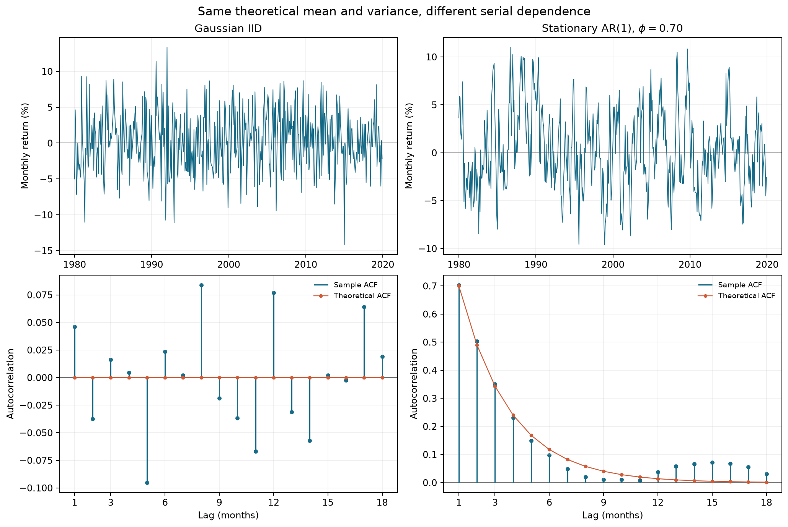

# 第16章 — 时间序列 I：从自相关到 ARIMA（Time Series I: Dependence and ARIMA）

> 主线：先说明序列在时间上怎样依赖，再估计只使用过去信息的模型，并用严格按时间推进的预测检验它。  
> 先修：第 6 章概率、第 7 章统计、第 8 章回归、第 11 章收益率与评价指标。完成后你能：区分价格水平和收益、定义弱平稳与严格平稳、解释白噪声和 IID 的差别、手算 AR(1) 的均值方差和自相关、读 ACF/PACF、比较 AR/MA/ARMA/ARIMA、诊断残差、计算预测区间，并写出逐月扩展训练窗的滚动预测。

## 1. 本章目标

本章结束时，你应能完成五件事：

1. 把带频率的时间索引作为数据的一部分；识别缺月、乱序和缺失值，拒绝把时间压成没有间隔的行号。
2. 从有限均值、方差和自协方差写出弱平稳条件，并说明它与严格平稳、白噪声和独立同分布的关系。
3. 从递推式 \(X_t=c+\phi X_{t-1}+\varepsilon_t\) 推到平稳均值、方差、自协方差、ACF 和多步预测误差方差。
4. 结合滞后算子解释 AR、MA、ARMA、ARIMA；知道 ACF/PACF 是辨认候选模型的线索，不是自动选模器。
5. 将模型阶数和参数选择限制在训练窗口，在每个预测起点只看该点以前的观测，并与朴素基准比较。

数学单位统一写清：月度收益以小数表示，0.01 表示该月收益 1%；均值和预测单位也是每月收益小数，方差单位是收益小数的平方；ACF、PACF 是无量纲数；滞后 \(k\) 表示向前 \(k\) 个观测月，不是向前 \(k\) 个相同长度的自然日。

## 2. 为什么 Quant 需要它

时间序列模型把“最近的值是否包含关于下一期的信息”变成可以陈述和检验的问题。量化工作中，这一步常发生在数据清理之后、回归或策略测试之前：我们先选定目标量（价格、收益、利差或波动代理），再描述它怎样依赖自己的历史，最后判断这种关系能否在预测时点成立。

把日、月或季度数据只存成一列数字会丢掉观测间隔。若一只资产缺了 2024 年 3 月，直接 `dropna()` 后把 2 月和 4 月视作相邻一步，AR(1) 就不再表示“一月滞后”。若把累计价格水平当作平稳收益建模，趋势会制造看似很强的相关。若在整段数据上先选阶数、再声称后半段是样本外预测，未来已经参与了研究决策。

本章沿一条完整链条推进：定义观察时钟 → 计算自协方差和相关 → 用低阶模型表达依赖 → 用训练数据估计 → 检查模型留下什么 → 逐期向前预测 → 和朴素基准比较。时间索引并非装饰；它决定滞后和预测目标是什么。

## 3. 直觉

想象两只“月度收益机器”。它们长期平均都给出 0.5% 的月收益，单月波动的长期标准差都是 4%，但第一台每个月重新抽一张独立的签；第二台会把上个月偏离长期均值的部分保留 70%。单看平均收益和波动，两台机器难以区分；如果第二台上个月高于平均，这个月也更可能偏高。差别在时间排列。

这类“记忆”用自相关表示。正的滞后 1 自相关表示相邻月通常同向偏离均值；负值表示相邻月倾向反向；接近零只说明线性相关小，并不排除非线性依赖、波动聚集或共同外部冲击。

还有一个常见误会：观察到的收益线条平稳地上下波动，不等于已证明数据生成机制平稳。一次结构变化、少量极端月、缓慢随机趋势，都可能让有限样本图形误导。图先提出问题，理论假设和后续检验再提供不同证据。

### 3.1 随机过程不是一条折线

随机过程（stochastic process）是带时间索引的一族随机变量 $\{X_t\}$：在观测前，每个月可能产生不同收益。一次实现（realization）是其中一组实际抽到的数 $x_1,\ldots,x_n$。下面用三个可能世界说明“沿时间”和“跨世界”的区别；它是识别对象的小表，不是平稳性检验。

| 可能世界 | 一月收益 | 二月收益 | 三月收益 |
|---|---:|---:|---:|
| A（实际看到的路径） | 1% | −1% | 2% |
| B | −1% | 2% | 0% |
| C | 0% | 1% | −2% |

一月这一列对应随机变量 $X_1$；A 这一行对应一次实现。$\mathbb E[X_1]$ 对可能世界加权，样本均值 $\bar x$ 沿实际路径平均，两者是不同操作。用长路径估总体矩，还要有相应的遍历性（ergodicity）或大数定律条件；平稳本身不保证。例如每次先抽一个 $Z$，以后所有月份都令 $X_t=Z$，这个过程严格平稳，但任意长路径的均值仍是该次的 $Z$，不会自动变成 $\mathbb E[Z]$。金融数据通常只有一条历史路径，因此“窗口内矩看起来稳定”是证据问题，不能由折线外观决定。

两台收益机器的总体参数可以写在同一张表里。令 $s=0.04$、$\mu=0.005$，并为 AR 机器使用平稳初始化：

| 总体对象 | IID 机器 | AR(1) 机器，$\phi=0.7$ |
|---|---:|---:|
| 长期均值 | 0.005 | 0.005 |
| 单月方差 | 0.0016 | 0.0016 |
| 创新标准差 | 0.04 | $0.04\sqrt{1-0.7^2}=0.0285657$ |
| 滞后1协方差 | 0 | $0.7(0.0016)=0.00112$ |
| 滞后2相关 | 0 | $0.7^2=0.49$ |

相同的边际均值、方差没有决定相邻两个月如何共同变化；AR 创新波动要更小，因为历史冲击也在贡献当月总波动。有限样本表中的样本数值不会精确等于这里的总体参数。

## 4. 数学基础

令 \(X_t\) 是按月排列的随机变量；\(t\) 代表月度观测的序号，\(X_{t-k}\) 是前 \(k\) 个观测月。若 \(P_t\) 是月末价格，简单收益和对数收益分别是

\[
R_t=\frac{P_t}{P_{t-1}}-1, \qquad r_t=\log P_t-\log P_{t-1}.
\]

若价格以欧元表示，\(P_t\) 是欧元/股，收益 \(R_t\) 与 \(r_t\) 无量纲。小收益时 \(r_t\approx R_t\)，但在较大变动下两者不同。价格水平、简单收益和对数收益是三个不同序列；模型必须先说清预测的是哪一个。

本章把日历月份写为月度 `PeriodIndex`。`2024-02` 到 `2024-03` 的滞后是一个月，即使两个自然月的天数不同；这不是假设 2 月和 3 月有相同日数。一个缺失的月份则是缺失观测，不能用“下一个留下来的 CSV 行”冒充一个月滞后。核心代码要求月份连续并拒绝 NaN、正负无穷和复数输入，不自动填补。

给定有限方差的平稳序列，均值、方差和自协方差为

\[
\mu=\mathbb{E}[X_t],\qquad \gamma(k)=\operatorname{Cov}(X_t,X_{t-k}),\qquad
\rho(k)=\frac{\gamma(k)}{\gamma(0)}.
\]

这里 \(\mu\) 的单位与 \(X_t\) 相同；\(\gamma(k)\) 的单位是该量单位的平方；\(\rho(k)\) 无量纲，且 \(\rho(0)=1\)。若 \(X_t\) 是月度收益，\(k=12\) 指相隔 12 个观测月；它不自动代表 365 天或某个固定自然日数。

## 5. 正式定义

**严格平稳**（strict stationarity）要求任意正整数 \(m\)、任意观测位置 \(t_1,\ldots,t_m\) 和任意共同平移 \(h\)，向量 \((X_{t_1},\ldots,X_{t_m})\) 与 \((X_{t_1+h},\ldots,X_{t_m+h})\) 具有相同的联合分布。它比较完整的分布形状和依赖结构，不只比较均值与方差。

**弱平稳**（weak stationarity，也称协方差平稳）要求二阶矩存在，均值不随 \(t\) 变化，且 \(\operatorname{Cov}(X_t,X_{t-k})\) 只依赖间隔 \(k\)，不依赖日历起点 \(t\)。严格平稳且二阶矩有限会推出弱平稳；反向一般不成立。第 18 节的练习用两个边际分布不同但前两阶矩相同的独立序列构造反例。

**白噪声**（white noise, WN）在本章采用二阶定义：\(\mathbb{E}[\varepsilon_t]=0\)、\(\operatorname{Var}(\varepsilon_t)=\sigma^2<\infty\)，并且所有非零滞后自协方差为零。白噪声不必相互独立；**独立同分布**（independent and identically distributed, IID）还要求每期彼此独立且边际分布相同。IID 零均值有限方差噪声是白噪声；仅有“相关系数接近零”不能推出 IID。若噪声联合高斯，零相关才可进一步推出独立。

**自相关函数**（autocorrelation function, ACF）列出 \(\rho(k)\) 随滞后 \(k\) 的变化。样本 ACF 是样本自协方差除以样本方差；同一序列不同软件的分母约定会让有限样本数字稍有差异。**偏自相关函数**（partial autocorrelation function, PACF）在控制中间滞后 \(X_{t-1},\ldots,X_{t-k+1}\) 后，度量 \(X_t\) 与 \(X_{t-k}\) 的剩余线性关系；它也可看作 \(\mathrm{AR}(k)\) 线性投影中最远滞后项的系数。

若观测值为 \(x_1,\ldots,x_n\)，常见样本定义是

\[
\hat\gamma(k)=\frac{1}{n}\sum_{t=k+1}^{n}(x_t-\bar x)(x_{t-k}-\bar x),\qquad
\hat\rho(k)=\frac{\hat\gamma(k)}{\hat\gamma(0)}.
\]

这里 \(n\) 是样本月数、\(k\) 是滞后月数、\(\bar x\) 是样本均值。分母用 \(n\) 或 \(n-k\) 会产生不同的有限样本估计；本章代码明确采用前一种约定。PACF 可通过把 \(x_t\) 对从滞后1到滞后 \(k\) 的全部变量做线性投影，读取最后一项 \(x_{t-k}\) 的总体投影系数；有限样本估计器可能不同。

**自回归模型**（autoregressive model, \(\mathrm{AR}(p)\)) 把当前值写成有限个自身滞后与创新项之和。**移动平均模型**（moving average model, \(\mathrm{MA}(q)\)) 把当前值写成当前及过去 \(q\) 个创新项的线性组合。**自回归移动平均模型**（autoregressive moving average, \(\mathrm{ARMA}(p,q)\)) 同时含两种结构。**差分自回归移动平均模型**（autoregressive integrated moving average, \(\mathrm{ARIMA}(p,d,q)\)) 先对序列做 \(d\) 阶差分，再用 ARMA 描述差分后的过程。

**滞后算子**（lag operator）\(L\) 定义为 \(LX_t=X_{t-1}\)，因此 \(L^kX_t=X_{t-k}\)。滞后多项式把有限滞后式写成紧凑形式。一个过程在 AR 多项式的根全部位于单位圆外时有稳定的因果平稳解；在 MA 多项式的根全部位于单位圆外时，模型可逆。对本章的 AR(1) 与 MA(1)，两个条件分别简化为 \(|\phi|<1\) 和 \(|\theta|<1\)。多项式符号惯例不同，使用软件前要核对其定义。

**预测区间**（prediction interval）给定模型与信息集后，为未来单个观测量提供不确定性范围；它比“条件均值的置信区间”更宽，因为未来创新本身也会波动。若使用正态误差、参数当作已知且预测方差为 \(V_h\)，常见形式为

\[
\hat X_{T+h\mid T}\pm z_{1-\alpha/2}\sqrt{V_h}.
\]

其中 \(\hat X_{T+h\mid T}\) 的单位与序列相同，\(V_h\) 是未来观测预测误差方差，\(z_{1-\alpha/2}\) 是标准正态分位数。真实模型参数估计、厚尾创新、条件异方差和结构变化会影响区间覆盖；区间不是保证。

## 6. 推导

### 6.1 AR(1)：从递推式到稳态矩

先写带常数项的 AR(1)：

\[
X_t=c+\phi X_{t-1}+\varepsilon_t,
\]

\(c\) 与 \(X_t\) 同单位，\(\phi\) 无量纲，\(\varepsilon_t\) 与 \(X_t\) 同单位。设创新项均值为零、方差为 \(\sigma^2\)，并与过去不相关。若过程有稳定平稳解，取期望：

\[
\mu=c+\phi\mu \quad\Longrightarrow\quad \mu=\frac{c}{1-\phi},
\]

在因果平稳条件 \( |\phi|<1 \) 下，长期均值为上述表达式。定义中心化变量 \(Y_t=X_t-\mu\)，代回递推式可得

\[
Y_t=\phi Y_{t-1}+\varepsilon_t.
\]

中心化的目的是把长期位置与围绕它的波动分开；此处 \(\mathbb{E}[Y_t]=0\)。利用创新与前一期 \(Y_{t-1}\) 不相关，平方并取期望：

\[
\begin{aligned}
\gamma(0)&=\mathbb{E}[Y_t^2]
=\phi^2\mathbb{E}[Y_{t-1}^2]+2\phi\mathbb{E}[Y_{t-1}\varepsilon_t]+\mathbb{E}[\varepsilon_t^2]\\
&=\phi^2\gamma(0)+\sigma^2,
\end{aligned}
\qquad
\gamma(0)=\frac{\sigma^2}{1-\phi^2}.
\]

在本章的因果设定中，创新是当期新冲击，且与过去不相关。要让冲击权重 \(1,\phi,\phi^2,\ldots\) 衰减并使因果表示收敛，必须有 \(|\phi|<1\)。把方差等式移项会形式上得到 \(\sigma^2/(1-\phi^2)\)，但 \(|\phi|\ge1\) 时它不再给出有限、非负的因果平稳方差。这里讨论的是因果 AR(1)；不同的非因果表示不在本章范围内。

再把 \(Y_t=\phi Y_{t-1}+\varepsilon_t\) 与 \(Y_{t-k}\) 相乘取期望。对 \(k\ge1\)，当前创新与过去的 \(Y_{t-k}\) 不相关，所以

\[
\gamma(k)=\phi\gamma(k-1).
\]

反复应用递推关系，得到 \(\gamma(k)=\phi^k\gamma(0)\)，因此

\[
\rho(k)=\frac{\gamma(k)}{\gamma(0)}=\phi^k,\qquad k\ge0.
\]

若 \(\phi=0.7\)，自相关按 \(0.7,0.49,0.343,\ldots\) 衰减；若 \(\phi<0\)，符号逐期交替；若 \(\phi\) 接近 1，衰减慢，有限样本看起来可能很持久。有限图形中的“缓慢衰减”本身不证明单位根；单位根检验和相关共同趋势放在第 17 章。

当 \(|\phi|<1\)，反复代入可把中心化序列写成

\[
Y_t=\varepsilon_t+\phi\varepsilon_{t-1}+\phi^2\varepsilon_{t-2}+\cdots.
\]

有限展开的余项为 \(\phi^mY_{t-m}\)，在稳定、有限方差的因果解下随 \(m\) 增大而消失。这说明当前值是近期冲击的加权和，旧冲击权重按 \(\phi^j\) 缩小。若创新是 IID，这个因果表示也帮助证明严格平稳；仅用白噪声二阶矩推出的是前面的弱平稳矩，不足以推出所有联合分布不变。

### 6.1.1 稳定递推与平稳初始化是两件事

$|\phi|<1$ 说明旧状态的影响会衰减；若从任意固定 $X_0$ 开始，前几期不一定已经有稳态矩。递推 $h$ 次，逐次将 $c=(1-\phi)\mu$ 代入，得到

\[
X_h=\mu+\phi^h(X_0-\mu)+\sum_{j=1}^{h}\phi^{h-j}\varepsilon_j.
\]

在未来创新与 $X_0$ 独立、零均值且互不相关的设定下，

\[
\mathbb E[X_h]=\mu+\phi^h(\mathbb E[X_0]-\mu),\qquad
\operatorname{Var}(X_h)=\phi^{2h}\operatorname{Var}(X_0)+\sigma^2\sum_{j=0}^{h-1}\phi^{2j}.
\]

第一项来自起点，第二项来自已经进入系统的创新；固定起点的方差为零。取 $\mu=0.005,\phi=0.5,\sigma=0.06$，从 $X_0=\mu$ 开始：

| $h$（月） | 均值 | 有限起点方差 | 平稳初始化方差 |
|---|---:|---:|---:|
| 0 | 0.005 | 0 | 0.0048 |
| 1 | 0.005 | 0.0036 | 0.0048 |
| 2 | 0.005 | 0.0045 | 0.0048 |
| 3 | 0.005 | 0.004725 | 0.0048 |

均值相同却方差随时间改变，故左侧初始过程不是弱平稳。若 $X_0$ 与未来创新独立，且其均值为 $\mu$、方差为 $\sigma^2/(1-\phi^2)$，则二阶矩从起点起就保持稳态；若创新 IID，要求严格平稳时还须按平稳因果解的完整分布初始化。正态创新时可抽 $X_0\sim N(\mu,\sigma^2/(1-\phi^2))$。丢弃模拟暖机期只能让起点影响近似变小，不能把“接近稳态”说成任意有限暖机后的精确平稳。

### 6.2 多步预测误差怎样变宽

为推导条件预测均值和条件误差方差，假设未来创新彼此独立、同分布，且整个未来创新集合与预测起点已知信息独立；创新均值为零、方差为 \(\sigma^2\)。这比仅有无条件白噪声二阶矩更强。用 \(\mathcal F_T\) 表示截止月 \(T\) 的信息。AR(1) 的一步预测均值为

\[
\hat X_{T+1\mid T}=\mu+\phi(X_T-\mu).
\]

右边的 \(X_T\) 在预测时已知；未来创新的条件均值为零，所以输出是“下月收益的条件均值”，不是下月必然实现的收益。若要预测后两个月，届时的 \(X_{T+1}\) 还未知，便把它替换成刚算出的一步预测：

\[
\hat X_{T+2\mid T}=\mu+\phi(\hat X_{T+1\mid T}-\mu)=\mu+\phi^2(X_T-\mu).
\]

推广到 \(h\) 步，条件预测均值为 \(\mu+\phi^h(X_T-\mu)\)。预测误差包括未来创新：

\[
X_{T+h}-\hat X_{T+h\mid T}=\varepsilon_{T+h}+\phi\varepsilon_{T+h-1}+\cdots+\phi^{h-1}\varepsilon_{T+1}.
\]

在这些假设下，给定 \(\mathcal F_T\)，每个未来创新的条件方差仍为 \(\sigma^2\)，不同未来期的条件协方差为零。因此可将条件误差方差逐项相加，得到

\[
V_h=\sigma^2\sum_{j=0}^{h-1}\phi^{2j}
=\sigma^2\frac{1-\phi^{2h}}{1-\phi^2}.
\]

这里 \(V_h\) 的单位是月收益小数平方。\(h\) 越大，未知未来创新项越多；当 \(h\to\infty\)，预测不确定性趋近无条件方差 \(\sigma^2/(1-\phi^2)\)。这是参数已知的推导；实际拟合还存在参数估计不确定性。

#### 信息集怎样改变“最好预测”

条件均值是平方损失下、给定 $\mathcal F_T$ 的最优预测。若只假定二阶白噪声，前面的 AR 递推仍给出基于过去值的线性预测，但未必给出所有可测函数中的条件均值。一个具体反例是 $U\sim\mathrm{Uniform}(0,2\pi)$、$e_t=\cos(2^tU)$（$t=0,1,\ldots$）：各期均值零、方差 $1/2$，不同频率余弦正交，故非零滞后协方差为零；然而

\[
e_{t+1}=2e_t^2-1.
\]

给定过去的 $e_t$ 后，下期完全可知，$\mathbb E[e_{t+1}\mid e_t]=2e_t^2-1$ 通常不是零。二阶白噪声不能代替“未来创新给定信息后的均值为零”。本章数值预测明确使用更强的独立创新假设；条件异方差时，还应重新推导条件误差方差。

### 6.3 MA(1)、可逆性与 ARMA

先区分两个都叫 moving average 的对象。价格滚动均值 $M_t=(P_t+P_{t-1}+P_{t-2})/3$ 是观测价格的平滑指标，单位为货币/股；MA(1) 的 $X_t=\mu+\varepsilon_t+\theta\varepsilon_{t-1}$ 则是数据生成模型，滤波对象是不可直接观测的创新。前者能直接由价格算出，后者需模型识别或估计创新。令创新（收益小数）为 $\varepsilon_{t-1}=0.02,\varepsilon_t=-0.01$，$\theta=0.5,\mu=0.005$，则 $X_t=0.005-0.01+0.5(0.02)=0.005$；这没有将两个月收益求平均。价格 $100,103,102$ 的三期滚动均值则是 $101.6667$ 货币/股。

采用 \(X_t=\mu+\varepsilon_t+\theta\varepsilon_{t-1}\) 的 MA(1) 符号约定。当前值由本月新冲击和上月冲击组成。以中心化序列为例，相邻两月分别是 \(X_t-\mu=\varepsilon_t+\theta\varepsilon_{t-1}\) 和 \(X_{t-1}-\mu=\varepsilon_{t-1}+\theta\varepsilon_{t-2}\)。创新均值为零、方差为 \(\sigma^2\)，且不同月份不相关时，

\[
\gamma(0)=\sigma^2(1+\theta^2),\qquad
\gamma(1)=\theta\sigma^2,\qquad
\gamma(k)=0\;(k\ge2),\qquad
\rho(1)=\frac{\theta}{1+\theta^2}.
\]

滞后 0 的方差把两项各自的方差相加，因为 \(\varepsilon_t\) 与 \(\varepsilon_{t-1}\) 不相关；滞后 1 的两个序列只共享 \(\varepsilon_{t-1}\)，其系数乘积为 \(\theta\)，所以协方差是 \(\theta\sigma^2\)；相隔至少两个月时不再共享创新，协方差为零。这说明 MA(1) 的总体 ACF 在第 1 阶之后截尾。有限样本 ACF 不会恰好变成零，只会围绕总体模式波动。

MA(1) 的 ACF 在理论上从滞后 2 起截为零，PACF 一般逐渐衰减。若 \(|\theta|<1\)，

\[
\varepsilon_t=(1+\theta L)^{-1}(X_t-\mu)
=(1-\theta L+\theta^2L^2-\cdots)(X_t-\mu),
\]

因为 \((1+\theta L)^{-1}=1-\theta L+\theta^2L^2-\cdots\)，当 \(|\theta|<1\) 时，右侧权重按几何级数衰减；把当前值和过去值代入，就能稳定恢复创新。这叫可逆。MA 过程是有限个白噪声项的线性组合，因此有限 \(\theta\) 下可平稳；不可逆不等于不平稳。可逆性是让同一可观测序列对应唯一、稳定创新表示的识别约束。

\(\mathrm{AR}(p)\) 的 PACF 在理论上 \(p\) 阶后截断、ACF 通常拖尾；\(\mathrm{MA}(q)\) 的 ACF 在 \(q\) 阶后截断、PACF 通常拖尾；ARMA 通常两者都拖尾。这些是理想总体模式，有限样本中噪声、近单位根和模型混合会模糊边界。模型阶数不能只靠肉眼挑一个“最像”的图。

### 6.4 差分与过度差分

一阶差分定义为 \(\Delta X_t=X_t-X_{t-1}=(1-L)X_t\)。\(\mathrm{ARIMA}(p,d,q)\) 让 \(\Delta^d X_t\) 由 \(\mathrm{ARMA}(p,q)\) 表示。若 \(X_t\) 是价格，\(\Delta X_t\) 是货币/股的价格变动；若 \(X_t=\log P_t\)，\(\Delta X_t\) 恰好是该区间的对数收益；小变动时才近似简单收益；若 \(X_t\) 已经是收益，再差分表示“收益变化”，不是通常的持有期收益。

从输入到输出看，一阶差分拿本月水平减去上月水平，并丢掉第一个无法配对的月份。例如月末价格 \([100,101,103,102]\) 欧元/股，差分输出 \([1,2,-1]\) 欧元/股；这只是价格变动，不是百分比收益。若输入换成对数价格，差分才近似简单收益。差分的目的，是在随机趋势等设定下移除共同累积的水平；它不会自动把任何序列变平稳，也会改变预测目标。

差分可能移除随机趋势，也会牺牲样本首行并改变问题。若原始月度序列本来就是白噪声 \(X_t=\varepsilon_t\)，再差分得到

\[
\Delta X_t=\varepsilon_t-\varepsilon_{t-1}.
\]

它是 \(\theta=-1\) 的 MA(1) 边界情形，方差为 \(2\sigma^2\)，滞后 1 自协方差为 \(-\sigma^2\)，ACF(1) 为 \(-1/2\)。人工增加差分反而制造显著负相关，称为过度差分。选 \(d\) 必须有关于目标量和趋势的理由；ADF、确定性趋势和单位根识别在第 17 章系统讨论。

### 6.5 差分预测怎样回到原对象

若模型预测 $D_t=\Delta X_t$，输出仍是变化量。由 $X_{T+h}=X_T+\sum_{j=1}^{h}D_{T+j}$，对同一个信息集取条件期望：

\[
\hat X_{T+h\mid T}=X_T+\sum_{j=1}^{h}\hat D_{T+j\mid T}.
\]

最后已知价格为 102 欧元/股，下一月和再下一月变化预测为 1、2 欧元/股，水平预测分别为 103、105。若两期变化预测误差 $v_1,v_2$ 的方差各为 4、协方差为 1，第二期水平误差是 $v_1+v_2$，方差为 $4+4+2(1)=10$ 欧元平方/股平方；不能简单把单期区间端点累加。

对数价格还多一层：若 $X=\log P$，预测对数水平 $m$ 后，$e^m$ 通常不是 $\mathbb E[P\mid\mathcal F_T]$。在条件正态且方差为 $V$ 时，条件价格均值为 $e^{m+V/2}$；$e^m$ 是条件中位数。若条件分布未指定，不能机械加这个修正。本章 `forecast_arima` 输入什么序列就返回该序列的未来预测；若给原水平并设 $d=1$，statsmodels 已在模型内部还原水平，不要再累计一次。

### 6.6 一个滞后到底有多长

ACF/PACF 的总体对象见第5节；样本估计用来提出候选，而样本外误差才回答候选在下一段预测怎样。两者都依赖有效观测时钟：月份标签属于日历时钟，交易日序号属于交易时钟，逐笔成交序号属于事件时钟。逐笔 AR(1) 的一步是下一笔成交，可能相隔毫秒或数小时，不能直接称作固定一分钟预测。若需要一分钟预测，应先定义一分钟网格和无成交区间的取值含义。

缺月例中，二月到四月相隔两步。给定二月状态，在同一 AR(1) 模型中四月条件均值的偏离乘 $\phi^2$、误差方差为 $\sigma^2(1+\phi^2)$；按相邻行使用 $\phi$ 与 $\sigma^2$ 同时错了目标和风险。本章的月频接口选择发现缺口即停止，不替研究者补月或更换时钟。

## 7. 金融解释

对资产价格 \(P_t\) 建模时，长期上涨趋势会让 \(P_t\) 与 \(P_{t-1}\) 高度相关，即使可交易的收益 \(R_t\) 并不可预测。价格水平上的高 ACF 不能直接翻译成“下月收益可预测”。先明确收益区间，再将目标写为月末到月末的简单收益、对数收益或其他合约回报。

如果月收益符合稳定 AR(1)，正 \(\phi\) 表示近期高于均值的收益在模型中会部分延续，负 \(\phi\) 表示模型中的线性反转。它只是时间依赖描述。估计结果可能来自市场微观结构、非同步交易、分红再投资口径、危机状态切换或样本选择；本章的单变量模型并不解释因果机制，也不提供交易成本、借券可得性或容量信息。

收益线性自相关和波动聚集也要分开。即便收益 ACF 接近零，\(|R_t|\) 或 \(R_t^2\) 仍可能有持续性；白噪声条件只描述序列的二阶线性相关。本章主要建立均值序列的 ARMA 工具，条件异方差模型留给后续章节。Ljung–Box 不拒绝残差线性自相关，不能证明残差 IID、正态或方差恒定。

月度信息的可交易时间不能从月份标签直接推断。若 \(R_t\) 表示 3 月月末至 4 月月末的收益，4 月收益要到区间结束后才完整可见；以它预测“4 月收益”会倒置时间。研究设计必须给出数据 `available_at`、信号 `signal_time`、可下单的 `trade_time` 和目标 `return interval`。French 月度组合文件没有逐月历史发布时间，故它只用于描述历史发布序列，不是点时训练集。

## 8. Numerical Example

::: {.body-example title="完整例题：AR条件均值、递归代码与区间"}

以下均为教学构造数值，不是市场观察。设

\[
X_t=0.005+0.5(X_{t-1}-0.005)+\varepsilon_t,
\qquad \varepsilon_t\overset{\mathrm{IID}}{\sim}N(0,0.06^2).
\]

此例额外假定创新相互独立、正态且与过去信息独立，因而下面的线性预测也是条件均值；只给白噪声二阶条件不足以保证这一点。长期月均收益为 \(0.005\)，即 0.5%；\(\phi=0.5\)，创新标准差为月收益 6%。中心化后的平稳方差为

\[
\operatorname{Var}(X_t)=\frac{0.06^2}{1-0.5^2}
=\frac{0.0036}{0.75}=0.0048,
\]

所以无条件标准差约为 \(\sqrt{0.0048}=0.06928\)，即月收益 6.928%。自协方差依次为 \(\gamma(0)=0.0048\)、\(\gamma(1)=0.0024\)、\(\gamma(2)=0.0012\)，对应 ACF 为 \(1,0.5,0.25\)。每个 \(\gamma\) 都是收益小数平方。

若本月收益为 \(X_T=0.04\)，距长期均值高 3.5 个百分点，下一月条件预测是

\[
\hat X_{T+1\mid T}=0.005+0.5(0.04-0.005)=0.0225.
\]

注意结果是 2.25%，不是将 4% 直接乘以 0.5 得 2%。再往后一个月，\(\hat X_{T+2\mid T}=0.005+0.5^2(0.035)=0.01375\)，即 1.375%。偏离均值按滞后次数的幂衰减。下面把同一计算放到一段很短的月度序列中。参数 \(\mu\) 和 \(\phi\) 在这个手算例中视为已知；这里演示预测步骤，不用三条数据去估计模型。

| 月份 | 已观察月收益 | 角色 |
|---|---:|---|
| 2025-01 | 0.0100（1.00%） | 历史观测 |
| 2025-02 | 0.0300（3.00%） | 历史观测 |
| 2025-03 | 0.0400（4.00%） | 预测起点 \(T\) |

输入是最后一条已观察值 \(X_T=0.04\)。第一步计算 \(0.005+0.5(0.04-0.005)=0.0225\)，输出 2025-04 的条件均值 2.25%；第二步用预测值代替未知的 2025-04 实际值，得到 \(0.005+0.5(0.0225-0.005)=0.01375\)，即 2025-05 的条件均值 1.375%。

```python
import numpy as np
import pandas as pd

observed = pd.Series(
    [0.01, 0.03, 0.04],
    index=pd.PeriodIndex(["2025-01", "2025-02", "2025-03"], freq="M"),
    name="monthly_return",
)
mu = 0.005
phi = 0.5
x_t = float(observed.iloc[-1])
forecast_april = mu + phi * (x_t - mu)
forecast_may = mu + phi * (forecast_april - mu)

print("forecast target months:", observed.index[-1] + 1, observed.index[-1] + 2)
print("forecast means:", forecast_april, forecast_may)
assert np.isclose(forecast_april, 0.0225)
assert np.isclose(forecast_may, 0.01375)
```

代码输出的两个数与手算一致。它只读到 2025-03；若要拟合未知 \(\mu,\phi\)，必须给 `fit_arima` 一个足够长、严格截止在预测起点的训练序列。

参数已知且创新正态时，一步预测误差方差是 \(V_1=0.06^2=0.0036\)，标准差为 0.06；95% 的未来单月收益预测区间约为 \(0.0225\pm1.96(0.06)=[-0.0951,0.1401]\)，即约 \([-9.51\%,14.01\%]\)。两步预测误差多出一项未来创新：\(V_2=0.06^2(1+0.5^2)=0.0045\)，标准差约 0.06708，因此不确定性比一步更大。宽区间表达单月创新仍很大，并不和“条件均值有预测”矛盾。区间没有加入 \(\phi,\mu,\sigma^2\) 的估计误差，也未处理厚尾或波动聚集。

:::

另设 MA(1) 的 \(\theta=0.5,\sigma=0.06\)。则 \(\gamma(0)=0.0036(1+0.25)=0.0045\)，\(\gamma(1)=0.5(0.0036)=0.0018\)，所以 \(\rho(1)=0.4\)，而 \(\rho(k)=0\) 对所有 \(k\ge2\)。它和 AR(1) 的 ACF 形状不同，尽管两者都能解释相邻期相关。

最后比较两台构造收益机器：取共同均值 0.005 和边际标准差 0.04。IID 机器的所有非零滞后总体 ACF 都为 0；AR(1) 机器设 \(\phi=0.7\)，则创新标准差应为 \(0.04\sqrt{1-0.7^2}\approx0.02857\)，总体 ACF(1)=0.7。这个参数调整保证两台机器的理论无条件方差都为 \(0.04^2\)，不强迫有限样本方差数值相同。

## 9. Python Implementation

### 本读者版的默认运行入口

从随包读者包根目录，按其[环境说明](../../../../editions/zh/README.md)建立独立环境后运行：

```bash
.venv/bin/python run_notebook.py notebooks/ch16_time_series.ipynb
```

默认种子20261016构造1980-01起480个月的IID与AR(1)收益，均值0.005、边际标准差0.04、AR系数0.7。AR初值从稳态正态分布抽取，创新标准差为0.04乘以sqrt(1−0.7²)。先核理论矩与样本ACF/PACF，再以前360个月（截至2009-12）训练，三步预测从2010-01开始。训练残差用lag=12、model_df=1做Ljung–Box诊断；后120个月逐月扩展训练，比较一步ARIMA与当时训练均值基准的RMSE。

Notebook显示`fixtures/figures/a4/ch16_stationarity_acf.png`随包既有图；显示不等于本次重新生成。`RUN_FRENCH=False`关闭历史市场分支。虽然创建并打印`runs/ch16_time_series_<uuid>/`，本Notebook不向它写CSV或PNG。运行器另在唯一`runs/execution_*`目录保存执行副本与状态；两个目录用途不同。构造计算不形成市场预测或策略净收益证据；第10–11节的French历史图表与数字保留原有身份。

下方CLI与制作测试属于历史课程工作根流程，不是本包默认路线；未随包提供的制作测试不要求读者补回。CLI第16章仍无条件读取French，CLI第17章历史分支需`--french-data`，均不替代上述默认命令。

### 历史课程工作根与原实现

本章核心实现位于 [`time_series.py`](../../../../src/quant_course/time_series.py)。`validate_monthly_series` 要求升序、唯一、连续的 `PeriodIndex(freq="M")` 和有限实数；缺月、NaN、无穷、复数都会显式报错。`split_monthly_series` 只按行数前后切分，不随机打乱。`forecast_arima(train, ...)` 的输入只有训练前缀；`rolling_origin_forecast` 在每个目标月之前重拟合一个扩展窗口，再预测下一月。该教学封装支持非季节阶数 \(d=0\) 或 1，不含外生回归量、季节项和复杂缺失状态估计。

statsmodels 的 ARIMA 似然实现对很小的十进制收益数可能出现数值收敛警告。本章拟合函数把月收益小数乘以 100 转成百分点后拟合，再把预测均值、区间与残差缩回小数；AR/MA 系数不因统一线性缩放而变。`FittedARIMA.result` 是 statsmodels 在百分点单位上的拟合结果，截距、残差和创新标准差若直接读取仍是百分点；优先用 `.residuals` 取得小数残差。

估计时，输入是严格截止于预测起点的月收益序列，模型阶数 \((p,d,q)\) 必须先给定；`fit()` 在该训练样本上估计参数，之后 `get_forecast()` 才产生未来条件均值和预测区间。ACF/PACF 只帮助提出小范围候选。可在训练窗内用 AIC/BIC 比较拟合候选，再用按时间推进的验证窗比较 MAE/RMSE；最终留出窗不能参与反复选阶。

本封装对 \(d=0\) 使用 `trend="c"`，statsmodels 把趋势项作为回归常数，因此这里的 `const` 表示序列的恒定水平/无条件均值。若写成教材中的递推截距形式 \(X_t=c+\phi X_{t-1}+\varepsilon_t\)，两种常数满足 \(c=(1-\phi)\mu\)；不能把拟合输出的 `const` 直接当成递推式的 \(c\)。对 \(d=1\)，封装使用 `trend="n"`，即不估计漂移项。模型还约束 AR 根为平稳、MA 根为可逆，并要求缺失时报错；这些计算选项不会证明数据符合模型。标准预测区间依赖模型创新结构，正态区间还依赖正态误差近似，参数已估计时也没有自动囊括所有参数不确定性。

在 `quant_course/` 项目根目录执行脚本和专项测试：

```bash
.venv/bin/python code/ch16_time_series.py
.venv/bin/python -m pytest -q tests/test_ch16_time_series.py
```

脚本用固定种子 `20261016` 生成 480 个月的 IID 与 AR(1) 构造数据，绘图后打印理论与样本矩、模拟扩展窗 RMSE，并读取 French 行业快照计算描述性统计。Notebook [`ch16_time_series.ipynb`](../../../../notebooks/ch16_time_series.ipynb) 必须从首单元在 `quant-course-venv` 内核重跑；Notebook 直接调用 `src/`，不是另写一套核心函数。

下面是完整的月频切分和一步预测示例。收益小数表示月度收益，`target_period` 是预测目标月份；它不是实际 `trade_time`。

```python
import numpy as np

from quant_course.time_series import (
    forecast_arima,
    simulate_stationary_pair,
    split_monthly_series,
    training_mean_forecast,
)

monthly_returns = simulate_stationary_pair(
    n=120, seed=20261016, mean=0.005, marginal_sd=0.04, phi=0.7
)["ar1"]
train, test = split_monthly_series(monthly_returns, train_size=96)
prediction = forecast_arima(train, steps=1, order=(1, 0, 0))
baseline = training_mean_forecast(train, steps=1)
print("train through:", train.index[-1], "target:", prediction.index[0])
print("ARIMA forecast:", float(prediction.iloc[0]["forecast"]))
print("training-mean baseline:", float(baseline.iloc[0]))
print("realized test return, for retrospective scoring only:", float(test.iloc[0]))
assert prediction.index[0] == test.index[0]
assert np.isfinite(prediction.to_numpy()).all()
```

对于样本 ACF/PACF，`sample_acf_pacf` 明确返回滞后 1 到 \(L\) 的结果，不含滞后 0；它使用 statsmodels ACF 的 `adjusted=False, fft=False, missing="raise"`，PACF 使用 `method="ywadjusted"`。ACF/PACF 的有限样本置信界依赖额外假设，正文图不把越过一条线当成模型证明。

## 10. Visualization

下图是脚本生成的 480 期月频模拟，随机种子为 `20261016`。上排横轴是月度观测时间，纵轴是月收益百分数；下排横轴是滞后月数，纵轴是无量纲 ACF。蓝色是样本 ACF，橙色是由生成参数计算的总体 ACF。IID 过程的橙线在零处，AR(1) 的理论相关按 \(0.7^k\) 衰减；蓝线不会逐点贴住总体曲线，因为这是有限样本。图中没有市场收益，也没有预测收益或策略表现。



## 11. Real Market Example

本地真实样本是 French 10 行业组合的当前月度价值加权收益缓存 月度行业收益CSV，对应原始来源见 [数据详情页](https://mba.tuck.dartmouth.edu/pages/faculty/ken.french/Data_Library/det_10_ind_port.html) 和 保存的数据清单。缓存由 2026-10-05 下载的 ZIP 解析，选择“Average Value Weighted Returns — Monthly”区块，将源文件百分数除以 100；样本 1,202 个月，从 1926-07 到 2026-08。它是行业组合的发布收益，不是逐股 OHLCV 价格或基金成交回报。

脚本实际读取 NoDur（消费耐用品以外的非耐用品行业）列，得到均值 0.009411、样本标准差 0.045564、样本 ACF(1)=0.094385、ACF(12)=0.034820。数字用于确认字段、单位和描述性算法确实运行；它们不表示显著性、稳定性、可预测收益或策略有效。月收益并非同方差 IID 的定理样本，A1 清单还说明这份缓存是当前发布版本，不能回建每月当时可见版本，故不能用它宣称真实历史滚动预测。

读取规则是将 `month` 保留为 `YYYYMM` 字符串，再转为 `PeriodIndex(freq="M")`；每个行业列是小数形式的简单月收益。数据无 OHLCV 日区块，不能把它合成日度数据。清单没有核实一个可用于课程外再分发的通用许可；公开下载不自动等于可任意转发。

## 12. Common Mistakes

**把月末 DatetimeIndex 当作等间隔天数。** 2 月 29 日到 3 月 31 日和 3 月 31 日到 4 月 30 日都应是一个观测月，但自然天数不同。对逐月序列使用月度 `PeriodIndex`；若任务关心实际天数或营业日，就应明确定义另一种时间尺度，不能靠行号猜测。

**先删掉缺失月份再算滞后。** `dropna()` 会让后续两行相邻，模型看不出中间跨了两个月。本章严格拒绝缺月/缺失；修复方式是回到来源判断缺失含义并定义合适方法，而不是自动补零、前向填充或假装时间等距。

```python
import numpy as np
import pandas as pd

from quant_course.time_series import validate_monthly_series

incomplete = pd.Series(
    [0.01, -0.02],
    index=pd.PeriodIndex(["2024-01", "2024-03"], freq="M"),
    name="monthly_return",
)
try:
    validate_monthly_series(incomplete)
except ValueError as error:
    print(type(error).__name__ + ":", error)
```

**把价格水平和收益混为一谈。** 若价格为 100、110、121，价格的自相关通常很高，因为上一期价格直接进入本期价格；简单收益却是 10% 和 10%。即便价格 AR(1) 拟合很好，也不能据此宣布收益有同样预测关系。需要时先按目标问题计算收益，再单独定义收益区间。

**看到 ACF/PACF 的“截尾”就定阶。** 样本相关是估计量，几十个滞后里总可能有随机尖峰。低阶图形模式只产生候选；选阶必须在训练窗口内完成，再在时间顺序验证窗比较预测损失。不能一边看最终留出结果、一边反复改 \(p,q,d\)。

**用全样本选择变换或估计预处理，再切分。** 预先固定、只用当前与过去观测的因果后向差分本身不必然泄漏未来信息；风险在于用全样本选择差分阶数、拟合标准化或填补规则，或把未来状态与缺失结构带入过去的决定。先定义有可得时间的原始数据；训练和验证切点要对应预测起点；任何估计型变换只从训练数据拟合。

**把 Ljung–Box 的大 p 值写成“残差独立”。** 检验只是在选定滞后集和渐近参考分布下检查一组线性自相关；小样本检验功效有限，也不检查残差平方的相关、厚尾或参数稳定性。报告检验的 \(H_0\)、滞后、模型自由度、样本量与残差图，再写有限结论。

检验从残差样本 \(e_1,\ldots,e_n\) 算出滞后 \(1\) 到 \(h\) 的样本自相关，再汇总为

\[
Q=n(n+2)\sum_{k=1}^{h}\frac{\hat\rho_e(k)^2}{n-k}.
\]

原假设是这些滞后上的总体残差自相关同时为零；在常用渐近校准下，参考自由度为 \(h-m\)，其中 \(m\) 是 `model_df`（对 ARMA 拟合通常扣除已估 AR、MA 参数数）。例如 \(h=12,m=1\) 时用 11 个自由度。小 p 值提示残余线性结构；大 p 值只表示这项检验没有足够证据拒绝原假设。

```python
import pandas as pd

from quant_course.time_series import ljung_box_diagnostic, simulate_stationary_pair

residuals = simulate_stationary_pair(n=120, seed=20261016)["iid"]
diagnostic = ljung_box_diagnostic(residuals, model_df=1, lag=12)
print(diagnostic.to_string())
print("Interpretation: a failure to reject is not proof of IID residuals.")
```

## 13. Quant Research Application

研究问题先限定为：“过去月度收益是否能改善下一月收益的点预测？”它不是“AR(1) 是否证明动量因果机制”，也不是“能否无成本交易”。完整设计可以按下列步骤执行：

1. **定义变量和时钟。** 记录价格或组合收益的来源、币种、频率、复权/股息口径和月度区间。若特征 \(X_t\) 用到 \(t\) 月末才完成的数据，它的 `available_at` 不能早于实际发布时间；`signal_time` 只能在全部输入可见后；`trade_time` 必须晚于信号且符合所选市场撮合规则。目标 \(Y_{t+1}\) 明确为下一月收益区间，而非同期 \(Y_t\)。
2. **先做描述，不以图判平稳。** 查看价格水平和收益的不同图形、缺月、异常值、分布和 ACF/PACF。一个月度 PeriodIndex 每步为一个月；实证数据不等于收益一定平稳。本章不做单位根或协整检验，这些检验放在第 17 章。
3. **预先定训练和验证。** 例如前 15 年训练、接下来逐月滚动预测；每个起点只用起点以前可见的观测重估参数。阶数和带宽都在训练范围内选，保留最后一段用于一次最终验证。若输入源没有可核验的历史发布时间或版本，应把结果降为“当前快照的描述分析”，不能伪称点时回测。
4. **与朴素基准比较。** 对接近零均值的收益，训练均值或零收益基准都可作为明确候选；每个起点的训练均值只能由当时以前计算。按目标收益小数计算 MAE/RMSE，并比较同一预测月份上的误差。若 ARIMA 没有稳定胜过基准，应保留这一结果。
5. **诊断并做反证。** 检查残差的线性自相关、分布异常、窗口间参数变化和误差随波动状态变化；尝试预先说明的模型阶数和起点敏感性。如果信号时点无效、预测误差不优于基准、模型只在一段时期改善、或残差/参数显示结构失配，就不能将相关结构包装成可预测 alpha。

核心滚动函数每一步内部只传入此前的前缀。它演示数据访问规则，不自动构造历史 `available_at`，也不替你执行交易。对 French 当前月度收益快照，不具备历史逐月入库/发布时间，不能进行合格的历史点时预测实验。

## 14. Chapter Summary

先把时间步、收益目标和索引定义清楚，滞后才有经济含义。平稳性刻画分布/矩结构是否随时间改变；白噪声描述二阶相关结构；ACF/PACF概括不同滞后的线性关系。AR、MA、ARMA、ARIMA 是对这些关系的参数化表达，不是自动识别经济机制的工具。

AR(1) 展示了本章核心链条：\(|\phi|<1\) 使冲击权重衰减，得到有限的无条件方差 \(\sigma^2/(1-\phi^2)\) 和几何衰减的 ACF \(\phi^k\)；同一递推式又给出逐步回归长期均值的预测与随预测期扩大的误差区间。估计后仍要检验残差和样本外预测，并把每项输入锁在其预测时点可获得的信息集中。

## 15. Exercises

题目均在同章第 18 节解答。除特别说明外，\(\varepsilon_t\) 表示零均值、有限方差创新；教学手算要求写出单位与关键中间步骤。

**16-E01（概念）** 用数学语言区分严格平稳与弱平稳。说明有限二阶矩下严格平稳为什么能推出弱平稳，再给出一个弱平稳但非严格平稳的构造思路。

**16-E02（概念）** “白噪声就是 IID”是否正确？构造一列均值为零、方差为 1、非零滞后协方差为零但不独立的过程，并指出可观测的依赖证据。

**16-E03（概念）** 总体 ACF/PACF 的典型模式如何帮助区分 AR(1)、MA(1) 与 ARMA(1,1)？说明为何这些模式不能单独定阶。

**16-E04（时间轴）** CSV 有 `2024-01, 2024-02, 2024-04` 三条月收益，直接删掉缺失行后执行 `shift(1)`，第二、三条之间代表几个月？如何表示正确时间并处理缺失？

**16-E05（概念）** 为什么“价格图看起来一直上涨”既不能证明单位根，也不能直接证明月收益不可预测？哪个问题留给第 17 章？

**16-E06（预测）** 预测区间与条件均值置信区间的目标有什么不同？使用正态 AR(1) 区间时，哪些不确定性和分布假设仍需检查？

**16-E07（手算：AR(1) 矩）** \(X_t=0.005+0.5(X_{t-1}-0.005)+\varepsilon_t\)，\(\operatorname{sd}(\varepsilon_t)=0.06\)。求无条件均值、方差、标准差、\(\gamma(1)\)、ACF(1) 和 ACF(2)。

**16-E08（手算：预测）** 对 E07 的过程，若本月 \(X_T=0.04\)，求下一月和后两个月的条件预测均值、1 步与 2 步预测误差方差。假定参数已知、未来创新彼此独立同分布，且整个未来创新集合独立于预测起点信息，条件方差均为 \(\sigma^2\)。

**16-E09（手算：MA(1)）** \(X_t=\mu+\varepsilon_t+0.5\varepsilon_{t-1}\)，\(\operatorname{sd}(\varepsilon_t)=0.06\)。求 \(\gamma(0)\)、\(\gamma(1)\)、ACF(1) 和所有 \(k\ge2\) 的 ACF。是否可逆？

**16-E10（手算：差分）** 若 \(X_t=\varepsilon_t\) 是方差 \(\sigma^2\) 的白噪声，计算 \(\Delta X_t\) 的方差、滞后 1 自协方差及 ACF(1)。这说明了什么差分风险？

**16-P01（编程）** 用固定种子生成 240 个月的两条模拟序列；计算 AR(1) 的 ACF/PACF 到 12 阶，输出首个滞后和样本数量；再断言一个缺月样本会被严格验证器拒绝。

**16-P02（编程）** 对固定种子的 240 个月 AR(1) 模拟序列，用前 180 个月训练，预测下一个月。输出目标月份、ARIMA 预测、训练均值基准和测试实值。断言目标索引正好是测试首月；不可将测试实值传入拟合函数。

**16-P03（编程）** 对 P02 训练数据拟合 ARIMA(1,0,0)，计算训练残差滞后 12 的 Ljung–Box 检验并输出检验统计量、p 值和自由度。用一句话解释原假设以及该检验不能证明什么。

**16-C01（挑战：同矩异相关）** 自行构造理论均值、方差相同的 IID 与 AR(1) 月序列；选择种子和样本长度，画两条路径和 ACF，核对理论 AR(1) ACF。写出有限样本可能偏离理论的原因，并说明你没有据此得到什么金融结论。按“参数与假设、随机种子与可复现、矩匹配推导、时间轴/单位、证据边界”五项各 0–2 分评分，共 10 分。

**16-C02（挑战：真实数据研究设计）** 用 French NoDur 月收益设计“是否改善下一月收益预测”的研究方案。明确单位、时间戳、滚动窗、基准、残差诊断和可证伪条件；评估当前缓存能否支持 PIT 回测。按“来源和版本、目标与时序、无泄漏验证、基准和指标、限制及反证”五项各 0–2 分评分，共 10 分。

## 16. Programming Exercises

本节的 P01–P03 已列在上一节，分别要求频率契约、仅历史预测和残差诊断。编程参考解必须使用 `quant_course.time_series` 核心实现，不在 Notebook 中重写 ACF 或拟合逻辑。

## 17. Challenge Problems

C01 比较总体定律和有限样本图形；C02 检查公开快照、信息时间与历史策略证据之间的距离。两题重点是避免把模拟性质或当前发布日期倒灌成当时可得信息。

### 补充练习（独立编号）

- **16-N01（识别与手算；§3.1、§6.1.1）**：总体方差为 0.0048 的 AR(1) 从固定均值起点运行，$\phi=0.5,\sigma=0.06$。求前三个月方差；解释为什么递推稳定仍不足以说初始过程平稳。一次长路径均值一定趋于总体均值吗？给反例。
- **16-N02（诊断；§6.2–6.3）**：给定 $e_t=0.5$ 的余弦白噪声，求下一期条件均值。它为何否定“白噪声就不能预测”？分别说明 MA 模型和价格 rolling mean 的输入。
- **16-N03（预测还原与研究判断；§6.5–6.6）**：最后水平102，未来两期变化预测1和2，误差方差各4、协方差1。求两期水平预测和第二期误差方差。若仅有二月和四月月收益，应如何处理相邻行滞后？若ARIMA原水平输入设$d=1$，是否再累计输出？

## 18. Solutions / Solution Hints

**16-E01 答案。** 严格平稳要求所有有限维联合分布在共同时间平移下不变；弱平稳只约束常数均值、有限常方差以及仅随滞后改变的自协方差。若严格平稳且二阶矩存在，则边际均值、方差不随时点变化，任意两期协方差只受相隔 \(k\) 期的联合分布决定，因此弱平稳成立。反向不成立：构造独立序列，偶数期取 (+1/-1) 各 1/2，奇数期以 1/2 概率取 0、以 1/4 概率各取 \(+\sqrt2\) 和 \(-\sqrt2\)。两类期的均值均 0、方差均 1，跨期协方差均 0，所以弱平稳；但边际分布交替，整体不是严格平稳。

**16-E02 答案。** 令 \(Z_t\) IID 标准正态，取 \(\varepsilon_t=Z_tZ_{t-1}\)。均值为零，方差为 \(\mathbb{E}[Z_t^2]\mathbb{E}[Z_{t-1}^2]=1\)。不同滞后乘积中至少有一个单次出现的零均值独立因子，所以所有非零滞后协方差为零。可是相邻平方量共享 \(Z_t^2\)：

\[
\mathbb{E}[\varepsilon_t^2\varepsilon_{t+1}^2]=\mathbb{E}[Z_t^4]=3,
\quad \mathbb{E}[\varepsilon_t^2]\mathbb{E}[\varepsilon_{t+1}^2]=1,
\quad \operatorname{Cov}(\varepsilon_t^2,\varepsilon_{t+1}^2)=2.
\]

因此相邻创新不独立。白噪声只保证二阶不相关，不能替代 IID 假设。

**16-E03 答案。** 理论 AR(1) 的 ACF 为 \(\phi^k\) 拖尾，PACF 在第 1 阶后为零；MA(1) 的 ACF 在第 1 阶后为零，PACF 通常拖尾；ARMA(1,1) 通常两者都拖尾。实际只有有限观测，ACF/PACF 又受估计噪声、均值估计、异常值和阶数组合影响，图形用于提出少量候选，最后要用训练窗信息准则、滚动预测损失和残差诊断共同审查。

**16-E04 答案。** 删除 3 月后，留下行的 `shift(1)` 会把 2 月行当成 4 月行的前一观测，但它们实际相隔两个月。保留月标签并构造成月频 `PeriodIndex`，验证索引连续；缺失月份要查原始数据和缺失含义，使用明确适用的缺失模型或限定样本，不应当成一个月滞后，也不能默认填零。

**16-E05 答案。** 上涨趋势可来自确定性趋势、随机趋势、结构变化、复权方式或样本选择；一张价格图无法区分。价格水平随自身过去高度相关，也不说明收益 \(P_t/P_{t-1}-1\) 的线性可预测性。第 17 章将讨论单位根检验、确定性趋势、差分与协整；检验结果仍需依赖假设和样本设定。

**16-E06 答案。** 条件均值置信区间关注未知均值估计的不确定性；预测区间关注未来一个随机观测，因此还包括未来创新的方差。常见 AR(1) 正态预测区间把 \(\mu,\phi,\sigma^2\) 当作已知并假定未来创新服从所设正态结构。实际应用还要看参数估计不确定性、厚尾、条件异方差、结构变更及训练样本是否代表预测期；预测区间不是策略收益下界保证。

**16-E07 逐步解答。** 均值由中心化表达式直接读出 \(\mu=0.005\)，单位是月收益小数。创新方差 \(0.06^2=0.0036\)，所以

\[
\gamma(0)=\operatorname{Var}(X_t)=\frac{0.0036}{1-0.25}=0.0048,
\quad sd(X_t)=\sqrt{0.0048}\approx0.06928.
\]

标准差约为月收益 6.928%。下一步 \(\gamma(1)=\phi\gamma(0)=0.5(0.0048)=0.0024\)，ACF(1) \(=0.0024/0.0048=0.5\)。再递推一次，\(\gamma(2)=0.5(0.0024)=0.0012\)，ACF(2) \(=0.25\)。方差和自协方差单位为收益小数平方，相关无量纲。

**16-E08 逐步解答。** 一步偏离均值为 \(0.04-0.005=0.035\)，乘以 0.5 得到下一期预测偏离 0.0175；加回均值得 (0.0225)，即月收益 2.25%。两步预测衰减一次：

\[
0.005+0.5^2(0.035)=0.01375,
\]

即 1.375%。一步误差方差只含一个未来创新，为 (0.0036)；两步误差为 \(\varepsilon_{T+2}+0.5\varepsilon_{T+1}\)，两项不相关，所以方差 \(0.0036(1+0.25)=0.0045\)。两步不确定性高于一步。

**16-E09 逐步解答。** MA(1) 方差由两项不相关创新平方相加：\(\gamma(0)=0.06^2(1+0.5^2)=0.0045\)。与前一期共享的项只有 \(0.5\varepsilon_{t-1}\) 和 \(\varepsilon_{t-1}\)，所以 \(\gamma(1)=0.5(0.0036)=0.0018\)，\(\rho(1)=0.0018/0.0045=0.4\)。滞后 2 及以后没有共享创新，协方差和 ACF 都为零。

对本章约定的 (1+0.5L)，零点是 \(L=-2\)，模为 2，大于 1，所以可逆；等价的一阶条件是 \(|\theta|<1\)。注意滞后多项式根条件不要和方程解 \(L=-1/\theta\) 搞反。

**16-E10 逐步解答。** \(\Delta X_t=\varepsilon_t-\varepsilon_{t-1}\)。方差为两个不相关方差之和 \(2\sigma^2\)。它与上一期差分 \(\Delta X_{t-1}=\varepsilon_{t-1}-\varepsilon_{t-2}\) 只共享一项且符号相反，所以滞后 1 协方差为 \(-\sigma^2\)，ACF(1) 为 (-1/2)；其他更高滞后无共享创新，自协方差为零。这就是本来白噪声被过度差分后变成 MA(1) 边界过程的例子。

**16-P01 参考实现。** 下列脚本单独运行，构造连续月度 PeriodIndex，再计算 ACF/PACF；含缺月索引会被验证器拒绝。

```python
import pandas as pd

from quant_course.time_series import (
    sample_acf_pacf,
    simulate_stationary_pair,
    validate_monthly_series,
)

pair = simulate_stationary_pair(n=240, seed=20261016, phi=0.7)
summary = sample_acf_pacf(pair["ar1"], lags=12)
print("n:", len(pair), "lag-1 ACF:", float(summary.loc[1, "acf"]))
assert summary.index[0] == 1 and summary.index[-1] == 12
missing_month = pd.Series(
    [0.01, 0.03], index=pd.PeriodIndex(["2000-01", "2000-03"], freq="M")
)
try:
    validate_monthly_series(missing_month)
except ValueError as error:
    print("gap rejected:", error)
else:
    raise AssertionError("a missing calendar month was accepted")
```

**16-P02 参考实现。** 唯一传给 `forecast_arima` 的是前 180 个月。程序只在回看时读取测试首月的实际值，并断言预测目标月份与测试首月完全一致。

```python
from quant_course.time_series import (
    forecast_arima,
    simulate_stationary_pair,
    split_monthly_series,
    training_mean_forecast,
)

returns = simulate_stationary_pair(n=240, seed=20261016, phi=0.7)["ar1"]
train, test = split_monthly_series(returns, train_size=180)
prediction = forecast_arima(train, steps=1, order=(1, 0, 0))
baseline = training_mean_forecast(train, steps=1)
print({
    "origin": str(train.index[-1]),
    "target": str(prediction.index[0]),
    "arima": float(prediction.iloc[0]["forecast"]),
    "training_mean": float(baseline.iloc[0]),
    "realized_for_scoring": float(test.iloc[0]),
})
assert prediction.index[0] == test.index[0]
assert train.index[-1] + 1 == test.index[0]
```

**16-P03 参考实现。** `model_df=1` 扣除已估计 AR(1) 系数的一个自由度；`lag=12` 联合查看前 12 个月。\(H_0\) 是残差在这些滞后上没有总体线性自相关；大 p 值不是独立同分布、正态或模型正确的证明。

```python
from quant_course.time_series import (
    fit_arima,
    ljung_box_diagnostic,
    simulate_stationary_pair,
)

series = simulate_stationary_pair(n=240, seed=20261016, phi=0.7)["ar1"]
training = series.iloc[:180]
fitted = fit_arima(training, order=(1, 0, 0))
model_df = 1
lag_months = 12
test = ljung_box_diagnostic(fitted.residuals, model_df=model_df, lag=lag_months)
print(test.to_string())
print("reference chi-square degrees of freedom:", lag_months - model_df)
print("H0: the first 12 residual autocorrelations are jointly zero; non-rejection is not proof of IID.")
```

\clearpage

**16-C01 参考论证、数值和评分。** 令边际目标标准差 \(s=0.04\)，均值 \(\mu=0.005\)，\(\phi=0.7\)。IID 对照直接抽 \(\mathcal{N}(\mu,s^2)\)；AR 创新标准差设为 \(s\sqrt{1-\phi^2}=0.0285657\)，因此 AR 的无条件方差也是 \(s^2\)，但其理论 ACF 是 \(0.7^k\)。固定种子 20261016、480 个月的本章运行得到 IID 样本均值 0.002567、样本标准差 0.041477、ACF(1)=0.046208；AR 样本均值 0.003149、样本标准差 0.042033、ACF(1)=0.702692。样本 ACF 不等于总体 ACF是抽样波动；样本均值和标准差也不会精确等于生成参数。

```python
import numpy as np

from quant_course.time_series import sample_acf_pacf, simulate_stationary_pair

pair = simulate_stationary_pair(n=480, seed=20261016, mean=0.005, marginal_sd=0.04, phi=0.7)
for name in ("iid", "ar1"):
    acf_values = sample_acf_pacf(pair[name], lags=12)
    print(name, "mean", f"{pair[name].mean():.6f}", "sd", f"{pair[name].std(ddof=1):.6f}", "rho1", f"{acf_values.loc[1, 'acf']:.6f}")
assert pair.index.freqstr == "M"
```

评分每项 0–2 分：明确 \(s_\varepsilon=s\sqrt{1-\phi^2}\) 及总体矩（2 分）；种子、样本量和月频可重跑（2 分）；报告样本与理论 ACF/均值方差差别（2 分）；图轴标月度收益和滞后月（2 分）；说明构造数据不证实真实市场预测、因果或净收益（2 分）。只画图、未写理论方差配平，最多 4 分。

**16-C02 参考研究方案、可接受结论与评分。** 当前数据允许演示将字符串月标签变为月频 PeriodIndex、校验连续月份、计算收益均值/标准差/ACF；它不能提供每个历史月的原始版本、公告/入库 `available_at` 或历史信号首次可用时点。故严谨结论应为：“在 2026-10-05 保存的当前 French 发布快照上，NoDur 月收益的描述统计为……；该资料不足以判断历史实时预测能力。”不能把下载时点当作 1926 年以来逐月信息时间，也不能将行业组合收益当作可成交个股价格。

如要升级为预测研究，需取得且保留每个观察当时可见的版本与时间戳，定义 \(X_t\) 的信息截止时刻和 \(Y_{t+1}\) 的持有区间；每个起点用扩展或滚动历史窗拟合 ARIMA，与零收益/训练均值基准在完全相同月份比较；预先规定阶数选择、缺失处理、MAE/RMSE、残差诊断和最后一次留出。若目的是交易，还需延后信号至真实可得后、记录订单可执行价格并扣成本。若研究结果对时间切分、样本开始日或阶数十分敏感，或不胜基准，就应否定“稳健预测改善”这一结论。没有这些数据和实验时，不给结果数字。

评分每项 0–2 分：正确引用数据版和行业组合单位（2 分）；区分月份标签、发布时间、signal_time、trade_time 与目标收益区间（2 分）；按时间滚动且只用过去训练（2 分）；预先定义朴素基准和样本外指标（2 分）；明示缺少历史 PIT 版本并给反证条件（2 分）。若把当前 CSV 直接称为 PIT 或把 ACF 当 alpha，时间和证据两项均计 0 分。

### 补充练习答案

**16-N01。** 前三期方差为 $0.0036$、$0.0036(1+0.25)=0.0045$、$0.0036(1+0.25+0.0625)=0.004725$。它们随期数变化，有限起点过程不弱平稳；平稳二阶初始化要有初始方差0.0048且与未来创新独立。严格平稳还需完整初始分布匹配。恒值过程 $X_t=Z$ 严格平稳，但路径均值始终是这次抽到的$Z$，未必是$\mathbb E Z$，需另核遍历条件。

**16-N02。** 下一期为 $2(0.5)^2-1=-0.5$，给定过去已确定。白噪声只约束零线性协方差，这个非线性平方关系仍能预测。MA 模型将当前和滞后创新线性组合，价格滚动均值将观测价格等权平滑；不能用价格滚动均值替代 MA 的创新。

**16-N03。** 水平预测为103、105；第二期误差方差 $4+4+2(1)=10$。缺三月时先拒绝压缩后的“月滞后”，追查缺月或明确适用的缺失模型；理论跨两月预测用$\phi^2$与$\sigma^2(1+\phi^2)$。原水平ARIMA($p,1,q$)输出已还原水平，再累计会重复积分。

## 19. Further Reading

- **Must Know：** [statsmodels `ARIMA`](https://www.statsmodels.org/stable/generated/statsmodels.tsa.arima.model.ARIMA.html) 和 [ARIMA `get_forecast`](https://www.statsmodels.org/stable/generated/statsmodels.tsa.arima.model.ARIMAResults.get_forecast.html)。重点看 \(p,d,q\)、trend、缺失策略、平稳/可逆约束和未来预测区间 API；软件接口说明模型怎样被计算，不证明你的序列满足模型假设。
- **Must Know：** [statsmodels `acf`](https://www.statsmodels.org/stable/generated/statsmodels.tsa.stattools.acf.html)、[`pacf`](https://www.statsmodels.org/stable/generated/statsmodels.tsa.stattools.pacf.html) 和 [Ljung–Box](https://www.statsmodels.org/stable/generated/statsmodels.stats.diagnostic.acorr_ljungbox.html)。阅读缺失值策略、分母调整、PACF 算法选项和 `model_df` 自由度。
- **Should Know：** [statsmodels `ArmaProcess`](https://www.statsmodels.org/stable/generated/statsmodels.tsa.arima_process.ArmaProcess.html)。看滞后多项式系数符号、AR/MA 根、平稳和可逆布尔属性；这可防止不同教材的 MA 符号约定混用。
- **Should Know：** [statsmodels ARMA：人工数据示例](https://www.statsmodels.org/stable/examples/notebooks/generated/tsa_arma_0.html)。阅读人工 ARMA 序列的 ACF/PACF、估计和残差检查部分；示例不能替代金融 PIT 数据。
- **Advanced：** Box 与 Jenkins 的时间序列分析框架，以及 Hamilton 的时间序列教材。用于深入似然估计、根条件、预报误差和诊断；本章不声称核验其受版权保护教材的具体版次或页码。

\clearpage

## 20. References

本章正文的定义和 AR(1)/MA(1) 矩公式为独立推导；statsmodels 文档用来核验代码接口与参数含义。补充参考资料、运行依赖和数据支持边界见 [`source_notes.md`](source_notes.md)。

- statsmodels `ARIMA`、`ARIMAResults.get_forecast`、`acf`、`pacf`、`acorr_ljungbox` 与 `ArmaProcess` 官方文档：支持本章实现与 API 说明，不支持模型有效或市场可预测性结论。
- Kenneth R. French Data Library [10 Industry Portfolios 数据说明](https://mba.tuck.dartmouth.edu/pages/faculty/ken.french/Data_Library/det_10_ind_port.html)：支持所下载组合文件的来源与字段背景；本章数字从缓存及哈希清单复核。公开下载页面不被解释为课程目录外任意再分发许可。
