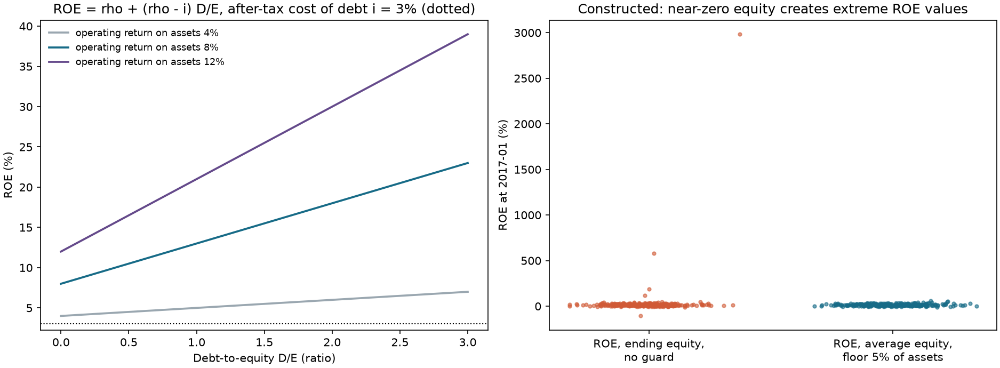
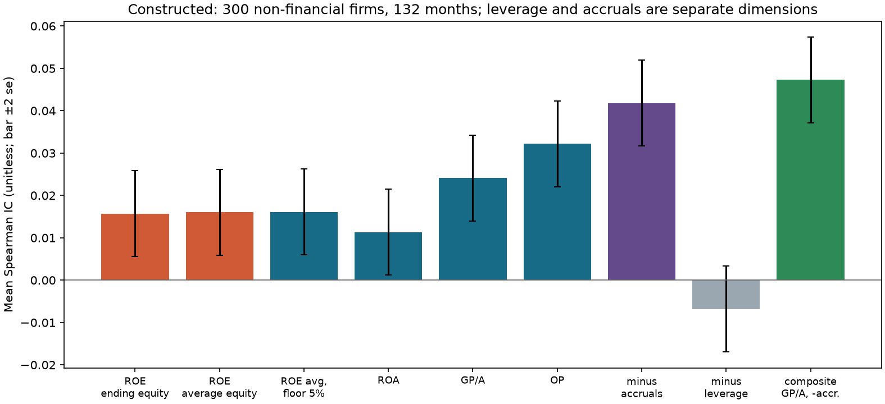
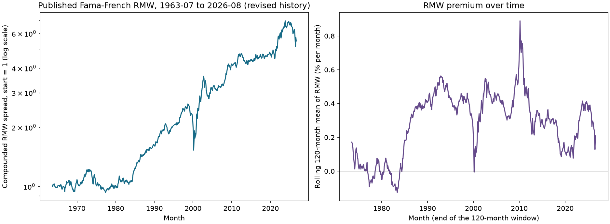

# 第26章 — 质量因子（Quality）

> 主线：质量不是一个数，而是几个会计维度：盈利能力、杠杆、盈利的现金含量与稳定性。每个维度都要问分子是什么、分母是什么、两者是否来自同一份财报、那一刻市场是否已经知道。
> 先修：第12章（财务报表）、第23章（截面研究）、第24章（价值与时点基本面）。完成后你能：把 ROE 拆成净利率、周转与权益乘数并说明为什么 ROE 上升不一定是经营改善；区分期末与平均分母，处理负权益与近零权益；计算毛利润对资产、营业盈利能力对权益、应计项目比率与盈利稳定性；用同一份财报版本构造比率；说明金融业口径；读懂已发布的 RMW 因子收益，并说明它不检验逐股质量信号。

## 1. 本章目标

读者应能回答：同一家公司“质量高”是因为它真的赚得多，还是因为它借得多；一个盈利比率里的数是不是现金，是不是那一刻已经公开。

1. 写出 ROE、ROA、GP/A、OP、杠杆、应计项目比率与盈利稳定性的分子、分母、单位、方向与适用行业。
2. 用杜邦分解 $\mathrm{ROE}=\text{净利率}\times\text{资产周转}\times\text{权益乘数}$ 推出杠杆对 ROE 的作用 $\mathrm{ROE}=\rho+(\rho-i)D/E$，并用两家公司说明“经营改善”与“加杠杆”如何给出相似的 ROE。
3. 说明平均余额与期末余额的取舍，负权益或近零权益使 ROE 失去意义的机制，以及为什么平均两个年末权益之前要先要求两者为正。
4. 说明“同一份财报版本”规则：分子与分母必须来自同一次提交，重述后的分子不能除以重述前的分母。
5. 用构造面板复现：净利润口径的指标混有应计项目；ROE 的横截面方差大部分来自杠杆；近零权益可严重扰动 Pearson IC；Spearman 对极端幅度较稳健，但排序及样本过滤仍会影响它；两个不相关标准化维度的 Pearson 合成恒等式，并与构造秩IC作量级比较。
6. 读取已发布的 RMW 月收益，报告均值、$t$、分期、回撤与相关，并说明它描述聚合因子收益，不构成对任何逐股质量信号的检验。

完成标准：任何质量信号都附一张字段表，写明每个字段的报告期、`available_at`、`ingested_at`、单位，以及它在哪些行业没有定义。

## 2. 为什么 Quant 需要它

价值因子回答“价格相对基本面便宜吗”；质量因子回答“基本面本身好不好”。两者合起来提供识别价值陷阱的更多事前信息：便宜但亏损、杠杆过高、盈利靠应计项目撑起来的公司，在价值信号上排前面，在质量信号上排后面。第28章把两者合成，合成之前每一个质量指标自己就要先站得住。

质量指标的难处与价值相同，但更隐蔽：分子来自利润表（一个时期的流量），分母来自资产负债表（一个时点的存量），时间口径天然不同；分母常是接近零甚至为负的权益；金融业的利润与负债含义不同；净利润里含有现金没有支撑的部分；财报会被重述。第24章的时点选择规则在这里直接复用，并增加一条：一个比率的分子与分母必须来自同一版本。

本章的逻辑链：先给出各指标的定义（5 节），推导杠杆为什么改变 ROE（6.1），再处理分母（6.2）、不直接含融资乘数的度量（6.3）、应计项目（6.4）、稳定性的估计误差（6.5）、同版本规则（6.6）与金融业（6.7），然后量化独立维度如何合成（6.8），最后在构造面板与已发布的 RMW 上做报告（10–11 节）。

## 3. 直觉

两家公司去年都把 ROE 从 15% 提高到 20%。甲公司把成本压低、卖得更好，每一块钱销售的利润更高；乙公司借钱回购了股票，权益变小，同样的利润除以更少的权益。ROE 都升了，但甲公司的经营改善了，乙公司只是承担了更多风险。把 ROE 拆成“利润率 × 周转 × 杠杆”才看得清它们的区别。

另一件容易混淆的是利润与现金。净利润是会计数字，一部分来自应收账款、存货与应计费用的变动，并没有对应的现金流入。利润与现金的差若来自以后需要回转的应计，可能伴随后续盈利回落；投资、营运资本季节性与会计分类也会造成差额，方向须检验。把净利润减去经营活动现金流量净额再除以平均资产，就是应计项目比率；它是会计利润与经营现金流之间的差，不是“现金”本身。

第三件事是时间。一份财报在财年结束后几周才发布，发布时的数字可能后来被修订。质量信号用到的每一个数字，都要问：在信号月末，有谁已经看得到它。

简化的边界：本章的构造面板把这些现象用最小的结构表示（一个潜在的质量因子、一个应计倾向、随机杠杆），真实公司的会计要复杂得多。

### 3.1 一份可得财报先给出完整手算行

::: {.body-example title="完整例题：同版本财报到五项比率"}

教学公司FY2024财报于2025-03-20发布、03-21本地入库，均在UTC；报告货币为百万欧元。利润及现金流覆盖2024全年，比较余额取自这同一次提交，不能另外取今天数据库中的上一年重述值。

| 项目 | FY2024流量或年末余额 | 同份报告FY2023比较余额 |
|---|---|---|
| 收入、销售成本 | 1000、600 | 本例不需 |
| 销售管理费用、利息 | 200、20 | 本例不需 |
| 归普通股净利润、经营净现金流 | 90、120 | 本例不需 |
| 总资产 | 1000 | 800 |
| 普通股权益 | 400 | 300 |
| 有息债务 | 300 | 本例不需 |

资产1000与权益400之间的总负债为600，其中有息债务300，另300为其他负债。因此本例没有假设 $E=A-D$，不能直接代入第6.1节只有有息债务的模型。先算 $\bar A=(800+1000)/2=900$、$\bar E=(300+400)/2=350$。毛利润400，GP/A $=400/900=0.444444=44.4444\%$；ROE $=90/350=25.7143\%$。原始应计率 $a=(90-120)/900=-3.3333\%$；P4 `neg_accrual` $=-a=+3.3333\%$，正值表示经营现金流超过净利润。债务/期末资产 $300/1000=30\%$。

French定义的OP采用账面权益口径：本例明确用期末权益400，$\mathrm{OP}=(1000-600-200-20)/400=45\%$；若改用平均权益350会得到51.4286%，这是另一个课程变式，不能混称同一原文规格。年度利润/余额的指标是对一年经营强度的会计比率，显示为小数或百分数均可；它不是月投资收益，不按12乘除来“月度化”。在连续时间维度下流量/存量有每年的频率；本课固定年度窗口后用无量纲比率展示，须始终附年度口径。

2025-02月末这份FY2024还不可用；03月末两个可得条件均满足，才能计算这一行。03-20发布前或03-21入库前使用它都是本地系统前视。每个月重新选第24章6.4节的整行版本后再计算，不能把年度流量插值成每月实现利润。

:::

## 4. 数学基础

**记号。** 对公司 $i$ 的某个财年：销售 $S$、销售成本 $C$（cost of goods sold, COGS）、销售管理费用 $G$（selling, general and administrative expenses, SG&A）、利息费用 $I$、净利润 $N$（归属普通股）、经营现金流 $F$、总资产 $A$、债务 $D$、账面权益 $E=A-D$（普通股东权益）。注意这是本章的简化：假定全部负债都是有息债务 $D$；真实资产负债表还有应付账款、预收款项等无息经营负债，权益是 $A-L$（$L\ge D$ 为总负债）。杜邦推导与构造面板都使用 $E=A-D$，用真实财报时要把有息债务与总负债分开。利润表项目是一个财年内的流量，资产负债表项目是财年末的存量。单位：同一币种同一规模；流量与余额比均须附年度窗口（按连续时间维度为年$^{-1}$，包括资产周转、ROE、GP/A等）。课程对固定财年累计额除以余额按无量纲小数/百分数展示，债务/资产和权益乘数则是存量/存量比；两种口径都不能当月投资收益。

**平均余额。** 财年内的利润对应的是财年内的平均资产，常用 $\bar A=(A_{\text{年末}}+A_{\text{年初}})/2$，$\bar E$ 同理；年初余额就是上一财年的年末余额。一份 10-K 同时报告当年和上年的资产负债表，所以两个余额可以来自同一份提交。

**杜邦恒等式。** 当 $S,A,E>0$ 时

\[
\frac NE=\frac NS\cdot\frac SA\cdot\frac AE .
\]

三个因子的名称：净利率（net margin）、资产周转（asset turnover）、权益乘数（equity multiplier，也称财务杠杆）。

**样本标准差的精度。** 对 $n$ 个独立正态观测，样本标准差 $s$ 的方差近似 $\sigma^2/(2(n-1))$，相对标准误 $1/\sqrt{2(n-1)}$。

**两个信号的合成。** 设标准化后的信号 $z_1,z_2$ 互不相关、方差 1，标签 $y$ 方差 1，与它们的相关系数分别为 $\rho_1,\rho_2$，则 $\mathrm{Corr}(z_1+z_2,\,y)=\dfrac{\rho_1+\rho_2}{\sqrt2}$。

频率约定：会计量按财年，信号与收益按月；`signal_time` 是月末；信号取最近一个已可得的财年。

## 5. 正式定义

**净资产收益率（Return on Equity, ROE）。** $N/\bar E$，分母为平均或期末普通股东权益；权益非正时没有定义。

**总资产收益率（Return on Assets, ROA）。** $N/\bar A$，不依赖权益，但净利润已扣除利息，所以含一部分杠杆信息。

**毛利润对资产（Gross Profitability, GP/A）。** $(S-C)/\bar A$。毛利润是收入减销售成本。Novy-Marx 的2012作者稿记录的是gross profits-to-assets，以账面资产而不是权益归一；课程及P4采用平均资产是本课程接口口径，不把“平均”归给未核对的论文定义。分子不直接扣利息；金融公司没有销售成本，这个指标不适用。

**营业盈利能力（Operating Profitability, OP）。** Fama 与 French（2015，表 8 说明）的定义：$(S-C-G-I)/E$，即收入减销售成本、销售管理费用与利息费用后除以账面权益；账面权益为正才纳入。注意分子扣了利息、分母是权益，所以它含杠杆。

**杠杆（leverage）。** 本章用 $D/A$（债务对总资产，无量纲；在 $E=A-D>0$ 的简化模型中在0到1之间，真实非正权益公司可超过1）与权益乘数 $A/E$ 两种。它们描述资本结构，不是盈利。

**应计项目比率（accrual ratio）。** $(N-F)/\bar A$：净利润减经营现金流再除以资产。它衡量净利润与经营活动现金流量净额之差相对于平均资产的大小：数值越高，净利润超出经营净现金流的部分（按资产归一化）越大；越低（越负），经营净现金流超出净利润越多。它不是“利润中未收到现金的比例”：A 公司 $N=10$、$F=5$、$\bar A=100$，$a=5\%$，差额占净利润 50%；B 公司 $N=20$、$F=12$、$\bar A=100$，$a=8\%$，差额占净利润只有 40%。若要讨论差额占净利润的比例，需要另定义 $(N-F)/N$，并单独处理 $N\le0$。

**盈利稳定性（earnings stability）。** 最近 $n$ 个财年 ROA（或 ROE）的样本标准差，越小越稳定；$n$ 通常取 5，不足 $n$ 年为 NaN。

**同一份版本（same-version）规则。** 构造一个比率用的分子与分母来自同一份、同一版本的财报；重述发布后，用重述后的所有数字重新计算，在重述发布之前仍用原数字。

**RMW（Robust Minus Weak）。** 已发布的盈利因子价差：$\tfrac12(\text{Small Robust}+\text{Big Robust})-\tfrac12(\text{Small Weak}+\text{Big Weak})$，按规模与营业盈利能力形成的 6 个价值加权组合（French 数据库说明页）。它是聚合收益，不是逐股信号。

**质量（quality）的使用约定。** 本章的“质量”只指上述可计算的会计维度，不涉及管理层、护城河等不可计量的概念。不同研究对“质量”有不同的组合方式；本章不把任何一种组合称为“质量因子的标准定义”。

## 6. 推导

### 6.1 杜邦分解与杠杆对 ROE 的作用

用一家借债 $D$、利率（税后）$i$ 的公司说明。比较固定资产、经营回报与债务利率，权益为正且全部负债为此债务；税后量须在统一税率、利息可扣除且税盾可在当期使用的简化条件下匹配，严重亏损时不能无条件假定即时税盾。令税后营业利润（net operating profit after tax, NOPAT）$=\rho A$，$\rho$ 是营业收益率（经营资产的税后收益率）。净利润是 NOPAT 减税后利息：$N=\rho A-iD$。权益 $E=A-D$。于是

\[
\mathrm{ROE}=\frac NE=\frac{\rho A-iD}{E}=\rho\frac AE-i\frac DE=\rho\Bigl(1+\frac DE\Bigr)-i\frac DE=\rho+(\rho-i)\frac DE .
\]

推导用到的恒等式是 $A/E=1+D/E$。读法：没有债务（$D/E=0$）时 ROE 等于 $\rho$；只要 $\rho>i$，每多一单位 $D/E$，ROE 多出 $(\rho-i)$。数值：$\rho=8\%,i=3\%$：$D/E=0,0.5,1,2$ 对应 ROE $8\%,10.5\%,13\%,18\%$。所以 ROE 上升可以只是杠杆上升，$\rho$ 一点没变。杜邦分解把它拆成三个因子：杠杆变化改变第三个因子 $A/E$，经营改善改变第一个与第二个。第 8.1 节用两家公司给出数值。

杠杆的代价：同样的 $D/E$ 在 $\rho<i$ 时降低 ROE，并增加 ROE 的波动（乘数放大 $\rho$ 的波动）；所以高 ROE 来自高杠杆的公司更脆弱。

### 6.2 分母：平均、期末与近零权益

**ROE 对分母的敏感度。** $\mathrm{ROE}=N/E$，$\partial\mathrm{ROE}/\partial E=-N/E^2$，一阶近似下的相对变化 $\delta\mathrm{ROE}/\mathrm{ROE}\approx-\delta E/E$。权益 $E=400$ 时，权益偏差 1 个单位使 ROE 相对变化约 0.25%（不是0.25个百分点）；权益 $E=2$ 时偏差大到一阶近似失效（权益从 2 增到 3，ROE 下降 33%，从 2 减到 1，ROE 上升 100%），同样1个单位偏差可使ROE变化极大。以 $N=40$ 为例，$E=2$ 时为 $40/2=2000\%$；$E=3$ 时 $40/3=1333.3\%$，下降666.7个百分点；$E=1$ 时 $40/1=4000\%$，上升2000个百分点。权益接近零会把会计噪声放大成极端值。

**负权益。** $E<0$ 且 $N>0$ 时 $N/E$ 为负数；$E=0$ 时比率未定义，两者均按课程规则剔除。负权益的负比率，看上去像“很差的盈利能力”，其实是资不抵债；符号的含义已经变了。本章要求权益为正，与 Fama–French 的纳入条件一致（French 数据库说明页）。

**平均余额陷阱。** 年末权益 $-30$、年初权益 $100$，简单平均 $35>0$，$N=40$ 给出 ROE $=114\%$：对一家年末资不抵债的公司报告了很高的盈利能力。所以要先要求两个余额都为正再平均（`average_balance(..., floor=0.0)`）。

**接近零的权益。** 即使为正，也要设阈值：例如要求权益大于资产的 5%（`floor` 参数）。阈值是研究者的选择，要写入计划并报告被剔除的比例。

**期末与平均的选择。** 利润是财年内累计的流量，平均余额更匹配；期末余额对应财年末，取值较简单；这不代表财年末已经对外披露或本地入库。平均与期末两种口径都须等同份报告的available_at/ingested_at满足截止。两者在稳定增长的公司里差别不大，在权益快速变化的公司里差别可能很大（8.3 节：$N=40$，权益从 500 降到 100，期末 ROE 40%，平均 13.3%）。本章对分母的选择必须在计划里写明，并保持各指标一致。

### 6.3 毛利润对资产为什么不直接含融资乘数

净利润 $N=(S-C-G-I-\cdots)(1-\tau)$ 含利息 $I$；利息等于债务乘利率，所以 $N$ 与资本结构相关。毛利润 $S-C$ 在利息之前，对资产 $A$（资本的总额，不区分债务与权益）之比，既不含利息，分母也与融资结构无关。所以在销售、成本和资产保持固定的比较中，GP/A 不因借款利息或权益分母直接改变；它度量资产毛利润水平。真实举债会影响投资、营运资本与经营成本，因此没有推出真实GP/A与杠杆在统计上独立。OP 的分子扣了利息、分母是权益，所以它受杠杆影响，这是两个指标的实质差别，不是实现细节。

### 6.4 应计项目：利润与现金之差

经营活动现金流量净额 $F$ 是现金流量表里的经营现金流；净利润 $N$ 是权责发生制的结果。两者之差 $N-F$ 是总应计项目（accrual gap，包含营运资本变动、折旧等非现金项目，也受现金流量表分类口径影响），来自营运资本变动（应收账款、存货、应付账款等）和折旧等非现金项目。应计项目比率 $a=(N-F)/\bar A$。$a$ 高意味着相对于资产规模，净利润超出经营净现金流的差额更大；$F$ 本身是收支净额，$N-F$ 也不逐笔标识哪一部分利润尚未收到现金。若这些应计项目之后回转，未来利润会回落。这是一个机制假说，应计项目对收益的预测方向与幅度是经验问题（本章没有读 Sloan 1996，不转述其结果）。方向约定：原始应计率 $a$ 越低越好，质量信号取 $-a$，所以转换后越大越好；不能把原始率与其相反数的方向混写。

### 6.5 盈利稳定性的估计误差

稳定性用 $n$ 年的 ROA 样本标准差 $s_n$ 度量。设年度 ROA 近似独立正态、总体标准差 $\sigma_i$，则 $\mathrm{Var}(s_n)\approx\sigma_i^2/(2(n-1))$，相对标准误 $1/\sqrt{2(n-1)}$：$n=5$ 时 $35\%$，$n=10$ 时 $24\%$。所以用 5 年标准差排序时，两家真实波动率相差 30% 的公司，样本排名很可能与真实顺序相反；这些数说明短历史标准差的相对精度低，却不能证明它比任何盈利水平估计都更嘈杂；后者也取决于均值、波动、样本量和依赖结构。实践含义：不足 $n$ 年的公司给 NaN，不要用 2 年标准差凑数；稳定性与水平指标合成时要降低权重或用更长的窗口。这是正态独立假设下的近似；财务数据常有序列相关与重尾，实际误差须按数据依赖结构另估，不能由这个近似断言一律更大。

### 6.6 同一份版本规则：重述造成的假变化

设公司原先报告 $N=40$、$E=400$，ROE $=10\%$。后来重述：$N=28$、$E=350$。同版本计算：重述前 $40/400=10\%$，重述后 $28/350=8\%$。若在重述发布后只更新分子而分母仍取原版本（把数据库里“最新的净利润”与“最先入库的权益”拼起来）：$28/400=7\%$，得到 $-3$ 个百分点的表观变化（真实变化 $-2$ 个百分点，额外多降1个百分点）。更糟的是，若在重述发布前就用重述后的数字，则是前视（第24章 6.4）。所以：从 `latest_available_values` 一次取出整行，所有分子分母同来自这一行；包括上一年年末余额（同一份 10-K 里的比较余额），这就是 `assets_prev`、`equity_prev` 同列保存的原因。

### 6.7 金融业

银行、保险的资产负债表以金融负债为主，利息既是成本也是经营收入，没有销售成本这一概念：GP/A、OP 的分子没有定义；EV 与 EBITDA 同样没有意义（第24章）。银行的权益乘数通常在 10 倍上下，非金融公司 1 到 2 倍，所以同一个 ROE 数值在两个行业含义不同。处理方式：对 GP/A、OP 把金融行业置 NaN（Novy-Marx 的作者稿也剔除了金融公司）；对 ROE、ROA 在行业内排序；报告每个指标的覆盖率。本章构造面板里银行的权益乘数中位数约 11.2，非金融公司约 1.5。

### 6.8 两个标准化维度合成：相关的算术

以下为同一配对样本上标准化Pearson变量的恒等式；不相关不等于独立，给定相关矩阵还须合法且合成方差非零。设 $z_1,z_2$ 标准化、互不相关，标签 $y$ 标准化，$\mathrm{Corr}(z_k,y)=\rho_k$。则 $\mathrm{Cov}(z_1+z_2,y)=\rho_1+\rho_2$，$\mathrm{Var}(z_1+z_2)=2$，所以合成信号的相关系数为 $(\rho_1+\rho_2)/\sqrt2$。构造面板里 GP/A 的 IC 是 0.0241，$-$应计项目的 IC 是 0.0418，潜在质量与应计倾向相互独立，两个信号的同日秩相关平均为 $-0.073$（接近零但不是零）。不相关时预测 $(0.0241+0.0418)/\sqrt2=0.0466$；用 $r_{12}=-0.073$ 修正 $\bigl(\sqrt{2(1+r_{12})}\bigr)$ 得 $0.0659/1.362=0.0484$；等权秩平均的实测 IC 是 0.0473，介于两者之间。这只是量级比较：跨日期的平均Rank IC及平均秩相关并不精确服从单一样本标准化Pearson恒等式。条件：两个信号不相关、权重等于各自标准化后的等权、不对测试期调权。若两者相关系数 $r_{12}>0$，分母变成 $\sqrt{2(1+r_{12})}$，合成的增益缩小；这是第28章讨论因子相关和权重选择的起点。

## 7. 金融解释

**质量是多个维度。** 盈利水平（GP/A、OP、ROA、ROE）回答“赚得多不多”；杠杆回答“靠借钱多不多”；应计项目回答“利润里现金多不多”；稳定性回答“利润波动大不大”。不同维度可能相反：高杠杆公司 ROE 高但脆弱；高应计项目公司利润高但现金少。把它们压成一个“质量分”之前，要知道每个维度在测什么。

**ROE 混杂了杠杆。** 构造面板里 ROE 的横截面方差是 ROA 的 5.6 倍（0.0233 对 0.0042）；每个日期按 ROE 排序的最高五分位的平均杠杆 $D/A=0.419$，最低五分位 $0.342$，全体 $0.340$：高 ROE 一组更高杠杆。GP/A 的最高与最低五分位的杠杆几乎相同（0.332 与 0.329）。这是 6.1 与 6.3 节机制的数值证据。

**净利润口径的指标含有应计项目。** 构造面板里利润 $N$ 含一个与收益负相关的应计成分（构造设定）；净利润口径的 ROA（IC 0.0113）与 ROE（0.016）因此弱于不含应计项目的 GP/A（0.0241）。这不说明 GP/A 在真实市场里更好，只说明：若净利润里混有与未来收益方向相反的成分，直接用净利润会稀释信号。真实世界里应计项目是否有这种方向，需要数据检验。

**质量与价值的关系是经验问题。** Fama 与 French（2015，第 7 节）发现，无条件地看价值股往往盈利较弱；控制其他因子后，价值股表现得像盈利稳健的股票。本章构造面板里质量与价值被设计成独立，不能用来回答这个问题；已发布的 RMW 与 HML 的相关系数是 0.095（11 节）。

**RMW 的经济含义。** 已发布的 RMW 平均每月 0.25%（$t=3.03$），1963–2026，是聚合价差，扣除成本与融资之前。它不说明哪一个会计指标更好，也不说明按质量买入的个股组合可行。

**可得时间。** 与第24章相同：Novy-Marx 作者稿把某财年的会计数据从下一日历年的 6 月末起使用；Fama–French 的 RMW 也用 t−1 财年数据于 t 年 7 月形成。研究者需要写明他们的滞后规则。

### 7.1 盈利为什么可能与下期收益有关

盈利强并不自动意味着股票回报高：若价格已经充分支付这些现金流，买方没有免费超额收益。风险假说可问高盈利公司是否风险较低、所需收益也较低，或不同质量维度在坏状态怎样暴露；误定价假说可问投资者是否低估盈利持续性或对现金与应计差异反应不足；代理假说可问指标是否只是行业、规模、资产计量或杠杆的替身。这些问题需要分别设计事前观测与检验，不能由“质量”一词直接推出正溢价。

应计差额尤其需要经济判断。扩张公司增加应收账款可能使经营现金流暂时低于利润，也可能是收入确认激进；同样的应计率并不识别原因。课程构造面板把应计倾向对收益的负效应写进生成器，演示该假设下信号怎样工作；它没有替真实公司裁决机制。Sloan、Piotroski等原文仍未读，不增加其经验结论。RMW则是已发布组合价差，无法替代单股GP/A或OP字段，也不检验本例会计质量。

## 8. 数值例题：手算每一步

所有数字由 `hand_examples()` 产生，并由 `qa/a5/claude/recompute/ch26_recompute.py` 用不同实现复核。公司为教学构造。

### 8.1 同样的 ROE 提升：经营改善与加杠杆

本节为期末余额杜邦简化，区别于第3.1节P4平均余额。单位百万美元。甲公司与乙公司去年相同：净利润 60，销售 1000，总资产 600，权益 400。ROE $=60/400=15\%$；净利率 $60/1000=6\%$，周转 $1000/600=1.667$，权益乘数 $600/400=1.5$，乘积 $0.06\times1.667\times1.5=15\%$。

甲公司今年净利润 90，其余不变：净利率 9%，周转 1.667，乘数 1.5，ROE $=22.5\%$：经营改善。乙公司今年借 100 回购股票：权益 300，债务多 100，利息税后约 3.75，净利润 $60-3.75=56.25$，销售与资产不变：净利率 $5.625\%$（下降），周转 1.667，乘数 $600/300=2.0$，ROE $=0.05625\times1.667\times2=18.75\%$。乙公司的净利率下降了，ROE 仍然上升，来源是乘数。

### 8.2 杠杆对 ROE 的作用

$\rho=8\%$，税后债务成本 $i=3\%$：$D/E=0,0.5,1,2$ 的 ROE 为 $8\%,10.5\%,13\%,18\%$（$\mathrm{ROE}=\rho+(\rho-i)D/E$）。资产负债表验证：资产 200，债务 100，权益 100，NOPAT $=0.08\times200=16$，税后利息 $0.03\times100=3$，净利润 13，ROE $=13/100=13\%$。

### 8.3 分母：期末、平均与近零权益

$N=40$，资产 1000。

| 公司 | 年初权益 | 年末权益 | 期末 ROE | 平均权益 | 平均 ROE | 年末权益不足资产 2% 时 |
|---|---|---|---|---|---|---|
| 稳定 | 400 | 400 | 10.0% | 400 | 10.0% | 保留 |
| 权益缩水 | 500 | 100 | 40.0% | 300 | 13.3% | 保留 |
| 权益近零 | 300 | 2 | 2000% | 151 | 26.5% | 期末 ROE 置 NaN（$2<20$） |
| 年末为负 | 100 | $-30$ | NaN | 35（未保护） | 114.3%（未保护） | 先要求两个余额为正：NaN |

读法：期末与平均的差别在权益快速变化的公司最大；平均余额会把负的年末权益掩盖成正数（114%）；设阈值后近零权益变为 NaN，被剔除的比例要报告。

### 8.4 毛利润、营业盈利能力与应计项目

某公司（本简化例期初期末资产相同，因此下列800也是同版本平均资产；应计例500亦同）：销售 1000，销售成本 600，销售管理费用 200，利息 20，总资产 800，账面权益 400。GP/A $=(1000-600)/800=50\%$；OP $=(1000-600-200-20)/400=45\%$。若利息为 60，GP/A 不变，OP $=(1000-600-200-60)/400=35\%$：OP 随杠杆下降，GP/A 不变。两家公司净利润 50、资产 500：A 的经营现金流 80，应计项目比率 $(50-80)/500=-6\%$（经营净现金流超出净利润 30）；B 的经营现金流 20，比率 $+6\%$（净利润超出经营净现金流 30，即资产的 6%）。

### 8.5 版本混用造成的假变化

原先 $N=40,E=400$（ROE 10%）；重述后 $N=28,E=350$：同版本 $28/350=8\%$；混用 $28/400=7\%$；$7\%$ 对 $10\%$ 的变化 $-3$ 个百分点，真实变化是 $8\%$ 对 $10\%$ 的 $-2$ 个百分点。

### 8.6 稳定性的估计误差

$n=5$ 年的 ROA 标准差，相对标准误 $1/\sqrt{2\times4}=0.354$。两家公司真实标准差 $4\%$ 与 $5.2\%$（相差 30%），样本标准差各带 35% 的相对误差，样本排序与真实顺序相反的概率不低（在正态近似下，两个独立估计量之比的对数的标准差约 $\sqrt{2}\times0.354=0.5$，真实比值 $\ln1.3=0.26$ 只有半个标准差，反序概率约 30%；$F$ 分布的精确值 31%）。

### 8.7 两个维度合成

$\rho_1=0.0241$，$\rho_2=0.0418$：$(\rho_1+\rho_2)/\sqrt2=0.0466$。若两个信号相关系数 0.5，$\sqrt{2(1+0.5)}=1.732$，合成相关 $0.0659/1.732=0.0380$，比不相关时低 18%。

## 9. Python 实现

字段定义在新模块 [`quality.py`](../../../../src/quant_course/quality.py)；同一版本的基本面选取复用第24章的 [`latest_available_values`](../../../../src/quant_course/factor_signals.py)（可以一次取出多列，整行来自同一版本）；排序、IC 复用第23章 [`factor_research.py`](../../../../src/quant_course/factor_research.py)。

| 函数 | 输入 | 输出与边界 |
|---|---|---|
| `average_balance` | 年末与年初余额 | $(c+p)/2$；给定 `floor` 时任一余额不高于它就为 NaN（权益用 `floor=0.0`） |
| `guarded_ratio` | 分子、分母、`floor`（数或表） | 分子保留符号；分母不高于 `floor` 为 NaN |
| `dupont` | 净利润、销售、资产、权益 | 净利率、周转、权益乘数与 ROE（三者之积）；净利率要求销售为正；周转要求销售/资产为正；乘数要求资产/权益为正；净利润保留符号；ROE要求销售、资产、权益都为正 |
| `gross_profit_to_assets` | 收入、销售成本、资产 | $(S-C)/A$，调用者须传入平均资产 $\bar A$（函数不做平均）；金融公司销售成本缺失则为 NaN |
| `operating_profitability` | 收入、销售成本、销售管理费用、利息、账面权益 | Fama–French（2015）的 OP；四项分子缺一为 NaN，权益须为正 |
| `accrual_ratio` | 净利润、经营活动现金流量净额、资产 | $(N-F)/A$，同样须传入平均资产 |
| `leverage_ratio` | 债务、资产 | $D/A$；债务为负报错 |
| `earnings_stability` | 年度比率历史（行为财年） | 最近 $n$ 年的样本标准差；不足 `min_years` 为 NaN |
| `roe_from_leverage` | $\rho$、$i$、$D/E$ | $\rho+(\rho-i)D/E$；$D/E<0$ 或非有限报错 |

默认离线入口（从 I3 阅读包根目录运行）：

```bash
.venv/bin/python run_notebook.py notebooks/ch26_quality.ipynb
```

默认 `RUN_FRENCH=False`。稳定性示例是100000个worlds、种子11（正文历史示例200000）；合成示例400000样本且每个r12重置种子5（正文600000且连续rng）；quality_world/quality_study默认种子20261107。 runner另写 `runs/execution_<stem>_<uuid>/` 的执行副本与状态。Notebook英语语言层及整包路径在BIL23装配；下列为历史完整CLI与测试参考，并非默认离线命令：

```bash
.venv/bin/python code/ch26_quality.py
.venv/bin/python -m pytest tests/test_ch26_quality.py tests/test_ch26_workflow.py -q
```

默认只建章级RUN_DIR，不写CSV/PNG/JSON或生成历史图库。

频率：会计量年度，信号与收益月度；`signal_time` 是月末的最后一刻（UTC）；取版规则见第24章 6.4 节的 `latest_available_values`；每份提交同时保存当年与上年的资产负债表余额，所以平均余额来自同一份提交。CLI 种子 20261107。

代码段一：杜邦分解与杠杆效应（8.1、8.2 节）。

```python
import pandas as pd

from quant_course.quality import dupont, roe_from_leverage

idx = pd.period_range("2026-06", periods=1, freq="M")
mk = lambda v: pd.DataFrame([[v]], index=idx, columns=["f"])
before = dupont(mk(60.0), mk(1000.0), mk(600.0), mk(400.0))
ops = dupont(mk(90.0), mk(1000.0), mk(600.0), mk(400.0))          # operations improve: margin 6% -> 9%
lev = dupont(mk(56.25), mk(1000.0), mk(600.0), mk(300.0))         # buy back 100 of equity with debt; after-tax interest 3.75
r = lambda d, k: float(d[k].iloc[0, 0])
assert abs(r(before, "roe") - 0.15) < 1e-12 and abs(r(ops, "roe") - 0.225) < 1e-12 and abs(r(lev, "roe") - 0.1875) < 1e-12
assert r(lev, "net_margin") < r(before, "net_margin") and r(lev, "equity_multiplier") > r(before, "equity_multiplier")   # ROE rose although margin fell
assert abs(roe_from_leverage(0.08, 0.03, 1.0) - 0.13) < 1e-12 and abs((16 - 0.03 * 100) / 100 - 0.13) < 1e-12              # balance-sheet check
print(round(r(ops, "roe"), 4), round(r(lev, "roe"), 4))
```

代码段二：分母规则（8.3 节）。

```python
import numpy as np
import pandas as pd

from quant_course.quality import average_balance, guarded_ratio

idx = pd.period_range("2026-06", periods=1, freq="M")
cols = ["steady", "shrinking", "tiny", "negative"]
ni = pd.DataFrame([[40.0] * 4], index=idx, columns=cols)
end = pd.DataFrame([[400.0, 100.0, 2.0, -30.0]], index=idx, columns=cols)
prev = pd.DataFrame([[400.0, 500.0, 300.0, 100.0]], index=idx, columns=cols)
assets = pd.DataFrame([[1000.0] * 4], index=idx, columns=cols)
roe_end = guarded_ratio(ni, end).iloc[0]
roe_avg_unguarded = guarded_ratio(ni, average_balance(end, prev)).iloc[0]
roe_avg = guarded_ratio(ni, average_balance(end, prev, floor=0.0)).iloc[0]
roe_floor = guarded_ratio(ni, end, floor=0.02 * assets).iloc[0]
assert abs(roe_end["tiny"] - 20.0) < 1e-12 and np.isnan(roe_end["negative"])                       # 2000%, and no ratio for negative equity
assert abs(roe_avg_unguarded["negative"] - 40 / 35) < 1e-12                                          # the average hides the negative balance: 114%
assert np.isnan(roe_avg["negative"]) and abs(roe_avg["shrinking"] - 40 / 300) < 1e-12
assert np.isnan(roe_floor["tiny"]) and abs(roe_floor["shrinking"] - 0.4) < 1e-12                    # 2 < 2% of assets (20): dropped
print(pd.DataFrame({"ending": roe_end, "average, unguarded": roe_avg_unguarded, "average, both > 0": roe_avg, "ending, 2% floor": roe_floor}).round(3))
```

代码段三：GP/A、OP、应计项目、杠杆（8.4 节）。

```python
import pandas as pd

from quant_course.quality import accrual_ratio, gross_profit_to_assets, operating_profitability

idx = pd.period_range("2026-06", periods=1, freq="M")
mk = lambda *v: pd.DataFrame([list(v)], index=idx, columns=["low_debt", "high_debt"][: len(v)])
rev, cogs, sga = mk(1000.0, 1000.0), mk(600.0, 600.0), mk(200.0, 200.0)
interest, assets, equity = mk(20.0, 60.0), mk(800.0, 800.0), mk(400.0, 400.0)
gpa = gross_profit_to_assets(rev, cogs, assets).iloc[0]
op = operating_profitability(rev, cogs, sga, interest, equity).iloc[0]
assert (gpa == 0.5).all()                                                                       # GP/A ignores interest
assert abs(op["low_debt"] - 0.45) < 1e-12 and abs(op["high_debt"] - 0.35) < 1e-12              # OP falls when interest rises
acc = accrual_ratio(mk(50.0, 50.0), mk(80.0, 20.0), mk(500.0, 500.0)).iloc[0]
assert abs(acc["low_debt"] + 0.06) < 1e-12 and abs(acc["high_debt"] - 0.06) < 1e-12            # cash-backed vs not (columns reused as labels)
print(gpa.to_dict(), op.round(3).to_dict(), acc.round(3).to_dict())
```

代码段四：同一版本规则与重述（8.5 节）。

```python
import pandas as pd

from quant_course.factor_signals import latest_available_values
from quant_course.quality import guarded_ratio

versions = pd.DataFrame({
    "security_id": ["S1", "S1"], "period_end": pd.to_datetime(["2022-12-31", "2022-12-31"]),
    "available_at": pd.to_datetime(["2023-03-15 16:05", "2023-11-20 16:05"], utc=True),
    "ingested_at": pd.to_datetime(["2023-03-15 16:12", "2023-11-20 16:12"], utc=True),
    "net_income": [40.0, 28.0], "equity": [400.0, 350.0]})                              # restated NI and equity
months = pd.period_range("2023-10", "2023-11", freq="M")
pit = latest_available_values(versions, months, ["net_income", "equity"])
same_version = guarded_ratio(pit["net_income"], pit["equity"])["S1"]
old_equity = latest_available_values(versions, months[:1], ["equity"])["equity"]["S1"].iloc[0]   # the equity known in October, kept after the restatement
mixed_nov = pit["net_income"]["S1"].iloc[1] / old_equity
assert abs(same_version.iloc[0] - 0.10) < 1e-12 and abs(same_version.iloc[1] - 0.08) < 1e-12
assert abs(mixed_nov - 0.07) < 1e-12                                                      # new numerator over the old denominator: a false -3 pp change
print(same_version.round(3).to_dict(), round(mixed_nov, 3))
```

代码段五：盈利稳定性的估计误差与排序反转概率（6.5、8.6 节）。

```python
import numpy as np

rng = np.random.default_rng(11)
worlds = 200_000
from scipy import stats

for n in (5, 10):
    expected = float(stats.f.sf((0.06 / 0.04) ** 2, n - 1, n - 1))            # exact: s1^2/s2^2 = (sigma1/sigma2)^2 F(n-1, n-1); 0.226 and 0.121
    s1 = rng.normal(0.0, 0.04, (worlds, n)).std(axis=1, ddof=1)             # true sigma 4%
    s2 = rng.normal(0.0, 0.06, (worlds, n)).std(axis=1, ddof=1)             # true sigma 6% (50% higher)
    reversed_share = float((s1 > s2).mean())                                  # sample ranking opposite to the truth
    assert abs(reversed_share - expected) < 0.01                              # the lognormal approximation (0.209, 0.112) is a little low
    print(n, round(reversed_share, 3), round(1 / np.sqrt(2 * (n - 1)), 3))
```

代码段六：两个不相关信号合成后的 IC（6.8、8.7 节）。

```python
import numpy as np

rng = np.random.default_rng(5)
rho1, rho2, n = 0.0241, 0.0418, 600_000


def composite_ic(r12: float) -> float:
    """Correlation of z1 + z2 with y when corr(z1, y) = rho1, corr(z2, y) = rho2 and corr(z1, z2) = r12."""
    cov = np.array([[1.0, r12, rho1], [r12, 1.0, rho2], [rho1, rho2, 1.0]])
    z1, z2, y = rng.multivariate_normal(np.zeros(3), cov, size=n).T
    return float(np.corrcoef(z1 + z2, y)[0, 1])


zero, half = composite_ic(0.0), composite_ic(0.5)
assert abs(zero - (rho1 + rho2) / np.sqrt(2)) < 0.004 and abs(half - (rho1 + rho2) / np.sqrt(2 * 1.5)) < 0.004
assert half < zero                                                              # a correlated second signal shrinks the gain
print(round(zero, 4), round(half, 4))
```

## 10. 图形解读

**图 26-1：杠杆、ROE 与近零权益。** 左图：税后债务成本 3%（虚线）时，三条线是营业收益率 $\rho=4\%,8\%,12\%$ 下 ROE 随 $D/E$ 的变化：$\rho>i$ 时向上、斜率 $\rho-i$，$\rho<i$ 的情形会向下。右图：构造面板某一月 300 家非金融公司的 ROE，左列是用年末权益、没有保护的 ROE，右列是用两个余额都为正的平均权益且要求权益大于资产 5% 的 ROE：左列有极端值（数百个百分点），右列被拉回到合理范围。读法：近零权益造成的极端值不是经济信息。构造数据。



**图 26-2：不同质量指标的 IC。** 构造面板 300 家非金融公司、132 个月，固定种子 20261107。条形是平均 Spearman IC（竖线约 ±2 倍标准误），依次是 ROE（期末）、ROE（平均权益）、ROE（平均权益且权益大于资产 5%）、ROA、GP/A、OP、$-$应计项目、$-$杠杆，以及 GP/A 与 $-$应计项目的等权秩平均。读法：净利润口径的指标（ROE、ROA）弱于毛利润（GP/A）与营业盈利（OP），$-$应计项目最强，合成最强；$-$杠杆约为零（构造里杠杆与收益无关）。这是构造设定的结果，不是对真实市场的估计。



**图 26-3：已发布的 RMW。** 左图：RMW 月度价差复利后的累计值（对数纵轴，起点为 1，1963-07 至 2026-08）；右图：滚动 120 个月平均 RMW（% 每月）。读法：长期缓慢向上、大部分时间为正，2000 年前后有一次回撤（最大回撤约 42%，发生在 2000-02）。已发布的聚合价差，不含成本与融资。



## 11. 历史市场案例

**数据与限制。** 使用 2026-10-05 冻结的 French 五因子（2×3）月度数据：[Ken French 数据库 F-F Research Data 5 Factors 2x3](https://mba.tuck.dartmouth.edu/pages/faculty/ken.french/Data_Library/f-f_5_factors_2x3.html)，处理后 CSV SHA-256 `833bd925b49651428781c789c13a6ac7454d4676449e6d119782050046a57eea`，758 个月（1963-07 至 2026-08），单位小数月度价差收益；公开可下载不等于可任意再分发。RMW 的构造见 5 节与来源笔记：按 t−1 财年的营业盈利能力与规模形成 6 个价值加权组合，7 月形成并持有至次年 6 月，只含权益为正且收入与成本项可得的公司。它是已发布的聚合收益，不是逐股盈利信号，不是时点版本，不是可交易成交。

**描述性结果。**

| 期间 | 月数 | 平均（% 每月） | $t$ | 标准差（% 每月） |
|---|---|---|---|---|
| 1963-07 至 1999-12 | 438 | 0.173 | 2.26 | 1.60 |
| 2000-01 至 2026-08 | 320 | 0.359 | 2.16 | 2.98 |
| 2007-01 至 2020-12 | 168 | 0.234 | 1.90 | 1.59 |
| 全样本 | 758 | 0.251 | 3.03 | 2.29 |

复利累计最大回撤 41.8%，发生在 2000-02。与市场超额收益的相关系数 $-0.19$，与 SMB $-0.33$，与 HML $+0.10$，与 CMA $+0.02$。$t$ 是把月份当独立样本的朴素值；两个分期是事后选定的，$t$ 不能当作检验结论；2000 年之后波动明显更大（2.98% 对 1.60%）。

**能说什么，不能说什么。** 可以说：已发布的盈利价差在 1963–2026 平均为正，两个分期的均值都为正但标准差差一倍；与 SMB 呈负相关；与 HML 的相关接近零。不能说：（1）任何一个会计指标（GP/A、OP、ROE、应计项目）是更好的质量度量，RMW 只用营业盈利能力一种；（2）逐股高 OP 的公司会有更高收益，RMW 是 6 个价值加权组合的算术差；（3）质量与价值的关系：Fama–French（2015，第 7 节）的无条件与条件关系描述适用于其样本，本章没有逐股数据检验；（4）可交易性、容量与成本。

**逐股质量研究缺什么。** 需要：每家公司每个财年的收入、销售成本、销售管理费用、利息、净利润、经营现金流、总资产、权益、债务的各个版本与 `available_at`；历史股票池与退市；行业分类的历史版本；价格与市值。第24章列出的 SEC“财务报表数据集”提供 2009 年以来 XBRL 财报的 as-filed 数值与受理时间，但标签（可扩展商业报告语言 eXtensible Business Reporting Language, XBRL 的标签）与会计概念的映射、销售成本等科目的覆盖率与一致性需要另行核对，且没有价格与退市收益。本章没有下载这些数据；Project 4 准备层的缺口表逐项列出。

## 12. 常见错误

**错误 1：把 ROE 上升当作经营改善。** 8.1 节：乙公司净利率下降而 ROE 上升。修复：始终报告杜邦三个因子，或在经营和资产固定的比较中使用不直接扣利息的GP/A，并报告杠杆；ROA用已扣利息的净利润，仍含融资信息。

**错误 2：用平均余额掩盖负权益。** 8.3 节：年末 $-30$、年初 100 平均为 35，ROE 114%。修复：先要求两个余额都为正再平均。

**错误 3：近零权益进入排序。** 构造面板里 Pearson IC：未保护的 ROE（期末）0.0017（$t=0.36$），保护后 0.0177（$t=3.22$）。该构造中的Spearman IC较接近（0.0157 与0.0161）；它对不改名次的极端幅度变化较稳健，但名次改变、过滤后的配对重排及股票池变化仍可能改变结果。修复：对分母设阈值并报告剔除比例；排序类指标默认用 Rank IC。

```python
import numpy as np
import pandas as pd

from quant_course.factor_research import information_coefficient
from quant_course.quality import guarded_ratio

rng = np.random.default_rng(8)
n = 300
quality = rng.standard_normal(n)
equity = np.exp(rng.normal(5.0, 0.3, n)); equity[:6] = [1.0, 0.5, 2.0, 0.8, 1.5, 3.0]          # six near-zero equity firms
income = 40 + 15 * quality + rng.normal(0, 5, n)
ret = 0.01 * quality + 0.03 * rng.standard_normal(n)
idx = pd.period_range("2026-06", periods=1, freq="M")
frame = lambda v: pd.DataFrame([v], index=idx, columns=range(n))
raw = guarded_ratio(frame(income), frame(equity)).iloc[0].to_numpy()                            # no floor: ROE of ~4000% for the tiny firms
guard = guarded_ratio(frame(income), frame(equity), floor=frame(np.full(n, 20.0))).iloc[0].to_numpy()
p_raw, p_guard = information_coefficient(raw, ret, method="pearson"), information_coefficient(guard, ret, method="pearson")
s_raw = information_coefficient(raw, ret, method="spearman")
assert p_guard > p_raw + 0.1 and abs(s_raw - information_coefficient(guard, ret, method="spearman")) < 0.1
print(round(p_raw, 3), round(p_guard, 3), round(s_raw, 3))
```

**错误 4：版本混用。** 8.5 节：新分子除以旧分母得到下降3个百分点，而真实下降2个百分点，混用额外多降1个百分点。修复：一次取出整行。

**错误 5：对金融公司计算 GP/A 或 OP。** 银行没有销售成本；用利息收入代替收入、利息支出代替成本会得到另一个含义的数。修复：这两个指标对金融行业置 NaN，ROE 与 ROA 行业内排序，并报告覆盖率。构造面板里银行的 GP/A 全部为 NaN（CLI 断言）。

**错误 6：把净利润当现金。** 8.4 节：两家净利润相同的公司，经营净现金流分别为80与20，这不是逐笔识别利润的现金收款。修复：单独计算应计项目比率；净利润口径的指标要与应计项目一起读。

**错误 7：用很少几年的数据排序稳定性。** 6.5 与 8.6 节：5 年标准差的相对误差 35%，真实相差 30% 的两家公司样本排序颠倒的概率约 30%；真实相差 50%（26-E06）时，$n=5$ 年的精确值约 23%、$n=10$ 年约 12%。修复：要求足够年数，降低权重或使用更长的窗口。

**错误 8：用测试期调合成权重。** 8.7 节与 6.8 节的合成假设等权、事先固定；若按测试期的 IC 调权，合成 IC 被事后选择夸大（第22章）。修复：权重在计划里固定，或只在训练期估计。

## 13. 量化研究应用

**质量字段契约（Project 4 信号层）。**

| 字段 | 来源 | 时间字段 | 单位 | 缺失与口径 |
|---|---|---|---|---|
| `revenue`、`cogs`、`sga`、`interest` | 利润表 | `period_end`、`available_at`、`ingested_at` | 报告货币 | 金融行业 `cogs` 缺失，GP/A 与 OP 置 NaN |
| `net_income`、`cfo`（经营现金流，cash flow from operations） | 利润表、现金流量表 | 同上 | 报告货币 | 与资产同版本 |
| `assets`、`assets_prev`、`equity`、`equity_prev`、`debt` | 资产负债表（当年与上年比较余额） | 同上 | 报告货币 | 当前P4平均权益先要求两个年末权益为正，再要求平均权益高于平均资产5%；平均资产另按接口取值 |
| `gp_a`、`neg_accrual`、`roe_avg` | 当前P4信号计算 | `signal_time` | 小数 | 同版本整行计算；OP/ROA/杠杆另作教材指标 |
| `industry` | 分类版本 | `available_at` | 标签 | 行业内排序用 |

**研究流程（构造面板）。** 冻结计划：假设“同日毛利润对资产更高、应计项目比率更低的公司下月收益更高”，信号为两个维度各自的同日百分位的等权平均，主指标 Rank IC 的 $t$；先评价每个维度，再合成；权重在看收益前固定。结果：132 个月、300 家非金融公司，GP/A 的 Rank IC 0.0241（$t=4.58$）、$-$应计项目 0.0418（$t=8.31$）、合成 0.0473（$t=9.00$，命中率 72.5%）；GP/A 最高与最低五分位的月均收益 1.039% 与 0.594%，多空 0.445%（$t=4.26$）。构造设定下这些方向与幅度是已知的，所以它们证明的是函数与流程正确，不是真实世界的效应。

**对 Project 4 的约束。** (1) 所有比率从 `latest_available_values` 一次取整行；(2) 每个指标报告覆盖率与被剔除比例；(3) 金融行业另行处理；(4) 净利润口径的指标与应计项目、杠杆一起报告；(5) 稳定性要求足够年数；(6) 合成权重事先固定，多个维度进入第28章的因子相关与拥挤分析；(7) 所有变体进第22章账本。

### 13.1 指标映射与覆盖：先问“还有谁能被排序”

当前P4质量字段只有 `gp_a`、`neg_accrual`、`roe_avg`，公式分别对应第3.1节的44.4444%、+3.3333%、25.7143%。当前七字段不含OP；章节独立 `quality.operating_profitability` 函数可供教学使用，存在这个函数不等于P4已经接入。论文gross profits-to-assets、课程平均资产GP/A与French权益OP是三个明确口径，不能互相替代。RMW是按French口径形成的组合收益，不是逐公司的OP输入。

P4 `roe_avg` 的实际保护分两步：`average_balance(equity, equity_prev, floor=0.0)`先排除任一非正年末权益；`guarded_ratio(..., floor=0.05 * assets_avg)`再排除平均权益不高于平均资产5%的记录，等于阈值也排除。这是预先固定的接口阈值，不是ROE的普遍定义。第8.3节2%与26-E03的期末5%是另外的教学政策例，不能搬来称作P4规则。

构造一个四公司截面，平均资产均1000、净利润均40，权益(年初,年末)分别为A(80,120)、B(10,30)、C(120,-20)、D(40,60)。A平均100>50，有效ROE40%；B平均20<=50排除；C年末非正先排除（未经保护平均恰50）；D平均50等于阈值也排除。完整输入4家中只有1家通过，ROE有效覆盖25%、损失75%；应计或GP/A能否计算仍按自己的字段判断。缺失不是低质量零分。规模/行业别覆盖和各失败原因应报告，因为过滤可能系统地改变股票池。

原始质量字段进入第24章13.1节的一次通用缩尾、行业/规模残差化、标准化与合成流程。金融行业GP/A缺失会使可用维度改变，风格内重新归一不能恢复缺失的经济证据。质量评分残差与最终权重行业投影仍是两个层次，旧A6支持外权重问题与当前C13限定修正须区分：listed支持集投影、gross恢复2及60名门槛已接受，执行后漂移残差另报，见第24章13.1节的当前接口入口；真实资格、借券、费用、容量与完整真实P4仍未完成，不把旧输出说成已重跑。

## 14. 本章小结

质量由几个会计维度构成。ROE 是净利率、周转与杠杆的乘积，杠杆上升可以使 ROE 上升而经营没有改善：$\mathrm{ROE}=\rho+(\rho-i)D/E$；GP/A不直接扣利息，在经营与资产固定时不含权益融资乘数；净利润口径的指标混有应计项目；应计项目比率是净利润与经营净现金流之差按平均资产归一化，不是差额占利润的比例；盈利稳定性的 5 年标准差相对误差约 35%，排序噪声大。分母必须为正且远离零，平均余额要先要求两个年末余额为正；分子分母必须来自同一份财报版本；金融行业没有销售成本，需要另行处理。两个不相关的维度合成后 IC 约为 $(\rho_1+\rho_2)/\sqrt2$，相关会缩小增益。已发布的 RMW 平均每月 0.25%（$t=3.03$），是聚合价差，不检验逐股信号。适用边界：构造面板的效应是设定的；RMW 是修订历史；本章没有逐股时点数据。

## 15. 练习

**26-E01（手算）** 某公司第一年净利润 36、销售 600、总资产 400、权益 150；第二年净利润 39.6、销售 660、总资产 440、权益 110（用债务回购了股票）。分别计算两年的净利率、周转、权益乘数与 ROE，并说明 ROE 变化的来源。

**26-E02（手算）** 营业收益率 $\rho=10\%$、税后债务成本 $i=4\%$、$D/E=1.5$：求 ROE。若 $\rho=3\%$ 而 $i=4\%$，求 ROE，并解释符号。

**26-E03（手算）** 净利润 24，资产 800。三家公司（年初权益，年末权益）：(200, 180)、(150, 6)、(80, $-10$)。求期末 ROE、平均 ROE（不保护）、两个余额为正才平均的 ROE，以及要求年末权益大于资产 5% 的期末 ROE。

**26-E04（手算）** 收入 2400，销售成本 1500，销售管理费用 500，利息 100，总资产 2000（同版本期初期末均为2000，所以也是平均资产），账面权益 800。求 GP/A 与 OP；若利息为 300，两者各为多少？净利润 120、经营现金流 60、平均资产 1000 时应计项目比率是多少？经营现金流 180 时呢？

**26-E05（手算）** 原先净利润 55、权益 500；重述后净利润 44、权益 440。求同版本 ROE 的两个值、新分子除旧分母的混用值，以及混用造成的假变化。

**26-E06（计算）** 5 年与 10 年的标准差的相对标准误各是多少？两家公司真实标准差 4% 与 6%，用 5 年、10 年样本排序，顺序颠倒的概率各约多少？

**26-E07（计算）** 两个标准化信号，与标签的相关 $\rho_1=0.03$、$\rho_2=0.02$。互不相关与相关系数 0.3 时，等权合成的 IC 各是多少？

**26-E08（概念与手算）** 银行 ROA 1%、权益乘数 11；软件公司 ROA 8%、权益乘数 1.5。求两者 ROE，并说明按 ROE 在全市场排序为何不合适；改用什么？

**26-N01（财报版本与覆盖）** 重算第3.1节五项比率并标注符号、分母与年度单位；说明2月为何不可用、French OP为何不改成平均权益。用第13.1节四家公司核对P4 ROE门槛、覆盖损失，并说明GP/A与RMW不能互换的理由。

## 16. 编程练习

**26-P01** 用 `dupont` 复现 26-E01，断言 ROE 的变化全部来自权益乘数（净利率与周转不变）。验收：三个因子的断言通过。

**26-P02** 构造含一次重述的版本表，用 `latest_available_values` 一次取出分子与分母，断言重述前、后的 ROE，并断言“新分子除旧分母”的混用值不同于两者。验收：三条断言通过。

**26-P03** 模拟两个相关系数为 0.5 的信号，其与标签的相关为 0.03 与 0.02，计算等权合成 IC，并与公式 $(\rho_1+\rho_2)/\sqrt{2(1+r_{12})}$ 比较。验收：误差小于 0.005。

## 17. 挑战题

**26-C01（推导）** 推广 6.1 节：营业利润（税前，earnings before interest and taxes, EBIT）$\mathrm{EBIT}$ 对资产的收益率 $r_a=\mathrm{EBIT}/A$，税率 $\tau$，债务利率 $r_d$（税前），推出 $\mathrm{ROE}=(1-\tau)\bigl[r_a+(r_a-r_d)D/E\bigr]$，并说明与 6.1 节中 $\rho$、$i$ 的对应；讨论 $\rho<i$ 时杠杆对 ROE 与 ROE 波动的影响。额外先修：恒等式 $A/E=1+D/E$。评分：推导 50，对应关系 20，讨论 30。

**26-C02（开放）** 为 Project 4 写质量信号的数据缺口表与冻结计划：列出每个字段在本课程现有数据中是否存在、真实可得的来源、时间字段与缺失规则；说明哪些结论在缺少数据时不能写；给出质量与价值合成前必须先检验的三件事（相关、覆盖、时点）。评分：缺口表 30，冻结计划 30，不能写的结论 20，合成前检验 20。

## 18. 完整答案与参考实现

**26-E01** 第一年：净利率 $36/600=6\%$，周转 $600/400=1.5$，权益乘数 $400/150=2.667$，ROE $=36/150=24\%$（$0.06\times1.5\times2.667=0.24$）。第二年：净利率 $39.6/660=6\%$，周转 $660/440=1.5$，权益乘数 $440/110=4.0$，ROE $=39.6/110=36\%$。净利率与周转都没变，权益乘数从 2.667 升到 4.0，ROE 的 12 个百分点上升全部来自杠杆。

**26-E02** $\mathrm{ROE}=0.10+(0.10-0.04)\times1.5=0.19$。$\rho=3\%<i=4\%$：$0.03+(0.03-0.04)\times1.5=0.015$（1.5%）：杠杆使 ROE 低于 $\rho$，因为资产的收益率低于借款成本，借的越多越亏。

**26-E03** 期末 ROE：$24/180=13.3\%$；$24/6=400\%$；$24/(-10)=-240\%$（符号失去意义，应为 NaN）。平均（不保护）：$(200+180)/2=190\to12.6\%$；$(150+6)/2=78\to30.8\%$；$(80-10)/2=35\to68.6\%$。两个余额为正才平均：12.6%、30.8%、NaN。要求年末权益大于资产 5%（40）：13.3%、NaN（$6<40$）、NaN（$-10<40$）。第三家的 68.6% 是平均掩盖了年末资不抵债。

**26-E04** GP/A $=(2400-1500)/2000=45\%$；OP $=(2400-1500-500-100)/800=37.5\%$。利息 300：GP/A 仍 45%，OP $=(2400-1500-500-300)/800=12.5\%$。应计项目：$(120-60)/1000=+6\%$；$(120-180)/1000=-6\%$。

**26-E05** 同版本：原 $55/500=11\%$，重述 $44/440=10\%$，真实变化 $-1$ 个百分点。混用 $44/500=8.8\%$，假变化 $8.8-11=-2.2$ 个百分点，比真实下降多出 1.2 个百分点。

**26-E06** 相对标准误 $1/\sqrt{2(n-1)}$：$n=5$：$0.354$；$n=10$：$0.236$。两个独立估计量之比的对数的标准差约 $\sqrt2\times$相对标准误：$n=5$：$0.5$；$n=10$：$0.333$。真实比值对数 $\ln(6/4)=0.405$；对数比近似为正态时的反序概率 $\Phi(-0.405/0.5)=\Phi(-0.81)=0.209$（$n=5$）；$\Phi(-0.405/0.333)=\Phi(-1.216)=0.112$（$n=10$）。这是近似，略偏低：样本方差之比 $s_1^2/s_2^2\sim(\sigma_1/\sigma_2)^2F(n-1,n-1)$ 给出精确值 $P(F_{n-1,n-1}>2.25)=0.226$（$n=5$）与 $0.121$（$n=10$），第 9 节代码段五的模拟围绕精确值。

**26-E07** 不相关：$(0.03+0.02)/\sqrt2=0.0354$。相关 0.3：$0.05/\sqrt{2(1+0.3)}=0.05/1.612=0.0310$。

**26-E08** 银行 ROE $=1\%\times11=11\%$；软件 ROE $=8\%\times1.5=12\%$。两者 ROE 相近，但净利润/资产的ROA相差8倍；这里ROA已扣利息，不是第6.1节未扣融资的营业收益率 $\rho$：银行的 11% 来自 11 倍杠杆，软件公司的 12% 来自资产的盈利能力。在全市场按 ROE 排序，会把两种截然不同的风险放在同一个尺度上；应在行业内排序，并结合融资与资产口径解释；非金融企业可另看GP/A，金融行业另行处理，不能称ROA不含杠杆。

**26-P01 参考实现**

```python
import pandas as pd

from quant_course.quality import dupont

idx = pd.period_range("2026-06", periods=1, freq="M")
mk = lambda v: pd.DataFrame([[v]], index=idx, columns=["f"])
y1 = dupont(mk(36.0), mk(600.0), mk(400.0), mk(150.0))
y2 = dupont(mk(39.6), mk(660.0), mk(440.0), mk(110.0))
g = lambda d, k: float(d[k].iloc[0, 0])
assert abs(g(y1, "roe") - 0.24) < 1e-12 and abs(g(y2, "roe") - 0.36) < 1e-12
assert abs(g(y1, "net_margin") - g(y2, "net_margin")) < 1e-12 and abs(g(y1, "asset_turnover") - g(y2, "asset_turnover")) < 1e-12
assert g(y2, "equity_multiplier") > g(y1, "equity_multiplier")                      # all of the ROE change is leverage
```

**26-P02 参考实现**

```python
import pandas as pd

from quant_course.factor_signals import latest_available_values
from quant_course.quality import guarded_ratio

versions = pd.DataFrame({
    "security_id": ["S1", "S1"], "period_end": pd.to_datetime(["2022-12-31", "2022-12-31"]),
    "available_at": pd.to_datetime(["2023-03-15 16:00", "2023-09-10 16:00"], utc=True),
    "ingested_at": pd.to_datetime(["2023-03-15 16:10", "2023-09-10 16:10"], utc=True),
    "net_income": [55.0, 44.0], "equity": [500.0, 440.0]})
months = pd.period_range("2023-08", "2023-09", freq="M")
pit = latest_available_values(versions, months, ["net_income", "equity"])
roe = guarded_ratio(pit["net_income"], pit["equity"])["S1"]
old_equity = pit["equity"]["S1"].iloc[0]
mixed = pit["net_income"]["S1"].iloc[1] / old_equity
assert abs(roe.iloc[0] - 0.11) < 1e-12 and abs(roe.iloc[1] - 0.10) < 1e-12
assert abs(mixed - 0.088) < 1e-12 and mixed != roe.iloc[0] and mixed != roe.iloc[1]
```

**26-P03 参考实现**

```python
import numpy as np

rng = np.random.default_rng(6)
n, r12, rho1, rho2 = 600_000, 0.5, 0.03, 0.02
cov = np.array([[1.0, r12, rho1], [r12, 1.0, rho2], [rho1, rho2, 1.0]])          # corr(z1,y)=rho1, corr(z2,y)=rho2, corr(z1,z2)=r12
z1, z2, y = rng.multivariate_normal(np.zeros(3), cov, size=n).T
sim = np.corrcoef(z1 + z2, y)[0, 1]
assert abs(sim - (rho1 + rho2) / np.sqrt(2 * (1 + r12))) < 0.005
print(round(sim, 4), round(0.05 / np.sqrt(3.0), 4))
```

**26-C01** 假定统一税率、利息可扣除且税盾可在当期使用，资产/债务及经营回报/利率口径固定；亏损与税盾递延须另建模。税前营业利润 $\mathrm{EBIT}=r_aA$，利息 $r_dD$，净利润 $N=(1-\tau)(r_aA-r_dD)$，权益 $E=A-D$。$\mathrm{ROE}=N/E=(1-\tau)(r_aA-r_dD)/E=(1-\tau)\bigl[r_a(1+D/E)-r_dD/E\bigr]=(1-\tau)\bigl[r_a+(r_a-r_d)D/E\bigr]$（用 $A/E=1+D/E$）。与 6.1 节对应：$\rho=(1-\tau)r_a$（税后营业收益率），$i=(1-\tau)r_d$（税后债务成本），于是 $(1-\tau)(r_a-r_d)=\rho-i$，式子回到 $\rho+(\rho-i)D/E$。$\rho<i$ 时，括号内第二项为负，杠杆压低 ROE；同时 ROE 对 $r_a$ 的敏感度是 $(1-\tau)(1+D/E)$，杠杆越高，$r_a$ 的波动被放大得越多，所以 ROE 的波动随 $D/E$ 增大。评分按原稿三项。

**26-C02（评分依据与参考）** 本课程现有数据里：French 的 RMW 是聚合价差；`valuation.py` 的构造公司只有极少量字段；没有逐股的收入、销售成本、销售管理费用、利息、经营现金流版本；也没有价格、股票池、行业历史。SEC 财务报表数据集可补充 2009 年以来 as-filed 的数值与 `filed`、`accepted` 时间，但销售成本等科目的 XBRL 标签映射、行业分类、价格与退市收益需另取（并需遵守该数据的访问限制，见第24章）。不能写的结论：任何逐股质量因子的收益、与价值的相关、成本后的表现。合成前的三件事：质量与价值指标的同日秩相关（决定合成增益）、各指标的覆盖率与剔除比例（决定样本是否偏）、每个字段的 `available_at` 与滞后规则（决定是否前视）。评分按原稿四项。

**26-N01完整答案。** 平均资产900、平均权益350；GP/A44.4444%、ROE25.7143%、原始应计率-3.3333%而其相反数+3.3333%、债务/期末资产30%；另算French OP为180/400=45%，用平均权益的51.4286%是变式。GP/A、ROE、应计率与OP取固定财年的流量/余额口径；债务/期末资产是期末存量/存量比；均不是月投资收益。2月报告尚未发布和入库；3月末才可得。四家公司只A通过，B低于平均资产5%、C年末非正、D等于阈值；覆盖25%、损失75%。GP/A是公司会计特征，RMW是规模/OP组合的聚合价差，既不同对象也不同分母，不能替代或验证彼此。

## 19. 延伸阅读

- Must Know：Fama–French（2015）表 8 说明与第 7 节，读 OP 的定义与价值、盈利的无条件关系。
- Must Know：Ken French 数据库五因子说明页，读 RMW 的构造与样本条件。
- Should Know：Novy-Marx 的 *The Other Side of Value* 作者稿（2012 年 6 月版），读引言与数据说明，理解以资产为分母和排除金融公司的理由；期刊版未读。
- Should Know：本课程第12章（财务报表）关于净利润、现金流与应计项目的定义。
- Advanced：Sloan（1996）关于应计项目、Piotroski（2000）关于基本面评分的原文，核对应计项目与稳定性指标的经验结果；本章未读。
- Optional：任何一份公开 10-K 的“Selected Financial Data”，练习找出每个字段的报告期与比较余额。

## 20. 参考资料

引用键与读取范围见 [source_notes.md](source_notes.md)。

- CH26_FF5_PAGE：Kenneth R. French Data Library，“Description of Fama/French 5 Factors (2x3)”。
- CH26_FF2015：Fama, E. F., French, K. R. (2015). *Journal of Financial Economics* 116(1)，表 8 说明（印刷页 14）、第 7 节（页 12–13）。
- CH26_NOVYMARX2012：Novy-Marx, R. “The Other Side of Value: The Gross Profitability Premium”，作者稿 2012 年 6 月版；期刊版 JFE 108(1) 未读。
- CH24_SEC_FSDS：SEC 财务报表数据集说明（见第24章来源笔记）。
- FRENCH：French 五因子冻结快照（`data/manifests/french_factors_2026-10-05.json`）。
