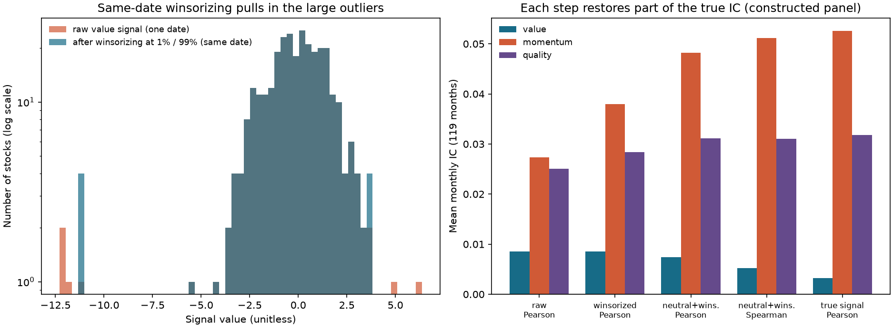
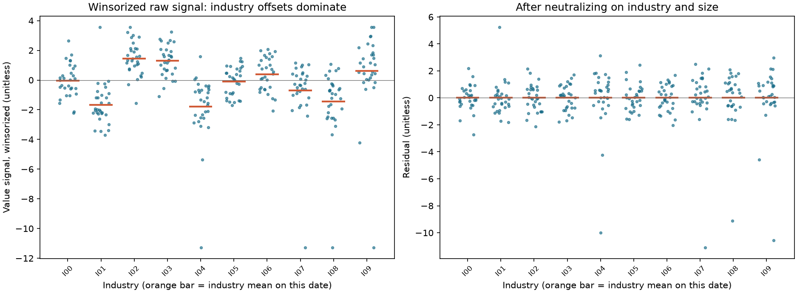
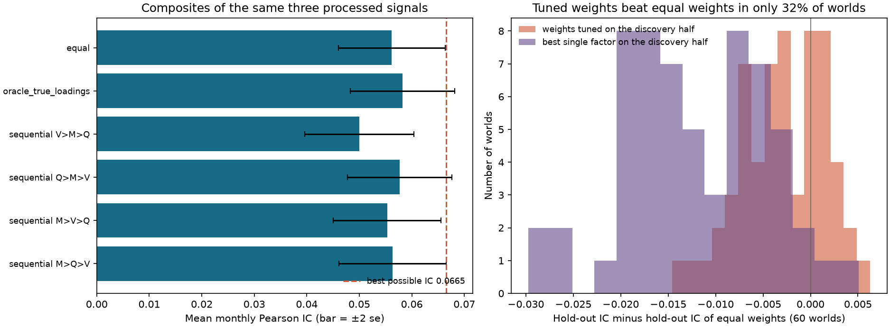
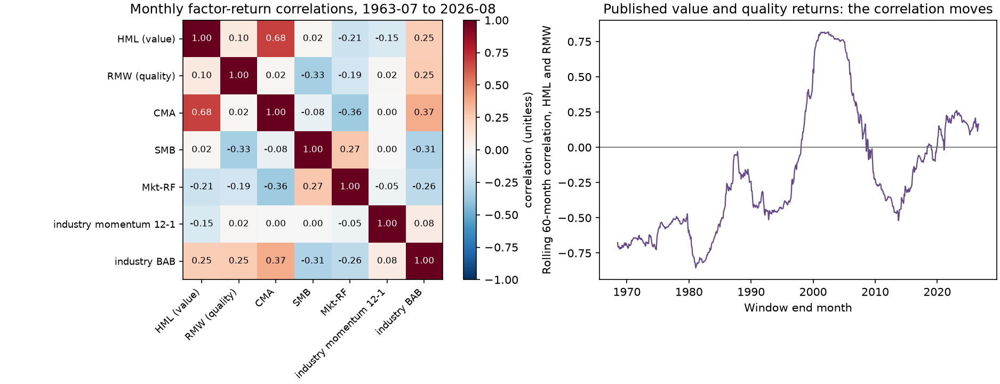

# 第28章 — 多因子模型（Multi-Factor Models）：预处理、合成与约束

> 主线：多因子流程有三个互不替代的职责。预处理（preprocessing）只改变单个信号的尺度、离群值与不想要的暴露，而且只用同一天的截面；合成（combination）决定几个信号怎样相加，权重必须在看到评价期收益之前定下；约束（constraints）决定最终组合允许有哪些暴露。三件事混在一起，就会出现“用测试期收益选权重”“用全样本均值做标准化”“用事后顺序做正交化”这些不报错、但让结果不可信的错误。
> 先修：第24章（价值与时点基本面）、第25章（动量）、第26章（质量）、第27章（套息与低风险）、第23章（截面研究）、第21章（组合构造）。完成后你能：写出同日 z 分数、分位数缩尾（winsorization）、秩与正态分数的定义与 IC 性质；用同日回归做行业与规模中性化，并说明它与对权重做线性约束投影的关系；写出两个相关信号的合成 IC 与正交化顺序对它的影响；写出缺失因子的两种处理及各自的尺度偏差；说明“全样本拟合的标准化”为什么不能用；用已发布的因子收益说明相关系数会随时间变号，并写出多元化后夏普比率的公式。

## 1. 本章目标

读者应能回答：一个原始信号变成可交易组合之前，要经过哪些步骤、每一步用到哪一天的数据；为什么对信号做中性化可以恢复被行业偏移稀释的 IC；两个相关的因子合成时，谁先谁后为什么会改变结果；一个公司缺了一个因子该怎么办；权重能不能用评价期的表现来选。

1. 区分三层职责：预处理（单个信号、同日截面）、合成（多个信号、权重事前固定）、约束（组合层面的暴露限制），并说明每一层可以用哪些数据。
2. 写出并实现同日的缩尾、z 分数、稳健 z 分数、秩与正态分数；说明哪些变换保持 Spearman IC、哪些改变 Pearson IC。
3. 推导一个信号带有与收益无关的干扰成分（行业偏移、规模载荷、离群值）时 Pearson IC 被衰减的因子 $1/\sqrt{1+\sigma_\text{干扰}^2/\sigma_\text{真}^2}$，并在构造面板上用 60 个新种子核对。
4. 推导同日回归中性化的代数：带全部行业虚拟变量时残差等于组内去均值；带规模控制时是 Frisch–Waugh–Lovell 的两步；残差与控制变量正交；冗余设计（行业虚拟变量加截距）下残差不变；对与信号成正比的权重，线性约束投影与中性化给出同一个向量，对分位数权重不是。
5. 写出两个标准化信号合成的 IC $(\rho_1+\rho_2)/\sqrt{2(1+r_{12})}$、依次正交化后的 IC，并说明顺序依赖；写出 IC 最大的权重 $\propto R^{-1}\rho$ 及其要求。
6. 说明缺失因子的“补零”与“按可得因子重新加权”各自改变了谁的尺度，用方差公式 $(1+(k-1)\bar r)/k$ 解释，并报告覆盖率。
7. 说明全样本标准化的前视问题，写出一个只用过去的 expanding 版本，并给出数值反例。
8. 读已发布的 FF5 因子收益：相关矩阵、HML 与 RMW 的相关系数在 1963–1999 与 2000–2026 符号相反、滚动相关的范围；写出等风险平均后夏普比率的公式并核对。
9. 报告三种组合构造（中性化信号的分位数权重、原始合成的分位数权重、原始合成后投影到行业中性）的收益、风险与暴露，并说明这是构造面板上的结果。

完成标准：任何多因子信号都附一张流程表，写明每一步的顺序、用到哪一天、参数（缩尾分位数、z 分数的自由度、最少因子数、权重）是谁在什么时候定的，以及被剔除或补齐的名字所占比例。

## 2. 为什么 Quant 需要它

第24至27章各自构造了一个因子：价值、动量、质量、套息与低风险。它们的量纲不同（比率、收益、会计比率、beta），截面分布不同（有的重尾），含有与收益无关的成分（行业偏移、规模），彼此相关，覆盖的名字也不同。把它们压成一个可以排序的分数，每一步都有研究者的选择，每个选择都能在评价期收益上看出“好坏”，所以每个选择都是一个自由度。第22章已经说明这些自由度会被计数；本章说明它们各自对应的数学对象，以及哪一步用到哪一天的数据。

本章的三条纪律。第一，预处理只用同一天的截面：行 $t$ 的输出只依赖行 $t$ 的输入；前提是该行所有字段、行业标签、取版与参数政策在信号时已可得。同一行不自动证明PIT合格。第二，合成的权重在看到评价期的收益之前写入计划；可以用发现期估计，但评价必须在独立的留出期，并在账本里记录。第三，约束是组合层面的事：它可以与信号层面的中性化等价（线性情形），也可以不等价（分位数权重），两者不能互相替代而不报告。

逻辑链：先写同日变换（6.1），推导干扰成分对 IC 的衰减（6.2）与中性化的代数（6.3）；再写合成的 IC 与顺序依赖（6.4）、权重的选择（6.5）、缺失因子（6.6）；然后写时间序列标准化的前视问题（6.7）、因子相关与多元化（6.8）、拥挤的定义（6.9）；最后在构造面板（10 节）与已发布的因子收益（11 节）上报告。

## 3. 直觉

想象三位分析师各给 300 只股票打分。第一位的分数里混进了所属行业的整体乐观程度（每只科技股都高了 2 分），第二位偶尔把一两只股票打成 ±12 分的离群值，第三位的分数与市值有关。直接按分数排序，第一位的排名主要在比行业，第二位的离群值把方差撑大，第三位的多空组合其实在做多小盘。预处理就是在合成之前，把这些与收益无关的成分一步一步拿掉：同一天内把离群值缩回（缩尾），把行业与规模的影响回归掉（中性化），再把尺度统一（z 分数）。

合成是另一件事：三位分析师的分数相加，权重怎么给？如果两位分析师高度相关，他们说的是同一件事，相加不会增加多少信息；如果先让第一位说完，再只听第二位“第一位没说到的部分”（正交化），那么谁先谁后就会改变第二位剩下的内容。如果用“过去哪位表现好就给他更高权重”，而这个“过去”恰好就是评价期，那就是用答案选权重。

约束是最后一步：最终的多空组合，每个行业的净仓位是不是要为零，对市场、对规模的暴露是不是要限制。这一步可以通过对信号做中性化来近似，也可以直接对权重做投影；它们在线性情形是同一个运算。

简化的边界：本章的构造面板里，行业偏移、规模载荷与离群值都是我设定的干扰，所以中性化与缩尾有益；真实数据里，行业偏移本身可能带来收益，那时中性化会拿走真信号，结论相反（本章没有模拟这种情形）。

### 3.1 从一行数到持仓：每一步交出的对象不同

::: {.body-example title="完整例题：从原始值到合成分数"}

沿用第8.2节六名截面，行业为 A/A/A/B/B/B，原始值 $(1,-1,0,11,10,9)$。为了只看台阶，此处没有新增离群值，先不缩尾、不加规模控制；生产流程仍严格依冻结规则先缩尾再行业/规模残差再z分数。组内均值为0、10，残差 $e=(1,-1,0,1,0,-1)$；均值0、平方和4，样本标准差 $s=\sqrt{4/5}=0.894427$，于是 $z=e/s$。这六名是**显式小例配置**，不是越过P4生产60名门槛的特例。

再给一个同日已标准化的信号 $z_2=(1,0,-1,0,-1,1)/s$，两信号都只有当前截面信息。等权合成 $c=(z+z_2)/2$；标签不参与任何一步。

| 名字/行业 | 原始$x$ | 残差$e$ | $z$ | $z_2$ | 合成$c$ |
|---|---|---|---|---|---|
| a/A | 1 | 1 | 1.1180 | 1.1180 | 1.1180 |
| b/A | -1 | -1 | -1.1180 | 0 | -0.5590 |
| c/A | 0 | 0 | 0 | -1.1180 | -0.5590 |
| d/B | 11 | 1 | 1.1180 | 0 | 0.5590 |
| e/B | 10 | 0 | 0 | -1.1180 | -0.5590 |
| f/B | 9 | -1 | -1.1180 | 1.1180 | 0 |

原始值保留经济方向，残差解释“相对同业和控制变量”，z是可比尺度，合成是排序分数；它们都还不是美元头寸。若f缺第二项，按可得项重归一给 $c_f=-1.1180$，补零给 $-0.5590$；若这两项代表两种风格且合同要求至少2种，f的合成应缺失，不能用重归一绕过门槛。分数缺失限制alpha排序资格；是否允许f作为行业对冲坐标，属于下一层的支持集合同（第6.10节）。

:::

为什么在第24–26章定义字段后，还要这一章？因为比率/收益/会计量无法直接相加；同业残差、尺度、覆盖与权重必须逐层确定。缺失名单、因子相关和持仓交集一起报告，但持仓相似本身不足以推断真实拥挤（第6.9节）。

## 4. 数学基础

**记号。** 日期 $t$（月末），股票 $i=1,\dots,n_t$，原始信号 $x_{i,t}$，下期收益标签 $y_{i,t+1}$（收益区间 $t\to t+1$）。同日变换指输出的第 $t$ 行只由第 $t$ 行输入算出。有效名字集合 $\mathcal V_t$（信号与所有控制变量都非缺失）。单位：信号无量纲；收益为月度小数。频率：月；`signal_time` 是月末；评价期标签是下一个月。

**同日 z 分数。** $z_{i,t}=(x_{i,t}-\bar x_t)/s_t$，$\bar x_t$ 与 $s_t$ 是 $\mathcal V_t$ 上的样本均值与样本标准差（自由度 1）。若 $s_t=0$ 或 $|\mathcal V_t|<3$，该行无定义（NaN）。

**同日缩尾。** 取该日 $\mathcal V_t$ 的分位数 $q^-_t,q^+_t$（线性插值，例如 1% 与 99%），

$$\tilde x_{i,t}=\min\{\max\{x_{i,t},q^-_t\},q^+_t\}.$$


**秩与正态分数。** 平均名次 $r_{i,t}$；百分位 $(r-1)/(n-1)$（第23章）；正态分数 $\Phi^{-1}\bigl((r-\tfrac12)/n\bigr)$。

**中性化。** 对每个日期 $t$ 做截面 OLS：$x_{i,t}=\sum_g\alpha_{g,t}\mathbf 1\{i\in g\}+\gamma_t\,c_{i,t}+e_{i,t}$，$g$ 为行业（所有类别都有虚拟变量，不再另加截距），$c$ 为控制变量（如对数市值）。中性化信号 $=e_{i,t}$。

**正交化。** 把信号 $x^{(2)}$ 对 $x^{(1)}$ 同日回归（含截距）取残差：$e^{(2)}=x^{(2)}-a-b\,x^{(1)}$。

**合成。** 标准化信号 $z^{(k)}$ 与权重 $w_k$：$c_{i,t}=\sum_kw_kz^{(k)}_{i,t}/\sum_k|w_k|$（所有因子都可得时）。

**合成 IC。** 设标准化信号方差为 1、相关矩阵 $R$（$K\times K$），标签方差为 1，与信号的相关向量 $\rho$：$\mathrm{Corr}(w^\top z,y)=w^\top\rho/\sqrt{w^\top Rw}$。$\rho$ 与 $R$ 必须**联合可行**：增广矩阵 $\begin{pmatrix}R&\rho\\\rho^\top&1\end{pmatrix}$ 要是相关矩阵，在 $R$ 对称正定、可逆的前提下，由Schur补等价于 $\rho^\top R^{-1}\rho\le1$（它是标签对信号的复相关系数的平方，也蕴含 $|\rho_i|\le1$）。例如 $R=I_2,\rho=(0.9,0.9)$ 不可行（$0.81+0.81=1.62>1$），代入公式会得到大于 1 的“IC”；代码对这类输入报错，不裁剪。

**因子收益的多元化。** $k$ 个因子收益，每个夏普比率 $S$、平均成对相关 $\bar\rho$、等风险平均：$S_p=S\sqrt k/\sqrt{1+(k-1)\bar\rho}$。

## 5. 正式定义

**同日截面变换（cross-sectional, same-date transform）。** 日期 $t$ 的输出只用日期 $t$ 的输入。本章的缩尾、z 分数、中性化、正交化、合成都属于这一类。

**时间序列标准化（time-series standardization）。** 对一个信号的时间序列用其均值与标准差做标准化。**全样本拟合**（full-sample fit）用全部日期估计均值与标准差，包含未来；**expanding** 版本在第 $t$ 行只用 $\le t$ 的行。

**缩尾（winsorization）。** 把超出分位数区间的值放到区间端点，改变大小，不改变未被缩尾名字之间的顺序。

**z 分数（z-score）、稳健 z 分数（MAD-based robust z-score）。** 前者用均值与标准差，后者用中位数与 $1.4826\times$ 中位数绝对偏差（median absolute deviation, MAD）。

**正态分数（normal scores）。** 用名次把任意分布映射为标准正态分位数，丢掉原始幅度，对固定配对集合内不改变名次的极端幅度更稳健；新增离群名字、缺失或并列仍会改变映射，也不使Pearson IC免疫。

**中性化（neutralization）。** 对一组控制变量（行业虚拟变量、规模等）做同日回归取残差。**行业中性（industry-neutral）**：每个行业内的残差和为零。

**正交化（orthogonalization）。** 对已有信号回归取残差；多个信号依次正交化是 Gram–Schmidt 过程，**顺序**决定每个信号保留什么。

**合成（combining signals）、权重选择（weight choice）。** 等权、固定经济权重、与发现期 IC 成比例、IC 最大化的 $R^{-1}\rho$；除第一种与第二种外都需要估计，估计期与评价期必须分开。

**缺失因子（missing factor）。** 某名字缺少某个因子的值。处理：**补零**（零是 z 分数的均值）、**按可得因子重新加权**（权重除以可得因子权重绝对值之和）、**剔除**（要求全部可得）、**最少因子数**（可得个数不足则 NaN）。

**因子相关（factor correlation）。** 两种：**信号相关**（同日截面上两个信号的相关）与**收益相关**（两个因子组合收益的时间序列相关）。前者影响合成 IC，后者影响多元化。

**拥挤（crowding）。** 本章的操作性定义：许多投资者持有相似的头寸，使得因子被迫去杠杆时收益同时下跌。可以用头寸重叠（同日前五分位集合的重叠比例）与压力期收益相关来描述；本章只有重叠的构造数值，没有真实持仓数据，所以不对真实拥挤下结论。

**约束（constraints）。** 对组合权重的线性限制 $Aw=b$（美元中性、行业中性、规模暴露为零）；`project_to_constraints`（第21章）求满足它的欧氏距离最近的权重。

## 6. 推导

### 6.1 同日变换对 IC 的作用

设每日截面上信号 $x$ 与标签 $y$。对 $a>0$ 与任意 $b$，$\mathrm{Corr}(ax+b,y)=\mathrm{Corr}(x,y)$：同日 z 分数不改变当日的 Pearson IC，也不改变 Spearman IC。它的作用是统一不同信号的尺度，使合成时权重有可比含义。严格保序变换在同一有效信号/标签配对集合及一致并列规则下保持Spearman IC；平均秩与正态分数须继承同一并列分组。Pearson IC一般改变；正态分数降低极端幅度的支配力，但新增名字、有效集合变化与名次变化仍会改变结果。缩尾会制造并列，Spearman IC也可能改变，不能无条件说几乎不变；Pearson IC也可大幅改变。

### 6.2 干扰成分对 IC 的衰减

设某日截面上观测信号 $x=s+u$，真信号 $s$（方差 $\sigma_s^2$）与干扰 $u$（行业偏移、规模载荷、离群值等；方差 $\sigma_u^2$）独立、均值零，并且 $u$ 与标签 $y$ 无关。则 $\mathrm{Cov}(x,y)=\mathrm{Cov}(s,y)$，$\mathrm{Var}(x)=\sigma_s^2+\sigma_u^2$，所以

\[
\mathrm{Corr}(x,y)=\mathrm{Corr}(s,y)\,\frac1{\sqrt{1+\sigma_u^2/\sigma_s^2}} .
\]

干扰方差等于真信号方差时，IC 衰减到 $1/\sqrt2=0.71$ 倍。构造面板（10 节）里真信号方差为 1，干扰：行业偏移（每个日期 10 个行业的偏移，截面方差约 0.9）、规模载荷（价值 $-0.5$、动量 0、质量 $0.3$，规模方差 1，所以方差 $0.25,0,0.09$）、离群值（概率 2%、标准差 8，方差 $0.02\times64=1.28$）。预测的原始信号 IC 衰减因子 $1/\sqrt{1+0.9+c^2+1.28}$：价值 0.540、动量 0.561、质量 0.553。10 节用 60 个新种子实测：0.553、0.592、0.576，与预测相差不到 0.04，说明衰减可以事前算出，不是事后解释。

缩尾去掉大部分离群值方差；中性化去掉行业偏移与规模载荷。这就是“每一步恢复一部分真实 IC”的算术。

注意前提：干扰与标签无关。若行业偏移本身预测收益，它就不是干扰，中性化会把它拿走。是否中性化取决于研究假设，要写入计划。

### 6.3 中性化的代数

**带全部行业虚拟变量。** 设 $D$ 是 $n\times G$ 的行业指示矩阵，$G$ 个类别、每只股票恰属一类。$\min_\alpha\|x-D\alpha\|^2$ 的解是组内均值，所以残差 $e_i=x_i-\bar x_{g(i)}$：组内去均值。每个行业内残差的和为零。

**带规模控制。** 设组内去均值后的信号与规模为 $\tilde x,\tilde c$。Frisch–Waugh–Lovell 定理说明：同时回归 $x$ 于 $D$ 与 $c$ 的残差，等于先对 $D$ 回归去掉行业影响，再把 $\tilde x$ 对 $\tilde c$ 回归的残差：

\[
e=\tilde x-\hat\gamma\,\tilde c,\qquad \hat\gamma=\frac{\sum_i\tilde x_i\tilde c_i}{\sum_i\tilde c_i^2}.
\]

上式除法要求 $\sum_i\tilde c_i^2>0$；若为零，规模已在行业列空间内，不增加解释方向，残差仍为 $\tilde x$，无需除以零。所有步骤须在相同有效配对集合上完成。

所以 $e$ 与规模正交（$\sum_ie_ic_i=0$）、行业内和为零。

**冗余设计下不变。** 若加上一列常数（所有行业虚拟变量之和），设计矩阵秩亏。残差是 $x$ 到列空间正交补的投影，只依赖列空间；列空间不因多一列冗余常数而改变，所以残差不依赖于丢掉哪一列、也不依赖 `lstsq` 的最小范数选择。（测试里有常数控制列的残差与无此列的残差相差小于 $10^{-10}$。）

**一个行业只有一只股票。** 它的虚拟变量独占一个自由度，残差恒为零。同日有效名字不足（自由度少于 2）的日期，该行为 NaN，不是零。

**与对权重做线性约束投影的关系。** 设权重取 $w=x$（与信号成正比），约束 $A w=0$，其中 $A$ 的行是行业指示行（可再加一行规模暴露）。第21章的 `project_to_constraints` 求 $w-A^\top(AA^\top)^{-1}Aw$，这恰是 $x$ 对 $A^\top$ 的列做 OLS 的残差。所以对与信号成正比的权重，“先中性化信号再按比例持仓”与“先按比例持仓再投影”给出同一个向量。分位数权重（前五分位 $+1/m$、后五分位 $-1/m$）是信号的非线性函数：先中性化再取分位数，与先取分位数再投影，是两个不同的组合（10 节的数值）。注意：全部行业指示行的和就是美元行，所以不要再加美元行（`project_to_constraints` 要求行线性无关）。

### 6.4 合成的 IC 与正交化顺序

以下要求 $|r_{12}|<1$，从而残差方差严格为正；标签与信号联合可行。两个标准化信号，标签相关 $\rho_1,\rho_2$，信号相关 $r_{12}$。等权合成 $z_1+z_2$：$\mathrm{Cov}=\rho_1+\rho_2$，$\mathrm{Var}=2(1+r_{12})$，IC $=(\rho_1+\rho_2)/\sqrt{2(1+r_{12})}$（$r_{12}=0$ 时是第26章的 $(\rho_1+\rho_2)/\sqrt2$）。

**依次正交化。** 先保留 $z_1$，再用 $z_2$ 对 $z_1$ 的残差 $e_2=z_2-r_{12}z_1$（方差 $1-r_{12}^2$，与 $z_1$ 不相关）。把 $e_2$ 重新标准化得 $\tilde e_2=e_2/\sqrt{1-r_{12}^2}$。$\mathrm{Cov}(\tilde e_2,y)=(\rho_2-r_{12}\rho_1)/\sqrt{1-r_{12}^2}$，两个不相关的单位方差信号相加：

\[
\mathrm{IC}_{1\to2}=\frac1{\sqrt2}\Bigl[\rho_1+\frac{\rho_2-r_{12}\rho_1}{\sqrt{1-r_{12}^2}}\Bigr].
\]

交换顺序得 $\mathrm{IC}_{2\to1}=\frac1{\sqrt2}\bigl[\rho_2+(\rho_1-r_{12}\rho_2)/\sqrt{1-r_{12}^2}\bigr]$。两者一般不同。数值（$\rho_1=0.04,\rho_2=0.02,r_{12}=0.5$）：$\mathrm{IC}_{1\to2}=0.0283$，$\mathrm{IC}_{2\to1}=0.0386$，等权 $0.0346$，最优（见下）$0.0400$。这个例子里 $\rho_2=r_{12}\rho_1$：第二个因子的全部预测力都来自它与第一个因子的相关，把第一个因子拿掉之后它没有任何增量信息，所以先放第一个因子再正交化第二个，等于只留下第二个的噪声。

**K 个信号。** 要求相关矩阵正定，故Cholesky各残差方差为正。 用相关矩阵的 Cholesky 分解 $P R P^\top=LL^\top$（$P$ 为顺序的置换），Gram–Schmidt 的单位残差是 $L^{-1}Pz$，与标签的相关是 $L^{-1}P\rho$，所以依次正交化后等权合成的 IC 是 $\mathbf 1^\top L^{-1}P\rho/\sqrt K$（`sequential_orthogonal_ic`）。

**IC 最大化的权重。** 最大化 $w^\top\rho/\sqrt{w^\top Rw}$：拉格朗日条件 $\rho=\lambda Rw$，$w^*\propto R^{-1}\rho$，最大 IC $=\sqrt{\rho^\top R^{-1}\rho}$。上例 $R^{-1}\rho\propto(0.04-0.5\times0.02,\ 0.02-0.5\times0.04)=(0.03,0)$：全部权重给第一个因子，IC $=0.04=\rho_1$。要求 $R$ 正定且 $\rho\ne0$，并与标签联合可行。若 $\rho=0$，所有非零方向IC都为0，没有唯一最优方向，不能归一化零向量；API对此报错。真最优公式用真值，估计它们需要独立发现期数据。

**含义。** 顺序没有“正确”答案；如果选哪个顺序是看哪个评价期 IC 最高，它就是一个多重比较（第22章）。可行的做法是事前写明“经济上最基础的因子在前”，把顺序变体全部记账。

### 6.5 权重的选择与调参的乐观性

等权不需要估计。与发现期 IC 成比例的权重 $\hat w_k\propto\max(\widehat{\mathrm{IC}}_k,0)$ 需要估计每个因子的平均 IC：$T$ 个月、每月 $n$ 个名字，平均 IC 的标准误约 $1/\sqrt{nT}$（独立日期，对每日 IC 近似 $1/\sqrt n$）。$n=300,T=60$：$0.0075$。构造面板里价值、动量、质量的真 IC 是 $0.014,0.049,0.033$；价值的估计噪声与它自身一样大，估计的权重会随机地把它压到零或抬高。所以“看谁表现好就给谁权重”若按同一发现期指标择优，其入选指标在重复抽样的期望上乐观（选择偏误），并非每次实现都乐观；IC比例规则也不精确最大化发现期合成IC，在留出期上不保证比等权好。10 节用 60 个新世界检验：发现期 IC 成比例的权重在留出期只有 31.7% 的世界好于等权；“发现期最佳单因子”只有 3.3%。

### 6.6 缺失因子：谁的尺度变了

设 $K$ 个标准化信号，等权。一个名字有 $k$ 个可得因子；以下 $\bar r$ 是这个可得子集的平均成对相关，并假设子集信号在所讨论条件分布中仍有单位方差。缺失若依赖信号值或标签，不能直接沿用完整总体的矩。

**按可得因子重新加权**：$c=\frac1k\sum_{j\in\text{可得}}z_j$，方差 $\frac1{k^2}\bigl[k+k(k-1)\bar r\bigr]=\frac{1+(k-1)\bar r}{k}$。$\bar r=0$ 时 $1/k$；$\bar r<0$ 时相较独立情形进一步降低平均方差。例如 $k=2,\bar r=-0.5$，方差为0.25，低于独立时0.5；相关结构须可行且所用方差非负。**补零**：$c=\frac1K\sum_{j\in\text{可得}}z_j$，方差 $\frac{k}{K^2}\bigl[1+(k-1)\bar r\bigr]$。

构造面板的三个因子 $\bar r=(-0.3-0.3+0.2)/3=-0.133$：三因子齐全的名字合成方差 $(1+2\times(-0.133))/3=0.244$（标准差 0.49）；只有一个因子的名字：重新加权方差 1（标准差 1，是齐全名字的 2.0 倍），补零方差 $1/9$（标准差 0.33，是齐全名字的 0.67 倍）。含义：不重新标准化时，重新加权给少因子名字较大的方差，补零压缩尺度；单凭方差不能在任意分布下推出尾部出现概率。下述尾部比例是这个构造与缺失机制中的实际观察。10 节的数值：这些名字占有效名字的 5.7%，重新加权时占前五分位的 8.8%，补零时占 3.5%。

**缺失机制。** 完全随机缺失（missing completely at random, MCAR）时可沿相应子集矩作上面的尺度比较；缺失与信号相关（如亏损公司没有盈利比率）时条件矩也可能改变，偏差不保证温和或必然更大，本章只模拟随机缺失。建议：设最少因子数（如 2），报告覆盖率，对两种处理做敏感度，把变体进账本。

### 6.7 时间序列标准化的前视

对每只股票的信号时间序列用全样本均值与标准差做标准化，第 $t$ 行就用了 $t$ 之后的数据。反例：一只股票的信号序列 $(1,2,3,10)$，第三个观测 $t=3$ 时：只用过去（expanding，均值 2、标准差 1）：$z=(3-2)/1=+1.0$；全样本（均值 4、标准差 4.08）：$z=(3-4)/4.08=-0.245$。符号相反，仅因为未来的 10 出现在了全样本均值里。规则：第 $t$ 行的任何变换只用 $\le t$ 的行；测试：改动最后一行，此前的输出不能变（`expanding_zscore` 有这个测试）。同日截面变换的算法只取当日行，但时点合格还要求该行输入版本与政策在当时已知。

### 6.8 因子相关、多元化与不稳定的相关

等风险平均的 $k$ 个因子，各自夏普比率 $S=\mu/\sigma$，平均成对相关 $\bar\rho$：组合均值 $\mu$（等权平均），方差 $\sigma^2[1+(k-1)\bar\rho]/k$，所以

\[
S_p=\frac{\mu}{\sigma\sqrt{[1+(k-1)\bar\rho]/k}}=\frac{S\sqrt k}{\sqrt{1+(k-1)\bar\rho}} .
\]

$\bar\rho=1$ 时 $S_p=S$（没有多元化）；$\bar\rho=0$ 时 $S\sqrt k$；$\bar\rho$ 不可能小于 $-1/(k-1)$（相关矩阵半正定），等于下界时组合方差为零，夏普比率没有定义（`diversified_sharpe` 要求严格大于下界）。数值：$S=0.3,k=3$：$\bar\rho=0$：0.520；$\bar\rho=0.2$：0.439；$\bar\rho=0.8$：0.322。

若等风险但夏普不同，把分子中的 $S$ 换成各成分平均夏普；要求是在同一评价口径下成分标准差相同。按过去波动缩放并不保证未来评价样本的实现风险相等。

相关系数是估计量。在独立同分布、近似二元正态及大样本近似下，$T$ 个月度观测的样本相关系数，真值 $\rho$ 时标准误约 $(1-\rho^2)/\sqrt T$；$T=60$、$\rho=0$ 时 0.13。所以用 60 个月估计的相关矩阵会大幅摆动；11 节的已发布价值与质量因子（HML 与 RMW）的相关系数在 1963–1999 与 2000–2026 符号相反。

### 6.9 拥挤：定义与能测什么

拥挤要求知道有多少资金在做相似的头寸，这需要持仓、卖空利率、基金资金流等数据。本章的数据没有这些，所以只能做两件事：（i）度量信号层面的头寸重叠：同日两个因子前五分位名字的交集占比，独立时应为 0.20；（ii）度量收益层面的同步性：因子收益的相关系数与滚动相关。前者在构造面板里算（价值与动量 0.10，价值与质量 0.10，动量与质量 0.28）；后者在已发布的因子收益上算（11 节）。这两件事都不能证明“拥挤”，只提供它的一个可观测的侧面。

### 6.10 支持集上的投影：中性成立在谁身上、哪一刻

**支持集（support）** $\mathcal S_t=\{i:\mathrm{listed}_{i,t}=\mathrm{True}\}$ 只含信号月已上市名字；**alpha有效集**是合成分数非缺失的子集，二者不等。先在alpha有效集取固定五分位多空 $w^0$，支持集外必须零。可选行业投影允许 $\mathcal S_t$ 内没有有效分数的名字承接对冲权重；这样输出已不再是纯最高/最低分位持仓，需要披露。

令 $u=w^0_{\mathcal S_t}$，$A_t$ 是仅在该支持集出现的行业指示行，每个名字恰属一个非缺失行业。只构造独立行，行和已经是净额行，不重复添加。每一行至少有一个坐标时，$A_tA_t^\top$ 是各行业人数的正对角阵。第21章最近点投影的支持集形式为

\[
v=\arg\min_{A_t v=0}\|v-u\|^2
  =u-A_t^\top(A_tA_t^\top)^{-1}A_tu.
\]

把全列权重先投影再对未上市名字置零，通常不等于这个式子：掩码删除了原先抵消行业净额的坐标。单行业只有一个上市名字时，它的约束就是该名字权重为零；这不是全矩阵秩亏，而是这个行业没有非零对冲方向。空支持集、无原始多空组合或数值零投影应明确持现金；分类缺失/轴错位应明确失败，不能把坏输入偷偷补成零。

**gross（总绝对风险头寸）与齐次约束。** 若 $g_v=\sum_{i\in\mathcal S_t}|v_i|$ 超过数值零阈值，$k=2/g_v>0$，令 $w_{\mathcal S_t}=kv$、其余坐标0。$A_t(kv)=kA_tv=0$；每个行业净额及总净额仍为零，gross恢复2，多头和为1、空头和为-1。若 $g_v$ 只有舍入噪声，不可放大到2。投影是最近点，**再缩放的最终结果一般不是原最近点**；恢复gross改变的是头寸预算，不是重选收益参数。非零目标 $A_tv=b$ 时 $A_t(kv)=kb$，除非 $k=1$ 或 $b=0$，不能沿用这个证明。当前P4不新增非零目标策略。

**两层门槛。** P4的 `min_names_per_date=60` 数的是 $|\mathcal S_t|$，不是每个字段的非缺失数。59名时全日预处理无资格，组合现金；60名仅打开宇宙资格，某字段仍需30个值才能缩尾、残差后需10个才能z分数，风格内至少1字段、跨风格至少2风格。任何后续合成都不得恢复一个失格日期；组合入口再核60名，以免外部直接传分数绕过它。

**时钟与残差。** $t$ 月末用此时上市状态和信号得到target；$t+1$ 执行日退市取消/清算、部分成交、价格漂移都可能让实际持仓偏离target。报告应分开：信号target的支持集外权重、行业净额/总净额/gross；执行目标过滤后的同项；账本实际收盘持仓按当期NAV归一的同项。执行后的信息可以做执行与诊断，不能回写 $t$ 的分数或支持集。P4当前上市状态是构造输入，没有真实停牌、逐股价格可得性或借券字段；信号listed不等于真实可交易资格。

## 7. 金融解释

**预处理是去掉与收益无关的成分，不是美化信号。** 每一步都要问：被去掉的是不是干扰。行业偏移、规模载荷、离群值在构造面板里都是干扰，所以每一步恢复一部分 IC（单世界动量的 Pearson IC：原始 0.027、缩尾后 0.038、中性化后 0.048，真值 0.053）。若某个“干扰”其实带有收益（真实的行业动量、规模效应），预处理就把它扔掉了。

**合成的收益来自分散，不是魔法。** 两个相关的因子相加，增益受相关系数限制；合成 IC 的公式说明了这一点。一个因子的全部预测力来自它与另一个因子的相关时，它没有增量。

**顺序与权重是研究者的自由度。** 正交化顺序、权重选择、缺失处理、缩尾分位数，都可以在评价期上看到“更好”或“更差”。这些选择必须事前写下，变体全部记账，调参要在独立的留出期上评价。

**中性化与约束的关系。** 对线性权重，中性化与投影相同；对分位数权重不同，所以“我做了行业中性”需要写明是哪一种：信号中性化后排序，还是排序后对权重投影。两者的暴露、波动与换手都不同（10 节）。

**相关不稳定。** 已发布的价值与质量因子，相关系数在不同的 20–30 年里符号相反。依赖估计的相关矩阵来配置权重，等于依赖一个会变号的估计量。多元化的算术（$S_p$ 公式）是有条件的：条件是平均相关，而它会变。

## 8. 数值例题：手算每一步

所有数字由 `hand_examples()` 产生，并由 历史独立复核脚本 用不同实现复核。股票与信号为教学构造。

### 8.1 缩尾、z 分数与正态分数

同一天 11 只股票的信号 $1,2,\dots,10,100$（最后一只是离群值）。

- **不缩尾的 z 分数**：均值 $155/11=14.09$，标准差 $28.64$。离群值的 $z=(100-14.09)/28.64=3.00$，其余十只被挤在 $-0.457$（信号 1）到 $-0.143$（信号 10）之间，彼此几乎分不开。
- **缩尾（10% 与 90% 分位数，线性插值）**：$(n-1)q=10\times0.1=1$ 与 $9$，恰是第 2 与第 10 个次序统计量，$q^-=2$，$q^+=10$。信号变为 $2,2,3,4,5,6,7,8,9,10,10$，均值 $66/11=6$，偏差平方和 $16+16+9+4+1+0+1+4+9+16+16=92$，样本方差 $92/10=9.2$，标准差 $3.033$。信号 10 与 100 的 $z$ 都是 $+1.319$；信号 5 的 $z=-0.330$，比不缩尾时的 $-0.317$ 略小，但十只正常股票现在占满 $-1.32$ 到 $+1.32$。
- **正态分数**：$\Phi^{-1}((r-1/2)/11)$：信号 100（第 11 名）$\Phi^{-1}(10.5/11)=1.691$；信号 10（第 10 名）$\Phi^{-1}(9.5/11)=1.097$。大小全部丢掉，只留下名次。

### 8.2 行业中性化：把符号翻回来

6 只股票，行业 A 为 $\{a,b,c\}$、行业 B 为 $\{d,e,f\}$。信号 $x=(1,-1,0,\ 11,10,9)$，下月收益 $y=(5\%,3\%,4\%,\ -3\%,-4\%,-5\%)$。行业 B 整体信号高（偏移 10）而收益低，行业内部信号高的收益高。

- **原始 Pearson IC**：$\bar x=30/6=5$，$x-\bar x=(-4,-6,-5,6,5,4)$，$\sum(x-\bar x)y=-1.16$，$\sum(x-\bar x)^2=154$，$\sum y^2=0.01$，IC $=-1.16/\sqrt{154\times0.01}=-0.935$。
- **中性化**：行业均值 $0$ 与 $10$，残差 $e=(1,-1,0,\ 1,0,-1)$，行业内和为零。$\sum ey=0.04$，$\sum e^2=4$，IC $=0.04/\sqrt{4\times0.01}=+0.200$。

行业偏移是与收益（行业内排序）无关、却与行业收益相反的干扰；中性化之前 IC 是 $-0.94$，之后是 $+0.20$。

### 8.3 线性约束投影与中性化是同一个向量

仍用 8.2 的 $x$。权重取 $w=x$，约束矩阵 $A$ 的两行是行业 A 与行业 B 的指示行（它们的和是美元行，所以不再加美元行）。$AA^\top=\mathrm{diag}(3,3)$，$Ax=(0,30)$，$w-A^\top(AA^\top)^{-1}Ax=x-(0,0,0,10,10,10)=(1,-1,0,1,0,-1)$：与 8.2 的残差逐项相同；投影后美元净仓位为 0，两个行业的净仓位都是 0。这对与信号成正比的权重成立；对分位数权重不成立（10 节的数值：中性化信号后取五分位，行业净仓位平均最大 0.053，不为零；原始合成取五分位后投影，行业净仓位恰为零）。

### 8.4 两个相关信号：等权、两种正交化顺序与最优

::: {.body-example title="完整例题：相关信号的四种合成"}

$\rho_1=0.04,\ \rho_2=0.02,\ r_{12}=0.5$（6.4 节）。

| 合成方式 | IC |
|---|---|
| 只用 $z_1$ | $0.0400$ |
| 等权 $z_1+z_2$ | $0.06/\sqrt{2\times1.5}=0.0346$ |
| 先 $z_1$，再 $z_2$ 对 $z_1$ 的标准化残差 | $\frac1{\sqrt2}[0.04+(0.02-0.02)/0.866]=0.0283$ |
| 先 $z_2$，再 $z_1$ 对 $z_2$ 的标准化残差 | $\frac1{\sqrt2}[0.02+(0.04-0.01)/0.866]=0.0386$ |
| 最优权重 $\propto R^{-1}\rho=(0.04,0)\to(1,0)$ | $\sqrt{\rho^\top R^{-1}\rho}=0.0400$ |

顺序把 IC 从 0.0283 改到 0.0386，相差 36%；等权在两者之间；最优等于只用第一个因子，因为 $\rho_2=r_{12}\rho_1$：第二个因子的预测力完全来自它与第一个因子的相关。

:::

### 8.5 缺失因子

两个因子，权重 $(0.5,0.5)$。名字 $s_1$ 两个因子都有，$z=(2,2)$，合成 $2.0$。名字 $s_2$ 只有第二个因子 $z=1$：

- 按可得因子重新加权：$0.5\times1/0.5=1.0$（保持 $z$ 的尺度）；
- 补零：$0.5\times1/1.0=0.5$（被压向 0）。

6.6 节：三个相关均值为 $-0.133$ 的因子，齐全的名字合成标准差 0.49，只有一个因子的名字重新加权后标准差 1（2.0 倍），补零后 0.33（0.67 倍）。

### 8.6 标准化的前视

某只股票的信号序列 $(1,2,3,10)$，在第三个观测：只用过去 $\{1,2,3\}$（均值 2、标准差 1）：$z=+1.0$；全样本（均值 4、标准差 $4.082$）：$z=(3-4)/4.082=-0.245$。符号相反，因为全样本均值用了未来的 10。

### 8.7 多元化

三个因子，各自夏普比率 0.3：平均相关 0：$0.3\sqrt3=0.520$；0.2：$0.520/\sqrt{1.4}=0.439$；0.8：$0.520/\sqrt{2.6}=0.322$。相关矩阵 $\begin{pmatrix}1&0.2&0.4\\0.2&1&0\\0.4&0&1\end{pmatrix}$ 的平均成对相关是 $(0.2+0.4+0)/3=0.2$。

### 8.8 四名宇宙中的三坐标支持集：先投影再掩码反例

四名a,b,c,d，行业A为a,b，B为c,d。已全列中性的权重 $w=(0.4,-0.4,0.3,-0.3)$，gross=1.4。设信号日a尚未上市：先照旧投影（权重未变）再清零a，得到 $(0,-0.4,0.3,-0.3)$，A行业净额 $-0.4$、总净额 $-0.4$、gross=1.0。这说明未上市名字不是一个“很小可忽略”的实现细节。

正确支持集为 $(b,c,d)$，原向量 $u=(-0.4,0.3,-0.3)$，

\[
A_t=\begin{pmatrix}1&0&0\\0&1&1\end{pmatrix},\quad
A_tA_t^\top=\operatorname{diag}(1,2),\quad A_tu=(-0.4,0).
\]

投影逐项减行业均值，$v=(0,0.3,-0.3)$，gross=0.6；乘 $2/0.6=10/3$ 得最终 $(0,0,1,-1)$（回嵌全列）。支持集外a为零，单名行业b也被约束为零，B行业净额和总净额都0，gross=2。预算恢复了，原四个分位头寸没有被保留。

再看缺失alpha的对冲坐标：四名都上市，只有a、c有分数，原多空 $(1,0,-1,0)$。两行业均值为 $0.5,-0.5$，投影 $v=(0.5,-0.5,-0.5,0.5)$，gross已是2；b、d没有分数却承担对冲。这是已声明的可选投影语义，不是给缺失alpha编造分数。如果只有a、c上市且各独占一个行业，投影全零，没有可用方向，现金；不可用除以零或放大噪声来“完成gross”。

非零目标的对照：行业A只一个坐标，要求 $v_a=0.2$。即使投影满足约束，乘2会变成0.4；非零目标必须重新解约束问题，不能无条件缩放。本节全为独立手算，不是新增市场结果。

## 9. Python实现

函数在新模块 [`factor_preprocessing.py`](../../../../src/quant_course/factor_preprocessing.py)；排序、IC 与分位数权重复用第23章 [`factor_research.py`](../../../../src/quant_course/factor_research.py)；线性约束投影复用第21章 [`project_to_constraints`](../../../../src/quant_course/portfolio_construction.py)。

| 函数 | 输入 | 输出与边界 |
|---|---|---|
| `winsorize_cross_section` | 信号面板、下上分位数、最少名字数 | 每行缩到该行分位数区间；有效名字少于最少数则整行 NaN；分位数须满足 $0\le$ 下 $<$ 上 $\le1$ |
| `zscore_cross_section` | 面板、自由度（0 或 1）、最少名字数 | 每行 $(x-\bar x)/s$；不足最少名字或标准差为 0 的行为 NaN |
| `mad_zscore_cross_section` | 面板 | $(x-\text{中位数})/(1.4826\,\mathrm{MAD})$；MAD 为 0 的行为 NaN |
| `normal_scores` | 面板 | $\Phi^{-1}((r-1/2)/n)$，平均名次 |
| `neutralize` | 信号、行业（静态表或日期表）、控制变量字典 | 同日 OLS 残差；缺任一项的名字为 NaN；同一signal/全部controls/group有效配对集合上计算；$n-\operatorname{rank}(X)<2$的日期整行为NaN；满足整日自由度时，单名行业残差为0 |
| `orthogonalize` | 信号、对其回归的面板列表 | 对截距与这些面板的同日残差 |
| `combine_signals` | 信号字典、权重字典、最少因子数、`missing='reweight'` 或 `'zero'` | 合成面板与每个名字的非零权重可得因子数（`min_factors`只计这些项）；权重须为有限实数且不全为零 |
| `expanding_zscore` | 面板、最少期数 | 第 $t$ 行只用 $\le t$ 的行的均值与标准差 |
| `composite_ic` | 与标签的相关向量、相关矩阵、权重 | $w^\top\rho/\sqrt{w^\top Rw}$；$R$ 须对称、对角为 1、正定，且 $\rho^\top R^{-1}\rho\le1$（联合可行），否则报错 |
| `optimal_composite_weights` | 同上 | $R^{-1}\rho$（绝对值和为 1）与对应 IC；联合不可行或 $\rho$ 全为零（没有唯一最优方向）报错 |
| `sequential_orthogonal_ic` | 同上、顺序 | 依次正交化后等权合成的 IC |
| `diversified_sharpe`、`average_pairwise_correlation` | 夏普、个数、平均相关；相关矩阵 | $S\sqrt k/\sqrt{1+(k-1)\bar\rho}$（组合方差 $1+(k-1)\bar\rho$ 不为正，含容差内的下界，报错）；平均非对角元 |

默认离线阅读入口是已接受读者包的 `notebooks/ch28_multifactor.ipynb`：`RUN_FRENCH=False`，构造300名×120月（seed 20261121），调参sweep默认60世界。只创建新的RUN_DIR；不输出历史图/CSV/JSON。下文French与本章四图属于既有历史证据，不由默认路径重跑。 runner另存execution副本和状态。代码块保留完整供学习；下列是原工程源中的历史CLI/测试入口，非读者默认步骤，独立包未捆绑这些工程入口时不要运行：

```bash
.venv/bin/python code/ch28_multifactor.py
.venv/bin/python -m pytest tests/test_ch28_preprocessing.py tests/test_ch28_workflow.py -q
```

频率：月；`signal_time` 是月末；所有同日变换的第 $t$ 行只用第 $t$ 行；`expanding_zscore` 的第 $t$ 行只用 $\le t$ 的行。种子：构造面板 20261121，60 个新世界 20261122 起。

代码段一：缩尾、z 分数、正态分数（8.1 节）。

```python
import numpy as np
import pandas as pd

from quant_course.factor_preprocessing import normal_scores, winsorize_cross_section, zscore_cross_section

x = pd.DataFrame([[1.0, 2, 3, 4, 5, 6, 7, 8, 9, 10, 100]], index=pd.period_range("2026-06", periods=1, freq="M"))
w = winsorize_cross_section(x, lower=0.1, upper=0.9, min_names=10)
assert w.iloc[0].tolist() == [2, 2, 3, 4, 5, 6, 7, 8, 9, 10, 10]
assert abs(w.iloc[0].mean() - 6.0) < 1e-12 and abs(w.iloc[0].std(ddof=1) - np.sqrt(9.2)) < 1e-12
z_raw, z_win = zscore_cross_section(x), zscore_cross_section(w)
assert abs(z_raw.iloc[0, 10] - 3.0) < 0.001 and z_raw.iloc[0, :10].between(-0.46, -0.14).all()   # the ten ordinary names are squeezed together
assert abs(z_win.iloc[0, 9] - 4 / np.sqrt(9.2)) < 1e-12 and abs(z_win.iloc[0, 9] - z_win.iloc[0, 10]) < 1e-12
ns = normal_scores(x)
assert abs(ns.iloc[0, 10] - 1.6906) < 1e-4 and abs(ns.iloc[0, 9] - 1.0968) < 1e-4
```

代码段二：行业中性化与线性约束投影（8.2、8.3 节）。

```python
import numpy as np
import pandas as pd

from quant_course.factor_preprocessing import neutralize
from quant_course.portfolio_construction import project_to_constraints

cols = list("abcdef")
sig = pd.DataFrame([[1.0, -1.0, 0.0, 11.0, 10.0, 9.0]], index=pd.period_range("2026-06", periods=1, freq="M"), columns=cols)
ret = np.array([0.05, 0.03, 0.04, -0.03, -0.04, -0.05])
groups = pd.Series(list("AAABBB"), index=cols)
res = neutralize(sig, groups=groups)
assert np.allclose(res.iloc[0], [1, -1, 0, 1, 0, -1], atol=1e-12)
assert abs(np.corrcoef(sig.iloc[0], ret)[0, 1] + 0.93475) < 1e-5 and abs(np.corrcoef(res.iloc[0], ret)[0, 1] - 0.2) < 1e-12
A = np.array([[1, 1, 1, 0, 0, 0], [0, 0, 0, 1, 1, 1]], dtype=float)         # industry indicator rows; their sum is the dollar row
proj = project_to_constraints(sig.iloc[0].to_numpy(), A)
assert np.allclose(proj, res.iloc[0], atol=1e-12) and abs(proj.sum()) < 1e-12 and np.allclose(A @ proj, 0)
```

代码段三：两个相关信号的合成与顺序（8.4 节）。

```python
import numpy as np

from quant_course.factor_preprocessing import composite_ic, optimal_composite_weights, sequential_orthogonal_ic

R = np.array([[1.0, 0.5], [0.5, 1.0]])
rho = [0.04, 0.02]
assert abs(composite_ic(rho, R) - 0.06 / np.sqrt(3)) < 1e-12
a, b = sequential_orthogonal_ic(rho, R, [0, 1]), sequential_orthogonal_ic(rho, R, [1, 0])
assert abs(a - 0.04 / np.sqrt(2)) < 1e-12 and abs(b - (0.02 + 0.03 / np.sqrt(0.75)) / np.sqrt(2)) < 1e-12 and b > a
w, best = optimal_composite_weights(rho, R)
assert np.allclose(w, [1.0, 0.0]) and abs(best - 0.04) < 1e-12 and abs(composite_ic(rho, R, w) - 0.04) < 1e-12
assert best > b > composite_ic(rho, R) > a                                      # 0.0400 > 0.0386 > 0.0346 > 0.0283
```

代码段四：缺失因子的尺度（8.5、6.6 节）。

```python
import numpy as np
import pandas as pd

from quant_course.factor_preprocessing import combine_signals

idx = pd.period_range("2026-06", periods=1, freq="M")
z = {"f1": pd.DataFrame([[2.0, np.nan]], index=idx, columns=["s1", "s2"]), "f2": pd.DataFrame([[2.0, 1.0]], index=idx, columns=["s1", "s2"])}
rw, count = combine_signals(z, {"f1": 0.5, "f2": 0.5}, missing="reweight")
zero, _ = combine_signals(z, {"f1": 0.5, "f2": 0.5}, missing="zero")
assert rw.iloc[0].tolist() == [2.0, 1.0] and zero.iloc[0].tolist() == [2.0, 0.5] and count.iloc[0].tolist() == [2, 1]

rng = np.random.default_rng(0)
R = np.array([[1.0, -0.3, -0.3], [-0.3, 1.0, 0.2], [-0.3, 0.2, 1.0]])
full = rng.multivariate_normal(np.zeros(3), R, size=300_000)                      # three standardized factors, mean correlation -0.133
var3 = full.mean(axis=1).var()
assert abs(var3 - (1 + 2 * (-0.1333)) / 3) < 0.005                                # (1 + (k-1) r) / k with k = 3
reweighted_one, zero_filled_one = full[:, 0], full[:, 0] / 3                      # a name that has only the first factor
assert abs(reweighted_one.var() / var3 - 1 / 0.2444) < 0.15 and abs(zero_filled_one.var() / var3 - (1 / 9) / 0.2444) < 0.02
```

代码段五：标准化的前视（8.6 节）。

```python
import pandas as pd

from quant_course.factor_preprocessing import expanding_zscore

x = pd.DataFrame({"x": [1.0, 2.0, 3.0, 10.0]}, index=pd.period_range("2026-01", periods=4, freq="M"))
past = expanding_zscore(x, min_periods=3)
full = (x["x"] - x["x"].mean()) / x["x"].std(ddof=1)
assert abs(past["x"].iloc[2] - 1.0) < 1e-12 and abs(full.iloc[2] + 0.244949) < 1e-6   # opposite signs at the third observation
changed = x.copy(); changed.iloc[3, 0] = -100.0                                        # change only the last row
assert expanding_zscore(changed, min_periods=3)["x"].iloc[:3].equals(past["x"].iloc[:3])
```

代码段六：多元化（8.7 节）。

```python
import numpy as np

from quant_course.factor_preprocessing import average_pairwise_correlation, diversified_sharpe

assert abs(diversified_sharpe(0.3, 3, 0.0) - 0.3 * np.sqrt(3)) < 1e-12
assert abs(diversified_sharpe(0.3, 3, 0.2) - 0.43916) < 1e-5 and abs(diversified_sharpe(0.3, 3, 0.8) - 0.32225) < 1e-5
assert abs(average_pairwise_correlation(np.array([[1, 0.2, 0.4], [0.2, 1, 0.0], [0.4, 0.0, 1]])) - 0.2) < 1e-12
assert abs(diversified_sharpe(0.3, 3, 1.0) - 0.3) < 1e-12                          # perfectly correlated: no diversification
```

## 10. 图形解读

**构造面板。** 300 只股票、120 个月（119 个有标签的月份），种子 20261121。三个真信号（价值、动量、质量），同日相关 $-0.3,-0.3,0.2$；下月收益对真信号的载荷 $(0.0030,0.0040,0.0025)$，加行业共同冲击（标准差 2%）与特质噪声（7%）；观测的原始信号 = 真信号 + 行业偏移（每个因子每个行业，AR(1)，系数 0.9，方差 1）+ 规模载荷（$-0.5,0,0.3$）+ 概率 2%、标准差 8 的离群值。真信号与标签的解析相关：价值 0.0144、动量 0.0493、质量 0.0329（收益标准差 7.30%）。已知的数据生成过程，不是市场证据。

**图 28-1：缩尾与逐步恢复 IC。** 左图：某一天价值信号的直方图（对数纵轴），橙色是原始值（尾部有 $-12$ 与 $+6$ 的离群值），蓝色是同日 1%/99% 缩尾后的值。右图：三个因子在五种处理下的平均月度 IC（119 个月）：原始 Pearson、缩尾 Pearson、中性化加缩尾 Pearson、中性化加缩尾 Spearman、真信号 Pearson。读法：动量从 0.027 升到 0.038 再到 0.048，真信号为 0.053；质量 0.025、0.028、0.031，真信号 0.032。价值的 IC 太小（真值 0.014，单个世界的抽样误差约 0.005），单个世界里看不出趋势，用 60 个新种子的平均看（下表）。



**60 个新世界的平均 Pearson IC 与衰减因子（原始、缩尾后、中性化加缩尾后相对真信号）。**

| 因子 | 真信号 IC | 原始 / 真 | 缩尾后 / 真 | 中性化加缩尾后 / 真 | 6.2 节预测的原始 / 真 |
|---|---|---|---|---|---|
| 价值 | 0.0159 | 0.553 | 0.629 | 0.878 | 0.540 |
| 动量 | 0.0496 | 0.592 | 0.692 | 0.881 | 0.561 |
| 质量 | 0.0327 | 0.576 | 0.676 | 0.859 | 0.553 |

**图 28-2：中性化前后的截面。** 同一天价值信号（已缩尾）按行业画的散点（左）与对行业与规模中性化后的残差（右）；橙色横线是该行业该日的均值。读法：左图行业均值明显分开（行业偏移占信号的大部分差异），右图每个行业的均值都落在 0（一个日期上最大的行业均值绝对值 $1.9\times10^{-15}$，残差与规模的相关 $-1.0\times10^{-17}$）。右图仍有几个 $-9$ 到 $-11$ 的点：它们是被缩尾在 $-11.3$ 的离群股票，缩尾发生在中性化之前，所以中性化后它们仍离群；若要消除，需要在中性化之后再缩尾一次，这是另一个要进账本的变体。



**合成（Pearson IC，119 个月；括号内是解析值，用真信号与真相关矩阵）。**

| 合成方式 | 实测 Pearson IC | 实测 Spearman IC | 解析 IC |
|---|---|---|---|
| 等权 | 0.0562 | 0.0519 | 0.0651 |
| 真载荷权重（事后的“上帝视角”） | 0.0582 | 0.0548 | 0.0665 |
| 依次正交化 价值→动量→质量 | 0.0500 | 0.0467 | 0.0595 |
| 依次正交化 质量→动量→价值 | 0.0577 | 0.0532 | 0.0661 |
| 依次正交化 动量→价值→质量 | 0.0553 | 0.0511 | 0.0649 |
| 依次正交化 动量→质量→价值 | 0.0563 | 0.0518 | 0.0639 |

最佳单一因子的解析 IC 是 0.0493。读法：顺序从最低到最高改变 IC（解析值 0.0595 到 0.0661，实测同方向）；实测 Pearson 值比解析值低 0.008–0.010。其中约 0.006 来自这个世界的抽样：用真信号本身做等权合成，实测 Pearson IC 是 0.0590（$t=11.7$），比解析的 0.0651 低 0.006，一个标准误约 0.005；另约 0.003 是处理后信号比真信号多损失的部分（缩尾与中性化也拿走了一点真信号）。

**图 28-3：合成与调参。** 左图：同样的三个已处理信号的各种合成的平均 Pearson IC（横条是 $\pm2$ 倍标准误），红色虚线是解析最优 IC 0.0665。右图：60 个新世界里，用前 60 个月发现期 IC 估计的权重（橙）与发现期最佳单因子（紫）在后 59 个月留出期的 IC 减去等权在留出期的 IC。读法：橙色分布集中在零的两侧，偏向负（只有 31.7% 的世界为正）；紫色几乎全部为负（3.3% 为正）。

红线是给定总体DGP真矩下的oracle最优IC，不是每一次有限样本实测IC的硬上界。图28-1的“逐步恢复”也指所设干扰机制与所报平均，不保证价值因子在单世界中每一步都单调增加。



**60 个新世界的发现期与留出期平均 Spearman IC。**

| 权重 | 发现期 | 留出期 | 发现期减留出期 |
|---|---|---|---|
| 等权 | 0.0578 | 0.0565 | 0.0013 |
| 与发现期 IC 成比例 | 0.0569 | 0.0537 | 0.0032 |
| 发现期最佳单因子 | 0.0459 | 0.0445 | 0.0014 |

**缺失因子（每个已处理因子随机去掉 15%，一个世界，119 个月）。**

| 处理 | 平均 Spearman IC | 覆盖率 | 单因子名字占前五分位的比例 |
|---|---|---|---|
| 补零（最少 1 个因子） | 0.0467 | 99.6% | 3.5%（占有效名字 5.7%） |
| 按可得因子重新加权（最少 2 个） | 0.0468 | 94.0% | — |
| 按可得因子重新加权（最少 1 个） | 0.0458 | 99.6% | 8.8%（占有效名字 5.7%） |
| 剔除（三个都要有） | 0.0511 | 61.3% | — |

读法：IC 的差别很小（随机缺失，且剔除时用的是不同的名字集合，不能直接比较）；尺度偏差在“谁出现在前五分位”里看得清：重新加权使只有一个因子的名字多出现 1.55 倍（8.8% 对 5.7%），补零使它们少出现到 0.62 倍。

**约束（一个世界，119 个月，毛收益，不含成本）。**

| 组合 | 月均收益（%） | $t$ | 月标准差（%） | 行业净仓位平均最大绝对值 | 平均 \|规模暴露\| |
|---|---|---|---|---|---|
| 中性化信号，五分位权重 | 1.188 | 9.29 | 1.395 | 0.053 | 0.084 |
| 原始合成（缩尾与 z 分数，未中性化），五分位权重 | 0.992 | 6.15 | 1.758 | 0.361 | 0.258 |
| 同上，权重投影到行业中性 | 0.870 | 10.19 | 0.931 | $5\times10^{-17}$ | 0.230 |

读法：投影后的行业净仓位恰为零，波动最低（0.93%）所以 $t$ 最高，但平均收益低于中性化信号的五分位组合；这两个组合不是同一个，投影让权重不再是“前五分位 $+1/m$、后五分位 $-1/m$”。三者的比较是在一个构造世界里，不说明哪种更好，只说明它们不同，且需要写明做的是哪一种。头寸重叠：价值与动量的前五分位交集占 10.3%，价值与质量 10.4%，动量与质量 27.7%（独立时 20%）。

**图 28-4：已发布因子收益的相关。** 左图：FF5 的五个因子与两个由 10 个行业构造的策略（横截面动量 12–1 与 BAB）的月度收益相关矩阵（1963-07 至 2026-08，共 758 个月）；右图：HML 与 RMW 的滚动 60 个月相关系数。读法：右图相关从 $-0.85$（1981-01）升到 $+0.82$（2002-05）；左图 HML 与 CMA 相关 0.68，HML 与 RMW 0.10，行业动量与 HML $-0.15$。



## 11. 真实市场案例

**数据与限制。** 使用 2026-10-05 冻结的 French 五因子（2×3）月度数据（处理后 CSV SHA-256 `833bd925b49651428781c789c13a6ac7454d4676449e6d119782050046a57eea`，758 个月，1963-07 至 2026-08），以及第25、27章使用的 French 10 行业与 FF3 快照（处理后哈希见第25章）。因子的构造见 French 数据库五因子说明页：HML $=\tfrac12$(Small Value + Big Value) $-\tfrac12$(Small Growth + Big Growth)，RMW 与 CMA（保守减激进投资）的构造类似；它们是已发布的聚合收益，不是逐股信号，不是时点版本，不是可交易成交。两个“行业策略”由 10 个价值加权行业构造：横截面 12–1 动量（五分位，每桶 2 个行业，$K=1$）与 BAB（60 个月 beta，收缩 0.6），它们不是已发布的 UMD 与 BAB 因子，也不是个股。收益月以 1963-07 至 2026-08 的公共月份对齐。

**相关矩阵（758 个月）。**

| | HML | RMW | CMA | SMB | Mkt-RF | 行业动量 | 行业 BAB |
|---|---|---|---|---|---|---|---|
| HML（价值） | 1.00 | 0.10 | 0.68 | 0.02 | $-0.21$ | $-0.15$ | 0.25 |
| RMW（质量） | 0.10 | 1.00 | 0.02 | $-0.33$ | $-0.19$ | 0.02 | 0.25 |
| CMA | 0.68 | 0.02 | 1.00 | $-0.08$ | $-0.36$ | 0.00 | 0.37 |
| SMB | 0.02 | $-0.33$ | $-0.08$ | 1.00 | 0.27 | 0.00 | $-0.31$ |
| Mkt-RF | $-0.21$ | $-0.19$ | $-0.36$ | 0.27 | 1.00 | $-0.05$ | $-0.26$ |
| 行业动量 12–1 | $-0.15$ | 0.02 | 0.00 | 0.00 | $-0.05$ | 1.00 | 0.08 |
| 行业 BAB | 0.25 | 0.25 | 0.37 | $-0.31$ | $-0.26$ | 0.08 | 1.00 |

**相关不稳定。** HML 与 RMW 的相关系数：全样本 0.095；1963-07 至 1999-12 为 $-0.335$，2000-01 至 2026-08 为 $+0.337$；滚动 60 个月的范围是 $-0.855$（窗口结束于 1981-01）到 $+0.818$（2002-05），最近一个窗口 0.165。两个分期是第23–27章沿用的日期划分，不是为本章选的。

**等风险平均。** 取 HML、RMW 与行业动量三条月度收益序列，每条除以它自己截至上个月的 expanding 标准差（至少 60 个月，用 $\le t-1$ 的数据；前 60 个月丢掉），再取平均。698 个月（1968-07 至 2026-08）：三个成分的年化夏普比率 0.341（HML）、0.380（RMW）、0.294（行业动量），平均 0.338；平均成对相关 $-0.035$；等风险平均的夏普比率 0.608；用平均成分夏普代入简化同风险公式 $S\sqrt3/\sqrt{1+2\bar\rho}$ 也四舍五入为0.608。未舍入的组合值为0.6077680037077575，简化式为0.6079788525663137，差约0.00021085；过去expanding风险缩放没有强制这698个月的实现标准差相同，不能把接近当精确恒等。用全样本标准差做缩放（前视）的同一组月份夏普比率是 0.590。读法：多元化的算术在样本内很准；前视缩放在这组数据里没有抬高夏普比率，但它在 `signal_time` 不可得，所以不是可用的方法，数值接近只是这组数据的巧合。

**能说什么，不能说什么。** 可以说：已发布的价值与质量因子在 1963–2026 的相关系数在不同时期符号相反，该样本说明短窗口估计与跨期漂移风险，不能推出每个60月矩阵都必然不稳定；三个低相关的风险溢价序列等风险平均后的样本内夏普比率，与简化公式近似接近。不能说：（1）该组合在样本外也有 0.6 的夏普比率；3 个成分、698 个月的样本内数值，并且 HML 与 RMW 是已发布的修订历史，行业动量只是 10 个行业；（2）价值与质量因子“拥挤”：本章没有持仓、卖空利率或资金流数据；（3）逐股的多因子组合表现：本章的逐股实验只有构造面板；（4）任何成本、容量与可交易性。

## 12. 常见错误

**错误 1：用全样本拟合的标准化。** 对每只股票的信号时间序列用全样本均值与标准差，第 $t$ 行用了未来（8.6 节：$+1.0$ 对 $-0.245$）。修复：同日截面 z 分数，或 expanding 版本；测试“改动最后一行，此前的输出不变”（代码段五）。

**错误 2：用整个面板的分位数缩尾。** 把全部日期放在一起算 1% 与 99% 分位数，等于用了其他日期的分布（含未来）。修复：每个日期只用该日的截面分位数（`winsorize_cross_section`）。

**错误 3：缩尾或 z 分数的参数按评价期 IC 来挑。** 缩尾分位数（1%/99% 还是 5%/95%）、自由度、是否二次缩尾，都能在评价期上看到差别。修复：事前写入计划，变体进账本（第22章）。

**错误 4：中性化用了事后的行业标签。** 行业分类会被修订；在 `signal_time` 不可得的标签会让中性化用到未来。修复：行业标签用当时已知的版本（日期表形式的 `groups`），并报告标签缺失的比例。

**错误 5：中性化拿走了真信号。** 若行业偏移本身带来收益（真实的行业动量或价值），中性化把它扔掉。修复：把“是否中性化”写成研究假设，报告中性化前后的 IC；不要把构造世界里“有益”的结论搬到真实数据上。

**错误 6：控制变量太多。** 每多一个控制变量就多一个自由度；一个只有 8 只股票的日期用 10 个行业虚拟变量，残差恒为零。修复：自由度不足的日期输出 NaN（`neutralize` 的规则），报告被丢弃的日期数。

**错误 7：把中性化信号与线性约束投影混为一谈。** 对与信号成正比的权重它们相同（8.3），对分位数权重不同（10 节的约束表：行业净仓位平均最大 0.053 对 $5\times10^{-17}$，波动与收益也不同）。修复：写明做的是哪一种。

**错误 8：事后选正交化顺序。** 顺序可以把 IC 改变 36%（8.4）。修复：事前写明“基础因子在前”的规则，把所有顺序进账本。

**错误 9：用评价期的表现选合成权重。** 发现期 IC 成比例的权重在留出期只有 31.7% 的世界好于等权（10 节）；最佳单因子 3.3%。修复：权重事前固定；或在发现期估计、在独立留出期评价，并记账。

**错误 10：补零或重新加权后不报告覆盖与尺度。** 本构造随机缺失样本中，重新加权使单因子名字在前五分位的占比相对其基准比例为1.55倍，补零使它们挤在中间（0.62 倍）。修复：设最少因子数，报告覆盖率与单因子名字的比例，对两种处理做敏感度。

**错误 11：用一个 60 个月的相关矩阵配置权重。** HML 与 RMW 的相关系数在 1963–1999 为 $-0.34$，2000–2026 为 $+0.34$，滚动范围 $-0.86$ 到 $+0.82$（11 节）。修复：报告相关的估计误差与不同时期的值；多元化公式写明它依赖的是平均相关。

**错误 12：把信号层面的相关与收益层面的相关混淆。** 信号相关（同日截面）决定合成 IC，收益相关（因子收益时间序列）决定多元化。两者可以符号不同（构造面板：信号相关 $-0.3$，而真信号的下月收益都是正载荷）。

**错误 13：把头寸重叠当成拥挤的证明。** 前五分位交集占比只是一个侧面；拥挤需要持仓、卖空与资金流数据（6.9）。

## 13. 量化研究应用

**多因子流程契约（Project 4 信号层）。**

| 步骤 | 变换 | 用到哪一天 | 谁在什么时候定参数 |
|---|---|---|---|
| 1 | 时点取版（第24–26章 `latest_available_values`） | 信号月之前已可得 | 计划（可得规则） |
| 2 | 同日缩尾（P4为1%/99%，字段至少30值） | 当日截面 | 计划，看收益之前 |
| 3 | 同日中性化（行业与对数市值） | 当日截面，行业标签为当时版本 | 计划 |
| 4 | 同日 z 分数（P4自由度1，最少10个；手算基础例最少3个） | 当日截面 | 计划 |
| 5 | 合成（等权，最少 2 个因子，按可得因子重新加权） | 当日 | 计划；权重变体进账本 |
| 6 | 分位数权重或与信号成正比的权重；线性约束（第21章投影） | 当日 | 计划 |
| 7 | 评价：IC、分位数收益、换手、暴露 | 下月标签；留出期独立 | 发现期与留出期的划分写入计划 |

**研究流程（构造面板，已知数据生成过程）。** 冻结计划：假设“三个已处理因子的等权合成同日对下月收益有正的 Rank IC，且比任何单因子的 IC 更高”，主指标合成的平均 Rank IC 及其 $t$；预处理固定为缩尾 1%/99%、对行业与规模中性化、z 分数；权重固定为等权。结果：合成的 Rank IC 0.0519（$t=10.5$），数值略高于动量单因子的0.0511，但合成自身的t不检验二者之差；要支持“优于任一单因子”须另作同月配对差评价；此处没有该项检验；Pearson IC 0.0562。依次正交化的 IC 在 0.0467 到 0.0532 之间（顺序的影响）；缺失处理的 IC 在 0.0458 到 0.0511 之间；在 60 个新世界里，发现期调权在留出期只有 31.7% 的世界好于等权。构造设定给出可核预期，这些结果仅为所查输入的函数与流程提供有限工程证据，不证明任意输入正确，不是真实世界的效应。

**账本里的变体（本章的计数）。** 缩尾（有/无）× 中性化（有/无）× 合成方式（等权、真载荷、四种顺序）× 缺失处理（4 种）× 约束（3 种），不是全部组合都评价了，但每个被评价的变体都要记账；评价的任一指标的 $t$ 都是未经多重检验调整的朴素值。

**对 Project 4 的约束。** (1) 所有变换只用 $\le$ 信号月的数据，同日变换只用当日；(2) 行业标签用当时版本；(3) 权重、缩尾分位数、最少因子数、正交化顺序事前写入计划；(4) 报告每个因子与合成的覆盖率、被丢弃的名字比例、单因子名字在两端的比例；(5) 报告中性化前后的 IC、行业与规模暴露；(6) 约束写明是“信号中性化”还是“权重投影”；(7) 相关矩阵报告估计误差与不同时期的值；(8) 没有真实持仓数据时不对“拥挤”下结论。

### 13.1 C13的协议纠错与历史结果怎样一起读

第9–11节的原构造面板、图和French聚合诊断继续按各自输入解释，不把它们改写成新P4运行。旧A5/A6 P4是在全240列投影后再按上市状态过滤，保留的历史记录含1,842个名月被清零、过滤后最大行业净额0.0280748663。这暴露了协议与实现的不一致；不能用“已做行业投影”跳过支持集检查。

C13按原配置语义纠错：宇宙60名门槛在预处理/组合入口执行，可选行业投影只用信号listed支持集，齐次投影后恢复配置gross=2，退化现金显式记录，A6分别报告target与实际持仓残差。原始七字段、排序/合成公式、数据生成/seed和两份冻结配置不改。新的源SHA、旧新样本/权重/收益/成本差异和检查见已接受纠正的 [P4协议对齐说明](../../../../projects/project04/SIGNAL_PORTFOLIO_PROTOCOL_ALIGNMENT.md)。

此修复是在已经看过旧结果之后作的规范性对齐，不是新的盲预注册、独立市场检验或选参策略。收益变好或变差都要保留；配置gross和中性被恢复并不能证明alpha、借券可得性或容量。第29章继续负责执行账本与现金/费用对账，执行日状态不反向影响信号。

## 14. 本章小结

多因子流程分三层：预处理（同日截面变换，只改变尺度、离群值与不想要的暴露）、合成（权重事前固定）、约束（组合层面暴露）。信号含有与收益无关的干扰时，Pearson IC 按 $1/\sqrt{1+\sigma_u^2/\sigma_s^2}$ 衰减，缩尾与中性化恢复它；同日回归中性化等于组内去均值加 FWL，对与信号成正比的权重与线性约束投影是同一个向量，对分位数权重不是。两个相关信号等权合成的 IC 是 $(\rho_1+\rho_2)/\sqrt{2(1+r_{12})}$；依次正交化的顺序改变 IC，最优权重 $\propto R^{-1}\rho$ 需要真值；在本章报告的60个构造世界和给定设定中，发现期 IC 调权重在留出期仅31.7%的世界优于等权；一般而言，调权不能保证优于等权。缺失因子的补零与重新加权分别压缩与放大尺度；全样本标准化用了未来；因子收益的相关会随时间变号，多元化公式 $S\sqrt k/\sqrt{1+(k-1)\bar\rho}$ 依赖平均相关。构造面板的已选检查与解析预测近似相符，不是全部步骤或任意输入正确的证明；已发布的 HML 与 RMW 的相关系数在 1963–1999 与 2000–2026 符号相反；三个低相关序列等风险平均后的样本内夏普比率与简化同风险公式近似接近，非精确恒等。适用边界：构造面板的干扰是设定的；已发布因子是修订历史；没有真实持仓，不对拥挤下结论。

## 15. 练习

**28-E01（手算）** 同一天 11 只股票的信号为 $(3,4,5,6,7,8,9,10,11,12,-50)$。用 10% 与 90% 分位数（线性插值）缩尾；求缩尾后的取值、均值、样本标准差，信号 12 的 z 分数，以及不缩尾时信号 $-50$ 的 z 分数。写出信号 $-50$ 的正态分数。

**28-E02（手算）** 8 只股票，行业 A 为前四只、行业 B 为后四只；信号 $(2,0,1,3,\ 10,8,12,6)$，下月收益 $(6,2,4,8,\ -1,-3,1,-5)\%$。求行业中性化的残差、原始 Pearson IC 与中性化后的 Pearson IC，并解释符号。

**28-E03（手算）** 用 28-E02 的信号作权重 $w$，约束矩阵 $A$ 是两个行业的指示行。求 $w-A^\top(AA^\top)^{-1}Aw$，与 28-E02 的残差比较。若改用“前 25% 的名字 $+1/2$、后 25% $-1/2$”的分位数权重，投影后每个行业净仓位是多少？投影前呢？

**28-E04（手算）** 两个标准化信号，$\rho_1=0.05,\rho_2=0.03,r_{12}=0.4$。求等权合成的 IC、两种依次正交化顺序的 IC、最优权重与最优 IC，并说明哪种顺序更好以及为什么。

**28-E05（手算）** 四个因子等权，每个因子均值为0、方差为1，且任意两个不同因子的相关系数都为0.25。假设完全随机缺失（MCAR），使任意可得子集在给定缺失掩码后仍保持上述条件矩；仅给四因子总体平均相关0.25并不足够。一个名字有 $k=1,2,4$ 个可得因子。求按可得因子重新加权与补零两种处理下合成分数的方差，并比较两类处理的尺度，并说明在怎样的分布/缺失假设下可据此讨论两端代表性。

**28-E06（计算）** 一只股票的信号序列 $(4,6,8,20)$。求第三个观测的 expanding z 分数（样本标准差）与全样本 z 分数，并说明为什么后者不能在 `signal_time` 使用。

**28-E07（计算）** 四个因子，每个夏普比率 0.4，平均相关 0.25，等风险平均。求组合夏普比率；要使它达到 0.6，平均相关应是多少？平均相关的下界是多少？

**28-E08（概念）** 判断下列做法在 `signal_time` 是否可用，并说明理由：（a）每个日期对截面做 z 分数；（b）对每只股票的信号时间序列用全样本均值与标准差做 z 分数；（c）用整个面板（所有日期）的 1% 与 99% 分位数缩尾；（d）用信号月已知的行业标签做同日中性化；（e）用评价期 IC 最大的顺序做正交化；（f）用截至上个月的 expanding 标准差缩放因子收益。

**28-N01（支持集、预算与因果时钟）** 用第8.8节四名权重和行业标签：（a）a未上市时，列先全列投影再掩码的行业/net/gross，以及只在b,c,d上投影再恢复gross=2的权重与残差。（b）四名都上市，原分位权重 $(1,0,-1,0)$，b、d没有alpha，算投影结果并解释持仓是否仍是纯分位组合。（c）信号日listed人数59与60，某字段只有29个值，各应怎样处理？（d）若执行后B行业只成交c的多头0.8、d空头0.6，报告行业/net/gross；能否提前使用该成交量改变信号？（e）对 $A=(1,1),b=1,v=(0.5,0.5)$，将gross扩成2是否保持约束？

## 16. 编程练习

**28-P01** 用 `neutralize` 复现 28-E02：断言残差，断言原始与中性化后的 IC；再加一个规模控制列，断言残差与规模正交、行业内和为零。验收：四条断言通过。

**28-P02** 模拟两个相关系数为 0.5 的标准化信号与一个标签（$\rho_1=0.04,\rho_2=0.02$，40 万个样本），用显式回归做两个顺序的正交化，计算合成 IC，并与 `sequential_orthogonal_ic` 比较。验收：两个顺序的 IC 与公式相差小于 0.006，并且后一个顺序的 IC 比前一个大 0.006 以上。

**28-P03** 模拟 100 个世界：每个世界 300 只股票、120 个月，三个相互独立的标准正态信号对标签的贡献相同；用前 60 个月估计每个因子的平均 IC，权重取其正部（归一化），在后 60 个月比较调权与等权的平均 IC。验收：等权的平均留出期 IC 大于调权的，调权好于等权的世界不到 40%。

## 17. 挑战题

**28-C01（推导）** 对两个标准化信号，证明依次正交化后的 IC 满足

\[
\mathrm{IC}_{1\to2}-\mathrm{IC}_{2\to1}=\frac{\rho_1-\rho_2}{\sqrt2}\Bigl[1-\sqrt{\tfrac{1+r_{12}}{1-r_{12}}}\Bigr],
\]

并讨论：$r_{12}>0$ 时哪个顺序更好？$r_{12}=0$ 时呢？再证明最优权重的 IC 不小于两个顺序中的任何一个。额外先修：Cauchy–Schwarz 不等式。评分：恒等式推导 50，符号讨论 25，最优不劣的证明 25。

**28-C02（开放）** 为 Project 4 写多因子流程的冻结计划与数据缺口表：列出每一步（取版、缩尾、中性化、z 分数、合成、约束、评价）用到哪一天的数据、每个参数谁在什么时候定、需要哪些字段（含行业标签的历史版本与市值）、被记账的变体个数；说明在没有这些数据时哪些结论不能写；给出合成前必须先检验的三件事（相关、覆盖、时点）。评分：流程表 30，缺口表 30，不能写的结论 20，合成前检验 20。

## 18. 完整答案与解题说明

**28-E01** 升序：$-50,3,4,\dots,12$。分位数位置 $(n-1)q=10\times0.1=1$ 与 $9$：$q^-=3$（第 2 个次序统计量），$q^+=11$（第 10 个）。缩尾后：$-50\to3$，$12\to11$，按原顺序 $(3,4,5,6,7,8,9,10,11,11,3)$。均值 $77/11=7$，偏差平方和 $16+9+4+1+0+1+4+9+16+16+16=92$，样本方差 $9.2$，标准差 $3.033$。信号 12 缩尾为 11：$z=(11-7)/3.033=1.319$。不缩尾：均值 $25/11=2.27$、标准差 $17.57$，信号 $-50$ 的 $z=(-50-2.27)/17.57=-2.975$，其余十只挤在 $+0.04$ 到 $+0.55$ 之间。正态分数：信号 $-50$ 是第 1 名，$\Phi^{-1}(0.5/11)=-1.691$。

**28-E02** 行业 A 均值 $1.5$，残差 $(0.5,-1.5,-0.5,1.5)$；行业 B 均值 $9$，残差 $(1,-1,3,-3)$。原始 IC：信号均值 5.25，$\sum(x-\bar x)y=-0.75$，$\sum(x-\bar x)^2=137.5$，$\sum(y-\bar y)^2=0.0138$（$\bar y=0.015$），IC $=-0.75/\sqrt{137.5\times0.0138}=-0.544$。中性化后：$\sum ey=0.3$（残差和为零，所以等于 $\sum e(y-\bar y)$），$\sum e^2=25$，IC $=0.3/\sqrt{25\times0.0138}=+0.511$。解释：行业 B 的信号水平高、收益低（行业层面的反向关系），行业内部信号高的收益高；原始 IC 主要读到行业层面的关系，中性化后读到行业内部的关系。

**28-E03** $AA^\top=\mathrm{diag}(4,4)$，$Aw=(6,36)$，修正 $A^\top(1.5,9)$：$w-(1.5,1.5,1.5,1.5,9,9,9,9)=(0.5,-1.5,-0.5,1.5,1,-1,3,-3)$，与 28-E02 的残差逐项相同。分位数权重：前 25% 的 2 只与后 25% 的 2 只，按信号排序前两名是 12（行业 B）与 10（行业 B），后两名是 0（A）与 1（A）：权重 $+\tfrac12$ 在 B 的两只上，$-\tfrac12$ 在 A 的两只上；投影前行业 A 净仓位 $-1$，行业 B 净仓位 $+1$（极端不中性）。$Aw=(-1,+1)$，$AA^\top=\mathrm{diag}(4,4)$，修正量是 A 的每只 $-0.25$、B 的每只 $+0.25$（从权重里减去）：投影后所有 8 只股票的权重变成 $\pm0.25$（A 行业按原顺序 $(0.25,-0.25,-0.25,0.25)$，B 行业 $(0.25,-0.25,0.25,-0.25)$），两个行业的净仓位都是 0，但权重不再是原来的“前 25% 与后 25%”。

**28-E04** 等权：$(0.05+0.03)/\sqrt{2\times1.4}=0.0478$。$1\to2$：$\frac1{\sqrt2}[0.05+(0.03-0.4\times0.05)/\sqrt{0.84}]=\frac1{\sqrt2}[0.05+0.0109]=0.0431$；$2\to1$：$\frac1{\sqrt2}[0.03+(0.05-0.4\times0.03)/\sqrt{0.84}]=\frac1{\sqrt2}[0.03+0.0415]=0.0505$。最优：$R^{-1}\rho\propto(0.05-0.4\times0.03,\ 0.03-0.4\times0.05)=(0.038,0.010)$，归一化 $(0.792,0.208)$，IC $=\sqrt{\rho^\top R^{-1}\rho}=0.0512$。顺序 $2\to1$（先放较弱的第二个因子，再用第一个因子的增量）更好，IC $0.0505$，接近最优 $0.0512$；这与 28-C01 的恒等式一致：$(\rho_1-\rho_2)/\sqrt2\times[1-\sqrt{1.4/0.6}]=0.01414\times(1-1.5275)=-0.00746$，即 $\mathrm{IC}_{1\to2}-\mathrm{IC}_{2\to1}=0.0431-0.0505=-0.0075$。

**28-E05** 按题设等相关与MCAR，给定任意可得子集，因子仍为零均值、单位方差，子集内每对相关均为 $\bar r=0.25$；因此可以对每个 $k$ 使用相同相关参数。重新加权：方差 $(1+(k-1)\times0.25)/k$：$k=1$：1；$k=2$：0.625；$k=4$：0.4375。补零：方差 $k(1+(k-1)\times0.25)/16$：$k=1$：0.0625；$k=2$：0.156；$k=4$：0.4375。重新加权时单因子名字方差是齐全名字的 $1/0.4375=2.29$ 倍（标准差 1.51 倍），若额外假设各组同形尺度分布且缺失不依赖值，较大方差可使其在固定对称尾阈值下过度代表；单靠方差不能证明任意尾概率。补零时是 $0.0625/0.4375=0.143$ 倍（标准差 0.38 倍），尺度缩小；在上述同形分布等附加条件下才可说两端不足代表。

**28-E06** 前三个观测 $(4,6,8)$：均值 6、样本标准差 2，第三个观测 $z=(8-6)/2=+1.0$。全样本 $(4,6,8,20)$：均值 9.5、样本标准差 7.19，$z=(8-9.5)/7.19=-0.209$。符号相反；全样本均值与标准差用了第四个观测 20，在第三个观测的 `signal_time` 它还不存在。

**28-E07** $S_p=0.4\times2/\sqrt{1+3\times0.25}=0.8/1.3229=0.605$。要 $S_p=0.6$：$\sqrt{1+3\bar\rho}=0.8/0.6=1.333$，$1+3\bar\rho=1.778$，$\bar\rho=0.259$。下界 $-1/(k-1)=-1/3$：平均相关不能比它更低（相关矩阵半正定），这时 $S_p$ 的分母趋于 0，公式失效。

**28-E08** （a）有条件可用：当日字段/行业标签版本、参数政策均在 `signal_time` 已知，且只用该截面；同一行并不自动保证PIT。（b）不可用：全样本均值与标准差含未来。（c）不可用：用了其他日期（含未来）的分布；应逐日用截面分位数。（d）可用：条件是行业标签是 `signal_time` 已知的版本。（e）不可用：用评价期结果选顺序，是调参到测试集；顺序应事前定并全部记账。（f）可用：expanding 标准差只用截至上个月的数据，不含未来。

**28-P01**

```python
import numpy as np
import pandas as pd

from quant_course.factor_preprocessing import neutralize

cols = list("abcdefgh")
sig = pd.DataFrame([[2, 0, 1, 3, 10, 8, 12, 6.0]], index=pd.period_range("2026-06", periods=1, freq="M"), columns=cols)
y = np.array([0.06, 0.02, 0.04, 0.08, -0.01, -0.03, 0.01, -0.05])
groups = pd.Series(list("AAAABBBB"), index=cols)
res = neutralize(sig, groups=groups)
assert np.allclose(res.iloc[0], [0.5, -1.5, -0.5, 1.5, 1.0, -1.0, 3.0, -3.0])
raw_ic, neutral_ic = np.corrcoef(sig.iloc[0], y)[0, 1], np.corrcoef(res.iloc[0], y)[0, 1]
assert abs(raw_ic + 0.5445) < 1e-4 and abs(neutral_ic - 0.5108) < 1e-4
size = pd.DataFrame([[1.0, 2.0, 0.5, 3.0, 2.5, 1.5, 0.2, 4.0]], index=sig.index, columns=cols)
res2 = neutralize(sig, groups=groups, controls={"size": size})
assert abs(np.dot(res2.iloc[0], size.iloc[0])) < 1e-10 and abs(res2.iloc[0].groupby(groups).sum()).max() < 1e-10
```

**28-P02**

```python
import numpy as np

from quant_course.factor_preprocessing import sequential_orthogonal_ic

rng = np.random.default_rng(1)
n = 400_000
z = rng.multivariate_normal([0.0, 0.0], [[1.0, 0.5], [0.5, 1.0]], size=n)
y = 0.04 * z[:, 0] + np.sqrt(1 - 0.04 ** 2) * rng.normal(size=n)               # corr(z1, y) = 0.04, corr(z2, y) = 0.02


def sequential(first: int, second: int) -> float:
    e = z[:, second] - np.polyval(np.polyfit(z[:, first], z[:, second], 1), z[:, first])    # residual of the second on the first
    return float(np.corrcoef(z[:, first] + e / e.std(), y)[0, 1])


a, b = sequential(0, 1), sequential(1, 0)
assert abs(a - 0.0283) < 0.006 and abs(b - 0.0386) < 0.006 and b - a > 0.006
assert abs(a - sequential_orthogonal_ic([0.04, 0.02], [[1, 0.5], [0.5, 1]], [0, 1])) < 0.006
```

**28-P03**

```python
import numpy as np

rng = np.random.default_rng(5)
worlds, n, months = 100, 300, 120


def mean_ic(sig: np.ndarray, lab: np.ndarray) -> np.ndarray:
    s = (sig - sig.mean(axis=1, keepdims=True)) / sig.std(axis=1, keepdims=True)
    l = (lab - lab.mean(axis=1, keepdims=True)) / lab.std(axis=1, keepdims=True)
    return (s * l).mean(axis=1)                                                    # per-month Pearson IC


hold_eq, hold_tuned = [], []
for _ in range(worlds):
    z = rng.normal(size=(months, n, 3))
    label = 0.05 * z.sum(axis=2) + rng.normal(size=(months, n))                    # three equally good, independent signals
    half = months // 2
    disc = np.array([mean_ic(z[:half, :, k], label[:half]).mean() for k in range(3)])
    w = np.maximum(disc, 0.0)
    w = w / w.sum() if w.sum() > 0 else np.ones(3) / 3
    hold_eq.append(mean_ic(z[half:].sum(axis=2), label[half:]).mean())
    hold_tuned.append(mean_ic(z[half:] @ w, label[half:]).mean())
hold_eq, hold_tuned = np.array(hold_eq), np.array(hold_tuned)
assert hold_eq.mean() > hold_tuned.mean() and (hold_tuned > hold_eq).mean() < 0.4
```

**28-C01** $\mathrm{IC}_{1\to2}=\frac1{\sqrt2}\bigl[\rho_1+\frac{\rho_2-r\rho_1}{\sqrt{1-r^2}}\bigr]$，$\mathrm{IC}_{2\to1}=\frac1{\sqrt2}\bigl[\rho_2+\frac{\rho_1-r\rho_2}{\sqrt{1-r^2}}\bigr]$（$r=r_{12}$）。相减：$\frac1{\sqrt2}\bigl[(\rho_1-\rho_2)+\frac{(\rho_2-r\rho_1)-(\rho_1-r\rho_2)}{\sqrt{1-r^2}}\bigr]$，而 $(\rho_2-r\rho_1)-(\rho_1-r\rho_2)=(\rho_2-\rho_1)(1+r)$，所以差 $=\frac{\rho_1-\rho_2}{\sqrt2}\bigl[1-\frac{1+r}{\sqrt{1-r^2}}\bigr]$，$\frac{1+r}{\sqrt{(1-r)(1+r)}}=\sqrt{\frac{1+r}{1-r}}$，得所求式。讨论：$r>0$ 时 $\sqrt{(1+r)/(1-r)}>1$，括号为负，所以 $\rho_1>\rho_2$ 时 $\mathrm{IC}_{1\to2}<\mathrm{IC}_{2\to1}$：先放较弱的因子、再用较强因子的“增量”更好；$r<0$ 时括号为正，较强的先放更好；$r=0$ 时括号为 0，两个顺序相同（残差即信号本身）。最优不劣：对任一权重向量 $w$，$\mathrm{IC}=w^\top\rho/\sqrt{w^\top Rw}\le\max_w=\sqrt{\rho^\top R^{-1}\rho}$（Cauchy–Schwarz：令 $v=R^{1/2}w$，$w^\top\rho=v^\top R^{-1/2}\rho\le\|v\|\,\|R^{-1/2}\rho\|=\sqrt{w^\top Rw}\sqrt{\rho^\top R^{-1}\rho}$）；依次正交化后的合成是 $z$ 的某个线性组合 $w^\top z$，所以不会超过它。评分：恒等式推导 50，符号讨论 25，最优不劣的证明 25。

**28-C02（评分依据与参考）** 本课程现有数据里：有 French 五因子与 10 个行业月收益、构造面板；没有逐股的行业标签历史版本、市值与基本面的时点版本。流程表每行写：变换、用到哪一天、参数、谁在什么时候定；缺口表每行写：字段（行业标签、对数市值、各因子的原始字段）、需要的真实来源、时间字段、缺失规则。不能写：任何逐股多因子组合的收益、容量与成本；任何“拥挤”结论；任何把构造面板的 IC 数值当作真实 IC 的说法。合成前三件事：（1）相关：同日信号相关与因子收益相关，及它们在不同时期的值；（2）覆盖：每个因子的覆盖率与缺失是否与信号相关；（3）时点：每个字段的 `available_at`、行业标签版本，以及每个变换用到哪一天。

**28-N01完整答案。** （a）掩码结果 $(0,-0.4,0.3,-0.3)$：A净额 $-0.4$、B净额0、总净额 $-0.4$、gross1。受限投影 $(0,0,0.3,-0.3)$，gross0.6，乘 $10/3$ 得 $(0,0,1,-1)$；行业和总净额0、gross2，支持集外为0。（b）行业均值0.5和-0.5；减均值得 $(0.5,-0.5,-0.5,0.5)$，net0、gross2。b、d可在listed支持集中对冲，但没有得到alpha排序资格，组合不再纯分位。（c）59名全日信号失格、目标现金，不能借某字段完整而恢复资格；60名宇宙合格但29值字段过不了缩尾30门槛，应NaN，该字段不能参加风格合成。其他字段/风格若仍满足各自门槛可生成组合；60不等于60个有效alpha。（d）持仓 $(0,0,0.8,-0.6)$（假设均以同一报告NAV归一）：B行业与net都是0.2、gross1.4。它是执行后残差，不能提前进入月末信号。真实账本还须报告实际持仓与NAV、价格和费用的归一口径。（e）$Av=1$、gross1，扩成2即 $2v=(1,1)$，$A(2v)=2\ne1$。齐次 $b=0$ 的缩放证明不能延伸到非零目标；当前P4没有该策略。

## 19. 进一步阅读

- Must Know：Ken French 数据库五因子说明页，读 HML、RMW、CMA、SMB 的构造与样本条件。
- Must Know：本课程第22章的试验账本与多重检验（Bonferroni、Holm、Benjamini–Hochberg），多因子流程里的每个自由度都进账本。
- Should Know：Gelman 与 Loken 关于数据依赖的分析路径（第22章来源笔记，工作稿），读“分析路径随数据而定”的论述。
- Should Know：本课程第21章的 `project_to_constraints` 与暴露报告，读线性约束投影的推导。
- Advanced：Asness、Moskowitz 与 Pedersen 关于价值与动量在多资产类中的组合；Fama 与 French（2015）关于五因子对价值因子冗余的讨论；本章未读它们关于因子相关与组合的结果。
- Optional：任何一份公开的基金持仓披露，练习度量两个因子前五分位名字的重叠；本课程没有持仓数据。

## 20. 参考文献

参考资料与链接见 [source_notes.md](source_notes.md)。

- CH28_FF5_PAGE：Kenneth R. French Data Library，“Description of Fama/French 5 Factors (2x3)”（HML、RMW、CMA、SMB 与市场的构造与样本条件）。
- CH22_GELMANLOKEN2013：Gelman, A., Loken, E. (2013)，未发表工作稿（见第22章来源笔记）。
- CH25_FRENCH_IND：French 10 行业与 FF3 快照（第25章来源笔记），及其构造的 12–1 动量与 BAB 策略（第25、27章）。
- FRENCH：French 五因子冻结快照（`data/manifests/french_factors_2026-10-05.json`）。
