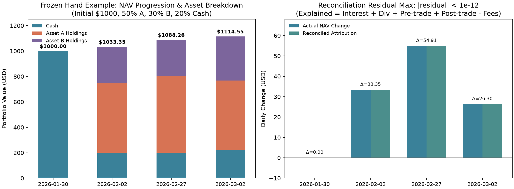
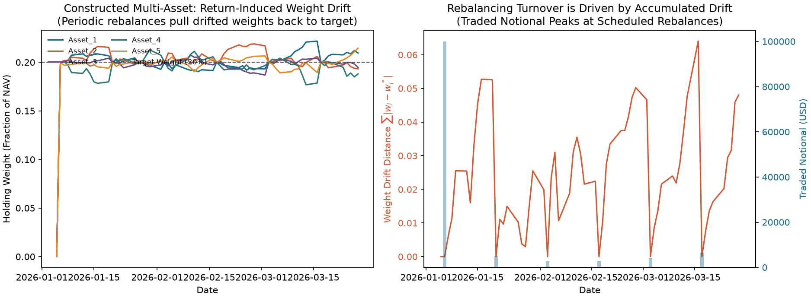
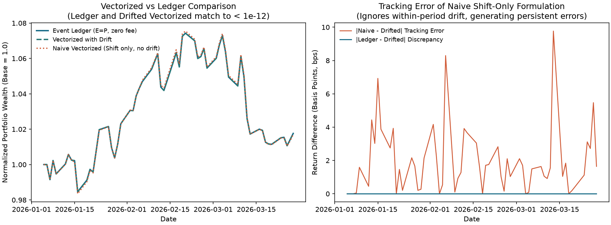
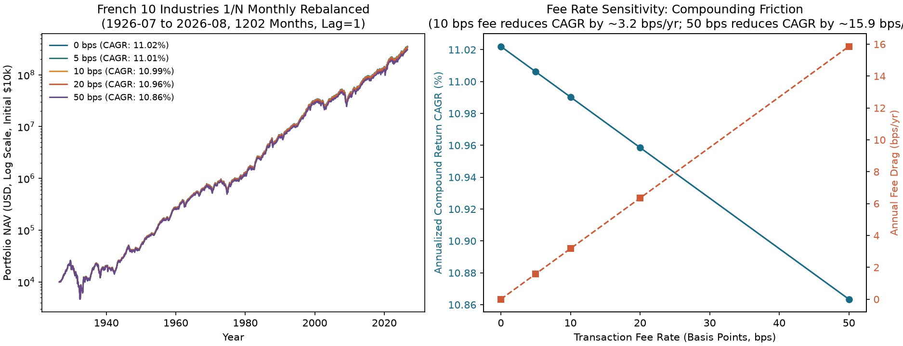

# 第29章 — 构建回测引擎（Building a Backtesting Engine）

> 主线：回测引擎的职责，是把研究员在时点 $s$ 决策的“目标权重”严格映射为在未来时点 $s+\text{lag}$ 可成交、可对账的实际股份数与现金账本。只有建立在资金与股份守恒上的自融资（self-financing）账本，才能客观分离资产价格收益、权重漂移、执行摩擦与分红利息，杜绝一切未经撮合就凭空生成的执行幻觉。
> 先修：第3章（金融数据工程与时点契约）、第11章（收益、复利与风险度量）、第21章（实用组合构建、漂移与换手）、第22章（量化研究方法论）。完成后你能：写出并证明离散自融资账本的对账分解恒等式；推导扣除比例交易费用后的目标净值方程并求解解析闭式解；解释持仓权重在无交易期内的几何漂移机制；说明执行延迟（lag $\ge 1$）与执行价格 $E$ 和收盘标记价 $P$ 的日内时序；按第6.1节的有效净值尺度报告对账残差，并区分正净值期的比例残差与终止行的货币绝对残差；清晰划定向量化回测与事件驱动账本的数学等价边界。

---

## 1. 本章目标

在量化研究的生命周期中，研究员最容易混淆的环节，是把优化器输出的抽象数学向量——“月末目标权重”——直接当成了账户里已经持有的资产。一个目标为 50% 股票 A、30% 股票 B、20% 现金的月度投资组合，在明天开盘扣除交易规费后，账户里究竟持有多少股 A、多少股 B、账上还剩多少美元现金？当价格从开盘变动到收盘、甚至跨越整个月份而未发生任何交易时，实际持仓比例为什么会自动脱离目标权重？如果遇到分红、拆股、甚至退市，现金和持仓又是怎样流转的？

完成本章学习后，读者应能达成以下四项核心能力：
1. **计算与推导目标**：掌握资产与现金守恒的离散记账逻辑，推导自融资（self-financing）账本的净值递推方程与分解恒等式；推导出扣除比例交易费用后的目标净值方程 $V' = V - c\sum_i |w_i V' - x_i|$，给出交易符号已知时的闭式解析解，在 $c\sum_i|w_i^*|<1$ 下证明解的全局唯一性与在 $c\sum |x_i| < V_{\text{pre}}$ 条件下的正值区间，并证明精确算术下的 Newton／次梯度（subgradient）迭代从上端在有限步内单调终止；浮点实现另有残差阈值和100轮上限。
2. **解释与诊断目标**：深入剖析“目标权重 $\ne$ 实际持仓权重”的四项机制（资产收益分化导致的权重漂移、交易费用耗损、执行延迟滞后、离散整股约束）；能清晰向团队解释为什么在月末收盘计算的信号绝不可能在同一个收盘价上成交（$\text{lag} \ge 1$ 是严格的时序因果约束，绝非代码中的简单 `shift(1)` 标签）。
3. **实现与对账目标**：熟练运用 `src/quant_course/backtest.py` 中的核心接口，建立包含每一笔成交详情（`fills`）、每日持仓股数（`positions`）、实际资产权重（`weights`）以及对账台账（`reconcile`）的完整系统，并在正且有限的净值期检查相对残差 $|\text{residual}| / \text{NAV} \le 10^{-12}$；终止的非正净值行另报货币单位绝对残差，不除以零或负数。此阈值是本实现与给定金额尺度的工程检查值，不是任意金额下通用的浮点精度保证。明确理解对账通过仅证明账本内部会计逻辑自洽，并非行情价格或时戳正确的充分条件。
4. **架构与边界目标**：明确划定“向量化快速回测”与“事件驱动账本回测”的数学等价边界，证明二者在零费率、零现金利率、执行价等于标记价（$E=P$）且显式纳入收益漂移的充分假设下逐日相等；在出现任何一项交易摩擦时，绝不轻信未经账本核对的向量化收益曲线。

完成条件：读者能徒手手算第 8 节的 4 期贯穿手算例，其股份数、手续费、期末现金与各观测日 NAV 与正文及代码核对至小数点后 4 位；能够在自己的策略研究中运行 `reconcile` 检查，报告残差的最大绝对值与原因。

---

## 2. 为什么 Quant 需要它

在量化投资的研发管线中，回测引擎处于策略生命周期的核心衔接位置：

```
原始数据（第3章） -> 因子工程（第23–28章）
组合优化（第20–21章） -> 目标权重 w*
目标权重 -> 回测引擎账本（本章第29章）
账本净值/持仓 -> 绩效与风险评估（第32–33章）
```

如果没有一个严谨的记账核心，研究员极易在以下关键环节跌入虚假的“高夏普陷阱”：
- **前视时间穿越（Look-ahead leakage）**：若在收盘计算信号并假设在当日收盘价“完美成交”，实际上相当于预知了当日全天的价格走势并以此套利。在真实市场中，只能在收盘后跑完数据流水线，并在次日开盘（或盘中）以执行价 $E$ 撮合成交。
- **摩擦隐形消失（Invisible friction）**：将名义权重直接与资产收益相乘的朴素回测，默认组合每次再平衡都是“无损切换”，忽略了换手率（Turnover）对资本的持续损耗。在换手频繁的中高频或多因子轮动策略中，数十个基点的单边费用长期累积会大幅侵蚀复利净值。
- **权重漂移失真（Drift blindness）**：在两次调仓之间（例如按月或按季再平衡），涨得多的资产市值膨胀，跌得多的资产市值缩水。组合的实际风险敞口早已偏离初始目标。若在向量化矩阵中简单用目标权重前向填充（forward-fill），就是在假设市场每日都在免成本自动重新平衡。
- **公司行动与结算断裂**：股票拆股会导致名义价格减半而股数翻倍；现金分红会使除息日股价下跌并将现金注入账户（空头持仓则需向借券方赔付现金分红）；退市则伴随着残值现金清算或直接归零。若错误地将复权因子（Split/Dividend Adjusted Prices）当作未复权的市场成交价送入账本，就会导致分红被重复计算两次，或者拆股日凭空亏损 50%。

本章与后续章节的承接关系高度明确：
- **本章（第29章）**：建立单币种、无外部资金出入、确定性执行、比例费用的基础账本核心，交出可对账的 NAV 路径、成交表与持仓表；
- **第30章（回测偏差）**：用本章的同一账本核心，展示 8 种典型回测陷阱（前视偏差、幸存者偏差、过拟合、数据窥探等）如何在代码不报错的情况下使虚假净值暴增；
- **第31章（样本划分与交叉验证）**：解决回测时间轴上的信息隔离问题（Purged CV, Embargo）；
- **第32章（绩效统计与推断）**：基于本章生成的净值与收益序列，评估 CAGR、Sharpe、最大回撤，并纠正数据挖掘带来的推断偏差（PSR, DSR, PBO）；
- **第33章（风险度量）**：基于本章输出的每日持仓表与现金表，进行 VaR、CVaR（ES）以及压力测试。

---

## 3. 直觉

### 3.1 教学贯穿场景：两只资产与现金账户

假设你在 2026 年 1 月 30 日（周五）收盘后完成了多因子评分与组合优化，模型给出的最优决策是：
$$\text{目标权重} = \begin{cases} \text{股票 A}: & 50\% \\ \text{股票 B}: & 30\% \\ \text{现金}: & 20\% \end{cases}$$
此时账户初始现金为 1000.00 美元，尚未持有任何股票。

直觉上，初学者会想：“拿 500 美元买 A，300 美元买 B，剩下 200 美元当现金。”
然而，当交易收取比例费率（例如 $c = 0.002$，即 20 bps 的佣金与规费）时：**买股票要付手续费，手续费从现金里扣除。如果把 800 美元全买了股票，必须额外支付 $800 \times 0.002 = 1.60$ 美元的手续费，现金就只剩下 $200 - 1.60 = 198.40$ 美元，占总资产的比例变成了 $198.40 / 998.40 = 19.87\%$，无法严格达到 20% 的现金目标。**

为了让买入完成后的**扣费后总净值 $V'$** 严格满足“股票 A 占 50%、股票 B 占 30%、现金占 20%”，购买股票的总市值必须按手续费比例进行微调缩放：
$$\begin{aligned}
V'+\text{交易费用}&=V_{\text{初始}} \\
V'+c(0.5+0.3)V'&=1000 \\ 
(1+0.0016)V'&=1000 \\
V'&=998.4026\text{ 美元}.
\end{aligned}$$
实际买入市值不是 800 美元，而是 $(0.5 + 0.3) \times 998.4026 = 798.7220$ 美元；支付手续费刚好是 $798.7220 \times 0.002 = 1.5974$ 美元；留在现金账户里的余额恰好是 $1000 - 798.7220 - 1.5974 = 199.6805$ 美元，占 $V'$ 的比例精确等于 20.0000%！

### 3.2 接下来发生了什么？价格变动与权重漂移

在次日（2026-02-02），按开盘价 $E_A = 10, E_B = 20$ 买入了 $49.92013$ 股 A 和 $14.97604$ 股 B。
到 2026-02-02 当天收盘时，市场标记价变为 $P_A = 11, P_B = 19$：
- 股票 A 涨了 10%，持仓市值变成 $49.92013 \times 11 = 549.1214$ 美元；
- 股票 B 跌了 5%，持仓市值变成 $14.97604 \times 19 = 284.5447$ 美元；
- 现金账户依然是 $199.6805$ 美元。
- 组合总净值 NAV 变为 $549.1214 + 284.5447 + 199.6805 = 1033.3466$ 美元。

此时计算实际持仓权重：
$$w_A = \frac{549.1214}{1033.3466} = 53.14\%, \quad w_B = \frac{284.5447}{1033.3466} = 27.54\%, \quad w_{\text{cash}} = \frac{199.6805}{1033.3466} = 19.32\%$$
可以看到，**即便未做任何交易，股票 A 的权重也已自动上升到 53.14%，股票 B 的权重自动下降到 27.54%。这就是“权重漂移（Weight Drift）”。**

到了 2026-02-27（月末），股票 A 进一步涨到 12.1 美元，股票 B 维持在 19.0 美元。总净值攀升到 $1088.2588$ 美元，A 的持仓权重进一步漂移至 **55.50%**，B 漂移至 **26.15%**，现金占比为 **18.35%**。
此时，新的月度信号产生，模型要求组合重新回到 **50% A / 30% B / 20% 现金** 的基准。
为了恢复到目标权重，策略必须**卖出超配的资产 A，买入低配的资产 B**。

在次月首日（2026-03-02）开盘执行时，执行价格为 $E_A = 12.0, E_B = 20.0$：
- 调仓前持仓在执行价下的市值为：$x_A = 49.92013 \times 12.0 = 599.0415$ 美元，$x_B = 14.97604 \times 20.0 = 299.5208$ 美元；
- 调仓前总净值为 $V_{\text{pre}} = 199.6805 + 599.0415 + 299.5208 = 1098.2428$ 美元；
- 调仓前资产占比分别为 $w_{A,\text{pre}} = 54.55\%, w_{B,\text{pre}} = 27.27\%, w_{\text{cash},\text{pre}} = 18.18\%$；
- 扣费后目标净值经解析方程求解为 $V' = 1098.0830$ 美元；
- 生成交易：卖出 $4.1667$ 股 A，变现 $50.0000$ 美元（新持仓 $45.7535$ 股）；买入 $1.4952$ 股 B，花费 $29.9041$ 美元（新持仓 $16.4712$ 股）；
- 支付手续费 $0.002 \times (50.0000 + 29.9041) = 0.1598$ 美元；
- 期末现金为 $199.6805 + 50.0000 - 29.9041 - 0.1598 = 219.6166$ 美元；收盘市值 $894.9376$ 美元，收盘 NAV 达到 $1114.5542$ 美元。

这个贯穿案例展示了回测账本的教学主线：
$$\begin{gathered}
\text{Data}\to\text{Signal}\to\text{Target Weight}\to\text{Execution Lag}\\
\to\text{Orders/Fills}\to\text{Position}\to\text{Costs}\\
\to\text{PnL}\to\text{Portfolio Value}\to\text{Metrics}
\end{gathered}$$

---

## 4. 数学基础

### 4.1 记号、单位与时间轴约定

- **离散交易日期序列**：$\mathcal{T} = \{t_0, t_1, \dots, t_T\}$，满足严格单调递增 $t_0 < t_1 < \dots < t_T$ 且无重复日期。
- **资产池**：$N$ 只风险资产，标识符集合 $\mathcal{A} = \{1, 2, \dots, N\}$。
- **价格标度与单位**：
  - $P_{i,t} \in \mathbb{R}_{++}$：资产 $i$ 在日期 $t$ 的收盘标记价格（Mark Price），单位：货币/股（USD/share）。
  - $E_{i,t} \in \mathbb{R}_{++}$：资产 $i$ 在日期 $t$ 的执行撮合价格（Execution Price），由显式执行价输入代表成交时点（例如当日开盘或指定 VWAP），与收盘盯市分开。未提供 $E$ 时，引擎令 $E_{i,t}=P_{i,t}$：这是同日按收盘标价成交的代理基准，交易后到收盘的价格损益为零；它不提供真实开盘或 VWAP 成交证据。即使 $E=P$，也只能执行更早索引步生成的信号，不能成交刚刚形成的同收盘信号。
  - $P$ 与 $E$ 在真实股份账本中必须为**未复权（Unadjusted）交易价格**，配套显式公司行动；第11节另用合成总回报代理单位且不重复叠加股利，不能把代理单位称为真实股票股数。
- **持仓与公司行动调整**：
  - $q_{i,t-1}$：日期 $t-1$ 收盘结算后的持仓股数。
  - 若日期 $t$ 发生拆股，拆股比例为 $S_{i,t}$，调整后股数为 $q_{i,t-1}' = q_{i,t-1} S_{i,t}$；未拆股资产 $S_{i,t} = 1$。
  - 若资产 $i$ 在日期 $t$ 退市，其持仓清零，退市清算款项转入现金。
  - $q_{i,t} \in \mathbb{R}$：日期 $t$ 交易结束并按收盘结算后的资产 $i$ 持有股数（Shares）。多头为正，空头为负。
  - $C_t \in \mathbb{R}$：日期 $t$ 收盘后的可用现金余额（Cash），单位：货币（USD）。
- **组合价值**：
  - $V_t = C_t + \sum_{i=1}^N q_{i,t} P_{i,t}$：日期 $t$ 收盘时的组合总净值（Net Asset Value, NAV）。
  - 调仓前预置净值计算使用拆股调整后、排除已退市资产的持仓：
    $$V_{t,\text{pre}} = C_{t,\text{start}} + \text{Interest}_t + \text{Div}_t + \text{DelistCash}_t + \sum_{i \notin \text{Delist}} q_{i,t-1}' E_{i,t}$$
  - $V'_t$：日期 $t$ 交易撮合完成并扣除当期手续费后的瞬时净值（Post-fee NAV）。
- **权重表示**：
  - $w_{i,t}^*$：日期 $t$ 产生的目标权重（Target Weight），满足 $\sum_{i=1}^N |w_{i,t}^*| \le \text{max\_gross}$。现金目标权重隐式定义为 $w_{\text{cash},t}^* = 1 - \sum_{i=1}^N w_{i,t}^*$。
  - $w_{i,t} = \frac{q_{i,t} P_{i,t}}{V_t}$：日期 $t$ 收盘时的实际持仓权重（Actual Holding Weight）。
- **摩擦参数**：
  - $c \ge 0$：比例交易费率（Fee Rate），无量纲小数（例如 $0.001$ 表示 10 bps）。
  - $r_{\text{cash}}$：现金单期借贷/存款利率（Cash Rate），无量纲小数。
  - $\text{lag} \in \mathbb{Z}_{\ge 1}$：执行滞后阶数，按输入价格索引计的观测步数。日频相邻索引通常对应下一交易日；French 月频例的 `lag=1` 是下一条月度观测，不是一天，也不是固定24小时。给定信号行位于索引 $k$，执行行位于 $k+\mathrm{lag}$，不能直接对日期字符串加整数。

### 4.1.1 先认清三个不同分母

目标权重 $w_i^*$ 是无量纲比例；股数 $q_i$ 的单位是股；价格 $E_i,P_i$ 的单位是美元/股；$x_i,V_{\mathrm{pre}},V',\Delta M_i$ 都以美元计。把 $w_i^*$ 直接当成股数，或把 $w_i^*V'$ 当成股数，会破坏单位。先在执行价下求目标美元金额，再除以同一个执行价，才能得到股数。

::: {.body-definition title="三个分母各回答什么问题"}

交易前的分母是 $V_{\mathrm{pre}}$，扣费后命中目标的分母是 $V'$，收盘报告权重的分母是 $V_t$。无费用且成交后组合净价格损益为零时，三者相同；无价格变化是其充分情形。目标 $w_i^*$ 约束的是 $q_{i,t}E_{i,t}/V'$，不是 $q_{i,t}P_{i,t}/V_t$；第3节建仓当天 A 的收盘权重升至53.14%，并非订单执行失败。

:::

### 4.1.2 从 Project4 目标到本章账本的接口

第28章与当前已接受的 Project4 信号层输出的是信号时点的 target-weight 行。信号时 listed 支持集、60名门槛及 gross=2 属于该行形成时的规则；本章接收行后，另按价格索引步数延迟成交，转换成现金与股份。gross=2 的多空行须显式允许做空并给出相容的 `max_gross`，不能送入默认只做多、gross上限1的账本。

基础 `run_backtest` 在执行日发现已退市资产的非零目标会报错，不会自动过滤。A6接口先保存原始信号，再对传入账本的副本按执行日资格置零；副本虽仍以信号行索引保存，也不表示策略在信号日已知未来资格。成本walk-forward消费者另在执行循环按当时上市状态决定目标并先结算旧退市持仓，不能与A6包装器混为同一流程。执行日资格取消以及成交后价格漂移可能改变行业净敞口、net和gross，因此消费者分别报告信号目标、执行过滤目标和实际收盘持仓。信号时中性不保证执行后仍中性；也不能回读执行日状态去改写旧信号。这里沿用C13接受后的接口，不重跑P4构造实验；真实借券、停牌、容量与部分成交不由该接口或本章代理成交证明。

### 4.2 假设集与定义域

- **假设 A1（无外部资金流动，Closed Fund）**：组合在 $t_0$ 之后不存在任何外部追加注资（Deposit）或赎回出金（Withdrawal），满足严格自融资条件。
- **假设 A2（完全确定性成交，Deterministic Fill）**：订单没有部分成交（Partial Fill）、没有排队滑点、没有市场冲击（Market Impact），所有订单均按执行价格 $E_{i,t}$ 100% 撮合成交。
- **假设 A3（费率可行性）**：单边费率与总杠杆率满足 $c \sum_{i=1}^N |w_{i,t}^*| < 1$。
- **假设 A4（正净值存续与清算可行性）**：在任何发生再平衡的时点，执行价格下评估的前置净值 $V_{t,\text{pre}} > 0$。若 $V_{t,\text{pre}} \le 0$，组合触发破产终止（Ruin Termination）；若 $V_{t,\text{pre}} > 0$ 但 $c\sum |x_i| \ge V_{t,\text{pre}}$（清算手续费超过总权益），则扣费后净值 $V' \le 0$，调仓在经济上不可行，系统主动抛出 `ValueError`。

---

## 5. 正式定义

### 5.1 概念体系与因果链条

每一个核心概念在回测引擎中都承担明确的逻辑职责，前一步的输出即为后一步的输入：

| 概念名称（中文 / English） | 概念角色与输入 | 承接的上一步输入 | 向下一步提供的输出 | 成立条件 / 政策边界 |
|---|---|---|---|---|
| **信号时点（Signal Timestamp）** | 策略产生目标权重的决策时点 $s$ | 截至 $s$ 收盘可见的特征与因子数据 | 目标权重行 $w_s^*$ | 严禁使用 $s$ 收盘之后的任何未来数据 |
| **执行延迟（Execution Lag）** | 从决策行到执行行的价格索引观测步数 | 信号时点 $s$ 与日历索引 | 执行日期 $t = s + \text{lag}$ | 强制 $\text{lag} \ge 1$，杜绝同一收盘形成信号并在同收盘成交 |
| **执行价格（Execution Price, $E$）** | 交易撮合的成交价格基准 | 行情数据源与撮合规则 | 订单成交单价 $E_{i,t}$ | 显式 $E$ 可为开盘或 VWAP；默认 $E=P$ 仅为收盘标价成交代理 |
| **扣费后净值（Post-Fee NAV, $V'$）** | 吸收当期交易成本后的真实配置基数 | 调仓前净值 $V_{\text{pre}}$、原持仓市值 $x$、目标权重 $w^*$ | 目标名义金额 $w^* V'$ 与交易订单 | 需满足 $V_{\text{pre}} > 0$ 且 $c\sum\|x_i\| < V_{\text{pre}}$ |
| **成交记录（Fills Table）** | 订单执行生成的长期流水账本 | 调仓股数差额 $\Delta q_i$ 与成交价 $E_i$ | 逐笔交易量、成交额、支付手续费 | 现金账户必须全额支付交易费与净买入款 |
| **对账分解（Reconciliation）** | 逐日对净值变动做会计归因的核验器 | 每日期初现金、期末持仓、价格走势与费用 | 归因残差项 $\text{residual}_t$ | 正且有限NAV期按工程阈值检查比例残差；非正终止行报货币绝对残差 |

### 5.2 交易日内事件发生顺序的严格规范

在任意给定的交易日 $t$，回测引擎内部的事件发生顺序有着严格的时序因果，不可倒置：

```
[步骤 1: 现金利息结算]
  上一区间产生的利息写入现金: C += C * cash_rate
       |
       v
[步骤 2: 除权日公司行动处理]
  拆股调整: q_i = q_i * split_ratio_i
  现金分红: C += q_i * dividend_per_share_i (空头支付)
  退市清算: C += q_i * delist_cash_i, 随后持仓清零 q_i = 0
       |
       v
[步骤 3: 交易撮合与费用结算]
  若 t 为执行日:
    计算 pre-trade 持仓市值 x_i = q_i * E_i (排除退市资产)
    检查 V_pre: 若 V_pre <= 0 则记录 terminated_at 并终止
    检查清算可行性: 若 c * sum|x_i| >= V_pre 则抛出 ValueError("infeasible")
    求解扣费后净值 V'
    生成买卖订单: Δq_i = (w_i* V' - x_i) / E_i
    扣除成交净款与手续费: C -= sum(Δq_i * E_i) + c * sum|Δq_i * E_i|
    更新持仓: q_i += Δq_i
       |
       v
[步骤 4: 收盘盯市与净值结算]
  计算收盘持仓市值: Holdings = sum(q_i * P_i)
  结算收盘净值: NAV_t = C + Holdings
  若 NAV_t <= 0，触发破产终止 (Terminated)
```

### 5.2.1 把同一交易日的每个中间数放到一张表里

::: {.body-example title="完整例题：同一交易日的现金与股份"}

以下是一资产教学小账，不含退市。上一收盘现金200美元、持仓8股、价格100美元，因此上一 NAV 为1000美元；本期间现金简单利率0.001。今天先拆股2:1，再向**新股数**支付每股1美元股利；执行价49、收盘价50美元/股，目标股票80%、现金20%，费率0.002。所有中间量从上一行算出，先保留精度，最后才按四位小数显示。

| 顺序与时钟 | 输入、动作及理由 | 本步输出（美元，股数另标） |
|---|---|---|
| 上一收盘 | 股份和现金是状态，目标不是已有持仓 | $C=200,\ q=8$股；NAV=1000 |
| 利息 | 对上期现金计 $200\times0.001$，不对当日交易后的现金计 | 利息0.2000；现金200.2000 |
| 公司行动 | 先 $8\times2=16$股，再付 $16\times1$股利 | 16股；现金 $C_{\mathrm{pre}}=216.2000$ |
| 执行价下估值 | 用同一 $E=49$ 估旧股份，不能先用 $P=50$ 下单 | $x=16\times49=784$；$V_{\mathrm{pre}}=1000.2000$ |
| 解净值 | 解 $v=1000.2-0.002|0.8v-784|$ | $V'=1000.1677$；目标市值800.1342 |
| 订单、费用 | $\Delta M=0.8V'-784$；$\Delta q=\Delta M/49$ | 买16.1342美元，0.3293股；费用0.0323 |
| 更新现金与股数 | $C=216.2-\Delta M-0.002|\Delta M|$ | 现金200.0335；持仓16.3293股 |
| 收盘盯市 | 此时才用 $P=50$，按收盘 NAV 报告实际权重 | 持仓市值816.4635；NAV=1016.4970；股票80.3213% |

为什么先解标量 $V'$ 再生成向量订单？这里先假定买入，移项得到
$$V'=\frac{1000.2+0.002\times784}{1+0.002\times0.8}=1000.1677.$$
回代 $0.8V'-784=16.1342>0$，买入方向自洽。多资产时，每项 $w_iV'-x_i$ 的符号可不同，但它们共用同一个净值基数；第6.2节的闭式解与 Newton 正是在处理这些符号，而非为每只股票单独求一个净值。

这张表也解释第6.1节守恒分解的两侧：拆股后旧股份16股，从等价旧价 $100/2=50$ 到 $E=49$ 的价格损益为 $16(49-50)=-16$；股利现金恰好为+16，抵消除息跌价。成交后新股份承受 $E\to P$，价格损益为 $16.3293(50-49)=16.3293$。于是
$$V_t-1000=0.2+16-16+16.3293-0.0323=16.4970,$$
与收盘NAV一致。后一段不能继续用旧16股，否则漏掉新买股份的收盘收益。

:::

### 5.3 明确的系统政策表（System Policies）

引擎对所有边界异常均有明确的确定性行为，严禁任何静默容错：

| 边界场景（Scenario） | 引擎处理政策（Policy） | 失败类型与行为 | 教学与实盘理由 |
|---|---|---|---|
| **执行前净值穿仓（$V_{\text{pre}} \le 0$）** | 立即终止运行，记录 `terminated_at = t` | 截断输出，不执行交易 | 破产账户无法交易，避免负净值下单放大亏损 |
| **清算成本超权益（$c\sum\|x\| \ge V_{\text{pre}}$）** | 严格拒绝调仓 | 抛出 `ValueError("rebalance ... is infeasible")` | 交易费用超过总资产，求解根 $V' \le 0$，经济上不可行 |
| **收盘净值穿仓（NAV $\le 0$）** | 立即终止运行，记录 `terminated_at = t` | 截断输出，不再产出后续净值 | 破产账户无法凭空复活；乘法累积收益模型失效 |
| **目标权重包含 NaN** | 严格拒绝 | 抛出 `ValueError` | 目标权重必须表达明确投资意图；空仓必须显式写 0 |
| **日期重复或乱序** | 严格拒绝 | 抛出 `ValueError` | 时间轴必须是唯一的单调递增全序关系 |
| **持仓或交易资产价格缺失/非正** | 严格拒绝，严禁 forward-fill | 抛出 `ValueError` | 缺失价格意味着无法撮合与估值，静默填充会伪造价格 |
| **杠杆超标（$\sum\|w^*\| > \text{max\_gross}$）** | 严格拒绝 | 抛出 `ValueError` | 必须受组合最大杠杆约束硬边界保护 |
| **未授权做空（$w^* < 0$ 且 `allow_short=False`）** | 严格拒绝 | 抛出 `ValueError` | 做空涉及借券与保证金机制，未声明不可开空 |
| **零交易再平衡（Target == Current）** | 生成 0 笔订单，产生 0 费用 | 正常执行，无成交流水 | 避免无意义的交易记录虚增换手率 |
| **空仓运行（Flat Book, Target == 0）** | 清空持仓至现金，净值随现金利息变动 | 正常执行，产生清仓成交 | 现金是合法资产，持有现金属于有效决策 |

---

### 5.4 三种边界是三个不同的停止位置

1. **执行前 $V_{\mathrm{pre}}\le0$**：在安排成交的那一行，按 $E$ 估值已失去权益。引擎记录此执行价终止状态，不求解净值、不下单；即使当天后续 $P$ 对旧仓位有利，也不再计入 $E\to P$ 恢复。
2. **$V_{\mathrm{pre}}>0$ 但清算费不足**：如多头市值1000、空头市值−990、现金0，权益只有10，费率0.01下平仓名义金额1990、费用19.9。条件 $c\sum|x_i|<V_{\mathrm{pre}}$ 失败，标量根不为正；系统报错拒绝再平衡。这是输入配置下交易不可行，不是生成一条负净值成交曲线。等号时根为0，同样拒绝。
3. **有效成交后收盘 NAV$\le0$**：执行价下还有正权益且费用可行，但 $E\to P$ 的持仓亏损耗尽净值。在 $P$ 完成当日结算后终止，不生成随后各期NAV。净值为非正时实际权重没有有效正分母，不能再用通常的比例解释。

另一个常见误用是把负现金当成不计息：上一期间现金为−100美元、单期简单利率0.001，本期利息为−0.1美元，现金变为−100.1。空头卖出所得全额入现金，这是现行账本规则；它未模拟借券费、借券回扣（borrow rebate）、独立保证金融资利率、抵押品隔离或追缴。`allow_short=True` 只明确许可这个简化做空模型，不表示已验证实盘融资制度。

---

## 6. 推导

### 6.1 自融资条件与净值变动的严格分解

在没有外部资金注入和抽离的封闭账户中，任何一期的净值变动都必然来自于：利息、分红、退市残值、交易前价格变动、交易后价格变动，以及支付的交易规费。

设 $t-1$ 期末的持仓为 $q_{t-1}$，收盘价为 $P_{t-1}$，现金为 $C_{t-1}$。
在日期 $t$ 开始时：
1. **现金利息**：
   $$\text{Interest}_t = C_{t-1} \cdot r_{\text{cash}}$$
2. **拆股处理**：设拆股比例为 $S_{i,t}$，调整后股数为 $q_{i,t-1}' = q_{i,t-1} S_{i,t}$。为了保持市值守恒，前一日的等价基准价变为 $\tilde{P}_{i,t-1} = P_{i,t-1} / S_{i,t}$。
3. **分红与退市**：
   $$\text{Div}_t = \sum_{i=1}^N q_{i,t-1}' D_{i,t}, \quad \text{DelistCash}_t = \sum_{j \in \text{Delist}} q_{j,t-1}' K_{j,t}$$
   退市资产在清算前的期初估值记为 $\text{DelistLoss}_t = \sum_{j \in \text{Delist}} q_{j,t-1}' \tilde{P}_{j,t-1}$。
4. **交易前持有价值**（按执行价 $E_{i,t}$ 计，排除已退市资产）：
   $$x_{i,t} = q_{i,t-1}' E_{i,t} \quad (i \notin \text{Delist})$$
   此时交易前总净值为：
   $$V_{t,\text{pre}} = C_{t-1} + \text{Interest}_t + \text{Div}_t + \text{DelistCash}_t + \sum_{i \notin \text{Delist}} x_{i,t}$$
5. **交易撮合与持仓更新**：以成交价 $E_{i,t}$ 交易 $\Delta q_{i,t} = q_{i,t} - q_{i,t-1}'$（仅针对活跃非退市资产），支付手续费：
   $$\text{Fees}_t = c \sum_{i \notin \text{Delist}} |E_{i,t} \Delta q_{i,t}|$$
   期末现金根据现金守恒满足：
   $$C_t = C_{t-1} + \text{Interest}_t + \text{Div}_t + \text{DelistCash}_t - \sum_{i \notin \text{Delist}} E_{i,t} \Delta q_{i,t} - \text{Fees}_t$$
6. **期末总净值**：
   $$V_t = C_t + \sum_{i=1}^N q_{i,t} P_{i,t}$$

现在推导净值变动 $\Delta V_t = V_t - V_{t-1}$ 的代数恒等分解式：
$$\begin{aligned}
V_t - V_{t-1} &= \left( C_t + \sum_i q_{i,t} P_{i,t} \right) - \left( C_{t-1} + \sum_i q_{i,t-1}' \tilde{P}_{i,t-1} \right) \\
&= C_{t-1}+\text{Interest}_t+\text{Div}_t+\text{DelistCash}_t \\
&\quad -\sum_{i\notin\text{Delist}}E_{i,t}(q_{i,t}-q_{i,t-1}')-\text{Fees}_t \\
&\quad + \sum_i q_{i,t} P_{i,t} - C_{t-1} - \sum_i q_{i,t-1}' \tilde{P}_{i,t-1} \\
&= \text{Interest}_t + \text{Div}_t + (\text{DelistCash}_t - \text{DelistLoss}_t) - \text{Fees}_t \\
&\quad + \sum_{i \notin \text{Delist}} q_{i,t-1}' (E_{i,t} - \tilde{P}_{i,t-1}) + \sum_{i \notin \text{Delist}} q_{i,t} (P_{i,t} - E_{i,t})
\end{aligned}$$

**结论（自融资对账恒等式）**：
净值变动被精确分解为六个分项：
$$\begin{aligned}
\Delta V_t &=\underbrace{\text{Interest}_t}_{\text{现金利息}}+\underbrace{\text{Div}_t}_{\text{分红净额}}
+\underbrace{(\text{DelistCash}_t-\text{DelistLoss}_t)}_{\text{退市清算损益}}\\
&\quad+\underbrace{\sum_{i\notin\text{Delist}}q_{i,\text{pre}}(E_{i,t}-\tilde P_{i,t-1})}_{\text{成交前旧持仓价格变动}}\\
&\quad+\underbrace{\sum_{i\notin\text{Delist}}q_{i,\text{post}}(P_{i,t}-E_{i,t})}_{\text{成交后新持仓价格变动}}
-\underbrace{\text{Fees}_t}_{\text{交易手续费}}.
\end{aligned}$$
该等式为**严格代数等式（$\equiv$）**。在回测中，实际净值差与分解项之差定义为残差：
$$\text{residual}_t = (V_t - V_{t-1}) - \text{Decomposition}_t$$
残差为货币量（USD）。仅在 $V_t>0$ 且有限的有效期，定义比例残差 $|\text{residual}_t|/V_t$，并以 $10^{-12}$ 作为本实现、给定金额尺度下的工程检查阈值。若终止行的NAV非正，则单独报告该行货币单位的绝对残差，不除以零或负NAV；非有限NAV须作为无效结果排查。该阈值不是任意账户规模下通用的浮点截断精度。历史100,000美元构造账户的最大绝对残差约为 $3.1 \times 10^{-11}$ 美元；绝对误差与比例误差应分别报告。
若在执行时点已经 $V_{t,\text{pre}}\le0$，本章账本立即截断，最后一行按执行价 $E$ 估值；它不是当天收盘净值。因此该行只计昨日收盘至 $E$ 的价格变动，不计 $E\to P$ 的收盘段，也不能用后来价格恢复“复活”账户。例如初始权益 100、在 10 元做空 10 股，现金为 200；下一执行价 150 时权益 $200-10\times150=-1300$，相对前日净值变动为 $-1400$。即使当天收盘回到 5 元，终止账本也不应再计入 $1450$ 的恢复。测试 `test_execution_ruin_reconciles_without_later_close_recovery` 同时检查此时的终止状态、现金恒等式与归因残差。

需要特别强调：**对账测试通过仅证明账本内部会计逻辑自洽、资金没有无故缺失或凭空生成，并不证明行情价格无误、时戳正确或因子没有前视信息。对账是必要条件，而非充分条件。**

### 6.2 扣费后目标净值方程、闭式解与唯一性证明

在调仓日 $t$，交易发生前的持仓市值为 $x_i = q_{i,\text{pre}} E_i$，交易前总净值为 $V_{\text{pre}} = C_{\text{pre}} + \sum_i x_i$。
设目标风险资产权重为 $w_i^*$，调仓扣除手续费后的总净值为 $V'$。
则调仓后的目标持仓市值为 $w_i^* V'$，资产 $i$ 产生的交易买卖名义金额为：
$$\Delta M_i = w_i^* V' - x_i$$
产生的交易手续费为 $c |\Delta M_i| = c |w_i^* V' - x_i|$。
因此，扣费后净值必须满足非线性方程：
$$V' = V_{\text{pre}} - c \sum_{i=1}^N |w_i^* V' - x_i|$$

#### 定理 1（解的存在性、唯一性与可行域）
设单边费率与权重满足 $c \sum_{i=1}^N |w_i^*| < 1$。
则函数 $f(v) = v + c \sum_{i=1}^N |w_i^* v - x_i| - V_{\text{pre}}$ 在全实数域 $\mathbb{R}$ 上存在全局唯一的实数根 $V'$。
并且，该实数根落在正区间 $(0, V_{\text{pre}}]$ 内当且仅当满足可行性条件：
$$f(0) = c \sum_{i=1}^N |x_i| - V_{\text{pre}} < 0 \iff c \sum_{i=1}^N |x_i| < V_{\text{pre}}$$

**证明**：
1. **全局单调性与根的全局唯一性**：
   函数 $f(v)$ 在 $\mathbb{R}$ 上连续且分段线性。在非折点处，其导数（斜率）为：
   $$f'(v) = 1 + c \sum_{i=1}^N w_i^* \cdot \text{sgn}(w_i^* v - x_i)$$
   由三角形不等式，$\left|\sum_i w_i^* \text{sgn}(w_i^* v - x_i)\right| \le \sum_i |w_i^*|$。因此斜率在全实数域上有正的下界：
   $$f'(v) \ge 1 - c \sum_{i=1}^N |w_i^*| > 0$$
   因此 $f(v)$ 在 $\mathbb{R}$ 上是严格单调递增的连续函数，且 $\lim_{v\to -\infty} f(v) = -\infty, \lim_{v\to +\infty} f(v) = +\infty$。根据连续函数介值定理与严格单调性，$f(v) = 0$ 在 $\mathbb{R}$ 上存在且仅存在唯一的实数根 $V'$。
2. **上界性质**：
   在 $v = V_{\text{pre}}$ 处：
   $$f(V_{\text{pre}}) = V_{\text{pre}} + c \sum_{i=1}^N |w_i^* V_{\text{pre}} - x_i| - V_{\text{pre}} = c \sum_{i=1}^N |w_i^* V_{\text{pre}} - x_i| \ge 0$$
   由于 $f$ 严格单调递增，根必定满足 $V' \le V_{\text{pre}}$。
3. **正根条件与反例**：
   由于 $f$ 严格单调递增，根 $V' > 0$ 当且仅当 $f(0) < 0$。
   带入 $v = 0$ 得：
   $$f(0) = 0 + c \sum_{i=1}^N |0 - x_i| - V_{\text{pre}} = c \sum_{i=1}^N |x_i| - V_{\text{pre}}$$
   因此 $V' > 0 \iff c \sum_{i=1}^N |x_i| < V_{\text{pre}}$。
   **反例**：考虑带有空头头寸的账户，无现金 $C = 0$，持有两只资产 $x_1 = 1000, x_2 = -990$，总净值 $V_{\text{pre}} = 10$ 美元。交易费率设为 $c = 0.01$（100 bps）。
   此时清算持仓的总成本为 $c(|x_1| + |x_2|) = 0.01 \times (1000 + 990) = 19.9$ 美元。
   则 $f(0) = 19.9 - 10 = +9.9 > 0$。
   此时唯一的实数根满足 $V' \le 0$。这在金融学上对应着“平仓清算费用超过了账户总权益”，调仓在经济上不可行。
   **引擎政策**：回测引擎对此情形进行前置防御，若 $c \sum |x_i| \ge V_{\text{pre}}$，立即抛出 `ValueError("rebalance at <date> is infeasible: proportional costs would exceed equity ...")`，不生成该调仓订单；若执行日按执行价计算的净值已经 $\le 0$，则不交易并记录 `terminated_at`。 $\blacksquare$

#### 定理 2（交易方向已知时的闭式解析解）
若已知调仓发生时各项资产的买卖方向符号 $s_i = \text{sgn}(w_i^* V' - x_i) \in \{-1,0,+1\}$，则绝对值项展开为 $|w_i^* V' - x_i| = s_i (w_i^* V' - x_i)$。零交易项取 $s_i=0$；也可为零项任选 $\pm1$，因其乘积仍为零。代入闭式解后必须逐项回查交易符号；预判符号本身不是证明。此时方程化为线性方程：
$$V' = V_{\text{pre}} - c \sum_{i=1}^N s_i (w_i^* V' - x_i) = V_{\text{pre}} - c \left(\sum_{i=1}^N s_i w_i^*\right) V' + c \sum_{i=1}^N s_i x_i$$
移项整理即得**闭式解析解（Closed-form Solution）**：
$$V' \left( 1 + c \sum_{i=1}^N s_i w_i^* \right) = V_{\text{pre}} + c \sum_{i=1}^N s_i x_i \implies V' = \frac{V_{\text{pre}} + c \sum_{i=1}^N s_i x_i}{1 + c \sum_{i=1}^N s_i w_i^*}$$

**特例 1：从纯现金账户全额买入（All Buys from Cash）**
此时原持仓 $x_i = 0$，全部资产均为买入（$s_i = +1$）：
$$V' = \frac{V_{\text{pre}}}{1 + c \sum_{i=1}^N w_i^*}$$
若目标权重为 A 50%, B 30%, 现金 20%，$c = 0.002$：
$$V' = \frac{1000}{1 + 0.002 \times (0.5 + 0.3)} = \frac{1000}{1 + 0.0016} = 998.4026 \text{ 美元}$$

**特例 2：双资产一买一卖**
若资产 1 为卖出（$s_1 = -1$），资产 2 为买入（$s_2 = +1$）：
$$V' = \frac{V_{\text{pre}} + c(x_2 - x_1)}{1 + c(w_2^* - w_1^*)}$$

#### Newton／次梯度迭代：精确理论与浮点实现

在可导点用普通导数；在折点选合法次梯度
$$d_k=1+c\sum_i w_i^*s_{i,k},\quad
s_{i,k}=\begin{cases}\operatorname{sgn}(w_i^*v_k-x_i),&w_i^*v_k-x_i\ne0,\\
\text{任取 }[-1,1]\text{ 中的值},&w_i^*v_k-x_i=0.
\end{cases}$$
先检验残差，若 $f(v_k)=0$ 就停止，否则令 $v_{k+1}=v_k-f(v_k)/d_k$。由A3，所有合法 $d_k\ge1-c\sum|w_i^*|>0$。

1. $f$ 连续、凸、分段线性；$f(V_{\mathrm{pre}})\ge0$，故从 $v_0=V_{\mathrm{pre}}$ 开始位于根右侧。
2. 凸函数的次梯度支撑线满足 $0=f(V')\ge f(v_k)+d_k(V'-v_k)$，所以 $V'\le v_k-f(v_k)/d_k\le v_k$。若尚未命中根，后一个不等号严格成立。序列单调下降且不越过根。
3. 只有 $w_i^*\ne0$ 的项才可能产生折点 $x_i/w_i^*$；$w_i^*=0$ 时是常数项，不能除以零。至多 $N$ 个不同折点划出至多 $N+1$ 个仿射区间。
4. 在光滑仿射段内，一步到其延长线零点；若这一步不是真根，就必须跨到更左的段。恰在折点而未收敛时，合法次梯度步向左移动，同样越过该折点。因而精确算术下至多经过这些有限段，在至多 $N+1$ 个更新内命中根。这个证明是函数几何结论，不是任意维数的浮点测试报告。$\blacksquare$

实际 `solve_post_fee_nav` 用 `np.sign(0)=0` 选择零交易项次梯度，停止条件为 $|f(v)|\le10^{-12}V_{\mathrm{pre}}$，最多迭代100轮，未收敛则报错。舍入误差、阈值和轮数上限都属于实现条件，不能把精确有限步结论写成所有输入都已实测机器零误差。

### 6.3 权重漂移的几何动力学

在无交易的持有区间 $[t, t+1]$ 内，资产价格从 $P_{i,t}$ 变动至 $P_{i,t+1}$，单期简单收益率为 $r_{i,t+1} = \frac{P_{i,t+1}}{P_{i,t}} - 1$。
假设无公司行动、无外部流量、股数固定，现金不计息（$r_{\text{cash}} = 0$），期初与期末NAV均正。期初各资产持仓权重为 $w_{i,t} = \frac{q_i P_{i,t}}{V_t}$。
到 $t+1$ 期末时，组合整体收益率为：
$$r_{p,t+1} = \frac{V_{t+1}}{V_t} - 1 = \sum_{i=1}^N w_{i,t} r_{i,t+1}$$
资产 $i$ 的持仓市值变为 $q_i P_{i,t+1} = q_i P_{i,t} (1 + r_{i,t+1}) = w_{i,t} V_t (1 + r_{i,t+1})$。
因此，$t+1$ 期的实际持仓权重为：
$$w_{i,t+1} = \frac{q_i P_{i,t+1}}{V_{t+1}} = \frac{w_{i,t} V_t (1 + r_{i,t+1})}{V_t (1 + r_{p,t+1})} = w_{i,t} \cdot \frac{1 + r_{i,t+1}}{1 + r_{p,t+1}}$$

**含义与性质**：
1. **相对强弱与有符号权重**：
   $$w_{i,t+1}-w_{i,t}=w_{i,t}\frac{r_{i,t+1}-r_{p,t+1}}{1+r_{p,t+1}}.$$
   正权重在资产收益高于组合时增加；负权重则变得更负。例如 $w_i=-0.2,r_i=10\%,r_p=0$ 时新权重为 $-0.22$，数值下降、空头绝对敞口增加。若 $w_i=0$ 或收益相同，对应权重可以不变。
2. **权重和自动归一**：
   $$\sum_{i=1}^N w_{i,t+1} + w_{\text{cash},t+1} = \frac{\sum_i w_{i,t}(1+r_{i,t+1}) + w_{\text{cash},t}}{1 + r_{p,t+1}} = \frac{1 + r_{p,t+1}}{1 + r_{p,t+1}} = 1$$
3. **换手的来源**：
   在下一个再平衡时点，策略如果想重置到固定目标权重 $w^*$，需要交易的名义金额占净值的比例由累积漂移距离决定：
   $$\text{Turnover} \approx \sum_{i=1}^N |w_i^* - w_{i,\text{drift}}|$$
   这里取约等号，是因为本章引擎按扣费后净值 $V'$（而非 $V_{\text{pre}}$）设定目标，且执行价 $E$ 与上一收盘价不同时漂移权重要按 $E$ 重估；费率很小时两者差别是 $c$ 的一阶小量。
   在给定初始权重、目标、收益方向和执行条件的例子中，收益分化可扩大漂移与复位换手；仅凭横截面收益分散度更大，不能对任意多空权重和目标推出换手单调增加。

### 6.4 执行延迟与未来扰动不变性

许多初学者容易编写如下逻辑：
> “每天 15:00 收盘后，根据全天收盘价计算多因子得分，然后以 15:00 的收盘价买入前 10% 的股票。”

这种写法在时序上存在逻辑矛盾：
1. **信息可得时间（Availability Time）**：计算当日收盘价需要交易日完全结束，交易所发布收盘行情、数据供应商入库、因子清洗管线运行。完成时点往往在收盘之后。
2. **可执行撮合时间（Execution Time）**：当日收盘集合竞价已经结束，订单不可能穿越回到过去去撮合成交。
3. **因此，在离散日历体系中必须强制 $\text{lag} \ge 1$**：
   - 信号时点 $s$：使用截至日期 $s$ 收盘可见的数据生成目标权重 $w_s^*$；
   - 执行时点 $s + \text{lag}$：最早在下一个交易日（$s+1$）的开盘价（或 VWAP）$E_{s+1}$ 撮合成交。
   - 这也是为什么在 `BacktestConfig` 中，`lag < 1` 会直接触发 `ValueError` 异常保护。

#### 未来扰动不变性（Invariance to Future Perturbations）
在回测引擎的设计中，时序因果律还包含一条核心检验准则：**未来扰动不变性**。
设回测输入为行情 $D_{0:T}$ 与目标 $W_{0:T}$。保持历史信息、资产标识、初始状态、执行日历和策略政策不变，对 $k$ 后作合法输入扰动，历史共同坐标上的现金、股份与NAV应不变：
$$\mathcal L_{0:k}(D,W)=\mathcal L_{0:k}(\widetilde D,\widetilde W).$$
新增资产可能扩展输出列，比较时应对齐共同历史标识并另查新增列的历史零持仓，不能无条件要求两个完整DataFrame逐字同一。`test_future_perturbation_does_not_change_past` 覆盖具体的未来价格和目标扰动；CLI另有其冻结构造检查。

有限扰动测试能发现所测试路径的泄漏，不是对所有未来变更的证明；严格因果性还依赖状态转移只读取当时合法信息的结构，以及输入特征本身的点时资格。即使引擎通过，也不能替代第30章的输入审查。

### 6.5 向量化回测与事件账本回测的等价性充分条件与失效反例

在学术界和量化研究中，基于 Pandas 矩阵相乘的向量化回测常用于快速探索：
```text
# 常见的朴素向量化算式
portfolio_return = (target_weights.shift(1) * returns).sum(axis=1)
```
本节给出关于该方法的严谨数学结论。

#### 定理 3（向量化与事件账本等价定理）
定义事件驱动账本生成的每日收益率为 $r_t^{\text{ledger}} = \frac{V_t}{V_{t-1}} - 1$。
定义考虑权重漂移的向量化收益率算法为 `drifted_weight_returns`（即持仓在调仓日重置为目标权重，非调仓日按公式 $w_{i,t+1} = w_{i,t} \frac{1+r_{i,t+1}}{1+r_{p,t+1}}$ 递推）。
先要求相同初始现金/持仓、相同已延迟的执行日期及再平衡政策；`drifted_weight_returns` 接收的是交易日期，不是原信号日期，它先用旧漂移权重计算本期收益，再在该收盘重置目标。在此前提下，若同时满足以下四项条件，则事件账本收益与向量化漂移收益逐日完全相等（$r_t^{\text{ledger}} \equiv r_t^{\text{vectorized}}$）：
1. **零交易摩擦**：手续费率 $c = 0$；
2. **零现金利率**：现金借贷利率 $r_{\text{cash}} = 0$；
3. **收盘即时执行**：所有交易在收盘标记价以零价差成交，即 $E_{i,t} = P_{i,t}$；
4. **精确纳入权重漂移**：向量化模型在非调仓日严格使用按资产收益递推的真实漂移权重，无公司行动事件干扰。

**关于“充分性而非必要性”的说明与反例**：
注意：上述四项条件是**充分条件，而非必要条件**。
反例：若在某一个观察窗口内，策略根本没有触发任何调仓（交易量恒为 0），则即便设定了交易费率 $c > 0$，由于无交易发生，当期手续费实际为 0；只要现金利率为 0 且 $E = P$，账本收益率与向量化漂移收益率在该区间内依然逐日完全一致。因此，“零费率”并不是逐日相等的必要条件。

**朴素 shift 向量化的失效反例**：
若采用常见的“简单 shift(1) 前向填充目标权重”的朴素向量化模型：
$$r_t^{\text{naive}} = \sum_{i=1}^N w_{i,\text{target}} \cdot r_{i,t}$$
设某组合持有两只资产，目标各为 50%。在第 1 天，$r_A = +100\%, r_B = 0\%$。
第 1 天收盘后，实际持有权重漂移为 $w_A = \frac{0.5 \times 2}{0.5 \times 2 + 0.5 \times 1} = \frac{1.0}{1.5} = 66.67\%$, $w_B = 33.33\%$。
第 2 天不调仓，$r_A = -50\%, r_B = 0\%$。
- **真实账本收益**：
  第 1 天总净值从 100 变成 150。
  第 2 天资产 A 市值从 100 变成 50，资产 B 维持 50，总净值从 150 变成 100，第 2 天收益率为 $\frac{100}{150} - 1 = -33.33\%$。
  两天累积总收益为 $0\%$。
- **朴素 shift(1) 向量化收益**：
  第 1 天收益：$0.5 \times 1.0 + 0.5 \times 0 = +50\%$。
  第 2 天模型依然认为权重是 50% / 50%：
  $r_2^{\text{naive}} = 0.5 \times (-0.5) + 0.5 \times 0 = -25\%$。
  两天复合收益为 $(1 + 0.5) \times (1 - 0.25) - 1 = 1.5 \times 0.75 - 1 = +12.5\%$！
- **结论**：朴素向量化凭空产生了 12.5% 的虚假收益，其本质是在第 2 天开盘“假设免成本把资产 A 从 66.7% 重新拉回 50%”，从而规避了 A 后续的下跌损失。本反例比较的是不调仓持有策略。若另行明确每日等权再平衡且满足零费等条件，固定权重点乘可以描述另一种合法策略；错误在于把两种再平衡政策当成同一策略。

---

## 7. 金融解释

### 7.1 为什么交易摩擦具有复利侵蚀效应？

交易费用不仅是单次的直接扣除，它会在时间轴上对净值产生持续的复利侵蚀（Fee Drag）。
假设一个平均月度单边换手率为 $T_{\text{month}}$ 的策略，每期付出的交易费用大致与 $c \cdot T_{\text{month}}$ 成比例。经过长达数十年的复利滚存，微小的单期摩擦差异会被指数级放大。

在第 11 节的 Kenneth French 10 行业全样本（1926-07 至 2026-08，跨越 100 年共 1202 个月）实证中，策略每月进行 1/N 等权再平衡，月度平均换手率约为 **2.38%**（年化换手率约为 **28.6%**）：
- 在 **0 bps 费率（无摩擦基准）** 下：期末净值为 **353,584,236 美元**，年化复合收益率（CAGR）为 **11.02%**（0.11022），年化波动率为 **17.80%**，年化夏普比率为 **0.495**；
- 引入 **10 bps（千分之一，即0.001）** 的温和费率后：期末净值降至 **343,599,177 美元**，CAGR 降至 **10.99%**（0.10990），累计支付手续费 **1,013,676 美元**，年化收益率拖累约为 **3.17 bps/年**；
- 当费率提高到 **50 bps（千分之五）** 时：期末净值降至 **306,406,322 美元**，CAGR 降至 **10.86%**（0.10863），累计支付手续费高达 **4,571,698 美元**，年化收益率拖累达到 **15.86 bps/年**。

虽然在单月看来，2.38% 的月换手率在 10 bps 费率下仅产生约 $0.0238 \times 0.001 \approx 0.00238\%$（不到 0.24 bps）的当期费用，但在 100 年复利作用下，50 bps 费率导致的净值差额累计超过 **4700 万美元**（净值缩减约 13.3%）。这证明了为什么策略上线前必须在账本中完成严格的摩擦敏感度分析。

### 7.2 可实现性与未复权价格原则

真实股份账本按实际每股牌价报单，并显式处理拆股与股利。例如旧价100、新价50的2:1拆股，股数应翻倍；只改价格而不改股数会制造机械亏损。总回报指数已含分红再投资，再传现金股利会重复计入。

另一种合法教学模型是第11节的合成总回报代理：把指数单位作为虚拟资产，不再加外部股利或拆股。这能比较一致的比例交易费用，不能证明真实整股、借券或开盘可成交性。价格水平按常数重缩且股数反向缩放时，在分数股、纯比例费用模型下金额与比例费不变；有整股、固定费或真实权益单位约束时才不能任意换单位。

前复权历史被常数重缩，不自动说明收益率含前视。泄漏与否要看特征是否使用未来不可得的水平、复权信息或事件，而不能只凭“复权”二字判断。真实股份与总回报代理各按自己的单位和公司行动契约核验。

---

## 8. 完整数值例题

以下按固定输入完整展开经典双资产手算例。读者可跟随步骤核验每一个中间变量与最终指标。

### 8.1 初始环境与行情输入
::: {.body-example title="完整例题：四期建仓、漂移、再平衡与对账"}

- **账户初始现金**：$C_0 = 1000.0000$ 美元。
- **交易费率**：$c = 0.002$（20 bps），单期借贷利率 $r_{\text{cash}} = 0.0$。
- **目标权重**：资产 A 为 0.5，资产 B 为 0.3，现金为 0.2。

**行情数据**：

| 索引 | 日期 $d$ | 执行价 $E_A$ | 执行价 $E_B$ | 标记价 $P_A$ | 标记价 $P_B$ | 事件说明 |
|:---:|:---:|:---:|:---:|:---:|:---:|:---|
| 0 | 2026-01-30 | 10.0 | 20.0 | 10.0 | 20.0 | 信号时点 1（收盘形成目标权重） |
| 1 | 2026-02-02 | 10.0 | 20.0 | 11.0 | 19.0 | 执行时点 1（按 $E$ 撮合，收盘按 $P$ 盯市） |
| 2 | 2026-02-27 | 12.0 | 19.5 | 12.1 | 19.0 | 信号时点 2（纯持有漂移，收盘形成新信号） |
| 3 | 2026-03-02 | 12.0 | 20.0 | 12.0 | 21.0 | 执行时点 2（按 $E$ 再平衡，收盘按 $P$ 盯市） |

---

### 8.2 第 1 期：2026-01-30（信号生成）
- 账户状态：纯现金 1000.0000 美元。
- 当日未到执行期（$\text{lag} = 1$），持仓股数 $q_A = 0, q_B = 0$。
- 净值 $V_0 = 1000.0000$ 美元。
- 收盘产生信号 1：$w_A^* = 0.5, w_B^* = 0.3, w_{\text{cash}}^* = 0.2$。

---

### 8.3 第 2 期：2026-02-02（首次建仓执行）
1. **期初现金与预置净值**：
   $C_{\text{start}} = 1000.0000$ 美元。交易前无股票持仓，$x_A = 0, x_B = 0$。
   $V_{1,\text{pre}} = 1000.0000$ 美元。
2. **求解扣费后净值 $V'$**：
   全额从现金买入，$s_A = +1, s_B = +1$：
   $$V_1' = \frac{V_{1,\text{pre}}}{1 + c(w_A^* + w_B^*)} = \frac{1000.0000}{1 + 0.002 \times (0.5 + 0.3)} = \frac{1000.0000}{1.0016} = \mathbf{998.4026} \text{ 美元}$$
3. **计算成交股数与交易费用**：
   - 股票 A 买入金额：$w_A^* V_1' = 0.5 \times 998.402556 = 499.2013$ 美元。
     买入股数：$q_A = \frac{499.201278}{E_A} = \frac{499.201278}{10.0} = \mathbf{49.92013} \text{ 股}$。
     股票 A 手续费：$0.002 \times 499.201278 = 0.9984$ 美元。
   - 股票 B 买入金额：$w_B^* V_1' = 0.3 \times 998.402556 = 299.5208$ 美元。
     买入股数：$q_B = \frac{299.520767}{E_B} = \frac{299.520767}{20.0} = \mathbf{14.97604} \text{ 股}$。
     股票 B 手续费：$0.002 \times 299.520767 = 0.5990$ 美元。
   - 总手续费：$\text{Fees}_1 = 0.998403 + 0.599042 = \mathbf{1.5974} \text{ 美元}$。
4. **期末现金余额**：
   $$C_1 = 1000.0000 - (499.201278 + 299.520767) - 1.597444 = \mathbf{199.6805} \text{ 美元}$$
   验算现金占比：$\frac{199.680511}{998.402556} = 0.200000$（严格等于 20.0000%）。
5. **收盘盯市与期末 NAV**：
   收盘价格为 $P_A = 11.0, P_B = 19.0$。
   - 股票 A 持仓市值：$49.920128 \times 11.0 = 549.121406$ 美元。
   - 股票 B 持仓市值：$14.976038 \times 19.0 = 284.544728$ 美元。
   - 总持仓市值：$549.121406 + 284.544728 = 833.666134$ 美元。
   - **收盘总净值**：
     $$V_1 = C_1 + \text{Holdings}_1 = 199.680511 + 833.666134 = \mathbf{1033.3466} \text{ 美元}$$
   - 单期简单收益率：$\frac{1033.346645}{1000.0000} - 1 = +3.3347\%$。
   - 收盘实际权重：$w_A = 53.14\%, w_B = 27.54\%, w_{\text{cash}} = 19.32\%$。

---

### 8.4 第 3 期：2026-02-27（持有漂移与新信号生成）
1. **无交易发生**：
   持仓股数不变：$q_A = 49.920128, q_B = 14.976038$。现金余额不变：$C_2 = 199.680511$ 美元。手续费为 0。
2. **收盘盯市与 NAV 漂移**：
   收盘价格为 $P_A = 12.1, P_B = 19.0$。
   - 股票 A 市值：$49.920128 \times 12.1 = 604.033546$ 美元。
   - 股票 B 市值：$14.976038 \times 19.0 = 284.544728$ 美元。
   - 总持仓市值：$604.033546 + 284.544728 = 888.578275$ 美元。
   - **收盘总净值**：
     $$V_2 = 199.680511 + 888.578275 = \mathbf{1088.2588} \text{ 美元}$$
   - 单期收益率：$\frac{1088.258786}{1033.346645} - 1 = +5.3140\%$。
3. **漂移权重计算**：
   $$\begin{aligned}
w_A&=\frac{604.033546}{1088.258786}=\mathbf{0.5550}\quad(55.50\%),\\
w_B&=\frac{284.544728}{1088.258786}=\mathbf{0.2615}\quad(26.15\%),\\
w_{\text{cash}}&=\mathbf{0.1835}\quad(18.35\%).
\end{aligned}$$
4. **信号生成**：
   策略决定重新调整权重至：$w_A^* = 0.5, w_B^* = 0.3, w_{\text{cash}}^* = 0.2$。

---

### 8.5 第 4 期：2026-03-02（再平衡执行）
1. **交易前状态（在执行价格 $E$ 下估值）**：
   开盘执行价格为 $E_A = 12.0, E_B = 20.0$。
   - 交易前 A 持仓价值：$x_A = 49.920128 \times 12.0 = 599.041534$ 美元。
   - 交易前 B 持仓价值：$x_B = 14.976038 \times 20.0 = 299.520767$ 美元。
   - **交易前总净值**：
     $$V_{3,\text{pre}} = 199.680511 + 599.041534 + 299.520767 = \mathbf{1098.2428} \text{ 美元}$$
2. **判断交易方向并求解 $V'$**：
   - 股票 A 现有权重占比 $\approx \frac{599.04}{1098.24} = 54.55\% > 50\%$，因此**卖出 A**（$s_A = -1$）；
   - 股票 B 现有权重占比 $\approx \frac{299.52}{1098.24} = 27.27\% < 30\%$，因此**买入 B**（$s_B = +1$）。
   套用闭式解析解公式：
   $$V_3' = \frac{V_{3,\text{pre}} + c (s_A x_A + s_B x_B)}{1 + c (s_A w_A^* + s_B w_B^*)} = \frac{1098.242812 - 0.002 \times (599.041534 - 299.520767)}{1 + 0.002 \times (-0.5 + 0.3)}$$
   分母为：$1 + 0.002 \times (-0.2) = 1 - 0.0004 = 0.9996$。
   分子为：$1098.242812 - 0.002 \times 299.520767 = 1098.242812 - 0.599042 = 1097.643770$。
   $$V_3' = \frac{1097.643770}{0.9996} = \mathbf{1098.0830} \text{ 美元}$$
3. **计算交易股数与手续费**：
   - 股票 A 目标价值：$0.5 \times 1098.083003 = 549.041502$ 美元。
     调仓金额：$\Delta M_A = 549.041502 - 599.041534 = \mathbf{-50.0000} \text{ 美元}$（卖出 50 美元）。
     交易股数：$\Delta q_A = \frac{-50.000032}{12.0} = \mathbf{-4.1667} \text{ 股}$。
     新持仓股数：$q_A = 49.920128 - 4.166669 = \mathbf{45.75346} \text{ 股}$。
     手续费：$0.002 \times 50.000032 = 0.1000$ 美元。
   - 股票 B 目标价值：$0.3 \times 1098.083003 = 329.424901$ 美元。
     调仓金额：$\Delta M_B = 329.424901 - 299.520767 = \mathbf{+29.9041} \text{ 美元}$（买入 29.9041 美元）。
     交易股数：$\Delta q_B = \frac{29.904134}{20.0} = \mathbf{+1.4952} \text{ 股}$。
     新持仓股数：$q_B = 14.976038 + 1.495207 = \mathbf{16.47125} \text{ 股}$。
     手续费：$0.002 \times 29.904134 = 0.0598$ 美元。
   - 总手续费：$\text{Fees}_3 = 0.100000 + 0.059808 = \mathbf{0.1598} \text{ 美元}$。
4. **期末现金余额**：
   $$\begin{aligned}
C_3&=C_2-(\Delta M_A+\Delta M_B)-\text{Fees}_3\\
&=199.680511-(-50.000032+29.904134)-0.159808\\
&=\mathbf{219.6166}\text{ 美元}.
\end{aligned}$$
   验算现金占比：$\frac{219.616601}{1098.083003} = 0.200000$（精确等于 20%）。
5. **收盘盯市与期末 NAV**：
   收盘价格为 $P_A = 12.0, P_B = 21.0$。
   - 股票 A 市值：$45.753458 \times 12.0 = 549.041496$ 美元。
   - 股票 B 市值：$16.471245 \times 21.0 = 345.896145$ 美元。
   - 总持仓市值（采用未舍入中间值）：$549.041496 + 345.896145 = \mathbf{894.937648}$ 美元。
   - **收盘总净值**：
     $$V_3 = 219.616601 + 894.937648 = \mathbf{1114.5542} \text{ 美元}$$
   - 单期收益率：$\frac{1114.554248}{1088.258786} - 1 = +2.4163\%$。
   - 收盘实际权重：$w_A = 49.26\%, w_B = 31.03\%, w_{\text{cash}} = 19.70\%$。

---

### 8.6 对账单总览与恒等式核对

根据第 6.1 节对账恒等式，对 4 期净值变动做完全归因：

| 日期 | 实际 $\Delta \text{NAV}$ | 成交前价格损益 | 成交后价格损益 | 扣除手续费 | 解释变动和 | 归因残差 $\text{residual}$ | 现金恒等差 |
|:---:|:---:|:---:|:---:|:---:|:---:|:---:|:---:|
| 2026-01-30 | 0.0000 | 0.0000 | 0.0000 | 0.0000 | 0.0000 | $0.0$ | $0.0$ |
| 2026-02-02 | +33.3466 | 0.0000 | +34.9441 | -1.5974 | +33.3466 | $1.56 \times 10^{-13}$ | $0.0$ |
| 2026-02-27 | +54.9121 | +54.9121 | 0.0000 | 0.0000 | +54.9121 | $-7.82 \times 10^{-14}$ | $0.0$ |
| 2026-03-02 | +26.2955 | +9.9840 | +16.4712 | -0.1598 | +26.2955 | $-7.11 \times 10^{-15}$ | $2.84 \times 10^{-14}$ |

**手算结论**：上表残差来自保存的历史运行，并非新运行结果；中间量用未舍入值计算后再显示。原最大对账残差为 $1.56 \times 10^{-13}$，现金恒等式误差仅为 $2.84 \times 10^{-14}$，展示了离散账本在浮点精度下的自洽性。

---

:::

## 9. Python实现

本章所有核心回测与对账功能均封装于 `src/quant_course/backtest.py` 中。

默认读者路线是已随包读者包中的 `notebooks/ch29_backtest_engine.ipynb`。在读者包根目录运行：

```bash
python run_notebook.py notebooks/ch29_backtest_engine.ipynb
```

Notebook默认 `RUN_FRENCH=False`，新算四期账本、权重漂移、`constructed_study`及极端政策等教学构造；第11节的历史French表图不是这次默认执行的新输出。runner将执行Notebook和 `execution.json` 保存在唯一的 `runs/execution_<stem>_<uuid>/`，失败也保留。Notebook自身另建 `runs/ch29_backtest_engine_<uuid>/`；主要结果是内核中的表和打印，不能假定全部已保存到内层目录。先按第11节理解历史数据边界。

以下代码展示如何在独立 Python 环境中调用回测引擎并完成端到端对账：

```python
import numpy as np
import pandas as pd
from quant_course.backtest import BacktestConfig, reconcile, run_backtest, solve_post_fee_nav

# 1. 构造行情与信号数据
dates = pd.DatetimeIndex(["2026-01-30", "2026-02-02", "2026-02-27", "2026-03-02"])
mark_prices = pd.DataFrame(
    {"A": [10.0, 11.0, 12.1, 12.0], "B": [20.0, 19.0, 19.0, 21.0]},
    index=dates,
)
exec_prices = pd.DataFrame(
    {"A": [10.0, 10.0, 12.0, 12.0], "B": [20.0, 20.0, 19.5, 20.0]},
    index=dates,
)
target_weights = pd.DataFrame(
    {"A": [0.5, 0.5], "B": [0.3, 0.3]}, index=[dates[0], dates[2]]
)

# 2. 配置并运行回测
config = BacktestConfig(initial_cash=1000.0, fee_rate=0.002, lag=1)
result = run_backtest(
    mark_prices, target_weights, config, exec_prices=exec_prices
)

# 3. 输出持仓表与成交流水
print("Fills count:", len(result.fills))
print("Final NAV:", round(result.ledger["nav"].iloc[-1], 4))

# 4. 执行逐日对账检查
rec = reconcile(result, mark_prices, config, exec_prices=exec_prices)
max_residual = rec["residual"].abs().max()
print("Max reconciliation residual:", max_residual)
assert max_residual < 1e-12
```

执行命令与脚本输出：
进阶入口：另行了解完整课程CLI与测试，核对其参数、历史分支及输出路径后再运行：
```bash
.venv/bin/python code/ch29_backtest_engine.py
.venv/bin/python -m pytest -q tests/test_ch29_backtest.py tests/test_ch29_workflow.py
```
这些完整课程入口可能生成输出、调用历史数据或使用固定默认目录。它们不是上述默认离线读者路线；先核实际脚本的路径及参数，保护旧qa冻结结果。本次返修不执行runner、完整Notebook、CLI、课程suite或French研究。

---

## 10. 图形解读

以下4张图来自历史 `code/ch29_backtest_engine.py` 输出；这里未重画或重跑。两张局部标题/图例拥挤处由完整图注解释；摘要不含完整NAV路径，不能据此重造全曲线。原图保存在 `figures/a6/` 目录中：

### 10.1 手算例账本资产拆解与对账残差

- **左图（资产构成柱状图）**：横轴为日期，纵轴为组合资产总值（USD）。展示期初 1000 美元纯现金在 2026-02-02 转化为资产 A、B 与现金储备，随后在 02-27 随 A 的上涨而净值扩张，最终在 03-02 顺利再平衡并达到 1114.55 美元。
- **右图（归因分解对照）**：横轴为日期，纵轴为每日净值变动（USD）。展示实际净值变动（深蓝柱）与对账归因解释变动（蓝绿柱）高度吻合，最大残差绝对值小于 $1.57 \times 10^{-13}$ 美元。
- **核心观察点**：资产与现金在各个时点均严格满足自融资守恒，各项资产流向清晰明了。

### 10.2 权重漂移与再平衡换手率

- **左图（持仓权重路径）**：横轴为日期，纵轴为持仓权重占比。在 5 只资产的构造市场中，目标权重固定为 20%（黑色虚线）。原图左侧拥挤图例中的资产线分别为五只资产的实际权重，黑色虚线只代表共同目标，不是一条额外资产路径；曲线均保留历史身份。在每 10 个交易日的调仓间隔期内，由于资产相对收益分化，实际持仓权重呈现明显的锯齿状“发散漂移”，并在再平衡日被拉回 20%。
- **右图（漂移距离与换手成交额）**：横轴为日期，左轴为持仓与目标权重的 $L_1$ 漂移距离 $\sum |w_i - w_i^*|$（橙线），右轴为实际成交名义金额（蓝灰柱）。
- **核心观察点**：再平衡的交易换手需求是累积权重漂移的直接结果，漂移越显著，调仓日的成交额峰值越高。

### 10.3 向量化回测与事件账本对比

- **左图（净值路径对比）**：横轴为日期，纵轴为归一化净值。深蓝线（事件账本在零费率、收盘成交下）与绿虚线（含权重漂移的向量化算法）**完全重合（差值 $< 10^{-15}$）**；而橙色点线（朴素 shift 向量化）发生明显轨迹偏离。
- **右图（单期跟踪误差）**：横轴为日期，纵轴为收益率差值（基点，bps）。深蓝线（账本与含漂移向量化差值）为机器浮点零；橙线（朴素向量化与真实收益差值）在非调仓日产生持续偏差，单日最大偏差约为 **9.77 bps**（0.000977）。
- **核心观察点**：忽略权重漂移的向量化回测具有明显的模型偏差，不能替代基于真实持仓的账本模型。

### 10.4 交易费用敏感度与复利侵蚀（Kenneth French 10 行业）

- **左图（全样本对数净值曲线）**：横轴为年份（1926–2026），纵轴为对数坐标下的组合 NAV（初始 10,000 美元）。展示 0 bps, 5 bps, 10 bps, 20 bps, 50 bps 五档费率下的净值路径分化。
- **右图（年化 CAGR 与摩擦拖累；原图边缘裁断标题的完整含义）**：横轴为交易费率（bps），左轴为净年化复合收益率 CAGR（%），右轴为年化绩效拖累（bps）。
- **核心观察点**：费率从 0 bps 提高到 50 bps，年化收益率从 11.02% 降至 10.86%（每 10 bps 费率使 CAGR 下降约 3.2 bps/年；50 bps 费率使 CAGR 下降约 15.9 bps/年）。

---

## 11. 真实历史收益的代理账本案例

### 11.1 真实数据规格与来源清单
本节保留此前以 Kenneth French 数据图书馆 **10 个行业投资组合（10 Industry Portfolios）** 月度价值加权收益率完成的历史代理账本研究。原始、提取及处理后的French数据未随默认读者包提供；以下路径是完整工程中的历史来源位置。数据权利、主体与用途仍待解决，不能把公开可见当成获准重分发或执行研究。研究设计不等于获得数据权利或执行授权；默认不运行真实数据分析。行业聚合月收益不是公司级时点可得（point-in-time, PIT）输入；真实成分、可交易价格、公司行动、借券/融资、容量及交易日历仍需另核。以下曲线不证明现实可部署收益。
- **数据文件位置**：`data/processed/french_10_industries_monthly.csv`
- **校验哈希（SHA-256）**：`3b097d810c295d64eedfa1ece7067ff2a0707f5ca90e33935df9949251f70950`（对应清单 `data/manifests/french_industries_2026-10-05.json`，SHA-256 为 `3b71cd5f781f9790cc380195c22635e03e9c9e27a5f43cd2d0d46fb12efa8271`）
- **无风险利率文件**：`data/processed/french_factors_3_monthly.csv`（SHA-256 为 `c19770a19a0ac47ad1c29074f57234570aeaa9725212cb4fa8146a2846c52814`）
- **样本区间**：1926 年 7 月至 2026 年 8 月（共 1202 个日历月）。
- **包含行业**：NoDur（必需消费）、Durbl（可选耐用品）、Manuf（制造业）、Enrgy（能源）、HiTec（高科技）、Telcm（电信）、Shops（零售批发）、Hlth（医疗保健）、Utils（公用事业）、Other（其他）。
- **口径与时序说明**：
  1. 该数据仅包含月末离散观测值。因此在回测配置中设置 $\text{lag} = 1$，意味着在月末时点 $s$ 计算的行业配置目标，在下一个月末时点 $s+1$ 的价格代理水平上撮合成交（即整整滞后一个月执行；且此时执行价 $E$ 等于标记价 $P$）；
  2. 在1926-06补入价格水平为100的基准行后，首个收益月1926-07按当月末代理价 $E=P$ 首次入场，没有建仓前的股票价格损益。$c=0$ 时该月收益为0；$c>0$ 时首期扣除入场费，收益为负，持仓区间的价格收益随后才开始。1202个收益观测包含这一首次执行月份，不改为1201期重估历史CAGR；
  3. 年化复合收益率（CAGR）的年数按总月数折算：$Y = 1202 / 12 \approx 100.167$ 年，$\text{CAGR} = (\text{NAV}_T / \text{NAV}_0)^{12 / 1202} - 1$；
  4. 夏普比率（Sharpe Ratio）使用对齐的 Kenneth French FF3 RF（月度无风险利率小数），按月度超额收益均值除以样本标准差并乘以 $\sqrt{12}$ 约定年化（其统计性质在第 32 章深入探讨）；
  5. 行业总回报指数序列是**总回报代理水平（Total-Return Proxy Level）**，内含分红再投资，并非个股交易牌价，回测中不额外叠加外部现金分红。

### 11.2 策略设定与回测结果
策略采用朴素的**月度等权重再平衡策略（1/N Rebalancing）**：
- 决策频率：每月月末产生目标权重（每行业 10%）；
- 执行机制：按 $\text{lag} = 1$ 在次月末执行，初始现金 10,000 美元；
- 考察费率：$c \in \{0, 5, 10, 20, 50\}$ bps。

#### 实测绩效对比表（1926-07 至 2026-08）

持仓路径与绩效（同一费率实验）：

| 交易费率档位 | 期末净值（USD） | 累积总回报 | 年化收益率（CAGR） | 年化波动率 | 年化夏普比率 |
| :---: | :---: | :---: | :---: | :---: | :---: |
| **0 bps（无摩擦）** | **353,584,236** | +3,535,742% | **11.02%** | 17.80% | 0.495 |
| **5 bps** | 348,555,862 | +3,485,459% | **11.01%** | 17.80% | 0.495 |
| **10 bps** | **343,599,177** | +3,435,892% | **10.99%** | 17.80% | 0.494 |
| **20 bps** | 333,896,778 | +3,338,868% | **10.96%** | 17.80% | 0.492 |
| **50 bps** | **306,406,322** | +3,063,963% | **10.86%** | 17.80% | 0.487 |

对应交易摩擦与实际换手：

| 交易费率档位 | 累计总手续费（USD） | 年化费用拖累（bps） | 月均换手率 |
| :---: | :---: | :---: | :---: |
| **0 bps（无摩擦）** | 0.00 | 0.0 | 2.38% |
| **5 bps** | 513,420 | 1.59 | 2.38% |
| **10 bps** | 1,013,676 | **3.17** | 2.38% |
| **20 bps** | 1,975,717 | 6.35 | 2.38% |
| **50 bps** | 4,571,698 | **15.86** | 2.38% |

**真实数据实证结论**：
1. **等价性复核**：在 0 bps 费率下，账本输出的月收益率序列与 `drifted_weight_returns` 向量化输出的最大绝对差值为 **$6.52 \times 10^{-16}$**，再次印证了定理 3 在机器精度下的成立。
2. **漂移偏差实证**：若将调仓频率改为每 12 个月（年度）再平衡一次，忽略月内漂移的朴素 shift 向量化在单月产生的最大跟踪偏差达到 **2.41%**（241 个基点）。
3. **成本敏感度观察**：1/N 策略月均换手率约为 2.38%（年化约 28.6%）。随着交易费率从 0 bps 提升至 50 bps，年化夏普比率从 0.495 缓慢下滑至 0.487，年化复合收益率降低了约 15.9 个基点，期末净值减少约 4718 万美元（减少约 13.3%）。

---

## 12. 常见错误

### 12.1 错误一：收盘生成信号在同收盘成交（Look-Ahead Fill）
- **错误分析**：若在收盘计算信号并在同收盘价成交，相当于利用未来全天走势逆向套利。
- **验证代码**：回测引擎强制限制 $\text{lag} \ge 1$，拒绝任何零延迟前视输入。
```python
import pandas as pd
import pytest
from quant_course.backtest import BacktestConfig, run_backtest

dates = pd.date_range("2026-01-05", periods=3, freq="B")
mark = pd.DataFrame({"A": [10.0, 11.0, 12.0]}, index=dates)
tw = pd.DataFrame({"A": [1.0]}, index=[dates[0]])

# 回测引擎执行时检测到 lag=0（收盘信号同收盘成交）将直接抛出 ValueError
with pytest.raises(ValueError, match="lag"):
    run_backtest(mark, tw, BacktestConfig(initial_cash=1000.0, lag=0))
print("Look-ahead fill with lag=0 is strictly rejected by run_backtest.")
```

### 12.2 错误二：直接使用复权价格回测并再次叠加现金分红（Double Counting）
- **错误分析**：总回报复权价（Total-Return Price）已内嵌分红再投资收益，若再次入账现金分红，会导致收益双重计入。未复权价格必须与分红拆股事件显式挂载。
- **验证代码**：
```python
import numpy as np
import pandas as pd
from quant_course.backtest import BacktestConfig, run_backtest

dates = pd.date_range("2026-01-05", periods=3, freq="B")
mark = pd.DataFrame({"A": [10.0, 10.0, 5.0], "B": [20.0, 20.0, 20.0]}, index=dates)
tw = pd.DataFrame({"A": [1.0], "B": [0.0]}, index=[dates[0]])
cfg = BacktestConfig(initial_cash=100.0)

# 未复权价格叠加拆股事件：市值守恒保持 100 美元
splits = pd.DataFrame({"A": [np.nan, np.nan, 2.0]}, index=dates)
res_split = run_backtest(mark, tw, cfg, splits=splits)
assert np.isclose(res_split.ledger["nav"].iloc[2], 100.0)

# 若不登记拆股事件，则净值错误暴跌至 50 美元
res_no_split = run_backtest(mark, tw, cfg)
assert np.isclose(res_no_split.ledger["nav"].iloc[2], 50.0)
print("Splits must be booked explicitly with unadjusted prices.")
```

### 12.3 错误三：用简单的 `shift(1)` 代替权重漂移（Naive Vectorized Drift Blindness）
- **错误分析**：朴素 shift 向量化假定每期都免费重新平衡到目标权重，忽略了资产相对涨跌引起的权重漂移。
- **验证代码**：
```python
import numpy as np
import pandas as pd
from quant_course.backtest import drifted_weight_returns

# 假设 2 个月不调仓，期初权重各 50%
px = pd.DataFrame({"A": [10.0, 20.0, 10.0], "B": [10.0, 10.0, 10.0]}, index=pd.date_range("2026-01-01", periods=3))
tw = pd.DataFrame({"A": [0.5], "B": [0.5]}, index=[pd.Timestamp("2026-01-01")])

# 1. 真实漂移向量化
r_drift = drifted_weight_returns(px, tw)
# 2. 朴素 shift 向量化
r_naive = (tw.reindex(px.index).ffill().shift(1).fillna(0) * px.pct_change(fill_method=None).fillna(0)).sum(axis=1)

print("True drifted return at t=2:", round(r_drift.iloc[2], 4))
print("Naive shift return at t=2:", round(r_naive.iloc[2], 4))
assert abs(r_naive.iloc[2] - r_drift.iloc[2]) > 0.08
```

### 12.4 错误四：忽略扣费后净值缩放，导致现金账户被击穿（Cash Deficit）
- **错误分析**：未调用 `solve_post_fee_nav` 求解 $V'$，直接使用 $V_{\text{pre}}$ 下单，导致手续费无资金垫付引发透支。
- **验证代码**：
```python
import numpy as np
from quant_course.backtest import solve_post_fee_nav

v_pre = 1000.0
w = np.array([0.5, 0.5])  # 打算 100% 满仓多头
c = 0.002

# 朴素错误做法：按 V_pre 满仓下单，导致现金透支负数
order_val_naive = w * v_pre
fees_naive = c * float(np.abs(order_val_naive).sum())
cash_deficit = v_pre - float(order_val_naive.sum()) - fees_naive
assert cash_deficit < 0  # 现金透支 -2.0 美元！

# 正确做法：调用 solve_post_fee_nav 求解扣费后净值 V'
v_post = solve_post_fee_nav(v_pre, np.zeros(2), w, c)
order_val_correct = w * v_post
fees_correct = c * float(np.abs(order_val_correct).sum())
cash_end = v_pre - float(order_val_correct.sum()) - fees_correct
assert np.isclose(cash_end, 0.0)  # 现金精确归零，绝无透支
print(f"Naive cash deficit: {cash_deficit:.2f}, Post-fee NAV solves exact cash: {cash_end:.4f}")
```

---

## 13. 量化研究应用

### 13.1 从策略构思到扣费后净值的标准化投研流水线
一个规范的量化研究报告，在展示策略净值时必须经历以下 5 个标准化检查步骤：
1. **时点审计门槛**：明确给出信号形成时间戳（`signal_time`）与执行时间戳（`trade_time`）。必须在报告中证明 `available_at` $\le$ `signal_time` $<$ `trade_time`。
2. **价格类型核验**：真实股份账本确保 `mark_prices` 为未复权收盘价并绑定公司行动；合成总回报代理另行声明虚拟单位且不重复入账股利；若存在早盘或 VWAP 撮合，必须单独提供 `exec_prices`。
3. **自融资对账审查**：回测输出后，第一步应运行 `reconcile`，只在正且有限的NAV有效期检查比例残差：
   $$\max_{t:\,0<V_t<\infty} \frac{|\text{residual}_t|}{V_t} \le 10^{-12}$$
   若没有这样的有效期，比例检查不适用；不把空集合当成通过。对非正NAV终止行单独报告货币单位绝对残差，非有限值另行排查。$10^{-12}$是本实现与给定尺度的工程阈值，应同时报告最大绝对误差。对账只是内部记账检查，排查是否存在资金漏记、分红重复计算或拆股股数不匹配。
4. **阶梯式成本压力测试**：报告不能只给出一张无费率或固定费率的净值图，建议同时展示 $c \in \{0, 5, 10, 20, 50\}$ bps 下的夏普比率与 CAGR 衰减曲线，并计算策略的**盈亏平衡费率（Break-even Fee Rate）**。
5. **反证与基准对比**：设置基准组合（如 1/N 等权买入持有策略），检验策略超额收益是否单纯来自于对市场整体 Beta 或漂移未平衡的被动暴露。

---

## 14. 本章小结

本章建立了量化教材 Part V 的基础记账核心。以下是本章概念间的内在联系与规则总结：

1. **自融资与守恒律（Conservation Law）**：
   在无外部出入金的账户中，组合净值变动具有明确的会计恒等性：
   $$\Delta \text{NAV}_t \equiv \text{Interest}_t + \text{Div}_t + \text{DelistNet}_t + \Delta P_{\text{pre}} + \Delta P_{\text{post}} - \text{Fees}_t$$
   正且有限NAV期按第6.1节的工程阈值检查比例残差，并分别报告货币绝对误差；非正NAV终止行不参与该除法，非有限结果须排查。这是内部一致性检查，而非行情与时戳正确的充分证明。
2. **扣费后净值的非线性本质**：
   交易费用直接减少了可配置的总资金。目标持仓必须以扣费后净值 $V'$ 为基准，求解分段线性方程 $V' = V_{\text{pre}} - c\sum |w^* V' - x|$。当 $c\sum |w^*| < 1$ 时实根在 $\mathbb{R}$ 上全局唯一；当且仅当 $c\sum |x_i| < V_{\text{pre}}$ 时根落在 $(0, V_{\text{pre}}]$。Newton 迭代法从 $V_{\text{pre}}$ 出发，因目标函数凸且分段线性，其切线零点单调递减且始终不小于真实根，在精确算术下有限步终止；浮点实现使用相对残差阈值并有100轮上限。
3. **实际持仓一般发生权重漂移**：
   目标权重只在交易完成的瞬时短暂成立。在第6.3节假设下，不调仓持有期的权重按照 $w_{i,t+1} = w_{i,t} \frac{1+r_{i,t+1}}{1+r_{p,t+1}}$ 演化；同收益、零持仓或纯现金可以不变。忽略漂移的朴素 shift 向量化代码会带来脱离实际的虚假收益。
4. **时序因果与延迟约束（$\text{lag} \ge 1$）**：
   收盘计算的信号不能在同日收盘价成交。日内时序由利息结算 $\to$ 公司行动 $\to$ 执行价 $E$ 撮合 $\to$ 收盘价 $P$ 盯市严格固定。未来扰动不变性是结构要求；现有有限构造测试只检验所选路径，不能证明所有未来改动均不影响过去。完整信号与输入仍须承担时点契约和结构证明责任。
5. **承前启后**：
   本章输出的可对账账本、持仓表与成交流水，将在**第30章**中作为分析工具，逐一揭露 8 种典型回测偏差对净值的扭曲；在**第31章**用于构建严密的时间序列样本划分；在**第32章**用于计算严谨的样本外统计推断；并在**第33章**用于组合风险建模。

---

## 15. 思考题

### 概念与数学思考题

- **29-E01**：试根据第 6.1 节自融资账本的期初、期末现金与资产持仓定义，详细写出包含分红、拆股、退市、交易前价格变动、交易后价格变动与交易手续费的完全代数推导过程，证明理论对账残差严格为 0。
- **29-E02**：考虑组合从纯现金 $V_{\text{pre}} = 10,000$ 美元出发，目标权重为 3 只股票，权重向量为 $w^* = [0.4, 0.3, 0.2]$，现金保留 0.1。比例交易费率为 $c = 0.0015$。请使用定理 2 的闭式解析解手算扣费后净值 $V'$、应付总手续费、各股票买入金额及期末现金余额，并验证现金占 $V'$ 的比例是否精确等于 10%。
- **29-E03**：详细讨论当 $c \sum_{i=1}^N |w_i^*| \ge 1$ 时，方程 $f(v) = v + c\sum_i |w_i^* v - x_i| - V_{\text{pre}} = 0$ 的导数符号如何变化，说明为何此时函数可能失去严格单调递增性并导致多解或无解；并结合反例 $C=0, x=(1000, -990), V_{\text{pre}}=10, c=0.01$ 说明当 $c\sum |x_i| \ge V_{\text{pre}}$ 时根非正的经济含义及引擎应对政策。
- **29-E04**：设某投资组合在第 $t$ 期持有两只股票，权重分别为 $w_{1,t} = 0.6, w_{2,t} = 0.4$，现金为 0。在区间 $[t, t+1]$ 内，股票 1 收益率为 $+20\%$，股票 2 收益率为 $-10\%$。若期间未发生交易，计算 $t+1$ 期末的两只股票漂移权重。
- **29-E05**：为什么在回测中不能将总回报指数（Total Return Index）作为未复权交易价格直接输入撮合模块？若策略在输入总回报价格的同时又传入了现金分红明细表，会对净值产生何种扭曲？
- **29-E06**：说明为何定理 3 中给出的四项条件是向量化回测与事件账本回测逐日相等的充分条件而非必要条件；给出一个费率 $c > 0$ 但两序列在特定区间内依然完全相等的具体场景；并分析当存在 $c = 5$ bps 且执行价取开盘价 $E \ne P$ 时，向量化回测发生偏离的原因。

---

### 29-N01：沿账本时钟诊断单位与边界（新增）

重做第5.2.1节小账，先计算 $C_{\mathrm{pre}},x,V_{\mathrm{pre}},V',\Delta M,\Delta q,C_t,q_t,V_t$，再用守恒分解独立核对。指出两处错误：把 $0.8V'$ 写成股数；把成交后价格损益仍乘旧16股。最后说明：默认 $E=P$ 是否就是开盘成交，月频索引 `lag=1` 是否是次日，以及执行前净值≤0后为何不能取当天收盘的恢复值。

---

## 16. 编程题

### 编程实现与边界验收题

- **29-P01**：编写一个名为 `solve_nav_closed_form` 的独立 Python 函数，输入 $V_{\text{pre}}$、原持仓市值向量 $x$、目标权重向量 $w^*$ 和费率 $c$，假设调仓交易方向与符号已知，利用定理 2 的解析式计算 $V'$；编写断言代码，用该函数与 `solve_post_fee_nav` 的 Newton 迭代解进行数值对比，验证二者在机器精度下的一致性。
- **29-P02**：利用 `run_backtest` 与 `reconcile`，编写一个完全复现第 8 节双资产贯穿手算例的自动化测试脚本，断言 4 个日期的持仓股数、手续费、期末现金、期末 NAV 以及对账残差，要求浮点误差断言精度达到 `abs=1e-4`。
- **29-P03**：编写一段对比实验程序，生成包含 3 只资产、60 个交易日的随机价格数据。分别运行 `drifted_weight_returns` 和朴素前向填充的 `(tw.shift(1) * ret).sum(axis=1)`，计算并打印二者在非调仓日产生的最大收益率偏差。
- **29-P04**：实现破产终止（Ruin Termination）单元测试：构建一个持有 -100% 股票 X 空头与 +100% 股票 Y 多头的杠杆组合，当股票 X 大涨导致账户 NAV 穿仓跌至负数时，断言回测引擎能够正确触发终止（`terminated_at` 不为 None），且终止日之后的日期不会继续生成净值。

---

## 17. 挑战题

### 高级挑战与拓展研究

- **29-C01（不交易带与比例交易费用的分段凸优化）**：在真实市场再平衡中，为了避免因微小权重漂移而频繁产生无谓的手续费，量化基金通常采用不交易带（No-Trade Band）策略：只有当实际持仓权重偏离目标权重的幅度超出容忍阈值 $\delta$（例如 $|w_i - w_i^*| > \delta$）时，才触发交易，且仅调仓至带的边界。试在数学上将该问题形式化为一个带 $L_1$ 正则化摩擦惩罚的单期效用优化问题，并说明其与凸优化的对应关系。
- **29-C02（空头借券做空成本与融券利息的完全账本建模）**：本章引擎假设 `allow_short=True` 时不收取额外的借券费（Borrow Fee）。在现实融券交易中，空头头寸需按年化融券费率 $r_{\text{borrow}}$ 每日向券商支付借券成本，且卖空所得现金通常受到再质押与保证金利息折扣（Rebate Rate）限制。试推导包含融券借贷费用下的离散现金与 NAV 递推守恒式，并说明如何在 `reconcile` 中扩展对应的归因项。

---

\newpage

## 18. 完整解答

### 29-E01 完整解答
根据定义，期末总净值为 $V_t = C_t + \sum_i q_{i,t} P_{i,t}$，期初净值为 $V_{t-1} = C_{t-1} + \sum_i q_{i,t-1}' \tilde{P}_{i,t-1}$（其中 $\tilde{P}_{i,t-1} = P_{i,t-1}/S_{i,t}$ 为拆股调整后基准价，$q_{i,t-1}' = q_{i,t-1} S_{i,t}$）。
根据现金账户流转方程：
$$C_t = C_{t-1} + \text{Interest}_t + \text{Div}_t + \text{DelistCash}_t - \sum_{i \notin \text{Delist}} E_{i,t} (q_{i,t} - q_{i,t-1}') - \text{Fees}_t$$
将 $C_t$ 带入净值差 $V_t - V_{t-1}$：
$$\begin{aligned}
V_t - V_{t-1} &= C_{t-1} + \text{Interest}_t + \text{Div}_t + \text{DelistCash}_t \\
&\quad - \sum_{i \notin \text{Delist}} E_{i,t}(q_{i,t}-q_{i,t-1}')-\text{Fees}_t \\
&\quad +\sum_i q_{i,t}P_{i,t}-C_{t-1}-\sum_i q_{i,t-1}'\tilde P_{i,t-1} \\
&= \text{Interest}_t + \text{Div}_t + (\text{DelistCash}_t - \text{DelistLoss}_t) - \text{Fees}_t \\
&\quad -\sum_{i\notin\text{Delist}}E_{i,t}q_{i,t}+\sum_{i\notin\text{Delist}}E_{i,t}q_{i,t-1}' \\
&\quad +\sum_{i\notin\text{Delist}}q_{i,t}P_{i,t}-\sum_{i\notin\text{Delist}}q_{i,t-1}'\tilde P_{i,t-1} \\
&= \text{Interest}_t + \text{Div}_t + (\text{DelistCash}_t - \text{DelistLoss}_t) - \text{Fees}_t \\
&\quad + \sum_{i \notin \text{Delist}} q_{i,t-1}' (E_{i,t} - \tilde{P}_{i,t-1}) + \sum_{i \notin \text{Delist}} q_{i,t} (P_{i,t} - E_{i,t})
\end{aligned}$$
上述推导中的每一项均为实数恒等代数变换，不包含任何近似截断，故理论残差严格为 0。证毕。

### 29-E02 完整解答
由于账户从纯现金出发且买入 3 只资产，初始原持仓价值 $x_i = 0$，交易方向均为买入（$s_i = +1$）。
资产权重和为 $\sum_{i=1}^3 w_i^* = 0.4 + 0.3 + 0.2 = 0.9$。现金目标权重为 $1 - 0.9 = 0.1$。
根据定理 2 的纯现金全额买入解析式：
$$V' = \frac{V_{\text{pre}}}{1 + c \sum_i w_i^*} = \frac{10000}{1 + 0.0015 \times 0.9} = \frac{10000}{1 + 0.00135} = \frac{10000}{1.00135} = \mathbf{9986.5182} \text{ 美元}$$
各股票买入金额：
- 股票 1：$0.4 \times 9986.518210 = 3994.6073$ 美元；
- 股票 2：$0.3 \times 9986.518210 = 2995.9555$ 美元；
- 股票 3：$0.2 \times 9986.518210 = 1997.3036$ 美元；
- 买入总金额：$0.9 \times 9986.518210 = 8987.8664$ 美元。
应付总手续费：
$$\text{Fees} = c \times 8987.866389 = 0.0015 \times 8987.866389 = \mathbf{13.4818} \text{ 美元}$$
期末现金余额：
$$C_{\text{end}} = 10000 - 8987.866389 - 13.481800 = \mathbf{998.6518} \text{ 美元}$$
验算现金占比：
$$\frac{C_{\text{end}}}{V'} = \frac{998.651821}{9986.518210} = 0.100000 \quad (10.0000\%)$$
符合目标设定。

### 29-E03 完整解答
辅助函数为 $f(v) = v + c\sum_i |w_i^* v - x_i| - V_{\text{pre}}$。
在非折点导数为 $1+c\sum_iw_i^*\operatorname{sgn}(w_i^*v-x_i)$；折点的零项取任意 $[-1,1]$ 给合法次梯度。
1. **$c\sum_i|w_i^*|\ge 1$ 时唯一性如何失去**：
   $f$ 是单变量凸函数之和（$v$ 与各 $c|w_i^*v-x_i|$），所以仍是凸的分段线性函数，斜率从左到右单调不减。最左段（$v\to-\infty$，$\operatorname{sgn}(w_i^*v-x_i)=-\operatorname{sgn}(w_i^*)$）的斜率为 $1-c\sum_i|w_i^*|\le 0$，最右段斜率为 $1+c\sum_i|w_i^*|>0$。因此 $f$ 先不增、后递增，零点只有四种情况：没有根；恰有一个根（例如最小值恰为0；等号边界也可能只在递增段穿零）；两个根；或某个斜率为 0 的平段恰好位于 0 上，得到一整段根。凸函数不可能“多次穿过 0 轴”。两个具体例子（单资产，$C$ 为现金）：
   - **两个根**：$x=0$、$C=V_{\text{pre}}=100$、$w^*=1$、$c=2$：$f(v)=v+2|v|-100$，根为 $v=100/3$ 与 $v=-100$；全实数根不唯一，但金融域 $v>0$ 只有 $100/3$ 这个根。买入金额 $100/3$、费用 $200/3$、现金0，净值仍为 $100/3$，账本完全可行；负根−100不是金融净值候选。
   - **无根**：$x=200$、$C=-100$（$V_{\text{pre}}=100$）、$w^*=1$、$c=2$：$f(v)=v+2|v-200|-100$ 的最小值在 $v=200$，$f(200)=100>0$，方程无解。
   该边界使第6.2节的全实数严格单调充分条件失效，不等于金融正根一定不存在。引擎选择只支持 $c\sum|w^*|<1$ 的可证明单调域，直接拒绝其他输入；这是API边界，不能当成一般经济不可能性。
2. **非正根与反例分析**：
   即使 $c\sum |w_i^*| < 1$，根为正的前提依然是 $f(0) < 0 \iff c\sum |x_i| < V_{\text{pre}}$。
   在反例 $C=0, x=(1000, -990), V_{\text{pre}}=10, c=0.01$ 中，虽然 $c\sum |w^*|$ 很小，但清算旧持仓的手续费 $0.01 \times (1000 + 990) = 19.9$ 美元已经超过了账户的总权益 10 美元。此时 $f(0) = 19.9 - 10 = +9.9 > 0$，求得的根必有 $V' \le 0$。
   **经济含义与引擎政策**：这表明如果强制执行调仓，平仓手续费会立刻把权益吞噬殆尽导致穿仓。因此，回测引擎在检测到 $c\sum |x_i| \ge V_{\text{pre}}$ 时主动抛出 `ValueError("rebalance at <date> is infeasible: proportional costs would exceed equity ...")`，拒绝执行该不可行再平衡。

### 29-E04 完整解答
单期组合收益率为：
$$r_p = w_{1,t} r_{1} + w_{2,t} r_2 = 0.6 \times 0.20 + 0.4 \times (-0.10) = 0.12 - 0.04 = +0.08 \ (+8\%)$$
根据持仓权重漂移公式 $w_{i,t+1} = w_{i,t} \frac{1 + r_i}{1 + r_p}$：
- 股票 1 的漂移权重：
  $$w_{1,t+1} = 0.6 \times \frac{1 + 0.20}{1 + 0.08} = 0.6 \times \frac{1.20}{1.08} = 0.6 \times 1.111111 = \mathbf{0.6667} \ (66.67\%)$$
- 股票 2 的漂移权重：
  $$w_{2,t+1} = 0.4 \times \frac{1 - 0.10}{1 + 0.08} = 0.4 \times \frac{0.90}{1.08} = 0.4 \times 0.833333 = \mathbf{0.3333} \ (33.33\%)$$
验算权重和：$0.6667 + 0.3333 = 1.0000$。股票 1 的权重上升6.67个百分点，股票 2 下降6.67个百分点。

### 29-E05 完整解答
总回报指数（Total Return Index）是通过假设将历史所有现金分红按照除息日收盘价全额再投资于本股票而合成的收益率累积序列。
如果在回测引擎中输入该指数，其每日价格变动已经内生包含了分红收益。若此时回测配置中又挂载了现金分红明细表（`dividends` 表），引擎会在除权日再次为账户增加分红现金，从而使得同一笔分红收益被**双重计入（Double Counting）**。
此外，总回报指数的价格水平通常与真实市场牌价脱节（例如经过数十年的复利累积，原本 20 美元的股票其总回报指数可能高达数千美元），把它冒充真实股份价格会误解整股与权益单位；但在允许分数股且只有比例费时，同步缩放价格和股数不改变资金占用和比例费用。作为明确声明的合成单位、且不再计股利时，总回报代理可用于第11节这种教学比较。

### 29-E06 完整解答
1. **充分性而非必要性**：
   定理 3 的四项条件保证了在任意调仓与非调仓日，两套系统每一步的资产计价和现金流均严格一致。然而这并非必要条件：例如在某段时间窗口内策略**未发生任何调仓**（持仓数量保持不变），即使费率 $c = 10$ bps，由于换手量为 0，当期支付费用为 0。只要现金利率为 0 且成交价等于收盘价，账本收益率与向量化漂移收益率在该区间内依然逐日完全相同。
2. **存在 $c = 5$ bps 且 $E \ne P$ 时偏离的原因**：
   - 费用扣除：5 bps 的交易费用直接从现金中扣除，使得调仓后的总净值下降，而标准向量化点乘公式没有现金摩擦扣除项；
   - 日内价格切片：在成交日，新持仓承担的是从执行价 $E$ 到收盘价 $P$ 的收益（即 $\frac{P - E}{E}$），而旧持仓承担的是从昨日收盘到开盘 $E$ 的收益（即 $\frac{E - P_{t-1}}{P_{t-1}}$）。向量化矩阵只包含日度全天收益率 $\frac{P_t}{P_{t-1}} - 1$，无法将交易前后的持仓切片分别与两段日内价格变动匹配，因此简单点乘一般不能表示同一账本；无交易、无持仓或损益偶合抵消时，两序列仍可能相等，不能仅凭 $c>0,E\ne P$ 宣称每期必有差。

---

### 29-N01 完整解答（新增）

利息0.2、拆股后16股、股利16，所以 $C_{\mathrm{pre}}=216.2$；$x=784$、$V_{\mathrm{pre}}=1000.2$。买入分段根 $V'=1000.1677$，$\Delta M=16.1342$美元、$\Delta q=0.3293$股；费用0.0323美元，现金200.0335美元，持仓16.3293股，收盘NAV1016.4970美元。以未舍入数核对：$V_t-1000=0.2+16-16+q_t(50-49)-\mathrm{fee}$。

$0.8V'$ 的单位是美元，须除以49美元/股才得到目标股数；成交后的价格损益须乘新股份 $q_t$。默认 $E=P$ 是收盘标价成交代理，不是开盘数据；月频 `lag=1` 是下一月度索引步。执行前非正净值在 $E$ 终止，随后 $P$ 不再作为观察段，不能恢复一条已终止曲线。若权益正却费用不可行，则报错；若有效成交后收盘非正，则在 $P$ 终止。

### 29-P01 完整解答（可运行独立代码）

```python
import numpy as np
import pytest
from quant_course.backtest import solve_post_fee_nav


def solve_nav_closed_form(
    v_pre: float, x: np.ndarray, w: np.ndarray, c: float, signs: np.ndarray
) -> float:
    """根据定理 2 闭式解计算扣费后净值 V'"""
    numerator = v_pre + c * float(np.sum(signs * x))
    denominator = 1.0 + c * float(np.sum(signs * w))
    return numerator / denominator


# 测试验证
v_pre = 1000.0
x = np.array([400.0, 500.0])
w = np.array([0.6, 0.2])
c = 0.01

# 预判交易方向：资产 1 目标 ~600 > 400 (买入 +1)；资产 2 目标 ~200 < 500 (卖出 -1)
signs = np.array([1.0, -1.0])

v_closed = solve_nav_closed_form(v_pre, x, w, c, signs)
v_newton = solve_post_fee_nav(v_pre, x, w, c)

print(f"Closed-form V': {v_closed:.6f}")
print(f"Newton solver V': {v_newton:.6f}")
assert np.isclose(v_closed, v_newton, rtol=0, atol=1e-10)
assert np.array_equal(np.sign(w * v_closed - x), signs)
print("P01 verification passed successfully!")
```

### 29-P02 完整解答（可运行独立代码）

```python
import numpy as np
import pandas as pd
import pytest
from quant_course.backtest import BacktestConfig, reconcile, run_backtest

dates = pd.DatetimeIndex(["2026-01-30", "2026-02-02", "2026-02-27", "2026-03-02"])
mark = pd.DataFrame(
    {"A": [10.0, 11.0, 12.1, 12.0], "B": [20.0, 19.0, 19.0, 21.0]},
    index=dates,
)
execp = pd.DataFrame(
    {"A": [10.0, 10.0, 12.0, 12.0], "B": [20.0, 20.0, 19.5, 20.0]},
    index=dates,
)
tw = pd.DataFrame({"A": [0.5, 0.5], "B": [0.3, 0.3]}, index=[dates[0], dates[2]])
cfg = BacktestConfig(initial_cash=1000.0, fee_rate=0.002, lag=1)

res = run_backtest(mark, tw, cfg, exec_prices=execp)
led = res.ledger
rec = reconcile(res, mark, cfg, exec_prices=execp)

# 四日期全部状态：q_A, q_B, cash_end, fees, nav。
# 期望值由闭式分数独立算出，显示到六位；rtol=0 固定绝对精度。
expected = np.array([
    [0.0, 0.0, 1000.0, 0.0, 1000.0],
    [49.920128, 14.976038, 199.680511, 1.597444, 1033.346645],
    [49.920128, 14.976038, 199.680511, 0.0, 1088.258786],
    [45.753458, 16.471245, 219.616601, 0.159808, 1114.554248],
])
actual = np.column_stack([
    res.positions[["A", "B"]].to_numpy(),
    led[["cash_end", "fees", "nav"]].to_numpy(),
])
assert led.index.equals(dates)
np.testing.assert_allclose(actual, expected, rtol=0, atol=1e-4)
assert rec["residual"].abs().max() < 1e-12
assert rec["cash_identity"].abs().max() < 1e-12
print("P02: all four dates, both positions, cash, fees, NAV and reconciliation checked.")
```

### 29-P03 完整解答（可运行独立代码）

```python
import numpy as np
import pandas as pd
from quant_course.backtest import drifted_weight_returns

rng = np.random.default_rng(2026)
dates = pd.date_range("2026-01-01", periods=60, freq="B")
shocks = rng.normal(0, 0.02, size=(60, 3))
px = pd.DataFrame(100.0 * np.exp(np.cumsum(shocks, axis=0)), index=dates)

# 每 20 天调仓一次为等权重
sig_dates = dates[[0, 20, 40]]
tw = pd.DataFrame(1.0 / 3.0, index=sig_dates, columns=px.columns)

trade_w = tw.copy()
trade_w.index = dates[np.searchsorted(dates, tw.index) + 1]

r_drift = drifted_weight_returns(px, trade_w)
r_naive = (
    trade_w.reindex(dates).ffill().shift(1).fillna(0)
    * px.pct_change(fill_method=None).fillna(0)
).sum(axis=1)

non_trade = ~dates.isin(trade_w.index)
max_error = np.abs(r_naive[non_trade] - r_drift[non_trade]).max()
print(f"Max tracking error between naive shift and drifted: {max_error:.6f}")
assert max_error > 1e-4
print("P03 passed: naive shift-only formulation diverges as predicted!")
```

### 29-P04 完整解答（可运行独立代码）

```python
import pandas as pd
import pytest
from quant_course.backtest import BacktestConfig, run_backtest

dates = pd.date_range("2026-01-05", periods=4, freq="B")
# 资产 X 价格暴涨，从 10 涨到 25
mark = pd.DataFrame(
    {"X": [10.0, 10.0, 25.0, 30.0], "Y": [20.0, 20.0, 20.0, 20.0]}, index=dates
)
# 做空 X，做多 Y
tw = pd.DataFrame({"X": [-1.0], "Y": [1.0]}, index=[dates[0]])
cfg = BacktestConfig(
    initial_cash=100.0, allow_short=True, max_gross=2.0, lag=1
)

res = run_backtest(mark, tw, cfg)

print("Terminated at:", res.terminated_at)
print("Ledger length:", len(res.ledger))
print("Final NAV:", res.ledger["nav"].iloc[-1])

assert res.terminated_at == dates[2]
assert len(res.ledger) == 3
assert res.ledger["nav"].iloc[-1] <= 0.0
print("P04 passed: ruin policy correctly terminated bankrupted backtest!")
```

### 29-C01 完整论证：静态不交易区域

令当前漂移权重为 $u$，选择新权重 $w$，期望收益向量 $\mu$，风险厌恶 $\gamma>0$，协方差 $\Sigma\succ0$，成本系数 $c>0$，且无额外投资约束。考虑静态近似
$$\max_w\ U(w)=\mu^\top w-\frac\gamma2w^\top\Sigma w-c\|w-u\|_1.$$
严格凹性给唯一最优解。最优次梯度条件为
$$0\in\gamma\Sigma w-\mu+c\,\partial\|w-u\|_1.$$
在 $w=u$ 时，各坐标的绝对值次梯度为 $[-1,1]$，故完全不交易的充要条件为
$$|\mu_i-(\gamma\Sigma u)_i|\le c\quad\text{对所有 }i.$$
这是当前状态 $u$ 的区域，而非“最优权重必在某个固定盒内”。令无费最优权重 $w^0=(\gamma\Sigma)^{-1}\mu$，则
$$\mathcal N=\{u:\|\gamma\Sigma(u-w^0)\|_\infty\le c\}.$$
正定性使 $\gamma\Sigma$ 可逆，所以该集合是有界闭凸平行多面体，中心为 $w^0$；相关资产时一般倾斜，$\Sigma$ 对角时才轴对齐。若只假定半正定，零空间可使该区域无界，不能继续称有界平行多面体。

区域外的最优 $w$ 按上述次梯度方程求解；交易坐标满足 $\mu_i-(\gamma\Sigma w)_i=c\operatorname{sgn}(w_i-u_i)$，未交易坐标满足绝对值不超过 $c$。折点（kink）使部分坐标停在原值。因而“触发后调到边界”在这个静态模型中指剩余边际改善恰抵成本，不是任意手选 $\delta$ 的全局动态最优政策。这里把权重变化 $L_1$ 作为费用近似，未同时解第6.2节的精确扣费分母；完整动态控制另需状态转移与未来效用。

评分：正确目标及条件40%；次梯度与折点解释30%；区域所在状态变量、几何及限制30%。

### 29-C02 完整解答：自由现金（free cash）、抵押与空头成本

这是本章基础引擎之外的教学扩展，不能把 `allow_short=True` 当成已实现保证金。为把现金守恒写清，先选一个具体口径：固定持仓区间内无再交易、无拆股与退市；$q_i$ 为有符号股数，$F$ 为可自由使用现金，$R$ 为受限抵押（restricted collateral）。总净值
$$V=F+R+\sum_iq_iP_i.$$
自由现金正余额按 $r_l$ 收息、负余额按 $r_b$ 付息，抵押按 $r_R$ 收息。取本例约定的年计数比例 $h=\Delta d/360$，不是现实统一制度。定义
$$I_F=h\{r_l\max(F_{t-1},0)-r_b\max(-F_{t-1},0)\},\quad I_R=h r_RR_{t-1},$$
$$B=h\sum_i r_{\mathrm{borrow},i}|\min(q_iP_{i,t-1},0)|,\quad D=\sum_iq_iD_{i,t}.$$
$B$ 用上期空头市值计费；其他合同可能用不同本金，必须另定。$I_R$ 已包含本例的抵押回扣，不再另加一次rebate。$D$ 对空头为负，表示代付股利。

先把利息、股利和借券费结算到自由现金，再按明确的抵押要求转账 $\Delta R_t$（正值为从自由现金转入）：
$$\begin{aligned}
F_t&=F_{t-1}+I_F+I_R+D-B-\Delta R_t,\\
R_t&=R_{t-1}+\Delta R_t.
\end{aligned}$$
相加并代入NAV，内部转账消掉：
$$V_t-V_{t-1}=\sum_iq_i(P_{i,t}-P_{i,t-1})+D+I_F+I_R-B.$$
这就是固定持仓区间的完整对账式。若有再交易，在执行价 $E$ 下把 $-\sum E_i\Delta q_i-\mathrm{Fees}$ 加入 $F$，并更新 $q$；按新空头名义金额重算抵押。NAV仍按第6.1节拆成旧仓 $P_{t-1}\to E$、新仓 $E\to P$，另加上述利息及 $-B$，转账本身没有损益。若 $F$ 不足以满足新保证金，必须另定融资、减仓或终止政策，不能无声忽略。

**完整构造小账（货币单位为美元，零利息/零回扣/零成交费）**：自有100，以50卖空1股，现金总额150；要求锁定卖空所得50及额外保证金25，于是 $F=75,R=75,q=-1$，NAV=$75+75-50=100$。下期股价55，代付股利1，借券费5：

| 步骤 | 自由现金 $F$ | 受限抵押 $R$ | 空头市值 $qP$ | NAV |
|---|---:|---:|---:|---:|
| 初始卖空与锁抵押后 | 75 | 75 | −50 | 100 |
| 价格升至55 | 75 | 75 | −55 | 95 |
| 付股利1及借券费5 | 69 | 75 | −55 | 89 |
| 抵押提高到 $1.5\times55=82.5$，内部转7.5 | 61.5 | 82.5 | −55 | 89 |

最终 $61.5+82.5-55=89$；净损失11=$5$价格损失+$1$股利+$5$借券费。抵押转账7.5的NAV影响为零。借券费5是本小账明确给定的费用，不冒充当前引擎计算结果；亦可按上式选相容费率与计费期间得到。扩展 `reconcile` 时应分别列自由现金利息、抵押回扣、空头股利、借券费与转账现金恒等式，不能只增加一行借券费就说保证金已建模。

评分：口径/现金递推/股利与借券费50%；NAV分解、内部转账抵消和完整小账50%。

---

## 19. 延伸阅读

为建立坚实的工程与量化回测理论基础，推荐读者研读以下参考资料：

- **Must Know（必读）**
  - **pandas 官方技术文档（用户指南）**：重点阅读 Time Series / Date Functionality 与 `DataFrame.pct_change` 边界处理。
    - 网址：<https://pandas.pydata.org/docs/user_guide/timeseries.html>
    - 学习目的：掌握时序索引单调性、切片以及对齐机制，避免数据索引未对齐引发的广播错误。
  - **Kenneth R. French Data Library 官方说明**：
    - 网址：<https://mba.tuck.dartmouth.edu/pages/faculty/ken.french/Data_Library/det_10_ind_port.html>
    - 学习目的：理解价值加权聚合收益的构造原理与年度重构规则。
- **Should Know（进阶推荐）**
  - **Boyd and Vandenberghe, *Convex Optimization* (2004)**（未核读，not read for this chapter）：
    - 网址：<https://web.stanford.edu/~boyd/cvxbook/>
    - 推荐内容：作为单变量凸函数求根与无约束优化的标准数学参考资料。
- **Advanced（高阶研究）**
  - **Frazzini, Israel, Moskowitz (2018), "Trading Costs of Asset Pricing Anomalies"**（未核读，not read for this chapter）：
    - 网址：<https://www.aqr.com/Insights/Research/Working-Paper/Trading-Costs-of-Asset-Pricing-Anomalies>
    - 推荐内容：作为机构投资者真实订单执行成本与换手摩擦经验研究的背景拓展。

---

## 20. 参考资料

1. **[PANDAS]** The pandas development team. (2026). *pandas documentation (v3.0)*. <https://pandas.pydata.org/docs/>
2. **[FRENCH_10]** French, K. R. (2026). *Detail for 10 Industry Portfolios*. Kenneth R. French Data Library. <https://mba.tuck.dartmouth.edu/pages/faculty/ken.french/Data_Library/det_10_ind_port.html>
