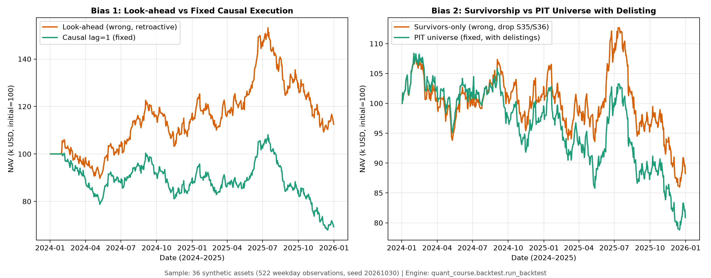
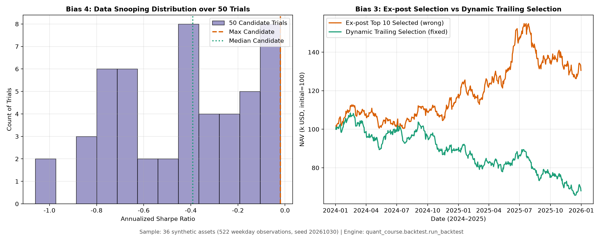
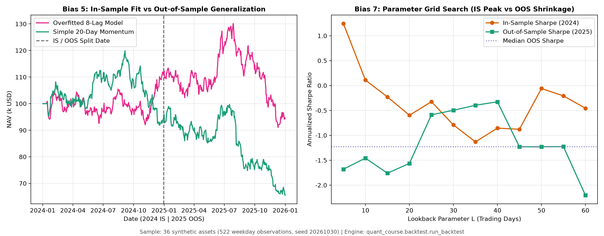
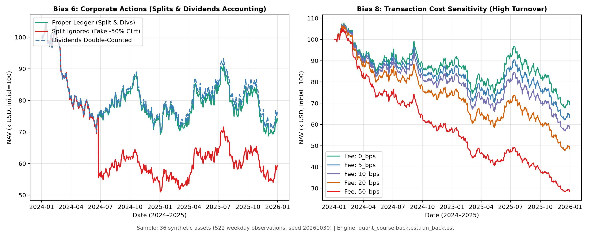

# 第30章 — 回测偏差（Backtesting Biases）

> 主线：回测偏差的本质，是将未来、外部、幸存或经过多重挑选的信息，在代码不抛出运行错误的情况下静默渗透进自融资账本；只有在严格的时点因果约束、时点（Point-in-Time, PIT）动态资产池、多重检验试验账本与真实交易摩擦下，回测净值才具备客观的经济解释力。
> 先修：第3章（金融数据工程与时点契约）、第22章（量化研究方法论与试验账本）、第29章（构建回测引擎与自融资账本）。完成后你能：在统一离散自融资账本上系统复现并诊断八种经典回测偏差；说明各偏差在信息论与概率测度上的失真机制；设计并运行未来扰动不可侵入性检验；维护完整的试验账本并计算多重检验统计校正；在真实聚合数据与构造数据上准确界定非时点与不可交易边界。

---

## 1. 本章目标

在量化投资的研发过程中，需警惕的核心风险并非抛出异常崩溃的代码，而是“毫无报错、平稳运行、净值曲线平滑向上，实盘却立即回撤”的模型。当优化器和矢量矩阵在没有时序因果门禁的代码环境中运行时，它们会以极高效率吸纳任何在当时并不具备的信息。一个表面上年化夏普比率较高的策略，可能仅仅是因为它在盘前集合竞价时读取了当天盘后才发布的财报公告，或者在回溯历史时将中途破产退市的股票直接从资产池中剔除。

完成本章学习后，读者应能达成以下四项核心能力：
1. **计算与推导目标**：掌握八种回测偏差（前视偏差、幸存者偏差、选择偏差、数据窥探、过拟合、公司行动失真、参数挖掘、交易成本失真）的数学机理；推导截断正态分布下的幸存者收益溢价闭式解；推导多重假设检验下极值统计量的期望膨胀 $\mathbb{E}[\max_{m=1}^M Z_m]$ 与 Bonferroni / Holm 校正界；证明未复权价格与公司行动（拆股、分红）在离散自融资账本上的资金与股份守恒性质。
2. **解释与诊断目标**：深入剖析“为什么错误代码不会抛出运行时错误”的底层逻辑；建立“何种信息（Which Information）、何时可得（Available When）、何处使用（Used Where）”的时点因果审查清单；说明为什么单纯给信号添加滞后（`lag=1`）无法根治财报修订与数据商延迟等深层前视问题。
3. **实现与对账目标**：在第 29 章建立的统一自融资账本核心（`quant_course.backtest.run_backtest`）之上，复现全部八种偏差的错误代码与修复代码；使用 `research_protocol.TrialLedger` 维护完整的候选策略试验台账；实现针对时点因果性的未来扰动不可侵入性检验（Future Perturbation Invariance Test），验证未来数据被扰动时历史决策、成交、持仓与净值在设定数值容差内一致。
4. **架构与边界目标**：明确区分个股点入时点（Point-in-Time, PIT）历史快照与学术界聚合行业指数（如 Kenneth French 10 行业组合）的数据边界；理解非时点、已修订、不可交易的历史快照只能用于宏观风格与方法论展示，不可作为实盘 Alpha 或执行回测的依据。

完成条件：能说明八种错误各自污染的通道，按第9节默认读者路线检查构造示例，并完成本章题答。历史JSON/图及20种子结果沿用原运行；本次教学修订不重跑完整CLI、Notebook或研究。有限未来扰动通过不是全部输入通道无泄漏的证明。

---

## 2. 为什么 Quant 需要它

在量化策略的完整生命周期中，回测偏差诊断处于因子工程与样本外推断之间的关键门禁位置：

```text
[原始行情与公告] --> [因子工程与信号] --> [多重尝试与寻优] --> 【回测偏差诊断门禁】 --> [第29章 账本撮合] --> [第31-33章 验证与风险]
   (Ch 3)              (Ch 23-28)         (Ch 22 账本)            (本章第30章)             (执行对账)            (推断与风控)
```

如果回测系统缺乏对偏差的系统性防御，量化团队将反复面临“账面虚高、实盘亏损”的系统性回撤风险：
- **执行时间穿越（Look-ahead leakage）**：若在收盘时计算因子并假设在当天收盘甚至开盘成交，实际上相当于利用未发生的价格或盘后公告进行“时间戳倒签偏差”。
- **资产池后见之明（Survivorship & Selection conditioning）**：若在 2026 年回测过去十年表现时，仅以“当前仍然存活且市值排名前 100”的股票作为资产池，就等于事先知道了哪些公司未来十年不会破产摘牌，将破产清算损失完全抹去。
- **多重搜索虚假显著（Data snooping & Mining）**：若尝试了 50 个动量回看期或 100 个技术因子，仅向投资委员会汇报其中 Sharpe 最高的那一个，而隐瞒其余失败尝试，该“最优策略”可能只是搜索噪声产生的偶然极值。
- **记账规则逻辑断裂（Corporate action distortion）**：将复权价格当作可成交价格、忽略除权除息股数跳变、或在总回报价格序列上重复发放现金分红，会导致虚假的资产减半暴跌或虚增利润。
- **无摩擦温室幻觉（Frictional blindness）**：对高换手率的短周期动量策略假设零佣金零滑点，在几十个基点的单边摩擦下，回测净值会显著高估扣除交易费用后的结果。

本章依托第 29 章的自融资账本，用一个统一的教学构造数据集，逐一解剖这八种偏差的发生机制、代码表征、数值后果与防御方案。

---

## 3. 直觉

### 3.1 极简贯穿案例：三只股票与三个交易日

为了在展开严谨的数学定义之前建立清晰的直观图像，我们考虑一个最简化的教学场景：
设账户在初始时刻（周一开盘前）持有初始现金 1,000 USD，持有股票 B 共 10 股（上一交易日收盘价 100 USD/股），总净值 NAV = 2,000 USD。
市场上共有三只股票：股票 A（稳健经营）、股票 B（实施 2:1 拆股）、股票 C（遭遇危机并最终退市）。
交易日历仅有 3 个日期：$t_0$（周一，信号产生）、$t_1$（周二，调仓撮合）、$t_2$（周三，收盘清算）。

```text
时间轴：
  t0 收盘 (周一 15:00) ----> t1 开盘 (周二 09:30) ----> t1 收盘 (周二 15:00) ----> t2 收盘 (周三 15:00)
       [决策点 s]                [执行撮合 E]               [标记计价 P]               [期末清算 P]
```

现在观察三种初学者常犯的典型错误如何在几行代码内扭曲现实：

1. **盘后公告的前视挪用**：
   股票 A 在周一收盘后（16:30）公布了超预期的业绩预告，周二开盘直接跳空高开 10%（从 100 涨至 110 USD）。
   - *错误做法*：在周一闭市后获取公告，却将信号时间戳倒签为周一（或设 $\text{lag}=0$ 在周一收盘撮合），以周一收盘价 100 USD 借款买入，在周二跳空前捕获 +10% 隔夜跳空收益；
   - *正确做法*：公告在周一收盘后发布，若允许公告后另作盘前决策，且发布、入库与下单截止均合法，最早也只能按周二跳空后的110 USD成交；若遵循本章收盘决策契约，则周二收盘才生成信号、周三开盘执行。两种契约都不能捕获公告前已错过的跳空。

2. **退市标的的后见剔除**：
   股票 C 在周三发生违约退市，清算价格为 0 USD。
   - *错误做法*：拿周三的存活名单回写周一的历史资产池，或删除账本中已有C持仓及其损失。周三使用当时上市状态限制新投资资格本身合法；错误是后见改写过去或跳过已有持仓清算。
   - *正确做法*：在周一决策时，没有任何投资者预知 C 必定退市，资产池必须包含当时的上市标的 C，并在周三账本中如实记录退市清算损失。

3. **拆股除权的虚假断崖**：
   股票 B 在周二收盘后实施 2:1 拆股，周三开盘名义股价由 100 USD 变为 50 USD，持有股数由 10 股变为 20 股。
   - *错误做法*：若回测引擎只更新了价格（从 100 跌到 50），却忘记将持仓股数翻倍，账面持仓市值将从 $10 \times 100 = 1000$ USD 降至 $10 \times 50 = 500$ USD，B持仓虚降50%，但现金仍为1000 USD，总NAV从2000降至1500 USD，即虚降25%。
   - *正确做法*：账本必须保持股份守恒，在除权日将持仓股数按拆股比例调整为 20 股，总市值保持 1000 USD 不变。

---

## 4. 数学基础

### 4.1 符号系统、信息流与量纲约定

为消除模糊性，本章所有数学表述严格遵循以下符号系统与因果时序：

- **离散交易日期序列**：$\mathcal{T} = \{t_0, t_1, \dots, t_T\}$，单调递增无重复，单位为交易日。
- **全息事件时钟**：每个数据事件 $e$ 拥有三个独立的时间戳：
  - $t_{\text{period}}$：事件归属的会计周期截止日（如财报季末 2023-12-31）。
  - $t_{\text{avail}}$：信息源对外公开发布时点（如公告发布于 2024-03-15 16:30 UTC）。
  - $t_{\text{ingest}}$：量化数据库完成采集、校验并落库可查的时间戳（如 2024-03-15 16:35 UTC）。
- **信息流子代数（Information Filtration）**：设 $(\Omega, \mathcal{F}, \mathbb{P})$ 为概率空间。在交易日 $s$ 收盘时，策略可见的历史信息全集为：
  $$\mathcal{F}_s = \sigma\left(\{e \mid \max(t_{\text{avail}}(e), t_{\text{ingest}}(e)) \le s\}\right)$$
- **时点因果可行性准则（Point-in-Time Causality Criterion）**：
  在日期 $s$ 计算的目标权重向量 $w_s^*$ 必须严格关于 $\mathcal{F}_s$ 可测：
  $$w_s^*\text{ 对 }\mathcal F_s\text{ 可测。}$$
  这里信息集下标是实际决策收盘时间；成交使用日期索引位置 $k+\mathrm{lag}$，$\mathrm{lag}\ge1$，不是给真实时间戳直接加整数。随机权重不是信息集中的一个事件。
- **价格与公司行动向量**：
  - $P_{i,t} \in \mathbb{R}_{++}$：资产 $i$ 在日期 $t$ 的未复权收盘标记价（USD/share）。
  - $E_{i,t} \in \mathbb{R}_{++}$：资产 $i$ 在日期 $t$ 的未复权执行撮合价（发生在收盘前，如开盘集合竞价，USD/share）。
  - $S_{i,t} \in \mathbb{R}_{++}$：资产 $i$ 在日期 $t$ 的拆股比例（新股数/旧股数，无拆股为 1.0）。
  - $D_{i,t} \ge 0$：资产 $i$ 在日期 $t$ 派发的每股现金股利（USD/share）。
  - $C_{i,t}^{\text{delist}} \ge 0$：资产 $i$ 在日期 $t$ 退市时的每股清算现金（USD/share）。

### 4.2 极值统计与多重检验数学工具

当研究者在同一数据集上评估 $M$ 个相互独立的候选策略（零假设 $H_0$ 为真实夏普比率等于 0）时，其估计的检验统计量 $Z_1, \dots, Z_M \overset{\text{i.i.d.}}{\sim} \mathcal{N}(0, 1)$。
最大次序统计量 $M_M = \max_{m=1}^M Z_m$ 的累积分布函数为 $\mathbb{P}(M_M \le z) = [\Phi(z)]^M$。
关于该极值期望的理论界定，第 22 章已系统给出形式化定义：
1. **精确数值期望（Exact Expected Maximum）**：
   $$\mathbb{E}[M_M] = \int_{-\infty}^\infty z \cdot d[\Phi(z)]^M = M \int_{-\infty}^\infty z [\Phi(z)]^{M-1} \phi(z) \, dz$$
   通过 `research_protocol.expected_max_standard_normal_exact(50)` 算得 $M=50$ 时的精确值为 **`2.2491`**。
2. **Bailey-López de Prado 近似公式（BLdP Approximation）**：
   $$\mathbb{E}[M_M] \approx (1-\gamma)\Phi^{-1}\left(1 - \frac{1}{M}\right) + \gamma \Phi^{-1}\left(1 - \frac{1}{M e}\right)$$
   通过 `research_protocol.expected_max_standard_normal(50)` 算得 $M=50$ 时的数值为 **`2.2763`**。
3. **一阶 Gumbel 极值渐近展开近似（Gumbel Asymptotic Approximation）**：
   $$\mathbb{E}[M_M] \approx \sqrt{2\ln M} - \frac{\ln\ln M + \ln(4\pi)}{2\sqrt{2\ln M}} + \frac{\gamma}{\sqrt{2\ln M}}$$
   在 $M=50$ 时该渐近展开公式给出的数值为 **`2.3072`**。该式属于大样本渐近近似，在有限样本（如 $M=50$）下略高于数值积分真值。

这三个数值描述独立标准正态零假设下最大值的期望，精确期望为2.2491，并不保证每次最大值超过2.24。把期望最大值代入单边尾概率所得约0.0123，也不是选择后p值的期望。50条相关动量策略的年化Sharpe不自动服从这组独立标准正态；正式推断需有效名义p值和明确搜索族。

---

## 5. 正式定义

本节对八种核心回测偏差给出明确的量化定义，界定其数学形式、触发机制与逻辑后果：

| 偏差名称（中文 / English） | 数学定义 / 触发条件 | 信息通道失真本质 | 典型后果 |
|---|---|---|---|
| **前视偏差（Look-ahead Bias）** | $w_s^*$不对 $\mathcal F_s$ 可测；使用发布或入库晚于决策时点的信息 | 时间倒流，决策使用了尚未发生的事实 | 夏普比率严重虚高，盘后跳空收益被无风险套现 |
| **幸存者偏差（Survivorship Bias）** | 资产池 $\mathcal{U}_t$ 满足 $\mathcal{U}_t = \{i \mid \text{alive}_i(T) = 1\}$，以期末存活状态过滤历史 | 条件概率截断，强制令历史样本破产概率为 0 | 抹去企业违约退市的左尾极端损失 |
| **选择偏差（Selection Bias）** | 策略规则或资产池选择条件直接依赖全样本或未来绩效指标：$\arg\max_{i} \text{Sharpe}_{[0, T]}$ | 事后诸葛亮，将样本结局作为入选门槛 | 挑选历史幸运儿，样本外策略收益断崖式衰减 |
| **数据窥探（Data Snooping）** | 搜索 $M$ 个候选模型仅披露最优者，且未在试验账本中记录其余 $M-1$ 次试验 | 多重比较未校正，将噪声极值包装为显著信号 | 名义 p 值失去统计推断效力，实盘无法复现 |
| **过拟合（Overfitting）** | 模型参数维度 $K$ 相对有效样本量过大，最小化样本内残差方差 $\min_\theta \sum_{t \in \text{IS}} e_t^2$ | 记忆样本特质噪声而非跨期稳态规律 | 样本内夏普偏高，样本外迅速衰退为负收益 |
| **公司行动失真（Corporate Actions）** | 账本忽略除权除息股数乘数 $S_t$、或使用后复权价格叠加现金分红 | 违背资产与现金记账守恒律 | 产生人为虚假暴跌（-50%）或分红重复双重计入 |
| **参数挖掘（Parameter Mining）** | 在一维或高维网格中穷举参数，选取尖锐孤立峰值：$\theta^* = \arg\max_\theta \text{Sharpe}(\theta)$ | 局部极值采样误差，忽视全参数空间敏感性 | 最优参数在样本外迅速均值回归（Shrinkage） |
| **成本建模错误（Cost Modeling）** | 假设费率 $c=0$、或按组合净值而非换手金额计费：$\text{Fee} \ne c \sum_i \|w_i V' - x_i\|$ | 忽视微观市场摩擦，摩擦损耗与换手脱钩 | 高换手虚假套利，实盘资金被交易规费蚕食殆尽 |

### 5.1 概念之间的拓扑因果关系

```text
[信息时间戳错位] --> 【前视偏差】 (使用了 t > s 的信息)
[样本空间选择性截断] --> 【幸存者偏差 / 选择偏差】 (以期末结果条件化历史样本池)
[搜索空间自由度滥用] --> 【数据窥探 / 参数挖掘 / 过拟合】 (在噪声中拟合极值)
[账本微观机制简化] --> 【公司行动失真 / 成本建模错误】 (违反资金股票守恒与交易摩擦)
```

---

## 6. 推导

### 6.1 前视收益差的构造条件

设公告盈余 $\Delta_{i,t}$ 在 $t$ 盘后16:30发布，跳空简单收益满足
$$g_{i,t+1}=\alpha+\beta r_{m,t+1}+\kappa\Delta_{i,t}+\varepsilon_{i,t+1}.$$
以下是声明假设的教学DGP，不是由 $\kappa>0$ 单独推出的普遍定理。$d_{i,u}=P_{i,u}/E_{i,u}-1$ 为盘中收益；公告、入库都在下一收盘前完成。合法收盘决策最早在 $t+1$ 收盘形成，lag=1后于 $t+2$ 开盘成交，其一天持有收益为 $r_c=d_{i,t+2}$。错误策略把公告倒签到 $t-1$ 信号、$t$ 开盘入场，持有至 $t+1$ 收盘：
$$1+r_w=(1+d_{i,t})(1+g_{i,t+1})(1+d_{i,t+1}).$$

若只保留小收益一阶项，则 $r_w\approx d_{i,t}+g_{i,t+1}+d_{i,t+1}$。令Top为公告选股事件。再假设条件于Top的非公告盘中收益均值相同为 $\mu_d$，市场和特质噪声与选股变量独立、条件均值为零，且 $\alpha=0$，则
$$\mathbb E[r_w-r_c\mid\mathrm{Top}]\approx\mu_d+\kappa\mathbb E[\Delta_{i,t}\mid\mathrm{Top}].$$
只有右侧为正时，才得到该近似下正向差异；两臂持有期不同，多出来的一期盘中收益与连乘交叉项都不能悄悄略去。若市场/噪声与选择相关、收益不小或盘中分布不平稳，须重算条件期望；即使错误策略表现更差，它使用不可得信息的机制仍无效。历史构造观察见第12.1节，不把它升级为所有DGP的收益膨胀定理。

### 6.2 幸存者偏差的样本截断与收益上偏推导

将评估期收益指标近似建模为 $X \sim \mathcal{N}(\mu_X, \sigma_X^2)$。在这个阈值教学模型中，当且仅当指标不低于清算阈值 $d$（即 $X \ge d$）时，企业维持上市存活。
标准化截断阈值定义为 $\alpha = \frac{d - \mu_X}{\sigma_X}$，违约退市概率为 $p_{\text{delist}} = \Phi(\alpha)$。
仅对存活标的计算条件期望收益，根据截断正态分布均值公式：
$$\mathbb{E}[X \mid X \ge d] = \mu_X + \sigma_X \lambda(\alpha)$$
其中 $\lambda(\alpha) = \frac{\phi(\alpha)}{1 - \Phi(\alpha)}$ 为逆 Mills 比率（Hazard Rate）。
由于标准正态密度 $\phi(\alpha) > 0$ 且存活概率 $1 - \Phi(\alpha) > 0$，处处成立 $\lambda(\alpha) > 0$。
偏差项为 $\Delta = \mathbb{E}[X \mid X \ge d] - \mu_X = \sigma_X \lambda(\alpha) > 0$。
固定位置与尺度 $\mu_X,\sigma_X>0$ 时，$\lambda(\alpha)$ 随阈值及 $p_{\mathrm{delist}}=\Phi(\alpha)$ 单调增加，是非线性单调关系，不是比例定律。正态变量无下界，这只是截断指标模型，不能把它当成现实有限责任股票简单收益/违约机制的普遍定理。

- **实测数值核验**：

  结果键：`ch30_results.json["bias_2_survivorship"]["truncated_normal_check"]`。

  设 $\mu_X = 0.0$、$\sigma_X = 0.3$、违约阈值 $d = -0.3$。
  标准化截断点 $\alpha = (-0.3 - 0.0) / 0.3 = -1.0$，对应违约概率 $\Phi(-1.0) = 0.1587$（15.87%）。
  逆 Mills 比率 $\lambda(-1.0) = \frac{0.2420}{1.0 - 0.1587} = 0.2876$。
  存活标的条件期望收益为：
  $$\mathbb{E}[X \mid X \ge -0.3] = 0.0 + 0.3 \times 0.2876 = 0.0863 \quad (+8.63\%)$$
  只统计存活样本而剔除退市低尾观测，条件平均收益相对未筛选总体上偏约8.63个百分点。

### 6.3 拆股与股利在未复权自融资账本上的守恒推导

在第 29 章回测引擎 `quant_course.backtest.run_backtest` 的执行顺序中，每个交易日开盘前依次执行：
1. 持仓股数按拆股乘数调整：$q_{i, t-1}' = q_{i, t-1} \cdot S_{i,t}$；
2. 现金账户注入股利：$\Delta C_t^{\text{div}} = q_{i, t-1}' \cdot D_{i,t} = q_{i, t-1} \cdot S_{i,t} \cdot D_{i,t}$（引擎约定 $D_{i,t}$ 为拆股后每股现金股利）；
3. 若同日发生拆股与除息，未复权参考价跳变基准为 $P_{i, t-1}^{\text{adj}} = \frac{P_{i, t-1}}{S_{i,t}} - D_{i,t}$。

验证调仓前总权益守恒：
$$V_{t,\text{pre}} = C_{t-1} + \Delta C_t^{\text{div}} + q_{i, t-1}' \cdot P_{i, t-1}^{\text{adj}}$$
$$= C_{t-1} + (q_{i, t-1} S_{i,t}) D_{i,t} + (q_{i, t-1} S_{i,t}) \left(\frac{P_{i, t-1}}{S_{i,t}} - D_{i,t}\right)$$
$$= C_{t-1} + q_{i, t-1}\left(S_{i,t}D_{i,t} + P_{i, t-1} - S_{i,t}D_{i,t}\right) = C_{t-1} + q_{i, t-1} P_{i, t-1} = V_{t-1}$$
例如，令 $C_{t-1}=0$、$q_{i,t-1}=10$ 股、$P_{i,t-1}=100$ 美元、$S_{i,t}=2$、$D_{i,t}=1$ 美元/拆股后股。公司行动后持有 20 股并收到 20 美元；参考价 $100/2-1=49$ 美元，因此净值仍为 $20\times49+20=1{,}000$ 美元。若误用 $(100-1)/2=49.5$ 美元，则净值会被记成 $20\times49.5+20=1{,}010$ 美元，多记 10 美元。

在无其他价格新闻、无交易/费用和利息的机械除权设定中，上式保持除权瞬间价值中性。现实同日仍可能有市场价格变动；它不能保证真实交易日NAV收益为0，第8节历史样本仍有−1.29%的正常市场变动。
若代码忽略拆股乘数（令 $S_{i,t} = 1$），则调整后持仓市值变为 $q_{i, t-1} \cdot (P_{i, t-1}/2) = \frac{1}{2} V_{t-1,\text{holding}}$，必然凭空出现 50% 的虚假断崖。

---

## 7. 金融解释

### 7.1 为什么量化团队会系统性产生回测偏差？

回测偏差之所以普遍存在，根源在于量化投资的研发组织架构中存在显著的激励机制与工程认知盲区：
1. **发表偏差与汇报激励（Publication & Reporting Bias）**：
   在投资机构实践中，若考核机制过度以“单次回测夏普比率”为导向，可能诱使研究员倾向于选择性汇报样本内最优结果。尝试了多次失败参数并如实披露的研究员缺乏汇报动力，而选择性汇报单一最优变体的做法更容易通过立项评审。这一现象在假设检验理论中等价于多重检验未经控制（参见第 22 章）。
2. **时点数据库的昂贵成本与工程门槛**：
   维护一套完整保留历史每一次财报发布时戳、每一次事后会计修订（Restatement）以及每一只退市摘牌个股的点入时点（Point-in-Time）数据库，需要巨大的商业采购与清洗成本。初学者往往直接从开源网站拉取经过后复权与现存名单清洗的“干净数据”，在数据输入端便已失去了时序纯洁性。
3. **向量化代码与真实交易环境的脱节**：
   现代数据科学库（Pandas、Polars）推崇矢量化计算。一行简单的 `.shift(-1)` 或者 `df.corr()` 能够以极高速度运行，但研究员在敲下这行代码时，极易忘却其背后对应的真实市场执行中挂单、排队、交易所撮合与现金划转的微观次序。

---

## 8. Numerical Example

::: {.body-example title="完整例题：构造市场输入、拆股及退市小账"}

### 8.1 教学构造数据集规格说明

为系统排查八种偏差，我们在 `code/ch30_backtest_biases.py` 中构造了一个严格可复现的标准市场环境：
- **随机数种子**：`SEED = 20261030`（全局唯一，禁止抽樱桃挑选种子）。
- **标的池**：36 只股票，代号 `S01` 至 `S36`。
- **时间范围**：2024-01-02 至 2025-12-31，共 522 个合成周一至周五观测；这不是交易所日历，含有交易所假日（例如 2025-01-01）。夏普、波动率等年化指标使用约定的 252 次观测/年，不表示 522 个真实交易日。
  - 样本内（IS）：2024 年度，共 261 个工作日网格观测（2024-01-02 至 2024-12-31）；
  - 样本外（OOS）：2025 年度，共 261 个工作日网格观测（2025-01-01 至 2025-12-31）。
- **公司行动预置**：
  - `S05` 于 2024-06-25（第 125 交易日）实施 2:1 拆股（$S = 2.0$）。
  - `S08` 分别于第 60、180、300、420 交易日派发每股 1.00 USD 现金股利。
  - `S12` 分别于第 100、220、340、460 交易日派发每股 1.50 USD 现金股利。
  - `S35` 遭遇经营困境，于 2024-09-10（第 180 交易日）退市，以每股 2.00 USD 现金清算并移出资产池。
  - `S36` 遭遇经营困境，于 2025-05-06（第 350 交易日）退市，以每股 1.00 USD 现金清算并移出资产池。
- **除息日价格基准**：账本先按 $S_t$ 调整股份，再向新股数支付每股股利 $D_t$。因此 $D_t$ 按拆股后每股报价时，合并事件参考价为 $P_{t-1}/S_t-D_t$。
- **盘后财报日历**：每隔 21 个工作日网格观测，随机抽取 12 只股票在收盘后（16:30）发布盈余公告，下一观测日开盘产生盈余跳空。由于该公告晚于当日收盘，因果示例在下一观测日收盘生成信号，再以 `lag=1` 于后续观测日开盘成交。

### 8.2 手算核对：第 125 日拆股与第 180 日退市清算

我们选取实际运行账本中的关键节点进行数值核算（数字全部引用自 `ch30_results.json`）：

#### 1. 第 125 交易日（2024-06-25）S05 拆股核算
引用自 JSON中的 `bias_6_corporate_actions.day_125_split_hand_check`：
- **第 124 交易日（2024-06-24）收盘账本**：
  - S05 收盘价 $P_{124} = 75.1314$ USD，持仓股数 $q_{124} = 500.8387$ 股，市值 $37,628.74$ USD；
  - S08 收盘价 $P_{124} = 74.2556$ USD，持仓股数 $q_{124} = 500.9080$ 股，市值 $37,195.22$ USD；
  - 现金余额 $C_{124} = 500.9080$ USD，总净值 $\text{NAV}_{124} = 75,324.87$ USD。
- **第 125 交易日（2024-06-25）开盘与收盘**：
  - S05 发生 2:1 拆股，执行价 $E_{125} = 37.5104$ USD，收盘标记价 $P_{125} = 37.4605$ USD；
  - S08 执行价 $E_{125} = 73.9312$ USD，收盘标记价 $P_{125} = 72.5206$ USD（当日无交易，执行价只作参考）。
- **Fixed 合规账本（传入 splits 表）**：
  - S05 股数翻倍至 $q_{125} = 500.8387 \times 2.0 = 1001.6775$ 股；
  - S05 收盘持仓市值 $= 1001.6775 \times 37.4605 = 37,523.31$ USD；
  - S08 收盘持仓市值 $= 500.9080 \times 72.5206 = 36,326.16$ USD；
  - 现金余额保持不变 $= 500.9080$ USD（它与 S08 股数 500.9080 数值相同纯属巧合，单位不同：一个是美元，一个是股）；
  - 总净值 $\text{NAV}_{125} = 37523.31 + 36326.16 + 500.91 = 74,350.38$ USD；
  - 当日收益率 $= (74350.38 - 75324.87) / 75324.87 = -0.012937$（正常市场波动 -1.29%）。
- **Split-Ignored 错误账本（未传入 splits 表）**：
  - 股数未调整，仍记录为 $500.8387$ 股；
  - 持仓市值被记为 $500.8387 \times 37.4605 = 18,761.66$ USD，比正确值少 18,761.66 USD；
  - 总净值 $\text{NAV}_{125} = 18761.66 + 36326.16 + 500.91 = 55,588.73$ USD；
  - 当日收益率 $= (55588.73 - 75324.87) / 75324.87 = -0.262014$（账面出现 −26.20% 的虚假下跌）。

#### 2. 第 180 交易日（2024-09-10）S35 退市清算核算
引用自 JSON中的 `bias_2_survivorship.s35_delisting_hand_check`：
- 退市前一日（2024-09-09，第 179 日）：
  - 策略持有 S35 股数 $q = 63.7348$ 股；收盘价 $P_{179} = 28.7926$ USD；
  - 退市前市值 $= 63.7348 \times 28.7926 = 1835.09$ USD。
- 第 180 交易日退市清算：
  - 清算现金价格 $C^{\text{delist}} = 2.00$ USD/share；
  - 账本清算回收现金 $= 63.7348 \times 2.00 = 127.47$ USD；
  - S35 持仓股数归零，现金账户注入 127.47 USD；
  - 账本确认直接退市资本损失 $= 1835.09 - 127.47 = 1707.62$ USD。
  若采用仅存活股票池，该笔 1,707.62 USD 的真实清算损失被完全隐蔽。


:::

---

## 9. Python Implementation

本章偏差分析的完整课程入口为 `code/ch30_backtest_biases.py`。默认先在已接受I3读者包根运行：

```bash
python run_notebook.py notebooks/ch30_backtest_biases.ipynb
```

Notebook默认跳过French分支，只新算构造示例；初始化创建唯一 `runs/ch30_backtest_biases_<uuid>/`，runner另在 `runs/execution_<stem>_<uuid>/` 保存执行副本和 `execution.json`，失败亦保留。章节Notebook英语、全包与冷启动留BIL23。以下完整课程调用用于理解原方法，含522观测构造和完整偏差研究，未在本次修订执行；独立运行前核实际参数与输出路径，不覆盖历史qa。

研究信号使用的日回报由未复权收盘价、拆股比例、现金股息及退市清算价按账本事件计算；订单成交与每日持仓估值仍使用原始未复权价格。一般收盘信号在日期 $d$ 收盘形成，历史特征最多使用到该收盘；`lag=1` 后的持有区间是下一个网格观测日开盘至收盘。回归标签采用该开盘至收盘毛回报，不把成交前的隔夜跳空算给新持仓。若信息在收盘后 16:30 才发布，则它最早用于下一观测日收盘信号，并在其后一个观测日开盘成交。

```python
import importlib.util
from pathlib import Path
import numpy as np
import pandas as pd

# 动态加载第 30 章可独立执行模块
root = Path.cwd()
spec = importlib.util.spec_from_file_location("ch30", root / "code/ch30_backtest_biases.py")
ch30 = importlib.util.module_from_spec(spec)
spec.loader.exec_module(ch30)

# 生成构造市场数据集
data = ch30.build_constructed_market(seed=20261030)
assert len(data["dates"]) == 522
assert len(data["assets"]) == 36
print(f"Dataset initialized: {len(data['assets'])} assets, {len(data['dates'])} synthetic weekday observations.")
```

```python
import importlib.util
from pathlib import Path

root = Path.cwd()
spec = importlib.util.spec_from_file_location("ch30", root / "code/ch30_backtest_biases.py")
ch30 = importlib.util.module_from_spec(spec)
spec.loader.exec_module(ch30)

data = ch30.build_constructed_market(seed=20261030)
# 运行前视偏差与端到端未来扰动测试
s1 = ch30.study_lookahead(data)
pert = ch30.study_future_perturbation(data)
print(f"Lookahead diff Sharpe: {s1['diff_sharpe']:.4f}")
print(f"Perturbed future inputs: {pert['perturbed_future_inputs']}")
print(f"Fixed look-ahead pre-cutoff diffs: {pert['fixed_lookahead_diffs_up_to_cutoff']}")
print(f"Fixed selection pre-cutoff diffs: {pert['fixed_selection_diffs_up_to_cutoff']}")
print(f"Wrong full-sample selection pre-cutoff diffs: {pert['wrong_selection_diffs_up_to_cutoff']}")
print(f"Fixed pipeline invariant: {pert['is_fixed_invariant']}")
print(f"Wrong pipeline causality violated: {pert['is_wrong_causality_violated']}")
assert pert["is_fixed_invariant"] == 1
assert pert["is_wrong_causality_violated"] == 1
```

扰动结果中的 `filled_orders` 指标在成交键（signal time、trade time、asset）不同的情况下返回 `1.0`，作为有限的身份变化标记；键一致时返回成交数量、价格、名义金额与费用的最大绝对差。其余连续指标均为对应输出的最大绝对差。

---

## 10. Visualization

历史 `code/ch30_backtest_biases.py` 的保存结果位于 `qa/a6/codex_resume/ch30/results_v2/`，对应4图位于 `qa/a6/codex_resume/ch30/figures_v2/`。本次修订沿用这些曲线，不重跑或重画。v1 结果与图保留在 `results/`、`figures/`；教材展示图仅在保存 v2 快照后更新。

### 10.1 图 1：前视偏差与幸存者偏差净值路径对照

- **左图（Panel A: 前视偏差）**：
  - 横轴：合成周一至周五日期网格（2024–2025，522 个观测，含交易所假日）；纵轴：净值 NAV（千美元，初始=100）。
  - 对照曲线：橙色实线为前视策略（Wrong, retroactive），期末 NAV `112500.12` USD、Sharpe `0.3730`；绿色实线为因果策略（公告后下一观测日收盘决策，`lag=1` 后再成交），期末 NAV `69300.37` USD、Sharpe `-0.7760`。
  - 核心现象：前视策略将盘后公告内容倒签到公告前的信号，在公告跳空前建立仓位；因果策略等到可用的收盘信号后再执行。
- **右图（Panel B: 幸存者偏差）**：
  - 横轴：同一522观测合成工作日网格；纵轴：净值 NAV（千美元）。
  - 对照曲线：橙色实线为仅保留存活股票策略（Wrong, survivors-only），期末净值 88.25 k USD，夏普比率 -0.2950；绿色实线为 PIT 真实全时点策略（Fixed, with delistings），期末净值 80.87 k USD，夏普比率 -0.5565。
  - 核心现象：仅包含存活股票的资产池抹去了 S35 与 S36 的两次深度暴跌，呈现虚假的抗跌性。

### 10.2 图 2：数据窥探多重比较与选择偏差

- **左图（Panel A: 数据窥探分布）**：
  - 横轴：年化夏普比率；纵轴：试验频数分布。
  - 核心现象：50 个不同回看期的动量策略中位数 Sharpe 为 -0.3921，最大值也为 -0.0193。零假设下 50 次独立标准正态试验的最大值期望为 2.2763（BLdP 近似）与 2.2491（精确值）；本例的 Bonferroni 校正 p 值为 1.0000。候选策略彼此相关且收益不满足独立正态假设，因此这只是多重比较教学示例，不是正式显著性检验。
- **右图（Panel B: 选择偏差）**：
  - 横轴：同一522观测合成工作日网格；纵轴：净值 NAV（千美元）。
  - 对照曲线：橙色实线为事后挑选全周期表现最好的 10 只股票（Wrong, ex-post），期末净值为 130.54 k USD，夏普比率 0.8164；绿色实线为动态滚动 60 日经济回报 Sharpe 筛选（Fixed, trailing 60d），期末净值为 68.06 k USD，夏普比率 -0.9108。

### 10.3 图 3：过拟合衰退与参数挖掘网格表面

- **左图（Panel A: 过拟合样本内外对比）**：
  - 横轴：日期（以 2024-12-31 为 IS/OOS 分割线）；纵轴：净值 NAV。
  - 核心现象：模型用截至信号收盘的 8 个 close-to-close 经济回报预测下一交易日 open-to-close 毛回报。无正则化回归（洋红色）IS Sharpe 为 0.7041，OOS 降至 -0.6788；20 日动量对照（绿色）IS 为 -0.1243，OOS 为 -1.5639。两者均未显示稳定的样本外表现，单次划分不能证明简单策略更优。
- **右图（Panel B: 参数挖掘网格）**：
  - 横轴：回看参数 $L$（5 至 60 日）；纵轴：年化夏普比率。
  - 核心现象：训练期选出的 $L^* = 5$ 日 IS Sharpe 为 1.2443，2025 OOS Sharpe 为 -1.6799，收缩幅度为 2.9242。所选参数的 OOS 表现低于全网格 OOS 中位数 -1.2301；网格 OOS 结果只作诊断，不参与选参。

### 10.4 图 4：公司行动记账与交易成本敏感度

- **左图（Panel A: 公司行动记账）**：
  - 核心现象：原图的“Fake -50% Cliff”指单股未调股份时的机械市值减半，不是本组合NAV跌幅；本组合历史样本为−26.20%，第3节现金/B小例为−25%。忽略拆股的红色曲线在第 125 日瞬间暴跌 26.20%，期末净值跌至 59.45 k USD；正确对账的绿色曲线平稳过渡，期末净值 74.28 k USD；蓝色虚线展示了复权价格重复发放股利的虚假膨胀（期末净值 76.44 k USD）。
- **右图（Panel B: 交易成本阶梯）**：
  - 横轴：同一522观测合成工作日网格；纵轴：净值 NAV。
  - 核心现象：高换手（10 bps 情景年化换手率 6912.25%）动量策略在 0 bps 单边费率下期末 NAV 为 69.29 k USD（CAGR -16.23%）；在 10 bps 费率下为 57.96 k USD（CAGR -23.15%）；在 50 bps 费率下为 28.36 k USD（CAGR -45.58%），随费率上升净值和 Sharpe 严格下降。

---

## 11. Real Market Example

### 11.1 真实市场数据规格与许可边界

本节保留此前使用 Kenneth R. French 数据的历史方法演示；原始/提取/处理数据未随默认I3包提供，权利/主体/用途仍待解决，A10-A设计与A10-A.1技术协议不替代执行授权，G05/A10-B未授权。本节不重跑历史研究。此前使用的 10 个行业投资组合月度收益率数据，演示选择偏差在真实历史长周期中的表现：
- **数据源 URL**：<https://mba.tuck.dartmouth.edu/pages/faculty/ken.french/ftp/10_Industry_Portfolios_CSV.zip>
- **行业数据清单校验文件**：`data/manifests/french_industries_2026-10-05.json`（SHA-256: `3b71cd5f781f9790cc380195c22635e03e9c9e27a5f43cd2d0d46fb12efa8271`）
- **行业原始 ZIP SHA-256**：`ebd937a4b995d821867aeb956a96f09a666386f38fa82516b7d1767ee4a49ae5`（原始压缩包哈希，与下方 JSON 清单文件哈希不同）
- **行业处理后文件路径**：`data/processed/french_10_industries_monthly.csv`（SHA-256: `3b097d810c295d64eedfa1ece7067ff2a0707f5ca90e33935df9949251f70950`）
- **无风险利率清单校验文件**：`data/manifests/french_factors_2026-10-05.json`（SHA-256: `597c9703afa623a63b0d5fbf36dc941aac90d00948aeca302f151ed3c854000b`）
- **无风险利率处理后文件路径**：`data/processed/french_factors_3_monthly.csv`（SHA-256: `c19770a19a0ac47ad1c29074f57234570aeaa9725212cb4fa8146a2846c52814`）
- **样本周期与频率**：1926-07 至 2026-08，共 1202 个连续月度观测，月频，单期十进制收益率。
- **免责与非 PIT 属性声明**：Kenneth French 10 行业数据属于**全市场价值加权的聚合行业组合**，历史数据经多次修订重算，**非点入时点（Non-PIT）快照，且不存在直接可交易的未复权成分股报价**。本实验不可用于宣称实盘 Alpha，仅作为学术研究方法论的案例演示。

### 11.2 50 年划分实证：事后挑选与事前选择对比

我们将历史划分为两个不重叠的时间区间进行对照检验（不据此假设收益序列统计独立；引用自 `ch30_results.json["real_market_french"]`）：
- **第一周期（Period 1: 1926-07 至 1975-12，共 594 个月）**：
  计算 10 个行业在第一周期的夏普比率，排名前三的最优行业分别为：
  1. `Hlth`（医疗健康）：Sharpe = `0.4657`
  2. `Telcm`（电信）：Sharpe = `0.4116`
  3. `HiTec`（高科技）：Sharpe = `0.4106`
  第一周期前三行业等权组合夏普比率为 `0.4701`，相比全市场 10 行业无条件等权基准的 `0.4250`，超额夏普比率为 `+0.0451`。
- **全样本视角（Full-Sample: 1926-07 至 2026-08，共 1202 个月）**：
  在全样本事后统计中，全周期夏普比率排名前三的行业变为：`NoDur`（0.5099）、`Hlth`（0.5044）、`Shops`（0.4577）。
- **第二周期评价（Period 2: 1976-01 至 2026-08，共 608 个月）**：
  对比三种策略在第二周期的实际表现：
  1. **错误版本（Wrong: 全样本事后挑选前三，含前视选择偏差）**：
     持有全样本事后挑出的 NoDur、Hlth、Shops 组合，在第二周期夏普比率达 **`0.6519`**（CAGR = `13.15%`），相对 10 行业等权基准的超额夏普为 `+0.0372`。
  2. **修复版本（Fixed: 仅依第一周期事前挑选前三）**：
     仅根据 1926–1975 年前三行业（Hlth、Telcm、HiTec）在第二周期持有，实际夏普比率为 **`0.5658`**（CAGR = `12.46%`），相对 10 行业等权基准的超额夏普为 `-0.0489`。
  3. **基准组合（Benchmark: 10 行业无条件等权）**：
     第二周期夏普比率为 **`0.6147`**（CAGR = `12.75%`）。

**数值定义与衰退量**：
- 错误与修复版本夏普差：`0.6519 - 0.5658 = +0.0862`（事后挑选产生虚高）；
- 事前组合超额夏普变化（Excess Decay）：由第一周期的 `+0.0451` 变为第二周期的 `-0.0489`，相对基准的超额夏普衰退量为：
  $$\text{Excess Decay} = (-0.0489) - (+0.0451) = -0.0940$$
这一数值展示了真实市场中，仅凭前半程选优构建的固定组合在后半程未能保持相对基准的超额夏普优势。

---

## 12. Common Mistakes

本节系统展开八种偏差的深度剖析，严格遵循“错误示例 -> 错误原因 -> 可运行错误代码 -> 修复代码 -> 同数据数值差异 -> 修复方案未解决的遗留限制”的标准结构：

### 12.1 偏差一：前视偏差（Look-Ahead Bias）

- **错误示例**：在月度再平衡模型中，公司于 2024-03-29（周五）收盘后 16:30 发布财报超预期预告，研究员在生成特征时将该公告标记为 3 月份特征，并在 3 月 29 日收盘前生成交易指令甚至当日成交。
- **错误原因**：信息发布时点 $t_{\text{avail}} > s$（周五收盘），该信息在周五决策与撮合执行时刻尚不可得。
- **可运行错误代码**（展示信息时间戳倒签误用）：
```python
import pandas as pd
from quant_course.backtest import BacktestConfig, run_backtest

dates = pd.bdate_range("2024-01-02", periods=3)
P = pd.DataFrame({"A": [10.0, 11.0, 12.0]}, index=dates)
E = pd.DataFrame({"A": [10.0, 11.0, 12.0]}, index=dates)
# 错误做法：公告产生于日期 1 盘后（16:30），但将信号时间戳倒签为日期 0
# lag=1 使账户在日期 1 开盘以 11 提前入场；此前 10→11 的跳空未计入该持仓收益
announcement_date = dates[1]
leaked_signal_date = dates[0]
tw_wrong = pd.DataFrame({"A": [1.0]}, index=[leaked_signal_date])
cfg = BacktestConfig(initial_cash=1000.0, lag=1)
res_wrong = run_backtest(P, tw_wrong, cfg, exec_prices=E)
assert res_wrong.fills["trade_time"].iloc[0] == dates[1]
```
这个三行短例只演示信号倒签与错误提前入场：账户在日期 1 以 11 买入，收盘估值也为 11，故该日收盘 NAV 仍为 1000 USD，并未赚到此前 10→11 的跳空。第6.1节跨公告持有期构造及下列历史研究结果使用各自的数据与协议，不是这三行代码的输出。

**修复代码**（公告在 `dates[1]` 收盘后 16:30 发布；收盘决策契约下，下一日收盘 `dates[2]` 才形成信号，`lag=1` 在 `dates[3]` 开盘成交）：
```python
import pandas as pd
from quant_course.backtest import BacktestConfig, run_backtest

dates = pd.bdate_range("2024-01-02", periods=4)
P = pd.DataFrame({"A": [10.0, 11.0, 11.0, 11.0]}, index=dates)
E = pd.DataFrame({"A": [10.0, 11.0, 11.0, 11.0]}, index=dates)
# The 16:30 announcement on date[1] is unavailable at its close.
announcement_date = dates[1]
causal_signal_date = dates[2]
tw_fixed = pd.DataFrame({"A": [1.0]}, index=[causal_signal_date])
cfg = BacktestConfig(initial_cash=1000.0, lag=1)
res_fixed = run_backtest(P, tw_fixed, cfg, exec_prices=E)
assert res_fixed.fills["signal_time"].iloc[0] == dates[2]
assert res_fixed.fills["trade_time"].iloc[0] == dates[3]
```
- **同数据数值差异**（引用自 `ch30_results.json["bias_1_lookahead"]`）：
  - `fixed`（公告后下一观测日收盘决策）：期末 NAV = `69300.37` USD，夏普比率 = `-0.7760`；
  - `wrong`（将未来公告倒签至公告前信号）：期末 NAV = `112500.12` USD，夏普比率 = `0.3730`；
  - 差异幅度：NAV 差异 `+43199.74` USD，夏普比率差异 `+1.1490`（符号：`wrong > fixed`）。
- **20 组额外随机种子实证分布**（引用自 `ch30_results.json["multi_seed_distribution"]["lookahead_diff_sharpe"]`）：
  - 均值差：`+1.1100`，标准差：`0.2150`，区间：`[0.7854, 1.6389]`，正差异比例：`100.0%`。主种子差值 `1.1490` 位于该 20 组样本的观测范围内。
- **修复方案未解决的遗留限制**：
  `lag=1` 只说明信号至少下一观测日执行，并不能单独证明盘后公告已在订单截止前入库。本章默认将盘后公告用于下一观测日收盘信号；若要更早决策，必须给出实际公告时间、接收/入库时间与订单截止时间并证明先后顺序。因果时间戳仍不能解决一字涨停、停牌、成交容量或事后重述问题。

---

### 12.2 偏差二：幸存者偏差（Survivorship Bias）

- **错误示例**：从行情软件导出“当前上市个股”，以此股票列表作为回测标的池回测过去多年行情。
- **错误原因**：当前的名单是经过历史优胜劣汰检验后的幸存者，自动剔除了因违约退市摘牌的失败公司。
- **可运行错误代码**（展示基于未来存活状态构建资产池）：
```python
import pandas as pd
from quant_course.backtest import BacktestConfig, run_backtest

dates = pd.bdate_range("2024-01-02", periods=4)
# 错误做法：在回测初（t=0）利用期末存活状态过滤资产池，提前剔除在日期 2 退市的股票 C
all_universe = ["A", "B", "C"]
future_delisted = ["C"]
survivors_only = [s for s in all_universe if s not in future_delisted]
P_surv = pd.DataFrame({"A": [10.0, 11.0, 12.0, 13.0], "B": [20.0, 21.0, 22.0, 23.0]}, index=dates)
tw_wrong = pd.DataFrame({"A": [0.5], "B": [0.5]}, index=[dates[0]])
cfg = BacktestConfig(initial_cash=1000.0, lag=1)
res_wrong = run_backtest(P_surv, tw_wrong, cfg)
assert "C" not in res_wrong.positions.columns
```
- **修复代码**（展示点入时点全资产池与退市入账）：
```python
import pandas as pd
from quant_course.backtest import BacktestConfig, run_backtest

dates = pd.bdate_range("2024-01-02", periods=4)
# 修复做法：保留当时全标的，在退市日由 delistings 字典清算返还现金
P_all = pd.DataFrame({
    "A": [10.0, 11.0, 12.0, 13.0],
    "B": [20.0, 21.0, 22.0, 23.0],
    "C": [10.0, 5.0, float("nan"), float("nan")]
}, index=dates)
tw_fixed = pd.DataFrame({"A": [0.33], "B": [0.33], "C": [0.34]}, index=[dates[0]])
cfg = BacktestConfig(initial_cash=1000.0, lag=1)
res_fixed = run_backtest(P_all, tw_fixed, cfg, delistings={"C": (dates[2], 1.0)})
assert res_fixed.ledger["delist_cash"].iloc[2] > 0
```
- **同数据数值差异**（引用自 `ch30_results.json["bias_2_survivorship"]`）：
  - `fixed`（PIT 包含退市清算）：期末 NAV = `80874.56` USD，夏普比率 = `-0.5565`；
  - `wrong`（仅存活股票）：期末 NAV = `88245.23` USD，夏普比率 = `-0.2950`；
  - 差异幅度：NAV 差异 `+7370.67` USD，夏普比率差异 `+0.2616`（符号：`wrong > fixed`）。
- **20 组额外随机种子实证分布**（引用自 `ch30_results.json["multi_seed_distribution"]["survivorship_diff_sharpe"]`）：
  - 均值差：`+0.3174`，标准差：`0.0306`，区间：`[0.2677, 0.3894]`，正差异比例：`100.0%`。主种子差值 `0.2616` 与这20次正差结果均保留为各自构造观察，不推出所有市场或种子的稳健方向。
- **修复方案未解决的遗留限制**：
  使用 PIT 资产池并计入退市清算，依然**无法解决**退市停牌期间场外折价转让滑点、以及历史全量数据库建库初期未覆盖微盘退市股的问题。

---

### 12.3 偏差三：选择偏差（Selection Bias）

- **错误示例**：查看股票池在 2024–2025 年的全样本结果，再把表现最好的股票预先放入回测组合。
- **错误原因**：选择准则条件化了全样本的未来结果。
- **可运行错误代码**（展示全样本事后指标选股）：
```python
import pandas as pd
from quant_course.backtest import BacktestConfig, run_backtest

dates = pd.bdate_range("2024-01-02", periods=4)
P = pd.DataFrame({"A": [10.0, 15.0, 18.0, 20.0], "B": [20.0, 18.0, 16.0, 15.0]}, index=dates)
# 错误做法：在全样本结束后用所有日期的平均收益选股；此小例不含公司行动
full_sample_top = P.pct_change().dropna().mean().idxmax()
assert full_sample_top == "A"
tw_wrong = pd.DataFrame({full_sample_top: [1.0]}, index=[dates[0]])
cfg = BacktestConfig(initial_cash=1000.0, lag=1)
res_wrong = run_backtest(P[[full_sample_top]], tw_wrong, cfg)
assert res_wrong.ledger["nav"].iloc[-1] > 1000.0
```
- **修复代码**（展示仅使用历史滚动窗口的事前动态选股）：
```python
import pandas as pd
from quant_course.backtest import BacktestConfig, run_backtest

dates = pd.bdate_range("2024-01-02", periods=6)
P = pd.DataFrame({"A": [10.0, 11.0, 10.0, 12.0, 11.0, 13.0],
                  "B": [10.0, 9.0, 10.0, 9.0, 11.0, 10.0]}, index=dates)
# 此迷你例无公司行动。每个收盘决策只比较截至当日的两日历史收益。
daily_returns = P.pct_change()
rows = []
for i in range(2, len(dates) - 1):
    trailing_mean = daily_returns.iloc[i - 1:i + 1].mean()
    selected = trailing_mean.idxmax()
    rows.append({"A": float(selected == "A"), "B": float(selected == "B")})
tw_fixed = pd.DataFrame(rows, index=dates[2:-1])
cfg = BacktestConfig(initial_cash=1000.0, lag=1)
res_fixed = run_backtest(P, tw_fixed, cfg)
assert tw_fixed.nunique().iloc[0] > 1 or tw_fixed.nunique().iloc[1] > 1
assert res_fixed.ledger["nav"].iloc[-1] > 0
```
- **同数据数值差异**（引用自 `ch30_results.json["bias_3_selection"]`，本对比在含 S35/S36 退市的完整 PIT 宇宙上执行）：
  - `fixed`（滚动动态前向筛选）：期末 NAV = `68057.83` USD，夏普比率 = `-0.9108`；
  - `wrong`（事后挑选 10 佳）：期末 NAV = `130536.57` USD，夏普比率 = `0.8164`；
  - 差异幅度：NAV 差异 `+62478.74` USD，夏普比率差异 `+1.7272`（符号：`wrong > fixed`）。
- **20 组额外随机种子实证分布**（引用自 `ch30_results.json["multi_seed_distribution"]["selection_diff_sharpe"]`）：
  - 均值差：`+1.2671`，标准差：`0.3014`，区间：`[0.6812, 1.8841]`，正差异比例：`100.0%`。
- **修复方案未解决的遗留限制**：
  事前动态规则仍需声明目标总体。若“过去持续盈利”条件在当时已知，它可以是合法的预设投资池；只有拿此条件化总体冒充全市场无条件结论，或利用未来资格回写历史，才构成相应选择问题。

---

### 12.4 偏差四：数据窥探（Data Snooping）

- **错误示例**：在同一份历史数据上尝试了 50 个不同回看期的动量信号，只报告回测 Sharpe 最高的那个并宣称发现了显著阿尔法。
- **错误原因**：独立随机变量取最大值会导致名义检验统计量系统性偏高，忽视多重比较（Multiple Testing）下的极值膨胀。
- **可运行错误代码**（展示多重试验未入账仅汇报极值）：
```python
import numpy as np

# 固定样本上的 50 个候选收益序列；错误做法只汇报最好的 Sharpe
rng = np.random.default_rng(30)
trial_returns = rng.normal(0.0002, 0.01, size=(522, 50))
sharpes = trial_returns.mean(axis=0) / trial_returns.std(axis=0, ddof=1) * np.sqrt(252)
best_metric = float(sharpes.max())
assert np.isfinite(best_metric)
```
- **修复代码**（展示 TrialLedger 完整入账与 Bonferroni 全向量校正）：
```python
import numpy as np
from scipy import stats
from quant_course.research_protocol import TrialLedger, bonferroni_adjust

# 与错误示例相同的 50 条候选收益序列；保留每一次试验
rng = np.random.default_rng(30)
trial_returns = rng.normal(0.0002, 0.01, size=(522, 50))
ledger = TrialLedger()
p_values = []
for m, daily_returns in enumerate(trial_returns.T):
    sharpe = float(daily_returns.mean() / daily_returns.std(ddof=1) * np.sqrt(252))
    t_stat = sharpe * np.sqrt(len(daily_returns) / 252)
    p_values.append(float(2 * stats.norm.sf(abs(t_stat))))
    ledger.record({"candidate": m + 1}, metric=sharpe, n_obs=len(daily_returns))

assert ledger.n_trials == 50
p_bonf_all = bonferroni_adjust(np.array(p_values))
# 传入完整的 50 个 p 值向量，自动执行多重比较校正
assert (p_bonf_all >= np.array(p_values)).all()
```
- **同数据数值差异**（引用自 `ch30_results.json["bias_4_data_snooping"]`）：
  - 候选试验次数：50 次；
  - 挑选出的最大夏普比率：`-0.0193`（中位数：`-0.3921`，均值：`-0.4369`）；
  - 零假设下 50 次正态试验的最大期望值：精确值 = `2.2491`，BLdP 近似 = `2.2763`，Gumbel 近似 = `2.3072`；
  - 名义 p 值 = `0.9782`，Bonferroni 校正后 p 值 = `1.0000`。
- **修复方案未解决的遗留限制**：
  试验账本能约束机械化代码尝试，但**无法解决**研究员脑海中未记录的非正式尝试（Mental Trial），以及学术界数十年来在公开数据上集体试错造成的数据窥探。

---

### 12.5 偏差五：过拟合（Overfitting）

- **错误示例**：在 2024 年（样本内 IS）使用 8 个历史回报特征拟合下一交易日回报，然后把样本内拟合表现直接当成未来表现。
- **错误原因**：模型自由度过高，强行记忆了样本内的特质噪声，缺乏结构性泛化能力。
- **可运行错误代码**（展示样本内高阶多项式强拟合）：
```python
import numpy as np

# 错误做法：只拟合训练样本，不留下任何样本外验证
rng = np.random.default_rng(2)
x = rng.uniform(-1, 1, 30)
y = 0.6 * x + rng.normal(0, 0.3, size=30)
x_is, y_is = x[:20], y[:20]
poly_overfit = np.polyfit(x_is, y_is, deg=8)
assert len(poly_overfit) == 9
# The target includes random noise; fit on training only is not out-of-sample evidence.
```
- **修复代码**（展示结构约束与样本外留出验证）：
```python
import numpy as np

# 固定随机种子；按时间顺序分开训练期与留出期，所有拟合只看训练段
rng = np.random.default_rng(2)
x = rng.uniform(-1, 1, 30)
y = 0.6 * x + rng.normal(0, 0.3, size=len(x))
split = 20
poly_overfit = np.polyfit(x[:split], y[:split], deg=8)
poly_simple = np.polyfit(x[:split], y[:split], deg=1)
train_mse_overfit = np.mean((y[:split] - np.polyval(poly_overfit, x[:split])) ** 2)
train_mse_simple = np.mean((y[:split] - np.polyval(poly_simple, x[:split])) ** 2)
test_mse_overfit = np.mean((y[split:] - np.polyval(poly_overfit, x[split:])) ** 2)
test_mse_simple = np.mean((y[split:] - np.polyval(poly_simple, x[split:])) ** 2)
assert train_mse_overfit < train_mse_simple
assert test_mse_overfit > test_mse_simple
```
- 在此固定随机示例中，8 阶模型训练 MSE 约为 `0.0382`，留出 MSE 约为 `0.2412`；一次留出集只能检查这段时间的泛化表现，不能证明后续稳定性。
- 构造市场 CLI 的策略级标签严格对应信号日收盘后的下一交易日开盘至收盘毛回报；八个特征是截至信号收盘的经济 close-to-close 回报。隔夜跳空发生在执行前，不计入新持仓标签。回测净值仍由原始价格、公司行动和费用账本计算。
- **同数据数值差异**（引用自 `ch30_results.json["bias_5_overfitting"]`）：
  - 8 特征回归模型：样本内 Sharpe = `0.7041`，样本外为 `-0.6788`，变化 `-1.3829`；
  - 20 日动量对照：样本内 Sharpe = `-0.1243`，样本外为 `-1.5639`，变化 `-1.4396`。本次构造样本中两种策略均未泛化，不能据此宣称简单基准更优。
- **修复方案未解决的遗留限制**：
  简单的样本外划分能发现过拟合，但**无法解决**反复查看样本外结果后重新修改模型导致的测试集迭代泄漏（第 31 章 Purged CV 与 Embargo 将对此进一步形式化）。

---

### 12.6 偏差六：公司行动处理错误（Incorrect Corporate Actions）

- **错误示例**：
  - 错误 A：未复权价格直接进回测，未向引擎提供 `splits` 表；
  - 错误 B：使用复权价格回测，同时在引擎中开启 `dividends` 现金入账。
- **错误原因**：
  - 错误 A 导致除权当日股价折半，而持股数未翻倍，引发 -50% 人为虚假暴跌；
  - 错误 B 导致价格中已体现的分红再投资在现金账本中再次重复记入，双重计算股利收益。
- **可运行错误代码**（展示忽略拆股参数的虚假暴跌）：
```python
import pandas as pd
from quant_course.backtest import BacktestConfig, run_backtest

dates = pd.bdate_range("2024-01-02", periods=4)
# 错误做法：S05 发生 2:1 拆股，未提供 splits 参数，导致出现虚假暴跌
P = pd.DataFrame({"S05": [100.0, 100.0, 50.0, 50.0]}, index=dates)
tw = pd.DataFrame({"S05": [1.0, 1.0, 1.0, 1.0]}, index=dates)
cfg = BacktestConfig(initial_cash=1000.0, lag=1)
res_wrong = run_backtest(P, tw, cfg)
# 第 2 日持仓因拆股但未调整股数，净值暴跌 50%
assert res_wrong.ledger["nav"].iloc[2] == 500.0
```
- **修复代码**（展示传入未复权价格与 splits 表）：
```python
import pandas as pd
from quant_course.backtest import BacktestConfig, run_backtest, reconcile

dates = pd.bdate_range("2024-01-02", periods=4)
# 修复做法：传入未复权价格与 splits 拆股乘数表
P = pd.DataFrame({"S05": [100.0, 100.0, 50.0, 50.0]}, index=dates)
splits = pd.DataFrame({"S05": [1.0, 1.0, 2.0, 1.0]}, index=dates)
tw = pd.DataFrame({"S05": [1.0, 1.0, 1.0, 1.0]}, index=dates)
cfg = BacktestConfig(initial_cash=1000.0, lag=1)
res_fixed = run_backtest(P, tw, cfg, splits=splits)
rec = reconcile(res_fixed, P, cfg, splits=splits)
assert rec["residual"].abs().max() < 1e-12
```
- **错误 B 与修复：复权价格再入股利现金**。下面的平盘复权价格已把 1 USD 股利反映到总回报中；再给账本传 `dividends` 会额外入账 10 USD。生产回测应使用来源明确的未复权成交/标记价，另传公司行动表：
```python
import pandas as pd
from quant_course.backtest import BacktestConfig, run_backtest

dates = pd.bdate_range("2024-01-02", periods=4)
tw = pd.DataFrame({"A": [1.0]}, index=[dates[0]])
dividends = pd.DataFrame({"A": [0.0, 0.0, 1.0, 0.0]}, index=dates)
cfg = BacktestConfig(initial_cash=1000.0, lag=1)

# Wrong: adjusted close is flat, while the ledger also credits a 1 USD dividend.
P_adjusted = pd.DataFrame({"A": [100.0, 100.0, 100.0, 100.0]}, index=dates)
wrong = run_backtest(P_adjusted, tw, cfg, dividends=dividends)

# Fix: use raw prices; record the 100-to-99 ex-date move and the 1 USD/share cash.
P_raw = pd.DataFrame({"A": [100.0, 100.0, 99.0, 99.0]}, index=dates)
fixed = run_backtest(P_raw, tw, cfg, dividends=dividends)
assert fixed.ledger["nav"].iloc[2] == 1000.0
assert wrong.ledger["nav"].iloc[2] == 1010.0
```
- **同数据数值差异**（引用自 `ch30_results.json["bias_6_corporate_actions"]`）：
  - `fixed`（合规未复权记账）：期末 NAV = `74281.57` USD，拆股当日收益率 = `-0.0129`；
  - `split_ignored`（忽略拆股）：期末 NAV = `59445.09` USD，拆股当日收益率 = `-0.2620`（人为产生 -26.20% 暴跌）；
  - `dividend_double_counted`（分红双重记入）：期末 NAV = `76444.05` USD（虚增 2,162.48 USD）；
  - 对账台账最大绝对残差：`2.55e-11` USD（给定尺度下的内部会计核验，不证明输入行情或全部交易条件正确）。
- **修复方案未解决的遗留限制**：
  规范输入拆股和分红能解决现金股票守恒，但**无法解决**：复杂子公司剥离上市（Spinoff）、配股摊薄折价、以及跨境投资中的股息预提所得税差异。

---

### 12.7 偏差七：参数挖掘（Parameter Mining）

- **错误示例**：在样本内对动量回看天数 $L \in \{5, 10, \dots, 60\}$ 进行密集网格扫描，挑选样本内最优的 $L^* = 5$ 天作为实盘参数。
- **错误原因**：将局部离散抽样极值当作市场深层不变量，忽视参数曲面的平坦度与过拟合风险。
- **可运行错误代码**：
```python
import importlib.util
from pathlib import Path

spec = importlib.util.spec_from_file_location("ch30", Path("code/ch30_backtest_biases.py"))
ch30 = importlib.util.module_from_spec(spec)
spec.loader.exec_module(ch30)
data = ch30.build_constructed_market(seed=20261030)
# 参数扫描函数返回真实回测的样本内表现
result = ch30.study_parameter_mining(data)
grid = result["grid"]
best_is = max(grid, key=lambda row: row["is_sharpe"])
# 错误解释：把样本内峰值直接当成未来可实现的 Sharpe
claimed_future_sharpe = best_is["is_sharpe"]
assert best_is["lookback"] == result["best_is_lookback"]
```
- **修复代码**（训练期选参，测试期只评估已选参数）：
```python
import importlib.util
from pathlib import Path

spec = importlib.util.spec_from_file_location("ch30", Path("code/ch30_backtest_biases.py"))
ch30 = importlib.util.module_from_spec(spec)
spec.loader.exec_module(ch30)
data = ch30.build_constructed_market(seed=20261030)
result = ch30.study_parameter_mining(data)
best_L = result["best_is_lookback"]  # selected on the 2024 IS segment only
selected_oos_sharpe = result["best_param_oos_sharpe"]
print(f"Selected on 2024 only: L={best_L}; 2025 Sharpe={selected_oos_sharpe:.4f}")
```
- **同数据数值差异**（引用自 `ch30_results.json["bias_7_parameter_mining"]`，已修正预热窗口）：
  - 样本内最优参数：$L^* = 5$ 日，样本内夏普 = `1.2443`；
  - 该参数样本外实际表现：样本外夏普 = `-1.6799`；
  - 样本外全网格中位数：`-1.2301`；
  - 样本外衰退收缩幅度（Shrinkage）：`2.9242`（从正收益均值回归至负收益区域）。
- **20 组额外随机种子实证分布**（引用自 `ch30_results.json["multi_seed_distribution"]["parameter_mining_oos_shrinkage"]`）：
  - 样本外收缩均值：`0.3974`，标准差：`1.4743`，正收缩比例：`55.0%`。不同随机种子的收缩方向并不一致，不支持普遍效应的结论。
- **修复方案未解决的遗留限制**：
  展示全参数表面揭示了脆弱性，但**无法解决**金融市场结构性体制转移（Regime Shift）使得真实最优参数随时间漂移。

---

### 12.8 偏差八：成本建模错误（Incorrect Cost Modeling）

- **错误示例**：开发了一套高换手动量策略，并在回测中设置 `fee_rate = 0.0`，宣称策略年化收益稳健。
- **错误原因**：无视微观市场摩擦。本章统一的比例费示意对高频换手组合具有显著的复利侵蚀效应。
- **可运行错误代码**：
```python
import pandas as pd
from quant_course.backtest import BacktestConfig, run_backtest

dates = pd.bdate_range("2024-01-02", periods=3)
P = pd.DataFrame({"A": [10.0, 11.0, 12.0]}, index=dates)
cfg_zero = BacktestConfig(initial_cash=1000.0, fee_rate=0.0, lag=1)
res_zero = run_backtest(P, pd.DataFrame({"A": [1.0]}, index=[dates[0]]), cfg_zero)
assert res_zero.ledger["fees"].sum() == 0.0
```
- **修复代码**：
```python
import pandas as pd
from quant_course.backtest import BacktestConfig, run_backtest

dates = pd.bdate_range("2024-01-02", periods=3)
P = pd.DataFrame({"A": [10.0, 11.0, 12.0]}, index=dates)
cfg_fee = BacktestConfig(initial_cash=1000.0, fee_rate=0.001, lag=1)
res_fee = run_backtest(P, pd.DataFrame({"A": [1.0]}, index=[dates[0]]), cfg_fee)
assert res_fee.ledger["fees"].sum() > 0.0
```
- **同数据数值差异**（引用自 `ch30_results.json["bias_8_cost_modeling"]`）：
  - 年化换手率：`6912.25%`；
  - 0 bps 费率：期末 NAV = `69293.03` USD，CAGR = `-16.23%`，夏普 = `-0.7744`，总手续费 = `0.0` USD；
  - 5 bps 费率：期末 NAV = `63373.14` USD，CAGR = `-19.76%`，夏普 = `-0.9870`，总手续费 = `7465.42` USD；
  - 10 bps 费率：期末 NAV = `57958.45` USD，CAGR = `-23.15%`，夏普 = `-1.1984`，总手续费 = `14318.22` USD；
  - 20 bps 费率：期末 NAV = `48476.06` USD，CAGR = `-29.50%`，夏普 = `-1.6158`，总手续费 = `26386.78` USD；
  - 50 bps 费率：期末 NAV = `28356.82` USD，CAGR = `-45.58%`，夏普 = `-2.7949`，总手续费 = `52420.09` USD。
  指标随费率呈现严格单调下降。
- **修复方案未解决的遗留限制**：
  比例费率模型覆盖了线性佣金规费，但**无法解决**大额订单的非线性市场冲击（如平方根定律）、借券做空成本与融券受限、以及极端行情下的流动性干涸。

---

## 13. Quant Research Application

在专业机构量化研究中，回测偏差防御不能仅靠研究员自觉，必须固化为全自动化的 CI/CD 持续集成门禁系统：

```text
[研究员提交策略代码与配置文件]
               |
               v
   【门禁 1: 未来扰动不变性自动检验】
   (截断时点 t 后注入高斯噪声，断言 t 之前历史 signals/fills/nav 绝对一致)
               | (通过)
               v
   【门禁 2: 点入时点 (PIT) 契约静态扫描】
   (核查发布/入库/决策通道；shift(-1)构造标签可合法，用于特征时须查真实支持)
               | (通过)
               v
   【门禁 3: 试验账本 (TrialLedger) 审计】
   (提取试验累计次数 M，自动计算 Bonferroni/Holm 阈值与极值期望膨胀)
               | (通过)
               v
   【门禁 4: 未复权自融资账本撮合与成本阶梯扫描】
   (真实股份绑定未复权价/公司行动；声明的总回报代理不重复股利；核费用与对账)
               | (通过)
               v
[准予进入第 31 章 样本外划分与第 32 章 推断流程]
```

---

## 14. Chapter Summary

### 14.1 偏差诊断审查清单：“何种信息、何时可得、何处使用”

量化工程师在部署任何回测之前，必须逐行对照下表进行严格防御核验：

| 审查维度 | 审查核心问题（Checklist Item） | 违规红色警报（Red Flags） | 架构解决方案 |
|---|---|---|---|
| **信息时效性（Available When）** | 该字段在回测决策时点 $s$ 是否已被交易所或数据商正式广播？ | 使用了 `period_end`、盘后公告直接进同日特征 | 按发布和入库双时钟筛选，再核决策与延迟执行 |
| **样本完整性（Which Universe）** | 资产池是否包含了在回测区间中途破产、退市、暂停上市的全部标的？ | 使用当前最新股票名单、过滤掉代码包含特定标识的股票 | 维护 PIT 动态截面成分库，提供退市清算价格字典 |
| **选择客观性（Used Where）** | 标的或因子的挑选规则是否以全样本的历史绩效指标为依据？ | “挑选过去三年表现最好的股票/行业进行组合配置” | 仅允许使用截面日前向滚动的历史信息建立基准 |
| **搜索多重性（How Many Tried）** | 在确定最终策略之前，代码和算法总共尝试了多少次变体？ | 论文或报告只字不提试错次数，只报告单一亮眼回测 | 强制使用 `TrialLedger` 记录全部尝试，计算调整后阈值 |
| **泛化能力（Generalization）** | 自由参数数量是否与有效独立样本容量相匹配？ | 样本内极高夏普，样本外迅速回落为负收益 | 严格划分训练/测试集，引入正则化与交叉验证门禁 |
| **记账守恒律（Conservation Law）** | 拆股、分红是否在股份数与现金账本上严格保持价值守恒？ | 使用复权价格作为成交价、除权日净值突发折半断崖 | 仅输入未复权真实价格，运行 `reconcile` 对账台账 |
| **参数曲面（Sensitivity）** | 最优参数是否位于孤立的尖峰上？小幅扰动参数表现如何？ | 参数微调 5 天回测夏普即由正转负 | 扫描全参数敏感性表面，向中位数进行收缩评估 |
| **摩擦现实感（Friction Reality）** | 策略在明确的比例费用、滑点和借券假设下表现如何？ | 假设零佣金回测、高换手策略对费率极度敏感 | 运行 0/5/10/20/50 bps 阶梯测试，核算换手门槛 |

---

## 15. Exercises

- **30-E01（概念题：时点因果不等式）**：在离散交易时间轴上，设信号决策收盘时点为 $s$，订单撮合成交时点为 $t_{\text{trade}} = s + \text{lag}$。若某宏观数据发布于日期 $s$ 的 16:30，请写出该数据被策略合法使用的时点因果约束不等式，分别解释：次日09:45入库是否妨碍次日收盘决策；若另采用次日09:30前下单的盘前决策契约，为什么它会违规。不得把两种时钟混为一谈。
- **30-E02（数学题：截断正态分布下的幸存者偏差溢价）**：设股票单期收益率 $R \sim \mathcal{N}(0.01, 0.04^2)$。若某策略只统计那些收益率不低于 $-0.03$ 的存活标的，利用标准正态分布密度函数 $\phi$ 与累积分布函数 $\Phi$ 的数值，手算存活样本的条件期望收益率 $\mathbb{E}[R \mid R \ge -0.03]$，并计算单期均值上偏及乘252的年化算术均值差；说明后者不是可实现复合年收益。
- **30-E03（数学题：多重检验下最大夏普比率期望膨胀）**：某量化团队在零假设（真实夏普比率为 0）下独立评估了 $M = 100$ 个因子。利用极值期望近似公式 $\mathbb{E}[M_M] \approx \sqrt{2\ln M} - \frac{\ln\ln M + \ln(4\pi)}{2\sqrt{2\ln M}} + \frac{\gamma}{\sqrt{2\ln M}}$，手算最优因子的检验统计量预期值，再用最大值零分布或有效多重p值判断单边名义统计量2.0在5%族水平下是否显著，不能只与期望最大值比较。
- **30-E04（证明题：未复权自融资账本的拆股价值中性）**：设在日期 $t$，持仓股份数由 $q_{t-1}$ 调整为 $q_{t-1} \cdot S_t$，收盘价格由 $P_{t-1}$ 调整为 $P_{t-1} / S_t$。证明在无现金分红且不发生调仓的纯除权日，账本的每日对账残差 $\text{residual}_t$ 恒等于 0，且总资产净值对拆股比例 $S_t$ 的一阶偏导数处处为 0。
- **30-E05（推导题：高换手策略的交易费用损耗临界点）**：定义 $\tau_{L1}=\sum_i |\Delta x_i|/V_{\text{pre}}$ 为账本所用的总 L1 换手率（买入名义金额与卖出名义金额相加），单边比例交易费率为 $c$。先定义 $r_g$ 是同一持仓的费用前会计收益，还是费用先扣再投资的无费反事实收益；请分别写出扣除交易摩擦后的期末财富增长方程；推导策略实现长期正向复合增长（$\mathbb{E}[\ln(1 + r_{\text{net}})] > 0$）所必须满足的最小毛换手收益率比值 $\frac{r_g}{\tau_{L1}}$ 的下界近似式。若定义 $\tau_{1w}=\tau_{L1}/2$ 为买入或卖出一侧的单边换手率，方程中的成本系数如何变化？

---

## 16. Programming Exercises

- **30-P01（未来扰动不可侵入性检验器）**：编写一个通用的 Python 检验函数 `assert_future_perturbation_invariant`，其参数为策略函数、市场数据和截断日。截断日后同时扰动原始标记价、执行价、公告、拆股、股利与未来退市清算数据，重跑策略；断言截断日前（含截断日）的目标权重、成交、持仓和 NAV 与原结果一致。策略接口应返回 `(target_weights, BacktestResult)`。
- **30-P02（基于 TrialLedger 的多重检验自动校正器）**：基于 `src/quant_course/research_protocol.py` 中的 `TrialLedger`，编写一个分析函数，输入试验账本及按trial_id完整对齐的有效名义p值，输出最大/中位指标、全部名义p、Bonferroni和Holm校正序列（原候选顺序及排序顺序），并返回被拒绝的候选ID。拒绝零假设不是证实“真实显著策略”。
- **30-P03（点入时点动态成分股过滤与退市清算分配器）**：编写一个动态权重生成函数，输入包含上市日期与退市日期的字典，在每个月度再平衡日，输出仅包含当时存活股票的 $1/N$ 等权目标权重矩阵；若某股票在持仓期间发生退市，按照给定的退市清算价格平仓并将现金返还现金账本。
- **30-P04（复权价格与未复权账本的双重计息对账检测器）**：编写一个防御性检测模块，要求调用者提供来源元数据中的价格基准（`raw_unadjusted` 或 `adjusted`）；只有明确声明为 `raw_unadjusted` 才允许与现金分红表共同进入账本。除息日价格跌幅只能生成诊断提示，不能单独证明是否复权；说明该诊断可能误报或漏报。

---

## 17. Challenge Problems

- **30-C01（开放挑战：财报事后重述修正的 PIT 因果隔离方案）**：在真实企业财务报表中，上市公司经常在数个季度甚至数年之后发布修正公告（10-K/A），对历史季度的净利润和净资产进行追溯调整。若量化团队需要回测基于净资产收益率（ROE）的选股策略，请设计一套包含版本表、生效时间戳（`pit_effective_at`）与双键对齐机制的底层数据架构，证明历史信号生成时不会被未来的会计重述所污染。
- **30-C02（开放挑战：连续参数搜索空间的有效独立试验数估计）**：在均线交叉策略中，短周期参数 $S \in [5, 20]$ 与长周期参数 $L \in [30, 120]$ 是连续或高密度的网格，相邻网格点的策略收益序列高度相关。直接使用网格总点数（如 $15 \times 90 = 1350$）进行 Bonferroni 校正会导致过度保守。请提出一种基于收益相关性矩阵特征值分解或有效试验数（Effective Number of Tests, $M_{\text{eff}}$）的估计方法，并给出反例说明何时该估计会失效。
- **30-C03（推导挑战：非线性市场冲击与自融资方程的闭式求解可行性）**：第 29 章给出了比例线性费率下的扣费后净值方程 $V' = V - c \sum_i |w_i V' - x_i|$。令 $z_i=|\Delta x_i|=|w_i V'-x_i|$，考虑总成本 $C_i(z_i)=c_1 z_i+c_2\sigma_i z_i\sqrt{z_i/\text{ADV}_i}$，其中 $z_i$ 与 $\text{ADV}_i$ 是同币种名义金额，$\sigma_i$ 是无量纲收益率波动率，$c_1$ 是费率，$c_2$ 无量纲。请给出区间 $[0,V_{\text{pre}}]$ 上可保证唯一正根的充分条件，解释 Newton 迭代为何不再默认单调收敛，并说明条件失败时如何使用括区间求根、又能与不能得出什么结论。

---

## 18. Solutions / Solution Hints

### 18.1 概念与推导题全解

#### 30-E01 题解

1. 发布与入库共同限定可用时点 $a(e)=\max(t_{\mathrm{avail}},t_{\mathrm{ingest}})$，合法特征要求 $a(e)\le s_{\mathrm{close}}$，权重对 $\mathcal F_s$ 可测；执行在之后的合法观测步。
2. 在本题15:00收盘、16:30公告的教学时钟下，当日收盘不能用。若次日09:45已经入库，则能用于次日15:00收盘决策；lag=1后在再下一观测日开盘执行，09:45并不造成这条路线的前视。
3. 若另改成次日09:30前形成订单的盘前契约，则09:45入库晚于决策/截止，不能假定已经可用。相同lag标签不能替代发布、入库、订单截止三个实际时间的先后核查。若入库更晚于下一收盘，本题收盘路线也须继续延后。

#### 30-E02 题解
1. **标准化截断点**：
   $$\alpha = \frac{-0.03 - 0.01}{0.04} = \frac{-0.04}{0.04} = -1.0$$
2. **查表数值**：
   标准正态分布密度函数 $\phi(-1.0) = \frac{1}{\sqrt{2\pi}} e^{-0.5} \approx 0.24197$。
   累积分布函数 $\Phi(-1.0) = 1 - \Phi(1.0) \approx 1 - 0.84134 = 0.15866$。
3. **逆 Mills 比率**：
   $$\lambda(-1.0) = \frac{\phi(-1.0)}{1 - \Phi(-1.0)} = \frac{0.24197}{0.84134} \approx 0.28760$$
4. **条件期望**：
   $$\mathbb{E}[R \mid R \ge -0.03] = 0.01 + 0.04 \times 0.28760 = 0.01 + 0.01150 = 0.02150 \quad (2.150\%)$$
5. **虚假上偏幅度**：
   未舍入单期均值差约0.011504，即1.1504个百分点。乘252约2.8990，即289.90个百分点/年的算术均值差；这是该单期截断模型的缩放，既不是可实现复合年收益，也不是同一公司年末存活条件下的结论。

#### 30-E03 题解
1. **计算对数项**：
   已知 $M = 100$，$\ln 100 \approx 4.60517$。
   $\sqrt{2\ln M} = \sqrt{2 \times 4.60517} = \sqrt{9.21034} \approx 3.03485$。
   $\ln\ln 100 = \ln(4.60517) \approx 1.52723$。
   $\ln(4\pi) = \ln(12.56637) \approx 2.53102$。
2. **代入公式求解预期最大值**：
   $$\mathbb{E}[M_{100}] \approx 3.03485 - \frac{1.52723 + 2.53102}{2 \times 3.03485} + \frac{0.57722}{3.03485}$$
   $$= 3.03485 - \frac{4.05825}{6.06970} + 0.19020 = 3.03485 - 0.66861 + 0.19020 \approx 2.55644$$
3. **选后显著性**：以上2.55644是渐近期望近似，不能拿它直接当5%临界值。对于单边独立标准正态最大值，在观测最大值 $z=2$ 时，族p值为
   $$p_{\max}=1-\Phi(2)^{100}\approx0.8999.$$
   它大于0.05，故不能拒绝全族零假设。Bonferroni也给 $\min(1,100[1-\Phi(2)])=1$。如果用双边统计量，须相应改成最大绝对值零分布；这不是相关策略Sharpe自动可用的p值。

#### 30-E04 题解
1. **记账递推残差定义**：
   根据第 29 章公式，除权日的解释权益变动为：
   $$\text{explained}_t = \Delta C_t + q_{t, \text{pre}} (E_t - P_{t-1}^{\text{adj}}) + q_{t, \text{post}} (P_t - E_t) - \text{fees}_t$$
2. **纯拆股日的变量代入**：
   不发生调仓交易（$q_{t, \text{post}} = q_{t, \text{pre}}$，$\text{fees}_t = 0$）且无现金分红（$\Delta C_t = 0$）。
   开盘前持仓调整为 $q_{t, \text{pre}} = q_{t-1} S_t$；除权参考价 $P_{t-1}^{\text{adj}} = P_{t-1} / S_t$。
   代入展开：
   $$\text{explained}_t = (q_{t-1} S_t) (E_t - P_{t-1} / S_t) + (q_{t-1} S_t) (P_t - E_t)$$
   $$= (q_{t-1} S_t E_t - q_{t-1} P_{t-1}) + (q_{t-1} S_t P_t - q_{t-1} S_t E_t) = q_{t-1} S_t P_t - q_{t-1} P_{t-1}$$
   而当日净值实际变化为：
   $$\text{NAV}_t - \text{NAV}_{t-1} = (C + q_{t-1} S_t P_t) - (C + q_{t-1} P_{t-1}) = q_{t-1} S_t P_t - q_{t-1} P_{t-1}$$
   两者完全相等，故残差 $\text{residual}_t = (\text{NAV}_t - \text{NAV}_{t-1}) - \text{explained}_t \equiv 0$。
3. **偏导数中性验证**：
   除权瞬间净值 $V_{\text{split}} = C_{t-1} + (q_{t-1} S_t) \cdot (P_{t-1} / S_t) = C_{t-1} + q_{t-1} P_{t-1}$。
   $\frac{\partial V_{\text{split}}}{\partial S_t} = 0$，对拆股乘数一阶偏导恒为 0，价值中性得证。

#### 30-E05 题解

1. **费用前会计定义**：令 $r_g$ 为同一实际交易/持仓路径、以 $V_{\mathrm{pre}}$ 为分母的费用前会计损益，费用也以该分母计价，$\tau=\sum|\Delta x|/V_{\mathrm{pre}}$。此定义下
   $$1+r_{\mathrm{net}}=1+r_g-c\tau$$
   是记账恒等式。它不是把同风险权重的无费反事实直接减费。若 $r_g^{(0)}$ 是费用先扣、剩余资金再获无费收益的反事实，则
   $$1+r_{\mathrm{net}}=(1-c\tau)(1+r_g^{(0)}),$$
   有交叉项 $-c\tau r_g^{(0)}$，还须 $c\tau<1$。不同计价顺序不能混用。
2. **必要条件**：在 $1+r_{\mathrm{net}}>0$、相关期望可积时，Jensen不等式给
   $$0<\mathbb E\ln(1+r_{\mathrm{net}})\le\ln(1+\mathbb E r_{\mathrm{net}}).$$
   所以会计定义下 $\mathbb E r_g>c\mathbb E\tau$ 是必要条件，不是充分保证。若 $0<\mathbb E\tau<\infty$，则 $\mathbb E r_g/\mathbb E\tau>c$。随机换手不能直接用某个固定 $\tau$ 代替期望。
3. **小收益二阶近似**：
   $$\mathbb E\ln(1+r_{\mathrm{net}})\approx\mathbb E r_{\mathrm{net}}-\tfrac12\mathbb E[r_{\mathrm{net}}^2].$$
   这里二阶矩等于方差加均值平方，只有进一步的小均值/扩散近似才可略去均值平方。换手与毛收益相关还影响净收益二阶矩；不能无条件换成 $\sigma_g^2$。
4. **一侧换手口径**：$\tau_{1w}=\tau/2$ 时，会计费用为 $2c\tau_{1w}$，必要毛利比下界变成 $\mathbb E r_g/\mathbb E\tau_{1w}>2c$。10bps对应每单位L1换手10bps、每单位一侧换手20bps，仅覆盖费用还不保证正对数增长。

#### 30-C03 题解
令 $z_i(v)=|w_i v-x_i|$，并定义
$$C_i(z)=c_1z+c_2\sigma_i z\sqrt{z/\text{ADV}_i},\qquad
f(v)=v+\sum_i C_i(z_i(v))-V_{\text{pre}}.$$
这里 $z_i$ 与 ADV 都是同币种名义金额，$z_i/\text{ADV}_i$ 无量纲；$\sigma_i$ 是无量纲收益率波动率，$c_1$ 为线性费率，$c_2$ 无量纲，因此 $C_i$ 的量纲是货币。

在 $0\le v\le V_{\text{pre}}$ 上，$z_i(v)\le |w_i|V_{\text{pre}}+|x_i|$，且对 $z>0$：
$$C_i'(z)=c_1+\frac32c_2\sigma_i\sqrt{z/\text{ADV}_i}\le
L_i:=c_1+\frac32c_2\sigma_i\sqrt{(|w_i|V_{\text{pre}}+|x_i|)/\text{ADV}_i}.$$
每个光滑区间有 $f'(v)\ge 1-\sum_i L_i|w_i|$。因此，若 $c_1,c_2,\sigma_i\ge0$、$\text{ADV}_i>0$ 且
$$\sum_i L_i|w_i|<1,$$
则 $f$ 在 kink 之间严格递增；由连续性，跨过 $w_i v=x_i$ 时仍严格递增。又因成本非负，$f(V_{\text{pre}})\ge0$。若再有 $f(0)<0$，介值定理给出区间内根，严格递增性保证它是唯一正根。

不满足该充分条件时，不能由此断言无解，也不能宣称唯一。反例取单资产 $w=1$、$x=50$、$V_{\text{pre}}=49$、$c_1=0$、$\text{ADV}=1$、$c_2\sigma=0.3$。必须保留冲击成本中的成交名义金额 $z$，所以
$$f(v)=v+0.3|v-50|^{3/2}-49.$$
数值上 $f(40)=0.48683298>0$、$f(45)=-0.64589803<0$、$f(49)=0.3>0$。因此在区间 $[0,49]$ 内至少有两个正根；用括区间求得 `41.29509609` 与 `48.38332833`。这里 $f(0)=57.06601718>0$，且充分条件中的导数界为 $L|w|=1.5(0.3)\sqrt{99}=4.47744347>1$。故唯一性充分条件及其端点变号前提均不成立；该例直接否定“成本函数无条件保证总方程单调”的说法，但不意味着一般情况下无解。

**凸性与正确起点**：$C_i$在 $z\ge0$ 非负、非减且凸，$z_i(v)$凸，故 $f$仍凸。设区间内有最大根 $r\in(0,V_{\mathrm{pre}}]$，从上端 $v_0=V_{\mathrm{pre}}$ 开始；若 $f(v)=0$就停止。对 $v>r$ 且 $f(v)>0$，任一合法次梯度 $d$ 满足
$$0=f(r)\ge f(v)+d(r-v),\qquad d\ge f(v)/(v-r)>0.$$
因此 $r\le v-f(v)/d<v$，迭代不越过最大根并单调下降。在包含迭代的有限凸区间上连续且次梯度局部有界时，若极限不是根，步长会有正下界而矛盾，故收敛到最大根；到达根后不再除导数。这不要求全实轴导数恒正。上述反例从49出发依次约为49、48.45454545、48.38436224、48.38332855、48.38332833，趋向较大金融根。

非线性失去的是第29章分段线性的有限步终止保证。任意初值、导数零/负、无根或不在上述区间的迭代没有无条件保证；$c_1>0$时需处理折点，冲击项 $z^{3/2}$ 在零处一阶导数趋0而不发散。已找到连续函数变号括区间时，二分法收敛到其中一个根，不负责替研究者选择经济根；端点同号不排除内部两根，Newton失败亦不证明无根。

---

### 18.2 编程题参考实现

#### 30-P01 题解
```python

import numpy as np
import pandas as pd

def _perturb_future_inputs(market_data, cutoff_date, seed=42):
    data = {k: (v.copy(deep=True) if isinstance(v, pd.DataFrame) else v)
            for k, v in market_data.items()}
    dates = data["dates"]
    after = dates > cutoff_date
    rng = np.random.default_rng(seed)
    for key, scale in (("mark_prices", 0.15), ("exec_prices", 0.12)):
        shocks = np.exp(rng.normal(0.0, scale, size=data[key].loc[after].shape))
        data[key].loc[after] = data[key].loc[after] * shocks
    data["earnings_surprises"].loc[after] = rng.normal(
        0.0, 1.0, size=data["earnings_surprises"].loc[after].shape
    )
    data["splits"].loc[after] *= np.exp(
        rng.normal(0.0, 0.08, size=data["splits"].loc[after].shape)
    )
    data["dividends"].loc[after] *= 1.5
    if after.any():
        data["dividends"].loc[dates[after][0], data["dividends"].columns[0]] += 0.25
    data["delistings"] = {
        asset: (date, cash * (1.5 if date > cutoff_date else 1.0))
        for asset, (date, cash) in data["delistings"].items()
    }
    return data


def assert_future_perturbation_invariant(strategy_func, market_data, cutoff_date, tol=1e-11):
    # strategy_func returns (target_weights, BacktestResult).
    w0, r0 = strategy_func(market_data)
    w1, r1 = strategy_func(_perturb_future_inputs(market_data, cutoff_date))

    def max_frame_diff(a, b):
        if not a.index.equals(b.index) or list(a.columns) != list(b.columns):
            return float("inf")
        x = a.to_numpy(dtype=float)
        y = b.to_numpy(dtype=float)
        if not np.array_equal(np.isnan(x), np.isnan(y)):
            return float("inf")
        finite = np.isfinite(x) & np.isfinite(y)
        if not np.array_equal(np.isfinite(x), np.isfinite(y)):
            return float("inf")
        if not np.array_equal(x[~finite & ~np.isnan(x)], y[~finite & ~np.isnan(y)]):
            return float("inf")
        return float(np.max(np.abs(x[finite] - y[finite]))) if finite.any() else 0.0

    f0 = r0.fills.loc[r0.fills["trade_time"] <= cutoff_date].sort_values(
        ["trade_time", "signal_time", "asset"]
    ).reset_index(drop=True)
    f1 = r1.fills.loc[r1.fills["trade_time"] <= cutoff_date].sort_values(
        ["trade_time", "signal_time", "asset"]
    ).reset_index(drop=True)
    keys = ["signal_time", "trade_time", "asset"]
    if not f0[keys].equals(f1[keys]):
        raise AssertionError("pre-cutoff filled orders differ")
    diffs = {
        "target_weights": max_frame_diff(w0.loc[w0.index <= cutoff_date],
                                          w1.loc[w1.index <= cutoff_date]),
        "filled_orders": max_frame_diff(f0[["quantity", "price", "notional", "fee"]],
                                         f1[["quantity", "price", "notional", "fee"]]),
        "positions": max_frame_diff(r0.positions.loc[:cutoff_date],
                                     r1.positions.loc[:cutoff_date]),
        "nav": max_frame_diff(r0.ledger.loc[:cutoff_date, ["nav"]],
                              r1.ledger.loc[:cutoff_date, ["nav"]]),
    }
    if max(diffs.values()) >= tol:
        raise AssertionError(f"Future perturbation changed pre-cutoff outputs: {diffs}")
    return diffs

from quant_course.backtest import BacktestConfig, run_backtest

dates = pd.bdate_range("2024-01-02", periods=5)
prices = pd.DataFrame({"A": [100.0, 100.0, 101.0, 99.0, 98.0]}, index=dates)
market_data = {
    "dates": dates,
    "mark_prices": prices.copy(),
    "exec_prices": prices.copy(),
    "earnings_surprises": pd.DataFrame(0.0, index=dates, columns=["A"]),
    "splits": pd.DataFrame(1.0, index=dates, columns=["A"]),
    "dividends": pd.DataFrame(0.0, index=dates, columns=["A"]),
    "delistings": {"A": (dates[4], 1.0)},
}

def strategy_func(data):
    weights = pd.DataFrame({"A": [1.0]}, index=[data["dates"][0]])
    result = run_backtest(
        data["mark_prices"], weights, BacktestConfig(initial_cash=1000.0, lag=1),
        exec_prices=data["exec_prices"], splits=data["splits"],
        dividends=data["dividends"], delistings=data["delistings"],
    )
    return weights, result

cutoff_date = dates[1]
print("P01 invariance check passed:", assert_future_perturbation_invariant(strategy_func, market_data, cutoff_date))
# Missingness changes must fail even when the alternative value is zero.
```

#### 30-P02 题解

指标只是排名摘要，不能把任意metric乘 $\sqrt n$ 当检验统计量。本题额外输入完整有效名义p；若采用年化Sharpe的IID正态近似，应先明确频率 $A$、$z\approx SR\sqrt{n/A}$ 与单/双边尾概率，依赖收益另需合适标准误。下例p是给定教学输入，不宣称由该metric估得。

```python
import numpy as np
import pandas as pd
from quant_course.research_protocol import TrialLedger, bonferroni_adjust, holm_adjust

def evaluate_ledger_multiplicity(ledger, nominal_p, alpha=0.05):
    df = ledger.to_frame()
    if df.empty or not 0 < alpha < 1:
        raise ValueError("nonempty ledger and 0<alpha<1 required")
    ids = df["trial_id"].to_numpy(int)
    if not isinstance(nominal_p, pd.Series) or nominal_p.index.has_duplicates:
        raise ValueError("unique trial-id-indexed nominal p-values required")
    if set(nominal_p.index) != set(ids):
        raise ValueError("every attempted candidate needs one valid nominal p")
    p = nominal_p.reindex(ids).to_numpy(float)
    if not np.isfinite(p).all() or ((p < 0) | (p > 1)).any():
        raise ValueError("p-values must be finite in [0,1]")
    metrics = df["metric"].to_numpy(float)
    finite = metrics[np.isfinite(metrics)]
    bonf = bonferroni_adjust(p)
    holm = holm_adjust(p)
    table = pd.DataFrame({"trial_id": ids, "metric": metrics,
                          "nominal_p": p, "bonferroni_p": bonf, "holm_p": holm})
    ordered = table.sort_values(["nominal_p", "trial_id"]).reset_index(drop=True)
    ordered["holm_threshold"] = alpha / np.arange(len(ids), 0, -1)
    ordered["step_pass"] = ordered["nominal_p"] <= ordered["holm_threshold"]
    ordered["holm_step_reject"] = ordered["step_pass"].cummin()
    return {"n_trials": len(ids),
            "max_metric": float(finite.max()) if finite.size else float("nan"),
            "median_metric": float(np.median(finite)) if finite.size else float("nan"),
            "table": table, "holm_sequence": ordered,
            "rejected_bonferroni": ids[bonf <= alpha].tolist(),
            "rejected_holm": ids[holm <= alpha].tolist()}

ledger = TrialLedger()
for k, metric in enumerate([0.5, -0.2, 0.3], 1):
    ledger.record({"candidate": k}, metric=metric, n_obs=100)
res = evaluate_ledger_multiplicity(ledger, pd.Series({3: 0.040, 1: 0.008, 2: 0.019}))
assert res["n_trials"] == 3
assert np.allclose(res["table"]["bonferroni_p"], [0.024, 0.057, 0.120], rtol=0, atol=1e-14)
assert np.allclose(res["table"]["holm_p"], [0.024, 0.038, 0.040], rtol=0, atol=1e-14)
assert res["rejected_bonferroni"] == [1]
assert res["rejected_holm"] == [1, 2, 3]
print(res["table"], res["holm_sequence"])
```

Holm排序门槛为0.05/3、0.05/2、0.05；任何一步失败后停止后续拒绝。候选ID始终可回溯，重复、失败与未定义指标仍计入尝试；若不能为某尝试提供有效p，不能直接删除以缩小族。可另用事先定义的保守p=1占位并披露，这不修复其他p的无效性。

#### 30-P03 题解

本例只演示上市资格、月末信号/下一观测执行和退市现金，不把三名小例冒充P4至少60名的真实选股门槛。未复权价、无股利/利息/费用；月末日期由输入明确给定。

```python
import numpy as np
import pandas as pd
from quant_course.backtest import BacktestConfig, run_backtest, reconcile

def generate_pit_weights(rebalance_dates, assets, listings, delistings):
    w = pd.DataFrame(0.0, index=rebalance_dates, columns=assets)
    for d in rebalance_dates:
        alive = [a for a in assets if listings[a] <= d and
                 (a not in delistings or d < delistings[a][0])]
        if alive:
            w.loc[d, alive] = 1.0 / len(alive)
    return w

dates = pd.to_datetime(["2026-01-30", "2026-02-02", "2026-02-27", "2026-03-02"])
assets = ["A", "B", "C"]
listings = {"A": dates[0], "B": dates[2], "C": dates[0]}
delistings = {"C": (dates[3], 2.0)}
prices = pd.DataFrame({"A": [10., 10., 12., 12.], "B": [np.nan, np.nan, 20., 20.],
                       "C": [10., 10., 9., np.nan]}, index=dates)
raw = generate_pit_weights(dates[[0, 2]], assets, listings, delistings)
assert np.allclose(raw.iloc[0], [0.5, 0., 0.5], rtol=0, atol=1e-14)
assert np.allclose(raw.iloc[1], [1/3, 1/3, 1/3], rtol=0, atol=1e-14)
# Execution-only copy: do not rewrite the historical signal or rescale survivors.
execution_copy = raw.copy()
for d in raw.index:
    execution_date = dates[dates.get_loc(d) + 1]
    for a, (exit_date, _) in delistings.items():
        if exit_date <= execution_date:
            execution_copy.loc[d, a] = 0.0
cfg = BacktestConfig(initial_cash=1000., lag=1)
try:
    run_backtest(prices, raw, cfg, delistings=delistings)
    raise AssertionError("base ledger must reject an already-delisted nonzero target")
except ValueError as exc:
    assert "delist" in str(exc).lower()
result = run_backtest(prices, execution_copy, cfg, delistings=delistings)
rec = reconcile(result, prices, cfg, delistings=delistings)
assert result.ledger.loc[dates[3], "delist_cash"] == 100.0
assert result.positions.loc[dates[3], "C"] == 0.0
assert np.isclose(result.ledger.loc[dates[3], "nav"], 700., rtol=0, atol=1e-10)
assert np.isclose(result.ledger.loc[dates[3], "cash_end"], 700/3, rtol=0, atol=1e-10)
assert rec["residual"].abs().max() < 1e-10
print(raw, execution_copy, result.ledger, result.positions)
```

首次执行买A、C各50股。退市前A值600、C值450；C清算回100，损失350，使1050变为700。执行副本中C为0、A/B各1/3，不重缩；因此A、B各持700/3美元，现金700/3美元。上市信息限制新目标，已有退市持仓由基础账本事件清算。基础 `run_backtest` 不自动过滤目标；这里显式复制资格是教学包装层，不是声称信号早已知道未来退市。

#### 30-P04 题解
```python

import pandas as pd

def validate_price_basis(price_basis, prices, dividends, tol_ratio=0.5):
    if price_basis != "raw_unadjusted":
        raise ValueError("cash dividends require source-declared raw_unadjusted prices")
    if not prices.index.equals(dividends.index) or list(prices.columns) != list(dividends.columns):
        raise ValueError("prices and dividends must have matching dates and assets")
    diagnostics = []
    for col in prices.columns:
        for d, div_val in dividends[col][dividends[col] > 0].items():
            t_loc = prices.index.get_loc(d)
            if t_loc > 0:
                price_drop = prices[col].iloc[t_loc - 1] - prices[col].iloc[t_loc]
                if price_drop < div_val * tol_ratio:
                    diagnostics.append(
                        f"{col} {d}: price drop {price_drop:.2f} is below "
                        f"{tol_ratio:.2f} x dividend {div_val:.2f}; basis is not inferred"
                    )
    return diagnostics

dates = pd.bdate_range("2024-01-02", periods=2)
dividends = pd.DataFrame({"A": [0.0, 1.0]}, index=dates)
# Raw prices can show no drop when a market gain offsets the dividend.
P_raw_offset = pd.DataFrame({"A": [10.0, 10.0]}, index=dates)
warnings = validate_price_basis("raw_unadjusted", P_raw_offset, dividends)
assert len(warnings) == 1

# Adjusted prices can fall by more than the dividend due to a market loss.
P_adjusted_down = pd.DataFrame({"A": [10.0, 8.0]}, index=dates)
try:
    validate_price_basis("adjusted", P_adjusted_down, dividends)
    raise AssertionError("adjusted price basis was not rejected")
except ValueError as exc:
    assert "raw_unadjusted" in str(exc)

print("P04 basis metadata enforced; price-drop check is diagnostic only.")
```

---

### 18.3 挑战题评分细则与参考论证

#### 30-C01 完整参考解答：重述与入库

原申报v1在3月1日发布并于3月2日入库：净利润10、权益100，ROE为10%。重述v2在5月1日发布并于5月3日入库：净利润5、权益50，ROE仍为10%。4月的信号只能读取v1；不能事后用v2重算4月信号。重述可得后若只更新利润而沿用v1权益，会错误得到 $5/100=5\%$，而同版本比率应为 $5/50=10\%$。

主键为`(security_id, fiscal_period, version_id)`，保留全部版本及来源，不覆盖旧行。分别记录源系统发布时点`source_available_at`与程序实际接收时点`ingested_at`。若模拟当时实际生产数据交付，定义可用时间为两者的较晚者；仅按源发布时点做学术PIT重构属于另一明确协议，不能声称复现了实际接收时序。

对每个证券、报告期及信号时点 $s$，先保留 $a_v\le s$ 的版本，再取其中 $a_v$ 最大者；同时取该版本所有财务字段。相同时点的版本用预先声明的源序号/版本排序打破并列，不在看结果后选择。5月2日的真实交付模拟仍用v1，5月3日之后才可切换v2。测试时任意改写5月3日以后才收到的重述值，4月及5月2日信号必须不变；变动就说明连接或版本字段发生泄漏。

#### 30-C02 完整参考解答：维度不等于最大值校准

设 $M=3$ 个标准化试验的相关矩阵对角为1、非对角为 $\rho=0.5$。其特征值为 $2,0.5,0.5$，和为3，平方和为4.5。谱参与率（Spectral Participation Ratio）为：

$$d_{\mathrm{eff}}=\frac{(\sum_i\lambda_i)^2}{\sum_i\lambda_i^2}
=\frac{3^2}{2^2+0.5^2+0.5^2}=2.$$

对一般相关矩阵，它也等于 $M^2/\mathrm{tr}(\boldsymbol{\Sigma}_M^2)$。单位矩阵时为 $M$，所有试验完全同向相同时为1。这衡量方差分散在多少个主方向，是有效维度的描述，不能无条件替代独立试验数去校准最大Sharpe或DSR；第32章另列所读工作稿的试验相关近似及其局限。

明确反例：两个试验分别为 $Z$ 与 $-Z$，其中 $Z\sim N(0,1)$。相关矩阵特征值为 $2,0$，所以谱参与率为1；但搜索两个试验的最大值是 $|Z|$，其期望为 $\sqrt{2/\pi}\approx0.7979$，而只看一个标准正态试验的期望为0。若机械把“维度1”当成“一次选择”，就错估搜索收益。这一反例即使没有厚尾或体制转移也成立。

连续参数搜索还需要冻结所搜区域、完整试验账本、依赖结构与有效的零假设重采样方案；在时间依赖数据上不能默认逐行打乱。高斯随机场极值方法需要额外光滑性、协方差几何和来源，不在本章已验证方法内。无法建立有效校准时，保留全部尝试并作保守多重校正、因果留出验证和限制性解释；不要从一个相关矩阵数字宣称搜索风险已解决。

#### 30-C03 评分标准与参考论证
- **满分标准（10分）**：
  1. 写出 $z_i(v)=|w_i v-x_i|$、$C_i(z)=c_1z+c_2\sigma_i z\sqrt{z/\text{ADV}_i}$ 与 $f(v)=v+\sum_i C_i(z_i(v))-V_{\text{pre}}$，并正确说明各项量纲（3分）；
  2. 给出区间 $[0,V_{\text{pre}}]$ 上的充分条件 $\sum_i L_i|w_i|<1$，其中 $L_i$ 采用上文定义；结合 $f(0)<0$ 与 $f(V_{\text{pre}})\ge0$ 证明区间内唯一正根（3分）；
  3. 说明线性绝对值成本可能产生折点、光滑区间导数也可能为零或负，任意初值Newton无通用保证；但凸函数有区间根时从上端可单调趋向最大根，非线性不保证有限步；二分法须有变号括区间，条件不成立不表示无解，且可能存在多根（4分）。

---

## 19. Further Reading

为方便读者进一步研读回测偏差的学术前沿与经典文献，以下提供分类阅读指引（声明：本章正文分析完全基于本地推导与实测，以下外部文献均未在本会话中直接打开核读，标注为**未核读**）：

- **Must Know（必读经典，未核读）**：
  - *White, H. (2000)*. "A Reality Check for Data Snooping". *Econometrica*, 68(5), 1097–1126.
    - 研读建议：重点阅读第 2 节 Bootstrap 现实检验构造。理解如何通过重抽样相关收益序列来控制家族错误率，打破独立性假设限制。
  - *Brown, S. J., Goetzmann, W., Ibbotson, R. G., & Ross, S. A. (1992)*. "Survivorship Bias in Performance Studies". *The Review of Financial Studies*, 5(4), 553–580.
    - 研读建议：重点阅读第 3 节关于基金存活与截断分布推导，对照本章第 6.2 节的逆 Mills 比率。
- **Should Know（进阶必读，未核读）**：
  - *Lo, A. W., & MacKinlay, A. C. (1990)*. "Data-Snooping Biases in Tests of Financial Asset Pricing Models". *The Review of Financial Studies*, 3(3), 431–467.
    - 研读建议：阅读其关于“被前人测试过的数据不再是无偏数据”的哲学与统计学论述。
  - *Harvey, C. R., Liu, Y., & Zhu, H. (2016)*. "... and the Cross-Section of Expected Returns". *The Review of Financial Studies*, 29(1), 5–68.
    - 研读建议：阅读对因子动物园（Factor Zoo）多重检验校正的分析，了解为何当今量化界要求新因子 t 统计量阈值提升至 3.0 以上。
- **Advanced（前沿拓展，未核读）**：
  - *Bailey, D. H., Borwein, J. M., López de Prado, M., & Zhu, Q. J. (2015)*. "The Probability of Backtest Overfitting". 2015-02-27 工作论文版本；第32章提供该版本的核读与本地来源记录。
    - 研读建议：第 32 章将正式推导其 CSCV（组合对称交叉验证）与 PBO（回测过拟合概率）算法。

---

## 20. References

以下列出本章涉及的来源清单及本地验证哈希条目：

- `FRENCH_10_INDUSTRIES`：Kenneth R. French 10 Industry Portfolios (Monthly, 1926-07 to 2026-08).
  - 清单文件：`data/manifests/french_industries_2026-10-05.json`（SHA-256: `3b71cd5f781f9790cc380195c22635e03e9c9e27a5f43cd2d0d46fb12efa8271`）
  - 行业数据文件：`data/processed/french_10_industries_monthly.csv`（SHA-256: `3b097d810c295d64eedfa1ece7067ff2a0707f5ca90e33935df9949251f70950`）
  - 来源网址：<https://mba.tuck.dartmouth.edu/pages/faculty/ken.french/ftp/10_Industry_Portfolios_CSV.zip>
- `FRENCH_FACTORS_RF`：Kenneth R. French Risk-Free Rate (Monthly, 1926-07 to 2026-08).
  - 清单文件：`data/manifests/french_factors_2026-10-05.json`（SHA-256: `597c9703afa623a63b0d5fbf36dc941aac90d00948aeca302f151ed3c854000b`）
  - 因子数据文件：`data/processed/french_factors_3_monthly.csv`（SHA-256: `c19770a19a0ac47ad1c29074f57234570aeaa9725212cb4fa8146a2846c52814`）
  - 来源网址：<https://mba.tuck.dartmouth.edu/pages/faculty/ken.french/ftp/F-F_Research_Data_Factors_CSV.zip>
- `QUANT_COURSE_BACKTEST`：Chapter 29 Frozen Backtest Ledger (`src/quant_course/backtest.py`).
  - 函数接口：`run_backtest`, `BacktestConfig`, `reconcile`, `solve_post_fee_nav`.
- `QUANT_COURSE_RESEARCH_PROTOCOL`：Chapter 22 Research Methodology (`src/quant_course/research_protocol.py`).
  - 类与函数：`TrialLedger`, `expected_max_standard_normal`, `expected_max_standard_normal_exact`, `bonferroni_adjust`, `holm_adjust`.
- `QUANT_COURSE_CH30_CLI`：Chapter 30 Implementation CLI (`code/ch30_backtest_biases.py`).
  - 当前输出结果：`qa/a6/codex_resume/ch30/results_v2/ch30_results.json`

本章英语Notebook及共享读者包便携路径、装配与冷启动仍待BIL23；正文英语不隐含已完成全书英语软件包。
