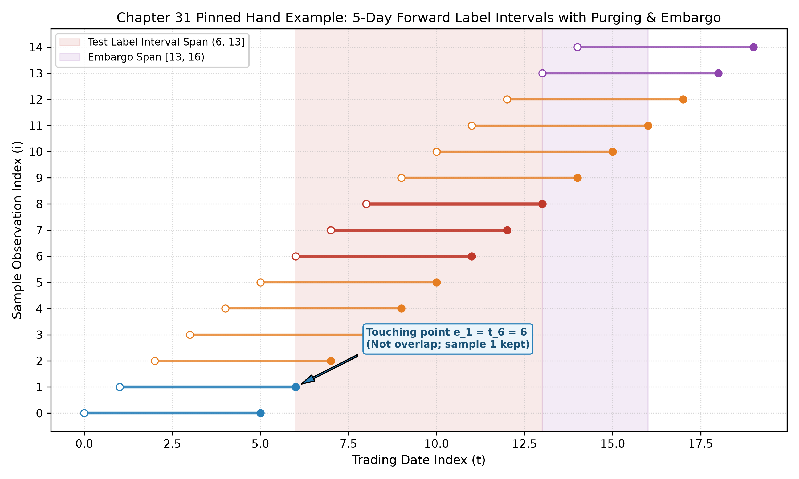
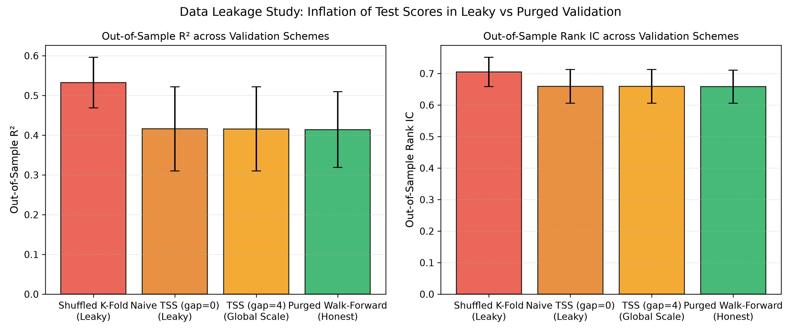
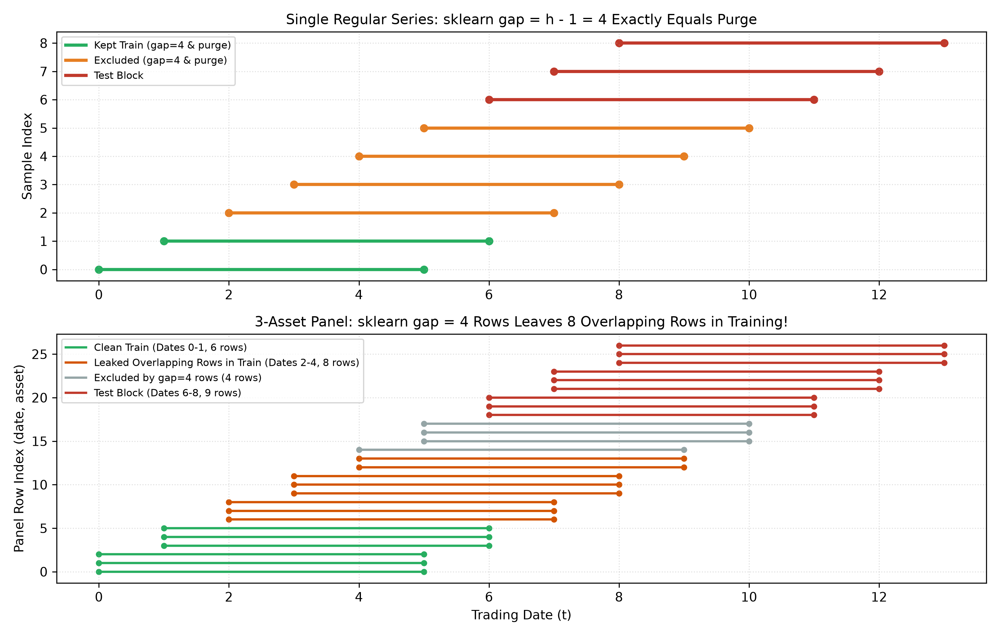
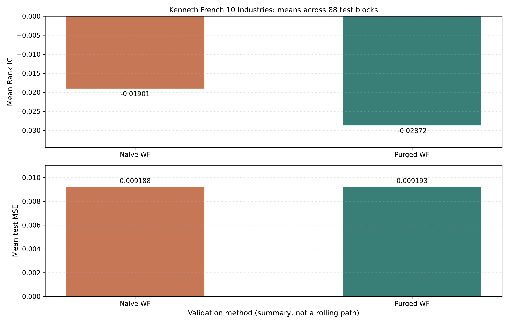

# 第31章 — 金融模型验证（Financial Model Validation）

> 主线：金融时间序列预测模型的验证核心，在于用严格的标签区间交集代数隔离信息；只有在消除未来收益重叠的前视净化（Purging）、阻断历史特征穿越的禁运（Embargo）以及严格按时间因果推进的样本外评价下，验证指标才能客观反映模型的样本外泛化能力。
> 先修：第7章（统计推断与抽样分布）、第16章（时间序列平稳性与自相关）、第22章（量化研究方法论与试验账本）、第29章（回测引擎与自融资账本）、第30章（回测偏差与时点因果）。完成后你能：徒手推导半开标签区间的重叠判定充要条件并证明接触非重叠；为多日与多月持有期标签计算精确的 Purge 与 Embargo 索引集合；证明 scikit-learn 的 `TimeSeriesSplit(gap=...)` 在截面面板上的失效机理并计算残留重叠行数；实现无前视泄漏的因果向前步进（Purged Walk-Forward）与净化交叉验证（Purged K-Fold）；实现嵌套验证（Nested Validation）流水线：缩放器仅在当前内层训练集拟合，超参数按内层验证分数选择，外层测试仅作评价；在真实历史行业收益与合成面板上量化数据泄漏带来的虚假增益。

---

## 1. 本章目标

在量化投资与金融机器学习的研究中，常见的隐性前视风险往往不是显式的代码错误，而是由于“向前持有收益标签的时间跨度”与“交叉验证切片边界”相互重叠所导致的虚假泛化。当研究员预测未来 5 个交易日的累计收益率时，若将数据集按常规机器学习方法随机打散，或者在时间轴上直接切分训练集与测试集而未扣除标签结算期，测试集中第一天的收益率实际上早已被训练集最后几天的收益标签全部或部分包含。模型表面上展现出亮眼的超额预测能力，实盘部署后却迅速失效。

完成本章学习后，读者应能达成以下四项核心能力：
1. **计算与推导目标**：掌握半开标签区间 $I_i = (t_i, e_i]$ 的区间代数性质，推导两区间重叠的充要条件 $\max(t_i, t_j) < \min(e_i, e_j)$，证明端点接触（$e_j = t_k$）不构成重叠；推导前视持有期 $h$ 下 Purge 样本集的闭式表达；证明在单资产规则日历下 `TimeSeriesSplit` 样本间隔参数 $\text{gap} = h - 1$ 与 Purge 等价，并推导其在包含 $N$ 只资产的面板数据上导致残留 $(h - 1)(N - 1)$ 行重叠数据的失效机理。
2. **解释与诊断目标**：深入阐释 Purge 与 Embargo 的各自经济逻辑与应用方向：Purge 双向消除标签收益与测试区间的交集，而 Embargo 仅单向作用于测试块之后的训练样本以防范自回归特征向后回看穿越；能够清晰界定 Purged K-Fold（用于跨市场状态检验参数稳定性）与时间因果 Walk-Forward（用于模拟实盘时间部署）的测量边界差异。
3. **实现与对账目标**：熟练运用 src/quant\_course/validation.py 中的核心函数，对单资产与多资产面板实现完整的样本净化、特征禁运、滚动与扩展向前步进划分；构建嵌套验证（Nested Selection）框架，确保缩放器与各候选模型仅在当前内层训练集拟合，按内层验证分数选择超参数，选定后在当前外层训练集重拟合，外层测试仅作评价。
4. **架构与边界目标**：明确检验五类边界条件（零与负区间 $e \le t$ 抛出异常、端点接触、非交易日与不规则日历、同日多证券截面面板、标签可得时点晚于结束时点 $a_i > e_i$）；在真实聚合行业收益（Kenneth French 10 Industries）与已知数据生成过程的合成面板上，准确量化泄漏方案与净化方案的数值差异。

完成条件：读者能徒手计算第8节的15观测期贯穿算例，并与代码逐项核对：

$$R_{\mathrm{purge}}=\{2,3,4,5,9,10,11,12\},$$
$$R_{\mathrm{embargo}}=\{13,14\},\qquad S_{\mathrm{final}}=\{0,1\}.$$

再按第9节默认I3读者路线理解代码、完成本章题答。保存的五种子/历史French结果是继承证据，本次修订不重跑完整CLI、Notebook、runner或历史研究。划分正确也不能单独证明全部数据、执行和特征通道无泄漏。

---

## 2. 为什么 Quant 需要它

在量化策略研发流水线中，模型验证处于因子特征工程与回测账本撮合之间的核心质量门禁位置：

```text
[数据清洗与特征构建] --> 【模型验证与无泄漏划分】 --> [组合优化与权重] --> [第29章 账本回测] --> [第32章 绩效推断]
   (Ch 3, 23-28)            (本章第31章)             (Ch 20-21)          (执行对账)          (PSR / PBO)
```

在经典计算机视觉或自然语言处理中，独立同分布（IID）假设构成了交叉验证的基石：样本之间彼此独立，在样本确为IID、目标分布与训练规模明确且不继续用外层结果选模型等条件下，随机K折可估计相应训练程序的预测风险；不能不加条件称为未来部署风险的无偏估计。但在金融时间序列中，IID 假设并不成立：
- **收益重叠与连续性（Overlapping Labels）**：金融预测往往关注数日、数周乃至数月的持有期回报。把简单收益复利暂按加总收益近似，若每日构建向前 5 日标签 $y_t^{\mathrm{add}} = \sum_{k=1}^5 r_{t+k}$，则相邻两天的标签共同包含 4 个交易日的真实市场收益。正式标签的复利定义见 §4.1；无论采用复利简单收益还是加总近似，其观测区间均需按 $I_t=(t,t+h]$ 追踪。将重叠标签随机分配到训练集与验证集，会让部分未来收益同时进入两侧。
- **特征回看窗口向后穿越（Feature Look-back Leakage）**：资产的技术指标（如 20 日均线、10 日动量、指数平滑）均使用历史回看窗口。若验证方案将时间顺序靠后的数据用作训练、靠前的数据用作测试（如 K-Fold 的非边界折），靠后训练集的初始特征会穿透进入测试块的真实发生区间。
- **预处理全局污染（Global Preprocessing Leakage）**：在划分训练集之前，对全样本特征矩阵进行全局标准化（`StandardScaler`）或主成分分析（PCA），测试集的均值、方差与极值分布已被优化器提前感知。
- **截面面板样本计数混淆（Sample count vs Calendar date）**：现有通用机器学习库（如 scikit-learn 的 `TimeSeriesSplit`）中的 `gap` 参数仅支持按**样本行数**排除。对于同一个截面包含数十只乃至数千只股票的金融面板，将 `gap` 设为 4 仅仅排除了最后 4 行数据（可能仅涵盖同一交易日的两三只股票），导致海量重叠样本依然潜伏在训练集中。

本章承接第 30 章对回测偏差的诊断，通过严谨的半开标签区间代数，形式化定义 Purging 与 Embargo，建立无泄漏的金融交叉验证标准，并为第 32 章的多重检验推断（PBO、CSCV）提供纯净的样本外候选序列。

---

## 3. 直觉

### 3.1 教学贯穿场景：为什么最后几天的训练标签已经包含了测试期收益？

假设你在单只股票上进行日频建模，特征在每日收盘后生成，预测目标是**未来 5 个交易日的累计收益率**。
我们在第 5 个交易日收盘切一刀：前 5 天（$t = 0, 1, 2, 3, 4$）划为训练集，从第 5 天开始（$t = 5$）划为测试集。

初学者的直觉通常是：“我在第 5 天收盘前把数据切开了，训练集特征全部来自第 0 到第 4 天，这难道不是严格的时间顺序吗？”

问题恰恰出在**标签的结算时点**上：
- 在第 4 天收盘（$t = 4$），模型观察了截至第 4 天收盘的所有特征，其对应的 5 日向前收益标签是股票从第 4 天收盘到第 9 天收盘（$t = 9$）的累计涨跌幅。
- 但你的测试集从第 5 天（$t = 5$）就已经开始了！测试集第 5 天的特征要预测第 5 天到第 10 天的收益；测试集第 6 天要预测第 6 天到第 11 天的收益。
- 精确地说，训练标签用 $r_5,\ldots,r_9$，测试起点5的标签用 $r_6,\ldots,r_{10}$，重叠四段 $r_6,\ldots,r_9$。在时点5收盘，$r_5$已实现，但训练标签仍要等到9才结算；不能把5..9五段都叫作测试未来收益。

这就是金融标签重叠造成的前视泄漏。为了杜绝此类信息渗透，我们必须将每一个样本视为一个**时间区间**，而非孤立的时间点。

### 3.2 冻结贯穿算例：单资产 15 个观测期的完整推演

我们考察课程冻结契约规定的标准算例：
- 离散交易日历包含 15 个交易日，观测时点索引为 $t \in \{0, 1, 2, \dots, 14\}$。
- 向前预测期限为 5 个交易日（$h = 5$）。每个样本的收益区间定义为左开右闭区间 $I_i = (t_i, t_i + h]$：$t_i$ 收盘价仅作为基准价格，收益率由随后各日的日收益集合 $\{r_{t_i+1}, \dots, r_{t_i+h}\}$ 构成。样本 $i$ 的特征在 $t_i$ 收盘可得。
- 我们指定测试块（Test Block）包含 3 个连续样本：$t \in \{6, 7, 8\}$。
- 候选训练集（Candidate Training Set）为其余所有样本：$t \in \{0, 1, 2, 3, 4, 5, 9, 10, 11, 12, 13, 14\}$。

```text
测试块样本的标签区间：
  t = 6: (6, 11]  --> 包含第 7, 8, 9, 10, 11 天收益
  t = 7: (7, 12]  --> 包含第 8, 9, 10, 11, 12 天收益
  t = 8: (8, 13]  --> 包含第 9, 10, 11, 12, 13 天收益
测试块整体信息跨度：从 t = 6 到 e_max = 13。
```

现在我们逐一审查候选训练样本的标签区间是否与测试块发生交集（Purge 判定）：
1. **测试块之前的样本**：
   - $t = 0$: $I_0 = (0, 5]$。测试集最早起点为 $t=6$。$\max(0, 6) = 6$，$\min(5, 11) = 5$。由于 $6 < 5$ 不成立，两区间无交集。**保留**。
   - $t = 1$: 对于样本 $1$（区间 $(1, 6]$），其收益覆盖第 2 至第 6 天的日收益集合 $\{r_2, \dots, r_6\}$；测试集首个样本 $6$（区间 $(6, 11]$）的收益覆盖第 7 至第 11 天的日收益集合 $\{r_7, \dots, r_{11}\}$。两者在 $t=6$ 收盘处仅为基准价格的**端点接触（Touching）**，实际日收益集合毫无交集（$\max(1, 6) < \min(6, 11) \iff 6 < 6$ 为假）。因此样本 1 不泄漏未来测试收益，安全**保留**！
   - $t = 2$: $I_2 = (2, 7]$。与测试样本 6（区间 $(6, 11]$）比较：$\max(2, 6) = 6 < \min(7, 11) = 7$。两区间重叠于第 7 天的收益！**剔除（Purged）**。
   - $t = 3$: $I_3 = (3, 8]$。$\max(3, 6) = 6 < \min(8, 11) = 8$。**剔除（Purged）**。
   - $t = 4$: $I_4 = (4, 9]$。$\max(4, 6) = 6 < \min(9, 11) = 9$。**剔除（Purged）**。
   - $t = 5$: $I_5 = (5, 10]$。$\max(5, 6) = 6 < \min(10, 11) = 10$。**剔除（Purged）**。
   因此，测试块之前的候选样本中，$\{2, 3, 4, 5\}$ 被 Purge 剔除，保留 $\{0, 1\}$。

2. **测试块之后的样本**：
   - 测试块最晚标签结束点为 $e_{\max} = 13$（由样本 8 的标签区间 $(8, 13]$ 决定）。
   - $t = 9$: $I_9 = (9, 14]$。与测试样本 8 比较：$\max(9, 8) = 9 < \min(14, 13) = 13$。**剔除（Purged）**。
   - $t = 10$: $I_{10} = (10, 15]$。$\max(10, 8) = 10 < 13$。**剔除（Purged）**。
   - $t = 11$: $I_{11} = (11, 16]$。$\max(11, 8) = 11 < 13$。**剔除（Purged）**。
   - $t = 12$: $I_{12} = (12, 17]$。$\max(12, 8) = 12 < 13$。**剔除（Purged）**。
   - $t = 13$: $I_{13} = (13, 18]$。与测试样本 8 比较：$\max(13, 8) = 13$，$\min(18, 13) = 13$。$13 < 13$ 不成立，端点接触，无重叠。**保留**。
   - $t = 14$: $I_{14} = (14, 19]$。$\max(14, 8) = 14 < 13$ 不成立。**保留**。
   因此，测试块之后的候选样本中，$\{9, 10, 11, 12\}$ 被 Purge 剔除，保留 $\{13, 14\}$。
   Purge 之后的训练集暂时为：$\{0, 1, 13, 14\}$。

3. **施加特征禁运（Embargo）**：
   - 设模型特征包含 3 日历史回看窗口（本例为过去3段收益，涉及4个价格点，即 $m=3$；不是仅3个价格点的均线）。
   - 位于测试块之后的训练样本 $t = 13$ 与 $t = 14$，其特征计算分别需要用到过去 3 天的数据（$t=13$ 需要 $t \in [10, 13]$；$t=14$ 需要 $t \in [11, 14]$），这些特征直接穿透回了测试块的标签结算区间 $(8, 13]$！
   - Embargo 规则规定：对测试块**之后**的训练样本，凡是观测时点落在 $[e_{\max}, e_{\max} + m) = [13, 13 + 3) = [13, 16)$ 的样本，必须予以清除。
   - 候选样本 $t = 13$ 与 $t = 14$ 均落在 $[13, 16)$ 内，因此被 Embargo 剔除！
   - 最终干净无泄漏的训练集为：$\{0, 1\}$。

这个极简算例直观展示了：Purge 与 Embargo 并非学术抽象，而是基于简单时间区间的精确几何运算。

---

### 3.3 用删除账与保留账再走一遍

用本章统一符号将15观测例写成单向过滤链：
$$\begin{aligned}
Q&=\{6,7,8\},\\
C&=\{0,1,2,3,4,5,9,10,11,12,13,14\},\\
R_{\mathrm{purge}}&=\{2,3,4,5,9,10,11,12\},\\
S_{\mathrm{after\_purge}}&=\{0,1,13,14\},\\
R_{\mathrm{embargo}}&=\{13,14\},\\
S_{\mathrm{final}}&=\{0,1\}.
\end{aligned}$$
数目对账：12个候选−8个purge删除=4个幸存者；4−2个embargo删除=2个最终训练样本。这里全轴候选含13、14，是purged K-fold式诊断小例，不是时点6就能用于训练的部署候选。所有标签结束时间仍按 $i+5$ 计算：最后样本的标签到19，15个观测起点不等于标签收益只到14；本例演示区间代数，实际数据需提供或剔除尚未结算的标签。

两种接触要分别解释：$I_1=(1,6]$ 与 $I_6=(6,11]$ 接触于6，前者含收益 $r_6$，后者从 $r_7$ 起；$I_{13}=(13,18]$ 与 $I_8=(8,13]$ 接触于13，前者从 $r_{14}$ 起。所以1、13都通过purge，但13的特征回看仍可进入测试标签跨度，被embargo删除。端点接触只回答“标签是否重叠”，不是全部可用性的通行证。

若部署预测在时点6且样本1的标签 $e_1=6$、真实发布 $a_1=7$，即使它仅与测试区间接触，也先被可得性门删除。它不能因为 $e_1=6$ 已结算就被程序自动视作已可读取。

---

## 4. 数学基础

### 4.1 离散时间轴与交易日历约定

- **交易日历序列**：$\mathcal{T} = \{t_0, t_1, \dots, t_{T-1}\}$ 为严格单调递增的交易日期索引集合，$t_0 < t_1 < \dots < t_{T-1}$。
- **观测（特征）时点（Observation Time）**：样本 $i$ 的特征提取时点记为 $t_i \in \mathcal{T}$。特征向量 $\mathbf{x}_i$ 仅允许使用截至交易日 $t_i$ 收盘为止所有已发布的信息集 $\mathcal{F}_{t_i}$。
- **标签结束时点（Label End Time）**：样本 $i$ 的预测目标结算时点记为 $e_i \in \mathcal{T}$，必须满足因果不等式 $e_i > t_i$。
- **半开标签区间（Half-Open Label Interval）**：样本 $i$ 的收益度量区间定义为左开右闭区间：
  $$I_i = (t_i, e_i] \subset \mathbb{R}$$
  在离散交易日历中，这代表资产从 $t_i$ 收盘价 $P_{t_i}$ 变动到 $e_i$ 收盘价 $P_{e_i}$ 的简单收益率：
  若共同日期序列为 $\tau_0<\cdots<\tau_K$，$t_i=\tau_{p_i}$、$e_i=\tau_{q_i}$，定义 $r_k=P_{\tau_k}/P_{\tau_{k-1}}-1$，则
  $$y_i=\frac{P_{\tau_{q_i}}}{P_{\tau_{p_i}}}-1=\prod_{k=p_i+1}^{q_i}(1+r_k)-1.$$
  只有把 $t_i,e_i$ 明确编码成共同观测位置时，才可把上界写作 $e_i-t_i$。不规则日期不能直接加h；资产各自日历的实际结束日期须先映射到共同有序时间坐标。

### 4.2 区间交集代数

在欧几里得一维实数轴上，考虑两个半开区间 $I_1 = (t_1, e_1]$ 与 $I_2 = (t_2, e_2]$，其中 $t_1 < e_1$ 且 $t_2 < e_2$。
两区间的交集为：
$$I_1 \cap I_2 = (\max(t_1, t_2), \min(e_1, e_2)]$$
交集为非空集合（即两区间存在重叠）当且仅当该区间的左端点严格小于右端点：
$$I_1 \cap I_2 \ne \emptyset \iff \max(t_1, t_2) < \min(e_1, e_2)$$

特别地，当 $e_1 = t_2$ 时（区间 1 的右端点等于区间 2 的左端点）：
$$\max(t_1, t_2) = t_2 = e_1, \quad \min(e_1, e_2) = e_1 \implies \max(t_1, t_2) = \min(e_1, e_2)$$
此时半开区间 $(e_1, e_1] = \emptyset$ 为空集。因此**端点接触不构成重叠**。

---

## 5. 正式定义

**样本观测时点（Observation Time, $t_i$）**：特征数据生成的时间截断点。在日频模型中，$t_i$ 表示信息截至第 $t_i$ 日收盘。

**标签结束时点（Label End Time, $e_i$）**：预测区间终止的时间截断点。严格满足 $e_i > t_i$；若出现 $e_i \le t_i$，系统必须抛出 `ValueError`。

**标签可得时点（Availability Time, $a_i$）**：标签真实值在数据库中完成记录、清算并可供程序读取的最早时间戳。对于二级市场流动性股票，通常 $a_i = e_i$（当日收盘即可结算）；但在基金净值、跨国资产或财报衍生指标中，可能存在清算或发布延迟导致 $a_i > e_i$。在训练集中，样本必须满足“在预测时刻该标签已完成结算”，即只有在 $a_i \le t_{\text{predict}}$ 时该历史样本才能被纳入训练。当前 `validation.py` 划分接口只接收区间起止时间 $t_i,e_i$，没有独立的 $a_i$ 参数；当 $a_i>e_i$ 时，调用方必须在生成每个预测时点的训练候选集前按真实可得时点过滤。不能用 $e_i$ 代替延迟发布的 $a_i$。

**候选集（Candidate Set, $C$）**：先确定验证目的再生成候选。部署型 walk-forward 只取预测时点前的历史观测，并要求标签可得 $a_i\le t_{\mathrm{predict}}$；调用方负责可得性过滤。允许未来训练块的 purged K-fold 是离线稳定性诊断，它使用评价时已可得的后置标签；不能把该候选集冒充预测时点可用的部署训练集。测试集记为 $Q$，且 $C\cap Q=\emptyset$。

**前视净化（Purging）**：定义删除集，再用集合差定义保留集：
$$R_{\mathrm{purge}}=\{i\in C:\exists j\in Q,\ \max(t_i,t_j)<\min(e_i,e_j)\},$$
$$S_{\mathrm{after\_purge}}=C\setminus R_{\mathrm{purge}}.$$
一个训练样本只要与任一测试标签相交就删除；没有相交、或只有端点接触，才进入保留集。$R$ 表示 removed，$S$ 表示 survivors，两者不能互换。面板数据默认采取保守的时间全局策略，不因资产名不同而放过标签重叠。

**特征禁运（Embargo）**：只检查已通过purge的后置候选，定义第二次删除集：
$$\begin{aligned}
R_{\mathrm{embargo}}=\{i\in S_{\mathrm{after\_purge}}:\ &t_i\ge t_{\mathrm{test,max}},\\
&e_{\mathrm{test,max}}\le t_i<e_{\mathrm{test,max}}+m\},
\end{aligned}$$
$$S_{\mathrm{final}}=S_{\mathrm{after\_purge}}\setminus R_{\mathrm{embargo}}.$$
这里 $t_{\mathrm{test,max}}=\max_{j\in Q}t_j$，$e_{\mathrm{test,max}}=\max_{j\in Q}e_j$；$m\ge0$ 的单位必须与观测时间坐标一致，规则日频时可按交易观测期计，不是无条件的自然日数。本章将 $m$ 设为覆盖所用特征最大回看长度的缓冲。左端点 $e_{\mathrm{test,max}}$ 包含，右端点 $e_{\mathrm{test,max}}+m$ 不包含；$m=0$ 时删除集为空。当前API将 $t,e$ 转成浮点数，不自动解析自然日期、各资产日历或 $a$；调用方先编码共同有序坐标，$m$也用同一单位。有限回看缓冲只覆盖声明的有限支持，未截断EMA的无限记忆不能靠某个有限m自动消除。

流程的关键不变量是
$$S_{\mathrm{final}}\subseteq S_{\mathrm{after\_purge}}\subseteq C,$$
因此已经purge的样本永远不会在embargo或后续拼接中复活。只含过去候选的walk-forward没有后置候选，$R_{\mathrm{embargo}}=\emptyset$。在严格部署条件 $a_i\ge e_i$ 且 $a_i\le t_{\mathrm{fit}}\le\min_{j\in Q}t_j$ 下，有 $e_i\le\min t_j$，因此已经排除历史标签与测试未来收益重叠；继续做区间核查可作为防错。离线诊断在较晚评价时刻可读取未来训练块，仍可能需要双向purge。反过来，几何不重叠不能替代可得性：只接触的旧标签仍可能晚发布。

**时间序列划分间隙（TimeSeriesSplit Gap, $g$）**：经典时间序列验证算法（如 scikit-learn 的 `TimeSeriesSplit`）中定义的切片参数，指定在训练块末尾与测试块开头之间跳过的**离散样本行数（Sample Count）**。

**因果向前步进验证（Purged Walk-Forward）**：严格保持单向时间前进的验证架构。训练集仅包含历史样本，测试集为紧随其后的未来时间块。每次前移时对训练集末尾进行 Purge 净化。

**净化交叉验证（Purged K-Fold）**：将连续时间轴切分为 $K$ 个不打乱的连续时间块。在第 $k$ 折中，第 $k$ 块作为测试集，其余所有时间块（包括过去块与未来块）组成候选训练集，随后施加 Purge 净化与 Embargo 禁运。

**嵌套验证（Nested Validation）**：双层交叉验证架构。外层用于评估模型的真实样本外泛化表现；内层仅在外层当前训练集内部进行子切分，用于超参数网格搜索与特征筛选。特征归一化参数（均值与方差）严格仅在当前训练折内拟合。

---

## 6. 推导

### 6.1 标签区间重叠判定条件的充要性证明

**定理 1（重叠判定的区间充要条件）**  
设 $I_1 = (t_1, e_1]$ 与 $I_2 = (t_2, e_2]$ 为实数轴上的非退化半开区间，即 $t_1 < e_1$ 且 $t_2 < e_2$。则：
$$I_1 \cap I_2 \ne \emptyset \iff \max(t_1, t_2) < \min(e_1, e_2)$$

*证明*：  
根据集合交集的定义，$x \in I_1 \cap I_2$ 当且仅当 $x \in I_1$ 且 $x \in I_2$。  
由半开区间定义：
$$x \in I_1 \iff t_1 < x \le e_1$$
$$x \in I_2 \iff t_2 < x \le e_2$$
两式联立，等价于：
$$\max(t_1, t_2) < x \le \min(e_1, e_2)$$
实数轴上存在满足上述不等式的实数 $x$ 的充要条件是严格不等式：
$$\max(t_1, t_2) < \min(e_1, e_2)$$
若该不等式成立，则任意 $x \in (\max(t_1, t_2), \min(e_1, e_2)]$ 均属于交集，交集非空。  
反之，若 $\max(t_1, t_2) \ge \min(e_1, e_2)$，则没有任何实数能够同时大于 $\max(t_1, t_2)$ 且小于等于 $\min(e_1, e_2)$，交集必为空集 $\emptyset$。证毕。

### 6.2 单资产规则日历下 Purge 样本规模与 gap 等价性推导

考虑单只资产在规则交易日历上观测，固定持有期为 $h \ge 2$ 个交易日。所有样本标签为 $e_i = t_i + h$。  
设测试块为时间连续区间 $[t_{\text{test}}, t_{\text{test}} + n_{\text{test}} - 1]$。其测试区间的总并集为：
$$\bigcup_{j \in \mathcal{S}_{\text{test}}} (t_j, e_j] = (t_{\text{test}}, t_{\text{test}} + n_{\text{test}} - 1 + h]$$

对于测试块**之前**的候选训练样本 $t_i < t_{\text{test}}$，其区间为 $(t_i, t_i + h]$。  
根据定理 1，样本 $i$ 与测试集第一个样本 $t_{\text{test}}$（区间 $(t_{\text{test}}, t_{\text{test}} + h]$）发生重叠的充要条件为：
$$\max(t_i, t_{\text{test}}) < \min(t_i + h, t_{\text{test}} + h)$$
由于 $t_i < t_{\text{test}}$，左边为 $t_{\text{test}}$；同时 $t_i + h < t_{\text{test}} + h$，右边为 $t_i + h$。不等式化简为：
$$t_{\text{test}} < t_i + h \iff t_i > t_{\text{test}} - h$$
由于 $t_i$ 为整数索引，满足该条件的训练样本集合为：
$$t_i \in \{t_{\text{test}} - h + 1, t_{\text{test}} - h + 2, \dots, t_{\text{test}} - 1\}$$
被 Purge 剔除的样本总数恰好为：
$$(t_{\text{test}} - 1) - (t_{\text{test}} - h + 1) + 1 = h - 1$$

在 scikit-learn 的 `TimeSeriesSplit` 中，若设置参数 `gap`，其切分逻辑将训练集末尾截断：
$$\text{train\_end} = \text{test\_start} - \text{gap} = t_{\text{test}} - \text{gap}$$
在单资产规则日历下，选取 $\text{gap} = h - 1$ 构成了与区间 Purge 完全等价的充分条件：训练集截止于 $t_{\text{test}} - (h - 1) = t_{\text{test}} - h + 1$ 之前，排除的恰好是 $\{t_{\text{test}} - h + 1, \dots, t_{\text{test}} - 1\}$ 这 $h - 1$ 个样本。

### 6.3 截面面板上 gap 失效机理与泄漏量闭式推导

**定理 2（截面面板上的 gap 破缺定理）**  
设面板完整平衡，每日期恰有 $N\ge2$ 只资产且无缺失，按 `(date, asset)` 排序；固定整数期限 $h\ge2$，测试从整日期边界开始，历史至少有连续的 $h-1$ 个日期。测试块起始于日期 $T_{\text{test}}$，在行索引上对应 $R_{\text{test}} = T_{\text{test}} \times N$。  
若算法直接采用 $\text{gap} = h - 1$ 过滤样本行，则训练集中将残留的重叠样本行数精确为：
$$N_{\text{leak}} = (h - 1)(N - 1)$$

*证明*：  
1. **真实重叠行数**：  
   根据 6.2 节推导，所有日期 $t \in \{T_{\text{test}} - h + 1, \dots, T_{\text{test}} - 1\}$ 的样本均与测试集重叠。共包含 $h - 1$ 个日期。  
   由于每个日期包含 $N$ 只资产的样本行，真实需要清除的训练样本总行数为：
   $$N_{\text{true\_purge}} = (h - 1) \times N$$
2. **gap 实际排除行数**：  
   `TimeSeriesSplit` 是按样本行进行切片的。令 $\text{gap} = h - 1$，算法实际剔除的仅仅是紧随 $R_{\text{test}}$ 之前的 $h - 1$ 个**样本行**：
   $$\text{排除行} = \{R_{\text{test}} - (h - 1), \dots, R_{\text{test}} - 1\}$$
3. **残留重叠行数**：  
   在 $N \ge 2$ 且 $h \ge 2$ 条件下，由于 $N > 1$，必有 $h - 1 < (h - 1)N$。被排除的 $h - 1$ 个样本行至多覆盖 $\lfloor(h - 1)/N\rfloor$ 个完整交易日及至多一个日期的部分资产，而无法覆盖全部 $h - 1$ 个重叠交易日。  
   残留的重叠行数为两者的差值：
   $$N_{\text{leak}} = N_{\text{true\_purge}} - (h - 1) = (h - 1)N - (h - 1) = (h - 1)(N - 1)$$
   在我们的冻结算例中：$N = 3$ 只资产，$h = 5$ 日标签。
   需要清除的重叠行为 $(5 - 1) \times 3 = 12$ 行（涵盖日期 2, 3, 4, 5 的全部 12 行）。
   设置 $\text{gap} = 4$ 样本行，仅剔除了 4 行（日期 5 的 3 只股票以及日期 4 的第 3 只股票）。
   残留在训练集中的重叠行数为：
   $$12 - 4 = 8 \text{ 行}$$
   这 8 行分别属于日期 2（3 行）、日期 3（3 行）与日期 4（2 行）。
   定理得证。缺失资产/日期、变长期限、历史不足或日内截开面板时，此闭式不再直接适用，须按真实区间逐项计算。

---

## 7. 金融解释

### 7.1 为什么金融特征和标签具有长记忆性？

在经典统计学中，残差往往被假定为独立同分布白噪声。然而，金融资产的价格序列是由基本面、宏观流动性与投资者微观博弈共同驱动的。
若把逐期简单收益的复利先作小收益加总近似，$h$ 期标签可写作滑动加总 $y_t^{\mathrm{add}}=\sum_{k=1}^h r_{t+k}$。在 $r_t$ 方差相同且两两不相关的条件下（例如同方差鞅差），滞后 $0\le\ell<h$ 的协方差为：
$$\mathrm{Cov}(y_t^{\mathrm{add}},y_{t+\ell}^{\mathrm{add}})=(h-\ell)\sigma_r^2$$
该式是加总标签下的精确结果；当 $\ell\ge h$ 时协方差为 0。它不是 §4.1 所定义复利简单收益标签的一般精确协方差。

对 §4.1 的复利简单收益标签 $Y_t=\prod_{k=1}^h(1+r_{t+k})-1$，只有在额外假设简单收益跨期独立同分布时，才能直接写出精确式。令 $G=1+r$、$m_1=\mathbb{E}[G]$、$m_2=\mathbb{E}[G^2]$，则对 $0\le\ell<h$：
$$\mathrm{Cov}(Y_t,Y_{t+\ell})=m_2^{h-\ell}m_1^{2\ell}-m_1^{2h}$$
若 $\mathbb{E}[r]=0$、$\mathrm{Var}(r)=\sigma_r^2$，化为 $(1+\sigma_r^2)^{h-\ell}-1$；只有在小方差下才近似为 $(h-\ell)\sigma_r^2$。因此，重叠区间会造成标签间的统计依赖，但依赖强度取决于收益分布、持有期和滞后；不能仅凭区间重叠就断言其“必然高度”相关。防止同一 realized return 同时进入训练标签与测试标签的 Purge 逻辑仍成立。

需要指出的是，标签重叠对模型评估的具体影响取决于数据生成过程、模型、特征结构和测试窗口。在本章的 Ridge 构造中，5 种子下净化前后的平均分差较小；单凭这一结果不能概括低容量模型的普遍表现。另一个 1-NN 构造展示了未净化边界样本可能成为记忆测试标签重叠信息的路径，但其影响大小并非只由模型容量决定，须结合具体数据与划分检验。

### 7.2 Purged K-Fold 与 Walk-Forward 的决策定位

量化界常常争论：模型验证到底应该使用严格向前推进的 Walk-Forward，还是可以使用两端训练的 Purged K-Fold？
这两者回答的实际上是不同的科学问题：
1. **Purged Walk-Forward 回答“实盘部署问题”**：
   - 它完全遵循时间的单向因果箭头。在任何一个预测点，模型永远只能使用过去的历史。
   - 它能够真实反映宏观经济体制变迁（Regime Shift）、结构突变与分布漂移对策略的冲击。部署评价应使用符合当时可得信息的前推协议；通过split仍不证明真实输入、交易成本或其他通道已合法。
2. **Purged K-Fold 回答“跨周期泛化稳定性问题”**：
   - 它在消除了标签重叠（Purge）与特征穿越（Embargo）的前提下，允许利用未来数据训练模型来测试历史区间。
   - 它回答的是：“如果一个经济规律在 2024 年成立，它在 2018 年的参数是否保持一致？”它通过提升样本利用率，检验模型是否对特定历史时期发生局部过拟合。但读者必须清醒地认识到：**Purged K-Fold 的测试分数不能替代实盘时间维度的部署测试**。

---

## 8. Numerical Example

我们在这里完整复现并手算第 3.2 节的冻结贯穿算例，并将其与 CLI 导出的标准化结果逐一核对。

::: {.body-example title="完整例题：15起点标签集合与45行面板"}

### 8.1 算例输入规格

- **样本序列**：单资产日度观测，索引 $t_i = i, \; i \in \{0, 1, \dots, 14\}$，共 15 个交易日。
- **向前标签跨度**：$h = 5$ 个交易日。标签区间为 $I_i = (t_i, t_i + 5]$。
- **测试块划分**：$\mathcal{S}_{\text{test}} = \{6, 7, 8\}$。
- **候选训练集**：$\mathcal{S}_{\text{train}} = \{0, 1, 2, 3, 4, 5, 9, 10, 11, 12, 13, 14\}$。
- **特征回看窗口**：$m = 3$ 个交易日。

### 8.2 手算逐步推演与核对表

下表列出每一个候选样本的区间端点、与测试块的重叠判定以及处理决策：

| 样本 $i$ | 观测 $t_i$ | 标签结束 $e_i$ | 半开区间 $I_i$ | 测试块重叠关系检验 | 判定状态 | 最终去向 |
|---|---|---|---|---|---|---|
| 0 | 0 | 5 | $(0, 5]$ | $\max(0, 6) = 6 \not< \min(5, 11) = 5$ | 无交集 | 保留 |
| 1 | 1 | 6 | $(1, 6]$ | $\max(1, 6) = 6 \not< \min(6, 11) = 6$ | 端点接触（非重叠） | 保留 |
| 2 | 2 | 7 | $(2, 7]$ | $\max(2, 6) = 6 < \min(7, 11) = 7$ | 重叠 | Purge 剔除 |
| 3 | 3 | 8 | $(3, 8]$ | $\max(3, 6) = 6 < \min(8, 11) = 8$ | 重叠 | Purge 剔除 |
| 4 | 4 | 9 | $(4, 9]$ | $\max(4, 6) = 6 < \min(9, 11) = 9$ | 重叠 | Purge 剔除 |
| 5 | 5 | 10 | $(5, 10]$ | $\max(5, 6) = 6 < \min(10, 11) = 10$ | 重叠 | Purge 剔除 |
| 9 | 9 | 14 | $(9, 14]$ | $\max(9, 8) = 9 < \min(14, 13) = 13$ | 重叠 | Purge 剔除 |
| 10 | 10 | 15 | $(10, 15]$ | $\max(10, 8) = 10 < \min(15, 13) = 13$ | 重叠 | Purge 剔除 |
| 11 | 11 | 16 | $(11, 16]$ | $\max(11, 8) = 11 < \min(16, 13) = 13$ | 重叠 | Purge 剔除 |
| 12 | 12 | 17 | $(12, 17]$ | $\max(12, 8) = 12 < \min(17, 13) = 13$ | 重叠 | Purge 剔除 |
| 13 | 13 | 18 | $(13, 18]$ | $\max(13, 8) = 13 \not< \min(18, 13) = 13$ | 端点接触（Purge 保留） | Embargo 剔除 |
| 14 | 14 | 19 | $(14, 19]$ | $\max(14, 8) = 14 \not< 13$ | 无交集（Purge 保留） | Embargo 剔除 |

- **Purge 阶段核对**：
  - 测试块前剔除：$\{2, 3, 4, 5\}$（键：`hand_example.removed_by_purge_pre_test`）；
  - 测试块后剔除：$\{9, 10, 11, 12\}$（键：`hand_example.removed_by_purge_post_test`）；
  - Purge 保留集：$\{0, 1, 13, 14\}$（键：`hand_example.purged_train_indices`）。
- **Embargo 阶段核对**：
  - 测试块最晚标签结束点 $e_{\max} = 13$；
  - 禁运时间区间为 $[e_{\max}, e_{\max} + m) = [13, 16)$；
  - 位于测试块之后的样本 $\{13, 14\}$ 其 $t_i \in \{13, 14\}$ 均落入 $[13, 16)$，予以清除（键：`hand_example.removed_by_embargo`）；
  - 最终保留训练集为：$\{0, 1\}$（键：`hand_example.final_train_indices`）。

### 8.3 截面面板 gap 失效手算核对

设 3 只资产在 15 个交易日上观测，数据表共 45 行，按 `(date, asset)` 严格排布：
- 行 $0, 1, 2$ 为日期 0；行 $3, 4, 5$ 为日期 1；……；行 $18, \dots, 26$ 为日期 6, 7, 8（测试集，共 9 行）。
- 正确的因果 Purge 应当清除日期 2, 3, 4, 5 的全部样本，即清除行 $6, \dots, 17$ 共 12 行，仅保留日期 0 与 1 的行 $0, \dots, 5$ 共 6 行（键：`hand_example.panel_purged_train_indices`）。
- 若错误调用 `TimeSeriesSplit(gap=4)`：测试集起始行号为 18，训练集截止行号为 $18 - 4 = 14$。算法保留了行 $0, \dots, 13$（共 14 行）。
- 残留重叠行：
  - 日期 2 的样本（行 6, 7, 8，共 3 行）；
  - 日期 3 的样本（行 9, 10, 11，共 3 行）；
  - 日期 4 的样本（行 12, 13，共 2 行）。
  - 合计残留重叠行数恰好为 $3 + 3 + 2 = 8$ 行（键：`hand_example.panel_tss_overlapping_count`），残留行索引列表为 $[6, 7, 8, 9, 10, 11, 12, 13]$（键：`hand_example.panel_tss_overlapping_rows`）。


:::

---

## 9. Python Implementation

`walk_forward_splits` 默认 `purge_overlap=True`，必须同时提供与样本数量一致的观测时间 `t` 与标签结束 `e`；缺少时直接报错，不会静默退化成普通时间切分。若为了对照实验明确关闭净化，可传 `purge_overlap=False`，但时间顺序本身不能保证标签已结算。例：`n=15, train_size=6, test_size=3`，若 `e=t+5`，第一折候选训练 0–5、测试 6–8；净化后仅保留训练 0、1。省略区间会遗留训练 2–5 的重叠标签。


本章核心算法位于 `src/quant_course/validation.py`。默认从已接受I3读者包根运行：

```bash
python run_notebook.py notebooks/ch31_model_validation.ipynb
```

默认Notebook会新算单种子500日期的四方案、1-NN、净化K折及嵌套构造，不是只读取五种子摘要；French分支默认跳过。Notebook创建唯一 `runs/ch31_model_validation_<uuid>/` 并将图写在该运行目录；runner另存 `runs/execution_<stem>_<uuid>/` 中的执行副本与 `execution.json`，失败亦保留。本次修订没有执行它们。英语Notebook/共享runner的全包装配与冷启动仍待BIL23。以下为代码阅读与独立小例入口，不引导覆盖历史CLI默认输出。

### 9.1 区间重叠测试与 Purge / Embargo 基础函数

以下代码展示如何在 NumPy 中高效实现无循环向量化重叠判定与净化过滤：

```python
import numpy as np
from quant_course.validation import check_label_intervals, intervals_overlap, purge, embargo

# 构造 15 观测期手算例
t = np.arange(15, dtype=float)
e = t + 5.0
test_idx = np.array([6, 7, 8])
cand_train = np.array([0, 1, 2, 3, 4, 5, 9, 10, 11, 12, 13, 14])

# 1. Purge 过滤
purged_train = purge(cand_train, test_idx, t, e)
assert np.array_equal(purged_train, [0, 1, 13, 14])

# 2. 接触非重叠断言：样本 1 (1, 6] 与测试样本 6 (6, 11]
assert not intervals_overlap(t[1], e[1], t[6], e[6])

# 3. Embargo 过滤 (m = 3)
final_train = embargo(purged_train, test_idx, t, e, m=3)
assert np.array_equal(final_train, [0, 1])
print("手算例 Python 净化断言完全通过，最终训练集:", final_train.tolist())
```

### 9.2 因果向前步进与 Purged K-Fold 生成器

```python
import numpy as np
from quant_course.validation import walk_forward_splits, purged_kfold_splits

# 1. 因果扩展窗口 (Expanding Walk-Forward)
n_samples = 30
t_series = np.arange(n_samples, dtype=float)
e_series = t_series + 3.0  # 3 日未来收益

splits_wf = walk_forward_splits(
    n_samples=30,
    train_size=10,
    test_size=5,
    step=5,
    expanding=True,
    t=t_series,
    e=e_series,
    purge_overlap=True,
)
print(f"生成的 Walk-Forward 折数: {len(splits_wf)}")
# 第一折：测试集 [10..14]，候选训练集 [0..9]，重叠样本为 8, 9，保留 [0..7]
train0, test0 = splits_wf[0]
assert np.array_equal(test0, np.arange(10, 15))
assert np.array_equal(train0, np.arange(8))

# 2. 面板数据的 Purged K-Fold (按日期成块)
dates_panel = np.repeat(np.arange(20), 2)  # 20 个日期，每个日期 2 只资产，共 40 样本
e_panel = dates_panel + 2.0
splits_pkf = purged_kfold_splits(
    n_samples=40,
    n_splits=4,
    t=dates_panel,
    e=e_panel,
    embargo_m=1,
    groups_date=dates_panel,
)
print(f"生成的 Purged K-Fold 折数: {len(splits_pkf)}")
train_f0, test_f0 = splits_pkf[0]
print(f"第 0 折测试集行数: {len(test_f0)}, 净化后训练集行数: {len(train_f0)}")
```

### 9.3 外内层均净化的嵌套超参数选择（Nested Selection）

下面明确采用前向数组约定：`period_returns[i]` 是特征时点 $i$ 之后、区间 $(i,i+1]$ 的合成收益，对应正式记号 $r_{i+1}$，不是在 $i$ 已实现的 $r_i$。因此 `y[i]` 累加 $(i,i+1]$ 与 $(i+1,i+2]$ 两段，结算终点为 $e_i=i+2$。`X_all[i+1]` 只用于生成第二段模拟未来收益，不进入时点 $i$ 的特征。这里用加法标签演示重叠净化，未声称它等于两期复利简单收益。

```python
import numpy as np
from sklearn.linear_model import Ridge
from quant_course.validation import nested_hyperparameter_evaluation

rng = np.random.RandomState(42)
N = 120
X_all = rng.randn(N + 1, 2)
X = X_all[:-1]
# period_returns[i] is realized over (i, i+1], driven by X_all[i] known at i.
period_returns = 0.5 * X_all[:, 0] + rng.randn(N + 1) * 0.1
# Two-period forward additive-return approximation.
y = period_returns[:-1] + period_returns[1:]
t_obs = np.arange(N, dtype=float)
e_obs = t_obs + 2.0
a_obs = e_obs.copy()  # This example assumes labels are available when their intervals end.

candidate_outer_splits = [
    (np.arange(60), np.arange(60, 90)),
    (np.arange(90), np.arange(90, 120)),
]
outer_splits = []
for train_idx, test_idx in candidate_outer_splits:
    prediction_time = np.min(t_obs[test_idx])
    eligible_train = train_idx[a_obs[train_idx] <= prediction_time]
    outer_splits.append((eligible_train, test_idx))

def inner_split_fn(out_tr, t_arr, e_arr):
    n = len(out_tr)
    folds = []
    for start, stop in [(n // 3, 2 * n // 3), (2 * n // 3, n)]:
        in_train = np.arange(start)
        in_val = np.arange(start, stop)
        prediction_time = np.min(t_arr[out_tr[in_val]])
        # The caller filters availability; the helper applies interval Purge.
        in_train = in_train[a_obs[out_tr[in_train]] <= prediction_time]
        folds.append((in_train, in_val))
    return folds

param_grid = [{"alpha": 0.01}, {"alpha": 1.0}, {"alpha": 100.0}]

def model_factory(p):
    return Ridge(alpha=p["alpha"])

def scorer(m, X_te, y_te):
    return -float(np.mean((m.predict(X_te) - y_te) ** 2))

nested_res = nested_hyperparameter_evaluation(
    X, y, t_obs, e_obs, outer_splits, inner_split_fn, param_grid, model_factory, scorer, scale_features=True
)
print("嵌套选择外层各折测试分数:", nested_res["outer_scores"])
print("外层各折选出的最优参数:", nested_res["best_params_per_fold"])
print("实际外层训练/测试索引:", nested_res["outer_splits_used"])
print("实际内层训练/验证索引:", nested_res["inner_splits_used"])
```

该 helper 会对外层训练候选集和内层训练集分别按标签区间执行 Purge，并在结果中记录实际使用的全局索引。纯前向示例中，调用方还先按 $a_i \le t_{\mathrm{predict}}$ 过滤可用标签；此处显式设 $a_i=e_i$。若实际发布延迟使 $a_i>e_i$，须用真实 $a_i$ 做同样的调用前过滤。Purged K-Fold 诊断可含测试块之后的训练样本，不代表部署时可用的信息集。

章节 CLI 的 20 资产合成研究结果（独立于上面的简短结构示例；见 `nested_selection`）：
- 诚实外层测试平均 MSE：$0.014231$（键：`nested_selection.mean_nested_outer_mse`）；
- 在测试集上直接调参的偷窥 MSE：$0.014195$（键：`nested_selection.mean_naive_cheating_mse`）；
- 两者差异仅为 $0.000036$（约 0.25%）。

**原因解析**：在该合成研究中，候选超参数网格为 5 个 $\alpha$，数据生成过程以线性为主，Ridge 正则化较强，因此这组测试折上的数值差距较小。这个结果只描述本次模型、搜索网格、种子和样本切分。测试集调参会使其也参与模型选择，因而外层分数不再是独立评估；实际偏差大小取决于搜索过程、数据和验证设计，不能从本例推导出固定增幅。

---

## 10. Visualization

本章通过 `code/ch31_model_validation.py` 生成了 4 幅高清晰度专业图表（均保存在 `figures/a6/` 目录中），严格对应正文推导与数值实验。

### 10.1 贯穿手算例标签区间图



- **文件路径**：`figures/a6/ch31_hand_label_intervals.png`。
- **坐标轴与单位**：横轴为共同观测位置 $t$（离散整数，完整延伸至最后标签端点19；15个起点不意味着标签止于14）；纵轴为样本观测编号 $i$（整数，$0$ 至 $14$）。
- **样本与图元**：包含全部 15 个样本的半开收益区间 $(t, t+5]$。左端点为空心圆，右端点为实心圆。测试块样本 $\{6, 7, 8\}$ 标为深红色粗线；因标签重叠被 Purge 剔除的样本 $\{2, 3, 4, 5, 9, 10, 11, 12\}$ 标为橙色线；因特征回看穿透被 Embargo 剔除的样本 $\{13, 14\}$ 标为紫色线；最终干净保留的训练样本 $\{0, 1\}$ 标为深蓝色粗线。
- **读者观察点**：
  1. 样本 1 的标签区间 $(1, 6]$ 的右端点实心圆与测试样本 6 的区间 $(6, 11]$ 左端点空心圆精确重合于 $t=6$ 垂直线。箭头明确标注“端点接触非重叠（Touching point $e_1 = t_6 = 6$）”，直观展示了为何样本 1 被安全保留。
  2. 测试块之后样本 $t=13$ 的标签区间并不与测试块重叠，但由于落在紫色阴影标注的禁运跨度 $[13, 16)$ 内，清晰展现了 Embargo 的保护机制。

### 10.2 数据泄漏消融对比柱状图与消融拆解



- **文件路径**：`figures/a6/ch31_leakage_comparison.png`。
- **坐标轴与单位**：左图纵轴为样本外可决系数 $R^2$（无量纲小数）；右图纵轴为样本外秩相关系数 Rank IC（无量纲小数）；横轴为 4 种验证方案。误差棒代表跨 5 个随机种子（`[20261031, 20261032, 20261033, 20261034, 20261035]`）的标准差。

下表汇总 5 种子平均的实测数值对比（键：`leakage_experiment.schemes`）：

| 验证方案 (Validation Scheme) | 样本外 $R^2$ (均值 $\pm$ 标准差) | 样本外 Rank IC (均值 $\pm$ 标准差) | 样本外 MSE | 泄漏属性与隔离级别 |
|---|---|---|---|---|
| **1. Shuffled K-Fold** | $0.5327 \pm 0.0638$ | $0.7054 \pm 0.0465$ | $0.01177$ | 打散时间轴，全局特征归一化 |
| **2. Naive TSS (gap=0)** | $0.4160 \pm 0.1059$ | $0.6593 \pm 0.0537$ | $0.01286$ | 未打散，无 Purge，全局特征归一化 |
| **3. TSS (gap=4)** | $0.4160 \pm 0.1060$ | $0.6594 \pm 0.0537$ | $0.01286$ | 未打散，按行剔除 4 行，全局归一化 |
| **4. Purged Walk-Forward** | $0.4143 \pm 0.0952$ | $0.6583 \pm 0.0526$ | $0.01290$ | 严格时序因果，Purge 净化，训练集归一化 |

- **读者观察与消融分解**：
  1. **协议之间的观测差**：Shuffled K-Fold与Purged Walk-Forward的保存均值差为0.1184（Rank IC差0.0471）。其中前两方案差0.1167，后两协议差约0.0017，但这不是匹配消融：打乱K折与TSS的训练日期/样本量不同，TSS与purged walk-forward还改变整日期分块、purge与缩放范围。不能把0.1167/0.1184约98.6%称为打乱的因果份额，也不能把0.0017单独归因purge；需匹配训练样本、测试样本、预处理和其他条件才能识别某一变更的贡献。
  2. **当前线性模型比较的边界影响**：在这组 20 资产、500 日、5 种子的 Ridge 构造中，5 个大测试块（每个 80 日）边界处的 4 天标签重叠占训练样本比例小于 $2\%$；实测净化前后分数接近。该观察描述本次设计，不能推出低容量模型通常不受泄漏影响，也不能把泄漏效应限定为高容量模型或某类特征。
  3. **高容量记忆模型（1-NN）下的未净化膨胀验证**：为了直观展现标签重叠在高容量记忆模型下的影响，我们在 30 资产面板上测试了 1-最近邻（1-NN）模型在逐日向前步进中的表现（键：`overlap_memorization_experiment`）：
     - 未净化的 1-NN 样本外平均 Rank IC 达到 $0.1194$（5 个种子依次为 $0.0977$、$0.0942$、$0.1691$、$0.1109$、$0.1249$）；
     - 因果 Purge 净化后的 1-NN 样本外平均 Rank IC 为 $0.0108$（5 个种子依次为 $0.0007$、$-0.0189$、$0.0784$、$0.0061$、$-0.0121$）；这是该生成过程与有限种子下的观测值，不是“真实”总体预测力的估计保证；
     - 在这个构造中，未净化模型可把测试资产匹配到昨日未净化的自身样本，两标签共享 80% 收益，5 种子平均 Rank IC 差为 $0.1086$（键：`overlap_memorization_experiment.rank_ic_inflation`）。它说明某些高记忆能力模型可能利用标签重叠；与前述 Ridge 结果合起来并不能建立模型容量与泄漏偏差之间的普遍单调关系。

### 10.3 样本计数 gap 与区间 purge 对比图



- **文件路径**：`figures/a6/ch31_gap_vs_purge_panel.png`。
- **坐标轴与单位**：上图为单资产序列（纵轴为样本序号 $0..8$）；下图为 3 资产面板数据（纵轴为面板行号 $0..26$，按 `(date, asset)` 排布）；横轴均为交易日索引 $t$。
- **读者观察点**：
  1. 上图展示在单资产序列上，`gap = 4` 样本正好对应排除了样本 $2, 3, 4, 5$，与 Purge 结果逐行重合；
  2. 下图醒目展示了面板数据的严重样本残留：`gap = 4` 仅排除了行 $14..17$（灰色线），而残留的行 $6..13$（深橙色线，涵盖日期 2、3、4 的 8 行数据）完全暴露在训练集中，直观印证了定理 2 的理论预测。

### 10.4 真实行业月度收益滚动验证的汇总均值图



- **文件路径**：`figures/a6/ch31_french_rolling_validation.png`。
- **坐标轴与单位**：横轴为朴素与净化两种验证方法；上图纵轴为88个测试块的平均 Rank IC，下图纵轴为平均测试均方误差 MSE。图中柱高只表示保存结果中的汇总均值，不呈现逐块路径，也不说明每个块稳定或方法差异显著。
- **读者观察点**：
  1. 3 个月向前重叠标签下，朴素 Walk-Forward 与 Purged Walk-Forward 的平均测试 MSE 分别为 $0.009188$ 与 $0.009193$；
  2. 真实学术聚合行业数据的观测平均 Rank IC 分别为 $-0.01901$ 与 $-0.02872$。本实验未提供均值不确定性或显著性检验，故这些负均值不能证明总体不存在正向 Alpha；图表只报告该数据、模型与验证窗口下的观测结果。

---

## 11. Real Market Example

本节保留历史方法示例，不是本批重新取得或执行的数据研究。French原始、提取及处理文件不随默认I3包提供；默认Notebook跳过该分支，使用权、主体与用途仍须另核，A10-A/A10-A.1不替代G05/A10-B执行授权。

为了展示模型验证在真实市场资产上的表现，我们使用已在工作区中冻结的 Kenneth R. French 10 行业组合月度总收益率数据（1926-07 至 2026-08，共 1202 个月度观测）。

### 11.1 数据属性与边界声明

- **数据来源**：Kenneth R. French Data Library: 10 Industry Portfolios (value-weighted, monthly) 与 FF3 无风险利率（RF）。
- **文件与哈希核验**：
  - 数据清单：`data/manifests/french_industries_2026-10-05.json`（SHA-256: `3b71cd5f781f9790cc380195c22635e03e9c9e27a5f43cd2d0d46fb12efa8271`）；
  - 处理后收益表：`data/processed/french_10_industries_monthly.csv`（SHA-256: `3b097d810c295d64eedfa1ece7067ff2a0707f5ca90e33935df9949251f70950`）。
- **学术与可交易性边界**：该数据属于学术聚合组合、已进行历史修订、非逐笔时点快照（`is_point_in_time: false`），且不具备个股的可成交流动性，因此本案例仅用于验证方法学教学，不构成任何实盘 Alpha 宣称。

### 11.2 实验设计：3 个月重叠未来收益与滚动验证

- **预测目标**：3 个月向前复合收益率（$h = 3$）：
  $$y_{i, t} = \prod_{k=1}^3 (1 + R_{i, t+k}) - 1$$
- **特征工程**：
  - 过去 12 个月动量因子：$X_{0, i, t} = \prod_{k=0}^{11} (1 + R_{i, t-k}) - 1$；
  - 过去 1 个月短期反转因子：$X_{1, i, t} = R_{i, t}$。
- **滚动验证窗口（Rolling Walk-Forward）**：
  - 固定训练窗长度：120 个月（10 年）；
  - 测试块长度：12 个月（1 年）；
  - 推进步长：12 个月（年度调优）。
  - 全样本共产生 88 个不重叠的 12 个月日历测试块（前向标签仍可跨块重叠，不意味着统计独立）（键：`french_market_experiment.eval_blocks`）。
- **方案对照**：
  1. **朴素向前步进（Naive Walk-Forward）**：训练集直接取测试块之前的 120 个月，不施加 Purge。训练集最后 2 个月的标签 $y_{t-1}, y_{t-2}$ 的收益区间直接伸入测试块的前 2 个月。
  2. **因果净化向前步进（Purged Walk-Forward）**：对训练集末尾与测试集重叠的 2 个月实施 Purge 剔除。

### 11.3 实测结果与对账

下表汇总历史独立复核保存的 CLI 数值结果（本次未重跑）（`build/codex_a6/final_learning_review/ch31/recheck/results/ch31_results.json`）：

| 验证方案 | 样本外平均 MSE | 样本外平均 Rank IC | 评估期数 | 前视状态 |
|---|---|---|---|---|
| 朴素 Walk-Forward（未净化） | $0.009188$ | $-0.01901$ | 88 | 存在末尾 2 个月收益标签泄漏 |
| 因果 Purged Walk-Forward（净化） | $0.009193$ | $-0.02872$ | 88 | 严格剔除重叠标签 |

**结论分析**：
1. 在 120 个月的大训练样本下，由于重叠区间仅为 2 个月（占训练期仅 $1.67\%$），两者的样本外均方误差非常接近（$0.009188$ 对比 $0.009193$）。
2. 两者的样本外平均 Rank IC 在本次划分中均为轻微负值（$-0.01901$ 与 $-0.02872$）。本表没有标准误、置信区间或检验，故只能报告这组样本均值，不能据此断言总体预测关系为负、统计上不显著或“不存在 Alpha”。该学术聚合组合数据也不支持可交易性结论。

---

## 12. Common Mistakes

### 12.1 错误一：误将随机打散的 Shuffled K-Fold 作为金融时间序列的默认验证

- **错误示例与产生原因**：忽略时间顺序和标签依赖窗口。打散后，相邻样本可能同时落在训练集和测试集；当标签窗口共享信息时，测试分数可能偏乐观，幅度取决于数据生成过程、特征、模型与划分。本节代码是一个固定的合成反例，不给出普遍的偏差大小。
- **可运行对比代码**：

```python
import numpy as np
from sklearn.linear_model import Ridge
from sklearn.model_selection import KFold
from quant_course.validation import walk_forward_splits

rng = np.random.RandomState(42)
N, h = 100, 5
X_all = rng.randn(N + h - 1, 2)
X = X_all[:N]
# period_returns[k] belongs to (k,k+1], so y[i] settles at i+h.
period_returns = 0.6 * X_all[:, 0] + rng.normal(0, 0.2, len(X_all))
y = np.array([period_returns[i:i+h].sum() for i in range(N)])
t = np.arange(N, dtype=float)
e = t + h
a = e.copy()
kf = KFold(n_splits=5, shuffle=True, random_state=42)
scores_leaky = [Ridge().fit(X[tr], y[tr]).score(X[te], y[te]) for tr, te in kf.split(X)]
splits = walk_forward_splits(N, 50, 10, step=10, t=t, e=e)
scores_forward = []
for tr, te in splits:
    tr = tr[a[tr] <= t[te].min()]
    assert np.all(e[tr] <= t[te].min())
    scores_forward.append(Ridge().fit(X[tr], y[tr]).score(X[te], y[te]))
assert np.isfinite(scores_leaky).all() and np.isfinite(scores_forward).all()
print("Shuffled / forward:", np.mean(scores_leaky), np.mean(scores_forward))
```

旧居中卷积 `convolve(X, ones(5)/5, mode="same")` 对内部点依赖 $X_{t-2},\ldots,X_{t+2}$，把它标成 $(t,t+5]$ 不是真实支持，长度同5也不能修复元数据。本例改成明确前向数组：第i个标签用 $(i,i+1],\ldots,(i+4,i+5]$ 的五段合成收益，$e_i=a_i=i+5$；未来 $X$ 只用于生成未来收益，不作为当时特征。它是新教学小例，和下方保存五种子研究不是同一运行，不断言任意样本中打乱分数必较高。

- **数值结果差异**：在合成面板 5 种子实验中，四种方案对比表明：
  1. Shuffled K-Fold 的 $R^2$ 均值为 $0.5327$（Rank IC 为 $0.7054$）；
  2. Naive TSS (gap=0) 为 $0.4160$（Rank IC 为 $0.6593$）；
  3. TSS (gap=4, 全局归一化) 为 $0.4160$（Rank IC 为 $0.6594$）；
  4. 因果 Purged Walk-Forward 为 $0.4143$（Rank IC 为 $0.6583$）。
  在这组线性 Ridge 的构造比较中，Shuffled K-Fold 与 Purged Walk-Forward 的 $R^2$ 差为 $0.1184$，前两协议观测差0.1167，TSS与最终协议差约0.0017；因训练/测试分块、样本和预处理同时不同，不作单因素因果分解。另一个独立的 1-NN 构造中，未净化和净化平均 Rank IC 分别为 $0.1194$ 与 $0.0108$（差 $0.1086$）。这些是各自设定下的模拟结果，不构成容量、泄漏或偏差大小的普遍定律。

### 12.2 错误二：在多资产面板上将 `TimeSeriesSplit` 的 `gap` 设为天数

- **错误示例**：在包含 20 只股票的日频面板上，预测 5 日未来收益时误以为 `TimeSeriesSplit(gap=4)` 已经排除了 4 天。
- **产生原因**：`TimeSeriesSplit` 的 `gap` 参数统计的是**样本行数**而非时间日期。在 20 只股票的面板中，`gap=4` 仅排除了 4 行（不及一天的交易记录），剩余 3 天多的重叠数据全部泄漏。
- **修复代码**：使用 `quant_course.validation.purge` 显式根据交易日期数组过滤，或在调用 `TimeSeriesSplit` 前按唯一日期提取索引。
- **数值差异**：在 3 资产算例中，`gap=4` 误留了 8 行重叠数据在训练集中。

### 12.3 错误三：在划分训练集之前对全样本进行特征归一化

- **错误原因**：测试集的未来均值和极值波动被融入了整个特征矩阵，导致训练集的特征基准包含了测试期的结构信息。
- **可运行对比代码**：

```python
import numpy as np
from sklearn.preprocessing import StandardScaler

rng = np.random.RandomState(42)
X = rng.randn(100, 2) + 2.0

# 错误做法：全样本标准化
X_scaled_all = StandardScaler().fit_transform(X)
X_test_leaky = X_scaled_all[80:]

# 修复做法：仅在训练集上 fit
scaler = StandardScaler()
X_train_clean = scaler.fit_transform(X[:80])
X_test_clean = scaler.transform(X[80:])

# 验证特征存在差异
assert not np.allclose(X_test_leaky, X_test_clean)
```

- **数值结果差异**：全局拟合把测试期分布信息带入训练特征基准；此小例两套变换不同，但不能保证任意样本中波动或均值漂移的误估方向。

### 12.4 错误四：对测试块之前的训练样本错误施加 Embargo

- **错误原因**：误解了 Embargo 的因果机制。Embargo 是为了防范向后回看特征跨入测试集标签区间，因此**仅在训练集位于测试块之后时才有必要**。按本章后置定义，纯历史前推没有后置候选，删除集为空；其他目的的历史依赖间隔或特征预热是不同约束，不能由此否定。
- **修复准则**：在代码中严格限制 `is_after_test = t_i >= t_test_max`，仅对满足此条件的训练样本执行 `[e_max, e_max + m)` 范围过滤。

### 12.5 错误五：将端点接触（Touching）误判为重叠并过度剔除

- **错误表现**：认为前一样本在第 6 天收盘结算、测试集在第 6 天收盘后开始预测属于重叠。
- **经济实质**：前一标签收益止于 $r_6$，后一标签始于 $r_7$，半开区间交集为空；共同使用基准收盘价不表示该价格非随机，也不推出两段收益统计独立。同收盘结算、入库与预测的先后仍按实际事件时钟检查，不能由端点接触自动放行。

---

## 13. Quant Research Application

### 13.1 完整量化投研验证流水线设计

在工业界量化投研中，建立一套不可篡改、无泄漏的模型验证流程是策略研发的核心防线。标准流水线包含以下四个阶段：

```text
阶段一：冻结协议与计划 (Ch 22 ResearchPlan)
    - 明确主度量指标 (Rank IC)、测试期限 h、特征最大回看窗口 m、资产池范围
阶段二：样本区间与标签构建 (Ch 3, 31)
    - 严格为每个样本记录观测时点 t_i、标签区间终点 e_i 与可得时点 a_i
    - 在每个预测时点先过滤 a_i <= t_predict；当前 helper 只负责基于 (t_i, e_i) 的区间 Purge
阶段三：外层因果向前步进 (Outer Purged Walk-Forward)
    - 划定历史训练窗，先核a资格再核标签交集；纯历史前推的后置Embargo集合为空
阶段四：内层嵌套超参数选择 (Inner Nested Selection)
    - 仅在当前外层训练集内生成子折，归一化拟合严格受限于内层训练集
```

### 13.2 实战反证规则与否定判据

在完成验证流水线后，量化团队应严格执行以下反证检查：
1. **未来扰动不变性测试（Future Invariance Test）**：在固定随机种子、标识/列模式与算法政策下，对合法未来输入作指定扰动，比较共同历史坐标的模型参数和超参数。超出声明容差须追查泄漏或非确定性来源；有限测试通过不证明全部未来变更或输入时点均合法。
2. **打散消融检验（Shuffling Ablation Check）**：比较 Purged Walk-Forward 与打散 K-Fold 的分数。分数接近或反向不能单独推出无时序依赖或欠拟合；差异很大也不能唯一归因标签记忆。先匹配评价目标、训练/测试日期与样本数、预处理，再排查分布和特征支持；保留全部协议结果。

---

## 14. Chapter Summary

### 14.1 核心概念逻辑关联图

```text
先定目的：部署历史/a可得，或离线未来块诊断
候选C -> 标签相交？
  是 -> R_purge：删除并终止
  否 -> S_after_purge -> 后置且在缓冲内？
    是 -> R_embargo：删除并终止
    否 -> S_final -> 内外折各自缩放/选择
```

图中两个删除节点都没有出边。只有 $S_{\mathrm{after\_purge}}$ 可以进入embargo判定；最终集合也没有从删除节点回来的箭头。部署与诊断的分支在候选生成之前确定，不能在过滤后把未来训练块改称部署。训练折拟合缩放器和内层调参仍在过滤完成后进行，且内外折各自应用区间规则。

图的数值走查：2经重叠判定进入 $R_{\mathrm{purge}}$ 并终止；1经端点接触的否支路到 $S_{\mathrm{after\_purge}}$，因在测试之前进入 $S_{\mathrm{final}}$；13也经接触通过purge，但其观测在 $[13,16)$，随后进入 $R_{\mathrm{embargo}}$ 并终止。把删除集合和幸存集合都命名为“purged”会掩盖这里最重要的方向。

### 14.2 验证方案决策规则表

针对不同投研问题，研究员应遵循以下决策规则选择验证架构：

| 验证目标与研究问题 | 推荐验证方案 | Purge 策略 | Embargo 策略 | 特征归一化拟合范围 | 核心局限与警告 |
|---|---|---|---|---|---|
| 模拟真实交易部署表现 | 扩展/滚动 Purged Walk-Forward | 严格清除训练集末尾 $h-1$ 期 | 无需（全在测试前） | 严格限于当前外层训练折 | 样本量随时间推移不均匀，早期折样本偏少 |
| 检验模型在不同宏观周期的稳定性 | 连续时间块 Purged K-Fold | 双向清除重叠样本 | 仅对后置训练块施加 $m$ 期禁运 | 严格限于当前外层训练折 | 包含未来训练过去，不可替代时间部署测试 |
| 多超参数网格搜索与特征筛选 | 嵌套验证（Nested Walk-Forward） | 外层与内层分别独立 Purge | 依测试块位置分别施加 | 外层/内层训练集各自独立拟合 | 计算复杂度成倍增加，需控制参数网格规模 |
| 多资产截面面板验证 | 基于日期成组的 Purged Panel Split | 跨资产按日期全局 Purge | 跨资产按日期全局 Embargo | 截面内每日标准化或训练集全局 | 禁用样本计数 `gap`，必须按交易日索引过滤 |

---

## 15. Exercises

### 31-E01: 半开标签区间重叠判定
已知某资产日频数据，三个样本的时间参数如下：
- 样本 A：$t_A = 2, e_A = 6$；
- 样本 B：$t_B = 5, e_B = 9$；
- 样本 C：$t_C = 6, e_C = 10$。
请判断：
1. 样本 A 与样本 B 是否发生重叠？给出交集区间。
2. 样本 A 与样本 C 是否发生重叠？说明理由。

### 31-E02: 单资产规则日历下 Purge 样本规模
某单资产交易日历连续无缺失，预测持有期为 $h = 10$ 个交易日。若测试集起始于交易日索引 $t = 100$，请推导测试集之前被 Purge 剔除的训练样本索引范围及总样本个数。

### 31-E03: Embargo 的必要性与方向性解释
为什么纯粹向前的 Walk-Forward（所有训练样本均发生在测试块之前）只需要施加 Purge 而完全不需要施加 Embargo？请从因果信息流与特征回看窗口的数学角度予以证明。

### 31-E04: 标签可得时点滞后于结算时点的边界
某因子标签来自上市公司季度财报的净资产收益率（ROE）。假设财报季度结算日为 $e_i = \text{2025-03-31}$，但假定实际发布且完成入库时点为 $a_i=\text{2025-04-30 10:00}$（这是本题给定事实，不由法定截止日推定）。
若当前模型的预测时点为 $t_{\text{predict}} = \text{2025-04-15 15:00}$，该样本能否进入当前训练集？若在 2025-04-15 将其作为训练样本会产生何种偏差？

---

### 31-N01：找出流程图中的“样本复活”（新增）

有人把“重叠→purge删除”再连到“不是后置→保留”，最后把保留项并入最终训练集。用样本2说明错误，写出正确的四个集合及其包含关系；分别解释样本1与13为何同样是接触却有不同最终命运。若部署时点为6、样本1的 $a_1=7$，它应在哪个门被挡住？

---

## 16. Programming Exercises

### 31-P01: 徒手实现半开区间交集判定函数
编写函数 `is_overlapping(t1: float, e1: float, t2: float, e2: float) -> bool`，严格验证：
1. 若输入满足 $e \le t$ 抛出 `ValueError`；
2. 准确返回两半开区间 $(t_1, e_1]$ 与 $(t_2, e_2]$ 是否有交集；
3. 对接触点 $(1, 6]$ 与 $(6, 11]$ 返回 `False`。

### 31-P02: 截面面板数据 Purge 算法实现
编写函数 `panel_purge(train_dates: np.ndarray, test_dates: np.ndarray, h: int) -> np.ndarray`。
输入为一个 5 资产面板的行观测日期数组（存在同日多行），测试集包含若干指定日期的样本行，要求返回净化后保留的训练集样本行索引，并断言其不残留任何重叠日期的观测。

### 31-P03: 验证 scikit-learn TimeSeriesSplit gap 失效实验
编写一段可独立运行的 Python 脚本，构造包含 3 只资产、15 个交易日的合成面板，设置 $h = 5$ 日标签并以日期 6..8 为测试集。运行 `TimeSeriesSplit(gap=4)` 并精确计算残留重叠行数，验证其是否严格等于 8 行。

### 31-P04: 实现严格无泄漏的嵌套验证评价器
基于 `sklearn.linear_model.Ridge`，实现一个包含 2 折外层因果向前步进与 2 折内层验证的超参数选择器。要求：特征标准化参数严格仅在内层训练集拟合，并输出外层测试集上的未受污染的均方误差。

---

## 17. Challenge Problems

### 31-C01: 不规则日历与停牌资产的 Purge 区间代数（开放推导）
在真实 A 股或港股市场中，资产可能遭遇长达数周的临时停牌，或者不同资产具有不同的交割结算日历。
1. 请形式化定义包含个体资产停牌日历的非规则标签区间；
2. 证明在非规则日历下，基于交易日索引 $t$ 的简化加法 $e_i = t_i + h$ 将导致局部前视或过度剔除；
3. 给出评分标准：如何设计一个按实际自然日或逐笔可交易时间戳对齐的鲁棒 Purge 引擎。

### 31-C02: Purged K-Fold 在非平稳体制转移下的失效反例（理论与数值）
构造一个具备两阶段马尔可夫体制转移（Regime-Switching）的数据生成过程（例如低波动牛市与高波动熊市）。
证明：即便 Purged K-Fold 完全消除了标签重叠与特征禁运泄漏，在测试历史牛市区间时使用未来熊市数据训练依然会导致模型参数严重偏离历史体制最佳参数。给出量化证据与应对建议。

### 31-C03: 结合多重检验试验账本的 Purged 验证门禁（综合设计）
结合第 22 章的 `TrialLedger` 与第 30 章的未来扰动检验，设计一个综合的量化策略准入验收协议（Verification Protocol）。协议须包含对每次超参数变体评价的 Purged 划分记录、有效独立试验数折算与最终留出测试防线。

### 31-C04: 连续标签与事件驱动三障标签（Triple Barrier）的验证扩展
金融实盘中常使用止盈、止损与时间到期的“三障标签”（Triple Barrier Method），此时标签结束时点 $e_i$ 是随价格路径随机触发的随机变量。
请推导并证明：在三障标签下，每个样本的 $e_i$ 不再是常数 $t_i + h$；如何动态计算可变长度标签的 Purge 与 Embargo 集合。

---

## 18. Solutions / Solution Hints

### 31-E01 题解
1. **样本 A 与样本 B**：
   - 样本 A 区间 $I_A = (2, 6]$，样本 B 区间 $I_B = (5, 9]$。
   - 计算重叠判定：$\max(t_A, t_B) = \max(2, 5) = 5$；$\min(e_A, e_B) = \min(6, 9) = 6$。
   - 由于 $\max(t_A, t_B) = 5 < \min(e_A, e_B) = 6$ 严格成立，两样本**发生重叠**。
   - 交集区间为 $(\max(t_A, t_B), \min(e_A, e_B)] = (5, 6]$。
2. **样本 A 与样本 C**：
   - 样本 A 区间 $I_A = (2, 6]$，样本 C 区间 $I_C = (6, 10]$。
   - 计算判定条件：$\max(t_A, t_C) = \max(2, 6) = 6$；$\min(e_A, e_C) = \min(6, 10) = 6$。
   - 由于 $\max(t_A, t_C) < \min(e_A, e_C)$ 不成立（$6 < 6$ 为假），两样本**不重叠**。
   - 经济解释：样本 A 的收益在第 6 天收盘结算完成，样本 C 的收益从第 6 天收盘后开始计算，两者在时间轴上仅为端点接触，无任何共同持有收益。

### 31-E02 题解
- 根据 6.2 节推导，当测试块起始于 $t_{\text{test}} = 100$ 时，测试块第一个样本的区间为 $(100, 100 + 10] = (100, 110]$。
- 历史训练样本 $t_i$ 的区间为 $(t_i, t_i + 10]$。
- 与测试集重叠的充要条件为 $t_i + 10 > 100 \iff t_i > 90$。
- 考虑到 $t_i < 100$，被 Purge 剔除的历史训练样本索引范围精确为：
  $$t_i \in \{91, 92, 93, 94, 95, 96, 97, 98, 99\}$$
- 被剔除的样本总数为 $99 - 91 + 1 = 9 = h - 1$ 个样本。

### 31-E03 题解
- **证明**：
  1. Embargo 的定义与目的是防止后置训练样本的**特征回看窗口**穿透回测试集的真实收益标签区间。
  2. 在纯前向 Walk-Forward 中，所有训练样本满足 $t_{\text{train}} < t_{\text{test},\min}$。
  3. 历史训练样本在计算技术指标或滚动特征时，其特征回看窗口使用的时间信息属于更早的过去（即时间索引 $\le t_{\text{train}} < t_{\text{test},\min}$），完全位于测试集之前。
  4. 历史训练特征在时序因果上不可能穿越到未来的测试集区间。
  5. 因此，纯向前步进的训练集不存在特征回看穿越风险，仅需通过 Purge 清除训练集末尾的标签重叠，完全无需施加 Embargo。

### 31-E04 题解
- **判定**：该样本**不应**进入当前训练集！
- **原因与偏差分析**：
  - 虽然该财报所反映的经营区间结算于 $e_i = \text{2025-03-31}$，但在当前决策时点 $t_{\text{predict}} = \text{2025-04-15 15:00}$，按题设实际可得时点4月30日10:00，4月15日15:00尚不可读。若只知道法定最晚截止日而不知道真实发布/入库时间，则不能据此判断4月15日是否未知，须查真实时戳。
  - 若在 4 月 15 日将该样本作为已知训练数据，模型将使用在当时尚未发生披露的信息训练参数，构成典型的高阶前视偏差（Look-ahead Bias）。
  - 正确准则是：样本进入训练集必须满足**可得时点先行约束** $a_i \le t_{\text{predict}}$。

### 31-N01 完整解答（新增）

样本2的 $I_2=(2,7]$ 与 $I_6=(6,11]$ 相交，必须删除；“不是后置”只能决定**尚未被删除**的候选是否免embargo，不能恢复样本2。$R_{\mathrm{purge}}=\{2,3,4,5,9,10,11,12\}$，$S_{\mathrm{after\_purge}}=\{0,1,13,14\}$，$R_{\mathrm{embargo}}=\{13,14\}$，$S_{\mathrm{final}}=\{0,1\}$。最终集包含于purge幸存者，幸存者包含于候选集。

1与6的收益集合分别止于 $r_6$、始于 $r_7$；13与8的收益集合分别始于 $r_{14}$、止于 $r_{13}$，所以两处接触均不重叠。但13在后置缓冲 $[13,16)$，其特征回看触及测试标签，须embargo。若 $a_1=7>6$，部署候选生成前就删除1，而不是交给区间接触检验代劳。

### 31-P01 参考实现
```python
def is_overlapping(t1: float, e1: float, t2: float, e2: float) -> bool:
    if e1 <= t1 or e2 <= t2:
        raise ValueError("Label end e must be strictly greater than observation time t")
    return max(t1, t2) < min(e1, e2)

# 测试断言
assert is_overlapping(2, 7, 6, 11) is True
assert is_overlapping(1, 6, 6, 11) is False  # 接触非重叠
assert is_overlapping(0, 5, 6, 11) is False
```

### 31-P02 参考实现
```python
import numpy as np
from quant_course.validation import purge

def panel_purge(train_dates: np.ndarray, test_dates: np.ndarray, h: int) -> np.ndarray:
    # Dates are common integer observation positions, not datetime strings.
    if isinstance(h, bool) or h < 1 or int(h) != h:
        raise ValueError("h must be a positive integer observation horizon")
    e_train = train_dates + float(h)
    e_test = test_dates + float(h)
    cand_idx = np.arange(len(train_dates))
    test_idx = np.arange(len(test_dates))
    # 拼接全集进行标准 purge
    all_t = np.concatenate([train_dates, test_dates])
    all_e = np.concatenate([e_train, e_test])
    test_offset_idx = np.arange(len(train_dates), len(all_t))
    purged = purge(cand_idx, test_offset_idx, all_t, all_e)
    return purged

# 验证
dates_tr = np.repeat(np.arange(6), 5)  # Five assets on every date0..5.
dates_te = np.repeat(np.array([6, 7, 8]), 5)
kept = panel_purge(dates_tr, dates_te, h=5)
assert np.array_equal(kept, np.arange(10))  # dates0,1: all ten rows
assert not np.any(np.maximum(dates_tr[kept, None], dates_te[None, :]) <
                  np.minimum(dates_tr[kept, None] + 5, dates_te[None, :] + 5))
```

### 31-P03 参考实现
```python
import numpy as np
from sklearn.model_selection import TimeSeriesSplit

dates = np.repeat(np.arange(15), 3)  # 45 行
test_idx = np.arange(18, 27)         # 日期 6..8 共 9 行
tss = TimeSeriesSplit(n_splits=3, test_size=9, gap=4)
train_tss, test_tss = next(tss.split(np.arange(45)))
assert np.array_equal(test_tss, test_idx)  # full45: first test18..26
assert np.array_equal(train_tss, np.arange(14))
e = dates + 5
overlapping_rows = [i for i in train_tss if any(
    max(dates[i], dates[j]) < min(e[i], e[j]) for j in test_tss)]
assert overlapping_rows == list(range(6, 14))
print("残留在训练集中的重叠行数:", len(overlapping_rows))
assert len(overlapping_rows) == 8
```

### 31-P04 参考实现

前向数组 `period_returns[i]` 表示 $(i,i+1]$，对应正式记号 $r_{i+1}$；`y[i]`为之后两段加总收益，$e_i=a_i=i+2$。未来数组值用于生成标签，不能进入当前特征。本题每外折有两段不同内层验证，分别只用此前且标签可得的训练行；helper再净化，缩放只fit该训练折。

```python
import numpy as np
from sklearn.linear_model import Ridge
from quant_course.validation import nested_hyperparameter_evaluation

rng = np.random.RandomState(123)
N = 100
X_all = rng.randn(N + 1, 2)
X = X_all[:-1]
period_returns = 1.2 * X_all[:, 0] + rng.randn(N + 1) * 0.2
y = period_returns[:-1] + period_returns[1:]
t = np.arange(N, dtype=float)
e = t + 2.0
a = e.copy()  # Availability equals interval end in this example.

candidate_splits = [(np.arange(50), np.arange(50, 75)), (np.arange(75), np.arange(75, 100))]
outer_splits = []
for train_idx, val_idx in candidate_splits:
    prediction_time = np.min(t[val_idx])
    outer_splits.append((train_idx[a[train_idx] <= prediction_time], val_idx))
def inner_split(out_tr, t_arr, e_arr):
    n = len(out_tr)
    folds = []
    for start, stop in [(n // 3, 2 * n // 3), (2 * n // 3, n)]:
        in_train = np.arange(start)
        in_val = np.arange(start, stop)
        prediction_time = np.min(t_arr[out_tr[in_val]])
        in_train = in_train[a[out_tr[in_train]] <= prediction_time]
        folds.append((in_train, in_val))
    return folds

res = nested_hyperparameter_evaluation(
    X, y, t, e, outer_splits, inner_split,
    [{"alpha": 0.1}, {"alpha": 10.0}],
    lambda p: Ridge(alpha=p["alpha"]),
    lambda m, Xt, yt: -float(np.mean((m.predict(Xt) - yt) ** 2)),
    scale_features=True
)
assert len(res["outer_scores"]) == 2
assert all(len(folds) == 2 for folds in res["inner_splits_used"])
for folds in res["inner_splits_used"]:
    for fold in folds:
        tr = np.array(fold["train_idx"]); va = np.array(fold["val_idx"])
        assert tr.size and va.size and t[tr].max() < t[va].min()
        assert np.all(a[tr] <= t[va].min())
        assert not np.any(np.maximum(t[tr, None], t[None, va]) <
                          np.minimum(e[tr, None], e[None, va]))
print("外层 MSE:", [-s for s in res["outer_scores"]])
print("净化后的外层划分:", res["outer_splits_used"])
print("净化后的内层划分:", res["inner_splits_used"])
```

### 31-C01 完整参考解答：不规则日历

先规定经济目标：本题以“该资产之后两个有效价格观测”结算，不是之后两个自然日；实际研究也可以固定共同日历期限，两者是不同标签，不能默认互换。设资产A的可观测日期为 $0,1,2,8,9,10$，停牌期间没有可成交价格；资产B每天可观测。令 $\tau_i(t,2)$ 返回资产 $i$ 在 $t$ 之后第二个有效观测日期。

A在 $t=2$ 的标签终点为 $e=9$，区间为 $(2,9]$；B在 $t=2$ 的终点为 $4$，区间为 $(2,4]$。测试样本取 $(8,10]$。逐项检验：

$$\max(2,8)=8<\min(9,10)=9$$

故A与测试区间共享 $(8,9]$，应净化。B对应 $8<4$ 不成立，应保留。若错误地令A的终点等于 $2+2=4$，则会漏掉真实重叠。训练资格还要求真实标签可得时点 $a_i\le t_{\mathrm{predict}}$；停牌后的结算值不能提前获得。以上始终使用半开区间，端点接触不构成重叠。

精细净化直接用每一行实际 $e_i=\tau_i(t_i,h)$，保留条件为：

$$\max(t_i,t_j)\ge\min(e_i,e_j),\qquad\forall j\in S_{\mathrm{test}}.$$

这是“所有测试样本都不重叠”的逻辑，不是只检查一个任意代表日期。若必须采用统一保守终点，可在同日资产中取 $e^{\max}(t)=\max_i e_i(t)$，再按 $(t,e^{\max}(t)]$ 净化。该包络包含各个真实区间，因此不会漏掉重叠，但会误删例中B的非重叠训练样本，降低可用样本量。区间更长不等于信息更多，保守规则与精细规则的差异应报告。

### 31-C02 完整参考解答：净化不能消除机制变化

先定义两状态Markov链：$S_0=0$，转移矩阵 $\begin{pmatrix}1-p&p\\0&1\end{pmatrix}$，$0<p<1$。令每块m个标签，考虑路径 $S_0,\ldots,S_{2m-1}=0$、$S_{2m},\ldots,S_{3m-1}=1$，其概率为 $(1-p)^{2m-1}p>0$。这是吸收式两阶段机制的一条正概率路径，不保证每次转移或每条路径都有相同误差。第i个样本在 $i-1$ 形成，单期标签 $y_i=2S_i$ 在i结算且可得，$I_i=(i-1,i]$；同端点先结算再拟合预测。条件于该路径，取三个等长连续块：B0、B1的标签恒为0，B2恒为2；特征只有截距，预测器为训练标签均值。标签为一个观察期，块边界的相邻区间仅接触，故正确Purge不改变下面的训练集合。

双向K折用B0作测试，B1与B2作训练：训练均值为 $(0+2)/2=1$，B0测试MSE为 $(0-1)^2=1$。但在历史B0时点，B2尚未发生；该模型不是可部署历史预测。严格前推用B0训练、B1测试，均值为0，MSE为0；到B2首次发生变化时，用B0/B1训练仍预测0，B2测试MSE为 $(2-0)^2=4$。不同折不能在不说明时期的情况下当作相同任务比较。

结论：区间净化只排除标签窗口相交造成的信息共享，不能让未来训练数据变成历史可用信息，也不能保证不同块分布相同。双向Purged K-Fold可作明确限定的历史状态诊断；部署评价需要前推训练、真实可得时点过滤、状态变化与窗口敏感度检查。前推也不保证未来分布稳定。这不是“条件方差测试器”的正式定义，不能仅凭净化宣称所有信息泄漏已消除。

### 31-C03 完整参考解答：试验账本与门禁

先声明：不能任意用特征相关性或谱有效维度来缩小FWER的试验数。保留第22章账本全部尝试；若采用有效试验数近似，须另建搜索统计量零分布和适用依赖假设，否则用完整族的保守Bonferroni/Holm。第30章Z与−Z反例已说明维度1不等于只尝试一次。

冻结同一假设族的三个规格、主指标、标签期限、净化规则、样本窗口与检验方法，再记录每次已看过结果的尝试。假设三个有效的单项p值为 $0.008,0.019,0.040$，全族显著性水平为 $0.05$。Bonferroni每项门槛为 $0.05/3=0.016667$，仅第一项通过。

Holm将p值递增排序，依次与 $0.05/3$、$0.05/2$、$0.05$ 比较：$0.008\le0.016667$、$0.019\le0.025$、$0.040\le0.05$，本例三个均通过。若某步失败，则停止拒绝后续假设。二者控制的是预先定义假设族的FWER，允许检验相关，但都要求单项p值本身有效；不能把重叠标签或相关折的普通独立标准误代入后声称已校正。必要时用时间块重采样或适合依赖结构的估计，并披露块长度与不确定性。

选择主规格时只使用发现期与内层训练验证；外层测试不参与选择。规定经济门槛，如费用后表现、最大换手与最坏情景，再一次性运行完全未用的留出期。无论通过与否均报告。若看过留出结果再修改模型，该留出期已经用于发现，不能重新称为未触碰测试。三项都通过也不证明三个可交易Alpha；还需要经济意义、执行成本、容量及新时期验证。

### 31-C04 完整参考解答：事件终点与可得时点

给定利润障碍、损失障碍与最长观察期限 $h$。在明示的价格观测和障碍触发约定下，标签终点为：

$$e_i=\min(t_{\mathrm{profit}},t_{\mathrm{loss}},t_i+h).$$

未触发的障碍时点可记为 $+\infty$。例如样本A在 $t_A=0$ 形成、最大期限5，利润障碍在3首次触发，因此 $e_A=3$、$I_A=(0,3]$。样本B在2形成、损失障碍在4触发，$I_B=(2,4]$。二者共享 $(2,3]$；若B为测试样本，A须净化。另一测试样本为 $(3,5]$ 时，A仅与其端点接触，不净化。

不能把所有样本终点统一设为最大期限：这会将 $(0,3]$ 错延长成 $(0,5]$，误删接触而非重叠样本。也不能直接把“障碍触发日”一律称为可成交结算日：日线内先触及哪一道障碍可能无法辨认，跳空成交可能越过障碍，次日成交会改变损失测量终点。先规定标签用首次触发标记还是实际退出成交收益，再按该定义确定 $e_i$；若标签还需退出成交、费用或结算数据，另记实际可得时点 $a_i$。先做 $a_i\le t_{\mathrm{predict}}$ 资格过滤，再将实际 $(t_i,e_i]$ 传给净化函数。这些时点与假设应进数据字典和试验账本。

---

## 19. Further Reading

1. **scikit-learn 官方模型选择文档（Must Know）**：
   - 重点研读 `sklearn.model_selection.TimeSeriesSplit` 的源码实现与官方 User Guide 中的时序切片说明。
   - 重点掌握：`gap` 参数在单时间序列与多样本截面上的统计计数定义差异，明确理解其按行计数的局限。
2. **金融交叉验证与信息净化概念拓展（Advanced，未核读标注）**：
   - Marcos López de Prado (2018), *Advances in Financial Machine Learning*, John Wiley & Sons, Chapter 7 ("Cross-Validation in Finance")。
   - **状态声明**：本地工作区未包含该书纸质或电子副本（未核读）。这里只保留延伸阅读线索，不由未核读资料主张概念优先权。本章直接展示区间代数与条件推导，不宣称独立建立通用规范。
3. **嵌套超参数优化与模型泛化评估（Should Know）**：
   - 研读标准机器学习教材关于嵌套交叉验证（Nested Cross-Validation）的泛化误差渐近无偏性推导。
   - 掌握在时序依赖下内层循环与外层循环如何同步维护时间单向因果流。

---

## 20. References

1. `SK_TSS`: scikit-learn documentation for `sklearn.model_selection.TimeSeriesSplit`, 历史2026-10-07记录版本1.9.1（本次不冒充在线最新版本）。历史本地源码核对：`train_end = test_start - gap`，验证其基于样本计数的截断逻辑。
2. `SK_PITFALLS`: scikit-learn documentation on "Common pitfalls and recommended practices in machine learning validation". 关于全样本预处理泄漏与特征污染的官方规范。
3. `PBO`: Bailey, D. H., Borwein, J., López de Prado, M., & Zhu, Q. J. (2014). "Pseudo-Mathematics and Financial Charlatanism: The High Probability of Overfitting in Financial Investment." *Notices of the AMS*.
4. `FRENCH_10_IND`: Kenneth R. French Data Library, 10 Industry Portfolios (value-weighted, monthly), 1926-07 至 2026-08 (1202 个月). 清单文件 SHA-256: `3b71cd5f781f9790cc380195c22635e03e9c9e27a5f43cd2d0d46fb12efa8271`.
5. 本章代码及历史独立复核结果（本次修订未重跑）：`code/ch31_model_validation.py`；数值输出为 `build/codex_a6/final_learning_review/ch31/recheck/results/ch31_results.json`，该历史复核图表为 `build/codex_a6/final_learning_review/ch31/recheck/figures/ch31_*.png`。既有 QA 历史和正文引用图未被覆盖。
