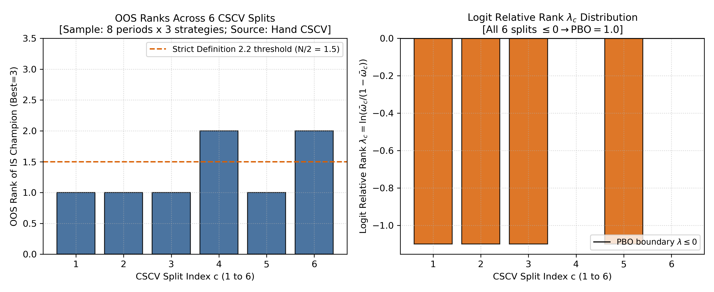
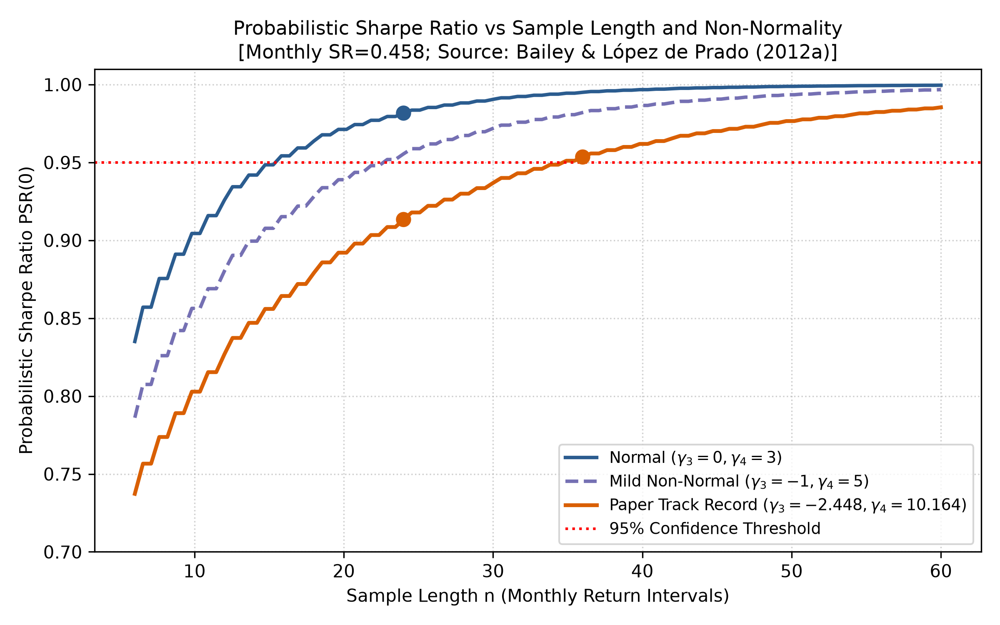
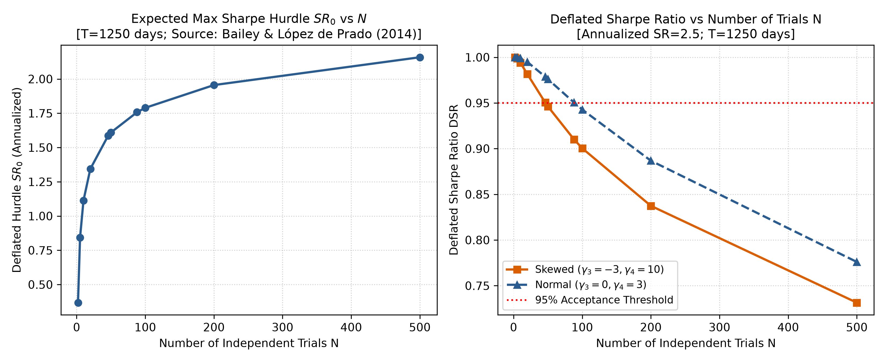
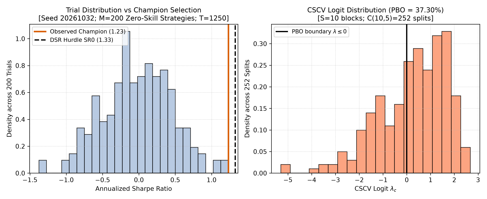

# 第32章 — 绩效统计与推断（Performance Statistics & Inference）

> 主线：先描述账户已发生的收益，再按样本长度、矩条件和完整搜索记录解释绩效证据；最后用相对样本外秩诊断选择结果。
> 先修：第7章, 第11章, 第22章, 第29章, 第31章；完成后你能：计算并解释全部 11 项描述性指标，实施 PSR、DSR 显著性检验与 CSCV 过拟合概率诊断，识破多重测试陷阱并生成含字节哈希与试验账本的可追溯绩效推断报告（哈希不等于外部时间戳或防篡改认证）。

---

## 1. 本章目标

完成本章学习后，读者将具备以下核心能力：
1. **描述性统计量计算与口径辨析**：严格区分简单收益率与对数收益率、算术平均与几何平均的复合增长率（CAGR）；计算年化波动率、逐期与年化 Sharpe 比率、Sortino 比率、最大回撤（MaxDD）、Calmar 比率、胜率、盈亏比（Profit Factor）、跟踪误差（Tracking Error）与信息比率（Information Ratio），并连接第 29 章真实账本的换手率（Turnover）；
2. **非正态性下的统计推断（PSR）**：掌握高阶矩（偏度 $\gamma_3$ 与峰度 $\gamma_4$）对夏普比率估计方差的膨胀机制，掌握概率夏普比率（Probabilistic Sharpe Ratio, PSR）公式与单侧假设检验，辨析技能概率与赚钱概率的根本界限；
3. **选择偏差与多重测试惩罚（DSR）**：理解从 $N$ 次独立试验中挑选最优夏普比率时极值分布的膨胀效应，掌握紧缩夏普比率（Deflated Sharpe Ratio, DSR）与门槛 $\mathrm{SR}_0$ 的推导，理解相关试验下的有效独立试验数启发式估计；
4. **组合对称交叉验证与过拟合概率（CSCV / PBO）**：掌握矩阵分割算法，理解相对秩 $\bar{\omega}$ 与 Logit 变换 $\lambda$，严格区分 CSCV 诊断机制与时序部署回测（Walk-Forward）的本质差异；
5. **推断失效边界与实证检验**：掌握序列相关、厚尾分布与极端机制转换下的方差膨胀规律，并在 Kenneth French 真实市场上落地端到端推断分析。

---

## 2. 为什么 Quant 需要它

在量化研究的生命周期中，研究员最常经历的幻觉莫过于“策略冠军陷阱”：在回测框架中尝试了 200 种均线周期、出场阈值或因子截面权重组合，最终挑选出一个年化夏普比率高达 2.5 的“冠军策略”。研究员兴高采烈地向投资委员会汇报，声称该策略在统计学上具备压倒性显著性。

然而，实盘部署半年后，该策略却迅速遭遇严重回撤。为什么完美的历史回测无法在实盘中复制？
经典金融统计学教科书通常假设资产收益率服从独立同分布的正态分布（i.i.d. Normal），并仅对单一固定策略进行单次 $t$ 检验。但在现代量化研究中，存在两大无法回避的统计违规：
1. **非正态收益的隐性风险**：对冲基金与量化策略（尤其是均值回归、高杠杆套利、波动率做空）普遍表现出负偏度与高超额峰度（厚尾）。忽略负偏与厚尾会严重低估夏普比率的点估计方差，从而使统计显著性被大幅虚增；
2. **多重假设检验的选择偏差（Selection Bias）**：哪怕 200 个候选模型全部由毫无预测能力的纯高斯白噪声生成，其样本最大夏普比率的期望值也天然大于零。不公开试验搜索账本、仅汇报冠军策略的点估计，属于典型的数据窥探（Data Snooping）。

因此，量化研究员不仅需要计算描述性收益指标，更必须具备推断统计（Inferential Statistics）能力：先用 PSR 在给定矩条件下衡量估计误差，再用 DSR 提高搜索后的比较门槛，最后用 CSCV 检查候选间样本内选优的相对样本外秩。

---

## 3. 直觉

### 3.1 一个直观类比：掷硬币选股大赛
想象一个由 1000 位选手参与的抛硬币比赛，每位选手连续抛掷 10 次硬币。规则规定：每次正面记为盈利，反面记为亏损。
单个公平选手连续10次正面的概率为 $p=2^{-10}$。1000人中的全胜人数期望为 $1000p=0.9765625$；这不意味着每次比赛恰有一人全胜。若选手之间也独立，至少一人全胜的概率为 $1-(1-2^{-10})^{1000}\approx0.623576$。如果这位“冠军选手”宣称自己拥有预测未来的神功，投资人如果只看他个人的 10 次全胜战绩（点估计），必定叹为观止；但如果投资人查阅了全部 1000 位选手的参赛名单（试验账本），就会立刻意识到这位冠军的完美战绩纯属随机抽样的极值涌现。

量化策略搜索与此完全一致：
- **PSR 的直觉**：如果某位选手的硬币正面盈利极小、反面亏损极大（负偏厚尾），那么即使他胜率尚可，其长期夏普比率的置信带也极宽；
- **DSR 的直觉**：在承认参赛人数为 $N$ 的前提下，根据极值理论提高零技能假设下的比较门槛 $\mathrm{SR}_0$；越过门槛提供反对零技能假设的统计证据，但不证明存在可重复的真实阿尔法。
- **CSCV 的直觉**：将历史切成若干小块，如果挑选出的冠军在其他样本块中的相对排名系统性偏低（严格定义以 $\bar r<N/2$ 判定，CSCV另用 $\bar r\le(N+1)/2$），说明所谓“优化”实际上起到了反向筛选的破坏作用。

---

## 4. 数学基础

### 4.1 符号与假定约定
- 收益时间区间：等长度离散区间 $t = 1, 2, \dots, T$，对应未破产期间的单期简单收益率 $r_t \in (-1, +\infty)$；财富计算另允许边界 $r_t=-1$，此后无外部注资的账户财富吸收于0，后续乘法收益不能使其复活。低于−100%的简单收益需要另一负财富模型，当前接口拒绝；
- 年化转换系数：设一年内包含 $A$ 个等间隔周期（日频 $A=250$，月频 $A=12$）；
- 基准与无风险序列：同频率且长度一致的无风险收益向量 $r_{f, t}$ 与基准组合收益向量 $r_{B, t}$；
- 超额收益率为 $r_{e,t}=r_t-r_{f,t}$，同频率样本均值与标准差分别是：
  \[
  \hat{\mu}_e=\frac{1}{T}\sum_{t=1}^T r_{e,t},\qquad
  \hat{\sigma}_e=\sqrt{\frac{1}{T-1}\sum_{t=1}^T(r_{e,t}-\hat{\mu}_e)^2}.
  \]
- PSR 实现从超额收益估计偏度与 Pearson 原始峰度：`psr_from_returns` 使用 bias-corrected 偏度与 `scipy.stats.kurtosis`（参数 `fisher=False`、`bias=False`）；正态基准的原始峰度为 $\gamma_4 = 3$，不是超额峰度。

---

### 4.2 一张输入—假设—解释表

同一条高夏普曲线先回答“发生了什么”，再回答“相对哪个门槛有多少证据”。频率转换应在代入前完成，不能在结果出来后补一个年化标签。

| 输入或输出 | 频率与单位 | 条件和解释 |
| --- | --- | --- |
| $r_t,r_{f,t},r_{e,t}$ | 同一个观察周期，均为无量纲简单收益 | 同期相减；RF不是年利率直接减月收益 |
| $\widehat{SR},SR^*,SR_0$ | 同频逐期无量纲比率 | 观察值与比较门槛在同一标尺上 |
| $n,\gamma_3,\gamma_4$ | 同频观察数；偏度、Pearson原始峰度无量纲 | 正态原始峰度3；两个矩匹配不证明正态 |
| PSR标准误 | 逐期夏普的标准误 | 原i.i.d.、有限四阶矩与渐近近似；串行依赖不能只增大n解决 |
| $V[\widehat{SR}],N$ | 同频夏普方差；搜索次数 | 方差随夏普频率转换平方缩放；N依赖独立搜索模型，候选列数不自动等于N |
| PSR、DSR、PBO | 无量纲尾面积或划分比例 | PSR阈值推断、DSR条件校准、PBO候选秩诊断，分别回答不同问题 |

若按 $SR_{ann}=\sqrt A SR$ 换算，则 $V[SR_{ann}]=A V[SR]$。例如年化2.5、250日/年，先算日频 $2.5/\sqrt{250}=0.158114$，再与日门槛0.113172比较；同频差为0.044942。先在原生日频收益上计算标准误；若仅把这组已计算的量一致地换成年化展示，观察值、门槛和标准误同时乘 $\sqrt{250}$，z不变。不能保持日频n与矩不动，却把年化夏普重新代入逐期D公式。只换观察值会制造虚假的显著性（32-L02）。

年化约定来自加总收益：独立同分布、有限方差下，A期均值为 $A\mu$，标准差为 $\sqrt A\sigma$，比值为 $\sqrt A\mu/\sigma$。正态性不是这条加总恒等式的必要条件。简单收益的实际年度财富是 $\prod_t(1+r_t)$，并非 $1+\sum_t r_t$，所以此夏普年化不能替代CAGR；串行依赖则还要加入各阶协方差（32-L04）。

## 5. 正式定义

### 5.1 描述性指标体系
1. **财富指数与 CAGR**：
   从初始本金 $W_0 > 0$ 出发，复合财富路径为 $W_t = W_0 \prod_{i=1}^t (1 + r_i)$。若跨度为 $Y$ 年，复合年化增长率定义为：
   $$\mathrm{CAGR} = \left(\frac{W_T}{W_0}\right)^{1/Y} - 1$$
   当且仅当发生破产（$W_T = 0$）时，$\mathrm{CAGR} = -100\%$。
2. **最大回撤（Max Drawdown, MaxDD）与 Calmar 比率**：
   时刻 $t$ 的历史最高净值为 $M_t = \max_{0 \le s \le t} W_s$，回撤序列为 $D_t = \frac{W_t - M_t}{M_t} \in [-1, 0]$。最大回撤取非负绝对值 $\mathrm{MaxDD} = \max_{t} |D_t|$。Calmar 比率定义为：
   $$\mathrm{Calmar} = \frac{\mathrm{CAGR}}{\mathrm{MaxDD}}$$
   若 $\mathrm{MaxDD} = 0$，Calmar 未定义并报错。
3. **逐期夏普（Per-period Sharpe）与年化夏普**：
   逐期夏普在收益序列原生频率下定义，不带年化系数：
   $$\hat{\mathrm{SR}} = \frac{\hat{\mu}_e}{\hat{\sigma}_e}$$
   传统年化夏普约定为 $\hat{\mathrm{SR}}_{\mathrm{ann}} = \sqrt{A} \cdot \hat{\mathrm{SR}}$。
4. **Sortino 比率与下行偏差（Downside Deviation）**：
   设目标门槛收益率为 $\tau$（同频率），全样本下行偏差计算包括全部 $n$ 个观测：
   $$\mathrm{DD}_\tau = \sqrt{\frac{1}{n}\sum_{t=1}^n \min(r_t - \tau, 0)^2}$$
   逐期 Sortino 比率为 $(\bar{r} - \tau) / \mathrm{DD}_\tau$，年化形式按惯例乘以 $\sqrt{A}$；下行偏差与门槛并不自动按独立加总标准差的定理缩放。下行偏差为0时该比率未定义，目标门槛必须有限。
5. **胜率（Hit Rate）与盈亏比（Profit Factor）**：
   - 严格胜率（排除平盘）：$\mathrm{HitRate} = \frac{\sum \mathbf{1}_{\{r_t > 0\}}}{\sum \mathbf{1}_{\{r_t \ne 0\}}}$；
   - 盈亏比：总盈利绝对值与总亏损绝对值之比：
     $$\mathrm{ProfitFactor} = \frac{\sum_{r_t > 0} r_t}{|\sum_{r_t < 0} r_t|}$$
     本章对每期收益等权求和；它不是平均盈利/平均亏损，也不等于按实际货币成交盈亏计算的交易Profit Factor。若无亏损，比率未定义；胜率分母排除零收益期，全部平盘时也未定义。
6. **跟踪误差与信息比率**：
   主动收益序列 $r_{a, t} = r_t - r_{B, t}$。年化跟踪误差 $\mathrm{TE} = \hat{\sigma}(r_a) \sqrt{A}$；年化信息比率 $\mathrm{IR} = \frac{\bar{r}_a}{\hat{\sigma}(r_a)} \sqrt{A}$。
7. **账本换手率（Turnover）**：
   连接第 29 章真实回测账本，单次调仓换手率定义为成交名义总金额与调仓前净值之比：
   $$\mathrm{Turnover}_t = \frac{\mathrm{traded\_notional}_t}{\mathrm{nav\_pre\_trade}_t}$$

### 5.2 推断性指标体系
1. **概率夏普比率（PSR）**：
   在收益服从独立同分布且四阶矩有限的假定下，样本逐期夏普比率 $\hat{\mathrm{SR}}$ 的估计方差被偏度与厚尾修正。设检验基准为同频率的 $\mathrm{SR}^*$，定义：
   $$\mathrm{PSR}(\mathrm{SR}^*) = \Phi\left(\frac{(\hat{\mathrm{SR}} - \mathrm{SR}^*)\sqrt{n-1}}{\sqrt{1 - \hat{\gamma}_3 \hat{\mathrm{SR}} + \frac{\hat{\gamma}_4 - 1}{4}\hat{\mathrm{SR}}^2}}\right)$$
2. **紧缩夏普比率（DSR）**：
   在从 $N$ 次独立试验中淘选最优夏普时，零技能假设下的期望最大随机夏普门槛为：
   $$\mathrm{SR}_0 = \sqrt{V[\{\hat{\mathrm{SR}}_n\}]} \left((1 - \gamma)\Phi^{-1}\left(1 - \frac{1}{N}\right) + \gamma \Phi^{-1}\left(1 - \frac{1}{N e}\right)\right)$$
   其中 $\gamma \approx 0.5772156649$ 为欧拉-马歇罗尼常数。这里采用独立高斯夏普近似，公式用于整数 $N\ge2$；$N=2$ 也只是近似，精确标准正态最大值期望为 $1/\sqrt\pi\approx0.564190$，近似为0.519755。$N=1$ 无搜索溢价，零均值噪声门槛为0，可做单次PSR；当前DSR API明确要求 $N\ge2$，不把1代入反CDF。期望最大值是比较门槛，并非控制整个搜索过程家族错误率的临界值，DSR不能自动成为精确选择后p值。紧缩夏普比率定义为：
   $$\mathrm{DSR} = \mathrm{PSR}(\mathrm{SR}_0)$$
3. **组合对称交叉验证（CSCV）与 PBO**：
   将 $T \times N$ 同步候选收益矩阵按行划分为偶数 $S$ 个等大小子块。从 $S$ 个块中任取 $S/2$ 个块拼接为训练集 $J$，互补块拼接为测试集 $\bar{J}$，共有 $C(S, S/2)$ 种组合。
   在训练集选出最优策略：
   \[n^* = \arg\max_n \hat{\mathrm{SR}}_{n,\mathrm{IS}}.\]
   在测试集计算全部 $N$ 个策略的秩（最优为 $N$）。样本内所选策略的测试集相对秩与Logit分别为：
   \[
   \bar{\omega}_c = \frac{\bar{r}_{n^*}}{N+1},\qquad
   \lambda_c = \ln\left(\frac{\bar{\omega}_c}{1 - \bar{\omega}_c}\right).
   \]
   当前CSCV口径计算测试相对秩不高于中点的划分比例：$\lambda\le0\iff\bar r\le(N+1)/2$。本地PBO Definition2.2则用 $\bar r<N/2$；两个阈值不同，偶数N也可能给出不同计数，不只是同一阈值的等号政策。
   $$\mathrm{PBO}_{\mathrm{CSCV}} = \frac{1}{C(S, S/2)} \sum_{c} \mathbf{1}_{\{\lambda_c \le 0\}}$$

---

## 6. 推导

### 6.1 PSR 分母方差项代数推导
根据 Mertens (2002) 及 Bailey & López de Prado (2012a, 式 8)，非正态 i.i.d. 收益序列下，样本夏普比率的渐近方差展开式为：
$$\sigma^2_{\hat{\mathrm{SR}}} = 1 + \frac{1}{2}\mathrm{SR}^2 - \gamma_3 \mathrm{SR} + \frac{\gamma_4 - 3}{4}\mathrm{SR}^2$$
我们考察其中包含 $\mathrm{SR}^2$ 的两个多项式项：
\[
\begin{aligned}
\frac{1}{2}\mathrm{SR}^2 + \frac{\gamma_4 - 3}{4}\mathrm{SR}^2
&= \frac{2}{4}\mathrm{SR}^2 + \frac{\gamma_4 - 3}{4}\mathrm{SR}^2\\
&= \frac{\gamma_4 - 3 + 2}{4}\mathrm{SR}^2\\
&= \frac{\gamma_4 - 1}{4}\mathrm{SR}^2.
\end{aligned}
\]
将此恒等式代入渐近方差表达式，立即得到：
$$\sigma^2_{\hat{\mathrm{SR}}} = 1 - \gamma_3 \mathrm{SR} + \frac{\gamma_4 - 1}{4}\mathrm{SR}^2$$
上式描述经样本量缩放的渐近方差系数，不是有限样本方差本身。文稿式 (11) 采用 $n-1$ 分母并代入样本矩，得到下面的标准误估计；这一近似不能仅凭Bessel修正就成为精确有限样本结果：
$$\hat{\sigma}_{\hat{\mathrm{SR}}} = \sqrt{\frac{1 - \hat{\gamma}_3 \hat{\mathrm{SR}} + \frac{\hat{\gamma}_4 - 1}{4}\hat{\mathrm{SR}}^2}{n-1}}$$
在正态情形下 $\gamma_3 = 0, \gamma_4 = 3$，分母简化为经典 Lo (2002) 表达式 $\sqrt{1 + \frac{1}{2}\hat{\mathrm{SR}}^2}$；但匹配这两个矩本身并不能推出收益服从正态分布。当 $\hat{\mathrm{SR}}>0$ 时，更负的偏度或更大的原始峰度会增大方差项；PSR的变化还取决于观察夏普在门槛哪一侧，见下段。

这一步的金融意义是先估计“均值除以波动率”的误差，再做阈值比较。记 $D=1-\gamma_3 SR+(\gamma_4-1)SR^2/4$，则估计量标准误约为 $\sqrt{D/(n-1)}$；把观察值减门槛后除以这个标准误，便得到PSR的z。n增长只缩小已成立模型内的抽样误差，不能让不存在的总体四阶矩变成有限，也不能把依赖样本变成独立样本。

还应检查阈值方向。对固定正夏普，矩变化使D增大；若观察夏普高于门槛，z下降、PSR向0.5靠近；若低于门槛，负z反而上升、PSR也向0.5靠近；若等于门槛，PSR保持0.5。因此“厚尾必然降低PSR”缺少观察值高于门槛这一条件（32-E02）。

### 6.2 独立标准正态极值分布推导
设 $Z_1, Z_2, \dots, Z_N \overset{\text{i.i.d.}}{\sim} \mathcal{N}(0, 1)$，其最大值记为 $M_N = \max(Z_1, \dots, Z_N)$。
累积分布函数为 $F_{M_N}(x) = [\Phi(x)]^N$，概率密度函数为 $f_{M_N}(x) = N \phi(x) [\Phi(x)]^{N-1}$。
期望值精确数值积分为：
$$E[M_N] = \int_{-\infty}^{+\infty} x \cdot N \phi(x) [\Phi(x)]^{N-1} dx$$
由极值理论（Fisher-Tippett-Gnedenko 定理），标准化正态极值弱收敛于 Gumbel 分布。Bailey & López de Prado (2014) 利用欧拉-马歇罗尼常数 $\gamma \approx 0.5772$ 给出了大样本解析近似：
$$E[M_N] \approx (1 - \gamma)\Phi^{-1}\left(1 - \frac{1}{N}\right) + \gamma \Phi^{-1}\left(1 - \frac{1}{Ne}\right)$$
在 CLI 结果 `expected_max_standard_normal_comparison` 中验证：
- $N=10$: 精确值 $1.538753$，BLdP 近似值 $1.574598$，偏差 $+0.035846$；
- $N=50$: 精确值 $2.249074$，BLdP 近似值 $2.276303$，偏差 $+0.027229$；
- $N=100$: 精确值 $2.507594$，BLdP 近似值 $2.530603$，偏差 $+0.023009$。
这三组例子的绝对误差随 $N$ 增大而减小；实际容忍程度应由所需精度决定，近似式不能称为精确期望。

---

## 7. 金融解释

### 7.1 为什么 PSR 不是“赚钱概率”
初学者常将 $\mathrm{PSR}(0) = 0.95$ 误读为“该策略未来有 95% 的概率盈利”。这是严谨统计学中的严重错误。
在独立同分布、四阶矩有限且夏普估计量可用渐近正态近似的条件下，$\mathrm{PSR}(\mathrm{SR}^*)$ 是阈值比较的渐近正态尾面积。对单侧原假设 $H_0: \mathrm{SR}\leq \mathrm{SR}^*$，在边界 $\mathrm{SR}=\mathrm{SR}^*$ 处，对应的近似 $p$ 值为 $1-\mathrm{PSR}$；因此 $\mathrm{PSR}$ 可按预先选定显著性水平转述为单侧频率学派置信度。这不是对固定未知参数的后验概率。
它衡量估计夏普相对给定门槛的统计证据，而非资产未来损益路径的概率。一个拥有 99% PSR 的微弱正收益策略，其单期亏损概率依然可能接近 50%。

### 7.2 搜索账本与“无中生有”的伪阿尔法
在本章 CLI 的零技能模拟中，$M=200$ 个独立噪声策略各有 $T=1250$ 个日收益观测。种子 `20261032` 的冠军年化夏普为 $1.2318$，朴素单侧 $p$ 值为 $0.002941$；但年化 DSR 门槛为 $1.3257$（日频 $0.083843$），DSR 为 $0.417160$。这是该组模拟及 DSR 假设下的结果，不是对任何真实策略阿尔法的证明或否定。

---

## 8. Numerical Example

本节数值来源于 CLI 计算产出 `qa/a6/codex_resume/ch32/results/ch32_results.json`，提供手算输入与可复算输出的对照。

::: {.body-example title="完整例题：六期描述指标"}

### 8.1 基础描述性指标手算例（6 期月度序列）
考虑 6 个月的月度收益序列（$A=12$, 跨度 $Y=0.5$ 年）：
- 策略收益率：$r = [0.04, -0.02, 0.03, -0.01, 0.05, -0.03]$
- 无风险收益率：$r_f = [0.002, 0.002, 0.002, 0.002, 0.002, 0.002]$
- 基准收益率：$r_B = [0.02, -0.01, 0.01, 0.00, 0.03, -0.01]$
- 初始资产：$W_0 = 1000.0$

```
【手算步骤】
1. 财富指数 [hand_descriptive_metrics.wealth_path]:
   W_0 = 1000.0
   W_1 = 1000.0 * 1.04 = 1040.0
   W_2 = 1040.0 * 0.98 = 1019.2
   W_3 = 1019.2 * 1.03 = 1049.776
   W_4 = 1049.776 * 0.99 = 1039.27824
   W_5 = 1039.27824 * 1.05 = 1091.242152
   W_6 = 1091.242152 * 0.97 = 1058.504887

2. CAGR 与最大回撤 [hand_descriptive_metrics.cagr, max_drawdown, calmar_ratio]:
   CAGR = (1058.504887 / 1000.0)^(1 / 0.5) - 1 = (1.058504887)^2 - 1 = 12.0433% (0.120433)
   历史峰值分别在 t=1(1040), t=3(1049.78), t=5(1091.24) 刷新。
   最大回撤发生在 t=6 从 t=5 峰值回落: (1058.504887 - 1091.242152) / 1091.242152 = -3.0000%
   MaxDD = 0.030000 (3.00%)
   Calmar = 0.120433 / 0.03 = 4.014420

3. 波动率与夏普比率 [hand_descriptive_metrics.per_period_sharpe, annualized_sharpe]:
   超额收益 r - rf = [0.038, -0.022, 0.028, -0.012, 0.048, -0.032]
   超额均值 = 0.048 / 6 = 0.008000
   样本标准差 (ddof=1) = sqrt(0.005800 / 5) = sqrt(0.001160) = 0.0340588
   逐期 Sharpe = 0.008000 / 0.0340588 = 0.234888
   年化 Sharpe = 0.234888 * sqrt(12) = 0.813676
   年化波动率 = std(r) * sqrt(12) = 0.0340588 * sqrt(12) = 0.117983 (11.7983%)

4. Sortino 比率 (tau=0) [hand_descriptive_metrics.annualized_sortino]:
   下行收益: [0, -0.02, 0, -0.01, 0, -0.03]
   下行平方和 = 0.0004 + 0.0001 + 0.0009 = 0.001400
   全样本均方下行偏差 DD = sqrt(0.001400 / 6) = 0.0152753
   逐期 Sortino = (0.01 - 0) / 0.0152753 = 0.654654
   年化 Sortino = 0.654654 * sqrt(12) = 2.267787

5. 胜率与盈亏比 [hand_descriptive_metrics.hit_rate_strict, profit_factor]:
   正收益期数: 3 期 (t=1, 3, 5); 负收益期数: 3 期 (t=2, 4, 6)
   胜率 = 3 / 6 = 50.00% (0.500000)
   总盈利 = 0.04 + 0.03 + 0.05 = 0.120000
   总亏损 = |-0.02 - 0.01 - 0.03| = 0.060000
   Profit Factor = 0.12 / 0.06 = 2.000000

6. 跟踪误差与信息比率 [hand_descriptive_metrics.tracking_error, information_ratio]:
   主动收益 r - rB = [0.02, -0.01, 0.02, -0.01, 0.02, -0.02]
   主动均值 = 0.02 / 6 = 0.0033333
   主动标准差 = sqrt(0.0017333333 / 5) = 0.0186190
   年化跟踪误差 TE = 0.0186190 * sqrt(12) = 0.064498 (6.4498%)
   年化 IR = (1/300)/sqrt(13/37500)*sqrt(12) = sqrt(5/13); rounded 6 d.p.: 0.620174
```

:::

::: {.body-example title="完整例题：两期复合增长"}

### 8.2 算术平均与几何平均的极端对比（波动拖累）
考虑两期收益序列：第一期 $+50\%$，第二期 $-50\%$（初始本金 1.0）：
- 期末本金：$W_2 = 1.0 \times 1.5 \times 0.5 = 0.75$（损失 $25\%$）；
- 算术平均：$\frac{0.50 + (-0.50)}{2} = 0.00\%$ (`hand_descriptive_metrics.arithmetic_vs_geometric.arithmetic_mean`)；
- 几何平均：$\sqrt{1.5 \times 0.5} - 1 = \sqrt{0.75} - 1 = -13.3975\%$ (`hand_descriptive_metrics.arithmetic_vs_geometric.geometric_mean`)。
**金融启示**：零算术平均并不代表保本；高波动率会造成严重的复合拖累（Volatility Drag），资产配置必须以几何复合增长率为核心评价基准。

:::

::: {.body-example title="完整例题：全部六个CSCV划分"}

### 8.3 冻结手算 CSCV 算例（8 样本 $\times$ 3 策略，S=4）
根据冻结契约，考虑 8 期 3 策略收益矩阵：
$$M = \begin{bmatrix}
0.02 & 0.01 & -0.01 \\
0.01 & 0.00 & 0.02 \\
-0.01 & 0.02 & 0.00 \\
0.03 & -0.01 & 0.01 \\
0.00 & 0.01 & 0.02 \\
-0.02 & 0.03 & 0.01 \\
0.01 & -0.02 & 0.03 \\
0.02 & 0.00 & -0.01
\end{bmatrix}$$
划分为 4 个块（每块 2 行）：$B_0 = \{0, 1\}, B_1 = \{2, 3\}, B_2 = \{4, 5\}, B_3 = \{6, 7\}$。
取 $S/2 = 2$ 块作为训练集，共有 $C(4, 2) = 6$ 种对称划分组合。全部 6 种划分手算详情如下表：

样本内选择与样本外收益（数组依次为策略0、1、2）：

训练集与选择（各策略数组依次为0、1、2）：

| 划分 $c$ | 训练块 $J$ | 训练集各策略 Sharpe | 最优策略 $n^*$ |
| :---: | :---: | :---: | :---: |
| 1 | $\{0, 1\}$ | $[0.7319, 0.3873, 0.3873]$ | **0** |
| 2 | $\{0, 2\}$ | $[0.1464, 0.9934, 0.7071]$ | **1** |
| 3 | $\{0, 3\}$ | $[2.5981, -0.1987, 0.3638]$ | **0** |
| 4 | $\{1, 2\}$ | $[-0.0000, 0.7319, 1.2247]$ | **2** |
| 5 | $\{1, 3\}$ | $[0.7319, -0.1464, 0.4392]$ | **0** |
| 6 | $\{2, 3\}$ | $[0.1464, 0.2402, 0.7319]$ | **2** |

互补测试集与各策略收益：

| 划分 $c$ | 测试块 $\bar{J}$ | 测试集各策略 Sharpe |
| :---: | :---: | :---: |
| 1 | $\{2, 3\}$ | $[0.1464, 0.2402, 0.7319]$ |
| 2 | $\{1, 3\}$ | $[0.7319, -0.1464, 0.4392]$ |
| 3 | $\{1, 2\}$ | $[-0.0000, 0.7319, 1.2247]$ |
| 4 | $\{0, 3\}$ | $[2.5981, -0.1987, 0.3638]$ |
| 5 | $\{0, 2\}$ | $[0.1464, 0.9934, 0.7071]$ |
| 6 | $\{0, 1\}$ | $[0.7319, 0.3873, 0.3873]$ |

同一划分的秩与PBO判定：

| 划分 $c$ | $n^*$ 测试秩 $\bar{r}^*$ | 相对秩 $\bar{\omega}_c$ | Logit $\lambda_c$ | $\lambda \le 0$ | $\bar{r}^* < 1.5$ |
| :---: | :---: | :---: | :---: | :---: | :---: |
| 1 | 1.0 | 0.25 | -1.0986 | 是 | 是 |
| 2 | 1.0 | 0.25 | -1.0986 | 是 | 是 |
| 3 | 1.0 | 0.25 | -1.0986 | 是 | 是 |
| 4 | 2.0 | 0.50 | 0.0000 | 是 | 否 |
| 5 | 1.0 | 0.25 | -1.0986 | 是 | 是 |
| 6 | 2.0 | 0.50 | 0.0000 | 是 | 否 |

**端点口径深度辨析**：
- 在划分 4 与划分 6 中，$n^*$ 在测试集的秩恰好为 2（在 3 个策略中排第 2，居中位数），此时相对秩 $\bar{\omega} = 2 / (3 + 1) = 0.50$，其 Logit $\lambda = \ln(0.5 / 0.5) = 0.0000$ 恰好落在零点！
- **CSCV 积分估计口径（$\lambda \le 0$）**：全部 6 个划分均满足 $\lambda \le 0$，因此 $\mathrm{PBO}_{\mathrm{CSCV}} = 6/6 = 1.000000$（`pinned_hand_cscv.pbo_cscv`）；
- **定义 2.2 严格秩口径（$\bar{r} < N/2 = 1.5$）**：仅划分 1、2、3、5 的秩为 1（小于 1.5），而划分 4、6 的秩为 2（不小于 1.5），因此 $\mathrm{PBO}_{\text{strict}} = 4/6 \approx 0.666667$（`pinned_hand_cscv.pbo_strict`）。
本模块同时披露两种阈值。N=4时严格规则只计秩1，CSCV计秩1、2；N=10时分别计1..4和1..5，故差别并不限于奇数。样本内并列最优在当前API按容差拒绝，样本外并列用平均秩；每一半至少需要2个观察且各候选方差非零。PBO描述候选间相对名次，不是绝对亏损概率。

:::

---

## 9. Python Implementation

本章所有核心算法均已沉淀至模块 `src/quant_course/inference.py`，完整 CLI 工具位于 `code/ch32_performance_statistics.py`。
从接受I3读者包根目录运行 `python run_notebook.py notebooks/ch32_performance_statistics.ipynb`。Notebook创建唯一 `runs/ch32_performance_statistics_<uuid>/`，fresh计算一个种子的1250×200冠军构造及252期CSCV，后续单元主要展示内核中的结果；它不只是静态回放，静态章图也不是该次Notebook新产物。French默认跳过。runner另将执行副本及execution.json写入 `runs/execution_<stem>_<uuid>/`，失败运行同样保留。英语Notebook与便携装配/冷启动归BIL23，本批不执行这些完整入口。

工作CLI仍含French、多种子冠军和AR研究，不应为阅读本章默认启动；若另获运行授权，应使用新输出目录，不覆盖冻结qa结果。下面保留局部API演示。

```python
import sys
from pathlib import Path
sys.path.insert(0, "src")

import numpy as np
from quant_course.inference import (
    probabilistic_sharpe_ratio,
    deflated_sharpe_ratio,
    pbo_cscv,
    per_period_sharpe,
)

# 1. 验证 Bailey & López de Prado (2012a) PSR 原文案例
psr_norm = probabilistic_sharpe_ratio(0.458, 0.0, 24, skew=0.0, kurt=3.0)
psr_skew = probabilistic_sharpe_ratio(0.458, 0.0, 24, skew=-2.448, kurt=10.164)
psr_36m = probabilistic_sharpe_ratio(0.458, 0.0, 36, skew=-2.448, kurt=10.164)

assert round(psr_norm, 3) == 0.982
assert round(psr_skew, 3) == 0.913
assert round(psr_36m, 4) == 0.9535
print("PSR 论文案例核对通过！")

# 2. 验证 Bailey & López de Prado (2014) DSR 原文案例
sr_daily = 2.5 / np.sqrt(250.0)
var_sr_daily = 0.5 / 250.0
dsr_100, sr0_100 = deflated_sharpe_ratio(sr_daily, var_sr_daily, 100, 1250, skew=-3.0, kurt=10.0)
dsr_46, sr0_46 = deflated_sharpe_ratio(sr_daily, var_sr_daily, 46, 1250, skew=-3.0, kurt=10.0)

assert round(sr0_100, 4) == 0.1132 and round(dsr_100, 4) == 0.9004
assert round(sr0_46, 4) == 0.1004 and round(dsr_46, 4) == 0.9505
print("DSR 论文案例核对通过！")
```

---

## 10. Visualization

本章沿用历史4图，本批仅从既有六划分缓存更正首图的阈值标签，不重跑历史研究。图表保存在 `figures/a6/` 目录下，所有绘图均标注了样本规模、轴物理单位与理论数据源。

### 10.1 手算 6 种 CSCV 划分的秩分布与 Logit

- **左图**：横轴为 6 种组合划分索引 $c$，纵轴为训练最优策略在测试集的表现秩（$N=3$），虚线为Definition2.2的严格判定阈值 $N/2=1.5$；3个候选的实际中位秩为2；
- **右图**：横轴为划分索引，纵轴为 Logit 统计量 $\lambda_c$。所有 6 根柱子均 $\le 0$（其中划分 4 与 6 恰在零点），直观展示为何 $\mathrm{PBO}=1.0$。

### 10.2 概率夏普比率（PSR）非正态性惩罚曲线

- **横轴**：样本期长度 $n$（月度区间，从 6 个月到 60 个月）；
- **纵轴**：$\mathrm{PSR}(0)$ 概率水平，红虚线标出 95% 置信水平；
- **观察点**：在这组固定输入下，正态矩假设给出 $\mathrm{PSR}(0)=0.982$，负偏厚尾矩给出 $0.913$（$n=24$）；将后者的样本长度改为 $n=36$ 后为 $0.9535$。若决策者预先选用 95% 单侧门槛，36 个月这一示例越过该门槛；这只是给定矩与观测夏普的敏感度计算，不是普遍的最低样本量结论。

### 10.3 紧缩夏普比率（DSR）试验次数惩罚曲线

- **左图**：横轴为独立试验数 $N$（实际显示2..500），纵轴为年化随机夏普期望极值门槛 $\mathrm{SR}_0$；
- **右图**：横轴为试验数 $N$，纵轴为给定假设下的 $\mathrm{DSR}$ 阈值比较度量；
- **观察点**：复现了 Bailey & López de Prado (2014) Exhibit 2：图中搜索次数范围为2..500；在其中N=46与100两个指定点，门槛 $\mathrm{SR}_0$ 持续抬升，使年化夏普 2.5 的策略在预先约定0.95判据下，N=46时 $\mathrm{DSR}=0.9505$，N=100时为0.9004。该条件近似不证明真实alpha或通用上线资格。

### 10.4 冠军陷阱实验分布对比

- **左图**：同一个构造世界中 $M=200$ 个纯噪声候选的夏普分布及被选冠军位置，而非重复世界冠军的抽样分布；
- **右图**：CSCV 的 Logit $\lambda_c$ 分布，描述选中冠军的相对样本外秩退化；负Logit不等于绝对收益为负。第11节French例的PBO为28.14%而样本外亏损比例为0%，正好说明二者不同。

---

## 11. Real Market Example

### 11.1 Kenneth French 10 行业全历史 100 年分析
我们调用 `quant_course.french_frozen.load_industries_and_rf` 读取 Kenneth French 10 个价值加权行业组合和 FF3 月度 RF。数据快照日期为 2026-10-05；这是当前修订历史，不是 point-in-time 数据，且行业组合不是含成交记录的可交易策略。
为满足 CSCV 的整除要求，本例截取最近 1200 个月（1926-09 至 2026-08），并逐月以 FF3 RF 从行业总收益中扣除得到超额收益。取 $S=12$（每块 100 个月），生成全部 $C(12, 6)=924$ 种划分。

### 11.2 实证检验结果披露
根据 `french_market_experiment` 输出结果：
1. **行业超额收益概况**：下表列出 CLI 对末尾 1200 个月的完整结果。年化算术超额收益与波动率按月度统计量乘以 12 和 $\sqrt{12}$ 年化，Sharpe 则在原始月频超额收益上计算后乘以 $\sqrt{12}$；NoDur 与 Hlth 的年化超额 Sharpe 在这组样本中居前。

   | 行业 | 年化超额收益 | 年化波动率 | 年化 Sharpe |
   |---|---:|---:|---:|
   | NoDur | 8.01% | 15.80% | 0.5073 |
   | Durbl | 10.69% | 28.59% | 0.3740 |
   | Manuf | 9.01% | 21.56% | 0.4182 |
   | Enrgy | 9.30% | 22.28% | 0.4175 |
   | HiTec | 10.78% | 24.79% | 0.4348 |
   | Telcm | 6.58% | 16.16% | 0.4072 |
   | Shops | 9.20% | 20.06% | 0.4587 |
   | Hlth | 9.57% | 19.07% | 0.5020 |
   | Utils | 7.31% | 18.82% | 0.3882 |
   | Other | 7.82% | 22.04% | 0.3548 |
2. **CSCV 诊断结果**：
   - $\mathrm{PBO}_{\mathrm{CSCV}} = 28.14\%$ (`pbo_cscv = 0.281385`)；严格秩口径为 $23.59\%$ (`pbo_strict = 0.235931`)；
   - 样本外亏损概率为 $0.00\%$；平均年化 IS/OOS Sharpe 为 $0.5473 / 0.4508$，平均衰减为 $0.0964$；
   - OOS 对 IS Sharpe 的回归斜率为 $-0.7975$。

**解释边界**：这些结果只描述当前修订的行业组合历史在所选 CSCV 划分下的表现，不检验某个择时信号或行业动量/质量因子，也不包含成交、fills、费用和可投资容量。CSCV 保留分块但不按时间先后模拟部署；这些统计量不能证明未来收益、可交易阿尔法或上线适格性。

---

## 12. Common Mistakes

### 12.1 错误一：对自相关序列直接施加 $\sqrt{A}$ 波动率年化

- **错误示例与产生原因**：当资产收益的完整加权自相关和为正时（如低流动性资产或含有平滑估值的私募股权），单期方差无法线性独立累加。盲目使用 $\sqrt{A}$ 会严重低估真实组合年化波动率，从而人为虚增年化夏普比率。
- **可运行对比代码**：

```python
import numpy as np

r = np.array([0.010, 0.011, 0.0105, 0.0115, 0.011, 0.012, 0.0115, 0.0125])
# 错误做法：盲目乘以 sqrt(250)
naive_ann_vol = float(np.std(r, ddof=1) * np.sqrt(250.0))

# 示例假设：收益服从 AR(1)，已知 phi=0.3
# 长期方差膨胀包括 rho_k = phi**k 的全部滞后项
phi = 0.3
if not -1.0 < phi < 1.0:
    raise ValueError("AR(1) coefficient must lie strictly between -1 and 1")
inflation = (1.0 + phi) / (1.0 - phi)
adjusted_ann_vol = float(naive_ann_vol * np.sqrt(inflation))
assert inflation > 0.0 and adjusted_ann_vol > naive_ann_vol
```

有限A期加总的精确方差为
$$\operatorname{Var}\left(\sum_{t=1}^A r_t\right)=A\sigma^2\left[1+2\sum_{k=1}^{A-1}(1-k/A)\rho_k\right].$$
这是把距离k的协方差计入A−k对。AR(1)令 $\rho_k=\phi^k$，只有在长跨度近似中才以无限和 $1+2\sum_{k\ge1}\phi^k=(1+\phi)/(1-\phi)$ 替代。上段代码采用这一长期近似，不是250期的精确公式。一般过程单独 $\rho_1>0$ 不决定整个加权和符号。

- **数值结果差异**：AR(1) 参数 $\phi=0.3$ 时，长期方差膨胀系数为 $\frac{1+0.3}{1-0.3} \approx 1.857$，标准误膨胀 $1.363$ 倍。实证中 $\phi$ 需要从训练样本估计并报告不确定性；对一般相关序列，应使用全部相关滞后或 HAC 方差估计，不能把单个样本 $\rho_1$ 当作精确长期方差修正。

### 12.2 错误二：将策略池总列数 $M$ 直接代入 DSR 充当独立试验数 $N$

- **错误示例与产生原因**：若200个策略只是参数微调，列数未必代表独立搜索。平均Pearson相关也不足以决定最大值分布，不能据此断言某个精确“真实独立次数”，或保证调整方向。以下只比较一个明示启发式的数值输出。
- **可运行对比代码**：

```python
import math
from quant_course.inference import deflated_sharpe_ratio, implied_independent_trials

# 观察到日频夏普 0.15，方差 0.002，总试验数 M=200
m_trials = 200
# 错误做法：直接将列数 200 视作独立试验数
dsr_naive, sr0_naive = deflated_sharpe_ratio(0.15, 0.002, m_trials, 1250)

# 启发式敏感度：用平均相关 rho=0.5 得到插值 N_hat
n_hat = implied_independent_trials(m_trials, avg_corr=0.5)
dsr_heuristic, sr0_heuristic = deflated_sharpe_ratio(0.15, 0.002, int(round(n_hat)), 1250)

assert sr0_naive > sr0_heuristic
assert dsr_heuristic > dsr_naive
```

- **数值结果差异**：当平均相关为 $0.5$ 时，启发式给出非整数 $\hat{N} = 0.5 + 0.5 \times 200 = 100.5$。当前 API 接受整数 $N$，示例用 Python 的 `round(100.5) == 100` 作为近似代入；实际API还将插值截到[1,M]；负相关给出的未截断值可能大于M，此时输出M。这是实现政策，不是极值校准定理。这项离散化不改变该公式只是启发式、也不意味着校正后门槛可以判定策略有真实阿尔法。

### 12.3 错误三：混淆算术平均与几何复合增长率

- **错误示例与产生原因**：将各期收益率的简单算术均值当成复利表现，忽略波动率拖累。
- **可运行对比代码**：

```python
import numpy as np

# 两期对称收益：+50% 与 -50%
r_seq = np.array([0.50, -0.50])
arith_mean = float(r_seq.mean())
geom_mean = float(np.sqrt(np.prod(1.0 + r_seq)) - 1.0)

assert arith_mean == 0.0
assert round(geom_mean, 6) == -0.133975
```

- **数值结果差异**：算术均值为 $0.00\%$，但期末财富仅剩初始本金的 $75\%$（几何平均收益率 $-13.3975\%$）。高波动率不仅吞噬复利增长，还会让破产风险在算术平均的表象下被完全隐匿。

---

## 13. Quant Research Application

### 完整的绩效推断全流程：从搜索账本到资本配置门禁
可审计的量化投研流程可分为四步。阈值应按决策目的预先设定；PSR、DSR、PBO 没有脱离模型假设和风险偏好的统一上线门槛。

```
[步骤 1: 试验账本登记]
  每次参数调整、因子增删均记录至 TrialLedger (第22章)
  记录试验总数 M, 样本长度 T, 评估频率
        ↓
[步骤 2: 基础描述性指标审计]
  计算 CAGR, MaxDD, Calmar, 波动率, 胜率, 盈亏比
  接入 第29章 账本审计交易换手率与滑点成本
        ↓
[步骤 3: 非正态性与单次显著性检验 (PSR)]
  估计样本偏度 gamma3 与峰度 gamma4
  计算原生频率下的 PSR(0)，结合预先设定的单侧显著性水平解释结果
        ↓
[步骤 4: 选择偏差与多重试验校正 (DSR + CSCV)]
  记录依赖结构；有效次数未知时披露未知与敏感度范围，不强行给出精确N_hat
  计算期望最大随机噪声门槛 SR0，并报告 DSR 与假设、频率、试验数
  运行 S 块 CSCV，报告 PBO、亏损概率和划分表现；阈值需针对决策预先设定
```

---

第32章到第33章的交接是明确的：PSR/DSR/PBO决定如何解释绩效证据，下一章仍要以实际持仓计算损失、退出能力与限额。证据较强不代替风险约束，搜索诊断也不直接生成卖单。

## 14. Chapter Summary

### 14.1 核心概念逻辑图
```
                            [收益时间序列 r_t]
                                    |
               +--------------------+--------------------+
               v                                         v
      【描述性统计指标】                        【推断性统计检验】
   (CAGR, MaxDD, Sharpe)                                 |
               |                                +--------+--------+
               |                                v                 v
               |                        【高阶矩修正】    【多重测试修正】
               |                         (偏度/厚尾)       (搜索账本)
               |                                |                 |
               v                                v                 v
       [点估计表面表现]                     [PSR 显著性]     [DSR / PBO 诊断]
               |                                |                 |
               +--------------------------------+-----------------+
                                                |
                                                v
                                    【资本配置与防伪决策】
```

### 14.2 严谨量化绩效报告披露规则
绩效报告应披露下面的信息，并按问题、样本和模型条件选择适用的推断方法。不能只展示搜索后的最优曲线，也不能在条件缺失时强算一个推断数字：
1. **样本时间与频率**：明确标注起始日期、终止日期、收益采样频率及年化常数 $A$；
2. **高阶矩特征**：明确汇报年化波动率、实现所用bias-corrected样本偏度（这不保证任意分布下严格无偏） $\hat{\gamma}_3$ 与原始峰度 $\hat{\gamma}_4$；
3. **真实搜索账本**：完整披露回测筛选过程中尝试的模型总数 $M$、参数空间及平均相关度 $\hat{\rho}$；
4. **推断指标**：满足相应矩、搜索与候选条件时报告 $\mathrm{PSR}(0)$、门槛 $\mathrm{SR}_0$、$\mathrm{DSR}$ 或CSCV两种 $\mathrm{PBO}$；不可用时说明条件和缺口；
5. **交易与容量约束**：结合第 29 章真实账本披露平均单期换手率与预估市场冲击成本。

---

## 15. Exercises

- **32-E01**（概念辨析）：经典年化夏普比率 $\hat{\mathrm{SR}}_{\mathrm{ann}} = \sqrt{A} \cdot \hat{\mathrm{SR}}$ 的平方根缩放依赖什么时间序列假设？区分独立同分布与正态性在缩放关系和经典显著性推断中的作用；若收益存在一阶正自相关 $\rho_1 > 0$，直接使用该公式会导致何种偏差？
- **32-E02**（数学性质）：在式 (11) 的概率夏普比率中，假设观察到的逐期夏普 $\hat{\mathrm{SR}} > 0$ 固定。试从导数角度分析：当偏度 $\hat{\gamma}_3$ 变小（更负）或峰度 $\hat{\gamma}_4$ 变大（更厚尾）时，分母方差项及 PSR 概率值将如何变化？
- **32-E03**（极值统计）：采用样本夏普的独立高斯近似模型，说明为什么即使真实期望收益为0，随着试验次数 $N\to\infty$，其最大样本夏普的期望值仍会趋向无穷大？
- **32-E04**（算法口径）：在 CSCV 算法中，若模型策略数为奇数 $N=3$，最优策略在测试集的秩为 $2$。请指出 Bailey 等人论文定义 2.2 的严格秩判定与 Algorithm 2.3 的连续积分估计在此处结论上的具体差异。

---

## 16. Programming Exercises

- **32-P01**（Sortino 与下行偏差）：编写独立 Python 函数计算 Sortino 比率，输入含 0 收益率序列与目标门槛 $\tau$。要求验证全样本分母 $n$ 约定，并在下行偏差为 0 时抛出受控的 `ValueError`。
- **32-P02**（DSR 门槛敏感度）：调用 `quant_course.inference.deflated_sharpe_ratio`，针对年化方差 $V=0.5$，在试验次数 $N \in [2, 10, 50, 100, 500]$ 下，输出日频与年化期望最大夏普门槛 $\mathrm{SR}_0$ 变化表。
- **32-P03**（CSCV 8 样本手算重现）：使用 `quant_course.inference.pbo_cscv` 对第 8.3 节的 $8 \times 3$ 矩阵进行划分测试，编写断言检验全部 6 个划分的 Logit 统计量与 PBO 结果。
- **32-P04**（账本换手率提取）：编写测试脚本，调用 `quant_course.backtest` 构建双资产轮动账本，并使用 `quant_course.inference.turnover_from_ledger` 准确计算每一次调仓日的换手率。

---

## 17. Challenge Problems

- **32-C01**（自相关破缺推导）：推导平稳 AR(1) 过程 $r_t = \phi r_{t-1} + \epsilon_t$（$|\phi| < 1$）下，样本均值方差相较于 i.i.d. 的渐近膨胀因子 $\frac{1+\phi}{1-\phi}$；再用 CLI 指定种子、样本长度与模拟次数，报告忽略相关性的双侧 5% 正态检验实际弃真率，并说明该蒙特卡洛值的抽样误差。
- **32-C02**（相关试验插值局限性）：评述 DSR 附录 A.3 中等权平均相关插值 $\hat{N} = \hat{\rho} + (1-\hat{\rho})M$ 的统计局限性。给出反例说明非线性相依（如 Copula 尾部相依）为何会导致该线性公式低估真实极值风险。
- **32-C03**（Walk-Forward 与 CSCV 联合诊断系统）：设计结合CSCV与纯前向Purged Walk-Forward的研究复核流程，说明各自回答的问题，以及两者之外仍需何种成交、数据和风险证据。
- **32-C04**（厚尾与 PSR 假设边界）：比较标准正态、方差标准化 Student-$t_5$ 与 Student-$t_4$ 零均值收益在多个 $n$ 下，以样本偏度和 Pearson 原始峰度代入 PSR 后的单侧 5% 弃真率。解释为什么 $t_4$ 的总体四阶矩不存在，故该 PSR 渐近方差公式的有限四阶矩前提不成立；模拟只能描述这组有限样本下 plug-in 规则的行为，不能证明存在一个通用的样本量补偿定理。

---

## 18. Solutions / Solution Hints

### 32-E01 参考解答
1. **缩放条件**：对每期超额收益的加总，若各期独立同分布且方差有限，则 $E[\sum_{t=1}^A r_t]=A\mu$、$\mathrm{Var}(\sum_{t=1}^A r_t)=A\sigma^2$，故加总收益的 Sharpe 等于 $\sqrt{A}\mu/\sigma$。这个平方根缩放不要求收益正态；正态性是经典正态型置信区间或检验的额外分布假设。对复合简单收益，年度乘积不等于逐期收益简单相加，平方根年化通常是常用近似。
2. **正自相关偏差**：对平稳弱相关序列，长样本均值方差按长期方差缩放；AR(1) 下渐近因子为 $[1+2\sum_{k=1}^\infty\phi^k]=(1+\phi)/(1-\phi)$。正的一阶相关在 AR(1) 模型中使该因子大于 1；仍按 $\sqrt{A}$ 计算会低估加总收益标准差，因而高估年化 Sharpe。一般序列应根据完整自相关结构或 HAC 标准误推断，不能只凭 $\rho_1$ 推出全部长期方差。

### 32-E02 参考解答
分母方差项为 $D = 1 - \hat{\gamma}_3 \hat{\mathrm{SR}} + \frac{\hat{\gamma}_4 - 1}{4}\hat{\mathrm{SR}}^2$。
当 $\hat{\mathrm{SR}} > 0$ 时：
- $\frac{\partial D}{\partial \hat{\gamma}_3} = -\hat{\mathrm{SR}} < 0$，因此当偏度更负（$\hat{\gamma}_3$ 减小）时，$D$ 单调增大；
- $\frac{\partial D}{\partial \hat{\gamma}_4} = \frac{\hat{\mathrm{SR}}^2}{4} > 0$，因此当峰度更厚尾（$\hat{\gamma}_4$ 增大）时，$D$ 单调增大。
由于统计量 $Z = \frac{(\hat{\mathrm{SR}} - \mathrm{SR}^*)\sqrt{n-1}}{\sqrt{D}}$，当观察夏普高于门槛时，分母 $D$ 增大导致 $Z$ 减小，在标准正态累积分布函数 $\Phi(Z)$ 下，$\mathrm{PSR}$ 概率水平单调下降。若观察夏普低于门槛，负的Z向0增大，PSR升向0.5；恰等于门槛时不变。这里校准的是阈值比较的估计误差。

### 32-E03 参考解答
由标准正态极值渐近理论，当 $N \to \infty$ 时，$N$ 个独立标准正态变量最大值的渐近展开为：
$$E[\max(Z_1, \dots, Z_N)] \sim \sqrt{2\ln N} - \frac{\ln\ln N + \ln(4\pi)}{2\sqrt{2\ln N}} + \frac{\gamma}{\sqrt{2\ln N}}$$
由于 $\lim_{N \to \infty} \sqrt{2\ln N} = +\infty$，因此即便策略池完全由零均值白噪声构成，独立高斯试验模型中的期望最大噪声值会随N增长无界。这是期望与模型结论，不保证任意给定有限次搜索必然出现指定高值；样本夏普的高斯近似也不能因此成为精确分布。

### 32-E04 参考解答
在 $N=3$ 且 $\bar{r}^* = 2$ 时：
1. **定义 2.2** 判定条件为 $\bar{r}^* < N/2 = 1.5$。由于 $2 \ge 1.5$，该划分**不被判定为过拟合**；
2. **Algorithm 2.3** 相对秩为 $\bar{\omega} = 2 / (3 + 1) = 0.50$，其 Logit $\lambda = \ln(0.5 / 0.5) = 0$。算法将 $\lambda \le 0$ 的集合按积分测度计入过拟合概率，因此该划分**被判定为过拟合**。
差异来自两个不同秩阈值：严格 $r<N/2$ 与CSCV $r\le(N+1)/2$。N=4时前者只计1，后者计1、2；N=10时前者计1..4，后者计1..5，所以偶数也有差异。必须在看结果前固定并披露口径。

### 32-P01 参考实现与测试
```python
import math
from quant_course.inference import sortino_ratio

def independent_sortino(returns, target=0.0, periods_per_year=1.0):
    x = [float(v) for v in returns]
    if not x or not all(math.isfinite(v) for v in x):
        raise ValueError("returns must be nonempty and finite")
    if not math.isfinite(target) or not math.isfinite(periods_per_year) or periods_per_year <= 0:
        raise ValueError("target and annualization must be finite; annualization positive")
    downside = math.sqrt(sum(min(v-target, 0.0)**2 for v in x) / len(x))
    if downside == 0:
        raise ValueError("downside deviation is zero")
    return (sum(x)/len(x)-target) / downside * math.sqrt(periods_per_year)

r = [0.04, 0.0, -0.02, 0.03, -0.01, 0.05, -0.03]
expected_dd = math.sqrt(0.0014 / 7)
expected = (0.06 / 7) / expected_dd * math.sqrt(12)
value = independent_sortino(r, periods_per_year=12)
assert math.isclose(value, expected, rel_tol=1e-12)
assert math.isclose(value, sortino_ratio(r, target_return=0.0, periods_per_year=12), rel_tol=1e-12)
assert not math.isclose(expected_dd, math.sqrt(0.0014 / 3))
for values, target in [([0.0, 0.02], 0.0), (r, math.nan), (r, math.inf), (r, -math.inf)]:
    try:
        independent_sortino(values, target)
    except ValueError:
        pass
    else:
        raise AssertionError("undefined/nonfinite case must fail")
print(value, expected_dd)
```
零收益期留在全样本n=7内；只有三个负收益期也不能把分母改成3。非零门槛时先逐期减去同频门槛；未定义值应报错。共享API非有限目标护栏由本批候选直接测试核验。

### 32-P02 参考实现与测试
```python
import sys
from pathlib import Path
sys.path.insert(0, "src")

import math
import numpy as np
from quant_course.inference import deflated_sharpe_ratio

var_daily = 0.5 / 250.0
sr_daily = 2.5 / math.sqrt(250.0)
expected_sr0_ann = np.array([0.367523, 1.113409, 1.609589, 1.789406, 2.158463])
sr0_ann = []

for n in [2, 10, 50, 100, 500]:
    dsr, sr0 = deflated_sharpe_ratio(sr_daily, var_daily, n, 1250, skew=-3.0, kurt=10.0)
    sr0_ann.append(sr0 * math.sqrt(250))
    print(f"N={n:3d} -> 日频 SR0={sr0:.4f}, 年化 SR0={sr0*math.sqrt(250):.4f}, DSR={dsr:.4f}")
np.testing.assert_allclose(sr0_ann, expected_sr0_ann, rtol=0.0, atol=1e-6)
print("32-P02 测试通过！")
```

### 32-P03 参考实现与测试
```python
import sys
from pathlib import Path
sys.path.insert(0, "src")

import numpy as np
from quant_course.inference import pbo_cscv

rows = [
    [0.02, 0.01, -0.01],
    [0.01, 0.00, 0.02],
    [-0.01, 0.02, 0.00],
    [0.03, -0.01, 0.01],
    [0.00, 0.01, 0.02],
    [-0.02, 0.03, 0.01],
    [0.01, -0.02, 0.03],
    [0.02, 0.00, -0.01]
]
res = pbo_cscv(rows, n_blocks=4)
assert res.n_splits == 6
assert res.pbo_cscv == 1.0
assert round(res.pbo_strict, 4) == 0.6667
expected_best = [0, 1, 0, 2, 0, 2]
expected_ranks = [1.0, 1.0, 1.0, 2.0, 1.0, 2.0]
expected_omega = [0.25, 0.25, 0.25, 0.50, 0.25, 0.50]
expected_lambdas = [-1.098612, -1.098612, -1.098612, 0.0, -1.098612, 0.0]
np.testing.assert_array_equal([p.best_strategy_index for p in res.partitions], expected_best)
np.testing.assert_allclose([p.oos_rank_best for p in res.partitions], expected_ranks, rtol=0.0, atol=1e-12)
np.testing.assert_allclose([p.relative_rank_omega for p in res.partitions], expected_omega, rtol=0.0, atol=1e-12)
np.testing.assert_allclose([p.logit_lambda for p in res.partitions], expected_lambdas, rtol=0.0, atol=1e-6)
print("32-P03 测试通过！")
```

### 32-P04 参考实现与测试
```python
import sys
from pathlib import Path
sys.path.insert(0, "src")

import pandas as pd
from quant_course.backtest import BacktestConfig, run_backtest
from quant_course.inference import turnover_from_ledger

dates = pd.date_range("2026-01-05", periods=4, freq="B")
mark = pd.DataFrame({"A": [10.0, 11.0, 12.1, 12.0], "B": [20.0, 19.0, 19.0, 21.0]}, index=dates)
execp = pd.DataFrame({"A": [10.0, 10.0, 12.0, 12.0], "B": [20.0, 20.0, 19.5, 20.0]}, index=dates)
tw = pd.DataFrame({"A": [0.5, 0.5], "B": [0.3, 0.3]}, index=[dates[0], dates[2]])
cfg = BacktestConfig(initial_cash=1000.0, fee_rate=0.002, lag=1)

res = run_backtest(mark, tw, cfg, exec_prices=execp)
turnover = turnover_from_ledger(res.ledger)

assert turnover.iloc[0] == 0.0
assert round(turnover.iloc[1], 4) == 0.7987
assert turnover.iloc[2] == 0.0
assert round(turnover.iloc[3], 4) == 0.0728
print("32-P04 测试通过！")
```

P04承接BIL15A接受账本：dates[0]/dates[2]收盘信号分别在dates[1]/dates[3]以给定执行价成交；换手分母是交易前NAV，分子是买卖名义额总和，费用率0.002按成交名义额计入自融资账本。成交日收盘权重可因价格与费用偏离目标，不能用目标权重差直接替代账本换手。

### 32-C01 挑战题参考论证与评分标准
- **参考论证**：对于 AR(1) 过程，自协方差函数为 $\gamma_k = \frac{\sigma_\epsilon^2}{1-\phi^2} \phi^{|k|}$。总样本方差为 $\mathrm{Var}(\sum_{t=1}^T r_t) = T\gamma_0 + 2\sum_{k=1}^{T-1} (T-k)\gamma_k$。当 $T$ 充分大时，其相对 i.i.d. 的均值方差膨胀为 $1 + 2\sum_{k=1}^\infty \phi^k = \frac{1+\phi}{1-\phi}$。若 $\phi = 0.5$，膨胀因子为 3，标准误为 i.i.d. 标准误的 $\sqrt{3} \approx 1.732$ 倍。

  CLI 的 `boundary_experiments.ar1_dependence` 用种子 `20261032`、$T=1000$、2000 条模拟序列、双侧正态 $z$ 检验和名义 $\alpha=0.05$。忽略相关性的检验在 $\phi=0.5$ 时有 $487/2000=24.35\%$ 的模拟弃真率（零相关基准为 $87/2000=4.35\%$）。这量化了本次有限模拟的欠覆盖风险；以真实拒绝率约 $0.2435$ 计，二项蒙特卡洛标准误约 $0.0096$，不可将单次模拟数值视为精确总体概率。
- **评分标准**：
  - 完整写出几何级数求和推导（40分）；
  - 明确给出 $\frac{1+\phi}{1-\phi}$ 闭式解及其物理含义（30分）；
  - 结合一类错误膨胀或置信区间欠覆盖进行数值阐释（30分）。

### 32-C02 挑战题参考论证与评分标准
令X在−3、−1、1、3上各取概率1/4，均值0、方差5。构造以下三个具有同一完整边际的联合分布：

1. **较高极值联合**：先独立选映射，概率5/8采用相邻交换 $g=(-1,-3,3,1)$，概率3/8采用反向 $h=-X$，再令Y为所选映射作用于X。联合概率矩阵（行X、列Y均按−3、−1、1、3排序）为
$$P_H=\frac1{32}\begin{pmatrix}0&5&0&3\\5&0&3&0\\0&3&0&5\\3&0&5&0\end{pmatrix}.$$
每行/列和为8/32=1/4。相邻交换下 $E[Xg(X)]=(3+3+3+3)/4=3$，反向下 $E[X(-X)]=-5$，故混合协方差为 $(5/8)3+(3/8)(-5)=0$，Pearson相关为0；但 $E[\max(X,g(X))]=(-1-1+3+3)/4=1$，反向最大值为 $E|X|=2$，故 $E\max(X,Y)=5/8+6/8=11/8$。
2. **独立联合**：16个格各1/16。最大值在四点上的概率为 $(1,3,5,7)/16$，期望为 $(-3-3+5+21)/16=5/4$；协方差0。
3. **较低极值联合**：各以1/2选择Y=X或Y=−X。每种映射的四格概率各1/8，边际仍均匀；协方差为 $(5-5)/2=0$。最大值期望为 $\tfrac12E[X]+\tfrac12E|X|=1$。

M=2、平均相关0时，插值均给Nhat=2，却不能分辨11/8、5/4、1三个最大值期望。独立假设在第一例低估1/8，在第三例高估1/4；非线性依赖本身不决定方向。这是有限四点边际的教学反例，不是Gaussian DSR的精确校准。Pearson可用于任何有限二阶矩变量的线性关联，并不限于椭圆分布；它不刻画完整联合尾部。M>T时样本去均值矩阵秩至多T−1，相关矩阵可能奇异；PCA或互信息维数可描述依赖，却不能未经极值分布校准就称精确搜索次数。

评分：完整边际/联合概率与矩计算40分，三个极值期望和方向比较40分，说明边际模型与DSR适用边界20分。

### 32-C03 挑战题参考论证与评分标准
- **参考论证**：CSCV 是对称分块的回测选择偏差诊断，用候选策略在测试块的相对秩衡量选择结果是否落到中位数以下；它不按实际时间先后模拟部署，因而不能单独检验时序推进、制度变化或因果可得性。按研究设计构造的 Purged Walk-Forward 可提供顺序样本外评估，两者诊断的问题不同。应先冻结研究规则与搜索账本，再以 CSCV 检查选择稳定性、以滚动前向窗口检查时间外表现，并按标签重叠范围决定 purge/embargo。二者都不能保证未来盈利、成交可行或实盘适格性。
- **评分标准**：
  - 深刻阐明 CSCV“打散时序”的诊断本质与 Walk-Forward“因果前向”的部署本质之区别（50分）；
  - 构建两者结合的投研风控流程（50分）。

### 32-C04 挑战题参考论证与评分标准
- **参考论证与可复现模拟**：$t_4$ 的方差有限，但总体四阶矩发散，因此不能把有限四阶矩条件下的 PSR 渐近方差公式当成对 $t_4$ 有已证校准保证的检验。下面以每个自由度分布的方差标准化收益，在零均值原假设下按样本估计夏普、偏度与 Pearson 原始峰度；对每次模拟的 $\mathrm{PSR}(0)>0.95$ 计为拒绝。此实验比较有限样本 plug-in 规则，不把其拒绝率解释成 $t_4$ 下的有效显著性水平。

```python
import numpy as np
from scipy import stats

rng = np.random.default_rng(20261007)
reps = 20_000
observed_counts = []
for n in [24, 60, 120, 240]:
    for label, df in [("Normal", None), ("t5", 5), ("t4", 4)]:
        x = rng.normal(size=(reps, n)) if df is None else rng.standard_t(df, size=(reps, n)) * np.sqrt((df - 2) / df)
        sr = x.mean(axis=1) / x.std(axis=1, ddof=1)
        g3 = stats.skew(x, axis=1, bias=False)
        g4 = stats.kurtosis(x, axis=1, fisher=False, bias=False)
        d = 1 - g3 * sr + (g4 - 1) * sr**2 / 4
        assert np.all(d > 0)
        psr = stats.norm.cdf(sr * np.sqrt(n - 1) / np.sqrt(d))
        rejected = int(np.count_nonzero(psr > 0.95))
        observed_counts.append(rejected)
        print(n, label, rejected, rejected / reps)
np.testing.assert_array_equal(observed_counts, [935, 1267, 1280, 968, 1116, 1191, 1002, 1109, 1158, 1024, 1039, 1096])
```

  种子 `20261007` 的结果如下；在每个 $n$ 内，代码依次生成 Normal、$t_5$、$t_4$ 三组样本：

  | $n$ | Normal 拒绝率 | $t_5$ plug-in 拒绝率 | $t_4$ plug-in 拒绝率 |
  |---:|---:|---:|---:|
  | 24 | 4.675% (935/20000) | 6.335% (1267/20000) | 6.400% (1280/20000) |
  | 60 | 4.840% (968/20000) | 5.580% (1116/20000) | 5.955% (1191/20000) |
  | 120 | 5.010% (1002/20000) | 5.545% (1109/20000) | 5.790% (1158/20000) |
  | 240 | 5.120% (1024/20000) | 5.195% (1039/20000) | 5.480% (1096/20000) |

  $t_5$ 的总体原始峰度为 $9$，四阶矩有限；$t_4$ 的总体原始峰度不存在。模拟中的样本峰度总是有限数，但这并不恢复 $t_4$ 的总体矩条件。接近 5% 的数值及其随 $n$ 的变化只能视为此配置的 Monte Carlo 描述，不给出“多少个月即可保证校准”的普遍阈值。
- **评分标准**：
  - 说明 $t_4$ 与 $t_5$ 的四阶矩边界，以及 PSR 渐近近似的适用条件（50分）；
  - 正确复现拒绝率、识别 Monte Carlo 误差，并避免将结果外推成通用样本量阈值（50分）。

---

## 19. Further Reading

1. **Must Know**
   - Bailey, D. H., Borwein, J., López de Prado, M., & Zhu, J. Q. (2015). "The Probability of Backtest Overfitting." SSRN Working Paper. [已实读 §2.1, §2.2, §3.1, §4]
   - Bailey, D. H., & López de Prado, M. (2014). "The Deflated Sharpe Ratio: Correcting for Selection Bias, Backtest Overfitting and Non-Normality." *Journal of Portfolio Management*, 40(5). [本地 2014-07-31 作者稿已读相关范围；未与最终期刊版逐页比对]
   - Bailey, D. H., & López de Prado, M. (2012a). "The Sharpe Ratio Efficient Frontier." *Journal of Risk*, 15(2). [本地 2012-07 作者稿已读 Eq. 8–11 相关范围；未与最终期刊版逐页比对]
2. **Should Know**
   - Lo, A. W. (2002). "The Statistics of Sharpe Ratios." *Financial Analysts Journal*, 58(4), 36–52.（未核读：自相关序列下夏普比率精确修正之经典文献）
   - Mertens, E. (2002). "Variance of the IID estimator in Lo (2002)." Working paper, University of Basel.（未核读：非正态 i.i.d. 收益渐近方差展开）
3. **Advanced**
   - Harvey, C. R., Liu, Y., & Zhu, H. (2016). "...and the Cross-Section of Expected Returns." *Review of Financial Studies*, 29(1), 5–68.（未核读：资产定价截面多重检验与因子发现折现门槛）
   - Harvey, C. R., & Liu, Y. (2014). "Backtesting." Working paper, Duke University.（未核读：序列测试与双重多重检验控制）
4. **Optional**
   - Opdyke, J. D. (2007). "Comparing Sharpe Ratios: So Where's the Catch?" *Journal of Risk*, 9(4), 31–60.（未核读：平稳遍历广义假定检验）

---

## 20. References

- [PBO] Bailey, D. H., Borwein, J., López de Prado, M., & Zhu, J. Q. (2015). "The Probability of Backtest Overfitting." SSRN Working Paper 2326253.
- [DSR] Bailey, D. H., & López de Prado, M. (2014). "The Deflated Sharpe Ratio: Correcting for Selection Bias, Backtest Overfitting and Non-Normality." *Journal of Portfolio Management*, 40(5), 94–107.
- [PSR] Bailey, D. H., & López de Prado, M. (2012a). "The Sharpe Ratio Efficient Frontier." *Journal of Risk*, 15(2), 13–44.
- [KENNETH_FRENCH] French, K. R. (2026). "Data Library: 10 Industry Portfolios." Dartmouth Tuck School of Business.
