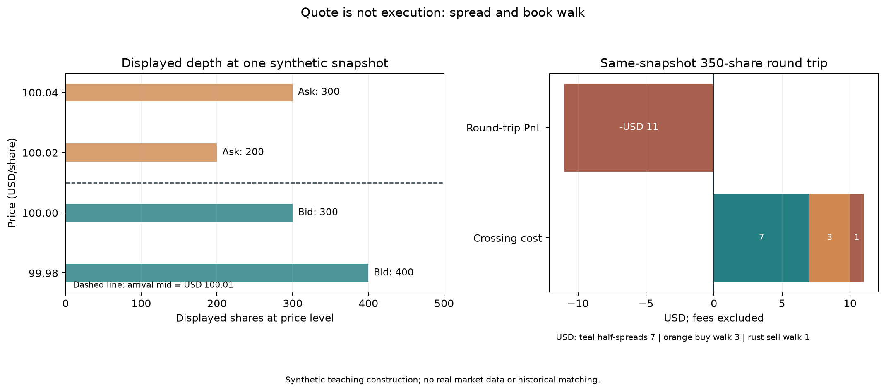

# 第34章 — 市场微观结构（Market Microstructure）

> 既有工程证据按原接受身份引用。主线：把屏幕上的报价转换为具体订单、场所规则、可见对手盘、实际成交、持仓与损益，并为每一步记录它在何时发生、何时可得。先修：第10章市场与交易者、第29章回测账本；第33章风险管理作为背景。读完后你应能复算一笔订单簿扫单，解释为什么 mid 不是成交承诺，指出快照和 OHLCV 无法证明什么，并把可执行性限制传回研究设计。

## 1. 本章目标

完成本章后，你应能：

1. 用买价（Bid）、卖价（Ask）、中间价（Mid）和报价点差（Quoted Spread）描述一个给定场所和时刻的报价；在币种、每股/每份额单位和时间戳下报告它们。
2. 区分市价单（Market Order）、限价单（Limit Order）、委托簿（Order Book）、可见深度（Displayed Depth）、队列（Queue）与队列位置（Queue Position）。说明每种订单的价格和成交数量约束。
3. 手算一个订单跨越多个价位的成交量、成交额、成交量加权平均价（Volume-Weighted Average Price，VWAP）及残余数量，并将报价、成交、持仓、现金和损益（PnL）分开对账。
4. 区分报价点差（Quoted Spread）、滑点（Slippage）、扫单产生的簿内价格走动、价格冲击（Price Impact）和逆向选择（Adverse Selection）；每个成本数字都注明方向、基准、期限和单位。
5. 说明先到先得（first-in, first-out，FIFO）只是特定场所和特定订单类别可能采用的优先规则；根据规则版本、订单事件和时间戳，而不是根据一个快照，判断排队与成交。
6. 区分事件发生时间、数据对研究者可用时间、决策时间、订单发送/接收时间、成交时间、估值时间与收益区间。解释 OHLCV 无法识别的撮合结果。
7. 运行并测试本章单场所静态可见深度计算器；说明它不能替代完整撮合器，不能被描述成第29章日频账本的订单簿扩展。

## 2. 为什么 Quant 需要它

一条策略可以预测方向正确，却因为买入价高于估值、卖出深度不足、订单没有成交或成交发生得太晚而无法兑现。若把收盘价当作无摩擦成交价，回测便把一个研究标记误写成交易事实。微观结构把这个跳步拆开：报价和委托簿描述场所当时显示的状态；订单表达价格与数量约束；撮合规则把可竞争订单分配给对手盘；成交记录才改变现金和持仓；之后的估值才形成账面或清算 PnL。

第10章给出交易场所、经纪商、做市商和市场参与者的概览；本章继续讲这些对象怎样在报价和订单层面相遇。第29章的账本把目标权重按指定滞后转为确定的账本成交，计算费用、现金和持仓；它假设完整目标数量可以按配置成交，没有部分成交、排队或簿内冲击。本章解释这些机制，但不把日频账本称为订单簿撮合器。第33章把流动性和可清算天数作为风险约束；本章说明可见深度及价格条件为何会影响这种约束。

本章与后续章节分工如下：第34章定义订单、报价、簿和成交证据；第35章把实际成交接入成本与自融资账本；第36章展开拆单时钟和实施短缺。Project 4 的成本执行 Lab 已有构造的 ExecutionSlot、模拟 fills、分段融资借券与冲击模型，但没有真实订单簿或券商成交。Project 5 的准备层不因此获得订单簿支持。静态可见簿扫单与模型化执行模拟是两个接口：后者并未把本章快照计算器接成真实撮合，也不能用其结果验证真实队列。

## 3. 直觉

先看一个明确标为教学构造的单场所快照。价格单位为 USD/股，数量为股，示例 tick 为每股 USD 0.01：

| 买方报价 | 可见股数 | 卖方报价 | 可见股数 |
|---:|---:|---:|---:|
| 100.00 | 300 | 100.02 | 200 |
| 99.98 | 400 | 100.04 | 300 |

最优买价是 100.00，最优卖价是 100.02，中间价是 100.01，显示点差是每股 0.02。中间价位于两边报价之间，但没有一方承诺按 100.01 与你交易。买入 350 股若追求即时成交，先消耗 200 股的 100.02 报价，再消耗 150 股的 100.04 报价。成交量足够与否，要看对手盘深度，不是看中间价是否存在。

若只移除被买单消耗的卖方数量，并假设Bid不动，则剩余最佳Ask为100.04，新的可见Mid为100.02；到达时Mid仍是100.01。这个静态更新例说明同一Mid依赖所指时刻，也不保证可成交。

这里的四件事不能互换：100.00/100.02 是报价；350 股是订单请求；200 股和150股两笔是本模型给出的成交；买入后的持仓是350股。现金减少 USD 35,010，按到达时中间价估值的持仓是 USD 35,003.50，二者差 USD 6.50。若随后假设在同一冻结快照立即卖回350股，按买方深度得到的收入是 USD 34,999，往返损益是 -USD 11。这个卖出是另一笔假设性扫单，不是买入后市场仍会保持原样的证据。

因此，阅读一条收益曲线前先问五个问题：什么价是可见的？我的订单何时到达？哪条价格/时间/其他优先规则适用？实际能成交多少？PnL 是按到达中间价标记，还是按可清算价格实现？

### 3.1 三章连接：从请求到账本，再到评价

下表沿同一笔订单往下读。价格都是 USD/股，金额都是 USD；“知道一个数”还必须知道它何时可用。

| 对象 | 数量或单位 | 生效或可得时点 | 下一步用法 |
|---|---|---|---|
| 报价 $b,a$，中间价 $P_{\text{arr}}$ | USD/股 | 报价事件及其 available_at | 设到达基准；不承诺成交 |
| 方向 $d$ 与请求 $Q$ | $d=\pm1$；$Q$ 为有符号股数 | 决策锁定后发送 | 请求量约束，不过现金账 |
| 实际成交 $f_j$、总量 $F=\sum_j f_j$ | 有符号股数 | 成交确认可得后 | 更新 $H$ 与成交货款 |
| 残余 $R=Q-F$ | 有符号股数 | 截止时确认未成交量 | 进入机会成本评价 |
| 成交额及显式费 $\Xi$ | USD | 实际成交与费用事件 | $C_1=C_0-\sum_j f_jP_j-\Xi$ |
| 可得 mark、$C+HP_{\text{mark}}$ | USD/股；USD | mark 可用后 | 更新 NAV；新 mark 仅供后续借券区间 |
| IS | USD | 窗口结束且终值可得后 | 与决策基准比较，不再扣现金 |

本章静态计算器用非负请求规模及单独的买卖方向；它输出的非负成交量 $Q_f$ 转成第35–36章有符号对象时，应写 $Q=dQ_{\text{abs}}$、$F=dQ_f$、$R=d(Q_{\text{abs}}-Q_f)$。这里单笔扫簿数量 $q_j\ge0$ 也应先乘 $d$，不能把卖单成交量直接作为买入加到持仓。

用一个小的**构造部分成交**连接例：决策买100股，决策价10.00；到达基准10.02；只成交60股、均价10.05，显式费0.30；截止可得 mark 为10.10。初始只有现金2,000、持仓0。成交后：

$$R=100-60=40,\quad H_1=60,$$
$$C_1=2{,}000-60\times10.05-0.30=1{,}396.70.$$

若成交时只可用10.02作 mark，NAV 为 $1{,}396.70+60\times10.02=1{,}997.90$；截止10.10可得后，NAV 为2,002.70。未成交40股不会进入持仓，机会成本也不扣现金。第35章先证明这一过账，第36章再分解同一例的 IS：延迟2.00、执行1.80、机会3.20、显式费0.30，共7.30。以决策价买足100股的纸面账户到截止值2,010，差额 $2{,}010-2{,}002.70=7.30$。所以实际 NAV 可高于初值，而相对纸面目标仍有正短缺。此例指定成交结果，不是从一个报价快照识别出真实成交。

## 4. 数学基础

::: {.body-conditions title="静态快照的支持域"}

令卖方最佳可执行报价为 \(a_t\)，买方最佳可执行报价为 \(b_t\)，二者单位为 USD/股或交易合约的报价单位。只有双边报价同时存在且 \(b_t<a_t\) 时，本章定义：

\[
m_t=\frac{a_t+b_t}{2},\qquad S_t=a_t-b_t.
\]

\(m_t\) 是中间价，单位与报价相同；\(S_t\) 是绝对报价点差，单位也是每股/每份额价格；相对点差 $s_t=S_t/m_t$ 无量纲，与第35章一致。若 tick 大小为 \(\delta\)，报价价位必须符合具体场所的价格增量规则。本章构造例设 \(\delta=\$0.01/\text{股}\)，该数字不是关于所有证券、场所或日期的规则陈述。

:::

订单数量 \(Q\) 用股计，单笔成交 \(j\) 的数量为 \(q_j\) 股、成交价为 \(P_j\) USD/股。成交额 \(N=\sum_jq_jP_j\) 的单位为 USD；当成交总量 \(Q_f=\sum_jq_j>0\) 时，

\[
\operatorname{VWAP}=\frac{\sum_jq_jP_j}{\sum_jq_j}.
\]

VWAP 单位是 USD/股。若没有成交，VWAP 未定义，不能用零代替。净持仓 \(H\) 用股计，现金 \(C\) 用 USD 计；忽略其他资产与负债时，按价格 \(p\) 的账户权益为 \(C+Hp\)，单位为 USD。成交改变现金和持仓，不会自动改变一个外部记录的报价。

时间也有单位与含义。对一条市场数据，event_time 是市场事件标记的时间；available_at 是它最早能进入研究流程的时间；ingested_at 是本地系统接收时间。decision_time 是信号真正作出的时间，order_send_time 和 order_receive_time 分别是客户端发送、场所收到的时间，fill_time 是成交时间，mark_time 是估值时间，returns interval 还须说明端点是否开闭、计价货币及现金流归属。一个 timestamp 字段不能替代这组契约。

所有示例价格和数量都必须是有限值。代码用 Decimal 处理价格金额、整数表示股数；不静默把 NaN、无穷或分数股数转为可计算输入。时间示例使用带 UTC 时区的 ISO 8601 字符串。没有真实事件数据时，时间字段仅说明所需数据契约，不伪装成观测值。

## 5. 正式定义

::: {.body-definition title="报价与标记"}

**买价（Bid）与卖价（Ask）。** 在一个指定场所和指定时刻，Bid 是买方愿意支付的价格，Ask 是卖方愿意接受的价格。订单簿可有多个价位；本章说“最佳”报价时，指当前可见簿中的最高 Bid 与最低 Ask。跨场所汇总的最佳报价须另行定义数据源、同步规则和报价资格。

**报价点差（Quoted Spread）与中间价（Mid）。** 双边报价有效且未交叉时，Quoted Spread 是最佳 Ask 减最佳 Bid；Mid 是二者的算术平均。Mid 仅为参考标记，不保证有人按该价成交。单边市场、停牌、异常交叉报价或不同步场所数据不满足此处简化定义。

:::

**市价单（Market Order）。** 以尽快成交为优先的订单指令；它通常不在下单时设一个价格上限/下限，可能消耗多个价位。具体场所可有保护价、路由、暂停或其他规则。若给定快照中的可见数量不够，本章计算器只报告已覆盖深度和残余量，不推断真实交易所会如何处理残余。

**限价单（Limit Order）。** 含价格边界的订单。买入限价单的成交价不能高于限价，卖出限价单的成交价不能低于限价；它可能不成交或部分成交。价格触及限价只能说明某个汇总价格达到边界，不能证明该订单已排到队首、订单在场所已生效或其数量已成交。经纪商规则和订单参数也可能附加条件。

SEC Investor.gov的“Limit Orders”说明了上述买卖价格边界和成交不保证；该教育页面不替代适用场所规则或经纪协议。

**委托簿（Order Book）、深度（Depth）与队列（Queue）。** Order Book 是特定场所接收、展示或维护的未完成订单状态；具体可见范围取决于数据产品与规则。Depth 是所选数据视图内某个价位或多个价位可见的数量。Queue 是同一价格或优先层级的订单竞争关系；Queue Position 是特定订单在适用优先规则下的相对位置。快照可以显示价位和汇总量，但未必显示完整订单身份、隐藏量、到达顺序、优先类别或当时的完整事件序列。

**流动性（Liquidity）。** 在给定时间、价格容忍度、数量和市场状态下，完成买卖的能力。常用观察量包括点差、深度、补单速度、市场冲击、成交率和退出所需时间；它们分别描述不同维度。成交量大不意味着任意数量都能按中间价成交。

**滑点（Slippage）。** 以成本为正的方向修正偏离：\(\operatorname{Slippage}=d(P-P_{\mathrm{ref}})\)，其中主动买方向 \(d=+1\)、主动卖方向 \(d=-1\)，\(P\) 是成交价、\(P_{\mathrm{ref}}\) 是明确的参考价，二者单位均为USD/股。必须标明基准和时间。若基准是决策价，滑点会混合报价变化、延迟、点差和簿内价格走动；若基准是到达中间价，解释又不同。滑点不是一个固定而可重复叠加的独立费用。

**价格冲击（Price Impact）。** 交易之后价格相对所选基准的变化。在本章成交价分解中，它以指定期限的成交后中间价变化表示；这类事后变化包括信息、公共新闻和市场共同变化。若没有反事实或识别设计，观察到的 markout 不能单独证明交易造成了价格变化。

**逆向选择（Adverse Selection）。** 流动性提供者担心对手方更了解资产价值、因而只在报价对自己不利时主动成交的风险。它是交易对手信息不对称的机制，不是任何一笔不利 markout 的同义词。理论机制与样本估计、个别成交因果解释属于不同证据层级。

**最小价格变动单位（Tick Size）与交易场所碎片化（Venue Fragmentation）。** Tick size 是特定证券、场所、订单类别和规则版本下报价/成交允许的最小价格增量。Venue fragmentation 是同一证券的流动性分布在多个场所或交易系统的现象。不同场所可以有不同市场模型、数据可见性和优先规则；一个场所快照并不等于全市场可执行深度。

## 6. 推导

**一、从静态显示深度得到可复核扫单。** 设买单方向为 \(d=+1\)，卖单方向为 \(d=-1\)。对买单，按照卖价从低到高；对卖单，按照买价从高到低。令第 \(j\) 档显示数量为 \(D_j\)，本递推使用非负请求规模 \(Q_{\mathrm{abs}}=|Q|\) 和非负剩余量 \(R_0=Q_{\mathrm{abs}}\)，方向由 \(d\) 单独给出，则

\[
q_j=\min(R_{j-1},D_j),\quad R_j=R_{j-1}-q_j,\quad N=\sum_jq_jP_j.
\]

若走完快照所有可见档后 \(R_K>0\)，只能说本快照可见深度未覆盖这部分订单。把 \(R_K\) 填成按最后一档成交、按中间价成交或自动取消，都需要额外撮合/订单参数规则，本算法不做这些推断。若 \(Q_f=Q_{\mathrm{abs}}-R_K>0\)，VWAP 为 \(N/Q_f\)；若 \(Q_f=0\)，VWAP 未定义。

**二、从中间价拆出成交价差。** 令方向 \(d=+1\) 表示买方主动成交、\(d=-1\) 表示卖方主动成交；\(P\) 为成交价，\(m_0\) 为订单到达时的参考中间价，\(m_1\) 为事先指定期限后的中间价。每股金额口径定义：

\[
\begin{aligned}
\text{Effective Spread}&=2d(P-m_0),\\
\text{Realized Spread}&=2d(P-m_1),\\
\text{Signed Price Impact}&=2d(m_1-m_0).
\end{aligned}
\]

代数上，

\[
2d(P-m_0)=2d(P-m_1)+2d(m_1-m_0),
\]

所以 Effective Spread = Realized Spread + Signed Price Impact。三个量单位都是 USD/股，乘以成交股数才是金额。公式前的因子2把单边成交相对到达Mid的每股偏离换算为“全点差等价”口径。对一笔非负已成交规模为 \(Q_f=|F|\) 的单边成交，按到达Mid计量的单边成本为 \(Q_f\,d(P-m_0)=Q_f\,\mathrm{EffectiveSpread}/2\)；\(Q_f\,\mathrm{EffectiveSpread}\) 是其全点差等价额，不能在同一边同时扣两者。若滑点已按实际成交对到达Mid计量，它已含该边的半点差和簿内走动；再分别加入这些项目会重复计费。这个恒等式只保证分解口径一致，不保证 \(m_1-m_0\) 是订单的因果冲击，也不等于一套成本模型已将所有费用完整计入。

**三、从订单现金流连接到账户权益。** 若初始现金 \(C_0\)、初始持仓 \(H_0\)，在价 \(P_j\) 买入 \(q_j\) 股，则 \(C_1=C_0-\sum_jq_jP_j\)、\(H_1=H_0+\sum_jq_j\)。按 mark \(m\) 的权益为 \(NAV_m=C_1+H_1m\)；选择另一个可清算价格 \(p_{\mathrm{exit}}\) 则是另一种估值/退出假设。两者差异不应误写成“订单自己已经实现的PnL”。

**四、把成本项目拆开但不重复计费。** 对本章对称、两边各交易 \(Q\) 股、无费用、两次扫同一冻结簿的例子，往返总损失可按“到达中间价两边各半个报价点差 + 买单超出最佳卖价的走簿金额 + 卖单低于最佳买价的走簿金额”计算。若已用 \(\operatorname{Slippage}=d(P-P_{\mathrm{ref}})\) 相对到达价量化成本，买单350股的偏离为USD 6.50，假设卖单为USD 4.50，二者已含半点差和簿内走动，不能再重复扣一次。事后中间价变化/冲击与执行价差的比较还依赖 markout horizon。

**五、队列规则为何不能从 FIFO 假设推出。** 若规则指定同价按时间优先，订单在同价层中的相对次序需要订单到达和修改事件；如果规则存在显示/非显示优先或 parity 等类别，单纯时间戳也不够。规则文件必须对应场所、证券类别、规则生效版本和时间段。单个时刻的聚合深度没有这些历史路径，因此从快照倒推出某订单“排第几”是不成立的。

## 7. 金融解释

流动性提供者把可成交报价挂在簿上，承担报价更新前的价格变动与被更知情对手方选择的风险；流动性需求者则用跨价成交换取即时性。点差可以补偿库存、处理、竞争和信息风险，但点差数值本身不能识别每一部分来自何处。Glosten-Milgrom 的经典理论说明：在异质信息交易者与做市商的模型中，交易方向会更新做市商对价值的判断，逆向选择可进入报价；本章只依据出版社摘要层面的机制描述，不把它扩写成实证系数或全市场定律。

成本项目应逐项辨认：报价点差是当时最佳买卖报价之差；簿内走动是给定可见价位上扫单的机械成交价变化；滑点是成交对选定基准的总偏离；价格冲击是成交后价格变化的操作性测度，因果解释需要额外识别；逆向选择是信息机制。它们可能相关，却不能仅凭名字相似相加。

交易所的优先模型也不是统一的。[NYSE Equities](https://www.nyse.com/trade/equities)介绍了其不同交易场所的市场模型；[Nasdaq Equity 4 Rule 4757](https://listingcenter.nasdaq.com/rulebook/nasdaq/rules/Nasdaq%20Equity%204)对适用订单类别的价格、显示状态及优先层级作出规定。这里引用的是2026-10-09核读的具体场所页面和规则，只用于说明规则依场所而定。执行时还要核对所交易证券、订单类型、场所路由和规则版本；不能从这些示例推出其他市场一律采用某种排序。

市场碎片化意味着可执行深度要考虑多个场所、不同更新时间、路由和订单保护；合并报价的异步快照可能组合出一个实际上并未同时存在的“最优价”。SEC Investor.gov的[订单执行概览](https://www.investor.gov/introduction-investing/investing-basics/how-stock-markets-work/executing-order)说明经纪商可能把订单送往交易所、其他场所、做市商或ECN。交易成本研究应记录来源、时间同步容差、场所覆盖和条件性缺失。只看一个venue的静态簿时，结论就限定在该venue的快照。

## 8. Numerical Example

**例A：报价、跨档成交、持仓和 PnL。** 使用第3节的教学构造快照，tick 仅对本例设为 USD 0.01/股。最优买价 USD 100.00/股，最优卖价 USD 100.02/股；\(m_0=(100.00+100.02)/2=100.01\) USD/股，\(S=100.02-100.00=0.02\) USD/股。

买入 350 股的逐档计算：

| 档位 | 可买股数 | 本次成交股数 | 价格 USD/股 | 成交额 USD |
|---|---:|---:|---:|---:|
| 卖价1 | 200 | 200 | 100.02 | 20,004 |
| 卖价2 | 300 | 150 | 100.04 | 15,006 |
| 合计 | 500 | 350 | 合计 | 35,010 |

VWAP \(=35{,}010/350=100.028571\ldots\) USD/股。买入前现金 USD 35,010、持仓0；零显性费用后，现金为0、持仓350股。按到达中间价估值：\(0+350\times100.01=35{,}003.50\) USD，较初始现金 -USD 6.50。相对到达中间价，每股实际买价高 \(100.028571\ldots-100.01\)，总额恰为USD 6.50。

现在另作一个“按同一冻结快照立即卖回”的假设：卖出300股@100.00、50股@99.98，收入 \(300\times100+50\times99.98=34{,}999\) USD，VWAP \(=99.997142\ldots\) USD/股。两笔执行合计的假设往返 PnL 为 \(34{,}999-35{,}010=-11\) USD。不是所有中间价标记都是实现PnL，反过来同快照卖出结果也不能证明真实市场可以重复提供这些数量。

同一USD 11可以按冻结分解复算：两边在到达中间价各付/让出 \(350\times0.01=3.50\) USD，合计USD 7；买单高于最优Ask的150股多付 \(150\times(100.04-100.02)=3\) USD；卖单低于最优Bid的50股少收 \(50\times(100.00-99.98)=1\) USD。合计 \(7+3+1=11\) USD。这里没有手续费、市场响应或补单。

**例B：有效点差、实现点差和 signed impact 的符号。** 买方主动，\(d=+1,P=100.02,m_0=100.01,m_1=100.03\) USD/股：Effective Spread \(=0.02\)，Realized Spread \(=-0.02\)，Signed Price Impact \(=0.04\) USD/股，满足 \(0.02=-0.02+0.04\)。卖方主动，\(d=-1,P=100.00,m_0=100.01,m_1=99.98\)：Effective Spread \(=0.02\)，Realized Spread \(=-0.04\)，Signed Price Impact \(=0.06\) USD/股，满足 \(0.02=-0.04+0.06\)。在这组构造数据中，事后mid下跌有利于卖方主动者相对新mid的成交价，却不证明卖方掌握私人信息；一笔或一个horizon的markout不能识别信息来源。

## 9. Python Implementation

核心函数 **sweep_displayed_book(book, aggressor_side, quantity)** 逐价位读取单一静态簿的可见反方向深度，返回逐笔价量、成交总额、VWAP 与剩余可见深度未覆盖数量。价格用 Decimal，股数用正整数。无成交时 VWAP 为 **None**。无效方向、非正/非整数数量、非有限/非正价格、未按 tick 对齐、重复价位、价位顺序错误和交叉簿都会报错，不静默填补或排序输入。

从项目根目录运行：

~~~bash
python code/ch34_market_microstructure.py --output-dir "runs/ch34_$(python -c 'import uuid; print(uuid.uuid4())')"
.venv/bin/python -m pytest tests/test_microstructure.py -q
~~~

命令在唯一 runs 子目录生成 ch34_sweep_case.json 和 figures/ch34_order_book_sweep.png。I3读者包默认Notebook调用共享 microstructure 逻辑新算小静态扫单，在唯一 RUN_DIR 保存一图，不下载外部数据、不设随机种子。按包根 projects/PROJECT_READER.md 使用外层 runner，保存执行副本与执行JSON，不重写源Notebook或冻结qa输出。英语Notebook语言层与全包冷启动归BIL23。

NaN 政策是拒绝：本内核只接受有限的 Decimal 价格和整数股数，不接受表格缺失值。执行价格、数量、现金额的量纲分别是 USD/股、股、USD。数据时钟不由本函数推断；调用者须先保证订单的决策与到达时点有资格使用所读快照。本代码是教学算例，不含真实数据频率、可交易时间序列或种子。

## 10. Visualization

图左侧横轴为单价位显示股数、纵轴为 USD/股；虚线为到达中间价。观察卖价簿在100.02先提供200股，随后必须移到100.04，才能在静态构造中覆盖350股买单。右侧以USD显示两边半点差和簿内走动的往返分解，并将其与假设往返PnL并列。图的样本仅是两买价、两卖价的合成快照，不表示历史或实时市场。

不要将图上“显示股数”等同于必然成交量：计算器把显示数量视为在该快照时可执行，是有意明确的一项简化假设。图没有展示队列、撤单、隐藏数量、延迟或全市场路由。

## 11. Real Market Example

本批没有下载、读取或估计真实成交、订单簿或收益序列；所有数值案例和图都标为教学构造，故没有真实数据许可、频率、样本期或数据哈希可报告。本节的来源只证明某些规则说明/数据格式文件确实存在，不代表我们观察了它们所描述期间的市场。

若之后做真实盘口研究，数据合同至少应写明供应商/交易所、产品与许可、规则及 feed 版本、证券标识与场所、样本期、事件时间精度及其时区、源端发布时间/可用时间、本地接收时间、校正/删重/排序/断档处理、显示与隐藏订单覆盖、公司行动和停牌处理，并保存未经变换的事件记录及摘要哈希。对于历史队列，单一快照不够：需要足以重建订单新增、执行、减量/撤销、改价、场所状态和同时间戳排序的事件消息，以及适用的撮合规则。

本章核读的 [Nasdaq TotalView-ITCH 5.0规范](https://www.nasdaqtrader.com/content/technicalsupport/specifications/dataproducts/NQTVITCHSpecification.pdf)把订单新增、执行、取消及删除等消息分别编码，说明逐事件feed与聚合快照的资料范围不同。引用该规范只为说明消息类别；本批未取得、解析或分析该feed的真实事件，不据此报告任何成交统计或市场效果。

## 12. Common Mistakes

**把 Mid 当作可成交价。** 错误写法：**entry_price = book.midpoint()**。它在例A中给350股估值USD 35,003.50，而买入成交额是USD 35,010；两者差USD 6.50。修正：将 mid 明确标为 benchmark/mark，将成交额从实际或明示的扫单成交中计算。

**把触价等同于限价单成交。** 错误规则：若 bar high 或 low 触及限价，就记为全量成交。触价不知道该价位之前有多少队列、期间是否有足够对手成交量、订单是否已送达，也不提供 high 与 low 的先后顺序。修正：明确标为价格触及代理，并做不成交/部分成交等界限情形；只有数据与规则足以还原订单时，才声称撮合成交。

**把 Queue 写成普遍 FIFO。** 错误规则：**queue_position = arrival_timestamp_rank**。这忽略场所规则、显示类别、改价/减量导致的优先级变化和订单状态。修正：给定场所、产品和规则版本先查优先算法，然后使用对应订单级事件回放；信息缺失就报告“位置不可识别”。

**把成交后 mid 变化都叫成因果冲击或私人信息。** \(m_1\) 是事后标记，受同期新闻、其他订单和市场整体变动影响。修正：注明 fixed horizon，先报告 signed markout 恒等式，再说明需要何种反事实/识别策略才能做因果归因。

**用OHLCV证明微观执行质量。** 同一根日线可以有 open=close=100、high=101、low=99，却没有说明先见101还是99，也没有报价、成交量在价位上的分布或排队。日频账本可按预先声明的bar规则做策略层比较；不能由其结果推断限价单的队列成交或订单簿冲击。

## 13. Quant Research Application

假设研究问题是：“某个信号在较高预测强度时，扣除买卖执行摩擦后的收益是否仍为正？”这不是“信号预测收益显著”同义问题。应用步骤为：

1. **定义估计目标。** 写清证券池、决策频率、持有区间、基准币种、目标数量形成方式、买卖方向、费用口径和要比较的成本后收益。明确目标是策略组合效应还是特定订单类型的执行差异。
2. **锁定当时可得的输入。** 对每条行情保留 event_time、available_at、ingested_at 和场所；对信号保留 decision_time；生成 order_send_time、order_receive_time、fill_time。验证来源允许在决策时使用且时钟已校正。available_at 大于 decision_time 的快照不能回填为决策输入。
3. **为订单定义可证伪规则。** 订单方向、数量、限价/保护价、有效期、路由与暂停处理都要在读取结果前确定。将执行价相对到达mid、决策价和收盘价分别报告，避免在看结果后选择有利基准。
4. **先建立低能力基准。** 比较不计成本的收盘标记、报价中间价标记、按显式 spread/费率代理的模型，以及有事件级数据时的规则驱动回放。基准之间的差异是测量边界，不是挑选“最真实”一列的许可证。
5. **检查可执行性。** 对照订单数量与同一时点/场所可见深度；量化部分成交率、未成交量、簿内走动、等待时间和后续markout。交易量、成交率与价差须按证券和市场状态分组，不能只汇总一个平均值遮蔽尾部。
6. **保留时间外评估。** 参数和成本模型只在过去训练窗标定，在下一时间窗冻结执行。和第29章账本对接时，应把订单实际已成交数量、现金/持仓和收益区间写进账本；没有真实订单事件时，明确仍是模型假设，不将该结果伪装成真实回测。
7. **预注册反证条件。** 若可交易子样本的部分成交过多、买卖方向净成本吞噬收益、收益仅存在于不可获得的收盘价、成本参数轻微变化即改变结论，或可用时间晚于决策，就不能声称信号可执行。样本外成本后收益仍需对模型不确定性和多个检验作判断。

一个日频OHLCV项目可以回答“在某个事先声明的日线成交代理下，排序信号怎样表现”；它不能回答某订单在某个价位何时排到队首，也不能验证 tick 内的撮合顺序。第35章的成本估计和第36章执行策略只有在观测与时序支持时才能扩大这个问题。

## 14. Chapter Summary

报价是场所展示的状态，中间价是参考标记，订单是带条件的指令，成交是逐笔结果，持仓与PnL是账本状态。买单穿过卖盘、卖单穿过买盘时，价格与数量要按可用档位逐一核算；越过最优价的数量产生簿内走动，深度不足则留有未覆盖数量。点差、滑点、冲击和逆向选择相互作用，但依赖不同定义和证据。

规则和队列是场所/订单类别/版本相关对象。快照只支持其可见时刻的有限陈述；完整历史需要顺序可用的事件与规则。数据时间、决策和订单时间不能合并成一个日期。OHLCV 可以支持明示的 bar 代理，不能证明订单簿撮合质量。本章计算器仅扫单一、静态、未交叉簿上的可见深度；它不改造第29章账本，也不构成未来项目的执行器。

## 15. Exercises

题号固定用于正文与Loom映射；所有数值均属教学构造。

**34-E01（概念）。** 用一句话分别解释 Bid、Ask、Mid 和 quoted spread。一个只有最佳买卖价的截图能否说明一笔1,000股买单可在 Mid 成交？还缺少什么信息？

**34-E02（手算与PnL）。** 使用本章例A订单簿。按规则列出350股市价买入和350股假设卖回的价量成交、两边VWAP、现金差额与往返PnL。解释为什么到达Mid mark 的-USD 6.50不等于往返成交PnL。

**34-E03（手算与边界）。** 用例B买方主动数据验证有效点差恒等式。将 \(m_1\) 改为100.00 USD/股后，重算Realized Spread与Signed Price Impact。它能否据此证明买单造成了价格下降？

**34-E04（规则与识别）。** 一个时刻的簿快照显示同价累计显示数量8,000股。研究者下单前该价位已有多少量、订单排第几、之后撤了多少量，能否从截图恢复？分别列出所需证据。

## 16. Programming Exercises

**34-P01（订单簿扫单）。** 在项目根目录用项目虚拟环境运行第18节的完整参考代码块；代码须自带 Decimal、Level、OrderBook 和 sweep_displayed_book 的导入，以及例A订单簿构造。断言350股买单逐档成交、成交额USD 35,010及VWAP；再用只有100股可见卖盘的簿验证100股成交、250股残余，并检查空卖盘时零成交、全额残余和None VWAP。不得修改核心函数来假装它支持队列。

**34-P02（输入边界与无成交）。** 在项目根目录运行第18节列出的完整命名测试：交叉簿、未排序簿及off-tick价位应被拒绝，空ask侧买单应返回零成交、全部残余、notional为0及VWAP=None。说明None是本API的无成交约定；NaN不等于0，若不检查filled或把缺值fillna(0)，会把无成交/未定义状态误作零值结果。

## 17. Challenge Problems

**34-C01（最小事件回放设计）。** 设计能核验一个限价单历史队列与成交的最小数据契约。写出事件字段、可用时间过滤、同时间戳排序、规则版本、订单状态和至少三个失败条件。不得假设仅有快照即可回放。

评分：时间/事件字段3分；场所规则与顺序2分；新增、执行、取消/改价状态2分；可用时点和时钟1分；失败/不可识别边界2分。

**34-C02（OHLCV边界与研究声明）。** 构造两条完整逐笔路径；每条四笔、每笔100股，事件时间为1、2、3、4，均汇总为O=100、H=101、L=99、C=100、V=400股。假设每笔记录在事件时间后0.1可得。固定同一买入限价单：100股、限价99、DAY至收盘；策略在t=2.5决策并发送，假设零延迟、同刻到场。到场时假设无可立即成交的ask，价99处无排队量。另外构造OHLCV外的主动方向和玩具优先规则：本单到场后持续有效，后来99处的卖方主动100股先与这个唯一在场买单撮合；其他打印不消耗本单。把这些补充假设与打印路径分开说明，不能仅凭打印先后断言成交。列出每笔时间、价格和成交量，说明一条路径成交、另一条未成交，并给出有边界的研究声明及所需后续数据。

评分：两种可行路径2分；说明次序/队列/数量缺失3分；谨慎声明2分；明确下一步数据需求和问题3分。

## 18. Solutions / Solution Hints

本节给出E题计算、P题参考断言和C题可接受的研究论证。开放题并无唯一市场规则或唯一算法；按题目评分条件核对，不把一个样例当作普遍交易所规则。

**34-E01。** Bid 是场所此时展示的买方价格；Ask 是卖方价格；Mid 是二者均值；quoted spread 是Ask减Bid。不能。Mid上没有任何卖单承诺向该买单提供成交。还需要订单到达时的可执行对手盘深度、场所及路由、时钟顺序、订单保护条件、适用规则和可能影响成交的市场状态。

**34-E02。** 买入：200@100.02、150@100.04，成交额 \(20{,}004+15{,}006=35{,}010\) USD，VWAP \(100.028571\ldots\) USD/股。卖回：300@100.00、50@99.98，收入 \(30{,}000+4{,}999=34{,}999\) USD，VWAP \(99.997142\ldots\) USD/股。零费用下假设往返PnL为 \(-11\) USD。初始现金35,010，买后现金0、持仓350股；按到达Mid100.01估值，权益35,003.50，Mark PnL=-6.50。Mid标记没有执行卖出，且同快照卖回另产生4.50美元相对Mid的损失，因此它与往返成交PnL不同。

**34-E03。** 最初买例：Effective \(=2(100.02-100.01)=0.02\)；Realized \(=2(100.02-100.03)=-0.02\)；Signed Impact \(=2(100.03-100.01)=0.04\) USD/股，故 \(0.02=-0.02+0.04\)。若 \(m_1=100.00\)，Realized \(=2(100.02-100.00)=0.04\)；Impact \(=2(100.00-100.01)=-0.02\)；仍有 \(0.02=0.04-0.02\)。不能证明因果价格冲击：同期新闻、其他交易与共同市场变动都可能改变 \(m_1\)。

**34-E04。** 不能从截图恢复。需要订单级新增和标识、精确场所时间、执行、减量/取消/删除、修改是否保留优先、场所状态/拍卖事件、数据feed可见类别和缺口检查，以及适用市场模型版本。必须验证事件当时可用并按场所规则排序；若关键消息缺失，应判队列不可识别，而非补造一个FIFO位置。

\newpage

**34-P01。** 从项目根目录运行 `.venv/bin/python -`，再粘贴以下完整代码；它不读取本节外的Python变量，也不复制核心算法。

~~~python
from decimal import Decimal

from quant_course.microstructure import Level, OrderBook, sweep_displayed_book

book = OrderBook(
    bids=(Level(Decimal("100.00"), 300), Level(Decimal("99.98"), 400)),
    asks=(Level(Decimal("100.02"), 200), Level(Decimal("100.04"), 300)),
)
buy = sweep_displayed_book(book, "buy", 350)
assert [(fill.price, fill.size) for fill in buy.fills] == [
    (Decimal("100.02"), 200),
    (Decimal("100.04"), 150),
]
assert buy.notional == Decimal("35010.00")
assert buy.vwap == Decimal("35010") / 350

thin = OrderBook(bids=(), asks=(Level(Decimal("100.02"), 100),))
partial = sweep_displayed_book(thin, "buy", 350)
assert (partial.requested, partial.filled, partial.remaining) == (350, 100, 250)
assert partial.notional == Decimal("10002.00")
assert partial.vwap == Decimal("100.02")

empty = OrderBook(bids=(), asks=())
no_fill = sweep_displayed_book(empty, "buy", 350)
assert (no_fill.filled, no_fill.remaining, no_fill.notional, no_fill.vwap) == (
    0, 350, Decimal("0"), None
)
~~~

34-P02所列命名测试覆盖交叉簿、未排序簿、off-tick输入和空对手盘。残余量不是成交量；本函数不模拟排队或剩余单的后续处理。

**34-P02。** 完整命名验证由下方两个pytest节点运行：第一个参数化测试覆盖交叉、未排序及off-tick簿；第二个测试覆盖空对手盘。项目根目录的运行命令为：

~~~bash
.venv/bin/python -m pytest -q \
  tests/test_microstructure.py::test_rejects_crossed_unsorted_or_off_tick_book \
  tests/test_microstructure.py::test_empty_contra_side_returns_no_fill
~~~

交叉簿因最佳买价不低于最佳卖价而违反本例要求的未交叉状态；买方价位须从高到低排列、卖方价位须从低到高排列，函数不会静默排序；off-tick价位不符合价格增量，也不会被四舍五入。空ask侧返回 filled=0、remaining=requested、notional=Decimal("0") 和 vwap=None。None是该API明确采用的无成交标记；NaN不是0，也不表示成交价格为0。先检查filled；不要把None/NaN直接fillna(0)后当作已成交或零成本结果。

**34-C01。** 一份合格答案可含：venue/security/order id；消息类型（新增、执行、撤单、删除、改价）；价格、剩余显示/隐藏数量、方向、订单类型、显示类别；源 event_time/序号、source available_at、local ingested_at；订单 client_send、venue_receive、ack 和 fill 时间；场所 session/交易状态；feed 序号连续性；规则生效版本/优先级；统一UTC时钟及同时间戳顺序策略。只纳入 available_at <= decision_time 的研究输入。发现序号缺口、时钟无法排序、订单ID复用未消歧、规则版本未知或必要消息丢失时，拒绝给出确定排队位置/成交；报告不可识别区间。

\newpage

**34-C02。** 表中 \(t_1,t_2,t_3,t_4\) 分别为事件时间1、2、3、4，各笔均为100股且在事件时间后0.1可得；成交量按股数只计一次：

| 路径 | 时间与价格（股数） |
|---|---|
| 甲 | \(t_1:100\ (100),\ t_2:101\ (100),\ t_3:99\ (100),\ t_4:100\ (100)\) |
| 乙 | \(t_1:100\ (100),\ t_2:99\ (100),\ t_3:101\ (100),\ t_4:100\ (100)\) |

同一DAY买单100股@99于 \(t=2.5\) 决策/发送并假设零延迟到场；订单假定到收盘持续有效，到场时ask高于99且99无排队。甲在 \(t=3\) 有100股卖方主动打印@99；按题设玩具优先规则，该打印先与唯一在场买单撮合，订单全成；其他打印不消耗该订单。乙在 \(t=2\) 的99打印早于到场，之后无99卖方主动打印，订单未成。主动方向、持续有效和玩具优先规则均是OHLCV外的假设，打印顺序本身不证明撮合。谨慎结论：“日线代理表现……；相同OHLCV不能识别订单时序、对手盘量或队列，故不证明真实成交或微观执行质量。”评估成交率、未成交机会成本和markout需场所逐笔/订单事件及event_time/available_at。

## 19. Further Reading

**Must Know**

- U.S. Securities and Exchange Commission / Investor.gov, “Limit Orders”：核对买入/卖出限价的价格边界和不保证成交。只把页面说明用于基本订单性质；具体场所及经纪指令仍以适用规则和协议为准。
- U.S. Securities and Exchange Commission / Investor.gov, “Executing an Order”：阅读经纪商可把订单路由到交易所、其他场所、做市商或ECN的概览；它不是具体订单路由记录或最佳执行评价。
- Nasdaq Equity 4，Rule 4757：只在讨论 Nasdaq 对指定订单类别的价格/时间及显示类别优先时使用。检查规则版本、生效日与证券适用范围。

**Should Know**

- NYSE Equities, “Equities”：看交易所对其不同市场模型的简述，理解即使同一交易所集团也不能一律套用FIFO；详细判断回到相应场所规则。
- Nasdaq, TotalView-ITCH 5.0 Technical Specification：阅读订单新增、执行、取消、删除等消息类型，以理解事件流与快照的记录差别。规格不是本章真实交易数据；未读取的具体条款不作结论。

**Advanced**

- Lawrence R. Glosten and Paul R. Milgrom (1985), “Bid, ask and transaction prices in a specialist market with heterogeneously informed traders,” Journal of Financial Economics 14(1), 71-100, DOI 10.1016/0304-405X(85)90044-3。本文仅核读[出版社摘要](https://www.sciencedirect.com/science/article/pii/0304405X85900443)，适合进一步研究知情交易和报价形成；本章只采用摘要层级的机制描述。

## 20. References

逐条来源及核读范围见 course/zh/chapters/ch34/source_notes.md 与 references/sources.json。来源支持订单规则、消息类别和摘要级机制；不提供构造行情或成本参数。未读章节、规则或论文全文不作为证据。

