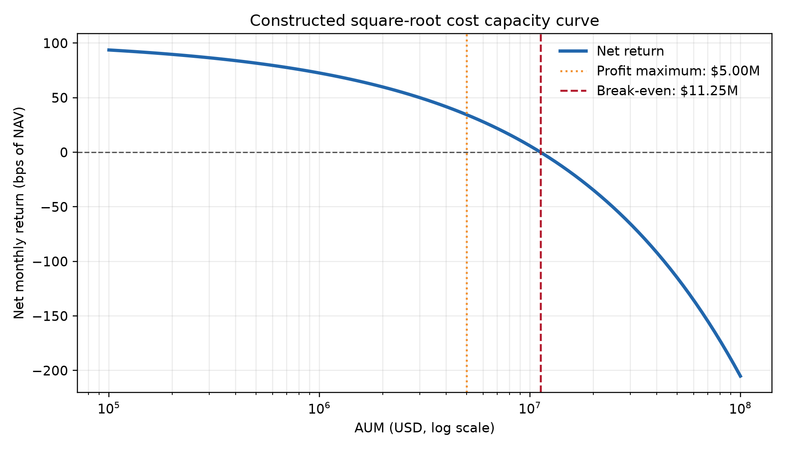
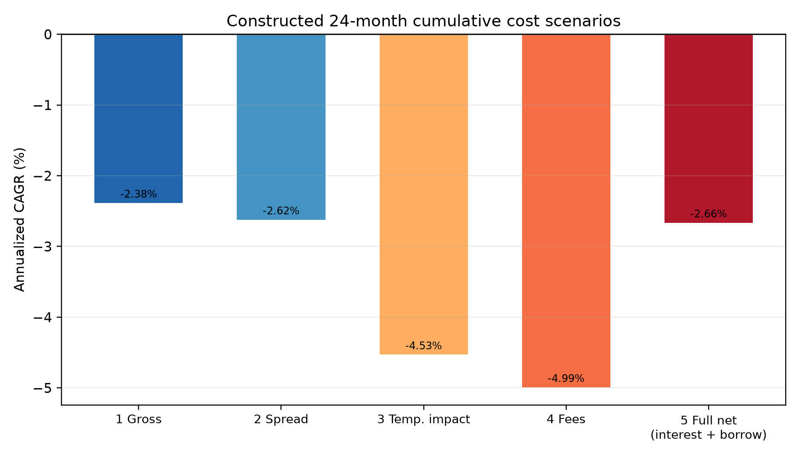

# 第35章 — 交易成本（Transaction Costs）

> 既有工程证据按原接受身份引用。主线：把优化器输出的目标权重与理想价格，通过买卖点差、滑点、冲击、规费、融资与借券等成本项，映射为给定情景下的成交股数、现金变动与期末净值；杜绝把内含于成交价的摩擦重复作为现金费用扣除，建立自融资与容量敏感的净收益核算边界。
> 先修：第29章（构建回测引擎与自融资账本）、第34章（市场微观结构与订单簿）。读完后你应能：拆解佣金、点差、滑点、临时冲击与永久冲击的计价逻辑；推导自融资约束下扣除摩擦后的可买入股数闭式解；在现金账本中准确记账而不发生任何双重扣费；手算包含部分成交与多资产摩擦的完整实施差额台账；构建容量与换手率敏感性分析并计算策略盈亏平衡资金规模。

---

## 1. 本章目标

在量化投资与多因子研究中，纸面组合与扣费后组合使用不同的成交和费用假设。优化器若忽略执行约束，可能建议超出策略可承受范围的换手；实际结果还取决于点差、冲击、佣金、融资、借券、执行窗口和成交数据。课程中的算例使用显式构造参数，用来展示核算方法，不描述某个真实策略或市场样本。

完成本章学习后，读者应能达成以下五项核心专业能力：
1. **成本层级与单位拆解能力**：严格区分显式费用（佣金、交易所规费、税费）与隐式成本（买卖点差、滑点、临时冲击、永久冲击），以及持仓占用成本（融资利息、借券费）。准确使用每股美元（USD/share）、股数（shares）、现金总额（USD）、基点（bps，即 $1\text{ bps} = 0.01\% = 10^{-4}$）与年化百分比，严禁在同一方程中混淆不同量纲。
2. **防范重复扣费与账本自洽能力**：透彻理解成交价格对隐式成本的吸收机制。证明当成交价已经包含半点差与临时冲击时，现金账本扣除实际成交金额后，绝不能再把点差或冲击作为单独的现金规费额外扣减一次；证明永久冲击仅改变后续基准价格路径，其成本通过持仓估值自然体现，严禁在现金流量表中重复记账。
3. **自融资调仓求解能力**：掌握调仓摩擦改变可买入资产规模的动态反馈机制。在给定现金余额与目标权重的约束下，列出考虑滑点与手续费的自融资非线性方程，推导单资产与多资产情形下的买入股数修正解，避免回测引擎因忽略交易损耗而产生现金透支。
4. **实施差额（Implementation Shortfall）对账能力**：掌握将纸面投资决策与最终执行结果进行归因分解的标准方法。把总实施差额严格分解为决策延迟成本、执行冲击与点差成本、未成交机会成本与显式规费，证明代数分解恒等式与直接现金差额法在机器精度下完全等价。
5. **容量评估与参数校准能力**：掌握平方根法则与线性冲击模型在容量测算中的应用边界；区分教学构造情景参数与真实机构实证校准的本质差异；推导换手率、资产管理规模（AUM）与净夏普比率之间的解析关系，手算策略从盈利走向零收益直至深度亏损的盈亏平衡点。

完成条件：读者能独立手算第 8 节给出的贯穿多资产案例，其成交股数、成交价、现金账本余额、各项费用细目与最终期末 NAV 与正文数值逐分钱核对一致；能够证明第 12 节给出的重复计费反例在代码与会计上的具体漏洞，并给出正确的修复逻辑。

---

## 2. 为什么 Quant 需要它

量化策略的完整生命周期始于信号，终于净利润：

```
[多因子信号 / Alpha 模型]
        |
        v (时点决策: signal_time)
[组合优化器: 目标权重 w*]
        |
        v (申报与路由: order_send_time)
[执行算法与撮合: trade_time] ---> 产生摩擦: 点差、冲击、滑点、佣金
        |
        v (实际成交: F = Q - R)
[账户与账本更新: fill_time] ---> 扣减现金、更新持仓、扣减借券/融资费
        |
        v (资产估值: mark_time)
[净值 NAV 与策略容量评估] ---> 决定策略实盘可容纳的资金规模上限
```

在量化研究中，忽视交易成本会高估纸面组合的可实现净收益：
- **高换手情景**：成本随可交易风险资产的实际成交额累积。若教学情景设定全组合投资于可交易股票且单边年化换手率 $\tau_{\text{turnover}}=15$、每单位实际成交名义额的平均成本为15 bps，则按可交易股票总成交名义口径（$2\tau_{\text{turnover}} A$），成本约为 $2\times15\times15=450$ bps 的年初净值（现金权重变动不进入股票成交额）。该数值只是算术示例，不能当成某类策略或市场的通用参数。
- **流动性差异**：相同股数订单在不同报价深度、成交量和波动环境下会产生不同成本。若没有逐标的历史盘口与成交数据，研究员只能做透明的情景分析，不能把假设点差写成市场事实。
- **借券约束**：空头订单还受券源可得性、费率、召回和买入平仓条件约束。缺少带时间戳的历史借券记录时，回测只能使用明确标注的情景输入；不能假设每只股票始终可借。
- **规模敏感性**：管理规模增大时，目标订单相对可用流动性的比例可能上升。成本如何随规模变化取决于执行模型和标定数据；本章只用构造函数说明这种依赖，不给出普遍容量阈值。

第 29 章建立了离散自融资账本的记账框架，第 34 章拆解了限价订单簿与微观撮合机制。本章承前启后：把微观结构中的点差与冲击模型化，接入第 29 章的自融资现金账本，量化交易摩擦如何侵蚀投资组合的长期复利，并为第36章的算法执行（TWAP、预测量VWAP、POV与实施短缺）提供精确的成本底层支撑。

---

## 3. 直觉

### 3.1 现实生活中的二手车交易类比

理解交易成本最直观的场景是个人二手车买卖。假设某款汽车在公允市场上的“中间估值”是 20,000 美元：
1. **买卖点差（Bid-Ask Spread）**：如果你现在想把车卖给二手车商，车商只愿意出价 19,500 美元（买入价 Bid）；如果你想从车商手里买同一款车，车商要价 20,500 美元（卖出价 Ask）。中间相差的 1,000 美元就是做市商收取的买卖点差。你买入的一瞬间，在公允估值意义下就先损失了半点差（500 美元）。
2. **显式佣金与税费（Commission & Fees）**：车管所要求过户时缴纳 200 美元的过户费与交易税。这是明确从你钱包里扣走的外部现金规费。
3. **市场冲击（Market Impact）**：如果你不是买 1 辆车，而是因为开租车公司，必须在今天下午一口气买下 50 辆该款二手车。本地车商手头没有这么多库存，为了紧急调货，车商向外地同行高价收购，第 1 辆卖你 20,500 美元，第 20 辆卖你 21,000 美元，第 50 辆涨到了 22,000 美元。你的大规模即时购买行为直接推高了市场供求平衡价，这种因订单自身规模引发的不利价格变动，就是市场冲击。
4. **临时与永久冲击的分别**：当你买完 50 辆车离场后，当地二手车市场的抢购狂潮暂时退去，车商要价从 22,000 美元回落到了 20,800 美元。为了在同一报价口径下比较，假定买入前的中间估值为 20,000 美元、买卖半点差为 500 美元，买入前 Ask 为 20,500 美元；交易最激烈时 Ask 一度升至 22,000 美元。若交易结束后的 Ask 回到 20,800 美元且半点差仍为 500 美元，则对应中间估值为 20,300 美元。这个构造路径把交易时 Ask 相对交易后 Ask 的 1,200 美元差额称为临时成分，把交易后中间估值相对交易前中间估值的 300 美元差额设为永久成分。它只是人为指定的价格路径；有限期限的观察本身不能证明冲击永久，也不能证明价格会在某个速度内回落。
5. **融资利息与融券借车费**：如果你买车的钱是向银行借的消费贷，每月要付利息（融资成本）；如果你向朋友借了一辆车卖掉、承诺一个月后买一辆还给他，你每月得给朋友付车辆租赁费（借券成本）。

### 3.2 为什么不能“双重扣费”？

这是许多初入量化行业的工程师最常犯的账本错误：
你在车商处以 20,500 美元的成交价买下了一辆车（公允中间价为 20,000 美元，包含 500 美元半点差），并缴纳了 200 美元过户费。
你掏出钱包付钱：
- 现金减少：$20,500 + 200 = 20,700$ 美元。
- 资产增加：1 辆车。若按买入时的公允中间价 20,000 美元估值，你的净资产从 20,700 美元现金变成了价值 20,000 美元的车，总财富减少了 700 美元（500 美元半点差损失 + 200 美元过户费）。

注意：这 500 美元的点差损失已经通过 20,500 美元的成交价格体现在现金的流出中了。如果你在写回测代码时，从现金中扣了 20,500 美元车款，又在手续费扣除项里写了一行“扣除点差费 500 美元”，你的现金就会变成扣除 21,200 美元。你就把点差重复扣了两次。

在金融市场中，严格记账的核心准则只有一条：**成交价吃掉点差与冲击，规费独立扣除现金，估值反映永久变动，决不重复过账**。

---

## 4. 数学基础

在严格定义各项交易成本前，先统一全书符号、变量维度与量纲标准。

### 4.1 核心变量与维度定义

令投资组合在调仓时刻面对的资产池包含 $N$ 只风险资产与 1 种无风险现金。
- $P_t^{\text{mid}} \in \mathbb{R}_{++}^N$：到达时点 $t$ 各资产的中间价向量，单位为 $\text{USD/share}$。
- $a_t, b_t \in \mathbb{R}_{++}^N$：最佳卖价（Ask）与最佳买价（Bid）向量，单位为 $\text{USD/share}$。满足 $b_t < P_t^{\text{mid}} < a_t$。
- $S_t = a_t - b_t \in \mathbb{R}_{++}^N$：报价点差向量，单位为 $\text{USD/share}$。相对点差为 $s_t = S_t / P_t^{\text{mid}}$（无量纲或以 bps 计）。
- $Q \in \mathbb{R}^N$：计划交易的有符号父订单股数向量（Signed Parent Order Quantity），单位为 $\text{shares}$。$Q_i > 0$ 表示买入，$Q_i < 0$ 表示卖出。
- $F \in \mathbb{R}^N$：实际成交的有符号股数向量（Signed Filled Quantity），单位为 $\text{shares}$。满足 $|F_i| \le |Q_i|$；当 $F_i\ne0$ 时还须 $\text{sgn}(F_i)=\text{sgn}(Q_i)$，零成交单独允许。
- $R = Q - F \in \mathbb{R}^N$：截止未成交的有符号残余股数向量（Signed Cutoff Remainder），单位为 $\text{shares}$。
- ::: {.body-conditions title="非零成交与空和"}
  定义非零成交集合 $\mathcal I_F=\{i:F_i\ne0\}$。成交资产 $i\in\mathcal I_F$ 的实际成交均价 $P_i^{\text{fill}}>0$（Fill VWAP）单位为 $\text{USD/share}$；若资产未成交（$F_i=0$），其成交均价未定义（记为 $\text{NaN}$ 或 $\text{None}$），绝不可设为 0。凡涉及 $P_i^{\text{fill}}$ 或 $\operatorname{sgn}(F_i)$ 的求和只在 $i\in\mathcal I_F$ 上进行，空集合的和为 0。
  :::
- $C_t \in \mathbb{R}$：账户在时点 $t$ 的可用现金余额，单位为 $\text{USD}$。$C_t < 0$ 表示存在现金借贷（杠杆融资）。
- $H_t \in \mathbb{R}^N$：账户在时点 $t$ 的持仓股数向量，单位为 $\text{shares}$。$H_{i, t} < 0$ 表示持有该股票的融券空头。
- $\text{NAV}_t \in \mathbb{R}$：账户在时点 $t$ 按照标记价格计算的资产净值（Net Asset Value），单位为 $\text{USD}$。

### 4.2 基点（Basis Points）与百分比换算

金融交易中微小比例通常采用基点（bps）度量：
$$1\text{ bps} = 0.01\% = 10^{-4} = 0.0001.$$
例如，$15\text{ bps}$ 等价于 $0.15\%$ 或 $0.0015$。若股票价格为 $\$50.00$，则 $20\text{ bps}$ 的点差对应的绝对金额为：
$$\Delta P = 50.00 \times 20 \times 10^{-4} = \$0.10/\text{share}.$$

---

### 4.3 从成交确认到估值：先过账，后比较基准

沿用第34章小连接例。请求 $Q=100$ 不是持仓变化；只有 $F=60$ 股实际买入，才将现金从2,000减到1,396.70、股数从0加到60。成交价10.05已经包含相对报价的执行偏离；只另扣显式费0.30。mark 从10.02变成10.10时，现金不变，持仓市值增加 $60(10.10-10.02)=4.80$，NAV从1,997.90变为2,002.70。

这笔买入的 IS 四分量为

$$100(10.02-10.00)+60(10.05-10.02)$$
$$+40(10.10-10.02)+0.30=7.30.$$

机会成本3.20没有买到任何股票，延迟2.00也没有向任何人另付现金；两者是评价分量。若在过账后再从现金扣总IS，NAV会错误变成1,995.40，重复扣7.30。下面§6.2给一般有符号恒等式，§8保留多资产、公司行动和融资账本的完整版本。

## 5. 正式定义

本节依次给出量化交易成本中每一项核心成分的严格数学与金融定义。

### 5.1 佣金与显式费用（Commissions & Explicit Fees）

**定义 5.1（显式费用 Explicit Fees）**：
由经纪商、清算所、交易所或监管机构针对交易活动直接收取的现金支出，记为 $\Xi \ge 0$，单位为 $\text{USD}$。
显式费用通常由三部分构成：
1. **按股固定佣金（Per-share Commission）**：$\Xi_{\text{share}} = c_{\text{share}} \sum_i |F_i|$，其中 $c_{\text{share}}$ 为每股费率（例如 $\$0.005/\text{share}$）。
2. **按名义金额比例佣金（Notional Commission）**：$\Xi_{\text{notional}} = c_{\text{notional}} \sum_i |F_i| P_i^{\text{fill}}$，其中 $c_{\text{notional}}$ 为无量纲费率（例如 $1.5\text{ bps} = 0.00015$）。
3. **其他交易相关规费与税费（Other Transaction Fees and Taxes）**：如模型采用这类费用，须依据题目明确给定的交易场所、产品与账户费率表设定；本章不陈述任何司法辖区的具体征收规则或当前费率。下式的卖出侧项仅是可选的建模项，不构成普遍法律规则。
综合显式费用函数写作：
$$\Xi = \sum_{i\in\mathcal I_F} \left( c_{\text{share}, i} |F_i| + c_{\text{notional}, i} |F_i| P_i^{\text{fill}} + \mathbb{I}_{\{F_i < 0\}} \cdot \tau_{\text{tax}, i} |F_i| P_i^{\text{fill}} \right).$$

*成立条件与特性*：在本章记账模型中，佣金与成交挂钩，仅对**实际成交部分（$F_i$）**计收；未成交残余（$R_i$）不产生本模型中的成交佣金。具体账户若另有申报或撤单费用，不在本模型范围内。

### 5.2 买卖点差（Bid-Ask Spread）

**定义 5.2（有效点差与已实现点差 Effective & Realized Spread）**：
设订单到达市场的时刻为 $t_{\text{arr}}$，此时市场最优买价为 $b$，最优卖价为 $a$，中间价为 $P^{\text{mid}} = (a+b)/2$。
1. **报价点差（Quoted Spread）**：$S^{\text{quote}} = a - b$。相对报价点差为 $s^{\text{quote}} = (a - b) / P^{\text{mid}}$。
2. **有效半点差成本（Effective Half-Spread Cost）**：对于一笔在时刻 $t$ 以价格 $P^{\text{fill}}$ 成交的单笔子单，其相对到达时中间价的单边滑移在无冲击极限下等于半点差。对有符号成交量 $F$，买入（$F > 0$）成交于 Ask，卖出（$F < 0$）成交于 Bid：
   $$P^{\text{fill}} = P^{\text{mid}} + \text{sgn}(F) \cdot \frac{S^{\text{quote}}}{2}.$$
   单笔成交支付的总点差金额（USD）为：
   $$\text{Cost}_{\text{spread}} = |F| \cdot \frac{S^{\text{quote}}}{2} = F \cdot (P^{\text{fill}} - P^{\text{mid}}).$$

*成立条件*：该式假设订单规模小于等于最优盘口可见挂单量。当订单穿透第一档深度时，必须考虑微观结构深度滑点与市场冲击。

### 5.3 滑点（Slippage）

**定义 5.3（滑点 Slippage）**：
实际执行成交价格 $P^{\text{fill}}$ 与某约定参考基准价格 $P^{\text{ref}}$ 之间的不利偏离：
$$\text{Slip} = \text{sgn}(F) \cdot (P^{\text{fill}} - P^{\text{ref}}).$$
- 若参考价取决策时中间价 $P^{\text{decision}}$，则滑点包含决策延迟造成的市场漂移以及到达后的所有执行摩擦。
- 若参考价取到达时中间价 $P^{\text{arrival}}$，则滑点包含半点差与即时市场冲击。
- 滑点总金额为 $F \cdot (P^{\text{fill}} - P^{\text{ref}})$。滑点为正表示执行结果劣于参考基准。

### 5.4 市场冲击：临时冲击与永久冲击（Market Impact: Temporary vs Permanent）

当订单规模较大时，交易行为本身会扰动市场供求关系，导致价格向不利于交易者的方向移动。这一现象被 Almgren 与 Chriss (2000) 形式化分解为临时冲击与永久冲击。

**定义 5.4（临时冲击 Temporary Impact）**：
由于交易者索取即刻流动性，在撮合过程中暂时消耗了订单簿深度，导致实际成交均价劣于未受扰动的当时中间价。在本模型中，该成分只进入成交价，不进入交易后的参考中间价；这项建模约定本身不证明现实价格会迅速回落，回落速度需要事件数据检验。
设在时间窗口 $\Delta t$ 内执行的交易速度为 $v = |F| / \Delta t$，临时冲击使买入成交价上涨、卖出成交价下跌：
$$P^{\text{fill}} = P_t^{\text{mid}} + \text{sgn}(F) \cdot \left( \frac{S_t}{2} + g(|F|, \Delta t) \right),$$
其中 $g(|F|, \Delta t) \ge 0$ 为临时冲击函数。在经典模型中，通常假设为幂律形式：
$$g(|F|, \Delta t) = \eta \cdot \sigma_{P,1\mathrm d} \cdot \left( \frac{|F|}{V_{\text{slot}}} \right)^\alpha,$$
这里先固定波动测量区间：例如决策日前60个完整交易日的日收益样本标准差 $\sigma_{r,1\mathrm d}$（无量纲），不含决策后的数据。定义 $\sigma_{P,1\mathrm d}=P_t^{\text{mid}}\sigma_{r,1\mathrm d}$（USD/股，1日价格增量的标准差），则 $g$ 为 USD/股。$\eta$ 与参与率幂均无量纲；$V_{\text{slot}}$ 为该时段的市场总成交量，$\eta > 0$ 为流动性系数，$\alpha \in [0.5, 1.0]$ 为冲击指数（$\alpha = 1.0$ 为线性冲击，$\alpha = 0.5$ 为平方根冲击）。

**定义 5.5（永久冲击 Permanent Impact）**：
本模型把交易者订单造成、并保留在交易后参考中间价中的价格变化称为永久冲击。以下公式是模型分量定义，不意味着有限观察窗口已经证明现实中的变化永久，也不预设其源于私有信息或能识别因果效应：
$$P_{t+\Delta t}^{\text{mid}} = P_t^{\text{mid}} + \text{sgn}(F) \cdot h(|F|),$$
其中 $h(|F|) \ge 0$ 为永久冲击函数。Huberman 与 Stanzl (2004) 在其价格冲击框架、冲击结构与无准套利/无价格操纵假设下讨论闭环交易约束；该结论不能脱离模型条件推广为所有市场的经验定律。在本章简化设定中，线性永久冲击只是教学规格：
$$h(|F|) = \gamma \cdot \sigma_{P,1\mathrm d} \cdot \left( \frac{|F|}{V_{\text{day}}} \right),$$
其中 $\gamma>0$ 无量纲，$h$ 的单位为 USD/股。沿用同一事前波动测量窗口；$V_{\text{day}}$ 是日成交量代理。参数未作市场校准，本式只给情景规格。

**与实际执行引擎的参数对应。** 上面是波动率缩放的抽象情景式。

当前模块 `quant_course.execution_costs` 的成交模型使用

$$g_{\text{engine}}=k_{\text{temp}}P_{\text{current}}\left(\frac{|F|}{V_{\text{realized}}}\right)^\alpha,$$
$$h_{\text{engine}}=k_{\text{perm}}P_{\text{current}}\frac{|F|}{V_{\text{realized}}}.$$

$k_{\text{temp}}$、$k_{\text{perm}}$ 是无量纲 scenario coefficient；当前实现没有估计日波动率输入，也没有使用真实 L2 队列。在同一参考价和分母的抽象比较中，可写 $k_{\text{temp}}=\eta\sigma_{r,1\mathrm d}$；这只是参数化对应，不能声称工程输入了已校准波动率。永久项的分母在上式是槽内实现量，在前面的抽象式是日量代理，若两者不同就不能直接等同系数。实现量只参与成交容量与成交价计算，不能倒灌到事前 VWAP/POV 请求排程。第36章 AC 的扩散参数 $\sigma$ 是 USD/股/$\sqrt{\text{时间}}$；本节 $\sigma_{r,1\mathrm d}$ 与 $\sigma_{P,1\mathrm d}$ 都不是该单位。

例如到达价50、相对日收益标准差2%、槽内参与率4%、$\eta=0.5,\alpha=0.5$ 时，$\sigma_{P,1\mathrm d}=1.00$ USD/股、$g=0.10$ USD/股；若绝对点差 $S=0.04$，买入成交价50.12。等价临时情景系数是 $k_{\text{temp}}=0.01$，不是0.5；该算术例没有校准含义。

*关键边界对比*：
- **临时冲击 $g(|F|)$**：只影响本笔订单的**成交价格 $P^{\text{fill}}$**，不改变交易完成后市场的均衡中间价。
- **永久冲击 $h(|F|)$**：直接改变交易完成后市场的**新中间价 $P_{t+\Delta t}^{\text{mid}}$**，不仅影响后续订单的到达价格，还会对账户中已经持有的存量现货市值产生标记影响。

### 5.5 融资利息与融券借券费（Financing Cost & Borrow Fees）

**定义 5.6（现金借贷融资成本 Financing Cost）**：
当投资者动用杠杆买入资产，导致账户现金余额为负（$C_t < 0$）时，经纪商按约定借款利率收取的利息支出。
在账本连续事件 $t_{j-1}$ 与 $t_j$ 之间，现金余额保持不变。设实际日数为 $\Delta d_j$，日计数基数为 $D$（本例采用 ACT/360），则该段简单计息的带符号净利息为
$$I_j=C_{j-1}\,r(C_{j-1})\frac{\Delta d_j}{D},\qquad r(C)=\begin{cases}r_{\text{credit}},&C\ge 0,\\r_{\text{debit}},&C<0.\end{cases}$$
负现金时融资费用为 $|C_{j-1}|r_{\text{debit}}\Delta d_j/D$，所以 $I_j<0$；正现金时 $I_j>0$。月末、成交或标记事件结算后，$I_j$ 立即进入现金账本，后续区间据此更新计息基数。因此每段内部是简单 ACT/360，多个事件之间按离散事件资本化；这不是把月内所有成交视为同一时点后仅计一次整月利息。

**定义 5.7（融券空头借券费 Borrow Fees）**：
当投资者持有空头头寸（$H_{i, t} < 0$）时，必须向证券出借方借入股票并支付借券费。借券费用依据融券市值的绝对值与年化借券费率（Borrow Rate）按日计收：
$$B_j = \sum_{i: H_{i, j-1} < 0} |H_{i, j-1}| \cdot P_{i, j-1}^{\text{available}} \cdot b_i \cdot \frac{\Delta d_j}{D},$$
其中 $b_i \ge 0$ 为标的资产 $i$ 的年化借券费率（对极度紧缺的股票，年化借券费率常称为 Special Borrow Rate）。

融资与借券沿用第29章的唯一单调账本事件时钟。结算 $[t_{j-1},t_j]$ 时，先用区间开始时的现金、空头数量及当时已经可得的最近标记价格计算 $I_j$ 与 $B_j$，并将 $I_j-B_j$ 记入现金；之后才处理 $t_j$ 时刻的成交或新标记。因而在事件末才观察到的价格只影响后续借券区间，不回填此前成本；无成交月份也必须结清至月末。若空头资产尚无可得标记价格，应停止并报缺失，不能把费率或未来价格代入。

在该 Project 4 构造执行窗中，每个时槽结束时的中间价都作为一条新 mark 事件入账，即使该槽没有成交；持仓继续存在但本月未调仓的证券也沿用同一规则。旧 mark 计息至该时槽末，新 mark 只供后续区间使用。这里的槽末 mark 可得性是实验的明确时钟约定，不意味着真实市场报价均在该时点以相同延迟可得。

**分段核算例（ACT/360，零佣金）**：day 0 现金为 $\$100{,}000$，卖空 A 100 股、成交价与当时可得标记均为 $\$100$，故卖空后现金为 $\$110{,}000$；年现金利率 4%，A 年借券率 1.5%。day 0 至 day 10 以旧现金和旧空头计费：利息 $110{,}000\times4\%\times10/360=\$122.2222$，借券费 $100\times100\times1.5\%\times10/360=\$4.1667$。费用记入现金后，day 10 买入 B 50 股、成交价 $\$100$，新现金为 $\$105{,}118.0556$。day 10 至 day 30 的利息为 $105{,}118.0556\times4\%\times20/360=\$233.5957$，A 借券费为 $100\times100\times1.5\%\times20/360=\$8.3333$。两段利息合计 $\$355.8179$。若 day 10 仍以旧 mark $100$ 计费，后段借券费为 $8.3333$、累计为 $12.50$；若 day 10 才观察到新 mark $105$，它只用于后 20 天，后段借券费为 $8.75$、累计借券费为 $12.9167$，不追改前十天。若把所有成交集中在月末计费，day 0 至 day 10 的旧现金利息和空头费用就会漏掉。

*注意*：空头持仓在持仓期间若标的发生分红派息，空头方还须承担向出借方全额补偿分红现金的\mbox{义务}（Manufactured Dividend），该项补偿直接从现金账户扣减。

### 5.6 组合换手率口径（Turnover Conventions）

**定义 5.8（换手率口径与可交易证券集合）**：
设组合可交易风险证券集合为 $\mathcal{S}_{\text{risky}}=\{1,\ldots,N\}$，另有现金账户。调仓前权重为 $w_{t^-}$，调仓后目标权重为 $w_t^*$。
1. **可交易风险证券单边换手率**：
   $$\tau_{\text{risky, one-sided}}=\frac{1}{2}\sum_{i\in\mathcal{S}_{\text{risky}}}|w_{i,t}^*-w_{i,t^-}|.$$
2. **总请求风险证券名义换手率**：
   $$\tau_{\text{risky, notional}}=\sum_{i\in\mathcal{S}_{\text{risky}}}|w_{i,t}^*-w_{i,t^-}|=2\tau_{\text{risky, one-sided}},$$
   对应请求交易名义额 $V_{\text{requested}}=\tau_{\text{risky, notional}}\,\text{NAV}$。实际佣金、点差与临时冲击只对实际风险证券成交额 $\sum_{i\in\mathcal{S}_{\text{risky}}}|F_i|P_i^{\text{fill}}$ 计取；未成交部分只进入机会成本评价。
3. **全资产权重重配率**可以另行定义为 $\tau_{\text{all, one-sided}}=\frac{1}{2}(\sum_{i\in\mathcal{S}_{\text{risky}}}|\Delta w_i|+|\Delta w_{\text{cash}}|)$，但它不是股票成交换手。现金权重变动是结算的货币差额，不生成股票成交、点差、冲击或佣金；不能把它放进 $V_{\text{trade}}=2\tau_{\text{turnover}} A$ 的 $\tau_{\text{turnover}}$。

月频组合的年化换手按“月均换手率乘 12”报告；执行窗口内的日内切片不会把月频信号或月回报变成日频统计。

---

## 6. 推导

### 6.1 现金账本递推与防重扣证明

根据第 29 章的事件时钟和模块接口，我们从离散会计守恒出发推导账本递推式。

设在调仓前时刻 $t_{\text{pre}}$，账户状态为 $(C_{\text{pre}}, H_{\text{pre}})$。在执行时段内，各资产实际成交股数为 $F \in \mathbb{R}^N$，只有 $i\in\mathcal I_F$ 才有定义的成交均价 $P_i^{\text{fill}}$；显式交易费用为 $\Xi$。
调仓完成时刻 $t_{\text{post}}$ 的现金余额为：
$$C_{\text{post}} = C_{\text{pre}} - \sum_{i\in\mathcal I_F} F_i P_i^{\text{fill}} - \Xi.$$
新持仓向量为：
$$H_{\text{post}} = H_{\text{pre}} + F.$$

**命题 6.1（内含成本的不可重复扣除性）**：
假定对每个 $i\in\mathcal I_F$，成交价满足微观结构关系：$P_i^{\text{fill}} = P_i^{\text{mid}} + \text{sgn}(F_i) \cdot \left(\frac{1}{2}S_i + g_i(|F_i|)\right)$。
证明：半点差与临时冲击已经在现金账户中足额结清，严禁将点差与临时冲击作为现金规费进行二次扣款。

*证明*：
将 $P_i^{\text{fill}}$ 代入现金递推方程：
$$C_{\text{post}} = C_{\text{pre}} - \sum_{i\in\mathcal I_F} F_i \left[ P_i^{\text{mid}} + \text{sgn}(F_i) \left( \frac{1}{2}S_i + g_i(|F_i|) \right) \right] - \Xi.$$
由于 $F_i \cdot \text{sgn}(F_i) = |F_i|$，展开得到：
$$C_{\text{post}} = C_{\text{pre}} - \sum_{i\in\mathcal I_F} F_i P_i^{\text{mid}} - \sum_{i\in\mathcal I_F} |F_i| \frac{S_i}{2} - \sum_{i\in\mathcal I_F} |F_i| g_i(|F_i|) - \Xi.$$
上式右侧清晰表明：
- 第一项 $\sum_{i\in\mathcal I_F} F_i P_i^{\text{mid}}$ 是以无摩擦中间价计量的名义交易资金。
- 第二项 $\sum_{i\in\mathcal I_F} |F_i| \frac{S_i}{2}$ 正是半点差消耗的现金总额。
- 第三项 $\sum_{i\in\mathcal I_F} |F_i| g_i(|F_i|)$ 正是临时冲击消耗的现金总额。
- 第四项 $\Xi$ 是显式交易佣金。

现金账户余额 $C_{\text{post}}$ 已经精确扣除了名义买卖款、半点差成本、临时冲击成本以及佣金。
若额外在现金账本中再记入一笔“点差扣除”或“冲击扣除”，现金余额将变为：
$$C_{\text{err}} = C_{\text{post}} - \sum_{i\in\mathcal I_F} |F_i| \frac{S_i}{2} - \sum_{i\in\mathcal I_F} |F_i| g_i(|F_i|),$$
这直接导致点差与临时冲击被双重计算，现金账户被虚假扣损。证毕。

### 6.2 净值变动与实施差额（Implementation Shortfall）等价性推导

Perold（1988）条目在本章仅作为书目记录；本章只核对出版社与作者书目元数据，未读论文正文；本章仅核对作者和出版信息，未读取论文正文。SEC（2003）文件指出当时组合实施差额没有普遍接受的计算方式，并讨论其历史概念来源。本节采用明确的教学口径：**纸面理想组合损益（Paper Portfolio PnL）与实际执行组合损益（Actual Portfolio PnL）的差额**；决策价、到达价、截止价和未成交机会成本的分拆属于本章的公开约定，不据此声称当前所有市场或监管制度采用同一公式。

设投资决策在时刻 $t_{\text{dec}}$ 形成，决策基准价向量为 $P^{\text{dec}}$，有符号母单目标为 $Q$。订单于 $t_{\text{arr}}$ 到达市场，此时中间价向量为 $P^{\text{arr}}$。实际成交向量为 $F$；成交均价 $P_i^{\text{fill}}$ 仅对 $i\in\mathcal I_F=\{i:F_i\ne0\}$ 定义；未成交向量为 $R=Q-F$。在窗口截止或评估时刻 $t_{\text{term}}$，市场标记价向量为 $P^{\text{term}}$。以下所有下标 $i$ 均表示同一资产。

**命题 6.2（实施差额四因子分解与直接金额法等价性）**：
定义实施差额（以正值表示成本损失）：
$$\text{IS} = \text{PnL}_{\text{paper}} - \text{PnL}_{\text{actual}}.$$
则实施差额可严格分解为以下四项之和：
$$\text{IS} = \underbrace{\sum_i Q_i \cdot (P_i^{\text{arr}} - P_i^{\text{dec}})}_{\text{延迟成本 Delay}} + \underbrace{\sum_{i\in\mathcal I_F} F_i \cdot (P_i^{\text{fill}} - P_i^{\text{arr}})}_{\text{执行摩擦 Execution}} + \underbrace{\sum_i R_i \cdot (P_i^{\text{term}} - P_i^{\text{arr}})}_{\text{机会成本 Opportunity}} + \underbrace{\Xi}_{\text{显式费用 Explicit}}.$$
且该分解与直接金额差额法严格相等：
$$\text{IS} = \sum_{i\in\mathcal I_F} F_i \cdot (P_i^{\text{fill}} - P_i^{\text{dec}}) + \sum_i R_i \cdot (P_i^{\text{term}} - P_i^{\text{dec}}) + \Xi.$$

*证明*：
按有符号多头/空头统一口径（$Q > 0$ 为买单，$Q < 0$ 为卖单）：
- **纸面组合损益**：对每只资产 $i$，纸面组合假定在决策时刻按 $P_i^{\text{dec}}$ 对相应母单数量 $Q_i$ 成交，且不收显式费用（$Q_i>0$ 为买入，$Q_i<0$ 为卖出）。到 $t_{\text{term}}$，纸面持仓按 $P^{\text{term}}$ 标记，故纸面损益为：
  $$\text{PnL}_{\text{paper}} = \sum_i Q_i \cdot (P_i^{\text{term}} - P_i^{\text{dec}}).$$
- **实际组合损益**：实际组合只持有已成交的 $F$，在截止时刻 $t_{\text{term}}$ 按 $P^{\text{term}}$ 标记；实际支付成交款与显式费用为 $\sum_{i\in\mathcal I_F}F_iP_i^{\text{fill}}+\Xi$。故实际损益为：
  $$\text{PnL}_{\text{actual}} = \sum_i F_i \cdot P_i^{\text{term}} - \left(\sum_{i\in\mathcal I_F} F_i \cdot P_i^{\text{fill}} + \Xi\right) = \sum_{i\in\mathcal I_F} F_i \cdot (P_i^{\text{term}} - P_i^{\text{fill}}) - \Xi.$$

将二者相减：
$$\text{IS} = \sum_i Q_i \cdot (P_i^{\text{term}} - P_i^{\text{dec}}) - \sum_{i\in\mathcal I_F} F_i \cdot (P_i^{\text{term}} - P_i^{\text{fill}}) + \Xi.$$
利用残余关系 $Q=F+R$，逐资产将纸面损益项拆为成交量与未成交量两部分：
$$\text{IS} = \sum_{i\in\mathcal I_F} F_i \cdot (P_i^{\text{term}} - P_i^{\text{dec}}) + \sum_i R_i \cdot (P_i^{\text{term}} - P_i^{\text{dec}}) - \sum_{i\in\mathcal I_F} F_i \cdot (P_i^{\text{term}} - P_i^{\text{fill}}) + \Xi.$$
合并关于 $F$ 的同类项：
$$\sum_{i\in\mathcal I_F} F_i \cdot (P_i^{\text{term}} - P_i^{\text{dec}}) - \sum_{i\in\mathcal I_F} F_i \cdot (P_i^{\text{term}} - P_i^{\text{fill}}) = \sum_{i\in\mathcal I_F} F_i \cdot (P_i^{\text{fill}} - P_i^{\text{dec}}).$$
由此直接得到直接金额差额法：
$$\text{IS} = \sum_{i\in\mathcal I_F} F_i \cdot (P_i^{\text{fill}} - P_i^{\text{dec}}) + \sum_i R_i \cdot (P_i^{\text{term}} - P_i^{\text{dec}}) + \Xi.$$

进一步，在各项中引入到达中间价 $P^{\text{arr}}$ 作为中介项展开：
$$P_i^{\text{fill}} - P_i^{\text{dec}} = (P_i^{\text{arr}} - P_i^{\text{dec}}) + (P_i^{\text{fill}} - P_i^{\text{arr}}),\quad i\in\mathcal I_F,$$
$$P_i^{\text{term}} - P_i^{\text{dec}} = (P_i^{\text{arr}} - P_i^{\text{dec}}) + (P_i^{\text{term}} - P_i^{\text{arr}}),\quad i=1,\ldots,N.$$
代入上式：
$$\text{IS} = \sum_{i\in\mathcal I_F} F_i \left[(P_i^{\text{arr}} - P_i^{\text{dec}}) + (P_i^{\text{fill}} - P_i^{\text{arr}})\right] + \sum_i R_i \left[(P_i^{\text{arr}} - P_i^{\text{dec}}) + (P_i^{\text{term}} - P_i^{\text{arr}})\right] + \Xi$$
$$= \sum_i (F_i + R_i)(P_i^{\text{arr}} - P_i^{\text{dec}}) + \sum_{i\in\mathcal I_F} F_i(P_i^{\text{fill}} - P_i^{\text{arr}}) + \sum_i R_i(P_i^{\text{term}} - P_i^{\text{arr}}) + \Xi.$$
再次利用 $F + R = Q$：
$$\text{IS} = \sum_i Q_i(P_i^{\text{arr}} - P_i^{\text{dec}}) + \sum_{i\in\mathcal I_F} F_i(P_i^{\text{fill}} - P_i^{\text{arr}}) + \sum_i R_i(P_i^{\text{term}} - P_i^{\text{arr}}) + \Xi.$$
四项依次分别代表：
1. $\sum_i Q_i(P_i^{\text{arr}} - P_i^{\text{dec}})$：决策到申报到达之间的价格漂移带来的**延迟成本**。
2. $\sum_{i\in\mathcal I_F} F_i(P_i^{\text{fill}} - P_i^{\text{arr}})$：实际成交部分包含的点差与市场冲击带来的**执行摩擦成本**；若没有成交，这个空和为0。
3. $\sum_i R_i(P_i^{\text{term}} - P_i^{\text{arr}})$：未成交残余份额错失市场行情的**机会成本**。
4. $\Xi$：缴纳给交易所与经纪商的**显式现金规费**。
代数恒等式成立，证毕。

本章把全额母单 $Q$ 的决策至到达价格变动计入延迟项，再以到达价计算成交与剩余项。其他研究或系统可能按成交份额分摊这段漂移，或采用不同的机会成本基准；只要使用一致的决策价、截止估值价和数量守恒，分量归属可以不同，直接金额法总额由代数恒等式确定。

### 6.3 自融资约束下的可买入股数修正推导

在第 29 章中，若优化器给出的目标权重为 $w^*$，研究员若天真地认为可以买入的名义市值为 $w^* \cdot \text{NAV}_{\text{pre}}$，并在下单后才发现佣金与点差导致现金透支，系统就会报错。本节推导考虑交易摩擦时的自融资闭式解。

考虑单资产买入场景：
设账户当前只有可用现金 $C_0 > 0$，无负债、无持仓，欲买入某标的股票。
到达时中间价为 $P^{\text{mid}}$，绝对半点差为 $S/2=P^{\text{mid}}s/2$（USD/股），临时冲击为线性形式 $g(F) = \lambda_{\text{impact}} F$（$\lambda_{\text{impact}} > 0$，USD/股$^2$；与第36章 USD$^{-1}$ 的 $\lambda_{\text{risk}}$ 不同），单股佣金为 $c_{\text{share}}$，比例佣金率为 $c_{\text{notional}}$。
买入 $F > 0$ 股时，实际成交单价为：
$$P^{\text{fill}}(F) = P^{\text{mid}} + \frac{S}{2} + \lambda_{\text{impact}} F.$$
买入所需支付的总现金为：
$$\text{CashRequired}(F) = F \cdot P^{\text{fill}}(F) + c_{\text{share}} F + c_{\text{notional}} F P^{\text{fill}}(F).$$
自融资严格约束要求总支出不得超过可用现金：
$$(1 + c_{\text{notional}}) F \left( P^{\text{mid}} + \frac{S}{2} + \lambda_{\text{impact}} F \right) + c_{\text{share}} F = C_0.$$
整理为关于买入股数 $F$ 的一元二次方程：
$$\underbrace{(1 + c_{\text{notional}}) \lambda_{\text{impact}}}_{A} F^2 + \underbrace{\left[ (1 + c_{\text{notional}}) \left( P^{\text{mid}} + \frac{S}{2} \right) + c_{\text{share}} \right]}_{B} F - \underbrace{C_0}_{C} = 0.$$
由于 $A > 0, B > 0, C > 0$，判别式 $\Delta = B^2 + 4AC > 0$，方程必有唯一正实根：
$$F^* = \frac{2C}{B + \sqrt{B^2 + 4AC}}.$$
若忽略非线性冲击（$\lambda_{\text{impact}} = 0$），则退化为简单一次方程：
$$F_{\text{linear}}^* = \frac{C_0}{(1 + c_{\text{notional}}) \left( P^{\text{mid}} + \frac{S}{2} \right) + c_{\text{share}}}.$$
这证明：摩擦的存在严格压缩了可买入资产的物理股数。若忽略分母中的佣金与半点差项，强行按照 $F = C_0 / P^{\text{mid}}$ 下单，将导致现金透支 $F P^{\text{fill}} + \Xi - C_0 > 0$。

### 6.4 策略容量与边际净收益衰减推导

本节用一个量纲闭合的平方根情景模型说明规模敏感性。令 $A$ 为净值（USD），$\alpha_{\text{gross}}$ 为同一评估期的毛超额收益率，$\tau_{\text{turnover}}$ 为可交易风险证券集合在该期的单边换手率（现金变动不构成股票成交），$D$ 为该期交易日数，$ADV_{\text{market}}$ 为对应股票集合的日均美元成交额（USD/day）。实际可交易风险证券总成交名义额为
$$V_{\text{trade}}=2\tau_{\text{turnover}} A,$$
与之匹配的评估期市场成交额代理量为 $D\,ADV_{\text{market}}$。参与率代理量定义为

$$p=\frac{V_{\text{trade}}}{D\,ADV_{\text{market}}}.$$

它是情景比较输入，不是可直接用于下单的流动性保证。

假设每美元实际成交额承担固定成本率 $c_0$，平方根冲击率为 $\gamma\sqrt{p}$。其中 $c_0$ 和 $\gamma$ 均为无量纲小数，且必须在同一评估期内使用：
$$C_{\text{period}}=V_{\text{trade}}\left(c_0+\gamma\sqrt{\frac{V_{\text{trade}}}{D\,ADV_{\text{market}}}}\right).$$
因此
$$\alpha_{\text{net}}(A)=\alpha_{\text{gross}}-2\tau_{\text{turnover}} c_0-\gamma(2\tau_{\text{turnover}})^{3/2}(D\,ADV_{\text{market}})^{-1/2}A^{1/2}.$$
记 $a=\alpha_{\text{gross}}-2\tau_{\text{turnover}} c_0$，$k=\gamma(2\tau_{\text{turnover}})^{3/2}/\sqrt{D\,ADV_{\text{market}}}$。若 $a>0$ 且 $k>0$，净收益率为零的规模为 $A_{\text{break}}=(a/k)^2$。美元净利润为 $aA-kA^{3/2}$，其内部最大值在 $A_{\text{opt}}=4A_{\text{break}}/9$。若 $a\le0$，固定成本已用尽毛收益，本模型不存在正的盈利容量。

$4/9$ 仅由这条特定净收益函数推出。它不是行业最佳规模常数；真实容量还需要按证券和时段标定的成交量、订单流与成本数据。

时间频率必须一致。标准月频示例使用 21 个交易日、月毛收益和单边月换手；若报告年化换手，则由月换手乘 12 得到，不能把年化换手与月毛收益或 $D=21$ 混在同一容量公式内。

## 7. 金融解释

从数学公式回到金融交易的实际运行机制，量化研究员必须深刻理解以下三个经济学原理：

### 7.1 点差与流动性供给

点差可补偿流动性提供者承担的库存风险、逆向选择和运营成本。不同市场结构、订单类型与行情状态下，这些因素的权重不同；点差不是由单一原因决定的固定“保险费”。临时冲击则描述交易者索取即时流动性时成交价相对基准的偏离。

### 7.2 频率、换手与成本的关系

较高换手会使固定费率按更多实际成交额重复发生；但成本能否压过毛收益，要结合成交规模、资产流动性和执行方式判断。一个便于手算的构造情景是：组合完全投资于可交易股票且单边年化换手率 $\tau_{\text{turnover}}=15$，每一美元实际成交名义额的合计费用为15 bps。按可交易股票总成交名义口径，总成交额约为 $2\tau_{\text{turnover}} A$，费用约占净值 $2\times15\times0.0015=4.5\%$；若存在闲置现金权重变动，该变动不进入股票成交额。所有数值均为算术假设。

### 7.3 融券借券费的时空不对称性

借券费取决于标的、券源和计费时点，不是仅凭空头信号就能确定的常数。广义可借券与紧张券源可能对应不同费率；借券是否可得、何时被召回以及买入平仓需要多少流动性，都要有带时间戳的借券/执行记录才能回测。没有这些来源时，本书示例只演示“费率 × 实际借券市值 × 计息比例”的现金记账，不推断真实券源状况或召回损失。

---

## 8. Numerical Example

本节给出一个完整的、贯穿所有公式的、可完全人工手算核对的教学构造案例（所有数值均明确标记为教学构造数值）。

### 8.1 初始环境与市场状态

考虑一个管理资产规模为 1,000,000.00 美元的投资组合。
- **当前时点**：2026-10-12 09:15:00 EDT (America/New_York, UTC-04:00)（决策与信号产生时点 $t_{\text{dec}}$）。
- **执行时点**：2026-10-12 09:30:00 EDT (America/New_York, UTC-04:00)（订单到达市场 $t_{\text{arr}}$）。
- **持仓与现金初始状态（$t_{\text{pre}}$）**：
  - 股票 A（大盘流动股）：持有 5,000 股，到达中间价 $P_{A}^{\text{mid}} = \$100.00/\text{share}$。市值 $\$500,000.00$（占比 50.0%）。
  - 股票 B（中盘成长股）：持有 0 股，到达中间价 $P_{B}^{\text{mid}} = \$50.00/\text{share}$。市值 $\$0.00$（占比 0.0%）。
  - 股票 C（融券空头对冲标的）：持有 0 股，到达中间价 $P_{C}^{\text{mid}} = \$40.00/\text{share}$。市值 $\$0.00$（占比 0.0%）。
  - 现金余额 $C_0$：$\$500,000.00$（占比 50.0%）。
  - 初始净值：$\text{NAV}_0 = 500,000.00 + 0.00 + 0.00 + 500,000.00 = \$1,000,000.00$。

### 8.2 市场报价与摩擦参数设定（教学构造）

报价输入（价格单位均为 USD/股；报价点差按 Ask 减 Bid 计算）：

| 资产 | 到达中间价 $P^{\text{mid}}$（USD/股） | 最优买价 Bid（USD/股） | 最优卖价 Ask（USD/股） | 报价点差（USD/股；bps） |
|:---:|:---:|:---:|:---:|:---:|
| **Stock A** | $\$100.00$ | $\$99.98$ | $\$100.02$ | $\$0.04$ ($4\text{ bps}$) |
| **Stock B** | $\$50.00$ | $\$49.95$ | $\$50.05$ | $\$0.10$ ($20\text{ bps}$) |
| **Stock C** | $\$40.00$ | $\$39.96$ | $\$40.04$ | $\$0.08$ ($20\text{ bps}$) |

本例把冲击写为每股价格偏移等于斜率乘成交股数：线性冲击斜率单位为 USD/股²，佣金为 USD/股，借券费率为年化。斜率按下表给出的精确分数计算；成交价和mark价按每股价格四舍五入到美分后入账，汇总现金、费用和NAV使用未舍入的内部金额，最后再显示到美分。本例得到的价格与美元汇总恰好落在分位。这里的永久斜率 $\gamma_i$ 不是§5.4的无量纲波动缩放系数：

| 资产 | 临时冲击斜率 $\lambda_{\text{impact}}$（USD/股²） | 永久冲击斜率 $\gamma$（USD/股²） | 佣金 $c$（USD/股） | 年借券费率 $b$ |
|:---:|:---:|:---:|:---:|:---:|
| **Stock A** | $1.0 \times 10^{-5}$ | $0.01/3{,}000 = 3.333\ldots \times 10^{-6}$ | $\$0.005$ | $0.5\%$ |
| **Stock B** | $0.10/12{,}000 = 8.333\ldots \times 10^{-6}$ | $0.04/12{,}000 = 3.333\ldots \times 10^{-6}$ | $\$0.005$ | $1.0\%$ |
| **Stock C** | $1.5 \times 10^{-5}$ | $5.0 \times 10^{-6}$ | $\$0.005$ | $3.65\%$ (HTB) |

### 8.3 意向调仓目标与订单生成

目标权重在 09:15:00 锁定。为避免把未来价格当成决策输入，本构造明确规定各资产的决策中间价与到达中间价相同，即 $P^{\text{dec}}=P^{\text{arr}}$，两者均取表中价格；09:30:00 才按已锁定的目标名义金额与当时到达中间价换算成交股数。该等价价格是本例的设定，不是对未来价格的观察或预测。

优化器在 09:15:00 依据因子打分给出新的目标权重：
- 股票 A：目标减持至权重 $20.0\%$（对应意向市值 $\$200,000.00$，即目标股数 2,000 股）。
  - 订单 A：计划卖出 3,000 股（$Q_A = -3,000$ 股）。
- 股票 B：目标建仓至权重 $60.0\%$（对应意向市值 $\$600,000.00$，即目标股数 12,000 股）。
  - 订单 B：计划买入 12,000 股（$Q_B = +12,000$ 股）。
- 股票 C：目标融券做空至权重 $-8.0\%$（对应意向市值 $-\$80,000.00$，即目标做空 2,000 股）。
  - 订单 C：计划融券卖出 2,000 股（$Q_C = -2,000$ 股）。
- 现金：目标剩余权重 $28.0\%$。

### 8.4 逐步手算成交价格与成本细目

所有订单在 09:30:00 至 10:00:00 执行窗口内全部成交（$F = Q$，$R = 0$）。

#### 1. 股票 A 执行计算（卖出 3,000 股，$F_A = -3,000$）
- 半点差扣减：$S_A / 2 = 0.04 / 2 = \$0.02/\text{share}$。
- 临时冲击扣减：$g_A(|F_A|) = \lambda_{\text{impact},A} |F_A| = 1.0 \times 10^{-5} \times 3,000 = \$0.03/\text{share}$。
- 实际卖出成交均价：
  $$P_A^{\text{fill}} = P_A^{\text{mid}} - \frac{S_A}{2} - g_A(|F_A|) = 100.00 - 0.02 - 0.03 = \$99.95/\text{share}.$$
- 实际成交名义金额（净收回现金前）：$|F_A| \times P_A^{\text{fill}} = 3,000 \times 99.95 = \$299,850.00$。
- 股票 A 佣金：$c_{\text{share}} \times |F_A| = 0.005 \times 3,000 = \$15.00$。
- 永久冲击改变市场中间价：$h_A(|F_A|) = (0.01/3,000) \times 3,000 = \$0.01/\text{share}$。
  执行完毕后股票 A 的新基准中间价为：$P_{A, \text{post}}^{\text{mid}} = 100.00 - 0.01 = \$99.99/\text{share}$。

#### 2. 股票 B 执行计算（买入 12,000 股，$F_B = +12,000$）
- 半点差加成：$S_B / 2 = 0.10 / 2 = \$0.05/\text{share}$。
- 临时冲击加成：$g_B(|F_B|) = \lambda_{\text{impact},B} |F_B| = (0.10/12,000) \times 12,000 = \$0.10/\text{share}$。
- 实际买入成交均价：
  $$P_B^{\text{fill}} = P_B^{\text{mid}} + \frac{S_B}{2} + g_B(|F_B|) = 50.00 + 0.05 + 0.10 = \$50.15/\text{share}.$$
- 实际买入名义金额：$F_B \times P_B^{\text{fill}} = 12,000 \times 50.15 = \$601,800.00$。
- 股票 B 佣金：$c_{\text{share}} \times |F_B| = 0.005 \times 12,000 = \$60.00$。
- 永久冲击改变市场中间价：$h_B(|F_B|) = (0.04/12,000) \times 12,000 = \$0.04/\text{share}$。
  执行完毕后股票 B 的新基准中间价为：$P_{B, \text{post}}^{\text{mid}} = 50.00 + 0.04 = \$50.04/\text{share}$。

#### 3. 股票 C 执行计算（融券卖空 2,000 股，$F_C = -2,000$）
- 半点差扣减：$S_C / 2 = 0.08 / 2 = \$0.04/\text{share}$。
- 临时冲击扣减：$g_C(|F_C|) = \lambda_{\text{impact},C} |F_C| = 1.5 \times 10^{-5} \times 2,000 = \$0.03/\text{share}$。
- 实际做空成交均价：
  $$P_C^{\text{fill}} = P_C^{\text{mid}} - \frac{S_C}{2} - g_C(|F_C|) = 40.00 - 0.04 - 0.03 = \$39.93/\text{share}.$$
- 实际融券卖出借入名义款：$|F_C| \times P_C^{\text{fill}} = 2,000 \times 39.93 = \$79,860.00$。
- 股票 C 佣金：$c_{\text{share}} \times |F_C| = 0.005 \times 2,000 = \$10.00$。
- 永久冲击改变市场中间价：$h_C(|F_C|) = 5.0 \times 10^{-6} \times 2,000 = \$0.01/\text{share}$。
  执行完毕后股票 C 的新基准中间价为：$P_{C, \text{post}}^{\text{mid}} = 40.00 - 0.01 = \$39.99/\text{share}$。

### 8.5 现金账户与持仓台账严格核对

现金账本严格按照第 6 节推导公式记账。本构造把做空所得列入可立即使用的现金，不设冻结保证金、抵押品折扣或券商对卖空所得的使用限制；这是假设的账户合同边界，不代表所有账户的资金可用规则：
$$C_{\text{post}} = C_0 - \left( F_A P_A^{\text{fill}} + F_B P_B^{\text{fill}} + F_C P_C^{\text{fill}} \right) - (\Xi_A + \Xi_B + \Xi_C).$$
带入具体数字：
- $F_A P_A^{\text{fill}} = (-3,000) \times 99.95 = -\$299,850.00$（卖出，现金增加 $\$299,850.00$）。
- $F_B P_B^{\text{fill}} = (+12,000) \times 50.15 = +\$601,800.00$（买入，现金减少 $\$601,800.00$）。
- $F_C P_C^{\text{fill}} = (-2,000) \times 39.93 = -\$79,860.00$（做空，现金增加 $\$79,860.00$）。
- 佣金总计：$\Xi = 15.00 + 60.00 + 10.00 = \$85.00$。
现金净变化量：
$$\begin{aligned}
\Delta C &= -(-299{,}850.00) - (+601{,}800.00) - (-79{,}860.00) - 85.00 \\
&= +299{,}850.00 - 601{,}800.00 + 79{,}860.00 - 85.00 \\
&= -\$222{,}175.00.
\end{aligned}$$
期末现金余额：
$$C_{\text{post}} = 500,000.00 - 222,175.00 = \$277,825.00.$$

更新持仓股数与按新中间价（$P_{\text{post}}^{\text{mid}}$）标记的持仓市值：
- 股票 A：持仓 $5,000 - 3,000 = 2,000$ 股。市值 $2,000 \times 99.99 = \$199,980.00$。
- 股票 B：持仓 $0 + 12,000 = 12,000$ 股。市值 $12,000 \times 50.04 = \$600,480.00$。
- 股票 C：持仓 $0 - 2,000 = -2,000$ 股（融券空头）。空头负债市值 $-2,000 \times 39.99 = -\$79,980.00$。
- 现金：$\$277,825.00$。

期末资产净值（$\text{NAV}_{\text{post}}$）：
$$\text{NAV}_{\text{post}} = 199,980.00 + 600,480.00 - 79,980.00 + 277,825.00 = \$998,305.00.$$
相比初始净值 $\$1,000,000.00$，本次调仓总共损耗净值：
$$\Delta \text{NAV} = 998,305.00 - 1,000,000.00 = -\$1,695.00 \quad (-16.95\text{ bps}).$$

### 8.6 成本归因消融表与实施差额精准对账

我们将这 $\$1,695.00$ 的净值损耗进行逐项归因消融：

| 项目 | 股票 A (USD) | 股票 B (USD) | 股票 C (USD) | 合计 (USD) |
|:---|---:|---:|---:|---:|
| 实际成交显式佣金 | -15.00 | -60.00 | -10.00 | -85.00 |
| 半点差与临时冲击（已在成交价内） | -150.00 | -1,800.00 | -140.00 | -2,090.00 |
| 永久冲击后的期末持仓标记变化 $H_{\text{post}}\Delta P^{\text{mid}}$ | -20.00 | +480.00 | +20.00 | +480.00 |
| 期末净值变化 | **-185.00** | **-1,380.00** | **-130.00** | **-1,695.00** |

*对账核验*：相对到达中间价的执行差额（不含持仓重估）为佣金85美元加成交滑点2,090美元，即实施差额2,175美元。期末持仓按永久冲击后的中间价标记，标记变化合计为 +480 美元。因此
$$\Delta\text{NAV}=-2{,}175+480=-1{,}695\text{ 美元}.$$
成交价已包含半点差和临时冲击，现金只按实际成交价和佣金记账；上表将它们作为归因拆分，不再从现金重复扣除。

同时，我们独立计算实施差额（以到达价为基准，$P^{\text{dec}} = P^{\text{arr}}$，无未成交残余 $R = 0$）：
$$\text{IS} = \sum_{i \in \{A, B, C\}} F_i \cdot (P_i^{\text{fill}} - P_i^{\text{arr}}) + \Xi$$
- 股票 A：$(-3,000) \times (99.95 - 100.00) = (-3,000) \times (-0.05) = +\$150.00$。
- 股票 B：$(+12,000) \times (50.15 - 50.00) = (+12,000) \times (+0.15) = +\$1,800.00$。
- 股票 C：$(-2,000) \times (39.93 - 40.00) = (-2,000) \times (-0.07) = +\$140.00$。
- 显式佣金：$\$85.00$。
总实施差额：
$$\text{IS} = 150.00 + 1,800.00 + 140.00 + 85.00 = \$2,175.00 \quad (21.75\text{ bps}).$$

*思考与辨析：为什么实施差额（$\$2,175.00$）不等于净值损耗（$\$1,695.00$）？*
实施差额按成交相对到达价衡量已实现执行摩擦；期末净值还按新中间价重估持仓。本例永久冲击使期末持仓的标记变化为 $-20+480+20=+480$ 美元，所以净值下降为 $2{,}175-480=1{,}695$ 美元。这个标记收益属于构造价格路径的估值结果，不是第二笔现金收入，也不能冲减成交佣金。这里把给定的执行后中间价作为本构造中的永久冲击标记；这个有限期路径不构成现实冲击永久性的经验检验。

### 8.7 跨期融券借券费与持仓收益核对

假定上述组合保持持仓 30 个自然日（$\Delta d = 30$ 天，日计数采用 $\text{Actual}/360$）。
期间无调仓，各资产市场价格保持在调仓后水平不变。
- 沿用上述构造：做空所得在该30天内仍为可用现金，并按正现金贷记利率计息；若实际券商将其隔离或限制使用，现金收益与融资口径须按对应合同重算。
- 现金余额 $\$277,825.00$ 获得活期年化利率 $r_{\text{credit}} = 2.0\%$：
  $$\text{Income}_{\text{cash}} = 277,825.00 \times 0.02 \times \frac{30}{360} = \$463.04.$$
- 股票 C 融券空头市值 $\$79,980.00$，其年化借券费率为 $3.65\%$（HTB 券种）：
  $$\text{Cost}_{\text{borrow}} = 79,980.00 \times 0.0365 \times \frac{30}{360} = \$243.27.$$
月末扣除借券费并计入现金利息后，净现金变为：
$$C_{30} = 277,825.00 + 463.04 - 243.27 = \$278,044.77.$$
一个月由于持仓占用的净资金收益为 $+463.04 - 243.27 = +\$219.77$。

### 8.8 成本敏感性构造实验

设月毛超额收益率为120 bps，可交易股票集合的单边月换手率为 $\tau_{\text{turnover}}$，每月按21个交易日计算，股票池日均美元成交额为100,000,000美元。每美元成交固定成本设为8.25 bps，平方根冲击系数设为 $\gamma=0.05$。全部数字是教学构造值，不含融资和借券费用；若对外年化换手则月换手乘12，公式内部全部保持月频量纲。每行按 $V_{\text{trade}}=2\tau_{\text{turnover}} A$、$p=V_{\text{trade}}/(21\times ADV)$、单位成交成本 $c_0+\gamma\sqrt p$ 计算。现金权重变动不进入 $V_{\text{trade}}$。

| AUM (USD) | 单边月换手 $\tau_{\text{turnover}}$ | 总成交额 (USD) | 冲击率 (bps/成交额) | 总费率 (bps/成交额) | 成本金额 (USD) | 净收益率 (bps/NAV) | 净收益 (USD) |
|---:|---:|---:|---:|---:|---:|---:|---:|
| 1,000,000 | 0.20 | 400,000 | 6.90 | 15.15 | 606.03 | 113.94 | 11,393.97 |
| 1,000,000 | 1.00 | 2,000,000 | 15.43 | 23.68 | 4,736.07 | 72.64 | 7,263.93 |
| 1,000,000 | 3.00 | 6,000,000 | 26.73 | 34.98 | 20,985.67 | -89.86 | -8,985.67 |
| 10,000,000 | 1.00 | 20,000,000 | 48.80 | 57.05 | 114,090.01 | 5.91 | 5,909.99 |
| 20,000,000 | 1.00 | 40,000,000 | 69.01 | 77.26 | 309,026.22 | -34.51 | -69,026.22 |

前两列展示换手与规模对单位成交冲击的不同影响。以单边月换手率为1的情景为例，模型给出的盈亏平衡AUM约为11.25百万美元，净美元收益最大值约在5.00百万美元。两者都是从本组假设推出的教学数值；它们不是历史回测结论或投资建议。

---

## 9. Python Implementation

本章与第36章共用 `src/quant_course/execution_costs.py`，实验报告和Notebook调用同一成本/执行核心。随包 Notebook 用4个单元格展示小型构造账本/IS示例，并生成1幅图；Notebook创建自己的唯一 `RUN_DIR` 保存新算结果；外层runner另建唯一execution目录，保存执行后的Notebook副本与execution JSON。这不是完整Project 4 CLI运行。常用对象如下：

| 接口 | 用途 |
|---|---|
| `ExecutionConfig` | 佣金、半点差、临时/永久冲击、参与率上限、正现金贷记利率、负现金借款利率、借券费与日计数惯例；构造时校验输入。未单独给借款利率时兼容沿用现金利率。 |
| `ParentOrder` | 有符号母单、决策/到达时间与价格。买单数量为正，卖单为负。 |
| `ExecutionSlot` | 发送、成交、切片时间及预测/已观测/实现外部量；`observation_time`证明POV观测在发送前可得。 |
| `execute_order` | 按 `TWAP`、事前预测曲线 `VWAP` 或滞后观测量 `POV` 生成子单并模拟成交。 |
| `ExecutionPortfolioLedger` | 逐笔过账成交现金与持仓；点差/临时冲击只在成交价中，永久冲击进入后续标记价。 |

下例展示母单、一个执行时段、IS拆分与现金记账的实际API。测试文件对完整边界、买卖方向、部分/零成交和泄漏反例作回归检查。

```python
import datetime as dt
from datetime import timezone
import math

from quant_course.execution_costs import (
    ExecutionConfig, ExecutionPortfolioLedger, ExecutionSlot,
    ParentOrder, execute_order,
)

utc = timezone.utc
start = dt.datetime(2026, 10, 12, 13, 30, tzinfo=utc)
parent = ParentOrder(
    order_id="order-1", asset="XYZ", signed_quantity=1_000,
    decision_time=start - dt.timedelta(minutes=5), parent_received_at=start, arrival_time=start,
    decision_price=99.95, arrival_price=100.00,
)
slot = ExecutionSlot(
    slot_index=0, slot_start=start, slot_end=start + dt.timedelta(minutes=30),
    send_time=start, child_venue_arrival_at=start,
    fill_time=start + dt.timedelta(minutes=15), forecast_frozen_at=start - dt.timedelta(minutes=1),
    forecast_external_volume=5_000, observed_external_volume=0,
    realized_external_volume=5_000, mid_price=100.00,
)
config = ExecutionConfig(
    commission_rate=0.0005,       # 5 bps of actual fill notional
    half_spread_bps=2.5,
    temp_impact_coef=0.001,
    max_participation=0.20,
)
result = execute_order(
    parent, "TWAP", [slot], config,
    terminal_mark_price=100.10,
    terminal_mark_time=slot.slot_end,
)
assert result.signed_parent_quantity == result.signed_filled_quantity + result.signed_remainder_quantity
assert math.isclose(
    result.is_decomposition.total_is_decomposition,
    result.is_decomposition.total_is_direct,
    rel_tol=0.0, abs_tol=1e-10,
)

ledger = ExecutionPortfolioLedger(100_000.0, config, parent.decision_time)
for fill in sorted(result.fills, key=lambda item: item.fill_at):
    # Mark at the price observable with this fill; do not backfill the later terminal mark.
    ledger.post_fill(parent.asset, fill, {parent.asset: fill.mid_price})
ledger.accrue_interest_and_borrow(
    result.terminal_mark_time, {parent.asset: result.terminal_mark_price}
)
assert ledger.reconcile_ledger()["is_exact"] == 1.0
```

`fill_vwap`在零成交时为`None`。已成交佣金按实际成交额计算；现金更新只扣成交货款与佣金，不再扣一次已计入成交价的点差或临时冲击。永久冲击只影响后续价格路径与净值标记。完整接口、因果约束和练习实现见测试及Project 4实验文件。

---

## 10. Visualization

本节展示两幅保存的构造教学图；本章未重新生成它们。曲线公式和输入对应第8.8节；消融图来自Project 4固定种子的24个月逐层成本情景。它们说明模型内部的数量关系，不是市场容量或真实绩效估计。

### 10.1 净超额收益与策略容量曲线图



图中固定月毛超额收益120 bps、单边月换手1、21个交易日、市场ADV每日1亿美元、固定单位成交成本8.25 bps和平方根冲击系数0.05。横轴是美元AUM对数刻度，纵轴是月净收益率。该组假设的盈亏平衡AUM约为1,124.8万美元，美元净收益最大值约在499.9万美元；这两个点只适用于图中参数。

### 10.2 调仓成本消融瀑布图



纵轴是24个月构造样本按各阶段净值序列计算的年化CAGR。各柱按固定顺序逐项启用成本层。由于样本路径、现金余额利息与借券费用会相互作用，这张图是累计情景对比，不应把相邻柱差值解释为普遍适用的单项因果成本。

---

### 10.3 读图前固定结果身份

上述24个月成本消融图及原 A7-B R2R6 数值保留其历史构造路径身份，不是2026-10-14当前信号接口刷新结果。历史信号实现 SHA-256 为 `e16d97c61fea2f8cab1e7b80a6f20442232507e8b35b4bb2c1a1a2b51f0d0373`；不要把旧图拼入新结果表。

这些数值均为 **CONSTRUCTED_TEACHING_DATA**，不代表真实市场结果。

当前36期样本外 CAGR：GROSS −1.9560%、TWAP −2.3459%、预测VWAP −2.3327%、滞后POV −6.0717%；相应夏普 −0.3334、−0.4014、−0.3994、−1.0800。高摩擦负例全样本净CAGR −7.4392%、夏普 −1.5050。保留这些负结果；比较只适用于同一构造路径及固定情景。它是已曝光后输入实现修正带来的消费者刷新，没有新预注册，也未校准真实Alpha、成本或容量。这些数值来自保存的历史摘要，不是本次新运行结果；完整原始 CSV 未包含在此处。

## 11. Real Market Example

在机构量化投资的真实世界中，交易成本的结构与学术论文假设存在重大差异。本节基于公开可验证的监管报告与机构实证文献，总结真实市场的成本特征与当前量化研究的数据边界。

### 11.1 真实机构实证的文献发现

1. **AQR 资本关于异象交易成本的实证研究（Frazzini, Israel, Moskowitz, 2012）**：
   - AQR 团队基于 1998 年至 2011 年期间、覆盖全球 19 个发达市场、近 1 万亿美元真实机构交易执行订单数据库进行分析。
   - 该工作论文报告：按实际执行成本估计，若干异象组合的成本低于早期文献基于聚合成交/报价数据的估计；论文还使用组合优化研究成本与跟踪误差的权衡，并报告不同风格的结果有差异。
   - 这些是该机构样本、时期和组合设计下的研究结果；不能把其冲击参数迁移为通用常数，也不能据此断言所有量化策略均能在扣费后保留显著收益。
2. **美国 SEC 算法交易监管报告（SEC Algorithmic Trading Report, 2020）**：
   - 报告系统阐述了算法交易在美股市场的核心决策流程、自动化做市商的流动性提供机制以及订单路由与多交易场所结构。
   - 报告概述算法交易在正常市场条件下对多项市场质量与流动性提供指标的改善，也指出某些算法类型可能在异常压力或波动时期放大风险；它同时描述了多场所、自动化的市场结构。本章不把该报告外推成大盘与小微盘之间点差或深度差异的总体统计结论。
3. **SEC 关于共同基金交易成本披露的征求意见文件（SEC, 2003）**：
   - SEC 在该历史征求意见文件中指出，当时组合实施差额没有普遍接受的计算方式；文件比较了不同交易成本计量方案，并征求对具体算法、公式及机会成本处理的意见。它是2003年的概念征求意见文件，不确立当前通用监管公式。研究员应公开并冻结本实验采用的判定标准。

### 11.2 当前教学环境的数据可得范围与缺口声明

本课程当前的数据边界如下：
- **可用数据**：本地环境拥有 Kenneth French 的月度行业与因子收益快照序列（用于宏观与大类资产定价演示），以及 Project 4 准备层的构造月频信号。
- **缺失的真实材料**：本地未获得逐股逐笔 Level-2/Level-3 订单簿回放数据、未获得逐日真实的日内借券池费率清单与借券可得性标记、未获得包含经纪商暗池与智能路由回执的实盘执行流水。
- **边界结论**：本章正文、算例与后续实验中的所有摩擦参数（如冲击系数 $\lambda_{\text{impact}}$、参与率上限、借券费率）均为**经过严密数学设计的教学构造参数**。读者应掌握本套自洽的成本建模与账本核算方法，但绝不能把本章的教学构造参数误认为实盘生产环境的真实校准估计，更不可据此宣称获得了可实盘盈利的超额 Alpha。

---

## 12. Common Mistakes

量化工程与策略研发中常见的四项交易成本错误：

### 错误一：成交价内含摩擦与现金规费的“双重扣费”

**错误表现**：
在回测撮合引擎中，先根据点差和冲击调整了成交价格 $P^{\text{fill}}$，随后在扣减现金时，又把点差金额和滑点作为现金费额外扣除了一次。

**错误代码示例**：
```python
# 错误示例：双重扣费
fill_price = mid_price + 0.5 * spread + impact  # 买入价格已经上浮
# 扣减买入货款
cash -= qty * fill_price
# 错误：再次额外扣除半点差与冲击损失！
cash -= qty * (0.5 * spread + impact)
```

**后果与数值偏差**：
对于买入 10,000 股、中间价 $\$100$、半点差 $\$0.05$、临时冲击 $\$0.10$ 的交易，实际成交价为 $\$100.15$。货款支出 $\$1,001,500$（已含 $\$1,500$ 摩擦）。上述错误代码会导致现金被多扣 $\$1,500$，人为将交易摩擦放大了整整一倍，导致原本盈利的策略在回测中被错误扼杀。

**正确修复代码**：
```python
# 正确记账代码：内含摩擦由成交价吸收，仅额外扣减显式规费
fill_price = mid_price + 0.5 * spread + impact
cash -= (qty * fill_price + explicit_commission)
```

---

### 错误二：总成交名义额已经计入双边，却再次乘以 2

**错误表现**：
设单边换手率为 $\tau_{\text{turnover}}=\frac12\sum_i|w_i^*-w_i^-|$。若先计算总成交名义额 $V_{\text{trade}}=2\tau_{\text{turnover}}\,\text{NAV}$，它已经包含买入和卖出两边；再用 $2V_{\text{trade}}$ 乘单边成交成本率，会把总额多算一倍。若直接从双边权重变动 $\sum_i|w_i^*-w_i^-|$ 计算了 $V_{\text{trade}}$，也不能再乘以2。

**错误修复对比**：
```python
# 错误口径：total_notional 已经是买卖两边的实际成交名义额，不能再乘以 2。
total_notional = np.sum(np.abs(target_weights - current_weights)) * portfolio_nav
# 错误：cost_total = 2.0 * total_notional * single_trip_fee_rate
# 正确：
one_sided_turnover = 0.5 * np.sum(np.abs(target_weights - current_weights))
# 费用总金额（按每美元成交额计的成本率）：
cost_total = total_notional * single_trip_fee_rate
# 等价地，从单边换手出发只乘一次 2：
cost_from_one_sided = (2.0 * one_sided_turnover) * portfolio_nav * single_trip_fee_rate
```

---

### 错误三：未成交订单（No-Fill / Partial-Fill）强行收取全额佣金

**错误表现**：
限价单在未成交时（$F = 0, R = Q$），回测引擎依然按照父订单计划申报规模 $Q$ 计算并扣除了经纪商佣金与印花税。

**后果与修复**：
显式规费严格挂钩实际成交份额 $F$。未成交残余 $R$ 产生的是机会成本（在实施差额中体现），绝不能在现金账本中扣减任何交易规费。
```python
# 正确修复
actual_commission = commission_per_share * abs(filled_qty)  # 严格使用 filled_qty，而非 parent_qty
```

---

### 错误四：零成交时成交均价误设为 0，导致收益率计算崩溃

**错误表现**：
当某只股票全天涨停或流动性枯竭导致成交股数为 0 时，代码中将 `fill_vwap` 默认赋值为 `0.0`。

**后果与修复**：
若 `fill_vwap = 0.0`，后续基于成交价计算滑点或收益率时，会出现 $(0.0 - P_{\text{arrival}}) / P_{\text{arrival}} = -100\%$ 的荒谬爆仓数据。
```python
# 正确修复：零成交时 VWAP 必须设为 None 或 np.nan
fill_vwap = (total_fill_notional / total_filled_qty) if total_filled_qty > 0 else np.nan
```

---

## 13. Quant Research Application

在量化研究的全流程中，交易成本绝非事后被动打补丁的扣费项，而是**深度嵌入组合优化目标函数的先验约束**。

### 13.1 成本感知的组合优化（Cost-Aware Portfolio Optimization）

传统均值方差优化器仅最大化预期收益并惩罚风险：
$$\max_w \quad w^T \mu - \frac{\lambda_{\text{risk}}}{2} w^T \Sigma w.$$
这里优化器的 $\lambda_{\text{risk}}$ 以同频收益率和收益率方差为对象，是收益率目标的局部权衡参数；它不同于第36章美元IS目标所需的 USD$^{-1}$ 参数，不能跨目标直接复用数值。
这种无摩擦优化容易诱发微小权重的频繁变动，产生大量边际收益低于交易成本的无效换手。
成本感知的量化优化器将交易成本直接内置于目标函数中：
$$\max_{w} \quad w^T \mu - \frac{\lambda_{\text{risk}}}{2} w^T \Sigma w - \frac{1}{\text{NAV}}\sum_{i=1}^N \text{Cost}_i(\Delta w_i),\qquad \Delta w_i=w_i-w_{i,\text{prev}}.$$
如果 $\text{Cost}_i$ 以美元计，除以NAV后才可与无量纲收益率目标相减。令成本为 $c_i|\Delta w_i|+\kappa_i(\Delta w_i)^2$。以下是凸QP的充分条件：固定 $\text{NAV}>0$，同频协方差矩阵 $\Sigma$ 对称半正定，$\lambda_{\text{risk}}\ge0$，美元成本系数 $c_i\ge0$、$\kappa_i\ge0$，且组合约束线性。引入 $u_i\ge\Delta w_i$、$u_i\ge-\Delta w_i$，在最大化目标中用 $-c_i u_i/\text{NAV}$ 替代绝对值惩罚，即得到等价的凸二次规划（QP）。当 $c_i>0$ 时，惩罚促使最优解取 $u_i=|\Delta w_i|$；当 $c_i=0$ 时，$u_i$ 可以松弛，但不改变该项或最优目标值。非负条件不能省略：若 $\Delta w=0$、$c=-1$、$\text{NAV}=1$ 且收益与风险项均为0，原目标为0，松弛问题却可令 $u\to\infty$ 使目标无界。

### 13.2 缓冲带交易策略（Trade Buffer / No-Trade Zone）

研究者可定义目标权重附近的无交易区间 $[w_i^*-\delta_i,w_i^*+\delta_i]$，仅在持仓偏差超过阈值时交易。对第29章中满足相应KKT条件的静态交易问题，该无交易区可由最优性条件刻画；不能把任意矩形缓冲带当作一般相关协方差下的最优解。缓冲宽度是模型参数，需在训练样本中设定并冻结，再在按时间留出的测试区间比较净收益、换手与风险；不能预先假定它会保留某个比例的Alpha或降低某个比例的成本。交易缓冲还要遵守实际成交额与现金约束。

---

## 14. Chapter Summary

本章建立了从微观交易摩擦到投资组合自融资净值核算的核心知识闭环：
1. **成本层级与计价逻辑**：显式费用（佣金、税费）为现金独立扣减；隐式成本中，半点差与临时冲击直接内化于成交均价 $P^{\text{fill}}$；永久冲击改变市场新中间价并影响资产后续估值；融资与借券费用依据借贷余额与日计数惯例按期结算。
2. **防范重复扣费核心铁律**：因为 $P^{\text{fill}}$ 已经高买低卖吸收了半点差与冲击，现金账本支付实际成交货款后，严禁再将点差或冲击作为单独规费重复扣款。
3. **自融资调仓**：摩擦会压低可买入资产的物理股数。在买入端必须解自融资非线性方程以确定下单量，杜绝现金透支。
4. **实施差额四因子分解**：$\text{IS} = \text{延迟成本} + \text{执行摩擦} + \text{机会成本} + \text{显式费用}$，该分解与直接金额法代数等价，是评价交易算法优劣的标准尺。
5. **策略容量与生命周期**：边际市场冲击随资产管理规模非线性递增，使策略超额收益最终遭遇容量天花板。在本节给定平方根净收益函数下，美元利润极大点为盈亏平衡规模的 $4/9$；这不是可直接外推的市场常数。

---

## 15. Exercises

### 35-E01 概念题：成交价内含成本与现金记账的防重扣分析
某量化研究员在编写事件驱动撮合引擎时，设计了如下记账逻辑：
对于买单，撮合引擎计算出的成交价为 $P^{\text{fill}} = P^{\text{mid}} + 0.5 \times S + \lambda_{\text{impact}} Q$；
随后在资金清算函数中，执行了如下代码：
```python
cash_balance -= Q * fill_price
cash_balance -= Q * (0.5 * S)  # 研究员注释：扣除点差损失
cash_balance -= Q * (impact_coef * Q)  # 研究员注释：扣除冲击损失
cash_balance -= commission
```
请明确指出该记账逻辑在会计学与数学上的严重错误，列出其正确的现金递推公式，并计算当 $Q = 1,000$ 股、$P^{\text{mid}} = \$50.00$、$S = \$0.04$、$\lambda_{\text{impact}} Q = \$0.08$、$\text{commission} = \$5.00$ 时，错误逻辑相比正确逻辑多扣除了多少现金？

### 35-E02 手算题：可交易风险资产换手与总成交额
某多资产组合管理资金规模为 5,000,000 美元，包含 3 只股票与现金。月初各资产权重为 $w_{\text{pre}} = [0.40, 0.30, 0.20, 0.10]$（第四项为现金），优化器输出的月末目标权重为 $w^* = [0.20, 0.50, 0.10, 0.20]$。按第5.6节定义，容量与交易摩擦使用的集合为可交易风险证券 $\mathcal{S}_{\text{risky}}=\{1,2,3\}$，现金不计入股票换手。
1. 计算该次调仓的可交易风险证券单边换手率 $\tau_{\text{risky, one-sided}}$。
2. 计算该次调仓对应的股票资产双边总成交名义金额（USD）。
3. 假定调仓按共同标记价、相同NAV并按该价格全部成交，使权重变化对应实际股票成交额。若股票交易的单边综合规费与滑点成本为 $12\text{ bps}$（按实际买卖股票名义成交额计），计算该次调仓损耗的总摩擦成本金额（USD）及其占组合总资产的基点数。

### 35-E03 手算题：包含部分成交的完整实施差额（IS）四因子分解
某量化基金执行一笔大额买单：
- 决策时点 $t_{\text{dec}}$ 股票中间价为 $P^{\text{dec}} = \$80.00$。计划买入父订单规模 $Q = 10,000$ 股。
- 订单到达交易场所时点 $t_{\text{arr}}$，中间价上涨至 $P^{\text{arr}} = \$80.10$。
- 执行窗口截止时，订单实际成交 $F = 8,000$ 股，成交均价为 $P^{\text{fill}} = \$80.25$；剩余 $R = 2,000$ 股未成交撤单。
- 截止评估时点 $t_{\text{term}}$ 股票中间价为 $P^{\text{term}} = \$80.50$。
- 经纪商对实际成交部分收取每股 $\$0.005$ 的固定佣金。
要求：
1. 分别计算延迟成本（Delay Cost）、执行摩擦成本（Execution Cost）、机会成本（Opportunity Cost）与显式费用（Explicit Fees）。
2. 计算总实施差额金额（USD），并用直接金额差额法进行交叉验证。

### 35-E04 手算题：融券借券费与融资利息计息核算
某杠杆多空对冲基金在 2026 年 5 月 1 日持仓如下：
- 多头资产市值：$\$15,000,000.00$。
- 融券空头由 5 只股票组成，各券年化借券费率依次为 $[0\%,12\%,0\%,0\%,0\%]$，对应空头市值绝对额依次为 $[\$4,900,000,\$100,000,\$0,\$0,\$0]$；总空头市值为 $\$5,000,000.00$。
- 账户可用现金余额为 $-\$2,000,000.00$（动用杠杆借款，年化融资利率为 $6.00\%$）。
- 计息天数：该组合持仓保持不变至 2026 年 5 月 31 日（共 30 天，日计数采用 $\text{Actual}/360$）。
计算各券借券费、融资利息及总侵蚀金额（USD），并解释为什么简单平均借券费率作用于总空头市值会产生错误答案。

---

## 16. Programming Exercises

### 35-P01 编程题：基础交易成本计算器与防重扣单元测试
编写一个名为 `execution_ledger_step` 的纯函数，输入前一期现金、持仓字典、已确认成交记录列表（每条记录中的有符号股数就是实际成交 $F$，不是申报量 $Q$）以及微观摩擦参数，输出更新后的现金与持仓字典。
要求：
1. 包含买单与卖单的半点差与线性冲击计算。
2. 包含按股收取的显式佣金。
3. 包含断言检查：零成交时不收佣金；买入成交价严格不低于中间价；卖出成交价严格不高于中间价。
4. 编写对应的 pytest 单元测试，构造反例验证“若再次扣减点差则断言失败”。

### 35-P02 编程题：自融资目标权重向实际成交股数的求解器
编写一个名为 `solve_purchasable_shares` 的数值求解函数。在账户当前可用现金为 $C$、目标股票到达中间价为 $P^{\text{mid}}$、半点差为 $S/2$、线性冲击系数为 $\lambda_{\text{impact}}$、佣金率为 $c_{\text{share}}$ 的条件下：
1. 求解使得总支出（货款 + 佣金）恰好等于 $C$ 的物理股数 $F^*$（保留至整数股，使用向下取整）。
2. 输出向下取整后剩余的未用现金残差。
3. 验证当忽略摩擦（$s=0, \lambda_{\text{impact}}=0, c=0$）时，解精确退化为 $\lfloor C / P^{\text{mid}} \rfloor$。

### 35-P03 编程题：策略容量敏感性与盈亏平衡曲线模拟
实现 `simulate_capacity_curve`。毛收益率、单边换手率、日均美元ADV与 $D$ 个交易日必须属于同一评估期；年频示例取 $D=252$，本节月频示例取 $D=21$。输入毛超额收益率（小数）、该期单边换手率 $\tau_{\text{turnover}}$、按实际成交额计的固定成本（bps）、平方根冲击系数 $\gamma$、市场日均美元成交额ADV和该期交易日数。根据
$$V_{\text{trade}}=2\tau_{\text{turnover}} A,\qquad p=V_{\text{trade}}/(D\,ADV),\qquad c_{\text{trade}}=c_0+\gamma\sqrt p$$
输出对数网格上的净Alpha与美元净收益，并解析计算盈亏平衡规模及美元净收益最大规模。参数需要通过输入校验；若固定成本已超过毛Alpha，或冲击系数为零，应明确返回“无有限容量解”而不是伪造数值。

---

## 17. Challenge Problems

### 35-C01 挑战题：固定总时长下，非线性冲击与分槽惩罚的权衡
假定交易者需要在总时长 $T$ 内完成总规模为 $X$ 股的买入建仓。
若交易者将交易等分为 $N$ 个独立的离散子时段执行（每个子时段交易 $x = X / N$ 股），每个子时段内的临时市场冲击满足幂律模型 $g(x) = \eta x^\alpha$（其中 $\alpha > 0$）。这个构造假定每个子时段的流动性状态独立重置，且 $g$ 不随子时段长度 $T/N$ 变化。

这不是“固定总时长内增加切片必然降低冲击”的一般结论。若各槽均匀执行，则每槽时长 $\Delta t=T/N$，执行速度 $v=(X/N)/(T/N)=X/T$ 不随 $N$ 变化；若冲击只由速度决定，即 $g=g(v)$，单价冲击项也不会因切片数增加而下降。本题中随 $N$ 变化的成本来自另一项明确假设：每槽冲击按单槽数量 $x$ 建模，并且每槽流动性独立重置。
另设每增加一个子时段就产生固定的外生惩罚，$\text{RiskCost}(N) = \beta N$（$\beta > 0$）。在固定 $T$ 的设定下，$\beta N$ 是模型直接给定的每槽成本，不是由总时长内的风险过程推导出的标准延迟风险项。
1. 写出总执行成本（临时冲击总金额 + 风险成本）关于期数 $N$ 的函数表达式。
2. 证明当 $\alpha = 1.0$（线性冲击）时，最优期数 $N^*$ 的解析解。
3. 讨论当 $\alpha = 0.5$（经典平方根冲击）时，目标函数的凸性与最优期数的极值条件。

### 35-C02 挑战题：借券召回和状态依赖成本下的净收益风险

构造一个年频多空组合示例。毛超额收益 $R_g$（假定基准或无风险收益为0）均值为12%、标准差为8%，故本题毛Sharpe为1.5；年借券费为净值的2%，常态交易成本为1%。若 $R_g$ 不是相对零基准的超额收益，则须给出基准后重新计算Sharpe。另设高点差状态概率为10%，该状态比常态额外增加0.60%净值成本；召回事件概率为5%，发生时强制平仓的额外损失为净值的20%。先假设这些成本事件与毛收益相互独立。

1. 计算净收益均值、方差和净Sharpe，说明结果依赖本题构造参数。
2. 改为杠杆空头：若召回时标的跳涨比例为 $u$、空头名义敞口/净值为 $L_s$，买回点差与冲击占净值 $c_{\text{liq}}$，写出单次事件损失 $L_su+c_{\text{liq}}$。给出使一次召回就令净值不高于零的充分条件，并解释召回概率为正时它如何推出正的单次破产概率。
3. 区分“净收益几何增长为负、长期财富趋近零”与“有限时间内触及清算/破产边界”；说明后者还需要明确的损失支持或清算阈值条件。

---

## 18. Solutions / Solution Hints

### 35-E01 完整解答
1. **错误定位**：
   在第一行代码 `cash_balance -= Q * fill_price` 中，成交单价 `fill_price` 已经通过定义包含了半点差 $0.5 \times S$ 与临时冲击 $\lambda_{\text{impact}} Q$。这意味着账户已经付出了 $Q \times (P^{\text{mid}} + 0.5 S + \lambda_{\text{impact}} Q)$ 的全部购股成本。
   第二行和第三行再次显式扣除 $Q \times (0.5 S)$ 与 $Q \times (\lambda_{\text{impact}} Q)$，导致买卖点差与市场冲击被重复扣除了整整两次。
2. **正确递推公式**：
   $$\text{cash\_balance}_{\text{after}} = \text{cash\_balance}_{\text{before}} - Q \cdot P^{\text{fill}} - \text{commission}.$$
3. **多扣除金额手算**：
   多扣除的金额恰好是第二行与第三行的数值之和：
  $$\begin{aligned}
  \Delta \text{Cash}_{\text{err}} &= Q \times (0.5 \times S) + Q \times (\lambda_{\text{impact}} Q) \\
  &= 1{,}000 \times 0.02 + 1{,}000 \times 0.08 \\
  &= 20.00 + 80.00 = \$100.00.
  \end{aligned}$$
   该错误代码使账户凭空多扣了 $\$100.00$。

### 35-E02 完整解答
1. **可交易风险证券单边换手率 $\tau_{\text{risky, one-sided}}$**：
   股票权重差为：资产1 $|0.20-0.40|=0.20$；资产2 $|0.50-0.30|=0.20$；资产3 $|0.10-0.20|=0.10$。风险证券集合的绝对变动之和为 $0.50$，因此
   $$\tau_{\text{risky, one-sided}}=\frac12\sum_{i\in\mathcal S_{\text{risky}}}|\Delta w_i|=\frac12(0.50)=0.25\quad(25.0\%).$$
   若另报全资产权重重配率，把现金变动 $0.10$ 纳入后会得到 $0.30$；它是不同统计量，不能用于推断股票成交额。
2. **股票双边总成交名义金额**：
   只有股票资产（资产 1、2、3）发生真实市场交易，现金为被动吸收项。
   股票资产权重变动绝对值之和为：
   $$\sum_{i=1}^3 |\Delta w_i| = 0.20 + 0.20 + 0.10 = 0.50.$$
   双边股票总成交名义额为：
   $$V_{\text{trade}} = 5,000,000 \times 0.50 = \$2,500,000.00.$$
3. **摩擦成本金额与基点**：
   单边综合摩擦率为 $12\text{ bps} = 0.0012$。
   总摩擦金额为：
   $$\text{Cost} = V_{\text{trade}} \times 0.0012 = 2,500,000 \times 0.0012 = \$3,000.00.$$
   占组合总资产（$\$5\text{M}$）的基点数为：
   $$\frac{3,000}{5,000,000} = 0.0006 = 6.0\text{ bps}.$$
   （即 $25\%$ 的股票单边换手对应 $50\%$ 的股票双边成交额，产生 $6.0\text{ bps}$ 的全组合成本侵蚀）。

### 35-E03 完整解答
已知：$Q = 10,000$，$F = 8,000$，$R = 2,000$；$P^{\text{dec}} = \$80.00$，$P^{\text{arr}} = \$80.10$，$P^{\text{fill}} = \$80.25$，$P^{\text{term}} = \$80.50$；$c_{\text{share}} = \$0.005$。
1. **四项分解逐项手算**：
   - 延迟成本：
     $$\text{Delay} = Q \cdot (P^{\text{arr}} - P^{\text{dec}}) = 10,000 \times (80.10 - 80.00) = 10,000 \times 0.10 = \$1,000.00.$$
   - 执行摩擦成本：
     $$\text{Execution} = F \cdot (P^{\text{fill}} - P^{\text{arr}}) = 8,000 \times (80.25 - 80.10) = 8,000 \times 0.15 = \$1,200.00.$$
   - 机会成本：
     $$\text{Opportunity} = R \cdot (P^{\text{term}} - P^{\text{arr}}) = 2,000 \times (80.50 - 80.10) = 2,000 \times 0.40 = \$800.00.$$
   - 显式费用：
     $$\text{Explicit} = F \times c_{\text{share}} = 8,000 \times 0.005 = \$40.00.$$
2. **实施差额总金额与验证**：
   - 四因子求和：
     $$\text{IS} = 1,000.00 + 1,200.00 + 800.00 + 40.00 = \$3,040.00.$$
   - 直接金额法交叉核对：
     $$\text{IS}_{\text{direct}} = F \cdot (P^{\text{fill}} - P^{\text{dec}}) + R \cdot (P^{\text{term}} - P^{\text{dec}}) + \Xi$$
     $$= 8,000 \times (80.25 - 80.00) + 2,000 \times (80.50 - 80.00) + 40.00$$
     $$= 8,000 \times 0.25 + 2,000 \times 0.50 + 40.00 = 2,000.00 + 1,000.00 + 40.00 = \$3,040.00.$$
   两法计算完全吻合。

### 35-E04 完整解答
1. **融券借券费**：
   逐券按空头市值与费率相乘，再按持有天数计息：
   $$B=4{,}900{,}000\times0\%\times\frac{30}{360}+100{,}000\times12\%\times\frac{30}{360}=\$1{,}000.00.$$
   等权简单平均费率为 $2.4\%$，若错误地乘以总空头市值会得到 $5{,}000{,}000\times2.4\%\times30/360=\$10{,}000$，是正确费用的十倍。正确的聚合费率应按空头市值与持有时间加权；仅知道等权平均费率不能确定借券成本。
2. **融资利息**：
   借款负现金余额为 $\$2,000,000.00$。
   年化融资利率 $r_{\text{debit}} = 6.00\%$：
   $$\text{Cost}_{\text{financing}} = 2,000,000 \times 0.0600 \times \frac{30}{360} = 120,000 \times \frac{1}{12} = \$10,000.00.$$
3. **合计侵蚀金额**：
   $$\text{TotalCost} = 1,000.00 + 10,000.00 = \$11,000.00.$$
   该构造月份的现金账本净减少 $\$11,000$；这项结果仅依赖题目给定的构造仓位、费率、持有天数和 ACT/360 假设。

### 35-P01 参考可运行实现
```python
from typing import Dict, List, Any
import numpy as np
import pytest

def execution_ledger_step(
    cash_pre: float,
    positions_pre: Dict[str, float],
    orders: List[Dict[str, Any]],
) -> tuple[float, Dict[str, float]]:
    cash_post = cash_pre
    positions_post = positions_pre.copy()
    
    for order in orders:
        symbol = order["symbol"]
        qty = float(order["signed_qty"])
        mid = float(order["mid_price"])
        half_spread = float(order["half_spread"])
        impact_coef = float(order.get("impact_coef", 0.0))
        commission_per_share = float(order.get("commission_per_share", 0.0))
        
        if qty == 0.0:
            continue
            
        direction = np.sign(qty)
        impact = impact_coef * abs(qty)
        fill_price = mid + direction * (half_spread + impact)
        
        # 边界与经济学断言
        if direction > 0:
            assert fill_price >= mid, "买入成交价不得低于中间价"
        else:
            assert fill_price <= mid, "卖出成交价不得高于中间价"
            
        commission = commission_per_share * abs(qty)
        
        # 正确记账：禁止重复扣除点差
        cash_post -= (qty * fill_price + commission)
        positions_post[symbol] = positions_post.get(symbol, 0.0) + qty
        
    return cash_post, positions_post

# 自动化测试验证
def test_anti_double_counting():
    cash_0 = 100_000.0
    pos_0 = {"A": 0.0}
    orders = [{
        "symbol": "A",
        "signed_qty": 1000.0,
        "mid_price": 50.0,
        "half_spread": 0.02,
        "impact_coef": 1e-4, # 冲击 = 0.10
        "commission_per_share": 0.005
    }]
    cash_1, pos_1 = execution_ledger_step(cash_0, pos_0, orders)
    # fill_price = 50.0 + 0.02 + 0.10 = 50.12
    # expected cash = 100000 - (1000 * 50.12 + 5) = 100000 - 50125 = 49875.0
    assert np.isclose(cash_1, 49875.0, atol=1e-4)
    assert np.isclose(pos_1["A"], 1000.0, atol=1e-4)

    # An extra spread debit is the counterexample: it must fail the cash assertion.
    with pytest.raises(AssertionError):
        assert np.isclose(cash_1 - 1000.0 * 0.02, 49875.0, atol=1e-4)


def test_zero_fill_and_sell_side_boundary():
    cash_0 = 100_000.0
    pos_0 = {"A": 100.0}
    cash_1, pos_1 = execution_ledger_step(cash_0, pos_0, [{
        "symbol": "A", "signed_qty": 0.0, "mid_price": 50.0,
        "half_spread": 0.02, "commission_per_share": 0.01,
    }])
    assert cash_1 == cash_0 and pos_1 == pos_0

    cash_2, pos_2 = execution_ledger_step(cash_1, pos_1, [{
        "symbol": "A", "signed_qty": -10.0, "mid_price": 50.0,
        "half_spread": 0.02, "impact_coef": 1e-4,
        "commission_per_share": 0.005,
    }])
    assert cash_2 > cash_1 and pos_2["A"] == 90.0
```

### 35-P02 参考可运行实现
```python
import numpy as np

def solve_purchasable_shares(
    cash: float,
    mid_price: float,
    half_spread: float,
    impact_coef: float,
    commission_per_share: float,
) -> tuple[int, float]:
    """
    求解受摩擦约束的整数买入股数:
    F * (mid + half_spread + impact_coef * F) + commission * F <= cash
    二次方程: impact_coef * F^2 + (mid + half_spread + commission) * F - cash = 0
    """
    values = (cash, mid_price, half_spread, impact_coef, commission_per_share)
    if not all(np.isfinite(value) for value in values):
        raise ValueError("all inputs must be finite")
    if cash < 0 or mid_price <= 0 or half_spread < 0 or impact_coef < 0 or commission_per_share < 0:
        raise ValueError("cash, price, and cost inputs are outside their allowed range")
    if cash == 0:
        return 0, 0.0
        
    A = impact_coef
    B = mid_price + half_spread + commission_per_share
    C = cash
    
    if A == 0.0:
        # 线性退化
        f_exact = C / B
    else:
        # 等价正根，避免小冲击系数下两个近似数相减。
        f_exact = 2 * C / (B + np.sqrt(B**2 + 4 * A * C))
        
    f_int = int(np.floor(f_exact))
    
    # 计算实际消耗与现金残余
    actual_fill_price = mid_price + half_spread + impact_coef * f_int
    cash_used = f_int * actual_fill_price + commission_per_share * f_int
    residual_cash = cash - cash_used
    
    assert residual_cash >= 0.0, "实际支出不得超过可用现金"
    return f_int, residual_cash
```

### 35-P03 参考可运行实现
```python
import math
import numpy as np

def simulate_capacity_curve(
    alpha_gross: float,
    tau_period: float,
    fixed_cost_bps: float,
    impact_gamma: float,
    adv_market_per_day: float,
    trading_days_in_period: int = 252,
    n_points: int = 100,
) -> dict:
    values = (alpha_gross, tau_period, fixed_cost_bps, impact_gamma, adv_market_per_day)
    if not all(math.isfinite(x) for x in values):
        raise ValueError("all numeric inputs must be finite")
    if tau_period <= 0 or fixed_cost_bps < 0 or impact_gamma < 0:
        raise ValueError("return and cost inputs are outside their allowed range")
    if adv_market_per_day <= 0 or trading_days_in_period <= 0 or n_points < 2:
        raise ValueError("ADV and period lengths must be positive")

    aum = np.logspace(5, 8, n_points)
    traded_notional = 2 * tau_period * aum
    participation = traded_notional / (trading_days_in_period * adv_market_per_day)
    cost_per_traded_dollar = fixed_cost_bps * 1e-4 + impact_gamma * np.sqrt(participation)
    net_alpha = alpha_gross - (traded_notional / aum) * cost_per_traded_dollar
    dollar_profit = aum * net_alpha

    alpha_after_fixed = alpha_gross - 2 * tau_period * fixed_cost_bps * 1e-4
    k = impact_gamma * (2 * tau_period) ** 1.5 / math.sqrt(
        trading_days_in_period * adv_market_per_day
    )
    if alpha_after_fixed > 0 and k > 0:
        breakeven_aum = (alpha_after_fixed / k) ** 2
        optimal_aum = 4 * breakeven_aum / 9
    else:
        breakeven_aum = None
        optimal_aum = None

    return {
        "aum": aum,
        "net_alpha": net_alpha,
        "dollar_profit": dollar_profit,
        "breakeven_aum": breakeven_aum,
        "optimal_aum": optimal_aum,
    }

# Constructed monthly example from section 8.8, expressed with its 21-day horizon.
r = simulate_capacity_curve(0.012, 1.0, 8.25, 0.05, 100_000_000, 21)
assert abs(r["breakeven_aum"] - 11_247_862.5) < 1.0
assert abs(r["optimal_aum"] - 4_999_050.0) < 1.0
assert simulate_capacity_curve(-0.01, 1.0, 0.0, 0.05, 100_000_000, 21)["breakeven_aum"] is None
assert simulate_capacity_curve(0.012, 1.0, 0.0, 0.0, 100_000_000, 21)["optimal_aum"] is None
```

月频教学参数下，函数返回的解析盈亏平衡规模为约11.25百万美元，最优美元净收益规模约为5.00百万美元。对其他参数应重算，不沿用这两个数字。

### 35-C01 开放挑战题论证与评分标准
1. **总成本函数构建**：
   在 $N$ 期离散调仓中，每期交易量 $x = X / N$。
   每期单价承受的临时冲击为 $\eta x^\alpha = \eta (X/N)^\alpha$。
   每期冲击支出金额为 $x \cdot \eta x^\alpha = \eta x^{1+\alpha} = \eta \left(\frac{X}{N}\right)^{1+\alpha}$。
   $N$ 期总临时冲击金额为：
   $$\text{Impact}_{\text{total}}(N) = N \times \eta \left(\frac{X}{N}\right)^{1+\alpha} = \eta X^{1+\alpha} N^{-\alpha}.$$
   总执行成本函数为：
   $$J(N) = \eta X^{1+\alpha} N^{-\alpha} + \beta N.$$
2. **线性冲击（$\alpha = 1.0$）解析解**：
   当 $\alpha = 1.0$ 时，$J(N) = \eta X^2 N^{-1} + \beta N$。
   一阶导数：$\frac{dJ}{dN} = -\eta X^2 N^{-2} + \beta = 0$。
   解得最优期数：
   $$N^* = X \sqrt{\frac{\eta}{\beta}}.$$
   二阶导数 $\frac{d^2J}{dN^2} = 2 \eta X^2 N^{-3} > 0$，函数在连续域 $N>0$ 上严格凸，连续极值点是唯一全局最小值。实际期数须为整数 $N\ge1$：若 $N^*<1$，取 $N=1$；否则比较可行的相邻整数 $\lfloor N^*\rfloor$ 与 $\lceil N^*\rceil$ 的成本。此解只适用于上述分槽重置与外生 $\beta N$ 的构造模型，不是固定时长执行的通用定理。
3. **平方根冲击（$\alpha = 0.5$）极值讨论**：
   当 $\alpha = 0.5$ 时，$J(N) = \eta X^{1.5} N^{-0.5} + \beta N$。
   一阶导数：$\frac{dJ}{dN} = -0.5 \eta X^{1.5} N^{-1.5} + \beta = 0$。
   解得极值点：
   $$N^* = \left( \frac{0.5 \eta X^{1.5}}{\beta} \right)^{2/3} = \left( \frac{\eta}{2\beta} \right)^{2/3} X.$$
   二阶导数：$\frac{d^2J}{dN^2} = 0.75 \eta X^{1.5} N^{-2.5} > 0$，同样保证连续目标严格凸。离散问题仍按可行边界 $N\ge1$ 和相邻整数成本选择；这条解析曲线只说明本题给定的外生惩罚与每槽重置假设。

*评分细则（满分 100 分）*：
- 准确建立总成本函数 $J(N)$，指明临时冲击总额与单步冲击金额的维度转换（30 分）；
- 线性冲击最优期数求导、二阶凸性验证与经济学直觉解释（30 分）；
- 平方根冲击极值求解与二阶充分条件检验（25 分）；
- 结合离散整数约束说明实际工程中向上/向下取整的判定规则（15 分）。

### 35-C02 参考论证与评分标准

1. 设高点差状态指标 $Z\sim\mathrm{Bernoulli}(0.10)$，召回指标 $Y\sim\mathrm{Bernoulli}(0.05)$，相互独立且独立于毛收益。按题目成本定义，
$$R_{\text{net}}=R_g-0.02-0.01-0.006Z-0.20Y.$$
因此 $\mathbb E[R_{\text{net}}]=0.12-0.02-0.01-0.006(0.10)-0.20(0.05)=0.0794$，即7.94%。方差为
$$0.08^2+0.006^2(0.10)(0.90)+0.20^2(0.05)(0.95)=0.00830324,$$
标准差约9.1122%，净Sharpe约 $0.0794/0.091122\approx0.87$。毛Sharpe 1.5并不能单独确定净Sharpe；这里的下降由本题假设数值推出。
2. 若召回状态损失按净值比例为 $L_su+c_{\text{liq}}$，它达到或超过1时，本模型中的一次跳空即可耗尽全部净值。若该状态概率 $p_{\text{recall}}>0$，有限期内至少触发一次的概率为正；在独立、每年固定概率的简化条件下，$T$年触发概率为 $1-(1-p_{\text{recall}})^T$。现实中的保证金清算线可能高于零净值，实际跳价与冲击分布需要数据估计。
3. 若不满足单次耗尽净值条件，但独立同分布的正净值收益满足 $\mathbb E[\log(1+R_{\text{net}})]<0$ 且对数可积，长期几何财富会按大数定律以概率1趋近于零。二阶近似 $\mathbb E[\log(1+R)]\approx\mathbb E[R]-\tfrac12\mathbb E[R^2]$ 仅在收益幅度较小且远离 $R=-1$ 时使用；它不与有限时间破产等价。

*评分细则（满分100分）*：正确计算均值/方差/Sharpe（35分）；推导单次召回的净值损失与正事件概率条件（35分）；正确区分负几何增长和有限时清算（20分）；说明独立性及构造参数边界（10分）。

---

## 19. Further Reading

为建立关于交易成本、市场微观结构与算法执行的完整学术与工业认知，推荐按以下梯次精读文献：

1. **Must Know（核心必读）**
   - **Perold, A. F. (1988)**. *The Implementation Shortfall: Paper vs. Reality*. *The Journal of Portfolio Management*, 14(3), 4–9. [JPM publisher record](https://jpm.pm-research.com/content/14/3/4)。
     - *推荐理由*：作为与实施差额相关的书目线索。当前核读只检查了出版社与作者书目元数据，没有核读论文正文；本章不以此条目支持具体定义、公式或概念首创主张。
   - **Almgren, R., & Chriss, N. (2000)**. *Optimal Execution of Portfolio Transactions*. Journal of Risk, 3(2), 5–39.
     - *推荐理由*：算法交易与冲击建模的经典基石。精读其第 1–3 节关于临时冲击与永久冲击的物理分解，掌握离散时间下均值方差最优执行路径的推导过程。
2. **Should Know（进阶推荐）**
- **Frazzini, A., Israel, R., & Moskowitz, T. J. (2012)**. *Trading Costs of Asset Pricing Anomalies*. AQR Working Paper.
     - *推荐理由*：量化工业界反驳学术界传统“异象成本过高不可投资论”的代表作。精读其关于大规模实盘订单数据与 CRSP 假想点差估计差异的实证分析方法。
   - **Huberman, G., & Stanzl, W. (2004)**. *Price Manipulation and Quasi-Arbitrage*. Econometrica, 72(4), 1247–1275. [DOI](https://doi.org/10.1111/j.1468-0262.2004.00531.x).
     - *推荐理由*：在其时间无关价格更新和其他市场假设下讨论排除准套利所需的永久冲击形状；结论不能脱离模型条件推广为普适经验定律。
3. **Advanced（前沿拓展）**
   - **Bouchaud, J.-P., Gefen, Y., Potters, M., & Wyart, M. (2004)**. *Fluctuations and Response in Financial Markets: The Subtle Nature of ‘Random’ Price Changes*. Quantitative Finance, 4(2), 176–194.
     - *推荐理由*：可作为后续核读的选读书目。本次来源记录未包含对该文的核读，因此这里不对其推导内容作摘要，本章也不依赖它支持平方根冲击或衰减核的主张。
4. **Optional（扩展参考）**
   - **U.S. Securities and Exchange Commission (SEC) (2020)**. *Staff Report on Algorithmic Trading in U.S. Capital Markets*.
     - *推荐理由*：了解现代多场所碎裂化（Fragmented Markets）背景下订单路由、做市商内化（Internalization）与暗池撮合的真实市场全貌。

---

## 20. References

本章正文引用的核心文献及其支持的具体理论与实证断言严格界定如下：

- `PEROLD_1988`：Perold, A. F. (1988), “The Implementation Shortfall: Paper vs. Reality,” *The Journal of Portfolio Management*, 14(3), 4–9. [JPM publisher record](https://jpm.pm-research.com/content/14/3/4)。
  - *支持断言*：仅核验HBS作者页和出版社书目记录，支持该文的作者、题名与出版信息；未核读全文，因此不据此支持第6.2节的具体定义、公式或概念首创主张。

- `AQR_COST`：Frazzini, A., Israel, R., & Moskowitz, T. J. (2012), *Trading Costs of Asset Pricing Anomalies*, AQR Capital Management Working Paper. [URL](https://www.aqr.com/Insights/Research/Working-Paper/Trading-Costs-of-Asset-Pricing-Anomalies)。
  - *支持断言*：支持第 11 节关于大规模真实机构交易数据（1998–2011、19 个发达市场、近 1 万亿美元执行样本）与学术模型估计差异的背景论述；明确其参数估计不得直接套用为本章教学构造参数。
- `ALMGREN_CHRISS_2000`：Almgren, R., & Chriss, N., *Optimal execution of portfolio transactions*, Journal of Risk, 3(2), 5–39, 2000. DOI: [10.21314/JOR.2001.041](https://doi.org/10.21314/JOR.2001.041)。
  - *支持断言*：支持第 5.4 节与第 6.1 节关于将市场冲击严格解耦为临时冲击（临时侵蚀成交均价）与永久冲击（永久偏移中间价）的经典数学定义与建模框架。
- `SEC_IS_2003`：U.S. Securities and Exchange Commission, *Request for Comments on Measures To Improve Disclosure of Mutual Fund Transaction Costs*, Release Nos. 33-8349, 34-48952, IC-26313, 2003. [URL](https://www.sec.gov/rules-regulations/2003/12/request-comments-measures-improve-disclosure-mutual-fund-transaction-costs)。
  - *支持断言*：支持第 5.3 节与第 11.1 节关于实施差额与纸面组合概念的监管渊源，并支持“SEC在2003年指出当时组合实施差额没有普遍接受的计算方式”这一历史性表述；该文件不支持关于当前所有监管制度或通用公式的断言。
- `CESARI_MARZO_ZAGAGLIA_2012`：Cesari, R., Marzo, M., & Zagaglia, P., *Effective Trade Execution*, arXiv:1206.5324 [q-fin.TR], 2012. [URL](https://arxiv.org/abs/1206.5324)。
  - *支持断言*：支持第 5 节与第 14 节关于执行摩擦、TWAP/VWAP 调度基准与实施短缺分类口径的跨文献交叉核验；该文献作为背景参考，不代表行业唯一实现标准。
- `SEC_ALGO`：U.S. Securities and Exchange Commission, *Staff Report on Algorithmic Trading in U.S. Capital Markets*, 2020. [URL](https://www.sec.gov/files/algo_trading_report_2020.pdf)。
  - *支持断言*：支持第 11.1 节关于多场所市场结构、算法交易影响、正常条件下若干市场质量和流动性指标变化，以及压力或波动期间风险的概述；不支持大盘股与小微盘股之间的总体点差、深度或成本差异断言。
- `HUBERMAN_STANZL_2004`：Huberman, G., & Stanzl, W., *Price Manipulation and Quasi-Arbitrage*, *Econometrica*, 72(4), 1247–1275 (2004). [DOI](https://doi.org/10.1111/j.1468-0262.2004.00531.x)。
  - *支持断言*：仅作第 5.4 节模型边界说明：在时间无关更新、无准套利且临时/永久项独立的假设下，只要求永久更新部分线性；此非普遍经验规律。
