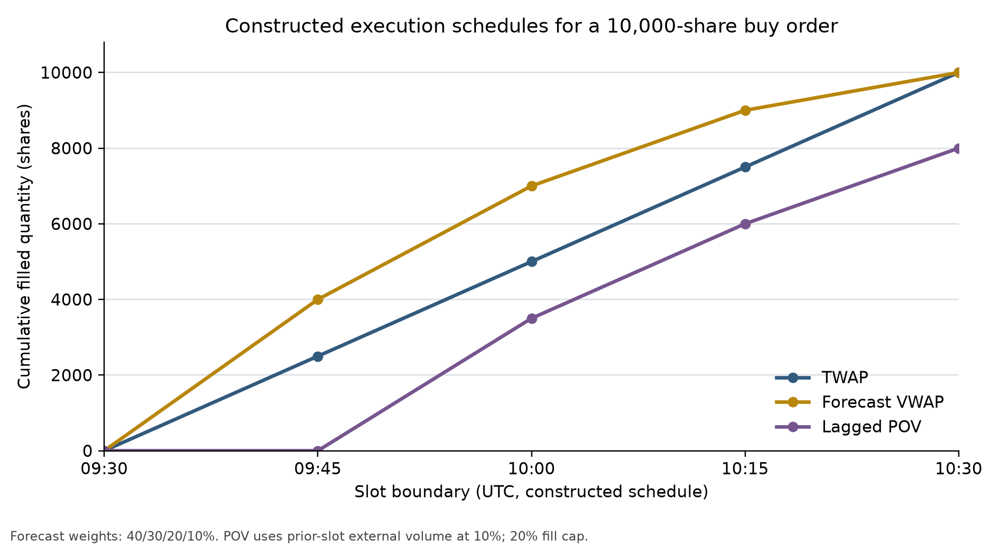
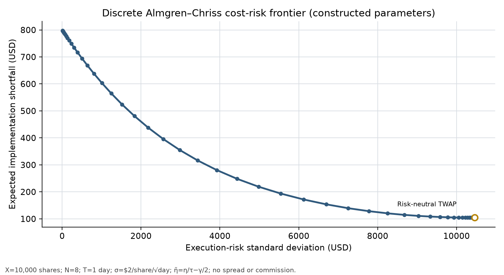

# 第36章 — 算法执行与交易调度（Algorithmic Execution and Trade Scheduling）

> 既有工程证据按原接受身份引用。主线：把投资组合目标权重转换为有符号父订单，在离散执行时钟上权衡市场冲击与执行风险，并通过实施短缺分解进行事后归因与基准评价。
> 先修：第9章优化基础、第34章市场微观结构、第35章交易成本与容量。读完后你应能：制定TWAP、预测VWAP与POV调度排程，计算含部分成交和未成交的实施短缺分解，推导Almgren-Chriss离散均值方差目标，并在因果时钟下对账现金与持仓。

## 1. 本章目标

完成本章后，你应能：

1. 区分四类执行基准：决策价格（Decision Price）、到达价格（Arrival Price）、事后市场成交量加权均价（Ex-Post Market VWAP）与截止估值价格（Terminal Mark Price），说明各自适用的评价场景与经济含义。
2. 为有符号父订单（Signed Parent Order）制定时间加权平均价（TWAP）、事前预测量加权（Forecast-Volume VWAP）与滞后观测成交量占比（POV）三类离散子单调度排程。
3. 严格区分决策时间、发送时间、到达时间、成交时间、估值时间与组合信号时间，解释为什么月频信号权重不能伪装为日内微观交易信号。
4. 计算有符号实施短缺（Implementation Shortfall, IS），将其精确分解为延迟成本、执行成本、未成交机会成本与显式费用，并证明其在代数上恒等于纸面组合直接金额法。
5. 处理部分成交（Partial Fill）与零成交（No-Fill）边界，并在零成交时将成交均价标为未定义（NaN/None），避免除零或将均价误记为零。
6. 说明临时价格冲击与永久价格冲击的微观机制差异，推导离散时间 Almgren-Chriss 均值方差目标函数的有效执行前沿，指出其理论假设与现实边界。
7. 对账实际成交后的现金变动、持仓变动与账面资产净值（NAV），避免在现金账本中对已内含在成交价中的价格冲击重复扣费。

## 2. 为什么 Quant 需要它

研究员在纸面上构建的策略常常呈现优异的夏普比率。当指令下达到真实市场时，纸面利润往往迅速损耗。若交易员将数万股的父订单一次性以市价单抛向市场，订单会直接穿透订单簿浅层深度，产生巨大的临时市场冲击；若为了避免冲击而将订单无限期分散在数天内缓慢买入，市场价格可能随着资产本身的上行趋势漂移走高，导致后半段订单买在更高价位，甚至因窗口截止而无法完成目标仓位。

未成交余量会影响相对纸面目标的执行评价。若策略计划买入一笔订单，而执行算法只成交20%，价格随后上涨，则余下80%相对到达价基准的潜在收益会计入实施短缺的机会成本。它是绩效归因项，不是现金账本中的实际费用。

第14–15章建立了资产期望收益与因子定价基础；第29章构建了投资组合回测账本，将权重变动折算为目标股数；第34章揭示了限价订单簿的可见深度、报价点差与排队队列；第35章量化了点差、佣金、借券利息与冲击成本函数。本章位于交易全流程的落地环节：它承接第29章与第35章的目标需求，解决如何把一个总需求分拆到离散时间窗口中执行，并在交易结束后对执行质量进行归因评估。算法执行的核心不是预测未来走势，而是在市场冲击成本（冲击随交易速度加快而上升）与执行风险（价格随时间拉长而漂移）之间寻找权衡。

## 3. 直觉

设定一个直观场景：你在上午 09:28 决定买入 10,000 股某股票，此时中间价为 100.00 美元。订单在 09:30 开盘时到达交易场所，价格已经变动为 100.20 美元。你需要在 09:30 到 10:30 之间完成这笔交易。

此时你面临两个极端选择：

极端一：在 09:30 将 10,000 股以一笔市价单立即打出。由于当前卖一到卖五的可见深度有限，你的买单瞬间吃尽前几档卖单，成交均价被推高到 101.50 美元。你承受了极大的临时市场冲击，但你彻底消除了后续一个小时内股价继续上涨的风险。

极端二：将 10,000 股拆成 60 笔子单，每分钟仅买入约 167 股。每笔子单仅占该分钟成交量的一小部分，订单簿几乎感受不到你的存在，临时市场冲击极小。然而，若该股票在这一小时内受到外部买盘推动，价格从 100.20 美元一路攀升到 102.00 美元，你后续买入的子单价格越来越贵，最终成交均价达到 101.10 美元。不仅如此，若到 10:30 仍有 2,000 股未能成交而被迫撤单，这 2,000 股后续暴涨带来的收益全部落空。

这两端的中间地带就是执行算法的领地：
- TWAP（时间加权平均价）简单地将父订单等分在时间片内，适合流动性均匀分布或缺乏预测的标的。
- 预测 VWAP 按交易前冻结的成交量预测曲线分配母单；如果该曲线在开收盘时段较高，排程便会在这些时段安排更多成交。
- POV（固定参与率）按约定的分母和最新已完整观测的市场量设定后续请求节奏，成交结果仍受当期流动性与容量限制。

实施短缺（Implementation Shortfall）则充当最终裁判。它从你决定交易的那一刻起记账，把最终结果精确拆解为：决策到送单之间的延迟损失、交易期间实际成交的滑点、未成交剩余部分错失的收益，以及交给券商的显式佣金。

## 4. 数学基础

设投资组合对某资产下达的有符号父订单总量为 $Q$（单位：股，买单 $Q > 0$，卖单 $Q < 0$）。交易窗口被划分为 $N$ 个离散的时间片（slot），索引为 $k \in \{1, 2, \dots, N\}$，每个时间片长度为 $\Delta t$。

### 变量与符号说明

- $t_d$：组合经理产生调仓决策的时间戳，对应接口字段 `decision_time` 与基准价格 $P_{\text{decision}}$（USD/股）。
- $t_p$：算法收到父订单的时间戳，对应 `parent_received_at`；它满足 $t_d\le t_p$。
- $t_{\text{arrival}}$：IS采用的到达基准时间，对应 `arrival_time` 与价格 $P_{\text{arrival}}$（USD/股）；这是归因基准，不可与子单发送或场所到达混为一谈。
- 对每个子单 $k$，接口字段 `child_send_at`、`child_venue_arrival_at`、`fill_at` 分别对应 $t_{\text{send},k}$、$t_{\text{venue},k}$、$t_{\text{fill},k}$；`observed_available_at` 与 `forecast_frozen_at` 分别记录量数据可用及预测冻结时间。槽末市场标记在 `slot_end` 才可用，并记录为 `slot_mark_available_at`；即使无成交，也先按旧标记结算该区间，再应用槽末标记。终值估价时间记为 $t_{\text{terminal}}$，对应 `terminal_mark_time`。
- $t_k$：第 $k$ 个执行时间片的开始时刻。
- $q_k$：在第 $k$ 个时间片下发的有符号子单请求数量（股），符号与 $Q$ 相同。
- $F_k$：在第 $k$ 个时间片实际撮合成交的有符号股数（股），满足 $|F_k| \le |q_k|$，非零时方向与 $q_k,Q$ 相同。全章是同向单一父单，故 $\sum_k|F_k|=|F|$；不可推广到混合买卖。
- $P_{\text{fill}, k}$：第 $k$ 个时间片实际成交的成交均价（USD/股）。若 $F_k = 0$，该价位未定义。
- $F$：整个执行窗口累计成交的有符号总股数（股），定义为：
  $$F = \sum_{k\in\mathcal F} F_k$$
- $R$：执行窗口截止时未成交并取消的剩余有符号股数（Remainder，单位：股），满足基本守恒恒等式：
  $$Q = F + R$$
- $t_{\text{terminal}}$：执行窗口截止及终值估价时间戳。对应价格为截止估值价格 $P_{\text{terminal}}$（USD/股）。
- $V_k^{\text{forecast}}$：在交易窗口开始前已冻结的第 $k$ 个时间片外部市场预测成交量（股）。
- $V_{k-1}^{\text{obs}}$：在发送第 $k$ 个子单前，外部市场在第 $k-1$ 个时间片已完整发生并被观测到的实际成交量（股）。
- $V_k^{\text{realized}}$：第 $k$ 个时间片期间外部市场实际发生的真实成交量（股）。注意：此变量在 $t_k$ 时刻处于未来状态，子单决策不可使用。
- $c_{\text{comm}}$：单股显式佣金费率（USD/股）。显式总费用记为 $C_{\text{fees}} = |F| \cdot c_{\text{comm}}$。

::: {.body-conditions title="单向成交与空和"}
所有涉及成交价的和均在非零成交集合 $\mathcal F=\{k:F_k\ne0\}$ 上进行，空和定义为0；零成交不读取未定义的成交均价，也不计算 $0\times\mathrm{undefined}$。
:::

### 从账本到执行评价：继续同一100股连接例

第34章的报价不能决定实际成交；第35章只按60股成交及0.30费用过账。第36章在截止后以 $Q=100,F=60,R=40$ 检查 IS：$2.00+1.80+3.20+0.30=7.30$；直接法为 $60(10.05-10.00)+40(10.10-10.00)+0.30=7.30$。它与纸面NAV减实际NAV相同，不再改变现金1,396.70或实际股数60。若窗口重叠，发送新子单前必须从未完成母单额度中减去已发未确认数量；$R=40$ 是截止残余，不能在中途把所有未确认请求当作可再次发送的额度。

若改成卖100股、只成交60股，并取决策10.00、到达9.98、成交9.95、截止9.90，则 $Q=-100,F=-60,R=-40$，四项仍为 $2.00,1.80,3.20,0.30$。在初持100股、现金1,000的账户，卖后现金1,596.70、剩40股，截止NAV1,992.70；理想按决策价卖足100股的账户为2,000，差7.30。方向来自有符号数量，不来自把卖单价格差强行取绝对值。

### 价格过程与市场冲击假设

在这个离散线性冲击教学规格中，外生的未受交易影响价格增量服从算术布朗运动。把当期永久冲击加入中间价后，若订单使用本章买正、卖负的有符号成交量 $F_k$，价格递推可写为：
$$S_k = S_{k-1} + \sigma (\Delta t)^{1/2} \xi_k + \gamma F_k$$
其中：
- $S_k$ 为第 $k$ 期末包含既往永久冲击的构造中间价（USD/股），不是可直接观测的“真实基本面价格”。
- $\sigma$ 为价格扩散系数；若时间按日计，$\sigma\sqrt{1\text{日}}$ 才是1日价格增量的标准差，局部恒定参考价下再除以该价才能对应第35章的日收益标准差。它的单位为（USD / ($\text{股} \cdot \text{时间}^{1/2}$)）。
- $\xi_k \sim \mathcal{N}(0, 1)$ 为独立同分布标准正态随机扰动。
- $F_k$ 为带方向的第 $k$ 期成交股数；买单为正、卖单为负。卖出清算时 $F_k=-n_k$，故上式等价于价格项 $-\gamma n_k$。
- $\gamma$ 为永久市场冲击系数（USD / 股$^2$），永久冲击进入后续中间价路径。

每槽先以 $S_{k-1}$ 为参考价、计入临时冲击后成交，再发生本槽噪声和永久价格更新。因此最后噪声发生时已清仓；N=1时这里的执行方差为0是本模型时序结果。算术布朗价格不保证全路径正值，不能混同工程正价格输入域。

实际成交价格包含临时市场冲击：
$$\tilde{S}_k = S_{k-1} + \operatorname{sgn}(F_k)\,\eta \left(\frac{|F_k|}{\Delta t}\right)$$
其中 $\eta$ 为临时市场冲击系数（USD·时间 / 股$^2$），临时冲击仅影响当前成交，不进入后续时间片的价格更新。

## 5. 正式定义

### 5.1 执行时钟与因果时序（Execution Timestamps and Causal Ordering）

在量化交易系统中，执行、观测与撮合跨越多个时钟。系统必须分别记录：信号冻结时间 $t_{\text{signal}}$、锁定目标股数的决策时间 $t_d$、算法收到母单的时间 $t_{\text{parent}}$、每个子单的发送时间 $t_{\text{send},k}$、到达撮合场所的时间 $t_{\text{venue},k}$、成交回报时间 $t_{\text{fill},k}$、POV外部量可供算法读取的时间 $t_{\text{obs},k}$、预测量冻结时间 $t_{\text{forecast},k}$，以及撤单和终值估价时间 $t_{\text{terminal}}$。IS使用的到达基准时间 $t_{\text{arrival}}$ 与对应价格 $P_{\text{arrival}}$ 也须记录；在本教学接口中，它表示母单约定的到达基准，不替代任何子单的发送或到场时间。

各时间戳须满足以下因果约束：
$$t_{\text{signal}} \le t_d \le t_{\text{parent}} \le t_{\text{arrival}} \le t_{\text{send},k} \le t_{\text{venue},k} \le t_{\text{fill},k} \le t_{\text{terminal}}$$
$$t_{\text{obs},k} \le t_{\text{send},k},\qquad t_{\text{forecast},k} \le t_{\text{send},k}.$$
`arrival_time`只作为IS基准锚点，不代表算法收到母单或子单到达场所的时刻。slot窗口可以重叠；引擎按slot编号处理不早于前一子单的发送。每次发送前，算法只计入严格早于该发送时刻的成交，并从母单剩余额度中预留尚未确认成交的已发送数量。同一时刻的发送先于成交确认，因此不会把同时发生的成交用于该次排程。POV观测必须满足 `observed_available_at <= child_send_at`，预测曲线须在首笔子单发送前冻结；当前模拟采用零传输延迟，故 `child_send_at == child_venue_arrival_at`。这些是可执行的因果时钟约束，不要求后一子单等待前一slot结束。

月度调仓信号代表基于月度财务或低频行情构建的目标头寸，它在整个执行日内保持冻结。算法决不能将月度信号伪装为日内动态高频阿尔法，也不得在日内执行算法中反向引入未来时刻的月度收盘数据。

### 5.2 时间加权平均价调度（Time-Weighted Average Price, TWAP）

TWAP 算法的目标是在预先划定的 $N$ 个时间片内，将父订单 $Q$ 均匀释放到市场中。

第 $k$ 个时间片的计划子单数量定义为：
$$q_k^{\text{TWAP}} = \frac{Q}{N}, \quad \forall k \in \{1, 2, \dots, N\}$$

成立条件：
1. 总执行时间窗口 $[t_0, t_{\text{terminal}}]$ 与切片数 $N$ 必须在交易开始前固定。
2. 父订单 $Q$ 在交易窗口内不发生动态追加或削减。

### 5.3 事前预测量加权均价调度（Forecast-Volume VWAP Schedule）

VWAP 调度旨在使子单的分布形状契合市场全天的成交量曲线。

设外部市场在窗口开始前，对各个时间片的预测成交量为 $V_k^{\text{forecast}} > 0$。预测成交量占比权重为：
$$w_k = \frac{V_k^{\text{forecast}}}{\sum_{j=1}^N V_j^{\text{forecast}}}, \quad \text{满足 } \sum_{k=1}^N w_k = 1, \ w_k \ge 0$$

第 $k$ 个时间片的计划子单数量为：
$$q_k^{\text{VWAP}} = Q \cdot w_k$$

成立条件：
1. 权重向量 $\boldsymbol{w} = (w_1, \dots, w_N)^\top$ 必须仅依赖历史统计数据（如过去20个交易日同时间段成交量中位数），并在 $t_0$ 时刻完全冻结。
2. 调度算法决不能使用交易日尚未发生的未来实际外部成交量 $V_k^{\text{realized}}$ 作为输入。

上式和第5.2节的 $q_k$ 是事前计划曲线。本章 `execute_order` 在实际成交量不足时，会按当前剩余母单量在后续时段重新分配未成交量；这是一条容量约束下的机械补量规则，不会读取未来成交量，也不等同于依据盘中信息更新价格或总量预测的自适应动态调度。

### 5.4 事后市场成交量加权均价基准（Ex-Post Market VWAP Benchmark）

事后市场 VWAP 是整个交易窗口结束后，用于评估机构执行质量的公共外部基准价格：
$$\text{VWAP}_{\text{market}} = \frac{\sum_{k=1}^N P_k^{\text{mkt}} V_k^{\text{realized}}}{\sum_{k=1}^N V_k^{\text{realized}}}$$
其中 $P_k^{\text{mkt}}$ 与 $V_k^{\text{realized}}$ 分别为第 $k$ 个时间片外部市场（排除自身）的成交均价与成交量；若另用含自身的基准，须明确另列纳入规则。该基准只能事后计算，不是事前排程的输入。

### 5.5 滞后观测成交量占比算法（Percentage of Volume, POV）

POV（又称 Participation Rate 算法）是一种反应型（Reactive）算法。它不预先设定完整的固定时间分配表，而是按选定的分母约定，根据可得流动性信息设定目标下单节奏；实际成交参与率还会受成交、撤单和容量限制影响。

在严格因果时钟下，算法在第 $k$ 个时间片起点发送子单时，无法得知当前时间片未来的真实外部量 $V_k^{\text{realized}}$。因此，子单量只能基于最新已完整结清并观测到的上一个时间片成交量 $V_{k-1}^{\text{obs}}$ 计算。

对于参与率 $\rho \in (0, 1)$，市场存在两种分母定义惯例：

以下参与率等式首先定义未经余量截断的参考请求；取min后实际请求可能达不到该比例，实际fill还受当期容量影响。

定义 A（排他分母，分母仅包含外部市场成交量）：
$$\rho = \frac{|q_k|}{V_{k-1}^{\text{obs}}} \implies q_k^{\text{POV}} = \operatorname{sgn}(Q) \cdot \min\left(|Q_{\text{rem}, k}|, \ \rho \cdot V_{k-1}^{\text{obs}}\right)$$
这里非重叠手算假设前期成交均已在发送前确认、没有在途，才可写 $Q_{\mathrm{rem},k}=Q-\sum_{j<k}F_j$。一般发送额度应取母单减去发送前已确认成交和仍在途预留量（同向有符号），不得按名义索引假定前面fill都已可得。

定义 B（全包分母，分母包含自身成交量）：
$$\rho = \frac{|q_k|}{V_{k-1}^{\text{obs}} + |q_k|} \implies |q_k| = \frac{\rho}{1 - \rho} \cdot V_{k-1}^{\text{obs}}$$
则子单量为：
$$q_k^{\text{POV}} = \operatorname{sgn}(Q) \cdot \min\left(|Q_{\text{rem}, k}|, \ \frac{\rho}{1 - \rho} \cdot V_{k-1}^{\text{obs}}\right)$$

边界与成立条件：
1. 首个时间片边界：在开盘首个切片 $k=1$，由于盘中尚未产生可观测的前一期连续交易量，$V_0^{\text{obs}} = 0$。根据契约，首期 POV 算法下发数量为 0，等待首期量结算完成后再行跟单。
2. 极限测试：定义 B 只在 $0\le\rho<1$ 时有有限解；当 $\rho\to1$ 且外部量大于0时，未经截断的反转式发散；已按有限剩余额度截断的实际请求仍有限。实现通常还会按剩余订单、参与率政策上限和市场容量约束请求量；$0.5$ 等上限是实现方选择，不是该恒等式推出的普适阈值。

### 5.6 实施短缺（Implementation Shortfall, IS）

Perold（1988）在此仅保留为选读书目；历史核验只涉及作者与出版社元数据，未核读全文。SEC（2003）讨论纸面与实际组合差额的成本度量，并将这一概念的早期来源追溯到Treynor（1981）；该征求意见文件提供概念背景，不规定本章公式。本章采用下列明确的教学分拆，不把它说成唯一的行业标准口径。

对于有符号父订单 $Q$，设实际成交序列为 $\{(F_k, P_{\text{fill}, k})\}_{k=1}^N$，累计成交 $F = \sum F_k$，未成交剩余 $R = Q - F$。总实施短缺金额定义为：
$$\text{IS} = \text{IS}_{\text{delay}} + \text{IS}_{\text{exec}} + \text{IS}_{\text{opp}} + C_{\text{fees}}$$

各项分量定义如下：
1. 延迟成本（Delay Cost / Slippage from Decision）：
   $$\text{IS}_{\text{delay}} = Q \cdot (P_{\text{arrival}} - P_{\text{decision}})$$
   度量组合经理做出决策到订单实际到达市场这段时间内，资产价格发生不利变动造成的损失。
2. 执行滑点成本（Execution Cost）：
   $$\text{IS}_{\text{exec}} = \sum_{k\in\mathcal F} F_k \cdot (P_{\text{fill}, k} - P_{\text{arrival}})$$
   在 $F\ne0$ 时，若实际成交量加权均价定义为 $P_{\text{fillVWAP}} = \frac{\sum_{k\in\mathcal F} F_k P_{\text{fill}, k}}{F}$（仅在 $F \ne 0$ 时定义），则执行成本可写为：
   $$\text{IS}_{\text{exec}} = F \cdot (P_{\text{fillVWAP}} - P_{\text{arrival}})$$
   度量实际成交价格相对于订单到达时参考价的滑点损失。
3. 未成交机会成本（Opportunity Cost）：
   $$\text{IS}_{\text{opp}} = R \cdot (P_{\text{terminal}} - P_{\text{arrival}})$$
   度量未能在截止期完成交易的剩余头寸 $R$，因价格向投资目标方向继续运动而错失的潜在账面损益。
4. 显式费用（Explicit Fees）：
   $$C_{\text{fees}} = \sum_{k\in\mathcal F} |F_k| \cdot c_{\text{comm}} = |F| \cdot c_{\text{comm}}$$
   向经纪商或交易所支付的显式交易佣金与税费。

符号约定：$\text{IS} > 0$ 表示执行过程中产生了正的成本损耗（即实际账户净值低于无摩擦纸面理论组合）。

## 6. 推导

### 6.1 实施短缺双重表示法的代数恒等推导

在投资实务中，实施短缺存在两种计算方式：
方式一：按业务流程分拆的四分量模型（延迟、执行、机会、显式费）。
方式二：直接对比理论纸面组合终值与实际执行现金账本的直接金额法（Direct Amount Method）。

定理：四分量分解法在代数上严格恒等于直接金额法。

证明：
根据直接金额法，纸面无摩擦组合假设在决策时刻 $t_d$ 能够以 $P_{\text{decision}}$ 无摩擦买入全部 $Q$ 股。在截止时刻 $t_{\text{terminal}}$，纸面组合持仓 $Q$ 股的市值为 $Q \cdot P_{\text{terminal}}$，初始耗费现金为 $Q \cdot P_{\text{decision}}$，理论账面收益为：
$$\Pi_{\text{paper}} = Q \cdot (P_{\text{terminal}} - P_{\text{decision}})$$

而在实际执行中，我们在各个时间片以 $P_{\text{fill}, k}$ 买入了 $F_k$ 股，支付了佣金 $C_{\text{fees}}$。在截止时刻，实际持有 $F$ 股，其按 $P_{\text{terminal}}$ 计价的市值为 $F \cdot P_{\text{terminal}}$。实际产生的经济收益为：
$$\Pi_{\text{real}} = F \cdot P_{\text{terminal}} - \sum_{k\in\mathcal F} F_k P_{\text{fill}, k} - C_{\text{fees}}$$

实施短缺定义为纸面收益与实际收益之差：
$$\text{IS} = \Pi_{\text{paper}} - \Pi_{\text{real}}$$

将收益表达式代入：
$$\text{IS} = Q \cdot (P_{\text{terminal}} - P_{\text{decision}}) - \left[ F \cdot P_{\text{terminal}} - \sum_{k\in\mathcal F} F_k P_{\text{fill}, k} - C_{\text{fees}} \right]$$

利用数量守恒关系 $Q = F + R$，将 $Q \cdot P_{\text{terminal}}$ 展开为 $(F + R) \cdot P_{\text{terminal}}$：
$$\text{IS} = (F + R) \cdot P_{\text{terminal}} - Q \cdot P_{\text{decision}} - F \cdot P_{\text{terminal}} + \sum_{k\in\mathcal F} F_k P_{\text{fill}, k} + C_{\text{fees}}$$

消去项 $F \cdot P_{\text{terminal}}$：
$$\text{IS} = \sum_{k\in\mathcal F} F_k P_{\text{fill}, k} + R \cdot P_{\text{terminal}} - Q \cdot P_{\text{decision}} + C_{\text{fees}}$$

由于 $\sum_{k\in\mathcal F} F_k = F$，且 $Q = F + R$，我们将 $Q \cdot P_{\text{decision}}$ 拆为 $F \cdot P_{\text{decision}} + R \cdot P_{\text{decision}} = \sum_{k\in\mathcal F} F_k P_{\text{decision}} + R \cdot P_{\text{decision}}$：
$$\text{IS} = \sum_{k\in\mathcal F} F_k (P_{\text{fill}, k} - P_{\text{decision}}) + R \cdot (P_{\text{terminal}} - P_{\text{decision}}) + C_{\text{fees}}$$
此即直接金额法的经典计算公式。

接下来推导其与四分量分解的恒等性。我们在上式每一项的差价中插入到达价格 $P_{\text{arrival}}$：
对于已成交项：
$$P_{\text{fill}, k} - P_{\text{decision}} = (P_{\text{fill}, k} - P_{\text{arrival}}) + (P_{\text{arrival}} - P_{\text{decision}})$$
对于未成交项：
$$P_{\text{terminal}} - P_{\text{decision}} = (P_{\text{terminal}} - P_{\text{arrival}}) + (P_{\text{arrival}} - P_{\text{decision}})$$

将这两项展开代入直接金额法表达式：
$$\begin{aligned}
\text{IS} &= \sum_{k\in\mathcal F} F_k \left[ (P_{\text{fill}, k} - P_{\text{arrival}}) + (P_{\text{arrival}} - P_{\text{decision}}) \right] \\
&\quad + R \left[ (P_{\text{terminal}} - P_{\text{arrival}}) + (P_{\text{arrival}} - P_{\text{decision}}) \right] + C_{\text{fees}} \\
&= \sum_{k\in\mathcal F} F_k (P_{\text{fill}, k} - P_{\text{arrival}}) + \left( \sum_{k\in\mathcal F} F_k \right) (P_{\text{arrival}} - P_{\text{decision}}) \\
&\quad + R (P_{\text{terminal}} - P_{\text{arrival}}) + R (P_{\text{arrival}} - P_{\text{decision}}) + C_{\text{fees}}
\end{aligned}$$

提取公共项 $(P_{\text{arrival}} - P_{\text{decision}})$：
$$\left( \sum_{k\in\mathcal F} F_k + R \right) (P_{\text{arrival}} - P_{\text{decision}}) = (F + R)(P_{\text{arrival}} - P_{\text{decision}}) = Q (P_{\text{arrival}} - P_{\text{decision}})$$

整理各项：
$$\text{IS} = \underbrace{Q (P_{\text{arrival}} - P_{\text{decision}})}_{\text{IS}_{\text{delay}}} + \underbrace{\sum_{k\in\mathcal F} F_k (P_{\text{fill}, k} - P_{\text{arrival}})}_{\text{IS}_{\text{exec}}} + \underbrace{R (P_{\text{terminal}} - P_{\text{arrival}})}_{\text{IS}_{\text{opp}}} + \underbrace{C_{\text{fees}}}_{\text{Explicit Fees}}$$
证毕。

该证明展示了数学对称性：无论父订单是买单（$Q > 0$）还是卖单（$Q < 0$），有符号公式完全自洽。若买单遇到价格上涨，差价为正，IS 增加；若卖单遇到价格下跌，$P_{\text{fill}} - P_{\text{arrival}} < 0$，但由于 $F_k < 0$，负负得正，IS 同样为正，反映卖出均价偏低的实际损失。

其他文献或交易系统可能把决策至到达的价格变动按成交量分摊到已成交项，或使用不同的机会成本基准。本章把全额 $Q$ 的决策至到达变动列为延迟成本，再以到达价计算成交与剩余项；只要各项按同一决策价和截止估值价完整结算，分量归属可以不同，直接金额法总额仍由恒等式确定。

### 6.2 Almgren-Chriss 离散执行成本与风险前沿推导

考虑在总时间 $T = N \Delta t$ 内清算初始持仓 $X > 0$ 股（卖单方向）。设 $x_k$ 为在时间戳 $t_k$ 结束时手中剩余持有的股数，边界条件为：
$$x_0 = X, \quad x_N = 0$$
每个时间片卖出的股数为 $n_k = x_{k-1} - x_k \ge 0$。本节在起点就锁定确定性静态排程，$n_k,x_k$均非随机；下列期望/方差推导不直接适用于随噪声自适应的库存。

根据第4节的价格演化模型：
$$S_k = S_{k-1} + \sigma (\Delta t)^{1/2} \xi_k - \gamma n_k$$
成交价格包含临时冲击：
$$\tilde{S}_k = S_{k-1} - \frac{\eta}{\Delta t} n_k$$

总清算现金收入为 $W = \sum_{k=1}^N n_k \tilde{S}_k$。以初始到达价值 $X S_0$ 为基准，总实施短缺（不计显式佣金）为随机变量：
$$x = X S_0 - W = X S_0 - \sum_{k=1}^N n_k \tilde{S}_k$$

第一步：推导期望短缺 $E[x]$。
递推展开基本面价格：
$$S_{k-1} = S_0 + \sigma (\Delta t)^{1/2} \sum_{j=1}^{k-1} \xi_j - \gamma \sum_{j=1}^{k-1} n_j$$
代入成交价表达式：
$$\tilde{S}_k = S_0 + \sigma (\Delta t)^{1/2} \sum_{j=1}^{k-1} \xi_j - \gamma \sum_{j=1}^{k-1} n_j - \frac{\eta}{\Delta t} n_k$$
计算收入总和：
$$\sum_{k=1}^N n_k \tilde{S}_k = S_0 \sum_{k=1}^N n_k + \sigma (\Delta t)^{1/2} \sum_{k=1}^N n_k \sum_{j=1}^{k-1} \xi_j - \gamma \sum_{k=1}^N n_k \sum_{j=1}^{k-1} n_j - \frac{\eta}{\Delta t} \sum_{k=1}^N n_k^2$$
由于 $\sum_{k=1}^N n_k = X$，且正态扰动期望 $E[\xi_j] = 0$，取数学期望得：
$$E\left[\sum_{k=1}^N n_k \tilde{S}_k\right] = X S_0 - \gamma \sum_{k=1}^N n_k \sum_{j=1}^{k-1} n_j - \frac{\eta}{\Delta t} \sum_{k=1}^N n_k^2$$
利用离散求和恒等式：
$$\sum_{k=1}^N n_k \sum_{j=1}^{k-1} n_j = \frac{1}{2} \left[ \left(\sum_{k=1}^N n_k\right)^2 - \sum_{k=1}^N n_k^2 \right] = \frac{1}{2} X^2 - \frac{1}{2} \sum_{k=1}^N n_k^2$$
代回期望短缺表达式：
$$E[x] = X S_0 - E\left[\sum_{k=1}^N n_k \tilde{S}_k\right] = \frac{1}{2} \gamma X^2 + \left( \frac{\eta}{\Delta t} - \frac{1}{2} \gamma \right) \sum_{k=1}^N n_k^2$$
本节要求 $\eta/\Delta t>\gamma/2$；这是严格凸目标与下述唯一解的模型条件，不是普遍市场事实。简记修正临时冲击参数 $\tilde{\eta} = \frac{\eta}{\Delta t} - \frac{1}{2}\gamma > 0$。则期望执行成本为：
$$E[x] = \frac{1}{2} \gamma X^2 + \tilde{\eta} \sum_{k=1}^N n_k^2$$
离散恒等式将总成本重组为常数项与路径相关项：

$$\sum_{k=1}^{N}n_k\sum_{j<k}n_j=\frac12\left(X^2-\sum_{k=1}^{N}n_k^2\right).$$

$\gamma X^2/2$ 是这次重组后的路径不变常数，不是原始离散永久冲击损失。原永久项

$$\gamma\sum_k n_k\sum_{j<k}n_j$$

仍随排程变化；其中 $-\gamma\sum_k n_k^2/2$ 与临时项合并，形成 $\tilde\eta=\eta/(\Delta t)-\gamma/2$。

数值核验：令 $\gamma=0.01$、$\eta/\Delta t=0.02$、$X=1{,}000$。排程 $[1{,}000,0]$ 的原始永久项为 $0$；排程 $[500,500]$ 的原始永久项为 $0.01\times500\times500=2{,}500$。重组后的常数 $\gamma X^2/2=5{,}000$ 在两种路径中相同，路径差异由修正后的临时冲击平方项体现。本节 $x_t$ 表示从 $X$ 降至 $0$ 的剩余持仓。卖出路径按当时已累计卖出量 $y_t=X-x_t$ 计算，永久冲击成本率为 $\gamma y_t\dot{y}_t$，总成本为

$$\int_0^T\gamma y_t\dot{y}_t\,dt=\gamma X^2/2.$$

利用固定端点 $x_0=X,x_T=0$，同一总积分也可写为

$$-\int_0^T\gamma x_t\dot{x}_t\,dt=\gamma X^2/2.$$

这只是积分后的边界恒等式，两个被积函数并非逐时相等。第17节挑战题36-C01中的 $x_t$ 是从 $0$ 增至 $X$ 的累计买入进度，因此买入成本率 $\gamma x_t\dot{x}_t$ 的积分取正号。

第二步：推导短缺方差 $V[x]$。
短缺的不确定性全部来源于布朗运动项

$$\sigma (\Delta t)^{1/2} \sum_{k=1}^N n_k \sum_{j=1}^{k-1} \xi_j.$$

交换求和次序：
$$\sum_{k=1}^N n_k \sum_{j=1}^{k-1} \xi_j = \sum_{j=1}^{N-1} \xi_j \sum_{k=j+1}^N n_k = \sum_{j=1}^{N-1} \xi_j x_j$$
因为 $\xi_j$ 相互独立且方差为 1，故方差为：
$$V[x] = \operatorname{Var}\left( \sigma (\Delta t)^{1/2} \sum_{j=1}^{N-1} x_j \xi_j \right) = \sigma^2 \Delta t \sum_{k=1}^N x_k^2$$
该结果表明：执行方差是剩余头寸平方在整个持有时间内的累积，手中滞留头寸越多、持仓时间越长，承担的价格波动风险越大。

第三步：求解最优化目标。
期望短缺单位为 USD，方差单位为 USD²。因此风险厌恶 $\lambda_{\text{risk}}$ 的单位必须为 USD$^{-1}$，使两项可以相加。它不是第35章的线性冲击斜率 $\lambda_{\text{impact}}$（USD/股²）。时间片 $\Delta t$ 有时间单位，不是无量纲换手 $\tau_{\text{turnover}}$。引入交易员的风险厌恶参数 $\lambda_{\text{risk}} \ge 0$，构建均值方差效用函数：
$$\min_{\{x_k\}_{k=1}^{N-1}} U(x) = E[x] + \lambda_{\text{risk}} V[x] = \frac{1}{2} \gamma X^2 + \tilde{\eta} \sum_{k=1}^N (x_{k-1} - x_k)^2 + \lambda_{\text{risk}} \sigma^2 \Delta t \sum_{k=1}^{N-1} x_k^2$$

对任意中间状态 $x_k$（$1 \le k \le N-1$）求一阶偏导数：
$$\frac{\partial U}{\partial x_k} = 2 \tilde{\eta} (x_k - x_{k-1}) - 2 \tilde{\eta} (x_{k+1} - x_k) + 2 \lambda_{\text{risk}} \sigma^2 \Delta t x_k = 0$$
两边除以 $2 \tilde{\eta}$ 并整理为二阶常系数线性差分方程：
$$x_{k+1} - \left(2 + \frac{\lambda_{\text{risk}} \sigma^2 \Delta t}{\tilde{\eta}}\right) x_k + x_{k-1} = 0$$

特征方程为 $r^2 - 2 \cosh(\kappa \Delta t) r + 1 = 0$，其中参数 $\kappa$ 满足 $2 \cosh(\kappa \Delta t) = 2 + \frac{\lambda_{\text{risk}} \sigma^2 \Delta t}{\tilde{\eta}}$。
本节库存节点用 $t_k=k\Delta t$（从起点起算的已结束时间），不同于§4排程槽开始时间；$\kappa$ 的单位为时间$^{-1}$，$\kappa\Delta t$ 无量纲。结合边界条件 $x_0 = X$ 与 $x_N = 0$，差分方程的唯一解析解为：
$$x_k = \frac{\sinh(\kappa (T - t_k))}{\sinh(\kappa T)} X$$

特例分析：
当 $\lambda_{\text{risk}} = 0$ 或 $\sigma=0$ 时，$\kappa=0$，取连续极限。利用洛必达法则：
$$x_k = \lim_{\kappa \to 0} \frac{\kappa (T - t_k)}{\kappa T} X = \left(1 - \frac{k}{N}\right) X$$
此时 $n_k = x_{k-1} - x_k = \frac{X}{N}$，最优清算轨迹蜕化为严格的线性清算，即 TWAP 调度。

当 $\lambda_{\text{risk}} > 0$ 且 $\sigma>0$ 时，在到期前，双曲正弦曲线呈现递减且向上凸的剩余库存轨迹（$x^{\prime\prime}(t)=\kappa^2x(t)>0$）：交易员在前期以更快的速度抛售资产（Front-loading），以承受较高临时冲击为代价，换取持仓敞口迅速缩减带来的低方差。

## 7. 金融解释

### 7.1 基准选择背后的委托代理关系

执行算法的基准选择直接决定了交易员的行为动机：

1. 选择 Arrival Price（到达价基准）：当订单目标是尽量贴近决策后给出的到达时点价格时，可用到达价评价延迟与后续执行表现。若信号预计衰减或价格漂移不利，等待会带来风险；漂移方向和速度需要数据估计，不能由基准定义本身推出。
2. 选择 Market VWAP（市场均价基准）：当研究或委托目标是比较本单成交与所定义窗口内的市场成交均价时，可采用该基准。排程仍需使用事前预测量曲线；市场VWAP则以窗口结束后符合事先纳入规则的市场成交计算。

### 7.2 未成交机会成本的经济实质

若评价只统计已成交订单的滑点，把撤单余量的机会项 $R(P_{\text{terminal}}-P_{\text{arrival}})$ 固定记为零，偏差方向取决于该项的符号：正时低估实施短缺，负时高估，零时不变。机会成本是相对基准的绩效归因项，不是未成交股票产生的现金费用。

例如，构造一个目标买入50,000股的订单：若截止前只成交5,000股，余下45,000股按约定撤单，且终值高于到达价，则已成交滑点不能代表整笔决策的执行结果。本章IS口径以 $R \cdot (P_{\text{terminal}}-P_{\text{arrival}})$ 记录这部分相对到达价的机会成本；它不等同于现金账本中的实际费用。

一个反例是 $Q=R=100$、$F=0$、$P_{\text{decision}}=P_{\text{arrival}}=10$、$P_{\text{terminal}}=9$ 且费用为0：正确IS为 $-100$ 美元，忽略机会项得到0，反而高估100美元。

### 7.3 临时冲击与永久冲击的微观机制

- 临时项在本模型只进入当前成交价，不传入下一槽mid。这是构造假设；现实流动性回补和价格衰减可能快慢不一，须用事件数据验证，不能保证数十秒恢复原价。
- 永久冲击是价格更新模型中交易对后续价格的持久影响；信息含量、流动性提供者库存等都可能参与形成价格反应，单凭冲击分解不能识别其因果来源。Huberman–Stanzl（2004）在其价格不确定、交易量影响价格且永久价格更新为时间无关的框架下，证明排除准套利所需的永久价格冲击为线性；若另有临时冲击，论文摘要指出只要求永久部分线性。该定理不是所有市场冲击路径的经验定律。

### 7.4 模型假设与现实边界

Almgren-Chriss 模型提供了清晰的分析闭式解，但在部署到实盘时具有显著局限：
1. 模型假设基本面价格服从无漂移的纯随机游走。然而量化调仓往往伴随着阿尔法信号衰减，标的本身存在确定性漂移趋势。
2. 模型假设全天市场流动性与波动率恒定。许多股票市场样本可见开盘与收盘附近成交量较高的日内形状，但形状、点差与深度会随市场、标的、时段和事件变化；排程应以适用数据重新估计。
3. 本章的静态调度不会根据盘中价格扰动更新速度。若目标函数允许动态反馈，且输入数据支持实时估计，可以用动态规划或 Hamilton–Jacobi–Bellman（HJB）方法构造另一类执行策略；这需要额外的模型与验证。

## 8. Numerical Example

本节给出一个统一的教学构造数值案例。所有输入数据均标明为教学构造，用于严格核验因果时间戳、调度子单、成交撮合、实施短缺分解与现金持仓对账。

### 8.1 基础设定与输入参数

设定一笔有符号买入父订单：
- 母单规模：$Q = +10{,}000$ 股（买单）。
- 决策时间：$t_d = \text{09:28:00}$，决策价格 $P_{\text{decision}} = 100.00$ 美元/股。
- 到达时间：$t_0 = \text{09:30:00}$，到达价格 $P_{\text{arrival}} = 100.20$ 美元/股。
- 执行窗口：分为 4 个离散时间片（每个切片 15 分钟），截止时间 $t_{\text{terminal}} = \text{10:30:00}$。
- 截止估值价格：$P_{\text{terminal}} = 101.00$ 美元/股。
- 单股佣金费率：$c_{\text{comm}} = 0.005$ 美元/股。
- 参与率上限约束：单片实际成交量不得超过当期真实外部成交量的 20%（$\rho_{\text{cap}} = 0.20$）。

以下采用构造UTC窗口，不代表真实市场开盘。表中每槽价格兼作外部均价/mid代理，并明确设己方fill与其相等（半点差与两类冲击均为0）；一般执行下二者不相等。

市场外部行情流与预测数据如下表（教学构造数据）：

| 时间片 $k$ | 时间区间 | 预测外部量 $V_k^{\text{forecast}}$ | 前期已观测外部量 $V_{k-1}^{\text{obs}}$ | 当期真实外部量 $V_k^{\text{realized}}$ | 当期成交价 $P_{\text{fill}, k}$ |
|:---:|:---:|:---:|:---:|:---:|:---:|
| 1 | 09:30–09:45 | 40,000 | 0（开盘前无盘中量） | 35,000 | 100.30 |
| 2 | 09:45–10:00 | 30,000 | 35,000 | 25,000 | 100.50 |
| 3 | 10:00–10:15 | 20,000 | 25,000 | 20,000 | 100.70 |
| 4 | 10:15–10:30 | 10,000 | 20,000 | 20,000 | 100.90 |
| 合计 | | 100,000 | - | 100,000 | - |

外部市场事后总成交均价（Ex-Post Market VWAP）：
$$\begin{aligned}
\text{VWAP}_{\text{market}} &= \frac{35{,}000 \times 100.30 + 25{,}000 \times 100.50 + 20{,}000 \times 100.70 + 20{,}000 \times 100.90}{100{,}000} \\
&= \frac{10{,}055{,}000}{100{,}000} \\
&= 100.5500 \text{ 美元/股}.
\end{aligned}$$

### 8.2 算法一：时间加权平均价（TWAP）

1. 排程计算：
   总片数 $N = 4$。每期计划子单量为 $q_k^{\text{TWAP}} = 10{,}000 / 4 = 2{,}500$ 股。
2. 成交与容量约束核验：
   - 第1片：上限 $20\% \times 35{,}000 = 7{,}000 \ge 2{,}500 \implies F_1 = 2{,}500$。
   - 第2片：上限 $20\% \times 25{,}000 = 5{,}000 \ge 2{,}500 \implies F_2 = 2{,}500$。
   - 第3片：上限 $20\% \times 20{,}000 = 4{,}000 \ge 2{,}500 \implies F_3 = 2{,}500$。
   - 第4片：上限 $20\% \times 20{,}000 = 4{,}000 \ge 2{,}500 \implies F_4 = 2{,}500$。
   累计成交 $F = 10{,}000$ 股，未成交剩余 $R = 10{,}000 - 10{,}000 = 0$ 股。
3. 实际成交 VWAP：
   $$P_{\text{fillVWAP}} = \frac{2{,}500 \times (100.30 + 100.50 + 100.70 + 100.90)}{10{,}000} = \frac{1{,}006{,}000}{10{,}000} = 100.6000 \text{ 美元/股}$$
4. 实施短缺分解：
   - 延迟成本：$\text{IS}_{\text{delay}} = 10{,}000 \times (100.20 - 100.00) = 2{,}000.00$ 美元。
   - 执行成本：$\text{IS}_{\text{exec}} = 10{,}000 \times (100.6000 - 100.20) = 4{,}000.00$ 美元。
   - 机会成本：$\text{IS}_{\text{opp}} = 0 \times (101.00 - 100.20) = 0.00$ 美元。
   - 显式佣金：$C_{\text{fees}} = 10{,}000 \times 0.005 = 50.00$ 美元。
   - 总实施短缺：$\text{IS}_{\text{total}} = 2{,}000.00 + 4{,}000.00 + 0.00 + 50.00 = 6{,}050.00$ 美元。
5. 直接金额法核验：
   $$\begin{aligned}
   \text{IS}_{\text{direct}} &= \sum_{k=1}^4 F_k (P_{\text{fill}, k} - P_{\text{decision}}) + R(P_{\text{terminal}} - P_{\text{decision}}) + C_{\text{fees}} \\
   &= 2{,}500 \times (0.30 + 0.50 + 0.70 + 0.90) + 0 + 50.00 \\
   &= 2{,}500 \times 2.40 + 50.00 = 6{,}000.00 + 50.00 = 6{,}050.00 \text{ 美元}
   \end{aligned}$$
   两套计算结果严格一致。

### 8.3 算法二：事前预测成交量加权调度（Forecast VWAP）

1. 排程计算：
   预测总量 $\sum V_k^{\text{forecast}} = 100{,}000$ 股。
   预测权重：$w_1 = 0.40, w_2 = 0.30, w_3 = 0.20, w_4 = 0.10$。
   计划子单量：
   - $q_1 = 10{,}000 \times 0.40 = 4{,}000$ 股。
   - $q_2 = 10{,}000 \times 0.30 = 3{,}000$ 股。
   - $q_3 = 10{,}000 \times 0.20 = 2{,}000$ 股。
   - $q_4 = 10{,}000 \times 0.10 = 1{,}000$ 股。
2. 成交与容量约束核验：
   - 第1片：上限 $7{,}000 \ge 4{,}000 \implies F_1 = 4{,}000$。
   - 第2片：上限 $5{,}000 \ge 3{,}000 \implies F_2 = 3{,}000$。
   - 第3片：上限 $4{,}000 \ge 2{,}000 \implies F_3 = 2{,}000$。
   - 第4片：上限 $4{,}000 \ge 1{,}000 \implies F_4 = 1{,}000$。
   累计成交 $F = 10{,}000$ 股，剩余 $R = 0$ 股。
3. 实际成交 VWAP：
   $$\begin{aligned}
   P_{\text{fillVWAP}} &= \frac{4{,}000 \times 100.30 + 3{,}000 \times 100.50 + 2{,}000 \times 100.70 + 1{,}000 \times 100.90}{10{,}000} \\
   &= \frac{1{,}005{,}000}{10{,}000} \\
   &= 100.5000 \text{ 美元/股}.
   \end{aligned}$$
   注意：预测 VWAP 实际成交均价（100.5000）优于外部全市场事后 VWAP（100.5500），因为算法在价格较低的早盘完成了更大比例的建仓。
4. 实施短缺分解：
   - 延迟成本：$\text{IS}_{\text{delay}} = 10{,}000 \times (100.20 - 100.00) = 2{,}000.00$ 美元。
   - 执行成本：$\text{IS}_{\text{exec}} = 10{,}000 \times (100.5000 - 100.20) = 3{,}000.00$ 美元。
   - 机会成本：$\text{IS}_{\text{opp}} = 0.00$ 美元。
   - 显式佣金：$C_{\text{fees}} = 50.00$ 美元。
   - 总实施短缺：$\text{IS}_{\text{total}} = 2{,}000.00 + 3{,}000.00 + 0.00 + 50.00 = 5{,}050.00$ 美元。
5. 直接金额法核验：
   $$\begin{aligned}
   \text{IS}_{\text{direct}} &= 4{,}000 \times 0.30 + 3{,}000 \times 0.50 + 2{,}000 \times 0.70 + 1{,}000 \times 0.90 + 50.00 \\
   &= 1{,}200 + 1{,}500 + 1{,}400 + 900 + 50 \\
   &= 5{,}050.00 \text{ 美元}.
   \end{aligned}$$
   结果完全相符。

### 8.4 算法三：滞后观测成交量占比（Lagged POV，含部分成交）

设定目标参与率 $\rho = 0.10$（按定义 A：排他分母）。

1. 因果排程与成交推进：
   - 第1片（09:30）：先前无可用盘中观测数据，$V_0^{\text{obs}} = 0 \implies q_1 = 0$ 股。成交 $F_1 = 0$ 股。剩余需求 $Q_{\text{rem}, 2} = 10{,}000$ 股。
   - 第2片（09:45）：观测到第1片完整外部量 $V_1^{\text{obs}} = 35{,}000$ 股。
     子单请求：$q_2 = \min(10{,}000, \ 0.10 \times 35{,}000) = 3{,}500$ 股。
     当期容量上限：$20\% \times 25{,}000 = 5{,}000 \ge 3{,}500 \implies F_2 = 3{,}500$ 股。
     剩余需求 $Q_{\text{rem}, 3} = 10{,}000 - 3{,}500 = 6{,}500$ 股。
   - 第3片（10:00）：观测到第2片外部量 $V_2^{\text{obs}} = 25{,}000$ 股。
     子单请求：$q_3 = \min(6{,}500, \ 0.10 \times 25{,}000) = 2{,}500$ 股。
     当期容量上限：$20\% \times 20{,}000 = 4{,}000 \ge 2{,}500 \implies F_3 = 2{,}500$ 股。
     剩余需求 $Q_{\text{rem}, 4} = 6{,}500 - 2{,}500 = 4{,}000$ 股。
   - 第4片（10:15）：观测到第3片外部量 $V_3^{\text{obs}} = 20{,}000$ 股。
     子单请求：$q_4 = \min(4{,}000, \ 0.10 \times 20{,}000) = 2{,}000$ 股。
     当期容量上限：$20\% \times 20{,}000 = 4{,}000 \ge 2{,}000 \implies F_4 = 2{,}000$ 股。
     窗口截止，剩余未成交：$R = 4{,}000 - 2{,}000 = 2{,}000$ 股。
2. 成交与未成交汇总：
   累计成交 $F = 0 + 3{,}500 + 2{,}500 + 2{,}000 = 8{,}000$ 股。
   剩余取消 $R = 2{,}000$ 股。
   数量守恒检查：$F + R = 8{,}000 + 2{,}000 = 10{,}000 = Q$。
3. 实际成交 VWAP：
   $$\begin{aligned}
   P_{\text{fillVWAP}} &= \frac{3{,}500 \times 100.50 + 2{,}500 \times 100.70 + 2{,}000 \times 100.90}{8{,}000} \\
   &= \frac{351{,}750 + 251{,}750 + 201{,}800}{8{,}000} \\
   &= \frac{805{,}300}{8{,}000} = 100.6625 \text{ 美元/股}.
   \end{aligned}$$
4. 实施短缺分解：
   - 延迟成本：$\text{IS}_{\text{delay}} = 10{,}000 \times (100.20 - 100.00) = 2{,}000.00$ 美元。
   - 执行成本：$\text{IS}_{\text{exec}} = 8{,}000 \times (100.6625 - 100.20) = 3{,}700.00$ 美元。
     （亦即 $3{,}500 \times 0.30 + 2{,}500 \times 0.50 + 2{,}000 \times 0.70 = 1{,}050 + 1{,}250 + 1{,}400 = 3{,}700.00$ 美元）。
   - 机会成本：$\text{IS}_{\text{opp}} = 2{,}000 \times (101.00 - 100.20) = 2{,}000 \times 0.80 = 1{,}600.00$ 美元。
   - 显式佣金（仅对实际成交计收）：$C_{\text{fees}} = 8{,}000 \times 0.005 = 40.00$ 美元。
   - 总实施短缺：$\text{IS}_{\text{total}} = 2{,}000.00 + 3{,}700.00 + 1{,}600.00 + 40.00 = 7{,}340.00$ 美元。
5. 直接金额法核验：
   $$\begin{aligned}
   \text{IS}_{\text{direct}} &= \sum_{k=1}^4 F_k (P_{\text{fill}, k} - P_{\text{decision}}) + R (P_{\text{terminal}} - P_{\text{decision}}) + C_{\text{fees}} \\
   &= (3{,}500 \times 0.50 + 2{,}500 \times 0.70 + 2{,}000 \times 0.90) + 2{,}000 \times 1.00 + 40.00 \\
   &= (1{,}750 + 1{,}750 + 1{,}800) + 2{,}000 + 40.00 = 5{,}300 + 2{,}000 + 40 = 7{,}340.00 \text{ 美元}
   \end{aligned}$$
   两套公式完全吻合。

### 8.5 边界案例：完全未成交（No-Fill）下的未定义 VWAP

另给零容量/不成交的构造边界，保留决策100、到达100.20和截止101，指定 $F=0,R=10{,}000$。这是手工给定边界，不声称execute_order模拟了限价簿或停牌。

1. 成交均价状态：
   $$P_{\text{fillVWAP}} = \frac{0}{0} \implies \text{未定义（NaN/None）}$$
   必须保留为未定义状态，严禁在账本中记为 0.00。
2. 实施短缺分解：
   - 延迟成本：$\text{IS}_{\text{delay}} = 10{,}000 \times (100.20 - 100.00) = 2{,}000.00$ 美元。
   - 执行成本：$\text{IS}_{\text{exec}} = 0.00$ 美元（成交量为零，滑点项为 0）。
   - 机会成本：$\text{IS}_{\text{opp}} = 10{,}000 \times (101.00 - 100.20) = 8{,}000.00$ 美元。
   - 显式佣金：$C_{\text{fees}} = 0 \times 0.005 = 0.00$ 美元。
   - 总实施短缺：$\text{IS}_{\text{total}} = 2{,}000.00 + 0.00 + 8{,}000.00 + 0.00 = 10{,}000.00$ 美元。
3. 直接金额法核验：
   $$\text{IS}_{\text{direct}} = R \times (P_{\text{terminal}} - P_{\text{decision}}) + 0 = 10{,}000 \times (101.00 - 100.00) = 10{,}000.00 \text{ 美元}$$
   即使在零成交极端边界下，机会成本完整承担了从到达价到终点价的全部未捕获利润，公式完全自洽。

### 8.6 对称性核验：有符号卖出父订单（Sell Order）

若设定母单为卖出 $Q = -10{,}000$ 股，决策价 $P_{\text{decision}} = 100.00$，到达价 $P_{\text{arrival}} = 99.80$（价格下跌），各期成交价依次为 $99.70, 99.50, 99.30, 99.10$，截止价 $P_{\text{terminal}} = 99.00$。
以 TWAP 为例（每期卖出 $F_k = -2{,}500$ 股，$R = 0$）：
- 延迟成本：$(-10{,}000) \times (99.80 - 100.00) = (-10{,}000) \times (-0.20) = +2{,}000.00$ 美元。
- 成交均价：$P_{\text{fillVWAP}} = 99.4000$ 美元。
- 执行成本：$(-10{,}000) \times (99.4000 - 99.80) = (-10{,}000) \times (-0.40) = +4{,}000.00$ 美元。
- 机会成本：$0.00$ 美元。
- 显式佣金：$|-10{,}000| \times 0.005 = 50.00$ 美元。
- 总实施短缺：$+6{,}050.00$ 美元。
直接金额法：
$$\begin{aligned}
\text{IS}_{\text{direct}} &= (-2{,}500) \times [(99.70 - 100) + (99.50 - 100) + (99.30 - 100) + (99.10 - 100)] + 50.00 \\
&= (-2{,}500) \times (-2.40) + 50.00 \\
&= +6{,}050.00 \text{ 美元}.
\end{aligned}$$
完全验证了有符号公式对买卖双向的对称性与数学普适性。

## 9. Python Implementation

I3读者包默认Notebook为独立四格构造IS小例，将JSON和一图写入唯一RUN_DIR；按包根run_notebook.py外层runner保存执行副本及执行JSON。它不是完整CLI、P4历史walk-forward或市场实验，英语Notebook语言层与全包冷启动归BIL23。

工程执行采用第35章§5.4说明的无量纲系数模型；下面AC离散式是明示假设下的解析教学模型，不能声称引擎已输入同一扩散/风险校准参数。当前Project 4结果身份见第35章§10.3与当前接受入口，旧R2R6只作历史构造证据。本章与实验共用 `quant_course.execution_costs`，不另建一套费用、排程或IS引擎。`ExecutionSlot` 分开保存事前预测量、发送前已观测量和当期实现量，并用 `observation_time` 记录可得时点；`execute_order` 返回成交、截止剩余、有符号IS分解及直接金额校验。

下面复现第8节预测VWAP的构造案例。为使输出与手算表一致，此例将点差、临时及永久冲击设为零，只按每股佣金记账；市场量仍用于参与率容量约束。

```python
import datetime as dt
from quant_course.execution_costs import (
    ExecutionConfig, ExecutionPortfolioLedger, ExecutionSlot,
    ParentOrder, execute_order,
)

UTC = dt.timezone.utc
start = dt.datetime(2026, 10, 9, 9, 30, tzinfo=UTC)
forecast = [40_000, 30_000, 20_000, 10_000]
observed = [0, 35_000, 25_000, 20_000]
realized = [35_000, 25_000, 20_000, 20_000]
mid = [100.30, 100.50, 100.70, 100.90]
slots = []
for k in range(4):
    slot_start = start + dt.timedelta(minutes=15 * k)
    observation_time = None if k == 0 else slot_start
    slots.append(ExecutionSlot(
        slot_index=k,
        slot_start=slot_start,
        slot_end=slot_start + dt.timedelta(minutes=15),
        send_time=slot_start,
        fill_time=slot_start + dt.timedelta(minutes=7),
        forecast_external_volume=forecast[k],
        observed_external_volume=observed[k],
        realized_external_volume=realized[k],
        mid_price=mid[k],
        observation_time=observation_time,
    ))
parent = ParentOrder(
    order_id="teaching-buy", asset="XYZ", signed_quantity=10_000,
    decision_time=start - dt.timedelta(minutes=2), arrival_time=start,
    decision_price=100.00, arrival_price=100.20,
)
config = ExecutionConfig(
    commission_rate=0.0,
    commission_per_share=0.005,
    half_spread_bps=0.0, temp_impact_coef=0.0, perm_impact_coef=0.0,
    max_participation=0.20,
)
result = execute_order(
    parent, "VWAP", slots, config,
    terminal_mark_price=101.00,
    terminal_mark_time=slots[-1].slot_end,
)
assert result.signed_parent_quantity == result.signed_filled_quantity + result.signed_remainder_quantity
assert abs(result.is_decomposition.identity_discrepancy) < 1e-9
assert result.fill_vwap == 100.50
assert abs(result.is_decomposition.total_is_decomposition - 5_050.00) < 1e-8

ledger = ExecutionPortfolioLedger(2_000_000.00, config, start)
for fill in result.fills:
    ledger.post_fill("XYZ", fill, {"XYZ": fill.mid_price})
assert ledger.positions["XYZ"] == 10_000
assert ledger.reconcile_ledger()["is_exact"] == 1.0
```

`fill_price` 已含点差和临时冲击；现金账本只扣实际成交价与佣金。`total_is_decomposition` 是相对决策价的评价指标，不再从现金扣一次。正式边界、卖单和零成交由同一模块的测试覆盖。

## 10. Visualization

以下两图继承已接受原图，本批未重新运行。原图由本章目录中的 `figures/build_figures.py` 从明确列出的构造参数生成；脚本同时保存Almgren–Chriss前沿的数值CSV。图形展示模型的方向关系，不代表真实证券的执行成本或最优策略。

### 图1：同一父订单的累计成交轨迹



TWAP每片请求2,500股；预测VWAP按40/30/20/10%的事前曲线分配；滞后POV首片因无已观测量而不下单，后续按上一片成交量的10%请求，并受当期20%外部量容量限制。纵轴是累计成交股数，横轴是构造时钟的切片边界。POV期末剩余2,000股。

### 图2：离散Almgren–Chriss期望成本与风险



每点由离散库存递推式计算，固定母单10,000股、8个切片、总时长1日；$\sigma=2$美元/股/$\sqrt{\text{日}}$，$\eta=10^{-6}$美元·日/股$^2$，$\gamma=10^{-7}$美元/股$^2$，且调整后的临时冲击系数满足$\tilde\eta=\eta/\Delta t-\gamma/2>0$。不含佣金和点差。风险中性端对应等额TWAP；风险厌恶提高时，目标在同一构造模型内以较高期望成本换取较低执行风险。

## 11. Evidence Boundary and TCA Study Design

本批没有真实逐笔成交、订单簿或机构执行样本，因此本节不报告真实证券案例或实证滑点。本节依照 `qa/a7/ch35_ch36_batch/SOURCE_DATA_GAP.md` 记录数据边界，并给出未来获得授权数据后可采用的研究设计示例。

### 11.1 数据可得性范围与缺口披露

1. 逐笔行情与委托簿深度缺口（No Tick-Level / L2 Feeds）：
   本课程当前环境仅包含日度与月度的因子分析数据（如 Kenneth French 行业组合收益），未购买亦未挂载全市场历史毫秒级逐笔成交（Tick / Trades）、五档/十档限价订单簿快照（L2 Order Books）或全深度消息流（如 Nasdaq TotalView-ITCH）。因此，正文中展示的订单簿扫单与切片成交均为教学构造数据，不能直接推断具体美股或 A 股标的在历史真实交易中的逐笔撮合滑点。
2. 借券与融资真实序列缺口（No Borrow / Financing Datasets）：
   缺少历史逐股可融券池名单、借券费率（Borrow Fee Rate / Hard-to-Borrow Surcharge）与券商召回记录。卖空交易相关的执行可行性无法在实证层面完整闭环。
3. 真实机构交易成本校准样本缺口（No Broker TCA Empirical Sample）：
   缺少机构级大额母单拆单的真实执行明细（Trade Cost Analysis, TCA）。因此，正文中的平方根冲击常数、临时冲击比例等数值，均为教学演示参数，不可视为真实市场的经验估计常数。

### 11.2 有真实样本时的 TCA 研究设计示例

若研究者获得适当授权的市场与订单数据，可以按研究问题预先固定口径；下列做法是分析步骤示例，不宣称为行业统一标准：

1. 数据采集与对齐：
   记录 OMS/EMS 系统中的母单落单时间戳 $t_d$、路由发送时间戳 $t_{\text{send}}$ 与交易所撮合确认回报 $t_{\text{fill}}$（精确至微秒或纳秒级别）。将成交记录与对应交易所的综合行情流（Consolidated Tape）进行时钟对齐。
2. 基准价格抓取：
   - 到达中间价：以母单到达市场瞬间的全国最优买卖报价中间价 $P_{\text{arrival}} = (P_{\text{NBBO}}^{\text{bid}} + P_{\text{NBBO}}^{\text{ask}}) / 2$ 为准。
   - 市场 VWAP：按研究问题、行情源和目标基准定义成交窗口及交易资格。竞价、场外/大宗、修正或迟报成交的纳入规则因基准而异，需事前记录；不能默认一律剔除。
3. 因子化冲击分解回归：
   未来若取得适当授权的数据，可将母单实际滑点对交易特征进行横截面回归；本批不执行估计：
   $$\text{Slippage}_i = \alpha + \beta_1 \cdot \sigma_i \left(\frac{|Q_i|}{\text{ADV}_i}\right)^{0.5} + \beta_2 \cdot \text{Spread}_i + \epsilon_i$$
   这里 $i$ 索引订单，$Q_i$ 是买正卖负的股数，$\text{ADV}_i>0$ 是对应标的的日均成交股数；分母采用一天的成交股数，使 $|Q_i|/\text{ADV}_i$ 为一天成交量比例，不混用股数和美元量。左侧 $\text{Slippage}_i$ 是按买卖方向调整的每股美元价格偏离，例如 $\operatorname{sgn}(Q_i)(P_{\text{fill},i}-P_{\text{benchmark},i})$；$\sigma_i$ 是决策前冻结窗口估计的一日价格变动标准差，$\text{Spread}_i$ 是全点差，二者均为USD/股。因此截距 $\alpha$ 与残差 $\epsilon_i$ 也为USD/股，$\beta_1,\beta_2$ 无量纲。卖单 $Q_i=-1000$、$\text{ADV}_i=100000$ 时，原式的 $\sqrt{-0.01}$ 不在实数域，修正后为 $\sqrt{0.01}=0.1$。这只是未来研究设计；本批没有真实数据校准，构造参数下的滑点或成本不能作为真实策略容量。

## 12. Common Mistakes

本节列出算法执行与交易调度中的六个典型常见错误。每个错误均包含典型症状、底层原因、错误代码、修复代码及数值影响分析。

### 12.1 错误一：在 POV 调度中未来信息泄漏（Lookahead Bias in POV Scheduling）

- 典型症状：回测中 POV 算法表现出异常优异的跟踪能力，即便在成交量骤降的时段也能精准按比例减单，滑点极其微弱。
- 底层原因：调度算法在第 $k$ 期发送子单时，直接调用了当期尚未结束的真实外部成交量 $V_k^{\text{realized}}$ 作为分母计算下单量。现实中，交易员在 09:30 不可能预知 09:30 至 09:45 这一刻度全市场的总成交量。
- 错误代码示例：
```python
# 错误：使用当期未来成交量决定当期子单
def bad_pov_schedule(parent_q, current_slot_realized_vol, participation_rate):
    target = participation_rate * current_slot_realized_vol
    return math.copysign(min(abs(parent_q), target), parent_q)
```
- 修复代码：
```python
# 正确：严格依赖上一期已完整结算的观测成交量
def good_pov_schedule(
    remaining_q, prev_slot_observed_vol, participation_rate
):
    target = participation_rate * prev_slot_observed_vol
    return math.copysign(min(abs(remaining_q), target), remaining_q)
```
- 数值差异与风险：若第 $k$ 期实现量远高于上一期观测量，错误算法会把事后放量错误地用于当期排程，形成前视偏差；实际价格影响取决于价格路径，不能仅凭这一错误断言必然盈利或亏损。

### 12.2 错误二：现金账本对价格冲击进行重复扣费（Double-Counting Impact Cost）

- 典型症状：回测系统中的现金消耗大幅超过理论预期，随着交易量增大，策略净值异常断崖式下跌。
- 底层原因：模型计算出成交均价为 $P_{\text{fill}} = P_{\text{arrival}} + \Delta P_{\text{impact}}$，但在更新现金账户时，既以 $P_{\text{fill}}$ 结算了货款，又额外从现金中扣除了一次所谓的“冲击成本准备金”：$\text{Cash} \leftarrow \text{Cash} - F \cdot P_{\text{fill}} - F \cdot \Delta P_{\text{impact}}$。
- 错误代码示例：
```python
# 错误：成交价已包含冲击，又在现金中重复扣减
fill_price = arrival_price + temporary_impact
cash -= fill_qty * fill_price
cash -= fill_qty * temporary_impact  # 致命错误：重复扣费！
```
- 修复代码：
```python
# 正确：成交价已经内含了临时冲击，现金仅按实际成交价与佣金扣减
fill_price = arrival_price + temporary_impact
cash -= fill_qty * fill_price + commission
```
- 数值差异：第8节TWAP的4,000美元是成交相对arrival的偏离，构造中点差/临时冲击为0，差额来自价格路径，不能称作临时冲击估计。若重复扣除，现金账本将虚增 4,000 美元的不真实亏损，严重低估策略的可行性。

### 12.3 错误三：零成交时将 VWAP 设为零引发指标崩溃（Zero-Division Misreporting）

- 典型症状：当订单完全未成交时，风险评估报表显示成交均价为 0.00 美元，随后计算出高达 100% 的虚假滑点亏损，触发系统异常报警。
- 底层原因：在代码中直接使用 `sum_notional / sum_volume`，为规避除零错误简单地加上默认值 `0.0`。
- 错误代码示例：
```python
# 错误：零成交时返回 0.0
vwap = (
    sum(p * q for p, q in fills) / sum(q for p, q in fills)
    if fills
    else 0.0
)
```
- 修复代码：
```python
# 正确：零成交时 VWAP 在数学上未定义，必须显式返回 None 或 math.nan
total_qty = sum(q for p, q in fills)
vwap = (
    sum(p * q for p, q in fills) / total_qty
    if total_qty != 0.0
    else math.nan
)
```
- 数值差异：在第8节第5小节中，零成交的成交 VWAP 未定义，滑点成本为 0，延迟2,000加机会8,000形成总短缺10,000美元。若同时把未定义VWAP填0，并错误地用母单Q=10,000冒充F=0，则执行滑点会被错误算成 $10{,}000 \times (0 - 100.20) = -1{,}002{,}000$ 美元，整个归因逻辑彻底瘫痪。

### 12.4 错误四：将月度信号权重伪装为日内微观信号（Signal Frequency Mismatch）

- 典型症状：报告把月频信号经过日内调度后的回测表现归因于执行算法，却没有分开报告信号生成频率和执行频率。
- 底层原因：策略使用了月末收盘价计算的月度多因子权重（如账面市值比、ROE），但在回测中却允许调度算法根据当天的日内波动“动态择时调仓”，把低频截面信号与高频执行混淆。
- 修复原则：必须在系统架构中严格划分层级：
  - 组合层（Portfolio Layer）：按月度或日度时钟更新目标权重，生成静态的有符号父订单 $Q$。
  - 执行层（Execution Layer）：接收冻结的父订单 $Q$，在日内离散时钟上仅以流动性跟踪和风险控制为目标进行子单调度，不擅自更改总仓位方向。

### 12.5 错误五：混淆 POV 参与率分母定义导致极端超单（POV Denominator Ambiguity）

- 典型症状：交易员设定参与率为 20%，却把全包分母和排他分母混用；请求量可能偏离预期并增加执行成本。
- 底层原因：没有分清排他分母（定义 A：$q / V_{\text{ext}}$）与全包分母（定义 B：$q / (V_{\text{ext}} + q)$）。若交易员心里想的是定义 B（全市场占比 20%），代码却按定义 A 的公式直接下发了 $0.20 \times V_{\text{ext}}$，实际全包占比仅为 $0.20 / 1.20 = 16.67\%$；反之，若想控制外部比例为 20%，却误用了反转公式 $\frac{0.2}{1-0.2} = 0.25$，导致多下了 25% 的单量。
- 修复原则：将分母约定写入执行配置与报告，并用单位测试验证公式。Project 4教学实现固定使用排他分母；若生产接口支持多种定义，应明确校验其取值和参与率范围。

### 12.6 错误六：最大回撤漏掉期初净值（Initial NAV Omission）

- 典型症状：首个评估月下跌后，报告的最大回撤仍为零；连续两次各跌10%却只显示10%。
- 根因：只把 $N$ 个区间收益累计成财富序列，却没有将期初财富 $W_0=1$ 纳入历史峰值。
- 正确约定：对区间收益 $r_1,\ldots,r_N$，先构造 $W_0=1$ 和 $W_k=\prod_{j=1}^k(1+r_j)$，再计算 $\max_{0\le k\le N}\{1-W_k/\max_{0\le j\le k}W_j\}$。因此 MDD 使用 $N+1$ 个财富点；收益、波动率与 Sharpe 仍只使用原有 $N$ 个区间收益。
- 回归例：$[-10\%]$ 的 MDD 为10%；$[-10\%,-10\%]$ 的财富从1降到0.81，MDD为19%；单调上涨路径的MDD为0。Project 4在所有/训练/测试窗口分别重算，不能沿用因缺期初点而碰巧未变的旧值。

## 13. Quant Research Application

### 13.1 机构量化执行的端到端研究流水线

在严谨的量化投资管理体系中，算法执行模块并非孤立的下单脚本，而是连接 Alpha 信号与组合实盘净值的核心桥梁。其完整工程闭环由六个因果时序阶段构成：

```text
+-------------------+      t_signal       +--------------------+
| 1. 多因子信号研究  | -----------------> | 2. 组合优化与风控   |
| (低频/截面 Alpha) |                    | (生成目标权重 w*)  |
+-------------------+                    +--------------------+
                                                    |  t_d (决策时间)
                                                    v
+-------------------+      t_parent       +--------------------+
| 4. 离散算法调度   | <----------------- | 3. 父订单转换引擎  |
| (TWAP/VWAP/POV)   |    父单接收时刻     | (计算 signed Q)    |
+-------------------+                    +--------------------+
         |
         | t_send → t_venue → t_fill → t_terminal
         v
+-------------------+                     +--------------------+
| 5. 现金持仓对账   | -----------------> | 6. 事后 TCA 归因   |
| (Q = F + R 守恒)  |                     | (IS 四分量分解)    |
+-------------------+                     +--------------------+
```

1. 父订单生成契约：在决策时刻 $t_d$，组合优化器根据最新资产净值 $\text{NAV}_d$ 与目标权重 $w_i^*$，计算资产 $i$ 的目标股数需求：
   $$Q_i = \operatorname{round}\left( \frac{w_i^* \cdot \text{NAV}_d}{P_{\text{decision}, i}} \right) - \text{Holdings}_i$$
2. 执行策略比较：
   可把 $|Q_i|/\text{ADV}_i$、波动率、点差、时段、时效和风险限额作为分层变量，比较 TWAP、事前预测 VWAP、滞后 POV 等策略在共同基准、成本口径和样本外期间的表现。任何路由阈值都应由适用订单/成交数据校准并做样本外检验；本章不设通用的 ADV 百分比界线。
3. 交易后分析报告（Post-Trade TCA Reporting）：
   交易结束后，系统自动生成实施短缺归因看板，对比算法成交 VWAP 与市场外部 VWAP，量化延迟滑点、冲击滑点与机会成本对策略总夏普比率的侵蚀程度。

### 13.2 基准对比与证伪检验

策略评估可预先写明基准、风险约束和证伪条件，避免看过结果后挑选有利口径：

1. 对照组可包括同一订单在相同时间窗中的立即执行基准、TWAP、事前冻结的预测 VWAP 与滞后 POV。计入费用、未成交机会成本和数据延迟后，再评估实施短缺与风险；复杂算法只有在预先定义的目标和样本外区间显示增量价值，才值得进一步研究。
2. 容量压力测试可在有依据的一组点差、冲击函数、借券、融资、成交上限和部分成交情景下报告范围。冲击函数与参与率上限需用适用数据校准；构造压力情景只能说明模型敏感性，不证明纸面信号真实、虚假或可执行。

## 14. Chapter Summary

本章围绕“如何将投资组合目标有符号父订单安全、高效地转化为市场真实成交”这一核心命题，构建了从时钟划分、算法排程、冲击建模到实施短缺归因的完整知识体系。

核心结论与决策规则总结如下：

1. 因果时钟是执行系统的生命线。必须在数据结构与底层账本中物理隔离信号时间、决策时间、到达时间、发送时间、成交时间与截止估值时间。任何将未来成交量或事后市场 VWAP 倒灌为当前子单输入的做法，都是严重的未来信息泄漏。
2. TWAP按时间切片分配目标量；预测 VWAP按事前冻结的量曲线分配；POV依据声明的量分母约定和当时可得观测量调整请求。Almgren–Chriss均值方差模型在常数波动率和冲击等假设下给出风险与期望成本的清算权衡；其具体轨迹不构成所有场景的执行处方。
3. 实施短缺（IS）把决策价到到达价、成交价、未成交终值和显式费用纳入同一金额口径。本章固定的四项分解与直接金额法代数恒等；比较实务结果时仍须先声明基准价格、窗口和费用约定。
4. 边界处理决定了工程系统的稳健性。当订单由于涨跌停或流动性枯竭而完全未成交（$F = 0$）时，成交 VWAP 在数学上未定义，系统必须将其置为 NaN/None，并通过机会成本项完整捕捉策略错失的经济收益。

## 15. Exercises

### 36-E01（概念理解：实施短缺符号对称性）
某量化对冲基金经理在上午 09:30 决定卖出 20,000 股某股票（有符号父订单 $Q = -20{,}000$ 股），当时决策价格为 50.00 美元/股。订单于 09:35 到达执行系统，到达价格已跌至 49.80 美元/股。算法执行至收盘，共成交 15,000 股，成交均价为 49.50 美元/股；剩余 5,000 股未成交撤单，收盘截止估值价格为 49.00 美元/股。单股佣金为 0.005 美元/股。
请使用有符号实施短缺四分量分解公式，分别计算延迟成本、执行成本、机会成本、显式佣金与总实施短缺，并验证其符号的经济含义。

### 36-E02（手算核对：TWAP 与预测 VWAP 调度排程）
交易员需要买入 $Q = +6{,}000$ 股某资产，交易窗口分为 3 个时间片。事前统计的历史预测成交量分布为 $V_1^{\text{forecast}} = 10{,}000$ 股，$V_2^{\text{forecast}} = 20{,}000$ 股，$V_3^{\text{forecast}} = 30{,}000$ 股。各切片实际成交价格分别为 20.10、20.30、20.50 美元/股。假设各期均全额完成子单请求。
请手算写出：
1. TWAP 算法在三个切片的子单请求量及最终成交加权均价。
2. 预测 VWAP 算法在三个切片的子单请求量及最终成交加权均价。
3. 解释为何在价格单调上涨的环境下，预测 VWAP 的成交均价劣于 TWAP。

### 36-E03（概念分析：POV 参与率分母定义与极值行为）
请针对 POV 算法的两种分母定义：
- 定义 A（排他分母）：$\rho = q_k / V_{k-1}^{\text{obs}}$
- 定义 B（全包分母）：$\rho = q_k / (V_{k-1}^{\text{obs}} + q_k)$
回答以下问题：
1. 若交易员设定目标参与率 $\rho = 0.20$，且上一期观测外部成交量为 40,000 股，分别计算两种定义下当前期应发送的子单数量。
2. 证明在定义 B 下，外部量为正、尚未按母单余量截断的参考请求在 $\rho \to1$ 时发散；说明实际有限请求为何不同。指出该现象背后的金融常识限制。

### 36-E04（边界推导：零成交下的实施短缺分解与 VWAP 状态）
某量化做市策略下达了一笔买入限价父订单 $Q = +5{,}000$ 股，决策价格 $P_{\text{decision}} = 30.00$ 美元，到达价格 $P_{\text{arrival}} = 30.10$ 美元。由于价格瞬间跳涨并持续单边上行，整场交易中该限价单未发生任何成交（$F = 0$），收盘截止价格 $P_{\text{terminal}} = 31.50$ 美元。显式佣金率为 0.002 美元/股。
1. 说明成交均价 $P_{\text{fillVWAP}}$ 的取值状态，解释为什么不能赋值为 0.00。
2. 逐步计算四项短缺分量，验证总短缺是否与直接金额法 $R \cdot (P_{\text{terminal}} - P_{\text{decision}})$ 严格一致。

### 36-E05（数学推导：Almgren-Chriss 风险中性极限）
在 Almgren-Chriss（2000）均值方差清算模型中，目标函数为 $\min (E[x] + \lambda_{\text{risk}} V[x])$。
1. 写出离散 Euler-Lagrange 差分方程。
2. 严格证明当交易员风险厌恶系数 $\lambda_{\text{risk}} \to 0$ 时，差分方程的解析解退化为匀速线性清算轨迹（即 TWAP）。

## 16. Programming Exercises

### 36-P01（编程练习：共享执行引擎的因果适配器）

编写薄适配器 `run_teaching_order(...)`，它接收父订单、算法名称、时段、配置、截止价格与截止时间，并调用 `quant_course.execution_costs.execute_order` 返回结果；不要在章节或Project目录中复制TWAP、VWAP、POV或费用算法。

测试应覆盖：
1. `Q = F + R`；POV首个slot没有先前观测量时，首个子单为0。
2. 对某个slot $k$，只扰动该slot及后续slot的 `realized_external_volume`，保持预测量与发送前观测量不变；第$k$个子单请求不能因这次未来量扰动而变化。实际成交量可以变化。
3. 对预测VWAP，保持冻结预测曲线不变，只改变实现量，当前已发送请求不应倒读本槽未来量；后续请求可以因过去实际成交和剩余额度合法变化。
4. 容量参与上限为0时无成交，成交VWAP未定义。

### 36-P02（编程练习：共享IS账本适配器）

编写薄适配器 `reconcile_order(parent_order, fills, terminal_price)`：由有符号父单和成交量求剩余量，再调用 `quant_course.execution_costs.compute_is_decomposition`。

测试应包含买单、卖单、部分成交和零成交；逐项确认 `Q = F + R`、四项分解等于直接金额法、手续费仅按实际成交收取，并在 `F = 0` 时返回未定义的成交VWAP。将费用和IS评价分开，不在现金账本中再次扣减IS。

## 17. Challenge Problems

### 36-C01（开放推导：衰减信号下的最优建仓速度）

设 $T,X,\eta>0$，$\alpha_0\ge0$、$\rho_a>0$、$\lambda_{\mathrm{risk}},\sigma\ge0$；$\alpha_0$单位为USD/股/时间，$\rho_a,\kappa$为时间$^{-1}$。设买入进度为 $x_t$ 股，$x_0=0$、$x_T=X$、交易速度 $v_t=\dot{x}_t\ge0$。不受自身冲击的价格漂移为 $\alpha(t)=\alpha_0 e^{-\rho_a t}$；永久冲击系数为 $\gamma$，临时冲击系数为 $\eta>0$，价格扩散系数为 $\sigma$。本题使用平均–方差近似，风险项定义为未完成目标仓位的价格暴露。

1. 写出相对决策价的期望执行成本及方差泛函。令 $A(t)=\int_0^t\alpha(s)\,ds$，并说明永久冲击总额 $\frac12\gamma X^2$ 在单调完成的路径下与排程无关。
2. 对排程相关目标求Euler–Lagrange方程。利用 $\int_0^T A(t)\dot{x}_t\,dt=A(T)X-\int_0^T\alpha(t)x_t\,dt$，给出一个便于变分的等价目标。
3. 对 $\kappa>0$ 且 $\rho_a\ne\kappa$ 求满足两端边界的解析解，其中 $\kappa^2=\lambda_{\text{risk}}\sigma^2/\eta$。另给 $\rho_a=\kappa>0$ 的共振解以及 $\kappa=0$ 的分支。
4. 比较衰减速度、信号总面积、风险厌恶与交易速率上限对建仓前置程度的作用。不得把无速率上限模型的边界层解解释为可实现的瞬时交易。
5. 为隔离信号效应，固定两条同端点买入轨迹，令 $\Delta x(t)=x_{\text{fast}}(t)-x_{\text{slow}}(t)\ge0$。分别在固定漂移峰值 $\alpha_0$ 与固定有限期信号面积 $S_0=\int_0^T\alpha_\rho(t)dt$ 下，推导信号收益差 $\Delta B(\rho)=\int_0^T\alpha_\rho(t)\Delta x(t)dt$ 的导数，并说明能否据此断言全局最优速度反转。

### 36-C02（模型题：暗池成交概率与逆向选择的路由阈值）

设买入母单规模为$Q$，按比例$z\in[0,1]$路由至暗池。公开场所每股预期成本为$c_A$；暗池成交时每股成本为$c_B<c_A$。暗池成交概率为$p(z)$；未成交的暗池数量随后转入公开场所，并额外承受每股逆向选择成本$\Delta(z)\ge0$。先假设成本按股数线性、没有容量或交互冲击。

1. 写出期望成本$C(z)$并求使暗池路由比全走公开场所便宜的条件。
2. 假设随知情交易者比例增加，$p$不升且$\Delta$不降。说明暗池优势指标如何变化，并写出使角点解改为$z^*=0$的阈值条件。指出何种附加机制会使解成为内部解。
3. 给出两项工程启示，区分模型阈值与需要真实成交数据校准的量。

## 18. Solutions / Solution Hints

### 36-E01 参考解答
1. 输入参数梳理：
   - 有符号父订单：$Q = -20{,}000$ 股（卖单）。
   - 决策价：$P_{\text{decision}} = 50.00$ 美元。
   - 到达价：$P_{\text{arrival}} = 49.80$ 美元。
   - 成交量与成交均价：$F = -15{,}000$ 股，$P_{\text{fillVWAP}} = 49.50$ 美元。
   - 剩余未成交量：$R = Q - F = -20{,}000 - (-15{,}000) = -5{,}000$ 股。
   - 截止估值价：$P_{\text{terminal}} = 49.00$ 美元。
   - 佣金率：$c_{\text{comm}} = 0.005$ 美元/股。
2. 四分量分解逐项计算：
   - 延迟成本：
    $$\begin{aligned}
    \text{IS}_{\text{delay}} &= Q \cdot (P_{\text{arrival}} - P_{\text{decision}}) \\
    &= (-20{,}000) \times (49.80 - 50.00) \\
    &= (-20{,}000) \times (-0.20) = +4{,}000.00 \text{ 美元}.
    \end{aligned}$$
     经济含义：在从决策到送单的 5 分钟内，股价下跌了 0.20 美元，导致卖出基准价变差，造成 4,000 美元的延迟损失。
   - 执行成本：
    $$\begin{aligned}
    \text{IS}_{\text{exec}} &= F \cdot (P_{\text{fillVWAP}} - P_{\text{arrival}}) \\
    &= (-15{,}000) \times (49.50 - 49.80) \\
    &= (-15{,}000) \times (-0.30) = +4{,}500.00 \text{ 美元}.
    \end{aligned}$$
     经济含义：实际成交的 15,000 股比到达价格又低了 0.30 美元，负负得正，产生 4,500 美元的滑点损失。
   - 机会成本：
    $$\begin{aligned}
    \text{IS}_{\text{opp}} &= R \cdot (P_{\text{terminal}} - P_{\text{arrival}}) \\
    &= (-5{,}000) \times (49.00 - 49.80) \\
    &= (-5{,}000) \times (-0.80) = +4{,}000.00 \text{ 美元}.
    \end{aligned}$$
     经济含义：未成交的 5,000 股未能以 49.80 美元卖出，而收盘进一步跌至 49.00 美元，错失了避免该 4,000 美元账面贬值的机会。
   - 显式佣金：
     $$C_{\text{fees}} = |F| \cdot c_{\text{comm}} = 15{,}000 \times 0.005 = +75.00 \text{ 美元}$$
   - 总实施短缺：
     $$\text{IS}_{\text{total}} = 4{,}000 + 4{,}500 + 4{,}000 + 75 = +12{,}575.00 \text{ 美元}$$
3. 直接金额法核验：
   $$\begin{aligned}
   \text{IS}_{\text{direct}} &= F \cdot (P_{\text{fillVWAP}} - P_{\text{decision}}) + R \cdot (P_{\text{terminal}} - P_{\text{decision}}) + C_{\text{fees}} \\
   &= (-15{,}000) \times (49.50 - 50.00) + (-5{,}000) \times (49.00 - 50.00) + 75 \\
   &= (-15{,}000) \times (-0.50) + (-5{,}000) \times (-1.00) + 75 \\
   &= 7{,}500 + 5{,}000 + 75 = +12{,}575.00 \text{ 美元}
   \end{aligned}$$
   两套方法完全吻合。符号均为正，度量相对更早按决策价卖足的纸面目标少收的金额。卖单可以是减持多头，不等于持有空头的策略PnL；已有空头反而可能因下跌获利。

### 36-E02 参考解答
1. TWAP 排程与均价：
   - 切片数 $N = 3$，母单 $Q = 6{,}000$ 股。
   - 各期请求量：$q_1 = q_2 = q_3 = 6{,}000 / 3 = 2{,}000$ 股。
   - 成交均价：
    $$\begin{aligned}
    P_{\text{fillVWAP}}^{\text{TWAP}} &= \frac{2{,}000 \times 20.10 + 2{,}000 \times 20.30 + 2{,}000 \times 20.50}{6{,}000} \\
    &= \frac{20.10 + 20.30 + 20.50}{3} \\
    &= 20.3000 \text{ 美元/股}.
    \end{aligned}$$
2. 预测 VWAP 排程与均价：
   - 预测总量：$10{,}000 + 20{,}000 + 30{,}000 = 60{,}000$ 股。
   - 权重：$w_1 = 1/6, w_2 = 2/6, w_3 = 3/6$。
   - 各期请求量：
     - $q_1 = 6{,}000 \times (1/6) = 1{,}000$ 股。
     - $q_2 = 6{,}000 \times (2/6) = 2{,}000$ 股。
     - $q_3 = 6{,}000 \times (3/6) = 3{,}000$ 股。
   - 成交均价：
    $$\begin{aligned}
    P_{\text{fillVWAP}}^{\text{VWAP}} &= \frac{1{,}000 \times 20.10 + 2{,}000 \times 20.30 + 3{,}000 \times 20.50}{6{,}000} \\
    &= \frac{20{,}100 + 40{,}600 + 61{,}500}{6{,}000} \\
    &= \frac{122{,}200}{6{,}000} \approx 20.3667 \text{ 美元/股}.
    \end{aligned}$$
3. 金融逻辑解释：
   在这组单调上涨的构造价格中，买入量越早，算术成交均价越低。预测 VWAP 将50%的单量排在第三片，故均价为20.3667美元，高于TWAP的20.3000美元。该例说明基准对齐与择时成本是不同目标；它不构成VWAP在其他价格路径上的绩效结论。

### 36-E03 参考解答
1. 两种定义下的子单计算：
   - 定义 A（排他分母）：
     $$q = \rho \cdot V_{k-1}^{\text{obs}} = 0.20 \times 40{,}000 = 8{,}000 \text{ 股}$$
   - 定义 B（全包分母）：
     $$q = \frac{\rho}{1 - \rho} \cdot V_{k-1}^{\text{obs}} = \frac{0.20}{1 - 0.20} \times 40{,}000 = \frac{0.20}{0.80} \times 40{,}000 = 0.25 \times 40{,}000 = 10{,}000 \text{ 股}$$
2. 奇异性证明与金融限制：
   在定义 B 中，方程为 $\rho = \frac{q}{V_{\text{ext}} + q}$。解关于 $q$ 的表达式得 $q = \frac{\rho}{1 - \rho} V_{\text{ext}}$。
   在外部量正且未经母单余量截断时，当 $\rho \to 1.0$，分母 $1 - \rho \to 0$，导致 $\lim_{\rho \to 1.0} q = +\infty$。
   全包分母代表“自身量占外部量与自身量之和的比例”。当 $V_{\text{ext}}>0$ 时，$\rho=1$ 只能由无限大的请求量逼近，无法由有限子单达到。有限余量截断后的实际请求不会发散，也可能不能达到目标参与比例。工程实现应按订单余量、风险政策和市场容量设置有限上限；公式本身不推出 $50\%$ 的阈值。

### 36-E04 参考解答
1. 成交均价状态：
   由于累计成交数量 $F = 0$，根据加权平均定义，分母为 0。因此 $P_{\text{fillVWAP}} = 0 / 0$ 在数学上处于未定义状态（Undefined），在系统中必须表示为 `None` 或 `math.nan`。严禁将其赋值为 0.00，否则在后续数据统计中会被误读为“以 0 元的价格买入了股票”，产生荒谬的暴利或亏损标记。
2. 四分量分解计算与验证：
   - 剩余未成交量：$R = Q - F = 5{,}000 - 0 = 5{,}000$ 股。
   - 延迟成本：
     $$\text{IS}_{\text{delay}} = 5{,}000 \times (30.10 - 30.00) = 5{,}000 \times 0.10 = +500.00 \text{ 美元}$$
    - 执行成本：
      按已成交子单集合 $\mathcal F=\{k:F_k\ne0\}$ 求和，$\text{IS}_{\text{exec}}=\sum_{k\in\mathcal F}F_k(P_{\text{fill},k}-P_{\text{arrival}})$。零成交时 $\mathcal F=\varnothing$，空集求和按定义为 0.00 美元；不构造未定义的成交均价，也不写成 $0\times\text{undefined}$。
   - 机会成本：
     $$\begin{aligned}
\text{IS}_{\text{opp}} &= R(P_{\text{terminal}}-P_{\text{arrival}}) \\
&=5{,}000(31.50-30.10)=5{,}000(1.40) \\
&=+7{,}000.00\text{ 美元}.
\end{aligned}$$
    - 显式佣金：
      $$C_{\text{fees}}=\sum_{k\in\mathcal F}|F_k|c_{\text{comm}}=0.00 \text{ 美元}$$
   - 总实施短缺：
     $$\text{IS}_{\text{total}} = 500.00 + 0.00 + 7{,}000.00 + 0.00 = +7{,}500.00 \text{ 美元}$$
   - 直接金额法核验：
    $$\begin{aligned}
    \text{IS}_{\text{direct}} &= R \times (P_{\text{terminal}} - P_{\text{decision}}) + 0 \\
    &= 5{,}000 \times (31.50 - 30.00) \\
    &= 5{,}000 \times 1.50 = +7{,}500.00 \text{ 美元}.
    \end{aligned}$$
   两套计算结果完全相等。在本章IS口径下，零成交时相对决策价的总差额全部落在延迟和机会成本两项；它们是基准归因，不是实际现金扣款。

### 36-E05 参考解答
1. 离散 Euler-Lagrange 差分方程：
   在 Almgren-Chriss 模型中，目标泛函为 $U(x) = E[x] + \lambda_{\text{risk}} V[x]$。代入推导所得公式：
   $$U(x) = \frac{1}{2}\gamma X^2 + \tilde{\eta} \sum_{k=1}^N (x_{k-1} - x_k)^2 + \lambda_{\text{risk}} \sigma^2 \Delta t \sum_{k=1}^{N-1} x_k^2$$
   对内部节点 $x_k$（$1 \le k \le N-1$）求一阶驻点条件 $\frac{\partial U}{\partial x_k} = 0$：
   $$2\tilde{\eta}(x_k - x_{k-1}) - 2\tilde{\eta}(x_{k+1} - x_k) + 2\lambda_{\text{risk}}\sigma^2\Delta t x_k = 0$$
   整理即得离散 Euler-Lagrange 差分方程：
   $$x_{k+1} - \left( 2 + \frac{\lambda_{\text{risk}} \sigma^2 \Delta t}{\tilde{\eta}} \right) x_k + x_{k-1} = 0$$
2. $\lambda_{\text{risk}} \to 0$ 极限退化证明：
   当 $\lambda_{\text{risk}} \to 0$ 时，系数项 $\frac{\lambda_{\text{risk}} \sigma^2 \Delta t}{\tilde{\eta}} \to 0$。差分方程简化为：
   $$x_{k+1} - 2x_k + x_{k-1} = 0 \iff (x_{k+1} - x_k) - (x_k - x_{k-1}) = 0$$
   这表明一阶差分序列 $n_k = x_{k-1} - x_k$ 为常数，即每期清算股数相等：$n_k = C$。
   由边界条件 $x_0 = X$ 与 $x_N = 0$，累加求和得 $\sum_{k=1}^N n_k = N \cdot C = X \implies C = \frac{X}{N}$。
   因此持仓轨迹为：
   $$x_k = X - k \cdot C = \left( 1 - \frac{k}{N} \right) X$$
   这在数学上严格证明了：当交易员完全不关心价格波动风险（$\lambda_{\text{risk}} = 0$）时，最小化期望临时冲击的最优解就是匀速时间加权清算（TWAP）。证毕。

### 36-P01 参考实现与测试

```python
from dataclasses import replace
from quant_course.execution_costs import execute_order


def run_teaching_order(parent_order, algorithm, slots, config, terminal_price, terminal_time):
    return execute_order(
        parent_order, algorithm, slots, config,
        terminal_mark_price=terminal_price,
        terminal_mark_time=terminal_time,
    )


# Execute Section 9 first; reuse its parent, slots, config, dt and terminal mark.
result = run_teaching_order(parent, "POV", slots, config, 101.00,
                            slots[-1].slot_end)
assert result.signed_parent_quantity == result.signed_filled_quantity + result.signed_remainder_quantity
assert result.child_orders[0].signed_quantity == 0.0

# Current-slot realized volume affects fills, not the already-sized child request.
perturbed = [slot if slot.slot_index < 1 else
             replace(slot, realized_external_volume=slot.realized_external_volume * 3)
             for slot in slots]
result_perturbed = run_teaching_order(parent, "POV", perturbed, config, 101.00,
                                      slots[-1].slot_end)
assert result.child_orders[0].signed_quantity == result_perturbed.child_orders[0].signed_quantity
assert result.child_orders[1].signed_quantity == result_perturbed.child_orders[1].signed_quantity

# In this nonbinding-capacity example all requests match; this is not a universal claim.
vwap = run_teaching_order(parent, "VWAP", slots, config, 101.00,
                          slots[-1].slot_end)
vwap_perturbed = run_teaching_order(parent, "VWAP", perturbed, config, 101.00,
                                    slots[-1].slot_end)
assert [c.signed_quantity for c in vwap.child_orders] == [
    c.signed_quantity for c in vwap_perturbed.child_orders
]

# A binding capacity case: current request is unchanged; later catch-up may change.
low = replace(config, max_participation=0.02)
base = run_teaching_order(parent, "VWAP", slots, low, 101.00, slots[-1].slot_end)
changed_slots = [replace(slots[0], realized_external_volume=70_000), *slots[1:]]
changed = run_teaching_order(parent, "VWAP", changed_slots, low, 101.00, slots[-1].slot_end)
assert base.child_orders[0].signed_quantity == changed.child_orders[0].signed_quantity
assert base.fills[0].signed_quantity != changed.fills[0].signed_quantity
assert base.child_orders[1].signed_quantity != changed.child_orders[1].signed_quantity

# Zero capacity participation produces no fills and an undefined fill VWAP.
zero_config = replace(config, max_participation=0.0)
zero = run_teaching_order(parent, "VWAP", slots, zero_config, 101.00,
                          slots[-1].slot_end)
assert zero.signed_filled_quantity == 0.0 and zero.fill_vwap is None
```

上述例中未触容量时所有VWAP请求恰好相等；新增低容量例才显示本槽请求不读未来、后续请求可合法补量的区别。共享引擎的`tests/test_execution_costs.py`另含成交量扰动与VWAP预测量隔离测试；此适配器只调用同一实现。

### 36-P02 参考实现与测试

```python
from dataclasses import replace
from quant_course.execution_costs import compute_is_decomposition, execute_order


def reconcile_order(parent_order, fills, terminal_price):
    filled = sum(fill.signed_quantity for fill in fills)
    remainder = parent_order.signed_quantity - filled
    return compute_is_decomposition(parent_order, fills, remainder, terminal_price)


# Execute Section 9 and P01 first. A genuinely partial buy uses a 2% capacity cap.
partial_config = replace(config, max_participation=0.02)
buy = run_teaching_order(parent, "VWAP", slots, partial_config, 101.00,
                          slots[-1].slot_end)
assert [fill.signed_quantity for fill in buy.fills] == [700, 500, 400, 400]
assert buy.signed_filled_quantity == 2_000
assert buy.signed_remainder_quantity == 8_000
buy_is = reconcile_order(parent, buy.fills, buy.terminal_mark_price)
assert abs(buy_is.explicit_fees - 10.00) < 1e-9
assert abs(buy_is.identity_discrepancy) < 1e-9
assert buy_is.explicit_fees == sum(fill.commission for fill in buy.fills)

sell_parent = replace(parent, order_id="teaching-sell", signed_quantity=-5_000,
                      decision_price=100.40, arrival_price=100.20)
sell = execute_order(sell_parent, "TWAP", slots, config,
                     terminal_mark_price=101.00,
                     terminal_mark_time=slots[-1].slot_end)
sell_is = reconcile_order(sell_parent, sell.fills, sell.terminal_mark_price)
assert abs(sell_is.identity_discrepancy) < 1e-9

no_fill = reconcile_order(parent, [], 101.00)
assert no_fill.fill_vwap is None
assert no_fill.explicit_fees == 0.0
assert abs(no_fill.identity_discrepancy) < 1e-9
```

本构造的2%容量案例依次成交700、500、400、400股，故 $F=2{,}000$、$R=8{,}000$，费用10美元。四分量为延迟2,000、执行700、机会6,400及费用10美元，总IS为9,110美元；直接金额法同为9,110美元。成交费用来自每笔真实`Fill`；`compute_is_decomposition`只报告成本归因，不修改账本现金。

### 36-C01 参考论证与评分标准

#### 参考推导

令$A(t)=\int_0^t\alpha(s)ds=\frac{\alpha_0}{\rho_a}(1-e^{-\rho_a t})$。对单调买入路径，永久冲击支出为$\int_0^T\gamma x_t\dot{x}_t dt=\frac12\gamma X^2$。相对决策价的期望执行成本和风险项为：

$$E[IS]=\frac12\gamma X^2+\int_0^T\{\eta\dot{x}_t^2+A(t)\dot{x}_t\}dt,\qquad V[IS]=\sigma^2\int_0^T(X-x_t)^2dt.$$

分部积分给出$\int A\dot{x}=A(T)X-\int\alpha x$。$A(T)X$与排程无关，故排程相关目标可写成：

$$J[x]=\int_0^T\{\eta\dot{x}_t^2-\alpha(t)x_t+\lambda_{\text{risk}}\sigma^2(X-x_t)^2\}dt.$$

设$\kappa^2=\lambda_{\text{risk}}\sigma^2/\eta$。Euler–Lagrange条件为

$$\frac{\partial L}{\partial x}-\frac{d}{dt}\frac{\partial L}{\partial\dot{x}}=0
\quad\Longrightarrow\quad
\ddot{x}_t-\kappa^2x_t=-\kappa^2X-\frac{\alpha_0}{2\eta}e^{-\rho_a t}.$$

当$\kappa>0$且$\rho_a^2\ne\kappa^2$时，令$B=-\frac{\alpha_0}{2\eta(\rho_a^2-\kappa^2)}$，通解可写成

$$x_t=X+B e^{-\rho_a t}+C\cosh(\kappa t)+D\sinh(\kappa t),$$

其中$C=-X-B$，$D=(-B e^{-\rho_aT}-C\cosh(\kappa T))/\sinh(\kappa T)$，满足两端边界。

共振$\rho_a=\kappa>0$时，令$a=\alpha_0/(2\eta)$，特解为$y(t)=a t e^{-\kappa t}/(2\kappa)$，因为$(d^2/dt^2-\kappa^2)(te^{-\kappa t})=-2\kappa e^{-\kappa t}$。取
$$x(t)=X+y(t)-X\cosh(\kappa t)+D\sinh(\kappa t),\quad D=\frac{X\cosh(\kappa T)-y(T)}{\sinh(\kappa T)}.$$

当$\kappa=0$（包括$\sigma=0$）时直接解$x''=-a e^{-\rho_a t}$，得
$$x(t)=\frac{X+a(e^{-\rho_a T}-1)/\rho_a^2}{T}t+\frac{a}{\rho_a^2}(1-e^{-\rho_a t}).$$
若同时$\alpha_0=0$，它就是$Xt/T$。这些是忽略非负速度及速率上限后的驻点，须逐段检查$\dot x\ge0$和上限。违反约束时要重新求解带边界与总量约束的凸变分问题；逐点clip会破坏总量/驻点条件，不能称为有约束最优解。


为单独比较信号变化，先固定两条候选持仓轨迹并令$\Delta x(t)=x_{\text{fast}}(t)-x_{\text{slow}}(t)\ge0$，信号收益差为$\Delta B(\rho)=\int_0^T\alpha_\rho(t)\Delta x(t)dt$。固定峰值$\alpha_\rho(t)=\alpha_0e^{-\rho t}$时，

$$\frac{d\Delta B}{d\rho}=-\alpha_0\int_0^Tt e^{-\rho t}\Delta x(t)dt\le0.$$

所以在同一前置持仓差下，更快衰减会减少可捕捉的信号收益；固定峰值时，总面积$\int_0^T\alpha_\rho dt=\alpha_0(1-e^{-\rho T})/\rho$也随$\rho$变化。若固定有限期总面积$S_0$，取

$$\alpha_\rho(t)=\frac{S_0\rho e^{-\rho t}}{1-e^{-\rho T}},\qquad m_\rho=\frac1\rho-\frac{T}{e^{\rho T}-1},$$

则

$$\frac{d\Delta B}{d\rho}=\int_0^T\alpha_\rho(t)(m_\rho-t)\Delta x(t)dt.$$

其中$m_\rho$是归一化信号权重下的平均时间；导数符号取决于$\Delta x(t)$在早晚时段的分布，不能仅凭固定面积推出该收益差必然上升。以上导数只比较给定两条路径捕捉到的信号收益；全局最优速度还取决于临时冲击、风险、容量与速率约束，不能据此声称最优策略必然反转。固定峰值下有限期总面积$\alpha_0(1-e^{-\rho_aT})/\rho_a$会随衰减率变化；有限临时冲击和参与率/速率限制则平滑并限制前置速度。

#### 评分标准

正确写出$A(t)$、执行成本和风险单位（25分）；由分部积分得到等价目标及正确Euler–Lagrange方程（25分）；解析解满足两端边界并说明共振/约束情形（30分）；准确区分固定峰值与固定信号总面积下的衰减比较（20分）。

### 36-C02 参考论证与评分标准

#### 参考论证

线性成本假设下，期望成本为

$$C(z)=Q\{(1-z)c_A+z[p(z)c_B+(1-p(z))(c_A+\Delta(z))]\}.$$

相对全走公开场所，暗池路由的每股增量成本为

$$M(z)=p(z)c_B+(1-p(z))(c_A+\Delta(z))-c_A
=(1-p(z))\Delta(z)-p(z)(c_A-c_B).$$

由成本式可写成$C(z)/Q=c_A+zM(z)$。$M(z)$表示在该$z$处，每股暗池路由量相对全走公开场所的成本差；若$p,\Delta$固定不随$z$变，$M<0$时全走暗池更便宜，$M>0$时公开场所角点$z^*=0$更便宜，$M=0$时无差异。若$p$或$\Delta$随$z$变化，单位总订单成本的导数为$M(z)+zM'(z)$；单点$M(z)>0$不能说明增加暗池量的边际成本为正，也不能单独证明全局最优在$z=0$。若在整个可行区间$M(z)\ge0$，则$C(z)\ge C(0)$，公开场所角点达到全局最小值。若知情比例$s$上升使$p'(s)\le0$、$\Delta'(s)\ge0$，则$M'(s)=(1-p)\Delta'-p'(c_A-c_B+\Delta)\ge0$。加入暗池容量、场所间冲击或非线性成交概率后，最优路由也可能为内部解。

工程上，路由比例应基于同一时点可得的成交概率、条件成交后滑点、失败后再路由成本和场所费用估计；阈值须按标的/时段/订单类型验证，并与未成交风险、订单时效共同报告。毒性指标或超时规则可以作为候选特征/约束，不能未经样本验证就当作有效信号。

#### 评分标准

模型成本及路由比例定义清楚（25分）；正确推导$M(z)$阈值并说明等号/角点（35分）；比较静态写明$p,\Delta$条件和阈值而不作普遍推断（25分）；工程建议区分估计输入和风险控制（15分）。

## 19. Further Reading

为指导不同阶段的读者进行延伸学习，本章文献阅读划分为四个梯队：

### Must Know（必读）
- Perold, A. F. (1988). *The Implementation Shortfall: Paper vs. Reality*. *The Journal of Portfolio Management*, 14(3), 4–9. [JPM publisher record](https://jpm.pm-research.com/content/14/3/4)。
  选读说明：历史核验仅确认作者与出版社书目元数据，未核全文或具体章节；本章教学分拆采用前文明示约定。
- Almgren, R., & Chriss, N. (2000). *Optimal Execution of Portfolio Transactions*. [Journal of Risk, 3(2), 5–39]。
  阅读重点：第 2 节离散时间价格演化方程与第 3 节有效前沿推导。掌握临时冲击与永久冲击的离散变分求解过程。

### Should Know（应知）
- Busseti, E., & Boyd, S. (2015). *Volume Weighted Average Price Optimal Execution*. [Stanford 论文稿]。
  阅读重点：论文区分了交易开始前固定的静态调度（Static Schedule）与利用盘中实时信息更新的动态调度（Dynamic Schedule），指出将全天市场总成交量视为随机变量时的凸优化求解方法。
- U.S. Securities and Exchange Commission (SEC, 2003). *Request for Comments on Measures To Improve Disclosure of Mutual Fund Transaction Costs*, Release Nos. 33-8349, 34-48952.
  阅读重点：监管机构关于共同基金隐性交易成本核算标准的公开征求意见文件，理解监管视角下实施短缺（IS）在口径界定与披露层面的争议与演进边界。

### Advanced（进阶）
- Cesari, R., Marzo, M., & Zagaglia, P. (2012). *Effective Trade Execution: A Review of Algorithmic Trading*. [arXiv:1206.5324 工作论文]。
  阅读重点：综述了经典 TWAP、VWAP、POV 算法在欧洲与美国市场的工程实现形态，对比了不同冲击函数假设下的变分求解方案。
- Huberman, G., & Stanzl, W. (2004). *Price Manipulation and Quasi-Arbitrage*. [Econometrica, 72(4), 1247–1275](https://onlinelibrary.wiley.com/doi/abs/10.1111/j.1468-0262.2004.00531.x)。
  阅读重点：论文在其时间无关价格更新框架中研究排除准套利的条件；摘要区分永久与临时价格冲击，不应概括成无条件的经验定律。

### Optional（选读）
- Kyle, A. S. (1985). *Continuous Auctions and Insider Trading*. [Econometrica, 53(6), 1315–1336]。
  阅读重点：理解知情交易者通过离散或连续订单流向做市商注入订单流的微观结构模型（Kyle's Lambda）。
- Frazzini, A., Israel, R., & Moskowitz, T. J. (2012). *Trading Costs of Asset Pricing Anomalies*. [AQR 工作论文]。
  阅读重点：基于真实大型对冲基金近万亿美元交易记录，实证检验动量、价值等异象因子的真实执行容量与换手限制。

## 20. References

本章所引用的核心学术文献与官方监管文件均对应于 `references.md` 与 `references/sources.json` 登记键。文献引述均标明其精确范围与有效主张边界：

1. `ALMGREN_CHRISS_2000`:
   - 引用条目：Robert Almgren and Neil Chriss, "Optimal Execution of Portfolio Transactions," *The Journal of Risk*, 3(2), 5–39 (2000). DOI: [10.21314/JOR.2001.041](https://doi.org/10.21314/JOR.2001.041).
   - 正文支撑范围：第4节、第6.2节、第10节与第15节关于均值方差最优执行前沿、线性永久冲击与线性临时冲击的离散推导。
   - 适用边界声明：正文仅引用其在无漂移随机游走与常数波动率假设下的教学简化版本，不把该闭式解作为真实市场保证最佳执行的充分依据。
2. `BUSSETI_BOYD_VWAP`:
   - 引用条目：Enzo Busseti and Stephen Boyd, "Volume Weighted Average Price Optimal Execution," Stanford University Manuscript (2015). URL: [https://web.stanford.edu/~boyd/papers/vwap_opt_exec.html](https://web.stanford.edu/~boyd/papers/vwap_opt_exec.html).
   - 正文支撑范围：第5.3节与第5.4节关于静态预测量加权与事后外部市场 VWAP 基准的严格分离概念。
   - 适用边界声明：该文区分静态解与盘中自适应动态解，其 NYSE 样本实证结论仅作为文献背景，不代表本课程教学模拟实验的实证输出。
3. `CESARI_MARZO_ZAGAGLIA_2012`:
   - 引用条目：Riccardo Cesari, Massimiliano Marzo, and Paolo Zagaglia, "Effective Trade Execution: A Review of Algorithmic Trading," arXiv preprint arXiv:1206.5324 (2012). URL: [https://arxiv.org/abs/1206.5324](https://arxiv.org/abs/1206.5324).
   - 正文支撑范围：第5节、第7节与第19节关于 TWAP、VWAP、POV 算法在机构交易中的应用演化及分类综述。
   - 适用边界声明：该文献为 2012 年发布的学术工作论文（Working Paper），其术语与算法归纳仅用于学术背景对照，不构成现行监管规范或行业唯一生产标准。
4. `SEC_IS_2003`:
   - 引用条目：U.S. Securities and Exchange Commission, "Request for Comments on Measures To Improve Disclosure of Mutual Fund Transaction Costs," Release Nos. 33-8349, 34-48952, IC-26313 (2003). URL: [https://www.sec.gov/rules-regulations/2003/12/request-comments-measures-improve-disclosure-mutual-fund-transaction-costs](https://www.sec.gov/rules-regulations/2003/12/request-comments-measures-improve-disclosure-mutual-fund-transaction-costs).
   - 正文支撑范围：第5.6节、第6.1节与第19节关于实施短缺在共同基金交易成本披露中的概念演进与各分量边界。
   - 适用边界声明：该文件属于官方公开征求意见文件（Request for Comments），反映监管层对隐性交易成本计量口径的探讨，并不构成现行统一强制的执行算法法律公式。
5. `AQR_COST`:
   - 引用条目：Andrea Frazzini, Ronen Israel, and Tobias J. Moskowitz, "Trading Costs of Asset Pricing Anomalies," AQR Capital Management Working Paper (2012). URL: [https://www.aqr.com/Insights/Research/Working-Paper/Trading-Costs-of-Asset-Pricing-Anomalies](https://www.aqr.com/Insights/Research/Working-Paper/Trading-Costs-of-Asset-Pricing-Anomalies).
   - 正文支撑范围：第2节、第11节与第13节关于真实机构大额订单实施短缺估算、换手率对因子容量约束的背景讨论。
   - 适用边界声明：该文基于特定大型资产管理机构的历史专有执行数据，其实证成本参数不得直接外推为所有市场标的或教学策略的通用恒常数。
6. `HUBERMAN_STANZL_2004`:
   - 引用条目：Gur Huberman and Werner Stanzl, “Price Manipulation and Quasi-Arbitrage,” *Econometrica*, 72(4), 1247–1275 (2004), 

     DOI: [10.1111/j.1468-0262.2004.00531.x](https://doi.org/10.1111/j.1468-0262.2004.00531.x).
   - 正文支撑范围：第7.3节只转述摘要中的条件性结论：时间无关且永久的价格冲击下，排除准套利要求线性冲击；同时存在临时冲击时，摘要只要求永久部分线性。
   - 适用边界声明：已核对出版社题录和摘要、作者机构PDF的摘要与模型介绍；没有把结果外推为所有市场的经验规律。
7. `PEROLD_1988`:
   - 引用条目：André F. Perold, “The Implementation Shortfall: Paper vs. Reality,” *The Journal of Portfolio Management*, 14(3), 4–9 (1988). [JPM publisher record](https://jpm.pm-research.com/content/14/3/4).
   - 支持范围：仅支持作者、题名、期刊、卷期与页码等书目身份；不支持本章具体段落、教学定义或公式。
   - 适用边界声明：2026-10-09的历史核读仅核对HBS作者页和JPM出版社书目记录，未核读全文；BIL17A沿用该状态，未作新的外部核查。SEC（2003）将实施差额概念早期来源追溯到Treynor（1981），故不把Perold称作首创者。
