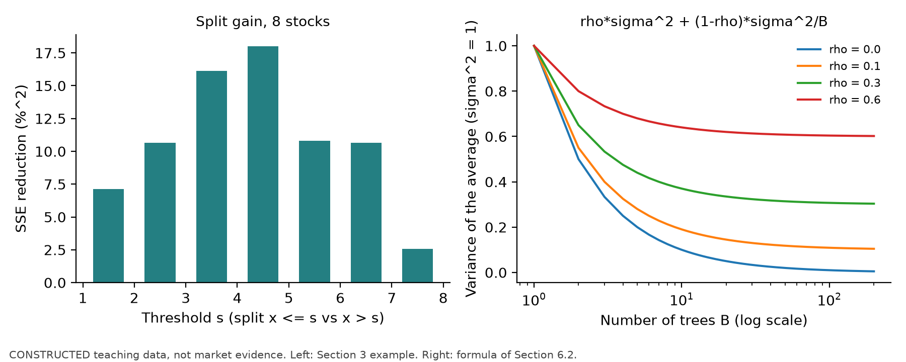
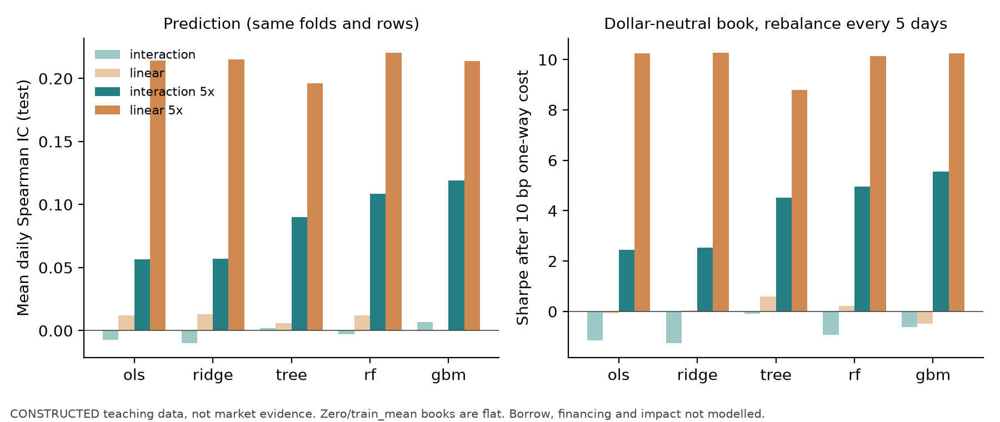
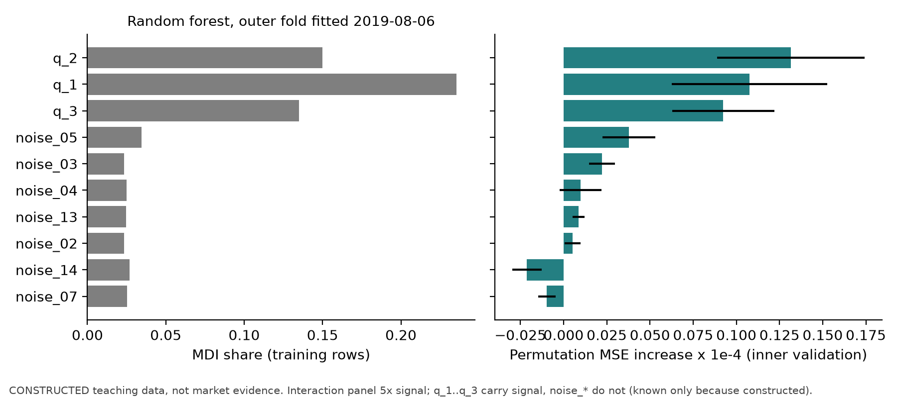

# 第40章 树模型（Tree-Based Models）

> 作者：Yuxiao Ma。既有 A8-B 构造实现已获限定范围接受、待正式整合；这不等于真实研究完成。主线：树用分段常数逼近非线性与交互，随机森林靠平均降低方差，梯度提升沿负梯度逐步修残差；它们的深度、叶样本、轮数和学习率都必须在训练内按日期选择，重要性只能当作有边界的诊断，经济结论仍看与基准同口径的成本后组合。
> 先修：第38章管线（日期 walk-forward、标签可用时点、训练内调参）、第39章正则化线性模型（偏差—方差、基准比较）。完成后你能：手算一次最优切分和两轮提升；推导森林方差公式；说明 sklearn 1.9.1 中 HistGradientBoosting 内置早停为何不能直接用于面板；在第38章管线上比较树模型与线性模型的预测指标和成本后结果；计算按日期的置换重要性并解释它在相关特征下的局限。

## 1. 本章目标

1. 写出回归树的切分目标，推导"切分增益 $=\frac{n_Ln_R}{n}(\bar y_L-\bar y_R)^2$"，手算一个 8 只股票的切分。
2. 说明深度（depth）与叶样本数（min_samples_leaf）如何限制树的方差，并能指出某个约束下哪些切分不可选。
3. 推导 $B$ 棵相关系数为 $\rho$ 的树平均后的方差 $\rho\sigma^2+\frac{1-\rho}{B}\sigma^2$，解释随机森林为何要随机抽特征。
4. 推导平方损失下梯度提升每一轮拟合的是残差，学习率（learning rate）如何收缩每一步；手算两轮提升；说明 sklearn 的 HistGradientBoosting 叶值 $-G/(H+\lambda)$ 与第39章 Ridge 收缩的对应关系。
5. 在训练内按日期选择深度、叶样本、轮数（早停），解释 sklearn 内置早停的随机留出为什么在面板中泄漏。
6. 计算按日期的置换重要性（permutation importance），对照不纯度重要性（MDI），说明相关特征、样本期和多次比较如何影响它；说明 SHAP 的可加性和局限。
7. 在交互项构造面板和第39章线性构造面板上，比较零预测、训练均值、OLS、Ridge、单树、随机森林、梯度提升的样本外与成本后表现，并用 Project 6 v2 协议做消融与稳定性报告。

完成条件：第15–17节可独立完成；`code/ch40_tree_models.py` 复现第8–10节数字。

## 2. 为什么 Quant 需要它

线性模型假设每个特征对预期收益的作用是固定斜率。截面研究里常见两种偏离：作用随另一特征变化（交互，例如某个价量信号只在流动性差的股票里有效），以及作用不单调（两端都异常、中间平常）。线性模型只能靠研究员手工加入交互项和分段项，而候选组合数随特征数快速增长。

树模型自动搜索"在哪个特征的哪个阈值处把样本分开"。Gu、Kelly、Xiu（2020）在美国个股月度数据上报告随机森林与梯度提升树的样本外 $R^2$ 高于线性基准（具体数值与核读状态见第11节和第20节）。同一研究也说明了代价：树的超参数多、对样本期敏感、重要性排名会随训练窗口变化。本章把这些代价放在第38章的管线里逐项检查：选深度和轮数只用训练内的日期验证；重要性在训练内的验证窗计算；经济意义与零预测、训练均值、线性模型用同一账本、同一成本比较。

## 3. 直觉

8 只股票，特征 $x$ 是过去 5 日收益的截面排名（1 = 跌得最多，8 = 涨得最多），标签 $y$ 是下周收益（%）。教学构造数字：

| 股票 | 1 | 2 | 3 | 4 | 5 | 6 | 7 | 8 |
|---|---|---|---|---|---|---|---|---|
| $x$ | 1 | 2 | 3 | 4 | 5 | 6 | 7 | 8 |
| $y$（%） | −2 | −1 | −1 | 0 | 2 | 1 | 3 | 2 |

一棵深度为 1 的树（树桩，stump）只问一个问题："$x\le s$ 吗？"，然后在两侧各预测一个常数。$s=4$ 时左侧平均 −1%，右侧平均 2%；整体平均 0.5%。不分组时误差平方和为 22，分组后为 2+2=4，减少 18。第8节逐个阈值计算，$s=4$ 的减少量最大。

这个例子的边界：只有一个特征、没有独立的未来验证集，树完全可以继续往下切到每个叶子只剩一只股票，训练误差为 0；训练误差归零暴露了过拟合风险，却不能由这8行数据证明下一周必然更差；需用之后日期的验证或测试评价。深度和叶样本约束、随机森林的平均、提升的学习率与轮数，都是在处理"切得太细"的问题。

## 4. 数学基础

| 符号 | 含义 | 维度/单位 |
|---|---|---|
| $n$ | 节点（或训练集）中的样本行数 | — |
| $x_i\in\mathbb R^p$ | 第 $i$ 行特征，$x_{ij}$ 为第 $j$ 个特征 | 特征原单位（树不需要标准化） |
| $y_i$ | 标签：从 trade_time 到 label_end 的简单收益 | 小数；手算例用 % |
| $R_m$ | 第 $m$ 个叶子对应的特征空间区域 | — |
| $c_m$ | 叶子 $m$ 的预测值 | 与 $y$ 同单位 |
| $\mathrm{SSE}(S)=\sum_{i\in S}(y_i-\bar y_S)^2$ | 节点 $S$ 的误差平方和 | $y$ 单位的平方 |
| $B$ | 森林中的树数 | — |
| $\sigma^2,\rho$ | 单棵树在固定 $x$ 处预测的方差、两棵树预测的相关系数 | $y$ 单位平方；无量纲 |
| $F_m(x)$ | 提升第 $m$ 轮后的预测 | 与 $y$ 同单位 |
| $\nu\in(0,1]$ | 学习率（sklearn `learning_rate`） | — |
| $M$ | 提升轮数（HGB 的 `max_iter`） | — |
| $L(y,F)=\tfrac12(y-F)^2$ | 平方损失 | $y$ 单位平方 |

先修：第8章最小二乘（均值使平方误差最小）、第9章梯度下降、第39章偏差—方差分解与 Ridge 收缩因子 $n/(n+\alpha)$、第38章日期分组 walk-forward 与 $\text{label\_available\_at}\le\text{fit\_time}$。本章时钟沿用第38章：signal_time 为收盘 $D_k$，trade_time $=D_{k+1}$ 收盘，label_end $=$ label_available_at $=D_{k+1+h}$，$h=5$。

## 5. 正式定义

**回归树（regression tree，CART）。** 通过递归的轴平行切分，把特征空间切成互不重叠的矩形区域 $R_1,\dots,R_J$，在每个区域上预测常数：

$$
f(x)=\sum_{m=1}^{J}c_m\,\mathbf 1\{x\in R_m\}.
$$

每次切分选一个特征 $j$ 和阈值 $s$，把节点 $S$ 分为 $S_L=\{i:x_{ij}\le s\}$ 与 $S_R=\{i:x_{ij}>s\}$。sklearn 1.9.1 的 `DecisionTreeRegressor` 默认准则 `squared_error` 选使 $\mathrm{SSE}(S_L)+\mathrm{SSE}(S_R)$ 最小的 $(j,s)$，叶值取叶内 $y$ 的平均。逐层贪心，不保证全局最优；固定深度下可表示的递归分区也不是任意矩形分区。它解决线性模型需要手工设定交互与阈值的问题；输入是特征与标签，输出是分段常数预测。

**深度（depth）与叶样本数（leaf samples）。** `max_depth` 限制从根到叶的切分次数，最多 $2^{d}$ 个叶子；`min_samples_leaf` 要求每个叶子至少有这么多训练行，不满足的切分不可选。两者都限制模型复杂度，从而限制方差。面板中一行是一只股票一天，同日行高度相关，"1000 行"远不等于 1000 个独立观测（第37章有效样本），所以叶样本需要远大于非金融数据中的习惯值。

**装袋（bagging）与随机森林（random forest）。** 装袋：对训练集有放回抽样 $B$ 次，每次长一棵树，预测取平均。随机森林在每次切分时只从随机抽取的 `max_features` 个特征中选切分，降低树之间的相关性。sklearn 1.9.1 的 `RandomForestRegressor` 默认 `max_features=1.0`（即不抽特征，等同装袋）；`max_samples` 控制每棵树抽多少行。

**梯度提升（gradient boosting）。** 从常数 $F_0$ 出发，每轮用一棵浅树 $h_m$ 拟合损失对当前预测的负梯度，再按学习率加进去：

$$
F_m(x)=F_{m-1}(x)+\nu\,h_m(x),\qquad m=1,\dots,M .
$$

它承接第9章的梯度下降：不是在参数空间里走，而是在"预测函数"空间里走，每一步的方向由一棵树近似。sklearn 1.9.1 的 `HistGradientBoostingRegressor`（HGB）先把每个特征在训练数据上分到至多 255 个箱（bin），再用梯度与二阶导数的箱内和寻找切分。

**学习率（learning rate）与早停（early stopping）。** 学习率 $\nu$ 缩小每一步；步子小，需要的轮数多，但每轮拟合到的噪声也少。轮数 $M$ 是超参数：太少欠拟合，太多拟合噪声。早停指在验证集误差不再下降时停止。它必须在训练行内部按日期留出验证窗；本章在第38章内层日期 walk-forward 上逐轮记录验证误差来选 $M$。

**不纯度重要性（MDI, mean decrease in impurity）。** 对每个特征，把所有使用该特征的切分带来的加权 SSE 减少加总，再归一化。sklearn 文档称其为 Gini importance，并警告它对取值多的特征有偏。它在训练数据上计算。

**置换重要性（permutation importance）。** 在一个没有参与拟合的验证集上，把某个特征的值打乱，看损失增加多少：

$$
I_j=\frac1R\sum_{r=1}^R\Big[\mathrm{MSE}\big(y,f(X^{(\pi_r,j)})\big)-\mathrm{MSE}\big(y,f(X)\big)\Big],
$$

$X^{(\pi_r,j)}$ 表示第 $j$ 列按第 $r$ 次置换 $\pi_r$ 重排。本书面板版本只在**同一 signal_time 内**打乱（截面置换），不跨日期交换，使日期层面的市场状态不被破坏；也报告逐日 Spearman IC 的下降。组置换（group permutation）对一组列用同一个置换，保留组内联合分布。

**SHAP（Shapley additive explanations）。** 给定一个预测 $f(x)$，把 $f(x)-E f(X)$ 按合作博弈的 Shapley 值分给各个特征：

$$
\phi_j=\sum_{S\subseteq N\setminus\{j\}}\frac{|S|!\,(p-|S|-1)!}{p!}\big[v(S\cup\{j\})-v(S)\big],
$$

$v(S)$ 是"只知道 $S$ 中特征的值时"的期望预测。$v$ 有两种常见定义：干预式 $v(S)=E\,f(x_S,X_{\bar S})$（补集 $X_{\bar S}$ 从背景的联合边际分布抽取，与固定的 $x_S$ 脱钩；并非把补集各列彼此独立抽取）与条件式 $v(S)=E[f(X)\mid X_S=x_S]$。两种定义在特征相关时给出不同答案。本书环境未安装 `shap` 包，第8节用穷举小例计算精确 Shapley 值。

**消融（ablation）。** 预先登记的"去掉某组特征或换掉某个组件"的对照运行，用同一折、同一组合规则、同一成本比较，回答"这个组件对样本外结果贡献多少"。

## 6. 推导

### 6.1 叶值与切分增益

**叶值取平均。** 叶内预测常数 $c$ 使 $\sum_{i\in S}(y_i-c)^2$ 最小。对 $c$ 求导：$-2\sum(y_i-c)=0\Rightarrow c=\bar y_S$。这一步只用到平方损失；换成绝对损失，叶值变成中位数。

**组内—组间分解。** 父节点 $S$ 分成 $S_L,S_R$，$\bar y$ 为父节点平均。对每一侧加减该侧平均并展开（交叉项因 $\sum_{i\in S_L}(y_i-\bar y_L)=0$ 消失）：

$$
\mathrm{SSE}(S)=\mathrm{SSE}(S_L)+\mathrm{SSE}(S_R)+n_L(\bar y_L-\bar y)^2+n_R(\bar y_R-\bar y)^2 .
$$

**化简组间项。** 由 $\bar y=(n_L\bar y_L+n_R\bar y_R)/n$ 得 $\bar y_L-\bar y=\frac{n_R}{n}(\bar y_L-\bar y_R)$，$\bar y_R-\bar y=-\frac{n_L}{n}(\bar y_L-\bar y_R)$。代入：

$$
\Delta\equiv\mathrm{SSE}(S)-\mathrm{SSE}(S_L)-\mathrm{SSE}(S_R)=\frac{n_Ln_R^2+n_Rn_L^2}{n^2}(\bar y_L-\bar y_R)^2=\frac{n_Ln_R}{n}(\bar y_L-\bar y_R)^2 .
$$

两个推论。第一，增益随两侧平均差的平方增长，但比较切分时还必须乘样本平衡因子 $n_Ln_R/n$，不能只比较平均差。第二，因子 $n_Ln_R/n$ 在两侧样本相等时最大，在一侧只有 1 行时约为 1：把一只极端股票单独切出去也能带来不小的增益，这就是 `min_samples_leaf` 要防的情形。第3节例子 $s=4$：$\frac{4\cdot4}{8}(-1-2)^2=18$。

**决策用途。** 这个公式告诉你树在看什么：两组平均收益差的平方与样本平衡权重的乘积。它不看斜率、不看排序相关；一个对排序有用、但两组平均差很小的特征可能永远不会被选中。

### 6.2 平均降低方差：$\rho\sigma^2+\frac{1-\rho}{B}\sigma^2$

固定一个特征点 $x$。把每棵树的预测 $T_b(x)$ 视为随机变量（随机性来自训练样本的自助抽样和切分时的特征抽样）。假设：各树同分布，方差 $\sigma^2$，任意两棵的相关系数为 $\rho\ge0$。则

$$
\operatorname{Var}\Big(\frac1B\sum_{b=1}^BT_b\Big)=\frac1{B^2}\Big[B\sigma^2+B(B-1)\rho\sigma^2\Big]=\rho\sigma^2+\frac{1-\rho}{B}\sigma^2 .
$$

第一步把和的方差展开为 $B$ 个方差加 $B(B-1)$ 个协方差，每个协方差为 $\rho\sigma^2$。$B\to\infty$ 时第二项消失，方差停在 $\rho\sigma^2$：多种树只能消掉"树与树之间不同"的部分，消不掉它们共有的部分。随机抽特征可能降低 $\rho$，也可能削弱单树并改变 $\sigma^2$ 与偏差；须比较整体误差，不能保证更小的 `max_features` 更好。该式与 ESL 第2版式(15.1)一致（核读状态见第20节）。

金融含义：同一个训练窗口里的一段偶然行情，每棵树都看得到，平均不会把它消掉；这部分误差只能靠更长样本、更粗的叶子或换窗口验证暴露。

### 6.3 平方损失下的梯度提升 = 逐轮拟合残差

**初值。** $F_0=\arg\min_c\sum_iL(y_i,c)=\bar y$（6.1 节同一推导）。

**负梯度。** $L(y,F)=\tfrac12(y-F)^2$，$-\partial L/\partial F=y-F$。在第 $m$ 轮，伪残差 $r_{im}=y_i-F_{m-1}(x_i)$。

**拟合与更新。** 用一棵浅树 $h_m$ 拟合 $\{(x_i,r_{im})\}$，叶值取叶内残差平均（平方损失下就是最小二乘），然后 $F_m=F_{m-1}+\nu h_m$。

**学习率的收缩。** 假设每一轮都选到同一个分区，叶 $R$ 中初始平均残差为 $\bar r_R^{(0)}$。一轮后该叶每行残差减少 $\nu\bar r_R^{(0)}$，叶内平均残差变为 $(1-\nu)\bar r_R^{(0)}$；归纳得第 $m$ 轮后 $(1-\nu)^m\bar r_R^{(0)}$。$\nu=1$ 一步到位；$\nu=0.1$ 时 10 轮后还剩 $0.9^{10}\approx35\%$。这是特殊情形（真实提升每轮分区会变），它说明的是：小学习率把一次大修正拆成很多小修正，每一小步都可以被后续验证误差否决，这就是"学习率 × 轮数"必须一起调的原因。

**HGB 的叶值。** sklearn 1.9.1 的 HGB 对每个叶子用梯度和 $G=\sum g_i$、二阶导数和 $H=\sum h_i$ 计算叶值 $-G/(H+\lambda)$，再乘学习率（源码 `splitting.pyx` 的 `compute_node_value` 与 `grower.py` 的 shrinkage；见 D06/第20节）。平方损失 $L=\tfrac12(y-F)^2$ 时 $g_i=F-y_i=-r_i$，$h_i=1$：

$$
\text{叶值}=\nu\cdot\frac{\sum_{i\in R}r_i}{n_R+\lambda}=\nu\cdot\frac{n_R}{n_R+\lambda}\,\bar r_R .
$$

`l2_regularization` $=\lambda$ 把叶内平均残差乘以 $n_R/(n_R+\lambda)$，与第39章正交设计下 Ridge 的收缩因子 $n/(n+\alpha)$ 同形：叶子越小，收缩越多。

### 6.4 早停必须按日期留出

HGB 的 `early_stopping="auto"` 在训练行数超过 10,000 时自动开启，用 `train_test_split`（`test_size=validation_fraction`）从训练行中**随机**抽 10% 当验证集（本机源码第533–581行）。面板中这有两个问题：同一天的其他股票落在训练侧，验证行与训练行共享当天的市场冲击；标签区间重叠（5 日标签，相邻信号日共享 4 天收益），验证行的标签在训练侧几乎被"看过"。随机行留出破坏了时间外推的验证口径，可能低估误差；第12.1节此构造面板确实停得偏晚，但这不是所有数据都选更多轮或测试更差的定理。正确做法：关闭内置早停，把轮数当作超参数，在第38章内层日期 walk-forward 上逐轮记录验证 MSE（`staged_predict`），取平均曲线的最小点，再用外层全部训练行以该轮数重拟合。外层测试窗只评价一次。第12.1节给出随机早停与日期早停的数值对照。

### 6.5 置换重要性在相关特征下的行为

设 $x_2=x_1$（两列完全相同），模型只用了 $x_1$（这是给定已拟合模型的假设；相同增益的tie受特征搜索、随机状态及实现约定影响，不保证选首列）。单独置换 $x_2$：预测不变，$I_2=0$；在第8.4节指定预测器、标签和MSE下，单独置换 $x_1$ 破坏了有用预测，$I_1>0$；但“模型读取该列”本身不保证任意验证集的损失上升。同一份信息，排名一高一低，取决于模型碰巧用了哪一列。若模型把两列作为可替代的预测性代理（例如某些森林中的不同树），单独置换时另一列可能保留信息，从而稀释单列重要性；并非模型读取两列就必然如此。组置换同时打乱两列，测量该组扰动下的损失变化。重要性符号与替代行为取决于模型、验证分布和损失。例如两行 $x_1=x_2=(-1,1)$、$y=(0,0)$，固定 $f=x_1-x_2$ 的基准MSE为0；交换任一单列使MSE为4，整组同交换却仍为0。这是代数反例，不声称森林在这些数据上会拟合出该函数。

第二个问题来自外推。若 $x_1,x_2$ 高度相关但不完全相同，单独打乱 $x_1$ 会造出现实中不存在的组合（$x_1$ 很高而 $x_2$ 很低），模型在这些点上的预测没有训练数据支撑，重要性反映的是模型在陌生区域的行为（Strobl 等 2008 的条件重要性就是为处理这个问题提出；核读状态见第20节）。

第三，重要性是样本期的函数：在哪个窗口算、用哪个折的模型算，结果就是那个窗口的。本书规定：用于任何选择的重要性只在训练内的验证窗计算；在外层测试窗算的重要性只作事后诊断，不回流到该测试窗或之后任何窗的模型、参数或特征选择。

### 6.6 Shapley 值的可加性与局限

取 $p=2$，干预式、单点背景 $b$：$v(\varnothing)=f(b)$，$v(\{1\})=f(x_1,b_2)$，$v(\{2\})=f(b_1,x_2)$，$v(\{1,2\})=f(x)$。代入定义：

$$
\phi_1=\tfrac12\big[v(\{1\})-v(\varnothing)\big]+\tfrac12\big[v(\{1,2\})-v(\{2\})\big],\quad
\phi_2=\tfrac12\big[v(\{2\})-v(\varnothing)\big]+\tfrac12\big[v(\{1,2\})-v(\{1\})\big].
$$

相加得 $\phi_1+\phi_2=v(\{1,2\})-v(\varnothing)=f(x)-f(b)$，即可加性（local accuracy）。局限：(1) 它解释的是**模型**，不是世界：模型只用了 $x_1$ 时 $x_2$ 的干预式 Shapley 值为 0，哪怕 $x_2$ 在数据中同样有信息；(2) 干预式与条件式定义在相关特征下给出不同分配，没有哪一个自动等于"经济重要性"；(3) 交互的贡献按规则平分（第8.4节 $f=2x_1x_2$ 的例子），平分是公理的结果，不是对机制的发现；(4) 与置换重要性一样依赖样本期和背景分布，跨折会变；(5) 不提供因果解释，不能把"SHAP 值大"读成"改变这个特征会改变收益"。

## 7. 金融解释

**树捕捉的是什么。** 树在切分点两侧给出不同的平均收益，最擅长"条件效应"：某信号只在某一类股票中起作用。例如第8节交互面板中，$q_1$ 只有在 $q_2>0$ 时才有载荷；线性模型只能学到平均斜率（约为真实条件斜率的一半），树可以先按 $q_2$ 切开再按 $q_1$ 切。真实市场中这类结构是否存在、是否稳定，需要实证；构造数据只能展示机制。

**分段常数对组合的影响。** 一个叶子里的所有股票预测相同，截面排名出现大量并列。浅树、粗叶子时，美元中性组合实际上在少数几个"桶"之间做多空；Spearman IC 在并列多时信息有限。森林与提升把许多树加总，并列减少，但仍是阶梯函数。

**外推。** 超出训练范围的特征值落在最外侧叶子，预测保持常数，不会像线性模型那样沿斜率外推。极端行情中这既是保护（不放大），也是盲区（看不到新区域的效应）。

**换手与成本。** 树的预测在阈值附近跳变：特征小幅变动跨过切分点，预测和权重就整档变化。这会推高换手；树在准确率上的小优势可能被成本抵消。第13节用同一第29章账本比较成本后结果。

**可实现性与时点。** 严格单调变换保存训练点次序与可分训练分区（忽略浮点、并列值和分箱边界），却不保证非线性变换后的新点预测不变。训练 $x=(0,2)$、$y=(0,1)$，原中点阈值为1；在非负域用严格递增 $g(x)=x^2$ 后，中点阈值为2。新点 $x=1.2$ 原预测1，变换后 $1.44\le2$ 预测0。正仿射缩放（例如使用固定训练均值与正SD标准化）则保存中点位置的对应关系。这仍不意味着预处理可以随便做：用全样本分位数做的截尾、全样本拟合的分箱、HGB 在全样本上做的分箱，都会让训练看到测试期的分布。截面排名必须在该 signal_time 所需的完整、当时已可得截面齐备后计算；跨时间的标准化与分箱必须只在训练行上拟合。

## 8. 完整数值例题

本节数字均为教学构造。8.1–8.4 为手算，并由 `code/ch40_tree_models.py` 的 `hand` 部分与 scikit-learn 1.9.1 核对；8.5来自同一脚本的登记主模拟（种子与设定见脚本文档串和 `qa/a8/ch40_ch41_batch/DECISION_LOG.md` D08）；8.6是看到主结果后另加的D11五倍敏感性，不是事前主结果。

### 8.1 一次切分：逐个阈值计算

沿用第3节的 8 只股票（$y$ 单位为 %，整体平均 0.5，$\mathrm{SSE}=22$）：

| 阈值 $s$ | $n_L$ | $\bar y_L$ | $\bar y_R$ | $\mathrm{SSE}_L$ | $\mathrm{SSE}_R$ | 增益 $\Delta$ | 闭式值 |
|---|---|---|---|---|---|---|---|
| 1.5 | 1 | −2.000 | 0.857 | 0.000 | 14.857 | 7.143 | 7.143 |
| 2.5 | 2 | −1.500 | 1.167 | 0.500 | 10.833 | 10.667 | 10.667 |
| 3.5 | 3 | −1.333 | 1.600 | 0.667 | 5.200 | 16.133 | 16.133 |
| 4.5 | 4 | −1.000 | 2.000 | 2.000 | 2.000 | **18.000** | 18.000 |
| 5.5 | 5 | −0.400 | 2.000 | 9.200 | 2.000 | 10.800 | 10.800 |
| 6.5 | 6 | −0.167 | 2.500 | 10.833 | 0.500 | 10.667 | 10.667 |
| 7.5 | 7 | 0.286 | 2.000 | 19.429 | 0.000 | 2.571 | 2.571 |

闭式值列按 $\frac{n_Ln_R}{n}(\bar y_L-\bar y_R)^2$ 计算，例如 $s=1.5$：$\frac{7}{8}\times2.857^2=7.143$；$s=4.5$：$\frac{16}{8}\times3^2=18$。最优阈值 4.5（sklearn 把阈值放在相邻取值的中点）：左叶 −1%、右叶 2%。`DecisionTreeRegressor(max_depth=1)` 给出同样的阈值 4.5 与叶值 $(-1,2)$。若 `min_samples_leaf=3`，只有 $s\in\{3.5,4.5,5.5\}$ 可选，最优仍是 4.5；把 $y_8$ 从 2 改成 9，最优切分会变成"把股票 8 单独切出去"，叶样本约束就会生效（第15节 40-E02）。

### 8.2 森林方差

$\sigma^2=1$、$\rho=0.3$：$B=1,10,100,\infty$ 时平均的方差为 $1,\ 0.37,\ 0.307,\ 0.3$。从 10 棵到 100 棵树只降低 0.063；剩下的 0.3 由相关性决定。若随机抽特征把相关性降到 0.1，代价是单棵树方差升到 1.2，则 $B\to\infty$ 时为 $0.1\times1.2=0.12$，比 0.3 低得多。这正是随机森林"牺牲单棵树、换取更低的树间相关"的算术。



### 8.3 两轮提升，学习率 0.5

**第 0 轮**：$F_0=\bar y=0.5$，残差 $r=(-2.5,-1.5,-1.5,-0.5,1.5,0.5,2.5,1.5)$，训练 MSE $=22/8=2.75$。

**第 1 轮**：对残差找最优树桩。残差是 $y$ 减常数，SSE 减少量与 8.1 节相同，最优阈值仍是 4.5；左叶平均残差 −1.5，右叶 1.5。$F_1=0.5+0.5\times(\mp1.5)$：前四只 −0.25，后四只 1.25。训练 MSE 1.0625。

**第 2 轮**：新残差 $(-1.75,-0.75,-0.75,0.25,0.75,-0.25,1.75,0.75)$。最优阈值变为 3.5：左叶 $(-1.75-0.75-0.75)/3=-13/12$，右叶 $(0.25+0.75-0.25+1.75+0.75)/5=0.65$。$F_2=F_1+0.5\,h_2$：股票 1–3 为 $-0.25-13/24=-0.7917$，股票 4 为 $-0.25+0.325=0.075$，股票 5–8 为 1.575。训练 MSE 0.5344。

下面这个设定在这 8 个点上输出完全相同的 $F_2$（$-0.791667,\dots,0.075,1.575,\dots$）。继续下去，第 3、4 轮训练 MSE 为 0.3205、0.2014，训练误差会一直下降；什么时候停，要由训练窗之外的验证误差决定。

```text
HistGradientBoostingRegressor(max_iter=2, learning_rate=0.5, max_leaf_nodes=2,
                              min_samples_leaf=1, early_stopping=False)
```

**叶值收缩。** 同一数据，max_iter=1、learning_rate=1、max_depth=1、l2_regularization=4：左叶 4 个残差和 $-6$，叶值 $-6/(4+4)=-0.75$，预测 $0.5-0.75=-0.25$；右叶 $+0.75$，预测 1.25。sklearn 输出 $(-0.25,1.25)$。不加 $\lambda$ 时叶值是 $\mp1.5$；$\lambda=4$ 把它乘以 $4/8$。

### 8.4 置换重要性与 Shapley 值的小例

**双胞胎特征。** 同一天 4 只股票，$x_1=(-1.5,-0.5,0.5,1.5)$，$x_2=x_1$，$y=(-0.9,-0.4,0.2,1.1)$（%）。拟合出的模型只用 $x_1$：$f=0.6x_1$。基准 MSE $=0.015$。用固定置换"向后移两位" $\pi=(3,4,1,2)$：

- 只打乱 $x_1$：预测变为 $0.6\times(0.5,1.5,-1.5,-0.5)$，MSE $=1.575$，重要性 $1.560$。
- 只打乱 $x_2$：预测不变，重要性 $0$。
- 两列一起打乱：重要性 $1.560$。

$x_2$ 与 $x_1$ 含有完全相同的信息，重要性却为 0。若模型碰巧选了 $x_2$，排名就反过来。

**交互项的 Shapley 值。** $f(x_1,x_2)=2x_1x_2$，取 $x=(1,1)$、背景点 $b=(0,0)$：$v(\varnothing)=0$，$v(\{1\})=f(1,0)=0$，$v(\{2\})=0$，$v(\{1,2\})=2$。$\phi_1=\tfrac12\cdot0+\tfrac12\cdot2=1$，$\phi_2=1$，和为 $2=f(x)-f(b)$。交互贡献被平分。**双胞胎模型** $f=0.6x_1$、$x=(1.5,1.5)$：$\phi=(0.9,0)$。

### 8.5 运行案例：交互面板与线性面板（主结果）

**设定（先登记后运行）。** 40 只资产、1260 个交易日。交互面板的条件均值 $0.0004\times g$，$g=q_1\mathbf 1\{q_2>0\}+0.8(|q_3|-\sqrt{2/\pi})$；线性面板沿用第39章生成器 $0.0004\times(q_1+0.5q_2+0.25q_3)$。两面板各有 20 个纯噪声特征，另加 rev\_5、mom\_60\_5、vol\_20，共 26 列。$h=5$、滞后 1 日、外层扩张窗（最少 504 日、每折测试 63 日、12 折）、内层最后 2 个 63 日验证窗；网格与 Project 6 v2 相同；美元中性、每 5 个信号日调仓、次日收盘成交。每行 $R^2_{\text{OS}}$ 相对训练均值、IC 为测试期逐日 Spearman IC 的均值。

| 面板 | 模型 | $R^2_{\text{OS}}$ vs 训练均值 | IC 均值 | 成本后夏普 10bp | 20bp | 年换手 |
|---|---|---|---|---|---|---|
| 交互 | OLS | −0.803% | −0.0072 | −1.15 | −1.53 | 24.5 |
| 交互 | Ridge | −0.075% | −0.0098 | −1.25 | −1.63 | 24.4 |
| 交互 | 单树 | −0.342% | 0.0019 | −0.10 | −0.56 | 31.6 |
| 交互 | 随机森林 | −0.116% | −0.0030 | −0.93 | −1.43 | 30.8 |
| 交互 | 梯度提升 | −0.010% | 0.0069 | −0.63 | −1.17 | 36.7 |
| 线性 | OLS | −0.614% | 0.0122 | −0.06 | −0.44 | 24.1 |
| 线性 | Ridge | −0.146% | 0.0128 | 0.04 | −0.35 | 23.8 |
| 线性 | 单树 | −0.343% | 0.0057 | 0.59 | 0.14 | 28.1 |
| 线性 | 随机森林 | −0.018% | 0.0120 | 0.22 | −0.29 | 30.2 |
| 线性 | 梯度提升 | −0.040% | −0.0003 | −0.50 | −1.06 | 35.8 |

零预测与训练均值的组合空仓。所有模型的 $R^2_{\text{OS}}$ 相对训练均值为负；交互面板上 IC 的 NW $t$ 绝对值都小于 1.2，线性面板最高 1.35。**树模型没有找到交互信号。** 内层验证也看出了这一点：梯度提升 12 折里有 11 折只选 1–14 轮，单树 8 折选最浅的深度 2。信号的量级是关键：交互面板中 $g$ 的标准差约 0.86，条件均值的日标准差约 $3.4\times10^{-4}$，而特质波动每日 2%；若近似把5日内信号视为不变、特异冲击视为独立，忽略复利及异质beta的共同项，则累计信号与特异噪声的方差比约为 $5(3.4\times10^{-4}/0.02)^2=0.001445$，即约0.145%（约0.1%的量级）。这是有条件的量级估算，不是从本面板实测的5日统计量。本次12折、约750个测试日未检出该交互信号。线性面板单树的夏普 0.59 来自 12 折中少数几个碰巧有利的切分，IC 只有 0.0057，不应当作证据。

### 8.6 信号强度敏感性（事后添加，D11）

主结果看过之后，为展示"信号能被检出时"树模型做了什么，把两面板的载荷同时放大到 0.002（5 倍），其余设定不变。这不是登记的主结果；夏普为 5–10 的数字远超任何现实策略，只说明构造信号过强。

| 面板（5 倍） | 模型 | $R^2_{\text{OS}}$ vs 训练均值 | IC 均值（NW $t$） | 成本后夏普 10bp | 年换手 |
|---|---|---|---|---|---|
| 交互 | OLS | −0.069% | 0.057（5.5） | 2.45 | 23.5 |
| 交互 | Ridge | 0.196% | 0.057（5.5） | 2.54 | 23.9 |
| 交互 | 单树 | 1.012% | 0.090（10.0） | 4.51 | 33.4 |
| 交互 | 随机森林 | 0.970% | 0.108（11.2） | 4.95 | 27.8 |
| 交互 | 梯度提升 | 1.162% | 0.119（13.0） | 5.55 | 34.9 |
| 线性 | OLS | 4.146% | 0.214（21.6） | 10.24 | 22.6 |
| 线性 | Ridge | 4.201% | 0.215（21.5） | 10.27 | 22.2 |
| 线性 | 单树 | 3.101% | 0.196（19.9） | 8.79 | 28.1 |
| 线性 | 随机森林 | 3.812% | 0.221（22.3） | 10.15 | 22.6 |
| 线性 | 梯度提升 | 4.043% | 0.214（22.0） | 10.25 | 25.0 |

交互面板上树模型的 IC 约为线性模型的两倍：线性模型只能用 $q_1$ 的平均斜率（理论上为条件斜率的一半）和 $q_2$、$q_3$ 的线性部分（$|q_3|$ 的线性投影为 0），树可以先按 $q_2$ 切开再按 $q_1$ 切，并在 $q_3$ 两端各切一刀。线性面板上 Ridge 与梯度提升、森林几乎相同，单树明显更差：用阶梯逼近直线需要很多切分，所选深度多为 2–4（12 折中 11 折）的单树做不到。梯度提升在交互面板上内层选择 20–270 轮（多数 39–112 轮），远多于主结果的 1–14 轮：有信号时验证误差会继续下降，早停给出的轮数随之增加。




**重要性。** 5 倍交互面板上，随机森林每折在最后一个内层验证窗做按日期置换（3 次重复），$q_1,q_2,q_3$ 的平均 MSE 增加为 $0.318,0.099,0.061\times10^{-4}$，12 折中 $q_1,q_3$ 每折都进入前 10，$q_2$ 为 11 折；纯噪声 noise\_05 也在 7 折进入前 10，平均增加 $0.018\times10^{-4}$。相邻两折重要性排名的 Spearman 相关平均 0.36（范围 0.05–0.64）。主结果（信号弱）中，前几名全是噪声特征（noise\_05、noise\_04、noise\_18），相邻折排名相关平均只有 0.12。最后一折的对比：MDI 把 $q_1,q_2,q_3$ 排在前三（0.235、0.150、0.135），其余 23 列各分到约 0.02–0.034，合计约 0.48；置换重要性中噪声列接近 0，最大的 noise\_05 为 $0.038\times10^{-4}$。主结果面板最后一折的 MDI 前四名全是噪声列，$q_1,q_2$ 各只有 0.033。



## 9. Python Implementation

- 核心模块 `src/quant_course/tree_models.py`（契约见 `qa/a8/ch40_ch41_batch/INTERFACE_CONTRACT.md` 第1节）：`make_estimator`、`fit_select_predict_tree`、`walk_forward_predict_tree`、`permutation_importance_by_date`、`simulate_interaction_panel`。外层与内层折、标签可用时点、缺失值规则复用第38章 `ml_pipeline.date_walk_forward`；评价与账本复用 `prediction_metrics` 与 `backtest_predictions`（第29章 `run_backtest`）。测试 `tests/test_tree_models.py`。
- 章节脚本。复现时只传 `--out`；`--figures-dir` 会覆盖本章 `figures/` 中的源图，只在有意刷新源图时使用：

  ```bash
  .venv/bin/python code/ch40_tree_models.py --out <新目录>
  ```

  四个面板、7 个模型、重要性与演示，本机 4–13 分钟（随机森林 `n_jobs=-1`，与其他任务并行时变慢）。输出 `results.json` 与四张图；目录已存在则拒绝。
- 种子：面板与模型 4001；置换重要性的随机数也用 4001。HGB 在 `early_stopping=False` 时给定数据是确定的。
- 时点：日频；signal_time $=D_k$ 收盘；trade_time $=D_{k+1}$ 收盘；收益区间 $D_{k+1}\to D_{k+6}$ 收盘；label_available_at $=D_{k+6}$。
- 缺失值：训练行任一特征或标签缺失则丢弃并计数；测试行任一特征缺失则不预测（该股票当期空仓）；无穷值报错。前 60 日因 mom\_60\_5 缺失不进入训练。

最小用法（单折、随机森林、训练内调参与重要性）：

```python
from quant_course import ml_pipeline as mp, tree_models as tm
close, chars = tm.simulate_interaction_panel(n_assets=12, n_days=420, n_noise=4,
                                             signal_loading=2e-3, seed=1)
labels = mp.make_forward_labels(close, horizon=5, execution_lag=1)
X = mp.stack_features(chars, labels.index)
folds = mp.date_walk_forward(labels.index.get_level_values(0), labels["label_start"],
                             labels["label_end"], labels["label_available_at"],
                             min_train_dates=250, test_dates=63)
grid = [{"n_estimators": 50, "min_samples_leaf": 50, "max_features": 0.5}]
res = tm.fit_select_predict_tree(X, labels, folds[0], model="rf", seed=1, param_grid=grid,
                                 importance_repeats=2, inner_val_dates=42,
                                 inner_min_train_dates=126)
imp = res.inner_importance["d_mse_mean"].round(8).to_dict()
print(res.chosen_params, res.n_train_used, imp)
```

## 10. Visualization

四张图均由 `code/ch40_tree_models.py` 生成，存于 `course/zh/chapters/ch40/figures/`：图1（第8.1–8.2节）；图2（第8.6节，内层验证曲线与所选轮数）；图3（第8.5–8.6节，四个面板的 IC 与成本后夏普）；图4（第8.6节，MDI 与置换重要性）。每张图的图注写明横纵轴、单位、样本与观察点，图内注明构造数据。

## 11. Real Market Example

**状态：尚待实验。** 本课程没有获授权的日频个股面板（`projects/project06/data_manifest.json`，`real_data.status = blocked`），本章不报告真实市场结果。

文献中的对照（不是本书证据）：Gu、Kelly、Xiu（2020）用 1957–2016 年美国个股月度数据、920 个特征（第2248页起的样本说明），初始训练集 1957–1974、验证集 1975–1986、测试 1987–2016；每年重拟合一次，训练集扩张一年、验证集保持 12 年并向前滚动，不用交叉验证以保持时间顺序（第2249页及脚注 32）。随机森林与带 Huber 损失的梯度提升树的样本外月度 $R^2$ 为 0.33% 与 0.34%（表1在第2250页，数值的文字叙述在第2251页），同期全变量 OLS 为 −3.46%；森林平均只长 1–5 层的浅树（第2251页）。大市值股票子样本中树与神经网络的 $R^2$ 为 0.52%–0.70%（第2252页）。他们的数据、频率、特征和成本前口径与本书构造实验都不可比；该文说明了月度截面中树模型的量级，也说明这个量级以 0.1% 为单位。

补做所需：授权的日频个股面板（未复权价格、成交量、拆分与分红、退市、按日期的成分），至少 8 年；字段与授权要求见 `data_manifest.json`。拿到数据后按 Project 6 v2 协议从数据节点重跑。

## 12. Common Mistakes

### 12.1 在面板上用 sklearn 内置早停

错误：`HistGradientBoostingRegressor` 设 `early_stopping=True`, `validation_fraction=0.1`（行数超过 10,000 时默认的 `"auto"` 也会开启）。原因：内置早停从训练行中随机抽 10% 作验证，同日其他股票与重叠标签都在训练侧（6.4 节）。差异（8.5 节交互面板主结果，12 个外层折，学习率 0.05、深度3、每叶至少500行、最多 1000 轮、20 轮不改善即停）：

| | 平均轮数 | 平均验证 MSE（$\times10^{-4}$） | 平均测试 MSE（$\times10^{-4}$） |
|---|---|---|---|
| 内置随机留出早停 | 1000（12 折全部跑满） | 22.06（随机留出行） | 26.01 |
| 内层日期验证选轮（本书做法） | 1–104，中位 8 | — | 24.72 |
| 零预测 | — | — | 24.76 |

随机留出的验证误差一直在下降，早停从未触发；测试误差 12 折全部高于日期选轮版本，也高于零预测。随机留出给出的 22.06 比实际测试误差低约 15%，这是它偏乐观的直接度量。修复：`early_stopping=False`，在内层日期折上用 `staged_predict` 选轮数（`tree_models` 的工厂对 gbm 禁止传入 `early_stopping` 等五个键）。

```python
import numpy as np
from sklearn.ensemble import HistGradientBoostingRegressor
X = np.random.default_rng(0).normal(size=(12_000, 5))
y = X[:, 0] * 0.1 + np.random.default_rng(1).normal(size=12_000)
auto = HistGradientBoostingRegressor(max_iter=50, random_state=0).fit(X, y)  # "auto"
print(auto.do_early_stopping_, auto.validation_fraction)  # True 0.1: random 10% holdout
```

输出 `True 0.1`。

### 12.2 用测试窗选轮数

错误：在外层测试窗上逐轮看 MSE，取最好的轮数报告。差异（同一面板、固定参数、每折 300 轮）：每折在测试窗上挑最佳轮数得到的 $R^2_{\text{OS}}$（相对零）为 +0.26%，挑到的轮数是 10、23、58、5、1、1、1、1、82、24、2、1，没有规律；固定 300 轮为 −1.61%；本书做法（内层日期验证选参数与轮数，8.5 节梯度提升）为 +0.16%。+0.26% 不能在实盘中获得，因为你在下单时不知道测试窗的标签。修复：轮数和其他超参数一样只在训练内选择，外层测试只评价一次。

### 12.3 以为树不需要预处理，就可以用全样本做

错误：用全样本分位数截尾、全样本拟合分箱或全样本标准化后再喂给树。原因：严格单调只保训练排序，不保证非线性中点规则对新点不变（第7节反例）；截尾和分箱更不是一一对应的严格单调变换。其阈值与边界若由全样本分布决定，测试期的极端值会改变训练期的取值，进而改变切分。修复：跨时间的变换只在训练行上拟合；同一 signal_time 的截面排名要等所需截面信息全部可得才计算。HGB 的分箱在 `fit` 内部只用传入的训练行，满足这个要求。

### 12.4 用 MDI 或测试期重要性挑特征

错误：取最终模型的 `feature_importances_` 或外层测试窗上的置换重要性排名，保留前 $k$ 个特征再报告样本外结果。原因：MDI 在训练行上计算，偏向可切分点多的连续特征（8.6 节，噪声列合计约一半份额）；测试期重要性用到了测试标签。修复：特征选择只用训练内验证窗的置换重要性（`select_top_k`，Project 6 v2 的 top10 消融），测试期重要性只作事后诊断。

### 12.5 把重要性排名读成经济机制

错误：报告"noise\_05 是第四重要的特征"。原因：信号弱时，置换重要性在验证窗内也会给偶然相关的噪声列正值；相关特征之间会互相替代（8.4 节双胞胎）；排名随折变化（主结果相邻折排名相关 0.12）。修复：报告跨折的稳定性（每折是否进前 10、排名相关）与组重要性，把重要性当诊断而不是发现。

## 13. Quant Research Application

**问题。** 在 Project 6 已冻结的构造面板上，树模型相对零预测、训练均值和正则化线性模型，样本外预测与成本后组合是否更好；结果是否稳定；哪些特征组贡献了结果。

**协议（`projects/project06/configs/p06_trees_v2.json`，首次 v2 运行前冻结，SHA256 `60101509…`）。** 继承 v1 的数据生成器、两个登记情景（基础、75% 处载荷反号）、特征（3 个价格特征 + 3 个有载荷特征 + 40 个零载荷特征）、$h=5$、滞后 1 日、外层扩张窗（最少 504 日、每折 63 日、16 折）、内层最后 2 个 63 日验证窗、美元中性组合与单边 0/10/20 个基点的第29章账本。新增：单树（深度 2/3/4/6、叶 1000）、随机森林（200 棵、`max_features=0.33`、叶 500/2000、`max_samples=0.5`）、梯度提升（HGB、上限 300 轮、学习率 0.05/0.02、深度 2/3、每叶至少500行，轮数在内层日期折上选择）、PCA+Ridge（第41章辅助消融）。重要性：每折最后一个内层验证窗上按日期置换（3 次）、价格/特征两组的组置换；外层测试窗置换重要性与随机森林 MDI 只作事后诊断。消融：去掉价格特征、只用价格特征、训练内前 10 特征。稳定性：每折所选参数与 IC、相邻折重要性排名相关、三个种子。比较统计：逐日 IC 相对 Ridge 的差及 NW $t$（滞后 4）。多次比较不做校正，全部为描述性结果。**冻结前已看过** A8-A v1 的构造结果（配置文件内逐条登记），因此这不是真实市场的事前预注册。v1 六个基线模型用未修改的 v1 代码重跑，与 A8-A c3 摘要逐值一致（两情景各 209 个数值，最大相对差 0）。

**结果：基础情景**（构造数据；$R^2_{\text{OS}}$ 相对训练均值；IC 为各模型**自身有 IC 的日期**上的逐日 Spearman IC 均值，括号内为 NW $t$（滞后 4 个交易日，只对日期连续的序列报告）；ΔIC 为模型与 Ridge 在**两者都有 IC 的共同日期**上的逐日差的均值；夏普按单边成本 0/10/20 个基点；换手为年化；10bp 下最大回撤：OLS −14.2%、Ridge −12.9%、Lasso −9.3%、Elastic Net −7.2%、单树 −20.0%、随机森林 −12.3%、梯度提升 −11.0%、PCA+Ridge −12.0%）：

| 模型 | $R^2_{\text{OS}}$ | IC（$t$） | ΔIC（$t$） | 夏普 0bp | 10bp | 20bp | 换手 |
|------------|----------|---------------|-----------------|------|------|------|------|
| OLS | −0.839% | 0.0203（2.24） | +0.0004（0.18） | 0.79 | 0.39 | 0.00 | 24.3 |
| Ridge | −0.113% | 0.0198（2.22） | — | 0.84 | 0.45 | 0.07 | 23.6 |
| Lasso | −0.083% | 0.0179（—）$^{\mathrm a}$ | +0.0017（—）$^{\mathrm a}$ | 0.36 | 0.01 | −0.33 | 16.3 |
| Elastic Net | −0.010% | 0.0309（—）$^{\mathrm a}$ | +0.0103（—）$^{\mathrm a}$ | 1.19 | 0.81 | 0.43 | 22.0 |
| 单树 | −0.393% | 0.0054（0.64） | −0.0144（−1.61） | 0.21 | −0.28 | −0.75 | 35.1 |
| 随机森林 | +0.037% | 0.0266（2.86） | +0.0067（1.06） | 1.13 | 0.64 | 0.16 | 29.2 |
| 梯度提升 | +0.023% | 0.0154（1.79） | −0.0044（−0.61） | 0.76 | 0.22 | −0.32 | 36.2 |
| PCA+Ridge | −0.008% | 0.0135（1.45） | −0.0063（−0.86） | 0.62 | 0.25 | −0.13 | 23.3 |

**结果：载荷反号情景**（第 1134 个交易日起载荷反号；第 11–16 折在反号之后）：

| 模型 | $R^2_{\text{OS}}$ | IC（$t$） | ΔIC（$t$） | 夏普 0bp | 10bp | 20bp | 换手 |
|------------|----------|---------------|-----------------|------|------|------|------|
| Ridge | −0.161% | 0.0087（0.95） | — | 0.23 | −0.15 | −0.53 | 23.7 |
| Elastic Net | −0.061% | 0.0152（—）$^{\mathrm a}$ | +0.0061（—）$^{\mathrm a}$ | 0.45 | 0.08 | −0.29 | 20.2 |
| 单树 | −0.604% | −0.0120（−1.32） | −0.0207（−2.19） | −0.66 | −1.13 | −1.60 | 36.2 |
| 随机森林 | −0.042% | 0.0129（1.35） | +0.0042（0.66） | 0.41 | −0.08 | −0.57 | 29.7 |
| 梯度提升 | −0.020% | 0.0041（0.46） | −0.0045（−0.59） | 0.16 | −0.38 | −0.92 | 36.5 |
| PCA+Ridge | −0.053% | 0.0063（0.68） | −0.0023（−0.31） | 0.24 | −0.14 | −0.52 | 23.5 |

（OLS 与 Lasso 见研究报告；Lasso 10bp 后夏普 −0.57。）

$^{\mathrm a}$ **日期基数。** 有成熟标签的测试日为 1002 个。OLS、Ridge、PCA+Ridge 与三种树模型在全部 1002 日都有 IC，日期连续。稀疏模型在部分日期预测为常数（系数全被压缩为 0），截面相关无定义：基础情景 Lasso 只有 630 日、Elastic Net 882 日有 IC；反号情景 567 日、819 日。所以它们的 IC 均值与 Ridge 的 1002 日均值不在同一组日期上，ΔIC 也不等于两列 IC 之差。基础情景中，Lasso 自身 0.0179（630 日），同一 630 日上 Ridge 只有 0.0161，配对差 +0.0017；Elastic Net 自身 0.0309（882 日），同日 Ridge 0.0206，配对差 +0.0103。反号情景中，Lasso 567 日上自身 0.0010、Ridge 0.0031，配对差 −0.0021；Elastic Net 819 日上 0.0152 对 0.0091，配对差 +0.0061。冻结摘要中这两类序列的 $t$ 值是先删除缺失日、再把剩余有效日当作相邻观测做 NW(4) 得到的诊断值，相邻有效观测之间可能隔着多个交易日，不是四个交易日带宽的 HAC，所以本表不报告。日期基数由冻结的预测与标签 CSV 独立复算，见 `projects/project06/research_report/v2_ic_date_bases.json`。

**消融（10bp 后夏普；ΔIC 为相对同模型全特征版本）：**

| 消融 | 基础 IC | 基础 ΔIC（$t$） | 基础夏普 | 反号 IC | 反号 ΔIC（$t$） | 反号夏普 |
|--------------------|--------|----------------|------|--------|----------------|------|
| 森林：去价格 | 0.0207 | −0.0059（−2.05） | 0.27 | 0.0082 | −0.0047（−1.62） | −0.34 |
| 森林：只价格 | 0.0131 | −0.0135（−1.09） | −0.05 | 0.0141 | +0.0013（0.10） | −0.14 |
| 森林：训练内前10 | 0.0146 | −0.0120（−1.85） | 0.28 | 0.0082 | −0.0047（−0.77） | −0.06 |
| 提升：去价格 | 0.0080 | −0.0074（−1.56） | −0.22 | −0.0013 | −0.0055（−1.14） | −0.42 |
| 提升：只价格 | 0.0145 | −0.0009（−0.08） | 0.44 | 0.0130 | +0.0089（0.77） | 0.19 |
| 提升：训练内前10 | 0.0197 | +0.0043（0.58） | 0.14 | 0.0141 | +0.0099（1.22） | −0.22 |

**稳定性。** 随机森林三个种子：IC 0.0266、0.0232、0.0237，10bp 后夏普 0.64、0.52、0.44，预测两两相关 0.962–0.982；梯度提升在 `early_stopping=False` 下对给定数据确定，三个种子完全相同。梯度提升每折所选轮数 2–96（多数 4–56），单树 16 折中 14 折选深度 2。内层置换重要性相邻折排名相关平均：单树 −0.10、森林 0.01、提升 0.09；$q_1$ 在森林与提升的 16 折中有 11 折进入前 10，零载荷的 noise\_04 在森林中也有 11 折。组置换：价格组的平均 MSE 增加约为 0（三种树模型都在 $\pm0.002\times10^{-4}$ 内），特征组约 $0.05\times10^{-4}$。

**解读。**

1. 预测层：没有任何模型相对训练均值的 $R^2_{\text{OS}}$ 超过 0.04%。树模型相对 Ridge 的 IC 差（日期连续，四交易日 NW）都在 $|t|<2.2$ 以内；唯一 $|t|>2$ 的是反号情景中单树更差（$t=-2.19$，未校正双侧近似 $p\approx0.029$；仅对 3 个树模型 × 2 个情景做 Bonferroni 后约 0.17，协议还登记了消融与种子比较），这是描述性比较，不是确认性的显著发现。数据生成过程是线性的，树模型没有可利用的非线性，这与第8.5–8.6节一致。
2. 成本：树模型年换手 29–36，高于线性模型的 16–24（分段常数预测跨过阈值时整档跳动）。随机森林基础情景成本前夏普 1.13，20bp 后降到 0.16；Elastic Net 在两个情景、三档成本下都排第一或接近第一。
3. 消融与替代：去掉价格特征使两种树模型的 IC 下降，只用价格特征时提升模型几乎保持全特征的 IC，而价格组的组置换重要性接近 0。这说明价格特征与特征列携带重叠的信息：过去收益里含有缓慢变化的预期收益（特征的 AR 系数为 0.98）。有特征列时价格组可以被替代，所以置换它几乎不损失；去掉它时模型失去一个独立的噪声来源，也失去一部分信号。反号情景中只用价格特征的提升模型反而更好：动量类特征随最近的收益更新，比在反号前学到的特征系数更快适应。这只是两个情景下的观察，$t$ 值都小于 1.3。
4. PCA+Ridge：所选成分数多为30（基础情景16折中10折），其余5折选择5、1折选择15。相对训练均值的 $R^2$ 两情景均好于 Ridge，IC均低于 Ridge；基础情景10/20bp夏普较差，反号情景−0.14/−0.52却略高于 Ridge 的−0.15/−0.53。43个 `q/noise` 构造序列彼此独立、单位边际方差，但各自为AR(1)、系数0.98；另外3个价格特征来自收益过程且与信号有间接联系，全46维不是独立同方差总体。有限样本PCA的方向与预测力需分开验证（第41章6.4节）。
5. 重要性：$q_1,q_2$ 是唯二稳定进入前列的有载荷特征（$q_3$ 的载荷只有 $q_1$ 的四分之一），但若干零载荷特征同样频繁进入前 10。没有真值时，你无法从这张表区分它们。

**教学判断准则（不是冻结JSON中的联合阈值）。** 若采用“两个情景IC差NW $t\ge2$ 且20bp夏普高于 Ridge 与 Elastic Net”作为一条保守的教学采用标准，没有树模型满足。冻结 `claims_rule` 实际要求构造数据不作经济/alpha结论、保留零负结果，并未登记上述联合阈值。构造数据不能支持任何 Alpha 结论；真实数据实证仍 blocked。完整表格、每折记录、重要性 CSV 与图见 `projects/project06/research_report/v2_trees.md`。

## 14. Chapter Summary

树把特征空间切成矩形、在每块上预测平均值；切分权衡两侧平均收益差与样本平衡（$\frac{n_Ln_R}{n}\Delta\bar y^2$），深度和叶样本约束限制它把少数极端股票单独切出去。随机森林靠平均降低方差，能降低的只是树与树之间不同的部分，剩下 $\rho\sigma^2$；减少 `max_features` 可能压低 $\rho$，也可能削弱单树并改变偏差或方差，须训练内验证该权衡。梯度提升在平方损失下逐轮拟合残差，学习率把每一步缩小，轮数要和学习率一起在训练内选择；HGB 的 L2 正则与第39章 Ridge 的收缩同形。三类模型的超参数都只能用训练行内部、按日期分组的验证窗选择，sklearn 的随机留出早停在本章面板中偏乐观。重要性是模型在某个窗口上的诊断：MDI 偏向可切分点多的连续特征，置换重要性会被相关特征稀释、会被噪声偶然抬高，Shapley 值解释的是模型而不是收益机制。本章的构造实验说明：信号弱时树模型并不能凭空找到交互；信号能被检出时，它在交互结构上胜过线性模型，在线性结构上与 Ridge 相当。是否采用树模型，要在同一折、同一账本、同一成本下与零预测、训练均值和正则化线性模型比较后决定。

## 15. Exercises

**40-E01**（手算切分）6 只股票，$x=(1,\dots,6)$，$y=(1,1,2,4,5,5)$（%）。计算 5 个阈值的增益，指出最优切分及两侧叶值；用 $\frac{n_Ln_R}{n}(\bar y_L-\bar y_R)^2$ 核对最优那一个。

**40-E02**（叶样本约束）第3节数据，`min_samples_leaf=3`。哪些阈值可选？最优切分是什么？若把 $y_8$ 从 2 改为 9，无约束与有约束时的最优切分各是什么？

**40-E03**（森林方差）单棵树 $\sigma^2=4$、$\rho=0.25$：$B=1,4,\infty$ 时的方差。另一种设置 $\sigma^2=5$、$\rho=0.1$：$B=4$ 与 $B=\infty$ 呢？哪种设置在 $B$ 很大时更好，为什么？

**40-E04**（提升一轮）第3节数据，学习率 0.25，只做一轮树桩提升。写出 $F_0$、残差、所选阈值、叶值、$F_1$ 与训练 MSE。

**40-E05**（L2 叶值）HGB 平方损失，某叶 4 个样本，残差和为 6，`l2_regularization` $=4$，学习率 1。叶值是多少？若学习率 0.1？用 $n_R/(n_R+\lambda)$ 解释它与 Ridge 收缩因子的关系。

**40-E06**（置换与相关）第8.4节双胞胎特征：为什么 $x_2$ 的重要性为 0？如果模型改为 $f=0.3x_1+0.3x_2$，单独置换 $x_1$、单独置换 $x_2$、一起置换，三种重要性的大小关系如何（不必算具体数）？

**40-E07**（Shapley）$f(x_1,x_2)=x_1+2x_1x_2$，$x=(1,1)$，背景点 $(0,0)$。求 $\phi_1,\phi_2$，验证可加性，并说明交互项 $2x_1x_2$ 的贡献如何分配。

**40-E08**（早停泄漏）用一段话说明：为什么在面板上用随机 10% 留出行做早停，在此面板中验证误差低于测试误差且选轮过多；说明为何不能把随机行留出当作日期外推验证。第12.1节表格中哪两个数直接显示了这一点？

**40-E09**（重要性解读）第8.6节主结果中，随机森林置换重要性前三名全是噪声特征。给出两个原因，并写出你会在报告中附上的两项稳定性证据。

## 16. Programming Exercises

**40-P01**（切分搜索）实现 `best_split(x, y, min_leaf)`：对一维特征返回最优阈值（相邻取值中点）、增益与两侧叶值。验收：(1) 第3节数据返回 $(4.5, 18.0, -1.0, 2.0)$；(2) 在有合法正增益、无最优tie且数值非退化的随机例中，与 `DecisionTreeRegressor(max_depth=1, min_samples_leaf=min_leaf)` 的阈值和叶值一致；(3) 增益等于闭式 $\frac{n_Ln_R}{n}\Delta\bar y^2$；(4) 所有 $y$ 相等且有合法候选时可返回零增益切分，sklearn可保留根叶；常数 $x$ 或叶约束使无合法切分时返回 `None`。

**40-P02**（日期分组选轮）对一个外层折，在内层日期折上（函数默认 `inner_folds=1`，即最后一折；本题沿用此默认，项目的两折是另一设置）用 `staged_predict` 选 HGB 轮数，结果必须与 `fit_select_predict_tree`（`model="gbm"`）的 `chosen_params["max_iter"]` 相同。验收：(1) 两者相等；(2) 打乱外层测试标签不改变所选轮数与测试预测；(3) 传入 `early_stopping=True` 时 `make_estimator` 报错。

**40-P03**（按日期置换）实现同日内置换：对每个 signal_time 独立打乱某列。验收：(1) 每个日期该列值的多重集合不变；(2) 不同日期的值从不交换；(3) 固定模型不读取噪声列时重要性精确为0；从有限样本拟合的模型即使噪声真实无载荷，也不保证该次估计恰为0，需报告重复分布；唯一信号列应明显为正；(4) 组置换时组内各列使用同一个行置换。

## 17. Challenge Problems

**40-C01**（Project 6 v2 解读）阅读第13节表格与 `projects/project06/research_report/v2_trees.md`。(a) 树模型在两个登记情景下与 Ridge 的 IC 差（NW $t$）和成本后夏普差是什么方向？与第8.5–8.6节的结论一致吗？(b) 三个登记消融（去掉价格特征、只用价格特征、训练内前 10 特征）各说明了什么？(c) 种子稳定性：不同种子的预测相关与成本后夏普差多大？(d) 你会用哪些结果反驳"梯度提升发现了 Alpha"？额外先修：第37章基准与第32章绩效。

**40-C02**（真实数据协议）为真实日频个股面板写一页树模型研究协议：特征与可得时点、标签、外层与内层折、网格与轮数选择、重要性窗口、消融、成本情景、种子、基准与反证条件。说明你如何保证它在看到真实结果之前冻结，以及哪些 `A8-A/A8-B` 构造结果你已经看过、需要披露。

## 18. 完整答案

**40-E01.** 总平均 3，$\mathrm{SSE}=4+4+1+1+4+4=18$。阈值 1.5：增益 4.8；2.5：12.0；3.5：**16.667**；4.5：12.0；5.5：4.8。最优 3.5：左叶 $4/3=1.333$，右叶 $14/3=4.667$；闭式 $\frac{3\cdot3}{6}(10/3)^2=16.667$。增益关于中间对称，因为数据关于中点反对称。

**40-E02.** 可选 3.5、4.5、5.5（两侧都至少 3 只），最优 4.5（增益 18）。$y_8=9$ 时：整体平均 1.375；无约束最优为 7.5（把股票 8 单独切出：$\frac{7\cdot1}{8}(0.286-9)^2=66.45$）；有约束时只比较 3.5、4.5、5.5，4.5 增益 $\frac{16}{8}(-1-3.75)^2=45.1$，3.5 为 $\frac{15}{8}(-1.333-3.0)^2=35.2$，5.5 为 $\frac{15}{8}(-0.4-4.333)^2=42.0$，最优 4.5。约束阻止了只为一只股票建叶子。

**40-E03.** $\sigma^2=4,\rho=0.25$：$B=1$ 为 4；$B=4$ 为 $0.25\times4+0.75\times4/4=1.75$；$B=\infty$ 为 1。$\sigma^2=5,\rho=0.1$：$B=4$ 为 $0.5+0.9\times5/4=1.625$，$B=\infty$ 为 0.5。大 $B$ 时第二种更好（0.5 < 1）：极限只剩 $\rho\sigma^2$，降低相关性比降低单棵树方差更重要。$B=4$ 时两者接近（1.625 对 1.75）。

**40-E04.** $F_0=0.5$；残差 $(-2.5,-1.5,-1.5,-0.5,1.5,0.5,2.5,1.5)$；最优阈值 4.5，叶值 $-1.5$、$+1.5$；$F_1=0.5\pm0.25\times1.5$：前四只 0.125、后四只 0.875。训练 MSE：$[(-2.125)^2+(-1.125)^2\cdot2+(-0.125)^2+(1.125)^2+(0.125)^2+(2.125)^2+(1.125)^2]/8=1.7656$。学习率 0.5 时一轮后为 1.0625，学习率小，每轮下降少。

**40-E05.** 叶值 $=\nu\cdot\frac{\sum r}{n_R+\lambda}=1\times6/8=0.75$；学习率 0.1 时 0.075。不加 L2 时平均残差 1.5；$\lambda=4$ 乘以 $n_R/(n_R+\lambda)=4/8$，与正交设计下 Ridge 的 $n/(n+\alpha)$ 同形：样本少的叶子收缩更多。

**40-E06.** 模型 $f=0.6x_1$ 不读取 $x_2$，打乱 $x_2$ 不改变任何预测，所以重要性为 0；这说明的是模型用了哪一列，不是 $x_2$ 有没有信息。若 $f=0.3x_1+0.3x_2$：单独打乱任一列，另一列仍提供一半信号，两者重要性相等且都明显小于一起打乱的重要性（单独时预测为 $0.3x_{1,\pi}+0.3x_1$，误差主要来自一半的信号被打乱）。组置换度量整组信息。

**40-E07.** $v(\varnothing)=0$，$v(\{1\})=f(1,0)=1$，$v(\{2\})=f(0,1)=0$，$v(\{1,2\})=3$。$\phi_1=\tfrac12(1-0)+\tfrac12(3-0)=2$，$\phi_2=\tfrac12(0-0)+\tfrac12(3-1)=1$，和为 3 $=f(x)-f(b)$。主效应 $x_1$ 的 1 全部给特征 1，交互项 2 平分为各 1。

**40-E08.** 随机留出的验证行与训练行来自相同日期：同一天的市场冲击、同一批股票的持续特征，以及重叠的 5 日标签（相邻信号日共享 4 天收益），都让验证行的标签在训练侧几乎"见过"。模型越贴近训练数据，验证误差越低，早停迟迟不触发，于是选更多轮。表中"随机留出验证 MSE 22.06"低于"其测试 MSE 26.01"约 15%，且 12 折全部跑满 1000 轮；日期选轮的测试 MSE 为 24.72。

**40-E09.** 原因：(1) 信号弱，模型在训练窗里拟合到的主要是噪声特征与收益的偶然关系，验证窗与训练窗相邻，这种偶然关系有时延续；(2) 3 次置换重复的随机性，以及重要性在单一验证窗（63 日）上计算。稳定性证据：各特征在多少折进入前 10；相邻折重要性排名的 Spearman 相关（主结果平均 0.12）。也可以报告组重要性与只用价格/只用特征的消融结果。

**40-P01 参考实现。**

```python
import numpy as np
from sklearn.tree import DecisionTreeRegressor


def best_split(x, y, min_leaf=1):
    o = np.argsort(x, kind="stable")
    x, y = np.asarray(x, float)[o], np.asarray(y, float)[o]
    n, best = len(y), None
    sse = lambda v: float(((v - v.mean()) ** 2).sum())
    for s in range(min_leaf, n - min_leaf + 1):
        if s == 0 or s == n or x[s - 1] == x[s]:
            continue
        L, R = y[:s], y[s:]
        gain = sse(y) - sse(L) - sse(R)
        assert np.isclose(gain, s * (n - s) / n * (L.mean() - R.mean()) ** 2)
        if best is None or gain > best[1] + 1e-12:
            best = ((x[s - 1] + x[s]) / 2, gain, L.mean(), R.mean())
    return best


x8, y8 = np.arange(1, 9.0), np.array([-2, -1, -1, 0, 2, 1, 3, 2.0])
assert np.allclose(best_split(x8, y8), (4.5, 18.0, -1.0, 2.0))
rng = np.random.default_rng(0)
for leaf in (1, 5):
    x, y = rng.normal(size=60), rng.normal(size=60)
    t = DecisionTreeRegressor(max_depth=1, min_samples_leaf=leaf).fit(x[:, None], y)
    thr, gain, l, r = best_split(x, y, leaf)
    assert np.isclose(thr, t.tree_.threshold[0])
    assert np.allclose([l, r], t.tree_.value[1:, 0, 0])
assert best_split(x8, np.ones(8))[1] == 0.0
assert best_split(np.ones(8), y8) is None
assert best_split(x8, y8, min_leaf=5) is None
print("ok")
```

**40-P02 参考实现。**

```python
import numpy as np, pytest
from quant_course import ml_pipeline as mp, tree_models as tm
close, chars = tm.simulate_interaction_panel(n_assets=10, n_days=400, n_noise=3,
                                             signal_loading=2e-3, seed=2)
labels = mp.make_forward_labels(close, horizon=5, execution_lag=1)
X = mp.stack_features(chars, labels.index)
f = mp.date_walk_forward(labels.index.get_level_values(0), labels["label_start"],
                         labels["label_end"], labels["label_available_at"],
                         min_train_dates=250, test_dates=40)[0]
grid = [{"max_iter": 40, "learning_rate": 0.1, "max_depth": 2, "min_samples_leaf": 50}]
kw = dict(model="gbm", param_grid=grid, inner_folds=1,
          inner_val_dates=40, inner_min_train_dates=120)
res = tm.fit_select_predict_tree(X, labels, f, **kw)
xtr, ytr = X.iloc[f.train_rows], labels["y"].iloc[f.train_rows]
ok = xtr.notna().all(axis=1) & ytr.notna()
lab = labels.iloc[f.train_rows][ok]
inner = mp.date_walk_forward(lab.index.get_level_values(0), lab["label_start"],
                             lab["label_end"], lab["label_available_at"],
                             min_train_dates=120, test_dates=40)[-1]
xi, yi = xtr[ok], ytr[ok]
est = tm.make_estimator("gbm", grid[0], seed=0)
est.fit(xi.iloc[inner.train_rows], yi.iloc[inner.train_rows])
yv = yi.iloc[inner.test_rows].to_numpy()
curve = [np.mean((yv - p) ** 2) for p in est.staged_predict(xi.iloc[inner.test_rows])]
assert int(np.argmin(curve)) + 1 == res.chosen_params["max_iter"]
lab2 = labels.copy()
lab2.iloc[f.test_rows, lab2.columns.get_loc("y")] = 9.9
res2 = tm.fit_select_predict_tree(X, lab2, f, **kw)
assert res2.chosen_params == res.chosen_params
assert res2.predictions.equals(res.predictions)
with pytest.raises(ValueError):
    tm.make_estimator("gbm", {"early_stopping": True}, seed=0)
print(res.chosen_params["max_iter"])
```

**40-P03 参考实现。**

```python
import numpy as np, pandas as pd
from quant_course import tree_models as tm
rng = np.random.default_rng(5)
dates = pd.bdate_range("2020-01-01", periods=60)
idx = pd.MultiIndex.from_product([dates, [f"A{i}" for i in range(15)]])
X = pd.DataFrame({"sig": rng.normal(size=len(idx)), "noise": rng.normal(size=len(idx)),
                  "twin": 0.0}, index=idx)
X["twin"] = X["sig"]
y = pd.Series(0.5 * X["sig"].to_numpy() + rng.normal(scale=0.5, size=len(idx)), index=idx)
predict = lambda d: 0.5 * d["sig"].to_numpy()  # a model that reads 'sig' only
imp = tm.permutation_importance_by_date(predict, X, y, n_repeats=5, seed=0)
assert imp.loc["sig", "d_mse_mean"] > 0.3
assert abs(imp.loc["noise", "d_mse_mean"]) < 1e-12 and imp.loc["twin", "d_mse_mean"] == 0
g = tm.permutation_importance_by_date(predict, X, y, groups={"pair": ["sig", "twin"]},
                                      n_repeats=5, seed=0)
assert g.loc["pair", "d_mse_mean"] > 0.3
print(imp["d_mse_mean"].round(3).to_dict())
```

多重集合、不跨日期及组联合置换也应直接检查，不能只看重要性输出：

```python
Xp = X.copy()
for date in X.index.get_level_values(0).unique():
    loc = np.flatnonzero(X.index.get_level_values(0) == date)
    order = rng.permutation(len(loc))
    # Read and write within the same date; paired columns use the same order.
    Xp.iloc[loc, X.columns.get_indexer(["sig", "twin"])] = (
        X.iloc[loc[order]][["sig", "twin"]].to_numpy())
    assert sorted(Xp.iloc[loc]["sig"]) == sorted(X.iloc[loc]["sig"])
    assert sorted(map(tuple, Xp.iloc[loc][["sig", "twin"]].to_numpy())) == (
        sorted(map(tuple, X.iloc[loc][["sig", "twin"]].to_numpy())))
assert np.array_equal(Xp["sig"], Xp["twin"])
```

这里不读noise的固定模型给出精确零；训练得到的模型可能偶然读取noise，有限样本置换值可正可负。多内层折选轮时，要对相同active folds逐轮MSE取平均后选最小值，不能只取最后一折。

**40-C01 完整参考答案。** 下列夏普差按表中各自保留两位的显示数相减，不是精确摘要差再舍入；ΔIC和t仍采用冻结配对字段，未重算t。基础情景单树、森林、提升的配对ΔIC分别为−0.0144、+0.0067、−0.0044，对应描述性NW t为−1.61、1.06、−0.61；10bp夏普相对Ridge 0.45的差为−0.73、+0.19、−0.23。反号情景ΔIC为−0.0207、+0.0042、−0.0045，t为−2.19、0.66、−0.59；10bp夏普相对Ridge −0.15的差为−0.98、+0.07、−0.23。20bp差分别为基础−0.82、+0.09、−0.39、反号−1.07、−0.04、−0.39。只有反号单树的未校正绝对t超过2，方向是更差；其余均未达到2。这不支持稳定采用树模型。第8节弱信号面板与此同样保留失败，但5倍交互面板证明的是强构造交互下可检出非线性，不能移植到本项目的线性生成过程。

去价格的森林IC两景都下降，10bp夏普基础0.64降到0.27、反号−0.08降到−0.34；只价格森林为−0.05、−0.14。提升去价格夏普为−0.22、−0.42，只价格反而为0.44、0.19，高于全特征0.22、−0.38。前10特征森林0.28、−0.06，提升0.14、−0.22，改善并不一致。价格由包含缓慢变化预期收益的价格路径衍生，与q列信息重叠，所以组置换接近零不等于去掉或独用时毫无价值。内层63日的排名自身有选择噪声；森林相邻折排名相关仅0.01，noise_04与q1同为16折中11折进前10，是不稳定的具体证据。

森林三种子IC 0.0266、0.0232、0.0237，10bp夏普0.64、0.52、0.44，预测两两相关0.962–0.982；高预测相关仍可伴随0.20的夏普差。给定数据、关闭内置早停的HGB在三种子完全相同，这只是实现的确定性，不是数据或时间稳定性。所有结果都是构造数据，多次比较未校正，载荷反号下成本后多数负值；重要性不能给出因果解释。这些共同反驳“发现市场Alpha”。

**40-C02 完整协议示例。** 以下是一份可在获准数据到位后另行冻结的研究设计，不宣称已获授权或已执行。输入限定为有许可的日频点时个股面板，保存原始未复权收盘、成交量、拆分分红、退市及成分历史；每列记录available_at，以信号截止时点 $\tau_k$ 为界，所有输入须满足 $\mathrm{available\_at}\le\tau_k$；若使用当日收盘特征，信号形成不早于这些收盘信息实际可得时刻，所需完整截面也须齐备。修正价用于收益构造，交易价与公司行动进入第29章账本，不能以后来成分回填。

信号为Dk收盘，Dk+1收盘成交，5日标签在Dk+6收盘成熟。外层扩张窗先用至少504日、每63日测试一次，剔除拟合时尚未成熟标签；内层最后2个63日验证窗，至少252日训练，跨日不打乱。零/训练均值/Ridge 与 Elastic Net及三类树用相同可用行、组合和账本；树深2/3/4/6、叶至少1000；森林200棵、max_features=0.33、叶500/2000；HGB最多300轮、学习率0.02/0.05、深度2/3、每叶至少500行，逐轮平均内层MSE选轮并关闭随机早停。所有网格和种子6061/6062/6063在结果前锁定。

重要性在内层验证按日期置换，用价格组/特征组联合置换；测试重要性只诊断。登记去价格、只价格和训练内前10三种消融，完整报告未改善的情形。组合截面去均值、总绝对权重1、每5日调仓；费用0/10/20bp，同时列明借券、融资、冲击和容量未建模。报告共同日期配对IC差、缺失日期、相对零及训练均值R²、成本后年化收益/夏普/回撤/换手，以及跨折和种子区间；稀疏日期不把dropna后的NW(4)冒充4交易日HAC。

采用条件可预定为两情景下配对优势及20bp后优于线性基准，并预先确定多重比较处理；若优势仅在某一窗、某一种子或只在成本前，则不采用。t阈值不是充分的经济证据。冻结配置、数据许可与SHA、时间戳和已看结果清单后才运行；清单披露第37–41章及P6的全部构造结果，特别是事后5倍与50种子诊断。后改网格必须开新版本并保留旧负结果。真实输入未授权时此协议停在blocked。

## 19. Further Reading

- **Must Know**：Breiman（2001）"Random Forests"，第1–2节与第11节：森林的强度—相关分解。Hastie、Tibshirani、Friedman《统计学习基础》第2版第9.2节（树）、第10.10–10.12节（梯度提升与收缩）、第15.2节（式15.1，森林方差）。
- **Should Know**：Friedman（2001）第3节（伪残差算法）与第5节（收缩）。scikit-learn 1.9.1 用户指南"Permutation feature importance"（与 MDI 的关系、相关特征警告）。Gu、Kelly、Xiu（2020）第1.1节与第2.2节：树模型在月度截面中的设定与量级。
- **Advanced**：Strobl 等（2007、2008）：变量重要性的偏差与条件置换重要性。Lundberg 与 Lee（2017）、Lundberg 等（2020）：SHAP 与 TreeSHAP；Aas、Jullum、Løland（2021）与 Janzing 等（2020）：相关特征下条件式与干预式的取舍。
- **Optional**：sklearn `HistGradientBoostingRegressor` 源码 `gradient_boosting.py` 第533–581行与 `splitting.pyx` 的 `compute_node_value`。

## 20. References

以下“作者核读”均指原课程作者历史核读，记录在source_notes；BIL19沿用其身份，本轮未重新打开原文或联网核读。

完整链接与核读位置见 `references.md`, `references/sources.json` 与本章 `source_notes.md`。

- `SK_PITFALLS`：scikit-learn "Common pitfalls"。用于第7节、第12.3节训练内预处理。核读：沿用 A8-A 登记。
- `SK_TREE_SRC`：scikit-learn 1.9.1 本机源码：`tree/_classes.py`（`feature_importances_` 文档串警告）、`ensemble/_forest.py`（`RandomForestRegressor.max_features` 默认 1.0）、`ensemble/_hist_gradient_boosting/` 下 `gradient_boosting.py` 第533–581行（`early_stopping="auto"` 与 `train_test_split`）、`splitting.pyx` `compute_node_value`（$-G/(H+\lambda)$）、`grower.py`（shrinkage = learning_rate）。用于第5节、第6.3–6.4节、第12.1节。核读：**作者核读**（本机源码）。
- `CH37_GKX2020`：Gu, S., Kelly, B., & Xiu, D. (2020). Empirical asset pricing via machine learning. *RFS*, 33(5), 2223–2274。用于第2节、第11节。核读：**作者核读**：第2248–2249页样本与切分、脚注32、第2251页 RF 0.33%/GBRT+H 0.34% 与浅树、第2252页大市值 0.52%–0.70%。
- `CH40_BREIMAN2001`：Breiman, L. (2001). Random forests. *Machine Learning*, 45, 5–32。用于第5节、第6.2节、第19节。核读：侦察报告（R）。
- `ESL_2ND_ED`：Hastie, Tibshirani, Friedman (2009). *The Elements of Statistical Learning*, 2nd ed。用于第6.2节式(15.1)、第6.3节。核读：侦察报告（R：第15.2节第588页式15.1）；作者未重读。
- `CH40_FRIEDMAN2001`：Friedman, J. H. (2001). Greedy function approximation: a gradient boosting machine. *Annals of Statistics*, 29(5), 1189–1232。用于第6.3节。核读：侦察报告（R）。
- `CH40_STROBL2007`, `CH40_STROBL2008`：Strobl et al. (2007) *BMC Bioinformatics* 8:25；(2008) 9:307。用于第6.5节。核读：侦察报告（R）；作者未读全文。
- `CH40_LL2017`, `CH40_LUNDBERG2020`：Lundberg & Lee (2017) NeurIPS；Lundberg et al. (2020) *Nature Machine Intelligence* 2, 56–67。用于第5节、第6.6节。核读：侦察报告（R）。
- `CH40_AJL2021`：Aas, Jullum, Løland (2021). *Artificial Intelligence*, 298, 103502。用于第6.6节。核读：侦察报告（R）。
- `SK_PERMIMP_DOC`：scikit-learn 用户指南 "Permutation feature importance"。用于第5节、第6.5节。核读：侦察报告（R）；作者核对 1.9.1 MDI 文档串警告。

具体读到的位置与来源分工见 `course/zh/chapters/ch40/source_notes.md`。

## Notebook读者入口

I3的第40章Notebook有11格、5代码格；会fresh计算手算核与5倍交互面板的7模型，并在新RUN_DIR写两图，不是读取旧缓存。它不运行完整CLI的四面板或全部重要性；5倍仍为D11事后诊断。Notebook语言层在BIL23处理，本批未运行或修改Notebook。
