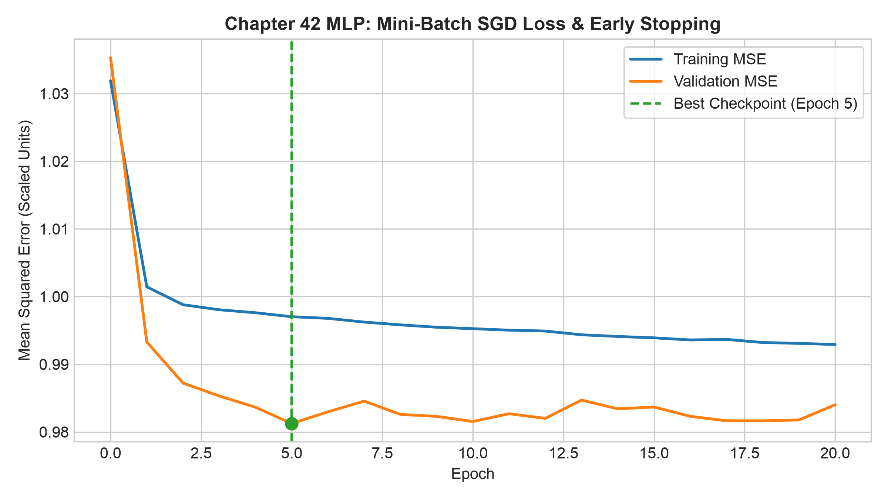
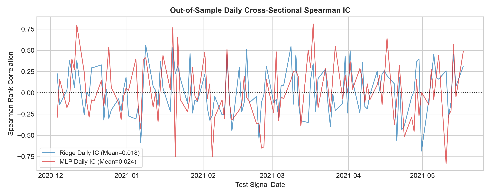

# 第42章 深度学习基础与量化应用 (Deep Learning Foundations & Quantitative Applications)

> 本章沿用冻结的构造结果，未重新训练。主线：网络架构的本质是函数空间的结构归纳偏置（Structural Inductive Bias），在金融低信噪比与时间序列环境中，增加参数量不会自动带来交易优势，严格的时间边界净化（Boundary Purging）与明确费用假设的交易账本是评估复杂深度模型有效性的核心准则。
> 先修：第4章 链式法则、第5章 矩阵维度、第8章 / 第39章 岭回归、第29章 撮合账本、第31章 / 第38章 时间因果验证、第40章 早停机制。完成后你能：手算并以纯 NumPy 实现多层感知机（MLP）前向与反向传播；实现 CNN 局部互相关、RNN 状态递推与梯度积、现代 LSTM 恒定误差回路与 Transformer 严格因果掩码；检查特征、标签与预处理的时间边界后执行模型对比，并评估构造信号在假设费用下的表现。

---

## 1. 本章目标

完成本章学习后，读者应能够：
1. **计算（Compute）**：
   - 给定输入向量与权重矩阵，以矩阵代数手算多层感知机（Multi-Layer Perceptron, MLP）前向传播输出与中间激活值；
   - 依据多变量微积分链式法则（Chain Rule），逐层推导均方误差加 $L_2$ 正则化损失函数对全层权重与偏置的解析梯度，并运用中心差分（Central Difference）进行数值梯度核对；
   - 独立计算一维卷积神经网络（1D CNN）的有效互相关（Valid Cross-Correlation）、简单循环神经网络（Simple RNN）的状态递推与跨时序梯度衰减乘积、现代长短期记忆网络（LSTM with Forget Gate）单步门、候选及状态更新及恒定误差回路（Constant Error Carousel, CEC）直接偏导，以及 Transformer 正弦位置编码（Positional Encoding）、缩放点积注意力（Scaled Dot-Product Attention）与严格因果掩码（Causal Mask）。
2. **解释（Explain）**：
   - 阐明不同深度学习架构所蕴含的“结构归纳偏置”（Structural Inductive Bias）及其对假说空间的几何约束；
   - 阐释金融资产定价数据“低信噪比”（Low Signal-to-Noise Ratio, SNR）、“小有效独立样本量”对高自由度深度神经网络构成的统计制约，基于固定输入在训练集分布上的偏差—方差分解（Bias-Variance Decomposition）分析过拟合机理；
   - 剖析注意力机制中的因果掩码只能阻断层内注意力前瞻，无法修复底层输入特征中包含的标签泄漏或信息前瞻。
3. **诊断（Diagnose）**：
   - 识别深度模型在训练中的过拟合、梯度消失（Vanishing Gradients）与数值溢出现象；
   - 诊断早停机制（Early Stopping）中的测试集污染陷阱，确保最佳轮次权重恢复（Best Epoch Restoration）严格基于独立验证集；
   - 检查特征标准化中的前瞻泄漏（Lookahead Leakage），保证均值与方差仅使用成熟训练集数据计算。
4. **实现（Implement）**：
   - 编写纯 NumPy 实现的轻量级 MLP 训练器与预测器，支持小批量随机梯度下降（Mini-batch SGD）、权重衰减与验证集早停；
   - 构建遵循严格因果时间契约的面板数据流水线，实施基于结算时点的边界标签净化（Boundary Purging）；
   - 对接标准的量化撮合账本，在考虑交易成本（单边 0 与 10 bps）与执行滞后的条件下评估毛/净投资组合绩效。

---

## 2. 为什么 Quant 需要它

在现代量化投资与量化研究的生命周期中，研究员往往面临从传统线性因子模型（如 Fama-French 多因子或弹性网络回归）向复杂非线性模型迁移的探索需求。然而，在量化金融语境下，直接套用计算机视觉（CV）或自然语言处理（NLP）领域的深度学习范式常常面临严峻挑战：

1. **结构归纳偏置与过拟合困境**：全连接神经网络（MLP）作为通用函数逼近器（Universal Approximator），具有极高的函数表达能力。然而在金融截面预测中，单期收益的信噪比通常处于较低水平（大量收益波动来自于无法预测的市场微观扰动或特异性冲击）。若直接在有限的历史数据上使用数十甚至成百上千个参数拟合，网络容易将样本内的随机噪声误识别为规律，导致测试集 $R^2$ 走低甚至落入负区间。
2. **特定架构的先验结构约束**：为了遏制自由度的过度膨胀，现代深度学习引入了特定结构的归纳偏置：
   - **CNN** 通过局部连接（Local Connectivity）与权重共享（Weight Sharing），强加了“局部时序模式平移等变性（Translation Equivariance）”的先验；
   - **RNN/LSTM** 通过自回归状态转移与门控机制，强加了“马尔可夫式隐状态演化与可控记忆衰减”的先验；
   - **Transformer** 则通过自注意力机制突破了时序距离限制，并通过严格因果掩码避免未来信息向历史渗透。
   量化研究员必须深刻理解这些架构为何被提出、它们分别做出了怎样的结构假设，以及这些假设在金融时间序列中的适用条件。
3. **严格时间契约与伪超额收益陷阱**：深度学习模型训练容易在不经意间引入前瞻泄漏。例如，在多步收益标签预测中未净化边界样本、全样本标准化、或者误以为 Transformer 的因果注意力掩码能够自动纠正输入特征中的未来信息。此外，高复杂度的深度模型往往产生剧烈波动的截面预测，引发极高的调仓换手率。未扣费前的毛夏普比率（Gross Sharpe），在真实撮合账本与交易摩擦磨损下可能发生显著衰减。

本章用数学推导与纯 NumPy 实现解释主要算子，再在固定时间分割的构造低信噪比实验中比较均值、Ridge 与小型 MLP。结果说明该实验的预测与费用权衡，不能外推为真实市场表现。

---

## 3. 直觉

### 3.1 线性模型 vs 神经网络：折线纸与多维橡皮泥
线性模型（如 OLS 或 Ridge）好比一把坚硬的木尺：它只能在特征与收益之间拟合出一条平直的截面切线。若真实的经济机制包含非线性阈值效应（例如：当波动率极低时动量特征显著，而当波动率超过临界值时动量特征急剧衰减），线性木尺将无法刻画这种非线性弯折。

多层感知机（MLP）则像是一团多维橡皮泥。隐藏层的每一个神经元都代表一个带偏置的仿射变换，紧接着经过非线性激活函数（如双曲正切 $\tanh$ 或修正线性单元 ReLU）的弯折。各层之间的复合映射，使得网络能够通过折叠将特征空间划分为复杂的非线性决策流形。然而，橡皮泥越柔软，它被水面随机微波（噪声）带偏的风险就越大。在低信噪比环境下，我们需要通过权重衰减（$L_2$ 正则化）与早停机制给橡皮泥注入“刚性”，防止其过度拟合样本内噪声。

### 3.2 为什么需要专门的结构：CNN、RNN 与 Transformer 的直觉
若要捕捉资产价格的时间序列特征，直接把过去 $T$ 天的价格展平成一个向量输入全连接网络（MLP）存在显著不足：
1. **参数膨胀且忽视时序邻近性**：全连接网络将第 $t-1$ 天与第 $t$ 天的关联，和第 $t-100$ 天与第 $t$ 天的关联赋予了同等的自由度，忽略了时间序列的局部平移相关性。**CNN** 的直觉是使用一个固定尺寸的小窗口（卷积核）在时间轴上滑动，专注于提取“短周期动量”、“差分反转”等局部模式，且在所有历史时刻复用同一组核权重。
2. **长程历史的记忆与遗忘**：金融状态（如波动率体制）往往具有时变依赖性。**RNN** 的直觉是设立一个“记忆载体”（隐状态 $h_t$），每来一天新数据，就将旧记忆与新输入混合更新。然而标准 RNN 的状态雅可比矩阵乘法会导致梯度在反向传播中呈指数级衰减或爆炸。**LSTM** 的直觉是引入由门控调节的加法通道——“恒定误差回路”（CEC），使得重要信息可以在遗忘门打开时跨越较长时隙传递。
3. **全局视野与因果屏蔽**：LSTM 虽然缓解了梯度消失，但其按时序逐步递推的计算模式限制了对长程跨时段相互依赖的直接关联。**Transformer** 的直觉是抛弃循环，直接计算任意两天之间的关联度（Query-Key 点积相似度）。但量化预测有着严格的时间约束——**今天不能读取明天的信息**。因此，在本章每个历史位置均需于该位置当时作预测的任务中，Transformer 要在注意力矩阵的上三角施加严格因果掩码（$\mathbf{M}_{i,j} = -\infty$ 当 $j > i$），确保各位置仅能关注当时及过去。若整个输入窗口均在同一预测截止前已可得，且只用末端表征预测截止后的目标，窗口内双向编码并不自动泄漏；仍须核输入可用时点、训练/标签及预处理边界。

---

## 4. 数学基础

### 4.1 符号与张量维度契约
在深入网络推导之前，必须严格明确各数学符号及其张量维度。设批次样本容量为 $B$：
- 输入特征矩阵 $\mathbf{X} \in \mathbb{R}^{B \times D_{\mathrm{in}}}$：每行为一个样本（资产在特定日期的特征向量），每列对应一个输入特征；
- 目标标签矩阵 $\mathbf{Y} \in \mathbb{R}^{B \times D_{\mathrm{out}}}$：在单目标收益率预测中，$D_{\mathrm{out}} = 1$；
- 第一层权重矩阵 $\mathbf{W}_1 \in \mathbb{R}^{D_{\mathrm{in}} \times D_{\mathrm{hidden}}}$，偏置行向量 $\mathbf{b}_1 \in \mathbb{R}^{1 \times D_{\mathrm{hidden}}}$；
- 隐藏层净输入 $\mathbf{Z}_1 \in \mathbb{R}^{B \times D_{\mathrm{hidden}}}$，激活输出 $\mathbf{A}_1 \in \mathbb{R}^{B \times D_{\mathrm{hidden}}}$；
- 第二层权重矩阵 $\mathbf{W}_2 \in \mathbb{R}^{D_{\mathrm{hidden}} \times D_{\mathrm{out}}}$，偏置行向量 $\mathbf{b}_2 \in \mathbb{R}^{1 \times D_{\mathrm{out}}}$；
- 网络最终输出预测值 $\hat{\mathbf{Y}} \in \mathbb{R}^{B \times D_{\mathrm{out}}}$。

### 4.2 矩阵微分与逐元素运算
1. **Hadamard 积（逐元素乘积）**：记作 $\odot$。若 $\mathbf{A}, \mathbf{B} \in \mathbb{R}^{M \times N}$，则 $(\mathbf{A} \odot \mathbf{B})_{i,j} = A_{i,j} B_{i,j}$。
2. **Frobenius 范数**：矩阵 $\mathbf{W}$ 的 Frobenius 范数平方定义为各元素平方和：$\|\mathbf{W}\|_F^2 = \operatorname{tr}(\mathbf{W}^\top \mathbf{W}) = \sum_{i,j} W_{i,j}^2$。
3. **双曲正切函数及其导数**：
   $$\tanh(z) = \frac{e^z - e^{-z}}{e^z + e^{-z}} = \frac{1 - e^{-2z}}{1 + e^{-2z}}$$
   其一阶导数满足解析恒等式：
   $$\frac{d \tanh(z)}{dz} = 1 - \tanh^2(z)$$
4. **Logistic Sigmoid 函数及其导数**：
   $$\sigma(z) = \frac{1}{1 + e^{-z}}$$
   其一阶导数满足：
   $$\frac{d \sigma(z)}{dz} = \sigma(z)(1 - \sigma(z))$$

---

## 5. 正式定义

### 5.1 多层感知机（Multi-Layer Perceptron, MLP）
定义单隐层回归 MLP 的数学映射 $f: \mathbb{R}^{B \times D_{\mathrm{in}}} \to \mathbb{R}^{B \times D_{\mathrm{out}}}$ 如下：
$$\mathbf{Z}_1 = \mathbf{X}\mathbf{W}_1 + \mathbf{b}_1$$
$$\mathbf{A}_1 = \phi(\mathbf{Z}_1)$$
$$\hat{\mathbf{Y}} = \mathbf{A}_1\mathbf{W}_2 + \mathbf{b}_2$$
其中 $\phi(\cdot)$ 为非线性激活函数（本章采用双曲正切 $\tanh$），偏置向量在矩阵加法中通过广播扩展至每一行。

### 5.2 正则化目标函数（MSE + L2 Regularization）
给定目标标签 $\mathbf{Y}$ 与正则化强度 $\lambda \ge 0$，批次损失函数定义为归一化均方误差（MSE）与全层权重矩阵 Frobenius 范数惩罚之和：
$$\mathcal{L}(\mathbf{W}_1, \mathbf{b}_1, \mathbf{W}_2, \mathbf{b}_2) = \frac{1}{B \cdot D_{\mathrm{out}}} \|\hat{\mathbf{Y}} - \mathbf{Y}\|_F^2 + \lambda \left( \|\mathbf{W}_1\|_F^2 + \|\mathbf{W}_2\|_F^2 \right)$$
*设计说明*：
1. 均方误差项采用 $\frac{1}{B \cdot D_{\mathrm{out}}}$ 归一化，使得多输出维度下的单标量损失尺度保持一致（在单输出 $D_{\mathrm{out}}=1$ 时与 $\frac{1}{B}$ 完全等价）；
2. 本章选择对偏置向量 $\mathbf{b}_1, \mathbf{b}_2$ 不施加 $L_2$ 惩罚，以免直接把基线输出拉向零。这是建模选择，其他任务可对偏置施加惩罚；偏置通过改变激活位置也会影响局部导数。

### 5.3 卷积神经网络一维互相关（CNN 1D Valid Cross-Correlation）
输入为长度 $N$ 的向量 $\mathbf x$，滤波核（filter）为长度 $K$ 的向量 $\mathbf w$，且 $N\ge K$：
$$\mathbf{x}=[x_0,\ldots,x_{N-1}]^\top,\qquad\mathbf{w}=[w_0,\ldots,w_{K-1}]^\top.$$
在有效模式（Valid Mode，无边缘填充）下，一维互相关算子产生长度为 $N - K + 1$ 的特征图输出 $\mathbf{y} = \mathbf{x} \star \mathbf{w}$：
$$y_i = (\mathbf{x} \star \mathbf{w})_i = \sum_{j=0}^{K-1} x_{i+j} w_j, \quad \forall i \in \{0, 1, \dots, N - K\}$$
*平移等变性（Translation Equivariance）*：
若对输入序列施加时移操作 $T_{\tau}(\mathbf{x})_t = x_{t-\tau}$，互相关运算满足 $(T_{\tau}(\mathbf{x}) \star \mathbf{w})_i = (\mathbf{x} \star \mathbf{w})_{i-\tau}$，即操作与平移可交换：$f(g(x)) = g(f(x))$。卷积操作自身提供的是**平移等变性**而非平移不变性；上述等变关系在无限序列或边界一致的定义下成立；有限 valid 窗口只在共同有效位置成立，步长与填充也会影响结果。全局池化可在平移仅重新排列同一特征集合时产生不变性，裁剪或边缘变化后仍需重新检查。

### 5.4 循环神经网络与现代长短期记忆网络（RNN & Modern LSTM）
1. **简单循环神经网络（Simple RNN）**：
   $$h_t = \tanh(w_h h_{t-1} + w_x x_t + b)$$
2. **现代带遗忘门长短期记忆网络（Modern LSTM with Forget Gate, Gers et al. 2000）**：
   对于时点 $t$ 的输入 $x_t \in \mathbb{R}^{D_{\mathrm{in}}}$ 与上一时刻隐状态 $h_{t-1} \in \mathbb{R}^{D_h}$、细胞状态 $c_{t-1} \in \mathbb{R}^{D_h}$：
   $$\mathbf{f}_t = \sigma(\mathbf{W}_f x_t + \mathbf{U}_f h_{t-1} + \mathbf{b}_f) \quad \text{（遗忘门，Forget Gate）}$$
   $$\mathbf{i}_t = \sigma(\mathbf{W}_i x_t + \mathbf{U}_i h_{t-1} + \mathbf{b}_i) \quad \text{（输入门，Input Gate）}$$
   $$\tilde{\mathbf{c}}_t = \tanh(\mathbf{W}_c x_t + \mathbf{U}_c h_{t-1} + \mathbf{b}_c) \quad \text{（候选细胞状态，Candidate Cell）}$$
   $$\mathbf{c}_t = \mathbf{f}_t \odot \mathbf{c}_{t-1} + \mathbf{i}_t \odot \tilde{\mathbf{c}}_t \quad \text{（细胞状态更新，Cell State Update）}$$
   $$\mathbf{o}_t = \sigma(\mathbf{W}_o x_t + \mathbf{U}_o h_{t-1} + \mathbf{b}_o) \quad \text{（输出门，Output Gate）}$$
   $$\mathbf{h}_t = \mathbf{o}_t \odot \tanh(\mathbf{c}_t) \quad \text{（隐藏状态输出，Hidden State）}$$

正文LSTM采用列向量：$\mathbf W_g\in\mathbb R^{D_h\times D_{\mathrm{in}}}$、$\mathbf U_g\in\mathbb R^{D_h\times D_h}$。代码采用批次行向量 $x@W_g+h@U_g$，因此代码权重为这里数学权重的转置；标量微例二者一致。具体六式以PyTorch官方现代LSTM方程为准，Gers原文只用于遗忘门历史归属。

### 5.5 Transformer 正弦位置编码与严格因果注意力（PE & Causal Attention）
本节三角掩码针对逐位置实时预测；同一截止前全已知窗口的末端预测任务可采用不同编码结构，仍须满足该任务的信息集。
1. **正弦位置编码（Sinusoidal Positional Encoding, Vaswani et al. 2017）**：
   对于位置 $pos \in \{0, 1, \dots, T-1\}$ 与维度通道 $2i, 2i+1 \in \{0, 1, \dots, d-1\}$：
   $$\mathrm{PE}_{(pos, 2i)} = \sin\left( \frac{pos}{10000^{2i/d}} \right)$$
   $$\mathrm{PE}_{(pos, 2i+1)} = \cos\left( \frac{pos}{10000^{2i/d}} \right)$$
2. **因果缩放点积注意力（Causal Scaled Dot-Product Attention）**：
   设序列长度为 $T$，特征投影矩阵为 $\mathbf{Q}, \mathbf{K} \in \mathbb{R}^{T \times d_k}$，$\mathbf{V} \in \mathbb{R}^{T \times d_v}$（要求 $d_k > 0, d_v > 0, T > 0$）。
   注意力输出计算公式为：
   $$\mathrm{Attention}(\mathbf{Q}, \mathbf{K}, \mathbf{V}) = \operatorname{softmax}\left( \frac{\mathbf{Q}\mathbf{K}^\top}{\sqrt{d_k}} + \mathbf{M} \right) \mathbf{V}$$
   其中因果掩码矩阵 $\mathbf{M} \in \mathbb{R}^{T \times T}$ 定义为：
   $$\mathbf{M}_{i,j} = \begin{cases} 0, & j \le i \\ -\infty, & j > i \end{cases}$$
   上三角被严格置为 $-\infty$，确保 $\operatorname{softmax}$ 归一化后上三角注意力权重在数值上严格等于零。

---

## 6. 推导

### 6.1 MLP 反向传播梯度的全矩阵链式法则推导
本节给出从标量损失 $\mathcal{L}$ 对各参数求偏导的完整、不跳步推导过程。

**第一步：求损失对最终预测值 $\hat{\mathbf{Y}}$ 的导数**
损失函数展开为：
$$\mathcal{L} = \frac{1}{B \cdot D_{\mathrm{out}}} \sum_{i=1}^B \sum_{k=1}^{D_{\mathrm{out}}} (\hat{Y}_{i,k} - Y_{i,k})^2 + \lambda \left( \|\mathbf{W}_1\|_F^2 + \|\mathbf{W}_2\|_F^2 \right)$$
对矩阵元 $\hat{Y}_{i,k}$ 求偏导：
$$\frac{\partial \mathcal{L}}{\partial \hat{Y}_{i,k}} = \frac{2}{B \cdot D_{\mathrm{out}}} (\hat{Y}_{i,k} - Y_{i,k})$$
写为矩阵形式，记作输出误差项 $\boldsymbol{\delta}_2 \in \mathbb{R}^{B \times D_{\mathrm{out}}}$：
$$\boldsymbol{\delta}_2 = \frac{\partial \mathcal{L}}{\partial \hat{\mathbf{Y}}} = \frac{2}{B \cdot D_{\mathrm{out}}} (\hat{\mathbf{Y}} - \mathbf{Y})$$

**第二步：求损失对第二层参数 $\mathbf{W}_2$ 与 $\mathbf{b}_2$ 的导数**
根据复合函数链式法则，注意 $\hat{\mathbf{Y}} = \mathbf{A}_1 \mathbf{W}_2 + \mathbf{b}_2$。
对于权重矩阵中的元素 $W_{2, j, k}$：
$$\frac{\partial \mathcal{L}}{\partial W_{2, j, k}} = \sum_{i=1}^B \frac{\partial \mathcal{L}}{\partial \hat{Y}_{i,k}} \frac{\partial \hat{Y}_{i,k}}{\partial W_{2, j, k}} + 2\lambda W_{2, j, k} = \sum_{i=1}^B A_{1, i, j} \delta_{2, i, k} + 2\lambda W_{2, j, k}$$
右端求和项正是矩阵转置乘积 $(\mathbf{A}_1^\top \boldsymbol{\delta}_2)_{j,k}$。因此全矩阵梯度为：
$$\frac{\partial \mathcal{L}}{\partial \mathbf{W}_2} = \mathbf{A}_1^\top \boldsymbol{\delta}_2 + 2\lambda \mathbf{W}_2 \in \mathbb{R}^{D_{\mathrm{hidden}} \times D_{\mathrm{out}}}$$
对于偏置项 $\mathbf{b}_2 \in \mathbb{R}^{1 \times D_{\mathrm{out}}}$，每个样本的偏置导数均为 1：
$$\frac{\partial \mathcal{L}}{\partial b_{2, k}} = \sum_{i=1}^B \delta_{2, i, k} \implies \frac{\partial \mathcal{L}}{\partial \mathbf{b}_2} = \mathbf{1}_{1 \times B} \boldsymbol{\delta}_2 \in \mathbb{R}^{1 \times D_{\mathrm{out}}}$$

**第三步：将误差反向传播至隐藏层激活值 $\mathbf{A}_1$**
对隐藏层激活值矩阵元素 $A_{1, i, j}$ 求导：
$$\frac{\partial \mathcal{L}}{\partial A_{1, i, j}} = \sum_{k=1}^{D_{\mathrm{out}}} \frac{\partial \mathcal{L}}{\partial \hat{Y}_{i,k}} \frac{\partial \hat{Y}_{i,k}}{\partial A_{1, i, j}} = \sum_{k=1}^{D_{\mathrm{out}}} \delta_{2, i, k} W_{2, j, k}$$
右侧求和对应于矩阵乘积 $(\boldsymbol{\delta}_2 \mathbf{W}_2^\top)_{i,j}$。故全矩阵形式为：
$$\frac{\partial \mathcal{L}}{\partial \mathbf{A}_1} = \boldsymbol{\delta}_2 \mathbf{W}_2^\top \in \mathbb{R}^{B \times D_{\mathrm{hidden}}}$$

**第四步：求损失对隐藏层净输入 $\mathbf{Z}_1$ 的导数**
由于激活函数为逐元素作用的 $\mathbf{A}_1 = \tanh(\mathbf{Z}_1)$，应用单变量导数恒等式 $\tanh'(z) = 1 - \tanh^2(z)$：
$$\frac{\partial \mathcal{L}}{\partial Z_{1, i, j}} = \frac{\partial \mathcal{L}}{\partial A_{1, i, j}} \cdot \tanh'(Z_{1, i, j}) = (\boldsymbol{\delta}_2 \mathbf{W}_2^\top)_{i, j} \cdot (1 - A_{1, i, j}^2)$$
写为 Hadamard 积形式，记隐藏层局部误差为 $\boldsymbol{\delta}_1 \in \mathbb{R}^{B \times D_{\mathrm{hidden}}}$：
$$\boldsymbol{\delta}_1 = \frac{\partial \mathcal{L}}{\partial \mathbf{Z}_1} = (\boldsymbol{\delta}_2 \mathbf{W}_2^\top) \odot (1 - \mathbf{A}_1^2)$$

**第五步：求损失对第一层参数 $\mathbf{W}_1$ 与 $\mathbf{b}_1$ 的导数**
已知 $\mathbf{Z}_1 = \mathbf{X}\mathbf{W}_1 + \mathbf{b}_1$，与第二步推导完全同理：
$$\frac{\partial \mathcal{L}}{\partial W_{1, m, j}} = \sum_{i=1}^B X_{i, m} \delta_{1, i, j} + 2\lambda W_{1, m, j} \implies \frac{\partial \mathcal{L}}{\partial \mathbf{W}_1} = \mathbf{X}^\top \boldsymbol{\delta}_1 + 2\lambda \mathbf{W}_1 \in \mathbb{R}^{D_{\mathrm{in}} \times D_{\mathrm{hidden}}}$$
$$\frac{\partial \mathcal{L}}{\partial \mathbf{b}_1} = \mathbf{1}_{1 \times B} \boldsymbol{\delta}_1 \in \mathbb{R}^{1 \times D_{\mathrm{hidden}}}$$

**第六步：普通 SGD 下 L2 正则化与权重衰减的等价性**
在标准 SGD 优化器下，权重更新方程为：
$$\mathbf{W}^{(t+1)} = \mathbf{W}^{(t)} - \eta \frac{\partial \mathcal{L}}{\partial \mathbf{W}} = \mathbf{W}^{(t)} - \eta \left( \nabla_{\mathbf{W}} \mathcal{L}_{\mathrm{MSE}} + 2\lambda \mathbf{W}^{(t)} \right) = (1 - 2\eta\lambda)\mathbf{W}^{(t)} - \eta \nabla_{\mathbf{W}} \mathcal{L}_{\mathrm{MSE}}$$
其中因子 $(1 - 2\eta\lambda)$ 实现参数模长的缩减。代数等价式本身不需要该不等式；若要求衰减因子为正且小于1，则需 $0 < 2\eta\lambda < 1$。注意：该严格等价性仅对普通 SGD 成立；在带动量（Momentum）或自适应学习率（Adam）的优化器中，$L_2$ 正则化导数会被梯度历史平滑扭曲，从而与解耦权重衰减（AdamW）产生显著差异。

---

### 6.2 Simple RNN 状态递推与梯度积衰减
考虑标量 Simple RNN 状态方程：$h_t = \phi(w_h h_{t-1} + w_x x_t + b)$。
时刻 $T$ 的损失对更早时刻隐状态 $h_{T-k}$ 的偏导数为：
$$\frac{\partial \mathcal{L}_T}{\partial h_{T-k}} = \frac{\partial \mathcal{L}_T}{\partial h_T} \prod_{j=T-k+1}^T \frac{\partial h_j}{\partial h_{j-1}}$$
其中单步雅可比为：
$$\frac{\partial h_j}{\partial h_{j-1}} = w_h \cdot \phi'(w_h h_{j-1} + w_x x_j + b)$$
若取线性激活 $\phi(z) = z$，则 $\frac{\partial h_j}{\partial h_{j-1}} = w_h$，梯度的传递因子退化为几何级数：
$$\frac{\partial h_T}{\partial h_{T-k}} = (w_h)^k$$
- 若 $|w_h| < 1$（如 $w_h = 0.5$），跨越 $k=10$ 步时，衰减因子为 $0.5^{10} \approx 9.76 \times 10^{-4}$，早期输入信息在反向传播中梯度趋近于 0（梯度消失）；
- 若 $|w_h| > 1$，乘积项将呈指数增长，容易发生梯度爆炸。

---

### 6.3 现代 LSTM 的恒定误差回路（CEC）偏导推导
考查现代 LSTM 细胞状态转移方程：
$$c_t = f_t \odot c_{t-1} + i_t \odot \tilde{c}_t$$
固定门控与候选状态，分析沿细胞记忆直接线性通路的偏导数。向量状态的雅可比矩阵（Jacobian matrix） 为对角矩阵：
$$\left. \frac{\partial \mathbf c_t}{\partial \mathbf c_{t-1}} \right|_{\text{fixed gates}} = \operatorname{diag}(\mathbf f_t).$$
第 $r$ 个坐标的直接偏导为 $f_{t,r}$；跨越 $k$ 步的直接雅可比矩阵 为
$$\left. \frac{\partial \mathbf c_T}{\partial \mathbf c_{T-k}} \right|_{\text{fixed gates}} = \operatorname{diag}\left(\bigodot_{j=T-k+1}^T\mathbf f_j\right).$$
标量情形才简写为 $\partial c_t/\partial c_{t-1}=f_t$，多步为 $\prod_{j=T-k+1}^T f_j$。
若遗忘门饱和在开放状态（$f_j \approx 1$），则误差可以沿加法通道跨越较长时序传递，这被称为**恒定误差回路（CEC）**。
*边界说明*：全导数还包含经过 $h_{t-1}$ 的门依赖非线性路径（$\frac{\partial f_t}{\partial h_{t-1}}, \frac{\partial i_t}{\partial h_{t-1}}$ 等）。当网络层数较深或遗忘门未饱和时，梯度衰减或震荡依然存在，不能断言 LSTM“彻底消除了所有梯度问题”。

---

### 6.4 批次、一次优化步与早停的完整流程
一个样本是某信号日某资产的一行特征与成熟标签；小批次（mini-batch）是当前梯度步选取的若干训练行。一次轮次（epoch）遍历所有训练行。本例2136行以32行为一批，每轮67次更新，最后一批24行，损失仍除以该批实际行数。只在178个成熟训练日期内重排，不跨到验证或测试；这种计算安排不意味着真实金融样本独立。

设参数集合为 $\theta=(W_1,b_1,W_2,b_2)$，批次 $\mathcal B$ 的平均数据损失为 $L_{\mathcal B}$。每步先前向计算，再按§6.1计算全参数梯度，执行 $\theta\leftarrow\theta-\eta\nabla_\theta(L_{\mathcal B}+\lambda\sum W^2)$；惩罚只对权重计算。全批次梯度下降用全部训练行，随机梯度下降（SGD）常指单行或小批次估计；小批次的噪声、计算开销与稳定性须一起考虑，不能将训练损失下降当作未来预测改善。

例如§8.1取学习率 $\eta=0.01$：$W_{1,00}$ 从0.2更新到 $0.2-0.01(0.019587)=0.19980413$；$b_2$ 从0.05更新到 $0.05-0.01(0.063251)=0.04936749$。该手算用 $\lambda=0.01$，主实验仍冻结为0.001，不混用。

```text
初始化权重；best_loss=+∞；bad_epochs=0；best_weights尚未设置
对 epoch=0,...,199：
    仅重排训练行，分批计算MSE+L2梯度并更新全部参数
    计算完整验证集的无惩罚MSE，拒绝非有限结果
    若 val_mse < best_loss：复制全部权重与偏置，更新best_epoch，bad_epochs=0
    否则 bad_epochs+=1；若 bad_epochs>=15则停止
返回复制的best_weights，而非停止时的当前参数
在模型选择完成后，才用测试特征预测并按原收益单位评估
```

主实验的编号从0起：best_epoch=5对应第6次遍历，stopped_epoch=20对应实际完成21轮。早停按“连续15轮无新最低值”计数，不要求每一轮验证误差严格递增；验证误差波动也可触发停止。训练API只接收训练与验证数组，仍由调用者保证没有把测试数组冒名传入；参数名不能证明整个研究无泄漏。

---

## 7. 金融解释

### 7.1 为什么金融时序的信噪比制约模型复杂度
在计算机视觉或语音识别中，输入信号包含丰富的局部冗余特征与高信噪比。然而在二级市场资产定价中：
1. **信噪比特征**：研究者应检验可预测信号相对噪声是否足够强。本章专门构造弱信号与较大噪声的情形，不能据此给所有市场或频率规定统一信噪比。
2. **有效独立样本量限制**：尽管高频逐笔数据记录密集，但在日频或周频截面预测场景下，一年仅约 250 个交易日。十年历史也仅有约 2500 个宏观截面。对于参数量较大的非线性网络，其参数空间容易将样本内噪声当做信号。
3. **偏差—方差权衡（Bias-Variance Tradeoff）**：
   在固定输入 $x$ 下，对训练集分布 $\mathcal{D}$ 取期望的泛化误差分解为：
   $$\mathbb{E}_{\mathcal{D},\epsilon}[(\hat{y}(x) - y)^2] = \operatorname{Bias}^2(\hat{y}(x)) + \operatorname{Var}_{\mathcal{D}}(\hat{y}(x)) + \sigma_{\epsilon}^2$$
   令 $y=f_*(x)+\epsilon$，新观测噪声与训练集独立、条件均值为0、条件方差为 $\sigma_\epsilon^2(x)$。左侧应同时对训练集和新观测噪声取期望；将 $\hat y-f_*$ 写成 $\hat y-\mathbb{E}_{\mathcal D}[\hat y]+\mathbb{E}_{\mathcal D}[\hat y]-f_*$，交叉项期望为0即得该分解。增加容量可能降低逼近偏差，也可能改变估计方差；参数量与方差并无普遍单调定理，正则化、训练算法及数据分布都影响结果。

### 7.2 交易摩擦对高换手信号的实际损耗
非线性模型对输入微小扰动较为敏感，日频预测值在资产截面上的排序可能频繁变动：
- 频繁变动会导致高调仓频率。若年化换手率达到 350+ 倍；
- 在单边交易成本为 10 bps（0.001）的设定下，年化成本规模约为：
  $$\text{Annual Fee Drag} \approx \text{Turnover} \times \text{Fee Rate} \approx 360 \times 0.001 = 36.0\%$$
- 这一成本磨损会将原本未扣费的毛超额收益显著侵蚀，导致净夏普比率转为深度负值。实际投资中，必须基于逐日撮合账本（Ledger）追踪资金动态演化，而不能使用静态线性扣除代替实际净收益。

---

## 8. Numerical Example

本节给出可纯手工复算的微算例，覆盖 MLP 前向与反向、CNN 互相关、RNN 状态递推、LSTM 单步门控、正弦位置编码与 Transformer 因果注意力。

### 8.1 2→2→1 MLP 手算前向传播与反向传播
取输入特征向量 $x = [0.5, -0.2]$，真实目标 $y = [0.1]$（单样本 $B=1, D_{\mathrm{out}}=1$）。
设定网络超参数：
$$\mathbf{W}_1 = \begin{pmatrix} 0.2 & -0.1 \\ 0.4 & 0.3 \end{pmatrix}, \quad \mathbf{b}_1 = [0.1, 0.0]$$
$$\mathbf{W}_2 = \begin{pmatrix} 0.5 \\ -0.2 \end{pmatrix}, \quad \mathbf{b}_2 = [0.05], \quad \lambda = 0.01$$

**步骤 1：前向传播**
1. 隐藏层净输入：
   $$\mathbf{z}_1 = x \mathbf{W}_1 + \mathbf{b}_1 = [0.5(0.2) + (-0.2)(0.4) + 0.1, \; 0.5(-0.1) + (-0.2)(0.3) + 0.0] = [0.12, -0.11]$$
2. 激活值（双曲正切）：
   $$a_{1, 1} = \tanh(0.12) \approx 0.119427, \quad a_{1, 2} = \tanh(-0.11) \approx -0.109559$$
3. 输出层计算：
   $$\hat{y} = a_{1, 1}(0.5) + a_{1, 2}(-0.2) + 0.05 = 0.119427(0.5) + (-0.109559)(-0.2) + 0.05 \approx 0.131625$$
4. 损失计算：
   $$\operatorname{MSE} = \frac{1}{1 \times 1} (\hat{y} - y)^2 = (0.131625 - 0.1)^2 = (0.031625)^2 \approx 0.00100014$$
   $$L_2 \text{ 惩罚} = 0.01 \times \left( (0.2^2 + (-0.1)^2 + 0.4^2 + 0.3^2) + (0.5^2 + (-0.2)^2) \right) = 0.01 \times (0.30 + 0.29) = 0.0059$$
   $$\mathcal{L} \approx 0.00100014 + 0.005900 = 0.00690014$$

**步骤 2：反向传播梯度**
1. 输出误差：$\delta_2 = \frac{2}{1 \times 1} (\hat{y} - y) = 2 \times 0.031625 = 0.063251$。
2. 第二层梯度：
   $$\frac{\partial \mathcal{L}}{\partial \mathbf{W}_2} = \mathbf{a}_1^\top \delta_2 + 2\lambda \mathbf{W}_2 = \begin{pmatrix} 0.119427 \\ -0.109559 \end{pmatrix} (0.063251) + 0.02 \begin{pmatrix} 0.5 \\ -0.2 \end{pmatrix} = \begin{pmatrix} 0.017554 \\ -0.010930 \end{pmatrix}$$
   $$\frac{\partial \mathcal{L}}{\partial b_2} = \delta_2 = 0.063251$$
3. 隐藏层局部误差：
   $$\boldsymbol{\delta}_1 = (\delta_2 \mathbf{W}_2^\top) \odot (1 - \mathbf{a}_1^2) = [0.063251 \times 0.5, \; 0.063251 \times (-0.2)] \odot [1 - 0.119427^2, \; 1 - (-0.109559)^2]$$
   $$= [0.031625, -0.012650] \odot [0.985737, 0.987997] = [0.031174, -0.012498]$$
4. 第一层梯度：
   $$\frac{\partial \mathcal{L}}{\partial \mathbf{W}_1} = x^\top \boldsymbol{\delta}_1 + 2\lambda \mathbf{W}_1 = \begin{pmatrix} 0.5 \\ -0.2 \end{pmatrix} \begin{pmatrix} 0.031174 & -0.012498 \end{pmatrix} + 0.02 \begin{pmatrix} 0.2 & -0.1 \\ 0.4 & 0.3 \end{pmatrix}$$
   $$= \begin{pmatrix} 0.019587 & -0.008249 \\ 0.001765 & 0.008500 \end{pmatrix}$$
   $$\frac{\partial \mathcal{L}}{\partial \mathbf{b}_1} = \boldsymbol{\delta}_1 = [0.031174, -0.012498]$$

经由 `tests/test_deep_learning.py` 中中心差分数值检验核对，解析导数与数值导数在 $10^{-10}$ 精度下完全吻合。

---

### 8.2 CNN 一维有效互相关手算
输入序列 $x = [1, 2, 3, 4]$，滤波器核 $w = [1, -1]$（长度 $K=2$）。
- $i=0$：$x[0]w[0] + x[1]w[1] = 1(1) + 2(-1) = -1$；
- $i=1$：$x[1]w[0] + x[2]w[1] = 2(1) + 3(-1) = -1$；
- $i=2$：$x[2]w[0] + x[3]w[1] = 3(1) + 4(-1) = -1$。
输出特征图严格为 $[-1, -1, -1]$。该运算提取前一项减后一项的局部差分；本例不涉及学习卷积核。

---

### 8.3 Simple RNN 状态递推手算
设定标量 Simple RNN 参数：$w_h = 0.5, w_x = 1.0, b = 0.0$，初始隐状态 $h_{-1} = 0.0$。
输入时序序列 $x = [1.0, 2.0, 0.0]$（$t=0, 1, 2$），激活函数取恒等映射 $\phi(z) = z$：
- $t=0$：$h_0 = 0.5(0.0) + 1.0(1.0) + 0.0 = 1.0$；
- $t=1$：$h_1 = 0.5(1.0) + 1.0(2.0) + 0.0 = 2.5$；
- $t=2$：$h_2 = 0.5(2.5) + 1.0(0.0) + 0.0 = 1.25$。
状态序列输出为 $[1.0, 2.5, 1.25]$。
跨越 $k=3$ 步的梯度传递因子为 $\frac{\partial h_2}{\partial h_{-1}} = (w_h)^3 = (0.5)^3 = 0.125$。

---

### 8.4 现代 LSTM 单步门控微算例手算
设定维度为 1 的标量单步 LSTM：
输入 $x_t = 0.5$，上一时刻隐藏状态 $h_{t-1} = 0.1$，上一时刻细胞状态 $c_{t-1} = 0.2$。
权重矩阵均设为 $W = 1.0, U = 0.5$，偏置均设为 $b = 0.0$：
1. 线性变换净输入：$z = W x_t + U h_{t-1} + b = 1.0(0.5) + 0.5(0.1) + 0.0 = 0.55$；
2. 遗忘门：$f_t = \sigma(0.55) = \frac{1}{1 + e^{-0.55}} \approx 0.634135$；
3. 输入门：$i_t = \sigma(0.55) \approx 0.634135$；
4. 候选细胞：$\tilde{c}_t = \tanh(0.55) \approx 0.500520$；
5. 细胞状态更新：
   $$c_t = f_t c_{t-1} + i_t \tilde{c}_t = 0.634135(0.2) + 0.634135(0.500520) = 0.126827 + 0.317397 = 0.444224$$
6. 输出门：$o_t = \sigma(0.55) \approx 0.634135$；
7. 隐藏状态输出：
   $$h_t = o_t \tanh(c_t) = 0.634135 \times \tanh(0.444224) = 0.634135 \times 0.417143 \approx 0.264523$$
与 `lstm_step` 核心函数运行结果完全一致。

---

### 8.5 正弦位置编码（PE）手算
设序列长度 $T=3$，维度 $d=4$。
通道尺度：$10000^{0/4} = 1.0$，$10000^{2/4} = 100.0$。
- **$pos = 0$**：
  $\mathrm{PE}_{0, 0} = \sin(0) = 0.0$；$\mathrm{PE}_{0, 1} = \cos(0) = 1.0$；
  $\mathrm{PE}_{0, 2} = \sin(0) = 0.0$；$\mathrm{PE}_{0, 3} = \cos(0) = 1.0$；
  $\implies \mathrm{PE}[0] = [0.0000, 1.0000, 0.0000, 1.0000]$。
- **$pos = 1$**：
  $\mathrm{PE}_{1, 0} = \sin(1.0) \approx 0.8415$；$\mathrm{PE}_{1, 1} = \cos(1.0) \approx 0.5403$；
  $\mathrm{PE}_{1, 2} = \sin(0.01) \approx 0.0100$；$\mathrm{PE}_{1, 3} = \cos(0.01) \approx 0.9999$；
  $\implies \mathrm{PE}[1] \approx [0.8415, 0.5403, 0.0100, 0.9999]$。
- **$pos = 2$**：
  $\mathrm{PE}_{2, 0} = \sin(2.0) \approx 0.9093$；$\mathrm{PE}_{2, 1} = \cos(2.0) \approx -0.4161$；
  $\mathrm{PE}_{2, 2} = \sin(0.02) \approx 0.0200$；$\mathrm{PE}_{2, 3} = \cos(0.02) \approx 0.9998$；
  $\implies \mathrm{PE}[2] \approx [0.9093, -0.4161, 0.0200, 0.9998]$。

---

### 8.6 Transformer 3 词元 Q, K, V 因果注意力与输出 O 手算
设定 $T=3, d_k=2, d_v=2$：
$$\mathbf{Q} = \begin{pmatrix} 1 & 0 \\ 0 & 1 \\ 1 & 1 \end{pmatrix}, \quad \mathbf{K} = \begin{pmatrix} 1 & 1 \\ 1 & 0 \\ 0 & 1 \end{pmatrix}, \quad \mathbf{V} = \begin{pmatrix} 1 & 2 \\ 3 & 4 \\ 5 & 6 \end{pmatrix}$$
1. 点积矩阵 $\mathbf{Q}\mathbf{K}^\top$：
   $$\mathbf{Q}\mathbf{K}^\top = \begin{pmatrix} 1 & 1 & 0 \\ 1 & 0 & 1 \\ 2 & 1 & 1 \end{pmatrix}$$
2. 缩放点积得分（除以 $\sqrt{2} \approx 1.414214$）：
   $$\mathbf{S} = \begin{pmatrix} 0.7071 & 0.7071 & 0.0000 \\ 0.7071 & 0.0000 & 0.7071 \\ 1.4142 & 0.7071 & 0.7071 \end{pmatrix}$$
3. 施加因果掩码（上三角为 $-\infty$）：
   $$\tilde{\mathbf{S}} = \begin{pmatrix} 0.7071 & -\infty & -\infty \\ 0.7071 & 0.0000 & -\infty \\ 1.4142 & 0.7071 & 0.7071 \end{pmatrix}$$
4. 逐行计算 Softmax 权重矩阵 $\mathbf{A}$：
   - 行 0：仅首项未被屏蔽，$\mathbf{A}[0] = [1.0000, 0.0000, 0.0000]$；
   - 行 1：有效项为 $[0.7071, 0.0000]$。以 0.7071 为基准：$\exp(0)=1.0$，$\exp(-0.7071) \approx 0.493069$。分母和为 $1.493069$。
     归一化后，$\mathbf A[1]\approx[0.669761,0.330239,0.000000]$；
   - 行 2：有效项为 $[1.4142, 0.7071, 0.7071]$。以 1.4142 为基准：$\exp(0)=1.0$，$\exp(-0.7071) \approx 0.493069$，$\exp(-0.7071) \approx 0.493069$。分母和为 $1.986138$。
     归一化权重为三个有效项分别除以分母：
     $$\mathbf A[2]\approx[0.503490,0.248255,0.248255].$$
5. 计算最终输出矩阵 $\mathbf{O} = \mathbf{A}\mathbf{V}$：使用未舍入的 A；下列小数系数仅展示近似值，O最后舍入。
   - $\mathbf{O}[0] = 1.0 \times [1, 2] = [1.0000, 2.0000]$；
   - $\mathbf{O}[1] = 0.669761 [1, 2] + 0.330239 [3, 4] = [0.669761 + 0.990717, \; 1.339522 + 1.320956] \approx [1.6605, 2.6605]$；
   - $\mathbf{O}[2] = 0.503490 [1, 2] + 0.248255 [3, 4] + 0.248255 [5, 6] \approx [2.4895, 3.4895]$。
上三角严格为 0，未来键值无法影响历史输出。

---

## 9. Python Implementation

本章的 NumPy 教学实现存放在 `src/quant_course/deep_learning.py` 中。完整训练路径是 MLP：`fit_mlp` 更新两层权重与偏置，按验证集 MSE 早停并恢复最佳检查点，再由 `predict` 对隔离测试集预测。§6.1 的矩阵反向传播与 §6.4 的优化流程在这条路径中衔接。

其余架构用于拆解机制：`cnn_cross_correlation` 是固定核的一维 valid 互相关，不训练卷积核；`rnn_states` 是标量线性递推，对应 §6.2 取恒等激活的梯度积 toy 形式，一般非线性 RNN 还包含激活导数；`lstm_step` 计算单步 cell 的门、细胞状态与隐藏状态，不执行序列训练；Transformer 部分提供正弦位置编码、带掩码的 softmax 和 Q/K/V 因果注意力算子，不包含完整 Transformer 的训练器。§8 的手算检验这些局部运算，不构成各架构的端到端训练比较。

### 9.1 执行命令与运行环境
以下命令从课程源码根目录运行。
- **运行 Python 解释器**：`.venv/bin/python`
- **核心单元测试命令**：
  ```bash
  PYTHONPATH=src .venv/bin/python -m pytest tests/test_deep_learning.py -v
  ```
- **独立 CLI 实验执行命令**：
  ```bash
  .venv/bin/python code/ch42_deep_learning.py --out build/batches/A8-C/reader/runs/ch42_trial_01
  ```
  *防覆盖契约*：若指定的 `--out` 目录已存在，脚本将严格报错拒绝执行（`FileExistsError`），保证历史实验数据不可变。

### 9.2 核心代码接口完全自包含运行示例
```python
import numpy as np
from quant_course.deep_learning import (
    forward,
    loss_and_grad,
    fit_mlp,
    predict,
    generate_ch42_panel_data,
    split_ch42_panel,
)

# 1. 生成面板数据并进行时间边界净化划分
x, raw_return, close, dates, assets = generate_ch42_panel_data(seed=4201)
splits = split_ch42_panel(x, raw_return, dates, assets)

# 2. 仅在训练集上计算特征与标签的均值和标准差
mu_X = np.mean(splits.X_train, axis=0)
sigma_X = np.std(splits.X_train, axis=0)
mu_y = float(np.mean(splits.y_train))
sigma_y = float(np.std(splits.y_train))

X_tr_s = (splits.X_train - mu_X) / sigma_X
y_tr_s = (splits.y_train - mu_y) / sigma_y
X_va_s = (splits.X_val - mu_X) / sigma_X
y_va_s = (splits.y_val - mu_y) / sigma_y
X_te_s = (splits.X_test - mu_X) / sigma_X

# 3. 训练 MLP 并自动在验证集上执行早停检查点恢复
mlp_res = fit_mlp(
    X_train=X_tr_s,
    y_train=y_tr_s,
    X_val=X_va_s,
    y_val=y_va_s,
    hidden_dim=8,
    lr=0.01,
    batch_size=32,
    l2_reg=0.001,
    max_epochs=200,
    patience=15,
    seed_init=4202,
    seed_shuffle=4203,
)

# 4. 预测与反标准化
pred_te_s = predict(X_te_s, mlp_res.W1, mlp_res.b1, mlp_res.W2, mlp_res.b2)
pred_te_real = pred_te_s * sigma_y + mu_y

print(f"MLP trained. Best Epoch: {mlp_res.best_epoch}, Stopped Epoch: {mlp_res.stopped_epoch}")
print(f"Test predictions shape: {pred_te_real.shape}, Mean prediction: {pred_te_real.mean():.6f}")
```

---

## 10. Visualization

历史冻结的 CONSTRUCTED 教学 CLI 实验生成了 5 幅图表；本轮仅复用原图，存放在相对目录 `figures/root_r2/` 下：

### 10.1 训练与验证损失曲线（Loss Curves & Early Stopping）

- **图注解释**：横轴为训练轮次（Epoch，范围 0 至 20），纵轴为标准化均方误差（MSE）。
- **现象观察**：训练 MSE（蓝色曲线）总体下降，索引16到17有一次小幅上升；验证 MSE（橙色曲线）在索引5达到最低点（0.9812），之后波动且未刷新最低值。patience=15在索引20耗尽，实际完成21次遍历，恢复索引5（第6次遍历）的权重（绿色虚线）。这次观察不能证明训练或验证误差必须单调。

### 10.2 岭回归与 MLP 测试集预测散点分布（Predictions vs Realized Targets）

- **图注解释**：左子图为最优岭回归（$\alpha=10$），右子图为 4→8→1 MLP；横轴为模型预测收益，纵轴为真实实现的次日简单收益。黑色虚线为理想的 45 度吻合线。
- **现象观察**：构造标签的离散程度远大于模型预测值的分布幅度。两者的预测横轴范围明显窄于真实收益纵轴范围，散点呈近竖直的窄分布，反映出低信噪比环境下真实收益中噪声占据主导。MLP 测试集 MSE（$0.00010186$）微弱劣于岭回归（$0.00010144$），两者测试集 $R^2$ 均落在微弱负区间。

### 10.3 组合账本毛净累计净值曲线（Cumulative Portfolio NAV: Gross vs Net）

- **图注解释**：左图为 0 成本（Gross），右图为 10 bps 单边成本（Net）；横轴为账本结算日期（信号期为2020年12月3日至2021年5月17日，结算延伸至最后标签日），纵轴为标准化的资产组合净值（初始资金归一化为 1.0，最后结算日期为2021年5月19日）。
- **现象观察**：在零成本假设下，岭回归与 MLP 在本构造账本中分别取得了 +2.12% 与 +1.55% 的毛收益率，毛夏普比率分别为 0.817 与 0.501。然而一旦计入单边 10 bps 的假设交易费用，在高频截面重排带来的 350+ 倍年化换手率冲击下，右图中的净值波动下降，Ridge与MLP分别止于约0.864和0.855（净收益分别约−13.64%与−14.47%，净夏普分别为−5.47与−4.69）。

### 10.4 测试集逐日截面 Spearman IC 时序分布

- **图注解释**：横轴为 118 个成熟测试日期，纵轴为当日 12 个资产截面的 Spearman 秩相关系数（IC）。
- **现象观察**：冻结的118行逐日 IC 中，Ridge范围为 $[-0.6853,0.5594]$，MLP范围为 $[-0.8322,0.8112]$（直接汇总已冻 IC 列，未重算预测或训练），体现了截面收益排序的波动性。虽然 MLP 的均值 IC（0.0241）微弱高于岭回归（0.0180），配对差值为 +0.0061，但时间序列波动性使得这项描述性均值差并不等同于统计显著性或净交易优势。

### 10.5 Transformer 严格因果注意力权重热力图

- **图注解释**：横轴为 Key 词元时点索引（$t=0 \dots 5$），纵轴为 Query 词元时点索引（$t=0 \dots 5$）。
- **现象观察**：上三角区域（Key 时点晚于 Query 时点）被严格置为 0.00，数字清晰标示于矩阵网格中。这从工程上直观验证了因果掩码阻断信息逆时流动的有效性。

---

## 11. Real Market Example / 实验与方法论基准

在学术与业界量化文献中，关于深度学习在资产定价中的应用有着广泛的讨论。本节明确将**经核实的方法论文献**与**作者本地运行的构造教学实验**严格区分，杜绝混淆与数据虚构。

### 11.1 学术方法论文献回顾与边界
1. **反向传播与结构偏置（Goodfellow et al., 2016，§6.5/§9.2）**：
   - 反向传播算法确立了多层复合函数通过局部链式法则逐层传递误差梯度的通用计算框架；
   - 卷积神经网络通过局部感受野与权重共享，大幅降低了模型的有效自由度，并将时序信号的平移等变性作为先验引入网络结构中。
2. **循环记忆与注意力因果约束（Gers et al., 2000摘要；PyTorch现代LSTM方程；Vaswani et al., 2017）**：
   - LSTM 通过引入带遗忘门的恒定误差回路（CEC），建立了长程记忆的加法流动通道；
   - Transformer 通过点积自注意力突破了序列距离限制，并依赖因果掩码在注意力计算内部阻断未来信息。
3. **市场数据未运行声明**：
   本轮实验未运行真实二级市场行情数据回测；所有实证数字均来自本章冻结协议（种子 4201、4202、4203）的教学构造实验，严禁外推或混淆为真实市场业绩。

### 11.2 本章构造实验（Constructed Teaching Benchmark）数据汇总
本章在遵循严格协议冻结的前提下，使用独立随机数种子（4201）生成了包含弱非线性（$0.0004 x_0 + 0.0002(x_1^2 - 1)$）与独立高斯噪声的合成资产面板。完整实证数据汇总于下表：

| 指标维度 | 全局训练均值 (Mean) | 岭回归 (Ridge) | 4→8→1 MLP | 教学与方法论意义 |
|---|---|---|---|---|
| **参数量** | 1（训练样本标量均值） | 5（4权重+1偏置） | 49（32+8+8+1） | 模型复杂度相差近 50 倍 |
| **测试集 MSE** | **0.00010135** | 0.00010144 | 0.00010186 | 均值基准 MSE 最优，MLP 最差 |
| **测试集 $R^2$** | 0.000000 | -0.000892 | -0.004977 | MLP 与 Ridge 样本外 $R^2$ 均为微弱负值 |
| **日度 Spearman IC** | NaN（常数无方差） | 0.0180 | 0.0241 | 118 个成熟测试日均有配对数据 |
| **配对 IC 差 (MLP-Ridge)** | — | 基准 | +0.0061 | 截面秩相关性略有提升 |
| **毛收益率 (0 bps)** | 0.00% | +2.12% | +1.55% | 未计交易成本时的毛收益 |
| **毛 Sharpe (0 bps)** | NaN | 0.817 | 0.501 | 未扣除交易成本的毛表现 |
| **年化换手率** | 0.0 | 351.8 | 360.2 | 截面重排导致高换手 |
| **净收益率 (10 bps)** | 0.00% | **-13.64%** | **-14.47%** | 扣除单边 10 bps 成本后大幅回撤 |
| **净 Sharpe (10 bps)** | NaN | **-5.468** | **-4.688** | 本构造设定下净表现为负 |

**保留负结果的说明**：
本实验如实报告了 MLP 样本外 MSE 劣于单参数均值基准、净收益在交易摩擦下严重回撤的“负结果”。量化研究不应因模型冠以“深度学习”之名而选择性报告经过挑选的种子或特定区间，真实揭示模型边界是量化工程的核心价值。

---

## 12. Common Mistakes

本节梳理量化深度学习实践中最常见的四大陷阱，并提供可运行的错误对照与标准修复代码。

### 12.1 陷阱一：全样本标准化导致全局前瞻泄漏
- **错误机制**：在划分数据集前对全样本特征调用 `fit_transform`，测试集未来的均值与极端方差信息渗入训练输入。
- **自包含验证代码**：
```python
import numpy as np

# 模拟数据
rng = np.random.default_rng(42)
X_all = rng.normal(loc=0.0, scale=1.0, size=(100, 2))
X_all[80:] += 5.0  # 未来发生体制漂移

# 错误做法：全样本统一 fit（泄漏发生）
mu_leaked = np.mean(X_all, axis=0)
sigma_leaked = np.std(X_all, axis=0)

# 正确做法：仅在训练集 fit（无泄漏）
mu_clean = np.mean(X_all[:80], axis=0)
sigma_clean = np.std(X_all[:80], axis=0)

print(f"Leaked mean: {mu_leaked}, Clean train mean: {mu_clean}")
assert not np.allclose(mu_leaked, mu_clean), "Leakage alters training distribution!"
```

### 12.2 陷阱二：时序跨期标签未进行边界净化（Boundary Purging）
- **错误机制**：当收益标签跨越多个日期时（如 $D_k$ 信号预测 $D_{k+1}$ 至 $D_{k+2}$ 收益），$k=178, 179$ 的训练样本其收益实际在 $D_{180}, D_{181}$ 才完成结算。如果直接以日期 180 切分，末尾标签在验证启动时点或之后才可知，不满足本冻结拟合快照要求的严格 `<`，因此178和179都删除。本次约定不表示所有在边界信息已到达且采用 `≤` 的其他协议都泄漏；须按实际时钟和拟合快照解释。
- **自包含修复代码**：
```python
import pandas as pd
import numpy as np

dates = pd.bdate_range(start="2020-01-02", periods=20, tz="UTC") + pd.Timedelta(hours=16)
# 信号 k，滞后1期在 k+1 成交，持有1期至 k+2；标签此时可得
df = pd.DataFrame({
    "signal_date": dates[:18],
    "label_available_at": dates[2:],
})

val_first_signal = dates[10]
# 正确过滤：仅保留结算时点早于验证集首次信号时点的成熟训练样本
train_clean = df[df["label_available_at"] < val_first_signal]
print(f"Total candidate dates: {len(df)}, Mature clean dates: {len(train_clean)}")
```

### 12.3 陷阱三：误以为 Transformer 因果掩码能够防止底层特征前瞻
- **错误机制**：因果掩码只能保证注意力层**在给定当前特征表示下，不主动查询未来时点的隐藏状态**。但是，如果输入特征本身在构建时就包含了未来收益（例如 `rolling(5).mean().shift(-1)` 在 t 处读取截至 t+1 的窗口，或使用盘后修正数据而未记录 `available_at`），则每一个时间步的输入自身就是带毒的。因果掩码对这种底层的特征级前瞻泄漏完全不具备防御能力。标准右对齐 `rolling(5).mean()` 在 t 处只读 t−4 至 t，本身可以因果；`shift(-1)` 才将 t+1 的窗口结果拉到 t，不能只凭“右对齐”判为前瞻。

### 12.4 陷阱四：早停机制监控测试集或发散后未恢复最优轮次
- **错误机制**：在模型训练中未妥善保存验证集最低损失时的网络参数，在触发早停时直接返回最后一轮的参数；或者更严重地，直接在测试集上监控早停。
- **自包含检查点代码**：
```python
best_val_loss = float("inf")
best_weights = {}

# 训练迭代中
for epoch in range(10):
    val_loss = 1.0 + (epoch - 3)**2 * 0.1  # 模拟在 epoch=3 时取得最低损失
    if val_loss < best_val_loss:
        best_val_loss = val_loss
        best_weights = {"epoch": epoch, "loss": val_loss}

# 训练终止后：必须恢复 best_weights，而非最后 epoch=9 的权重
assert best_weights["epoch"] == 3
print(f"Successfully restored checkpoint from epoch {best_weights['epoch']}")
```

---

## 13. Quant Research Application

构建端到端的深度学习量化研究体系，建议遵循以下标准化研究流程：

```
[理论假设形成] -> [特征工程与可用时点登记] -> [严格时序划分与边界净化]
       |
       v
[确定单参数/低参数基准 (Mean, Ridge)] -> [深度模型训练与独立验证集早停]
       |
       v
[样本外泛化评估 (MSE, R^2, IC)] -> [美元中性目标与总敞口归一]
       |
       v
[对接滞后撮合账本 (Execution Lag = 1)] -> [多档交易成本扣除 (0, 10 bps)]
       |
       v
[固定成本假设下的费用容忍度评估 (净 Sharpe > 0? 换手率可承受?)]
```

目标权重接口默认先对有效预测截面去均值，再按 $\sum_i|w_i|=1$ 归一，使目标美元权重和为0；有效资产不足或预测完全相同时全为0。它不保证 beta 中性，成交后权重还会漂移，实际交易仍以账本为准。

### 13.1 核心研究阶段规范
1. **阶段一：基准优先原则（Baseline First）**
   任何复杂的深度学习项目立项时，应预先设立两个基准：成熟训练块整体均值基准（检验是否存在任何统计预测力）与正则化线性模型基准（如 Ridge，检验非线性复杂度是否具有增量价值）。若深度模型在样本外无法战胜强约束的 Ridge，应审慎评估网络结构的复杂度合理性。
2. **阶段二：时间契约与可用时点登记**
   严格记录因子的 `signal_time`、订单执行的 `trade_time` 与标签结算的 `label_available_at`。严格执行边界净化，绝不通过随机洗牌混合训练、验证与测试时间块（No Shuffling Across Time Blocks）。这与仅在成熟训练块内重排 mini-batch 不矛盾。
3. **阶段三：交易成本与摩擦容忍度压力测试**
   将预测输出输入撮合账本，施加从 0 到 20 bps 的阶梯式交易成本测试。评估策略的盈亏平衡成本点，确保策略具有承受实盘滑点摩擦的缓冲空间。

---

## 14. Chapter Summary

1. **结构归纳偏置是模型选择的核心**：深度学习并非通用黑箱，MLP、CNN、RNN/LSTM 与 Transformer 各自引入了不同的先验假设。在缺乏足够先验结构的情况下盲目增加网络深度，容易加速过拟合。
2. **金融低信噪比制约参数自由度**：参数量与有效训练样本数的比率是风险诊断线索，不能单独决定泛化误差。在弱信号环境中，单参数均值与低参数 Ridge 凭借较低的估计方差，在样本外往往能够保持稳健。
3. **严格的时间划分与边界净化是底线**：涉及多期收益标签时，训练集与验证集/测试集之间必须执行严格的边界样本剔除。因果掩码只能屏蔽层内前瞻，不能替代底层的严格时间工程。
4. **真实交易摩擦是评估量化策略的关键**：任何高换手的预测信号，须在明确单边摩擦假设的完整撮合账本中评估（本构造例假设10 bps，不是已测真实市场费率）。脱离成本的毛收益率无法反映真实的投资可行性。

---

## 15. Exercises

### 42-E01（概念题：MLP 矩阵维度与前向链条）
设某量化选股模型采用 $4 \to 8 \to 1$ 结构的 MLP。输入特征为 4 个技术指标，隐藏层为 8 个神经元（使用 $\tanh$ 激活函数），输出为次日预期收益率。
1. 写出第一层权重矩阵 $\mathbf{W}_1$、第一层偏置 $\mathbf{b}_1$、第二层权重 $\mathbf{W}_2$、第二层偏置 $\mathbf{b}_2$ 的严格矩阵维度；
2. 计算该模型在不考虑正则化时的总可训练参数量；
3. 若输入为一个包含 32 只股票的截面批次特征矩阵 $\mathbf{X} \in \mathbb{R}^{32 \times 4}$，写出前向传播中隐藏层净输入 $\mathbf{Z}_1$、隐藏层激活值 $\mathbf{A}_1$ 与最终预测输出 $\hat{\mathbf{Y}}$ 的张量形状。

### 42-E02（数学题：解析梯度与 L2 正则化项展开）
考虑损失函数 $\mathcal{L} = \frac{1}{B \cdot D_{\mathrm{out}}} \|\hat{\mathbf{Y}} - \mathbf{Y}\|_F^2 + \lambda (\|\mathbf{W}_1\|_F^2 + \|\mathbf{W}_2\|_F^2)$。
1. 详细推导第二层权重梯度 $\frac{\partial \mathcal{L}}{\partial \mathbf{W}_2}$ 中正则化项对应的求导过程；
2. 解释为什么在普通 SGD 梯度更新公式 $\mathbf{W} \leftarrow \mathbf{W} - \eta \frac{\partial \mathcal{L}}{\partial \mathbf{W}}$ 中，$L_2$ 正则化等价于权重衰减（Weight Decay），并指出其有效收缩条件；
3. 论述为什么通常不对偏置向量 $\mathbf{b}_1, \mathbf{b}_2$ 施加 $L_2$ 正则化惩罚。

### 42-E03（解释题：早停机制与偏差—方差权衡）
在 第42章 的实验中，MLP 在第 5 轮达到验证集最低损失，但整个训练过程在第 20 轮才触发早停终止。
1. 结合统计学习理论中的偏差—方差权衡（Bias-Variance Tradeoff），解释为什么随着训练轮数持续增加，验证集误差可能出现先下降后反弹；说明本章实际曲线为何不能概括为必然的 U 型；
2. 为什么在训练终止后，必须强制恢复第 5 轮的权重检查点，而不能直接使用第 20 轮的模型参数？

### 42-E04（概念题：CNN 互相关与参数共享平移等变性）
1. 解释一维卷积神经网络（1D CNN）中的“参数共享”（Parameter Sharing）与“局部连接”（Local Connectivity）如何降低模型参数量；
2. 为什么卷积操作提供的是“平移等变性（Translation Equivariance）”而非“平移不变性”？说明深度学习中的互相关与数学卷积的具体操作区别。

### 42-E05（数学题：RNN 梯度消失与 LSTM 恒定误差回路）
1. 给定标量 Simple RNN 状态递推公式 $h_t = w_h h_{t-1} + x_t$。若 $|w_h| = 0.5$，计算跨越 10 个时间步的梯度传递衰减因子；
2. 对标量现代 LSTM，在门与候选状态固定的假设下，详细推导细胞状态直接路径的偏导数 $\frac{\partial c_t}{\partial c_{t-1}} = f_t$；
3. 阐明恒定误差回路（CEC）如何从机制上缓解长序列反向传播中的梯度消失问题，并说明为何不能断言其消除了所有梯度衰减。

### 42-E06（解释题：Transformer 因果掩码与研究泄漏边界）
1. 详细说明 Transformer 缩放点积注意力中，为何将因果掩码的上三角元素设为 $-\infty$ 而非 0；
2. 论证如下命题：“因果掩码只能保证注意力层内部不向未来偷看，无法防止底层特征构建中的时间前瞻泄漏。”请举出一个量化研究中的具体特征反例。

---

## 16. Programming Exercises

### 42-P01（编程题：中心差分数值梯度检验器）
编写一个 Python 函数 `check_mlp_gradients(X, y, W1, b1, W2, b2, l2_reg=0.01, eps=1e-6)`：
1. 调用解析损失与梯度函数计算解析梯度 $(\mathbf{dW}_1, \mathbf{db}_1, \mathbf{dW}_2, \mathbf{db}_2)$；
2. 对每个参数张量的每个标量元素，通过扰动 $+\epsilon$ 与 $-\epsilon$ 计算对称中心差分数值梯度；
3. 断言所有参数的最大绝对误差小于 $10^{-7}$，并打印核验通过报告。

### 42-P02（编程题：带早停与边界隔离的 MLP 训练流程）
编写完整的模型训练与测试隔离评估脚本：
1. 输入包含 360 个日期的合成面板；
2. 严格按 $[0, 177]$、$[180, 237]$、$[240, 357]$ 划分成熟的训练、验证与测试集，排除边界未结算样本；
3. 仅在训练集上拟合特征与标签的标准化参数；
4. 运行 `fit_mlp` 并在测试集上输出未标准化的测试 MSE 与 $R^2$。

### 42-P03（编程题：Transformer 未来输入扰动不变性单元测试）
编写一个 pytest 风格的自动化测试函数 `test_causal_attention_future_invariance()`：
1. 构造一个包含 5 个时间步、特征维度为 4 的 Query、Key、Value 矩阵；
2. 计算因果掩码注意力输出 $\mathbf{O}_{\mathrm{orig}}$；
3. 篡改最后两个时间步（$t=3, 4$）的输入数值，重新计算因果注意力输出 $\mathbf{O}_{\mathrm{pert}}$；
4. 断言历史时间步（$t=0, 1, 2$）的输出完全保持不变（最大绝对差值等于 0.0）；
5. 负面测试：在关闭因果掩码（`mask=False`）时，断言未来扰动引起历史时间步输出的改变。

---

## 17. Challenge Problems

### 42-C01（挑战题：测试集数据窥视与过拟合虚标实验）
设计并运行一个“测试集受污染”的负例对照实验：
1. 在正常的流程中，早停机制严格监控独立验证集；
2. 在受污染的错误流程中，故意将测试集传入早停监控器（即以测试集损失作为恢复最佳轮次的依据）；
3. 比较两种流程在测试集上报告的最终 MSE 与 $R^2$；
4. 从量化研究方法论角度，撰写一段 300 字的方法论报告，阐述为何“在测试集上挑选最优早停检查点”属于数据窥视。

### 42-C02（挑战题：多档交易成本下的费用容忍度与换手权衡）
基于 第42章 实验产出的 4→8→1 MLP 测试集预测结果：
1. 对接 第29章 撮合账本，分别在单边成本 0 bps、2 bps、5 bps、10 bps、20 bps 下运行回测（作为事后教学敏感性探索，不混淆主协议）；
2. 绘制净夏普比率随单边交易成本增加的变化曲线；
3. 采用二分法按数值容差求出使得 MLP 策略净夏普比率穿越 0 的盈亏平衡成本点（Breakeven Fee Rate）；
4. 讨论如何通过对网络预测值施加工艺平滑（如指数移动平均 EMA）或引入换手率惩罚损失函数来缓解换手磨损。

---

## 18. 完整习题答案 (Complete Solutions)

### 42-E01 完整解答
1. **张量矩阵维度**：
   - 输入维度 $D_{\mathrm{in}} = 4$，隐藏维度 $D_{\mathrm{hidden}} = 8$，输出维度 $D_{\mathrm{out}} = 1$；
   - 第一层权重 $\mathbf{W}_1 \in \mathbb{R}^{4 \times 8}$；
   - 第一层偏置 $\mathbf{b}_1 \in \mathbb{R}^{1 \times 8}$；
   - 第二层权重 $\mathbf{W}_2 \in \mathbb{R}^{8 \times 1}$；
   - 第二层偏置 $\mathbf{b}_2 \in \mathbb{R}^{1 \times 1}$。
2. **总可训练参数量**：
   - 权重参数量：$(4 \times 8) + (8 \times 1) = 32 + 8 = 40$；
   - 偏置参数量：$8 + 1 = 9$；
   - 总计参数量：$40 + 9 = 49$ 个浮点参数。
3. **批次张量形状**：
   - 输入 $\mathbf{X} \in \mathbb{R}^{32 \times 4}$；
   - 隐藏净输入 $\mathbf{Z}_1 = \mathbf{X}\mathbf{W}_1 + \mathbf{b}_1 \in \mathbb{R}^{32 \times 8}$；
   - 隐藏激活值 $\mathbf{A}_1 = \tanh(\mathbf{Z}_1) \in \mathbb{R}^{32 \times 8}$；
   - 最终预测输出 $\hat{\mathbf{Y}} = \mathbf{A}_1\mathbf{W}_2 + \mathbf{b}_2 \in \mathbb{R}^{32 \times 1}$。

### 42-E02 完整解答
1. **正则化求导过程**：
   正则化项展开为各元素平方和：
   $$g(\mathbf{W}_2)=\lambda\|\mathbf{W}_2\|_F^2=\lambda\sum_{j=1}^{D_{\mathrm{hidden}}}\sum_{k=1}^{D_{\mathrm{out}}}W_{2,j,k}^2.$$
   对特定元素 $W_{2, j, k}$ 求导：$\frac{\partial g}{\partial W_{2, j, k}} = 2\lambda W_{2, j, k}$。
   写成矩阵形式即为 $2\lambda \mathbf{W}_2$。
2. **权重衰减等价性与收缩条件**：
   在普通 SGD 下，参数更新式为：
   $$\mathbf{W} \leftarrow \mathbf{W} - \eta \frac{\partial \mathcal{L}}{\partial \mathbf{W}} = \mathbf{W} - \eta \left( \nabla_{\mathbf{W}} \mathcal{L}_{\mathrm{MSE}} + 2\lambda \mathbf{W} \right) = (1 - 2\eta\lambda) \mathbf{W} - \eta \nabla_{\mathbf{W}} \mathcal{L}_{\mathrm{MSE}}$$
   当学习率 $\eta > 0$ 且 $\lambda > 0$ 时，只要满足 $0 < 2\eta\lambda < 1$，收缩因子 $(1 - 2\eta\lambda)$ 便严格介于 $(0, 1)$ 之间，在每次梯度步前将权重模长向零收缩，因而在普通 SGD 下等价于权重衰减。
3. **偏置不加正则化的理由**：
   本章不惩罚偏置，以保留基线输出与激活平移的自由度；这不是数学要求。惩罚偏置会把它拉向零，其实际效果需按任务验证，不能断言偏置对局部曲率或泛化没有影响。

### 42-E03 完整解答
1. **验证误差可能反弹的成因**：
   在训练初期，模型从随机初始化权重开始学习数据中的主要非线性主干模式，模型可能逐步学习可复用关系，验证集误差走低；但随着轮数继续推进，高容量网络开始利用多余自由度去拟合训练样本中特异性的随机噪声。此时偏差项降低极其缓慢，而估计对训练样本噪声可能更敏感，导致未见过的验证集样本预测误差反弹，可能形成 U 型曲线，也可能出现波动、平台或继续下降。本章验证曲线仅在第 5 轮达到记录最低值后小幅波动；训练轮数与方差没有逐轮单调关系。
2. **恢复检查点的必要性**：
   第20轮验证误差高于所记录的最小值；本实验没有据此证明其真实未来误差必定更大。早停机制的本质是将“训练轮数”视作一个离散的隐式正则化超参数。终止条件触发表示连续15轮未刷新验证集最低值，不要求持续上升。按既定选择规则恢复索引5的检查点；直接使用索引20会偏离该规则，并使用本次验证误差更高的参数，不能据此断言其真实未来泛化必更差。

### 42-E04 完整解答
1. **参数共享与局部连接**：
   - 局部连接：每个卷积神经元只与输入序列中尺寸为 $K$ 的相邻局部窗口连接，而非与整个长度为 $N$ 的序列全连接，将单神经元连接数从 $O(N)$ 降至 $O(K)$；
   - 参数共享：同一个卷积核在整个时间序列上滑动计算，所有时间步复用完全相同的 $K$ 个权重。本例为单输入通道、单输出通道和单核，参数量为 $K+1$（含偏置），与时序长度 $N$ 无关。一般输入/输出通道数为 $C_{\rm in},C_{\rm out}$ 时，参数量为 $C_{\rm out}(KC_{\rm in}+1)$。
2. **平移等变性与互相关区别**：
   - 卷积操作满足 $f(g(x)) = g(f(x))$，即输入时移与特征提取可交换，具有平移等变性。平移不变性要求 $f(g(x)) = f(x)$，在平移只重新排列完整同一特征集合时，全局池化可实现不变性；局部池化或边界裁剪并不自动保证不变性；
   - 数学卷积定义要求对核函数进行时域翻转：$\sum_j x_{i-j} w_j$；互相关算子不翻转核：$\sum_j x_{i+j} w_j$。由于深度学习中核权重是由梯度下降端到端学习的，翻转与否在表达能力上完全对称，框架底层均采用不翻转的互相关运算。

### 42-E05 完整解答
1. **Simple RNN 梯度衰减计算**：
   根据推导 $\frac{\partial h_{10}}{\partial h_0} = (w_h)^{10} = (0.5)^{10} = \frac{1}{1024} \approx 0.00097656$。梯度在反向传播仅 10 个时间步后就衰减了超过 1000 倍。
2. **LSTM 状态偏导推导**：
   已知细胞状态更新方程为 $c_t = f_t \odot c_{t-1} + i_t \odot \tilde{c}_t$。
   本题取标量状态，在门和候选取值固定的条件下，对 $c_{t-1}$ 求偏导（向量版本为 $\operatorname{diag}(\mathbf f_t)$）：
   $$\frac{\partial c_t}{\partial c_{t-1}} = \frac{\partial (f_t \odot c_{t-1})}{\partial c_{t-1}} + \frac{\partial (i_t \odot \tilde{c}_t)}{\partial c_{t-1}} = f_t + 0 = f_t$$
3. **CEC 缓解机制与边界**：
   CEC 将 RNN 中连乘项替换为了包含遗忘门的直接通路。当遗忘门保持较高激活状态（$f_t \approx 1$）时，梯度的直接回传通道增益接近 1.0，从而允许误差沿时序回传。但全导数还受经过隐藏状态反馈的非线性路径制约，在层数较深或门未饱和时梯度仍可能衰减，不能声称解决了所有梯度问题。

### 42-E06 完整解答
1. **设为 $-\infty$ 的数学依据**：
   Softmax 计算中包含自然指数变换 $\exp(z)$。设原得分为 $S_{ij}$。加性掩码 $M_{ij}=0$ 保留 $S_{ij}$，其指数为 $\exp(S_{ij})$，通常并非1；如果另把未来 logit 直接覆写为0，才有 $\exp(0)=1$。这两种做法都未严格屏蔽未来；唯有将掩码设为 $-\infty$，由于 $\lim_{z \to -\infty} \exp(z) = 0.0$，在 Softmax 归一化时未来时点的分子严格等于 0，从而确保未来时点的注意力权重严格为零。
2. **因果掩码局限性与反例**：
   - 机制论证：因果掩码的作用域严格限定在注意力矩阵的计算层，它所能做的一切仅仅是“在给定各时间步输入向量的前提下，禁止第 $t$ 步的输出聚合第 $t+1$ 步的输入”。
   - 反例：某研究员构建了一个特征叫“过去5日均线突破度”，但在编写代码时误写为 `df['close'].rolling(5).mean().shift(-1)`（t 处取原 t+1 的均线结果，窗口为 t−3 至 t+1，包含明天收盘价）。当这个特征输入到包含因果掩码的 Transformer 中时，模型在时点 $t$ 仅仅根据第 $t$ 步自身的输入就读取到了明天的收盘价。因果掩码对这种底层的特征级前瞻完全失效。

---

### 42-P01 完整实现与实际运行检验
```python
import numpy as np
from quant_course.deep_learning import loss_and_grad

def check_mlp_gradients(X, y, W1, b1, W2, b2, l2_reg=0.01, eps=1e-6):
    """验证 MLP 解析梯度与数值中心差分梯度的高度一致性."""
    loss, dW1, db1, dW2, db2 = loss_and_grad(X, y, W1, b1, W2, b2, l2_reg=l2_reg)
    param_dict = {"W1": (W1, dW1), "b1": (b1, db1), "W2": (W2, dW2), "b2": (b2, db2)}

    for name, (param, analytic_g) in param_dict.items():
        num_g = np.zeros_like(param)
        it = np.nditer(param, flags=["multi_index"])
        while not it.finished:
            idx = it.multi_index
            orig = param[idx]
            param[idx] = orig + eps
            l_plus, _, _, _, _ = loss_and_grad(X, y, W1, b1, W2, b2, l2_reg=l2_reg)
            param[idx] = orig - eps
            l_minus, _, _, _, _ = loss_and_grad(X, y, W1, b1, W2, b2, l2_reg=l2_reg)
            param[idx] = orig
            num_g[idx] = (l_plus - l_minus) / (2.0 * eps)
            it.iternext()

        max_err = float(np.max(np.abs(analytic_g - num_g)))
        assert max_err < 1e-7, f"Gradient mismatch on {name}: max_err={max_err:.2e}"
        print(f"[*] Parameter {name} gradient check passed with max_err = {max_err:.2e}")
    return True

# 实际运行验证
if __name__ == "__main__":
    rng = np.random.default_rng(42)
    X = rng.normal(size=(4, 2))
    y = rng.normal(size=(4, 1))
    W1 = rng.normal(size=(2, 2))
    b1 = rng.normal(size=(1, 2))
    W2 = rng.normal(size=(2, 1))
    b2 = rng.normal(size=(1, 1))
    assert check_mlp_gradients(X, y, W1, b1, W2, b2)
```

---

### 42-P02 完整实现与实际运行检验
```python
import numpy as np
from quant_course.deep_learning import generate_ch42_panel_data, split_ch42_panel, fit_mlp, predict

def run_isolated_pipeline():
    # 1. 生成面板数据与时间切分
    x, raw_return, close, dates, assets = generate_ch42_panel_data(seed=4201)
    splits = split_ch42_panel(x, raw_return, dates, assets)

    # 2. 严格仅在训练集拟合标准化参数
    mu_X = np.mean(splits.X_train, axis=0)
    sigma_X = np.std(splits.X_train, axis=0)
    mu_y = float(np.mean(splits.y_train))
    sigma_y = float(np.std(splits.y_train))

    X_train_s = (splits.X_train - mu_X) / sigma_X
    y_train_s = (splits.y_train - mu_y) / sigma_y
    X_val_s = (splits.X_val - mu_X) / sigma_X
    y_val_s = (splits.y_val - mu_y) / sigma_y
    X_test_s = (splits.X_test - mu_X) / sigma_X

    # 3. 训练 MLP 并早停恢复
    mlp_res = fit_mlp(
        X_train=X_train_s, y_train=y_train_s,
        X_val=X_val_s, y_val=y_val_s,
        hidden_dim=8, lr=0.01, batch_size=32, l2_reg=0.001,
        max_epochs=200, patience=15, seed_init=4202, seed_shuffle=4203
    )

    # 4. 测试集预测与反变换
    pred_s = predict(X_test_s, mlp_res.W1, mlp_res.b1, mlp_res.W2, mlp_res.b2)
    pred_real = pred_s * sigma_y + mu_y

    # 5. 评估原始单位 MSE 与 R^2
    mse_test = float(np.mean((splits.y_test - pred_real) ** 2))
    mse_mean_baseline = float(np.mean((splits.y_test - mu_y) ** 2))
    r2_test = 1.0 - mse_test / mse_mean_baseline

    print(f"Test MSE: {mse_test:.8f}, Test R^2: {r2_test:.6f}")
    return mse_test, r2_test

if __name__ == "__main__":
    run_isolated_pipeline()
```

---

### 42-P03 完整实现与实际运行检验
```python
import numpy as np
from quant_course.deep_learning import causal_attention

def test_causal_attention_future_invariance():
    T, d_k = 5, 4
    rng = np.random.default_rng(42)
    Q = rng.normal(size=(T, d_k))
    K = rng.normal(size=(T, d_k))
    V = rng.normal(size=(T, d_k))

    # 1. 正常因果掩码输出
    weights_orig, out_orig = causal_attention(Q, K, V, mask=True)
    # 严格检验上三角等于零
    assert np.allclose(np.triu(weights_orig, k=1), 0.0)

    # 2. 仅篡改未来时间步 t=3, 4
    Q_pert, K_pert, V_pert = Q.copy(), K.copy(), V.copy()
    Q_pert[3:] += 10.0
    K_pert[3:] -= 5.0
    V_pert[3:] += 8.0

    _, out_pert = causal_attention(Q_pert, K_pert, V_pert, mask=True)

    # 3. 历史时间步 t=0, 1, 2 输出完全不受影响
    history_diff = np.max(np.abs(out_orig[:3] - out_pert[:3]))
    assert history_diff == 0.0, f"Future leakage detected! diff={history_diff}"

    # 4. 负面测试：若未加掩码，未来扰动污染历史
    _, out_unmasked = causal_attention(Q, K, V, mask=False)
    _, out_unmasked_pert = causal_attention(Q_pert, K_pert, V_pert, mask=False)
    leakage = np.max(np.abs(out_unmasked[:3] - out_unmasked_pert[:3]))
    assert leakage > 1e-3, "Unmasked attention failed to detect leakage."
    print("[*] Causal attention invariance unit test passed.")

if __name__ == "__main__":
    test_causal_attention_future_invariance()
```

---

### 42-C01 完整可运行代码与分析报告
```python
import numpy as np
from quant_course.deep_learning import generate_ch42_panel_data, split_ch42_panel, fit_mlp, predict

def run_c01_experiment():
    x, raw_return, close, dates, assets = generate_ch42_panel_data(seed=4201)
    splits = split_ch42_panel(x, raw_return, dates, assets)

    mu_X, sigma_X = np.mean(splits.X_train, axis=0), np.std(splits.X_train, axis=0)
    mu_y, sigma_y = float(np.mean(splits.y_train)), float(np.std(splits.y_train))

    X_tr_s = (splits.X_train - mu_X) / sigma_X
    y_tr_s = (splits.y_train - mu_y) / sigma_y
    X_va_s = (splits.X_val - mu_X) / sigma_X
    y_va_s = (splits.y_val - mu_y) / sigma_y
    X_te_s = (splits.X_test - mu_X) / sigma_X
    y_te_s = (splits.y_test - mu_y) / sigma_y

    # 1. 正常流程：监控独立验证集
    res_clean = fit_mlp(X_tr_s, y_tr_s, X_va_s, y_va_s, hidden_dim=8, lr=0.01,
                        batch_size=32, l2_reg=0.001, max_epochs=200, patience=15,
                        seed_init=4202, seed_shuffle=4203)
    pred_clean_real = predict(
        X_te_s, res_clean.W1, res_clean.b1,
        res_clean.W2, res_clean.b2
    ) * sigma_y + mu_y
    mse_clean = float(np.mean((splits.y_test - pred_clean_real)**2))
    mse_base = float(np.mean((splits.y_test - mu_y)**2))
    r2_clean = 1.0 - mse_clean / mse_base

    # 2. 受污染流程：直接监控测试集
    res_contaminated = fit_mlp(X_tr_s, y_tr_s, X_te_s, y_te_s, hidden_dim=8, lr=0.01,
                               batch_size=32, l2_reg=0.001, max_epochs=200, patience=15,
                               seed_init=4202, seed_shuffle=4203)
    pred_contam_real = predict(
        X_te_s, res_contaminated.W1, res_contaminated.b1,
        res_contaminated.W2, res_contaminated.b2
    ) * sigma_y + mu_y
    mse_contam = float(np.mean((splits.y_test - pred_contam_real)**2))
    r2_contam = 1.0 - mse_contam / mse_base

    print(f"Clean Pipeline        : Best Epoch={res_clean.best_epoch}"
          f", Test MSE={mse_clean:.8f}, R^2={r2_clean:.6f}")
    print(f"Contaminated Pipeline : Best Epoch={res_contaminated.best_epoch}"
          f", Test MSE={mse_contam:.8f}, R^2={r2_contam:.6f}")
    return {
        "clean": {"best_epoch": res_clean.best_epoch, "mse": mse_clean, "r2": r2_clean},
        "contaminated": {"best_epoch": res_contaminated.best_epoch,
                         "mse": mse_contam, "r2": r2_contam},
    }

if __name__ == "__main__":
    run_c01_experiment()
```

**继承历史冻结的事后教学运行数值（本轮未重跑）**：
- 合规流程：恢复 Best Epoch = 5，测试集 MSE = $0.0001018575$，$R^2 = -0.004977$；
- 污染流程：恢复 Best Epoch = 17，测试集 MSE = $0.0001015535$，$R^2 = -0.001978$。

**方法论分析报告**：
在机器学习研发闭环中，测试集扮演着模拟“未发生之真实未来”的独立验证角色。当研究人员将测试集传入早停监控器时，模型实质上在迭代搜索能够最小化特定测试集损失的参数检查点。这种操作构成了典型的数据窥视（Data Snooping），将测试集的性质从“无偏评估集”降格为了“模型超参选择集”。此时测试集上报告的微弱指标提升，仅仅反映了在已知测试数据上的幸存者偏差。在实盘运作中，未来的市场行情不可能提前参与模型的轮次选择，这种过拟合检查点在真实样本外无法保证有效性。

---

### 42-C02 完整可运行代码、二分求根与敏感性分析
```python
import numpy as np
import pandas as pd
import matplotlib.pyplot as plt
from quant_course.deep_learning import generate_ch42_panel_data, split_ch42_panel, fit_mlp, predict
from quant_course.ml_pipeline import backtest_predictions

def run_c02_experiment():
    x, raw_return, close, dates, assets = generate_ch42_panel_data(seed=4201)
    splits = split_ch42_panel(x, raw_return, dates, assets)

    mu_X, sigma_X = np.mean(splits.X_train, axis=0), np.std(splits.X_train, axis=0)
    mu_y, sigma_y = float(np.mean(splits.y_train)), float(np.std(splits.y_train))

    X_tr_s = (splits.X_train - mu_X) / sigma_X
    y_tr_s = (splits.y_train - mu_y) / sigma_y
    X_va_s = (splits.X_val - mu_X) / sigma_X
    y_va_s = (splits.y_val - mu_y) / sigma_y
    X_te_s = (splits.X_test - mu_X) / sigma_X

    mlp_res = fit_mlp(X_tr_s, y_tr_s, X_va_s, y_va_s, hidden_dim=8, lr=0.01,
                      batch_size=32, l2_reg=0.001, max_epochs=200, patience=15,
                      seed_init=4202, seed_shuffle=4203)
    pred_mlp = predict(X_te_s, mlp_res.W1, mlp_res.b1, mlp_res.W2, mlp_res.b2) * sigma_y + mu_y

    idx_test = pd.MultiIndex.from_product(
        [splits.test_dates, assets], names=["signal_time", "asset"]
    )
    pred_series = pd.Series(pred_mlp.ravel(), index=idx_test)

    # 1. 多档成本回测（事后教学探索，单位：bps）
    fee_grid = [0.0, 2e-4, 5e-4, 1e-3, 2e-3]
    grid_results = []
    for fee in fee_grid:
        bt = backtest_predictions(close, pred_series, rebalance_every=1, fee_rate=fee)
        ret = float(bt["metrics"]["total_return"])
        sharpe = float(bt["metrics"]["sharpe"])
        grid_results.append({"fee_bps": fee * 10000, "total_return": ret, "sharpe": sharpe})
        print(f"Fee {fee*10000:4.1f} bps: Return = {ret*100:6.2f}%, Sharpe = {sharpe:6.3f}")

    fig, ax = plt.subplots()
    ax.plot([row["fee_bps"] for row in grid_results],
            [row["sharpe"] for row in grid_results], marker="o")
    ax.axhline(0, color="gray", linestyle="--")
    ax.set(xlabel="One-way fee (bps)", ylabel="Annualized Sharpe",
           title="Constructed post-hoc cost sensitivity")
    plt.show()
    plt.close(fig)

    # 2. 二分法求净 Sharpe = 0 的盈亏平衡成本点
    def sharpe_at_fee(f):
        bt = backtest_predictions(close, pred_series, rebalance_every=1, fee_rate=f)
        return float(bt["metrics"]["sharpe"])

    f_low, f_high = 0.0, 2e-4
    endpoints = [sharpe_at_fee(f_low), sharpe_at_fee(f_high)]
    assert np.isfinite(endpoints).all() and endpoints[0] > 0 > endpoints[1]
    for _ in range(30):
        f_mid = 0.5 * (f_low + f_high)
        s_mid = sharpe_at_fee(f_mid)
        if s_mid > 0:
            f_low = f_mid
        else:
            f_high = f_mid
    breakeven_bps = 0.5 * (f_low + f_high) * 10000
    print(f"\nNumerical Sharpe-Zero Fee Rate (Sharpe crosses 0): {breakeven_bps:.4f} bps")
    return grid_results, breakeven_bps

if __name__ == "__main__":
    run_c02_experiment()
```

**继承历史冻结的事后教学运行数值（本轮未重跑）**：
- 0 bps（毛收益）：总收益率 +1.55%，Sharpe = +0.501；
- 2 bps：总收益率 -1.88%，Sharpe = -0.541；
- 5 bps：总收益率 -6.80%，Sharpe = -2.101；
- 10 bps：总收益率 -14.47%，Sharpe = -4.688；
- 20 bps：总收益率 -27.96%，Sharpe = -9.779；
- **二分法按数值容差求得盈亏平衡单边费率**：**0.9605 bps**（约为万分之 0.96）。

**分析讨论**：
1. **换手与费率敏感性**：MLP 策略在年化换手率高达 360.2 的情况下，净夏普比率随单边费率快速衰减。当单边成本仅上升至 0.9605 bps 时，净 Sharpe 即穿越至负区间；
2. **协议边界声明**：这里求的是年化 Sharpe 的零点（平均日收益为0），不等同于复利总收益为0；30轮二分的费率区间宽度不超过 $2/2^{30}$ bps。该 0/2/5/10/20 bps 的敏感性分析属于课后延伸探索，不改变主协议中对 0 bps 与 10 bps 的基准冻结；该数值仅描述本构造账本的固定比例费用容忍度，不是资金容量：此处没有 AUM、订单规模、成交量或市场冲击模型。二分要求区间内 Sharpe 有限连续且端点异号，本次在该局部区间定位过零；不能仅由 Sharpe 分母变化推导全区间单调。真实费用、滑点及冲击需按市场、订单和容量另行估计；
3. **改进方案**：
   - **信号平滑滤波**：对原始日频截面预测值计算指数移动平均（EMA，如 $\alpha=0.3$），减缓目标仓位的剧烈抖动；
   - **换手惩罚损失函数**：在网络训练的目标函数中显式引入换手惩罚项 $\lambda_{\mathrm{turnover}} \sum_t \|w_t - w_{t-1}\|_1$，这是尚未运行的研究建议，未证明能改善本结果。实际权重须依据当前及前次成交、价格与 NAV 定义；跨期惩罚需要保持时间相邻关系，不能在任意重排 mini-batch 的相邻行上直接套用。EMA 同样未在本实验中验证。

---

## 19. Further Reading

1. **Must Know（必读经典）**：
   - Goodfellow, I., Bengio, Y., & Courville, A. (2016). *Deep Learning*. MIT Press. 重点精读第6章（反向传播与计算图）与第7.8节（早停作为正则化手段）。
   - Vaswani et al. (2017). *Attention Is All You Need*. 重点精读 Section 3.2（缩放点积与因果掩码）及 Section 3.5（位置编码）。
2. **Should Know（进阶推荐）**：
   - Goodfellow et al., *Deep Learning*, 第 9 章 §9.1–9.2。理解已核读的局部连接、参数共享与互相关。
   - Gers, F. A., Schmidhuber, J., & Cummins, F. (2000). *Learning to Forget: Continual Prediction with LSTM*. 理解遗忘门为何成为现代循环网络的核心组件。
3. **Advanced（前沿研究）**：
   - Goodfellow et al., *Deep Learning*, §10.7 与 §10.10.1。比较长期依赖与书中 LSTM 变体；不要把它和本章现代方程逐项混同。
4. **Optional（扩展参考）**：
   - Scikit-learn 官方文档：*Common pitfalls and recommended practices*. 重点复查预处理前瞻泄漏与时间序列拆分原则。

---

## 20. References

1. Goodfellow, I., Bengio, Y., & Courville, A. (2016). *Deep Learning*. MIT Press. 官方在线版：[前馈网络§6.2.2.1/§6.5](https://www.deeplearningbook.org/contents/mlp.html)、[批次与SGD§8.1.2–8.1.3/§8.3.1](https://www.deeplearningbook.org/contents/optimization.html)、[互相关与等变§9.1–9.2](https://www.deeplearningbook.org/contents/convnets.html)、[长期依赖§10.7及LSTM变体§10.10.1](https://www.deeplearningbook.org/contents/rnn.html)。
2. Gers, F. A., Schmidhuber, J., & Cummins, F. (2000). Learning to Forget: Continual Prediction with LSTM. *Neural Computation*, 12(10), 2451–2471. [作者PDF](https://sferics.idsia.ch/pub/juergen/FgGates-NC.pdf)，历史来源核查只核标题、作者与摘要，本轮继承该范围；具体现代tanh门式见下一项。
3. PyTorch Contributors. *torch.nn.LSTM*, 2.14官方文档。[现代六式](https://docs.pytorch.org/docs/2.14/generated/torch.nn.LSTM.html)。只作公式来源；本章未安装或调用PyTorch。
4. Vaswani, A., et al. (2017). Attention Is All You Need. *Advances in Neural Information Processing Systems*, 30. [作者论文arXiv:1706.03762](https://arxiv.org/pdf/1706.03762)，核读§3.2.1、§3.2.3、§3.5。
5. Scikit-learn Developers. [Common pitfalls and recommended practices](https://scikit-learn.org/stable/common_pitfalls.html)，核读预处理泄漏部分。

历史来源核读范围、版本与证据见共享路径 `course/zh/chapters/ch42/source_notes.md`；BIL20继承这些记录，未重新访问网页；延伸阅读建议不等于本轮已核读全文。
