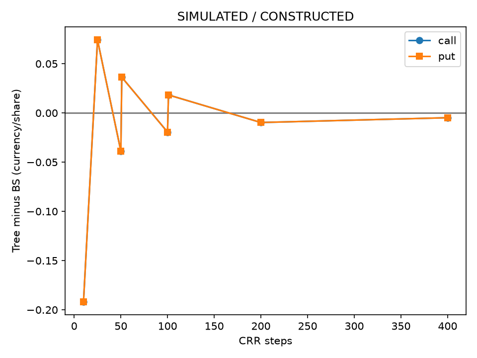
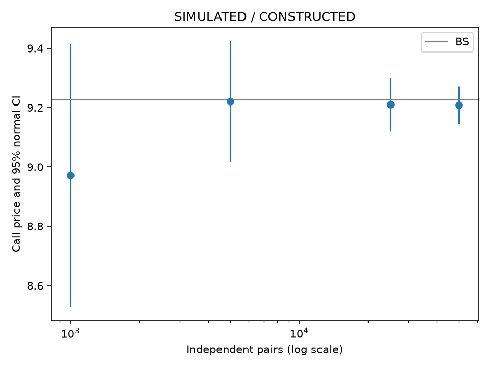
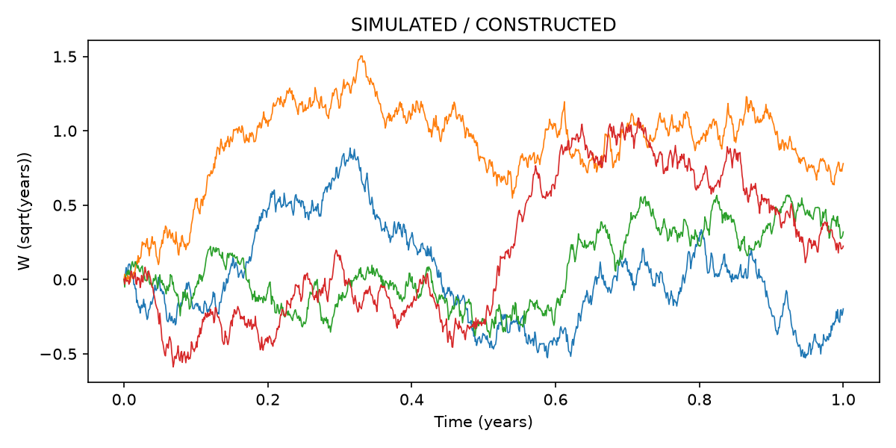
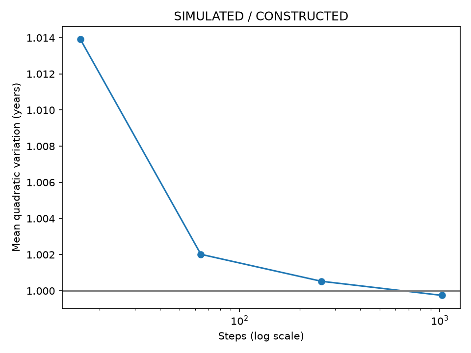
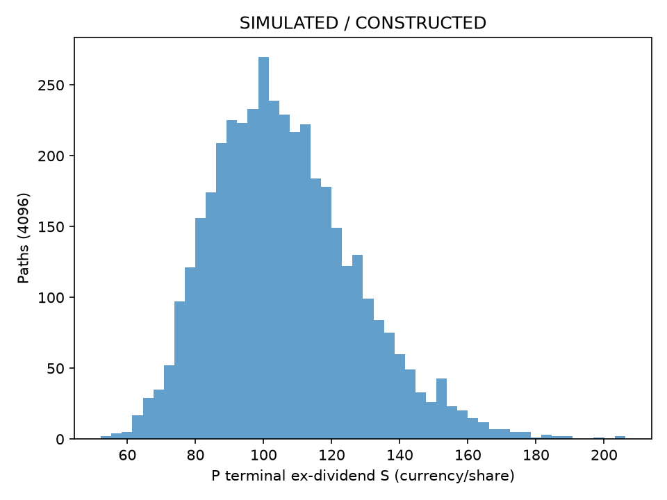
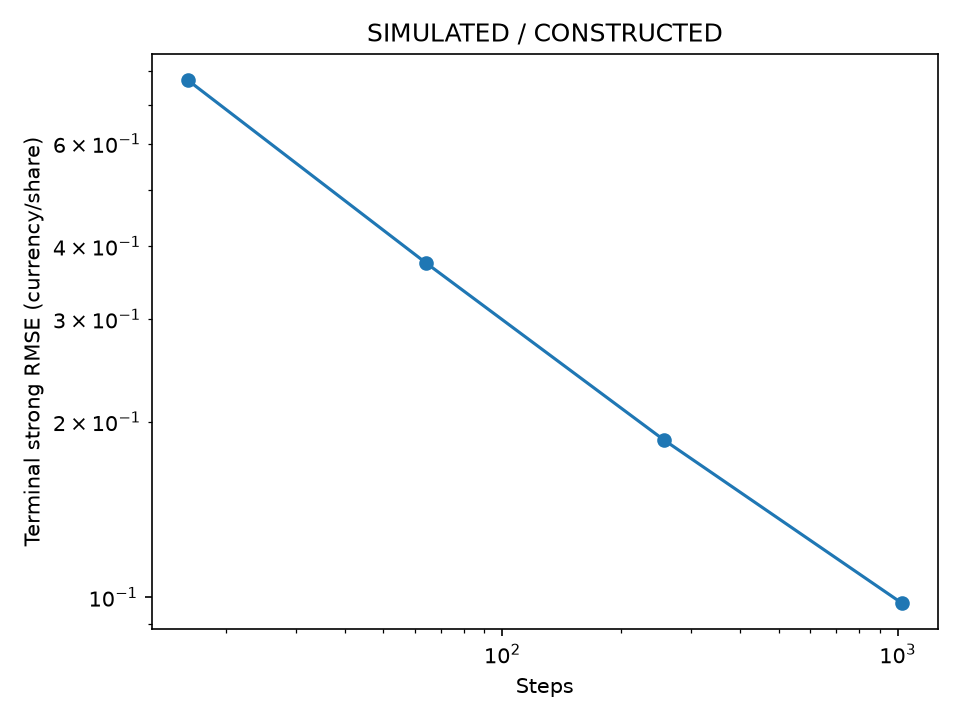
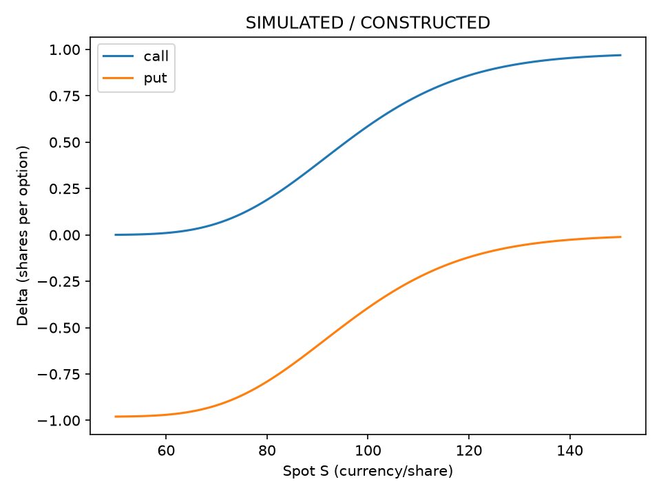
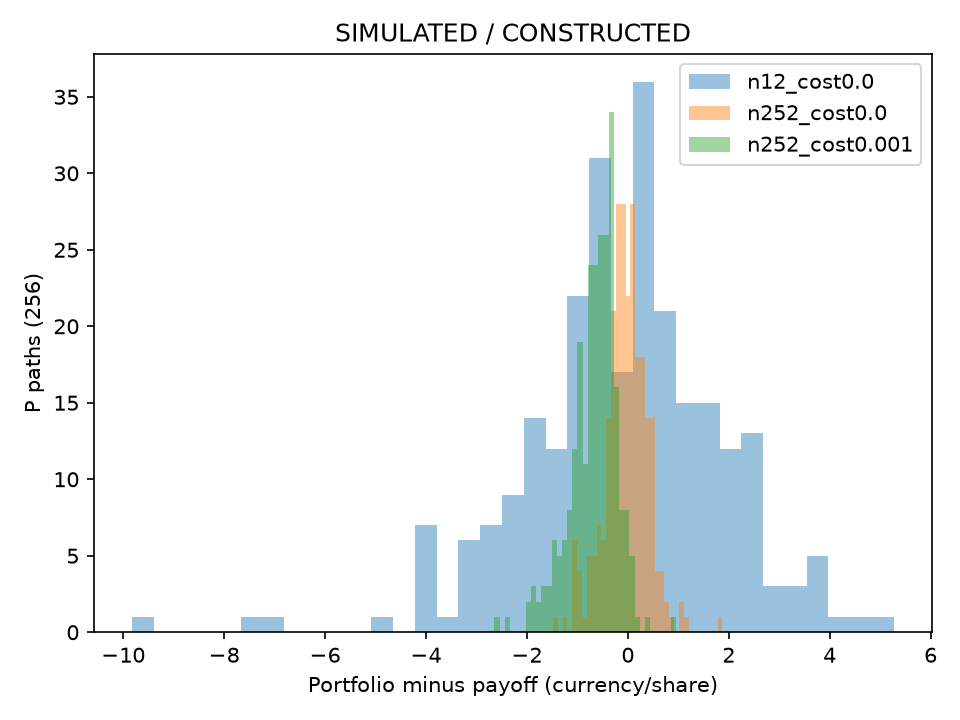

# 第44章 — 随机微积分与衍生品（Stochastic Calculus and Derivatives）

> Yuxiao Ma · Advanced。
> 主线：从无套利复制出发，用可用信息与Itô二次变差建立连续定价，再以数值和现金账本核对边界。

## 1. 本章目标

本章沿一份欧式期权，从离散复制走到连续复制，再用解析式、树与模拟互相核对。读完后，你应能解释Itô二阶项的来源，按给定信息集构造左点积分，区分真实测度与定价测度，并逐行重算一次含股息和融资的离散对冲账本。

验收动作包括：手算一期复制的股票与债券头寸；推导含连续股息的Black–Scholes PDE；给call/put算出同单位Greeks；辨认MC抽样误差、Euler离散偏差与离散对冲误差；用支付折点、无效树概率或未来信息反例说明某种算法何时失效。每个动作都有同章习题与完整答案。所有本章实验标为SIMULATED或CONSTRUCTED。

本章层级为Advanced。先修第4章Taylor与偏导、第6章条件期望与正态/对数正态、第9章约束和维度、第10章合约与支付、第11章价格收益和总收益。第34–36章提供可执行价格与费用边界。普通权益Alpha研究按原路线启动，不需要先学完随机微积分。

## 2. 为什么 Quant 需要它

投资者预测股票明年涨多少，与交易台报一份欧式call多少钱，面对两个不同任务。预测要估计真实分布；报无套利价格要找一组股票和现金，使其支付与期权一致。若两组组合在所有模型状态都有相同支付，理想市场中的当前价格就必须相同，否则可以买便宜的一组、卖昂贵的一组。

你在离散树里用两个状态解两条方程。连续模型有无穷多路径，每次调整股票数量以抵消即时随机风险，便需要对路径函数求变化。布朗路径不可普通求导，普通链式法则会漏掉一个累积二阶项。这就是从离散复制进入随机微积分的具体原因。

定价模型还提供风险敏感度。做Delta对冲的人需要知道今天持多少股票、下一次何时换仓以及换仓如何影响现金；估计未来涨幅的人需要知道模型的真实漂移和样本证据。把风险中性分布写成未来收益预测，会把定价计算误作交易信号。

## 3. 直觉：两种状态先解一组复制头寸

教学构造：当前股票100、欧式call行权价100、一年后股价只能是120或80，现金一年增长因子1.05，不付股息。期权支付分别为20和0。持有Δ股和当前金额A的现金，需要同时满足

\[
120\Delta+1.05A=20,\qquad80\Delta+1.05A=0.
\]

两式相减得到40Δ=20，所以Δ=0.5；代入下状态，A=−40/1.05。负现金表示借款。上状态股票60、债务40，净额20；下状态股票40、债务40，净额0。复制成本等于50−40/1.05。这里不需要知道真实上涨概率。

用一个辅助概率p，使股票的期望增长因子等于1.05，则1.2p+0.8(1−p)=1.05，p=0.625。把期权支付按这个概率加权再除1.05，也得到复制成本。p的角色来自复制和贴现，真实上涨概率可以是0.3或0.8而不改变上述代数。在多期树里你会逐节点重新解复制头寸；连续极限把这种调整变成可预测的动态持仓。

这棵树只允许两种状态、无费和相同借贷率。若多一个独立风险状态却只有股票与债券，可能无法解出同时复制所有支付的头寸；若付股息，需要把股票价格变化与持有人收到的现金合起来。后面的GBM模型保留单一Brownian风险、连续交易与理想融资，再检查离散执行造成的误差。

## 4. 数学基础、单位与信息契约

固定到期日T，当前日历时间t，剩余期限τ=T−t，三者以年计。S是除息股票价格（Ex-dividend Price），K是行权价，V是每份只对应一股的期权价值，都用同一报价货币。实际合约乘数应在最终金额外乘，本章不默认为100股。r、q是无风险连续年利率与连续股息收益率；σ是年化波动率，量纲为\(\text{年}^{-1/2}\)。真实测度下μ专指含股息的总收益漂移，因此股价漂移为μ−q。P/Q用\(\mathbb P,\mathbb Q\)，put价格用\(P_{\mathrm{put}}\)或明确局部P，避免把字母P的价格用途混入概率测度。

布朗增量满足\(\operatorname{Var}(\Delta W)=\Delta t\)，所以W的单位是\(\sqrt{\text{年}}\)。正态生成器参数scale是标准差，程序传\(\sqrt{\Delta t}\)，传Δt会把方差写成Δt²。股票收益σΔW无量纲，rΔt也无量纲，指数函数里的每一项因此可以相加。

市场风险价格\(\lambda=(\mu-r)/\sigma\)的单位是\(\text{年}^{-1/2}\)：μ、r以年⁻¹计，σ以年⁻¹/²计。因此λW与λ²t都是无量纲。Δ是复制每份期权的股数，A是现金金额；ΔS与A才能相加。程序保留参数名T时，价格/Greeks/MC中的 **API T=τ**，表示从当前估值时点到到期的剩余年数，不是日历到期日。冻结算例当前t=0，故数值上τ=T，不改其输入。

本章先用\(f\in C^{1,2}\)表示对时间一阶、对空间二阶连续可微，再把支付函数不光滑的到期点单独作为边界。call的支付\((S-K)^+\)在S=K有折点；T>t时GBM的高斯积分使价格在S>0内光滑，并不把终值折点变为普通可微点。

所有策略持仓在网格左点\(t_i\)依据当时信息确定，赚取区间\((t_i,t_{i+1}]\)的变动。数值对冲在观察\(S_i\)后按同一\(S_i\)即时换仓，是理想化模拟执行约定；真实数据应用必须另给available_at、`signal_time`、发送、撮合与trade_time，不能从一次离线数组计算推断可瞬时成交。滤过与适应性在下一节把“当时信息”变成数学条件。

## 5. 正式定义：从随机路径到可用信息

### 5.1 随机游走缩放与布朗运动（Brownian Motion）

把一年分N段，每段Δt=1/N，令独立硬币\(\xi _i\)取±1、概率各1/2。缩放路径的单步是\(\sqrt{\Delta t}\xi_i\)。N步之和均值0、方差\(N\Delta t=1\)。若错误地把单步改成\(\Delta t\xi_i\)，终值方差是1/N，极限退化成0；不缩放单步则方差发散。这组计算解释扩散尺度，CLT只先说明固定终值的分布趋向正态；完整路径弱收敛需要函数型中心极限定理（Functional CLT）和紧性，本章引用其结果，不把有限维CLT当作证明。有限硬币路径也不等于一条Brownian路径。[CH06_DOC_13]

标准Brownian过程满足\(W_0\)=0、样本路径几乎必然连续、相互不重叠的增量独立且\(W_t-W_s\sim N(0,t-s)\)。后面用其增量生成路径，连线只是有限观察点的画法。取相容的Brownian滤过时，未来增量还必须独立于当前\(\mathcal F_s\)。本章使用完成并右连续化的自然滤过；添加提前泄露未来的信息会破坏这个前提。

差商\((W_{t+h}-W_t)/h\sim N(0,1/h)\)。对固定有限M，\(\Pr(|\Delta W/h|\le M)\to0\)，因此该差商族不紧，不能依概率收敛到有限导数。Brownian几乎必然处处不可普通求导（Nowhere Differentiable）是更强的标准定理，需要同时控制所有时点；方差发散本身不是这个定理的完整证明。你仍可对价格函数V(t,S)求偏导，不能对Brownian样本路径用普通速度dW/dt。

### 5.2 信息、条件期望与鞅

滤过（Filtration）\(\mathcal F_s\subseteq\mathcal F_t\)表示信息随时间增长。适应过程（Adapted Process）要求\(X_t\)关于\(\mathcal F_t\)可测。可测性让你在t只凭已有信息得到\(X_t\)，而非偷看后来增量。连续时间积分还需要合适的联合可测性，例如渐进可测（Progressively Measurable）或可预测（Predictable）的被积过程；只对每个时刻说“适应”不能自动省掉这些条件。

条件期望（Conditional Expectation）Y=\(E[X\mid\mathcal F_s]\)满足Y在s时可测，且对每个\(A\in\mathcal F_s\)，\(E[Y1_A]=E[X1_A]\)。有限状态中，它就是在已知状态下重新加权求均值。鞅（Martingale）M要求适应、每时刻\(E|M_t|<\infty\)，并且\(E[M_t|\mathcal F_s]=M_s\)（s≤t）。这是一个条件关系，单独\(E[M_t]\)不变不够。

把信息具体画成四个等概率终态。ξ先揭晓，η后揭晓，二者独立公平取±1；设\(M_0=0,M_1=\xi,M_2=\xi+\eta\)。

| 终态(ξ,η) | 概率 | \(\mathcal F_{0}\)信息组 | \(\mathcal F_{1}\)信息组 | \(\mathcal F_{2}\)信息组 | \(M_{1}\) | \(M_{2}\) |
|---|---|---|---|---|---|---|
| (+1,+1) | 1/4 | 全部四态 | ξ=+1的两态 | 本终态 | +1 | 2 |
| (+1,−1) | 1/4 | 全部四态 | ξ=+1的两态 | 本终态 | +1 | 0 |
| (−1,+1) | 1/4 | 全部四态 | ξ=−1的两态 | 本终态 | −1 | 0 |
| (−1,−1) | 1/4 | 全部四态 | ξ=−1的两态 | 本终态 | −1 | −2 |

\(\mathcal F_{t}\)严格说是当时可判断事件构成的σ代数；表中的信息组是它的原子。有限状态下，“\(\mathcal F_{t}\)可测”就是在每个当时无法再区分的组内取同一个值。\(M_{1}\)在\(\mathcal F_{1}\)两组内分别恒为+1和−1，故时刻1可得；\(M_{2}\)在同组内仍有不同值，不能提前把它当作\(M_{1}\)。条件期望先在组内重算概率：ξ=+1时两态各1/2，均值(2+0)/2=1；ξ=−1时均值(0−2)/2=−1。因此\(E[M_2\mid\mathcal F_1]=\xi=M_1\)，且\(\mathcal F_{0}\)下两者均值0，构成鞅。类似地，t<T时\(W_T\)含未揭晓增量，通常不是\(\mathcal F_{t}\)可测；“数值已经存进数组”并不把未来变成当前信息。

有限时域反例：t=0,1,2，ξ取±1且等概率；\(X_0\)=0、\(X_1\)=ξ、\(X_2\)=−ξ。三期均值都0，在时刻1你已知道ξ，故\(E[X_2\mid\mathcal F_1]\)=−ξ≠ξ，X不是鞅。若换成\(M_2\)=ξ+η，其中η是独立公平硬币，\(E[M_2\mid\mathcal F_1]\)=ξ=\(M_1\)，才满足条件。后面左点持仓乘未来独立增量，也依赖这一条件化动作。

### 5.3 二次变差与Itô积分的定义域

一阶全变差定义为所有有限划分上的\(\sup_\Pi\sum_i|X_{t_{i+1}}-X_{t_i}|\)。连续可微路径的值是\(\int|X'|dt\)。Brownian的全变差几乎必然无穷大，而平方增量可以累积成有限值。对确定性划分序列、最大步长趋于0，Brownian二次变差（Quadratic Variation）为

\[
Q_\Pi=\sum_i(\Delta W_i)^2\xrightarrow{L^2}T.
\]

证明本章需要的收敛：\(E[Q]=\sum_i\Delta t_i=T\)；独立高斯增量满足\(\operatorname{Var}((\Delta W_i)^2)=2\Delta t_i^2\)，故\(\operatorname{Var}(Q)\le2T|\Pi|\to0\)。因此\(E[(Q-T)^2]\to0\)，也推出依概率收敛。定义二次变差过程\([W]_t=t\)，并不声称每个有限网格QV恰等于t；任意随机依赖路径的划分需要另行说明。

先定义左点简单过程：\(H_t=H_i\)于\((t_i,t_{i+1}]\)，\(H_i\)在\(t_i\)已知，定义积分\(\sum H_i\Delta W_i\)。对一般渐进可测、\(E\int_0^T H_t^2dt<\infty\)的H，用简单过程\(H^{(n)}\)在\(L^2(dt\times\mathbb P)\)中逼近，再由等距把积分延伸到L²极限。对于本章连续H=W或光滑路径函数，左点取值近似满足所需条件；任意不规则H不能仅凭一个任意左点网格宣称收敛。[CH44_MIT_ITO]

Itô积分（Itô Integral）在上述域中是从0开始的平方可积鞅；特别\(E[\int HdW]\)=0，且Itô等距（Itô Isometry）为

\[
E\left[\left(\int_0^T H_t dW_t\right)^2\right]=E\int_0^T H_t^2dt.
\]

### 5.4 SDE、GBM与定价模型

随机微分方程（Stochastic Differential Equation, SDE）\(dX=a(t,X)dt+b(t,X)dW\)是积分方程的简写，存在/唯一性不能从这个记号自动推出。局部Lipschitz与线性增长是常见充分条件；本章常系数ABM和GBM可以直接写显式解验证，不求解任意系数SDE。

完整写法是对每个t：

\[
X_t=X_0+\int_0^t a(u,X_u)\,du+\int_0^t b(u,X_u)\,dW_u.
\]

| 积分 | 累积的对象 | 本章所用条件与单位 |
|---|---|---|
| 时间积分∫a du | 漂移乘实际时间长度 | 路径上局部可积；a为X单位/年 |
| 随机积分∫b dW | 当前已知系数乘未来Brownian增量的L²极限 | 渐进可测/可预测且\(E\int b^2\,du\)有限（或定理允许的局部化）；b为X单位/√年 |

第二项不是先求普通dW/du再积分。SDE简写中的dX不能依普通可分离微分规则直接移项积分；下面log变换必须保留Itô二阶项。

欧式期权（European Option）只在固定T支付\(h(S_T)\)，call为\((S_T-K)^+\)，put为\((K-S_T)^+\)。后续连续复制假设S>0、常数r/q/σ、σ>0、一个Brownian风险、无交易费用、股票可分割/卖空、同一r借贷、连续可预测交易且策略满足防止翻倍策略等病态的可积/可容许条件。数值代码价格支持T=0与σ=0边界，但测度转换与随机Greeks推导另限于正T/σ。

## 6. 推导：积分、测度与复制价格

### 6.1 左点积分为什么带二阶修正

对任何有限数列，\(a(b-a)=[b^2-a^2-(b-a)^2]/2\)。代入a=\(W_i\)、b=\(W_{i+1}\)，再将平方端点差裂项相消，\(W_0\)=0时得到

\[
I_\Pi=\sum_iW_i\Delta W_i=\tfrac12\left(W_T^2-Q_\Pi\right).
\]

这是纯代数有限恒等式。将\(Q_\Pi \)按上一节L²结果取极限，得到\(\int_0^T W_t dW_t=(W_T^2-T)/2\)。普通光滑路径从0开始的平方增量和趋0，普通链式法则因此没有−T/2。若改成右点，和是\((W_T^2+Q_\Pi)/2\)，极限多出T；两种采样用到的信息与积分定义不同。

等距的简单过程证明也可逐项展开。\(E[(\sum H_i\Delta W_i)^2]\)的交叉项i<j在\(\mathcal F_{t_j}\)条件化后为0，因为当时前面的变量都已知，\(E[\Delta W_j\mid\mathcal F_{t_j}]\)=0；平方项为\(E[H_i^2]\Delta t_i\)。相加得到\(E\sum_i H_i^2\Delta t_i\)，再通过L²简单过程逼近给一般等距。对H=W，等距右边\(\int_0^T E[W_t^2]dt=T^2/2\)，与\((W_T^2-T)/2\)的方差一致。

### 6.2 Itô公式：Taylor展开后保留哪些累积项

为看清增量，先在有界局部系数、足够光滑函数上作展开，所有偏导在左点计算：

\[
\Delta f\approx f_t\Delta t+f_x\Delta X+\tfrac12 f_{xx}(\Delta X)^2.
\]

时间二阶和时间空间交叉项在累积极限消失；空间平方项保留。写\(\Delta X\approx a_i\Delta t+b_i\Delta W\)，其平方展开为\(a_i^2\Delta t^2+2a_ib_i\Delta t\Delta W+b_i^2(\Delta W)^2\)。前两项在局部有界条件及网格细化下消失，最后一项通过加权二次变差趋向\(b_t^2dt\)的积分。随机增量尺度写成\(O_p(\sqrt{\Delta t})\)，表示概率意义的尺度，不是每条路径上有统一普通大O上界。

**随机左点权重为何仍可换平方增量。** 固定确定性划分\(0=t_0<\cdots<t_n=T\)，令\(C_{i}\)为\(\mathcal F_{t_{i}}\)可测且\(|C_i|\le K\)，K为同一确定常数。设\(\varepsilon_i=(\Delta W_i)^2-\Delta t_i\)，\(R_\Pi=\sum_i C_i\varepsilon_i\)。增量独立于左点信息，正态二阶、四阶矩给

\[
E[\varepsilon_i\mid\mathcal F_{t_i}]=0,
\qquad E[\varepsilon_i^2\mid\mathcal F_{t_i}]=2(\Delta t_i)^2.
\]

i<j时，\(C_i\varepsilon_i\)与\(C_{j}\)在\(t_{j}\)已知，故条件化在\(\mathcal F_{t_{j}}\)得到\(E[C_i\varepsilon_i C_j\varepsilon_j]=0\)。不是要求各个随机权重彼此独立，而是下一段中心化平方增量对已有信息条件均值为0。于是

\[
\begin{aligned}
E[R_\Pi^2]&=2\sum_i E[C_i^2](\Delta t_i)^2\\
&\le 2K^2\sum_i(\Delta t_i)^2
\le 2K^2T|\Pi|\longrightarrow0.
\end{aligned}
\]

因此\(\sum C_i(\Delta W_i)^2-\sum C_i\Delta t_i\to0\)于L²。若还要把后一和写成\(\int C_t\,dt\)，仍需对应过程和黎曼和的收敛条件。可用同样条件化说明\(E[(\sum C_i\Delta t_i\Delta W_i)^2]\le K^2\sum(\Delta t_i)^3\le K^2T|\Pi|^2\)，而\(\sum(\Delta t_i)^2\le T|\Pi|\)控制时间平方项。提前使用未来值的权重不满足这一步的条件化前提。

本章光滑函数在停留于紧区域时可将系数/偏导权重限制为有界，再由局部化定理处理离开区域的部分；这说明有界计算怎样连接一般Itô公式，不是用上述短界完成全部余项证明。这里的结论限于确定性划分，不推广到任意路径依赖随机划分。

于是对\(f\in C^{1,2}\)的Itô公式（Itô Formula）是

\[
df(t,X_t)=(f_t+a f_x+\tfrac12 b^2f_{xx})dt+b f_xdW_t.
\]

这个Taylor论证给出二阶项来源；一般\(C^{1,2}\)、局部可积系数的定理还需要逼近与局部化来控制余项。本章没有用单个o(Δt)记号替代这些步骤。记账规则(dW)²=dt、dt dW=0、dt²=0表示相应二次变差项在积分极限中的作用，不是有限随机增量逐点普通代数恒等式。[CH44_MIT_ITO, Lecture17]

具体取f=x²、a=0、b=1，\(f_x\)=2x、\(f_{xx}\)=2，所以d(W²)=2WdW+dt，积分重得上一节的结果。对二个相关Brownian风险的扩展需要交叉二次变差\(d[W^1,W^2]=\rho dt\)，本章实现限于一维。

### 6.3 ABM与GBM的显式解、矩与离散误差

算术布朗运动（Arithmetic Brownian Motion, ABM）用局部a（X单位/年）、b（X单位/√年）写dX=a dt+b dW，直接积分得\(X_t=X_0+at+bW_t\)，均值\(X_0\)+at、方差b²t。若用它模拟需非负的股票，正态支撑包含负值会违背模型要求；用于某些价差或允许负值的状态变量须另说明对象。

几何布朗运动（Geometric Brownian Motion, GBM）设股价漂移β，dS=βSdt+σSdW。β是股价漂移的局部符号，P下β=μ−q，Q下β=r−q。对f(S)=log S，有f'=1/S、f''=−1/S²，代入Itô式：

\[
d\log S=(\beta-\sigma^2/2)dt+\sigma dW,
\quad S_t=S_0e^{(\beta-\sigma^2/2)t+\sigma W_t}.
\]

也可从候选显式解反向验证，而不是相信普通分离变量。令\(F(t,w)=S_0\exp[(\beta-\sigma^2/2)t+\sigma w]\)。其\(F_t=(\beta-\sigma^2/2)F,F_w=\sigma F,F_{ww}=\sigma^2F\)。对\(F(t,W_t)\)应用Itô：

\[
dS=\big[(\beta-\sigma^2/2)S+\sigma^2S/2\big]dt+\sigma S\,dW
=\beta S\,dt+\sigma S\,dW.
\]

指数在有限t和有限Brownian值下严格为正，故\(S_{0}\)>0给\(S_{t}\)>0。正性既允许对数变换，也由显式解直接验证；在由正初值出发的解上先作停止/局部化的log推导，再验证正解，不能把普通链式法则遗漏的−σ²/2省掉。

\(\sigma W_t\)是N(0,σ²t)。用正态指数矩\(E[e^{uY}]=e^{um+u^2v/2}\)，若Y均值m、方差v，得到\(E[S_t]=S_0e^{\beta t}\)，\(E[S_t^2]=S_0^2e^{(2\beta+\sigma^2)t}\)，\(\operatorname{Var}(S_t)=S_0^2e^{2\beta t}(e^{\sigma^2t}-1)\)。这给终值分布与模拟均值的解析参照，不等于一条样本路径的复合收益率。

网格精确采样为\(S_{i+1}=S_i\exp[(\beta-\sigma^2/2)\Delta t+\sigma\Delta W_i]\)；Euler–Maruyama近似为\(S_{i+1}=S_i(1+\beta\Delta t+\sigma\Delta W_i)\)。后者括号可负，例如β=0、σ=1、dt=1、ΔW=−2，得到负100，精确解仍正。这是诊断负价格风险的构造反例，未改入冻结主模拟参数。

强误差（Strong Error）比较共同噪声的路径，本章估计终值\(\sqrt{M^{-1}\sum(S_T^E-S_T^{exact})^2}\)。弱误差（Weak Error）比较某个函数的期望，本章只用g(S)=S，报告配对均值差\(\bar D\)及\(SE=s_D/\sqrt M\)，同时精确与Euler的总体均值分别是\(S_0e^{\beta T}\)与\(S_0(1+\beta dt)^N\)。Higham(2001)§5用期望绝对误差定义强阶，并给Euler强阶1/2和适当条件下的弱阶1；本章报告的是终值L²的RMSE，不把两个误差估计量的数字混用。[CH44_HIGHAM2001]

这里还可直接推导线性GBM的总体RMSE。令h=T/N，单步Euler因子X=1+βh+σΔW，精确因子Y=exp[(β−σ²/2)h+σΔW]。高斯指数矩和独立增量给

\[
\begin{aligned}
E[X^2]&=(1+\beta h)^2+\sigma^2h,\\
E[Y^2]&=e^{(2\beta+\sigma^2)h},\\
E[XY]&=e^{\beta h}[1+(\beta+\sigma^2)h].
\end{aligned}
\]

因此终值均方误差为

\[
\begin{aligned}
E[D^2]/S_0^2={}&[(1+\beta h)^2+\sigma^2h]^N
+e^{(2\beta+\sigma^2)T}\\
&-2e^{\beta T}[1+(\beta+\sigma^2)h]^N.
\end{aligned}
\]

\Needspace{7\baselineskip}

对N次幂用N log(1+a h+b h²)展开，各项的一阶h系数合并后得到均方误差的首项为

\[
S_0^2 e^{(2\beta+\sigma^2)T}\sigma^4Th/2.
\]

所以本GBM的总体RMSE为O(√h)。均值差由§6.3两个均值直接展开得O(h)。有限网格图只是抽样估计与这些受限解析参照相容，不能证明任意SDE或支付的收敛阶。

### 6.4 P到Q：常系数有限时域的测度转换

固定有限T、σ>0，μ为含股息总收益漂移。定义λ=(μ−r)/σ与\(Z_t=e^{-\lambda W_t^{\mathbb P}-\lambda^2t/2}\)。Z是正密度，\(E[Z_t]\)=1可由高斯指数矩直接算出；独立未来增量也给\(E[Z_t\mid\mathcal F_s]\)=\(Z_s\)。Novikov充分条件\(E\exp[\frac12\int_0^T\lambda^2dt]<\infty\)在常有限λ/T下等于\(e^{\lambda^2T/2}\)，满足。这个结论依赖所列条件。[CH44_CMU_RNM]

Girsanov定理给\(d\mathbb Q=Z_Td\mathbb P\)、\(W_t^{\mathbb Q}=W_t^{\mathbb P}+\lambda t\)。常数情形还能看见倾斜后的增量：P下ΔW的密度乘\(e^{-\lambda\Delta W-\lambda^2\Delta t/2}\)，配方后成为N(−λΔt,Δt)，因此\(\Delta W_Q=\Delta W_P+\lambda\Delta t\)又是N(0,Δt)。密度在不相交增量上分解，保留独立性，连续性由加确定性漂移保留。本章给这一受限验证，不给一般随机λ的完整证明。

将\(dW_P=dW_Q-\lambda dt\)代入：

\[
dS=(\mu-q)Sdt+\sigma S(dW_Q-\lambda dt)
=[\mu-q-\sigma\lambda]Sdt+\sigma SdW_Q
=(r-q)Sdt+\sigma SdW_Q.
\]

q在λ中抵消，因为μ先定义为总收益漂移。这个转换是在同一路径空间重新加权概率，不是把真实投资者预期改成r，也不是证明股票P下回报已知。

### 6.5 含股息股票的正确鞅

Q下\(d(e^{-rt}S_t)=-qe^{-rt}S_tdt+\sigma e^{-rt}S_tdW_Q\)。当q≠0，贴现除息股票本身通常不是鞅；\(E_Q[e^{-rT}S_T\mid\mathcal F_t]=e^{-rt}S_t e^{-q(T-t)}\)。若把现金股息计入贴现收益过程

\[
G_t=e^{-rt}S_t+\int_0^t e^{-ru}qS_u du,
\quad dG_t=\sigma e^{-rt}S_tdW_Q,
\]

它在本章有限时域GBM二阶矩条件下为真实鞅。另一个选择是将股息持续再投资：持股数\(n_t\)满足dn=q n dt，\(n_0\)=1，因此\(n_t=e^{qt}\)、财富\(e^{qt}S_t\)，其贴现值\(e^{-(r-q)t}S_t\)也为真实鞅。这两种构造现金用途不同；都把股息带入收益，而非只漏看股票价格上的漂移。

### 6.6 一期复制到多期CRR

q=0时，定义增长\(R=e^{r\Delta t}\)、股票乘数u>d>0、下/上支付\(V_d\)/\(V_u\)，复制方程为ΔuS+AR=\(V_u\)、ΔdS+AR=\(V_d\)。相减得\(\Delta=(V_u-V_d)/[S(u-d)]\)，再代入下状态给\(A=R^{-1}(uV_d-dV_u)/(u-d)\)。因此

\[
V=\Delta S+A=e^{-r\Delta t}\left[\frac{e^{r\Delta t}-d}{u-d}V_u+\frac{u-e^{r\Delta t}}{u-d}V_d\right].
\]

无套利要求d<R<u，才让两个辅助状态权重均严格正。股票和债券的两列支付线性独立（行列式与u−d相关），所以这个两状态市场能复制任意支付；这说明完备性如何出现在具体方程里。

Cox–Ross–Rubinstein树（CRR Binomial Tree）取\(u=e^{\sigma\sqrt{dt}},d=1/u\)。连续股息用再投资总收益资产解释：从左点Δ股起，股息再投资让右点股数\(\Delta e^{qdt}\)，两状态复制股票支付为\(\Delta e^{qdt}uS\)、\(\Delta e^{qdt}dS\)。相减后的股票头寸多出\(e^{-qdt}\)，初始成本再整理为

\[
a=e^{(r-q)dt},\quad p=(a-d)/(u-d),\quad
V_{k,j}=e^{-r dt}[pV_{k+1,j+1}+(1-p)V_{k+1,j}].
\]

这是本树含q远期增长关系的依据；不能把有股息的股票只用价格变化当总收益。终点股票\(S_{N,j}=S_0u^jd^{N-j}\)，先算\(h(S_{N,j})\)，再逐层用当前节点的两状态复制倒推。一层有k+1个节点，递推要同时更新整层，不能覆盖后再读取被改的邻点。

若a不严格在(d,u)内，这棵两状态模型不满足严格无套利；改用更细有效网格或显式拒绝。本章不clip概率，σ=0确定性边界另处理。随N增大，支付折点与网格对齐关系会改变，常见奇偶振荡。所选网格误差变小是数值观察，不能声称相邻N单调收敛。

### 6.7 连续自融资复制与Black–Scholes/Merton PDE

一份欧式期权由Δ股和现金A复制，V=ΔS+A。自融资（Self-financing）表示调整Δ时从A支付，外部不注资，获得的收益由已有头寸产生：

\[
dV=\Delta(dS+qSdt)+rA dt
=\Delta dS+q\Delta Sdt+r(V-\Delta S)dt.
\]

这条收益方程包括股息和融资。对ΔS用乘积法则会有SdΔ和交叉变差，但它们由现金账户的股票再平衡转移匹配；不能只从V=ΔS+A把Δ当常数无限期持有。本章可容许策略和积分条件保证这些随机收益方程有意义。

先看零费、没有区间收益的瞬时调仓：S=100，卖0.1股，则股票市值减少10货币、现金增加10货币；ΔS+A不变。这10是组合内转移，不是额外收益。若本章光滑Delta在到期前为半鞅，乘积公式可明确写为

\[
\begin{aligned}
d(\Delta S)&=\Delta\,dS+S\,d\Delta+d[\Delta,S],\\
dA&=rA\,dt+q\Delta S\,dt-S\,d\Delta-d[\Delta,S].
\end{aligned}
\]

相加抵销换仓项和交叉变差，恰得上述自融资收益式。现金A含借款时也用同一r；连续股息进入现金，不自动再投资为股数。这是本章足够光滑Delta的展开，不能要求每个一般可预测策略都有可求的dΔ；一般自融资定义仍用已有头寸的收益积分式。

P下\(dS=(\mu-q)Sdt+\sigma S\,dW_P\)，Itô给

\[
dV=[V_t+(\mu-q)SV_S+\tfrac12\sigma^2S^2V_{SS}]dt+\sigma SV_SdW_P.
\]

复制收益方程的随机系数是σSΔ，所以σS>0时必须Δ=\(V_S\)。其漂移项随之是\((\mu-q)SV_S+qSV_S+rV-rSV_S=\mu SV_S+rV-rSV_S\)。两边漂移匹配：

\[
V_t+(\mu-q)SV_S+\tfrac12\sigma^2S^2V_{SS}
=\mu SV_S+rV-rSV_S.
\]

左右减\(\mu SV_S\)再整理，得到偏微分方程（Partial Differential Equation, PDE）：

\[
V_t+(r-q)SV_S+\tfrac12\sigma^2S^2V_{SS}-rV=0,
\qquad V(T,S)=h(S).
\]

真实μ消失是因为同源Brownian风险被复制头寸抵消，其漂移由融资与股息约束；不是因为人为假设μ=r。这里若有另一个不可交易的独立风险、跳跃或交易费用，原复制方程可能不再成立。Merton(1973)§7式(44)以剩余期限写−\(V_\tau \)，转换到日历t正是本式。[CH44_MERTON1973]

call/put的空间边界分别满足C(t,0)=0、\(P_{put}(t,0)=Ke^{-r\tau}\)，大S时call趋\(Se^{-q\tau}-Ke^{-r\tau}\)、put趋0；S=0仅用作连续极限边界，公共API要求S>0。增长条件与这些边界排除无经济意义的PDE解，不能只有终值就忽略解空间。

**同一支付的定价导航。** 固定\(h(S_T)\)、当前(t,S)、τ=T−t以及相同融资/股息约定，各层完成不同步骤：

| 层次 | 对同一支付的任务 | 所需依据/条件 |
|---|---|---|
| 连续复制→PDE | 抵销同源噪声并匹配融资漂移 | 自融资、可交易风险、光滑价格与允许策略 |
| Q条件期望 | 将PDE价格表示为贴现支付期望 | 下节受限Feynman–Kac、真实鞅与到期可积极限 |
| BS高斯积分 | 常系数GBM下算出该期望 | d₂给行权概率，d₁来自股票权重截断积分 |
| CRR树 / Q下MC | 分别离散复制 / 抽样计算 | 有效树概率与网格误差 / 独立配对单位与SE |

P路径的离散对冲误差检验给定模型下执行账本，是另一任务。Q不是股票真实上涨的预测分布；共享支付不意味着共享P/Q漂移。下节先用call/put有界Delta保证鞅条件，解析验证见§6.10；反向路线在§6.9先积分，再核PDE。

### 6.8 Feynman–Kac连接：本章为何能用Q期望

Feynman–Kac表示（Feynman–Kac Representation）把扩散生成元的PDE解与条件期望联系起来。本章限于常r/q/σ、σ>0、正S、有限T、call/put连续且至多线性增长的支付，以及τ>0内\(C^{1,2}\)且具有相应增长/可积性的解。

对u∈[t,T)的\(Y_u=e^{-r(u-t)}V(u,S_u)\)用Q下Itô公式，漂移为贴现后的PDE左侧，恰为0；随机项为\(e^{-r(u-t)}\sigma S_uV_SdW_Q\)。call/put的\(|V_S|\)有界于由q/T决定的常数，而有限时域GBM有二阶矩，所以该随机被积项平方可积，Y是可用于条件期望的真实鞅。到T用支付连续性和增长界取可积极限，得到

\[
V(t,S_t)=E_Q[e^{-r(T-t)}h(S_T)\mid\mathcal F_t].
\]

Q下GBM的Markov性质让条件期望可写成只依赖当前t/S的函数。局部鞅没有自动获得真实鞅的期望守恒，所列矩条件是这一推导的一部分。反方向在本章用下面的显式高斯积分得到光滑价格，再核对PDE；没有对任意不规则支付或退化/不连续系数宣称无条件成立。

### 6.9 正态积分得到call/put和d1/d2

给定当前S和τ，Q终值为\(S_T=S\exp[m+vZ]\)，m=(r−q−σ²/2)τ、v=σ√τ、Z~N(0,1)。行权条件Z>−d2，其中\(d2=[\log(S/K)+m]/v\)。因此行权概率Φ(d2)，支付中的K项期望是KΦ(d2)。

股票项需要带指数权重的截断正态积分。令φ为标准正态密度，配方恒等式\(e^{vz}\phi(z)=e^{v^2/2}\phi(z-v)\)，所以

\[
E_Q[S_T1_{S_T>K}]
=Se^m\int_{-d2}^{\infty}e^{vz}\phi(z)dz
=Se^{m+v^2/2}\Phi(d2+v).
\]

定义d1=d2+v，m+v²/2=(r−q)τ。贴现股票项和行权价项给Black–Scholes/Merton解析式（Black–Scholes/Merton Formula）：

\[
\begin{aligned}
C&=Se^{-q\tau}\Phi(d1)-Ke^{-r\tau}\Phi(d2),\\
P_{put}&=Ke^{-r\tau}\Phi(-d2)-Se^{-q\tau}\Phi(-d1),\\
d1&=\frac{\log(S/K)+(r-q+\sigma^2/2)\tau}{\sigma\sqrt\tau},
\quad d2=d1-\sigma\sqrt\tau.
\end{aligned}
\]

d2对应Q行权概率；d1来自股票支付的指数加权，Φ(d1)不是同一Q下未经加权的行权概率。Delta将是\(e^{-q\tau}\Phi(d1)\)。从call与put终值差\(S_T-K\)，或用Φ(x)+Φ(−x)=1，得到看涨看跌平价（Put-call Parity）：\(C-P_{put}=Se^{-q\tau}-Ke^{-r\tau}\)。r可负，前述贴现关系仍成立。

### 6.10 Greeks：先约定导数，再消去重复项

Greeks是局部风险敏感度，求偏导时其他合约参数固定。\(\Delta=V_S\)（复制股/份），\(\Gamma=V_{SS}\)（Delta每单位S的变化），\(\mathcal V=V_\sigma\)（货币/单位年化波动参数），\(\Theta=V_t=-V_\tau\)（货币/年），\(\rho=V_r\)（货币/单位连续年率）。小参数变化的一阶金额近似为导数乘变化量，Δσ=.01和Δr=.01才分别表示1个百分点；这种导数不是一次完整大幅冲击的精确价格差。

解析求导先用\(Se^{-q\tau}\phi(d1)=Ke^{-r\tau}\phi(d2)\)。证明它只需把d1=d2+σ√τ代入两个高斯密度的比：\(\log[\phi(d1)/\phi(d2)]=-d2\sigma\sqrt\tau-\sigma^2\tau/2\)。再代入d2，结果为\(-\log(S/K)-(r-q)\tau\)。因此对S求导时，d1/d2的链式项相消，剩\(\Delta_{\mathrm{call}}=e^{-q\tau}\Phi(d1)\)，put可由平价减\(e^{-q\tau}\)。再对S求导，\(\frac{\partial d1}{\partial S}=\frac1{S\sigma\sqrt\tau}\)，得到Gamma。

对σ求导时，价格中的两个CDF链式项变成同一密度系数乘\((d1_\sigma-d2_\sigma)=\sqrt\tau\)，所以\(\mathcal V=Se^{-q\tau}\phi(d1)\sqrt\tau\)。对r求导，\(\frac{\partial d1}{\partial r}=\frac{\partial d2}{\partial r}=\frac{\sqrt\tau}{\sigma}\)，链式项相消，剩行权价贴现项的导数；Theta可由已知Delta/Gamma代回PDE求−\(V_\tau \)，亦可直接对期限求导。最终为

\[
\begin{aligned}
\Delta_C&=e^{-q\tau}\Phi(d1),&\Delta_P&=-e^{-q\tau}\Phi(-d1),\\
\Gamma_C=\Gamma_P&=\frac{e^{-q\tau}\phi(d1)}{S\sigma\sqrt\tau},
&\mathcal V_C=\mathcal V_P&=Se^{-q\tau}\phi(d1)\sqrt\tau,\\
\rho_C&=K\tau e^{-r\tau}\Phi(d2),&\rho_P&=-K\tau e^{-r\tau}\Phi(-d2).
\end{aligned}
\]

\[
\begin{aligned}
\Theta_C&=-\frac{Se^{-q\tau}\phi(d1)\sigma}{2\sqrt\tau}
+qSe^{-q\tau}\Phi(d1)-rKe^{-r\tau}\Phi(d2),\\
\Theta_P&=-\frac{Se^{-q\tau}\phi(d1)\sigma}{2\sqrt\tau}
-qSe^{-q\tau}\Phi(-d1)+rKe^{-r\tau}\Phi(-d2).
\end{aligned}
\]

PDE给逐情景核对\(\Theta+(r-q)S\Delta+\sigma^2S^2\Gamma/2-rV=0\)。put与call的Theta可以有不同符号，不能把时间损耗理解成一切参数下必负。中心差分用(V(x+h)−V(x−h))/(2h)，Gamma用二阶差分/h²；日历Theta要对期限差分取负。有限步长有截断误差，太小则相消放大舍入。到期折点左右导数不同；本API全部T=0/σ=0 Greeks拒绝，文档也说明非折点的确定性导数未实现。

### 6.11 Q下Monte Carlo与对偶变量

本段把当前估值时点平移为0；段内T记平移后的剩余期限，即原时标的τ=\(T_{\text{到期}}\)−\(t_{\text{当前}}\)。下式终值下标T同属这一平移时标，API参数T也等于τ。任意当前t不能把未减t的日历到期日直接传给MC。

蒙特卡洛（Monte Carlo, MC）取独立\(Z_i\)，用Q精确终值\(S_T^{(i)}=S\exp[(r-q-\sigma^2/2)T+\sigma\sqrt T Z_i]\)，贴现支付\(Y_i=e^{-rT}h(S_T^{(i)})\)。欧式仅依赖终值，精确采样消除了Euler时间离散偏差；有限随机样本仍有抽样误差。价格估计mean(Y)、\(SE=s_Y/\sqrt M\)，在本章有限方差及足够M下用正态近似95%CI=mean(Y)±1.95996398454SE；不是精确有限样本覆盖声明。

对偶变量（Antithetic Variates）让每个独立\(Z_i\)同时生成\(Z_i\)与−\(Z_i\)两条路径，\(X_i=(Y_i^++Y_i^-)/2\)。M个\(X_i\)彼此独立；同对两支付相关。正确SE=\(s_X/\sqrt M\)，\(\operatorname{Var}(X)=[\operatorname{Var}(Y^+)+\operatorname{Var}(Y^-)+2\operatorname{Cov}]/4\)。本章单调香草支付的反偶相关通常有利于减少方差，但不把这个数值结论推广到任意支付。相同独立样本数下反偶使用两倍终值支付计算，比较计算成本时要写清。

样本数趋大时SE的典型尺度为\(M^{-1/2}\)，某一批实际价格误差不需要单调。一次解析价格落入CI只是该次随机结果，算法正确性由解析/金融恒等式、独立公式复算和边界拒绝共同核验。随机样本M=1不能估s²；确定性σ=0/T=0才可直接返回SE=0与单点区间。

### 6.12 离散Delta对冲账本：每个区间谁收到现金

模拟P股价漂移μ−q，初始资本\(V_0\)等于Q模型价格。买\(\Delta _0\)股，现金\(A_0=V_0-\Delta_0S_0-\mathrm{fee}|\Delta_0|S_0\)。这样初始购买费用已在资金里扣除，并不暗中追加资本。

设dt=T/N，上一个换仓后的股数\(\Delta _{i-1}\)和现金\(A_{i-1}\)固定。区间末换仓之前，现金按协议近似递推：

\[
A_i^{pre}=A_{i-1}e^{r dt}
+\Delta_{i-1}S_{i-1}(e^{q dt}-1).
\]

连续模型的现金股息是\(\int q\Delta S_u\,du\)；本式用左点价和固定旧持股的区间股息近似，并把区间现金流统一在右端记账，未计每笔期内股息不同融资时点。它和连续公式有离散偏差，不能因为S终值精确采样就说整个对冲账本精确连续复制。

现在观察\(S_i\)，用剩余期限\(T-t_i\)算新Delta（只用于随后区间），换股\(\delta\Delta=\Delta_i-\Delta_{i-1}\)，现金

\[
A_i=A_i^{pre}-\delta\Delta S_i-fee|\delta\Delta|S_i,
\quad V_i^{portfolio}=A_i+\Delta_iS_i.
\]

到期强制\(\Delta _N\)=0，清仓费也扣除，最终误差\(A_N-h(S_N)\)。现金与股数必须同时对账；借款A负时同一个r表达融资成本，本模拟没有真实借贷利差。费用总额\(\sum\mathrm{fee}|\delta\Delta|S\)只是名义现金费加总；费用带来的到期资金差还包括融资机会成本，因此不能把两个频率误差均值之差机械等同费用均值。

## 7. 金融解释：价格、概率与对冲资金

股票价格变化与股票总收益必须分开。持有Δ股会收到ΔqSdt股息；借款余额按r计息。若从复制账本漏掉股息，PDE里的股票项会从r−q写错为r，call和put的价格与Delta也会随之错配。相同支付、相同融资和相同现金流归属才允许比较两个定价算法。

\(\mathbb Q\)是与模型无套利相容的测度。在本章一个Brownian风险、股票加现金、σ>0、允许连续交易且策略有适当可积性的完备模型内，可复制的欧式支付有唯一模型价格。完备性强调每个允许的支付能用可交易资产复制；只有无套利而不完备时，一般未必唯一。σ=0是确定性边界，不能直接把市场风险价格λ=(μ−r)/σ的转换公式套进去。

MC在Q下求期望来算价格；离散对冲实验在P下设定含股息μ=.08来检验给定模型路径中的误差。这两个实验共享r、q、σ和支付，但任务、测度与漂移不同。对冲误差定义为清仓后现金减期权支付，正值表示复制组合多余资金，负值表示复制短缺；这不是持有一份期权的投资收益率。

无费用连续复制给一个模型基准。离散换仓会留下Gamma风险，股息与现金区间近似也有误差，增加换仓次数还会增加费用。费用10bp是构造参数，既没有盘口验证，也没有市场冲击估计。对冲图与真实盈利能力之间仍缺报价、延迟、借贷、跳跃风险与数据许可的验证环节。

## 8. Numerical Example：冻结的欧式定价与对冲实验

全部为SIMULATED / CONSTRUCTED，每份支付对应一股；输入\(S_0\)=K=100、T=1年、r=.05、q=.02、σ=.20。首轮运行前固定协议，历史输出原位于`build/batches/A9-A/r1/runs/experiment_output_02`，现已归档；原运行身份见归档索引。下面沿用历史根独立运行并已接受的数值；现存独立根结果见results.json。现存根结果与归档作者运行保留各自身份，本双语批次未重新运行或提取归档。所有金额为每股同币种教学金额。

### 8.1 手算与解析价格的中间值

无股息单期树的复制股数.5、现金−38.0952380952，价格11.9047619048，上状态20、下状态0、辅助p=.625，与§3方程对应。它的乘数1.2/.8和增长1.05与主案例的CRR网格不同，不能把两个价格差称算法误差。

主案例log(S/K)=0，(r−q+σ²/2)T=.05，σ√T=.2，因此d1=.25、d2=.05。股票贴现金额\(100e^{-.02}=98.0198673307\)，行权价贴现金额\(100e^{-.05}=95.1229424501\)；乘上各自CDF再相减得到call 9.2270055082，put 6.3300806275。平价差2.8969248806，计算残差在双精度范围内为0；该恒等式比一次模拟区间覆盖更直接检查股息/贴现。

### 8.2 CRR与解析式对照

| 步数 | call | put | call−BS |
|---|---|---|---|
| 10 | 9.03532574 | 6.13840086 | -0.19167977 |
| 25 | 9.30117882 | 6.40425394 | +0.07417331 |
| 50 | 9.18822483 | 6.29129994 | -0.03878068 |
| 51 | 9.26328514 | 6.36636025 | +0.03627963 |
| 100 | 9.20758997 | 6.31066509 | -0.01941554 |
| 101 | 9.24530483 | 6.34837995 | +0.01829933 |
| 200 | 9.21729155 | 6.32036667 | -0.00971396 |
| 400 | 9.22214700 | 6.32522212 | -0.00485851 |

25/50/51与100/101展示奇偶与支付网格对齐影响。call/put误差因本模型的平价关系在图中重叠。有效概率随步长重新检查，图中的连线只用于读相邻选择；没有声称单调收敛。



### 8.3 Q下精确终值MC

seed4401，反偶的独立单位是配对均值。每行M个独立配对、2M终值支付计算，95%区间是正态近似。

| 类型 | 独立配对M | 价格 | SE | 95%近似CI |
|---|---|---|---|---|
| call | 1000 | 8.970967 | 0.226342 | [8.527344, 9.414590] |
| put | 1000 | 6.168817 | 0.144720 | [5.885170, 6.452464] |
| call | 5000 | 9.221358 | 0.103914 | [9.017691, 9.425026] |
| put | 5000 | 6.322140 | 0.066202 | [6.192386, 6.451894] |
| call | 25000 | 9.210317 | 0.045884 | [9.120386, 9.300248] |
| put | 25000 | 6.322468 | 0.029532 | [6.264586, 6.380350] |
| call | 50000 | 9.208583 | 0.032531 | [9.144823, 9.272343] |
| put | 50000 | 6.318800 | 0.020913 | [6.277811, 6.359790] |

50000个普通独立路径的call SE=0.061862；同样50000独立配对的SE=0.032531。支付计算次数不同，不能称同计算成本比较。一次覆盖不证明算法正确，误差也不会随每次增加M单调缩小。



### 8.4 Brownian的有限QV与极限

seed4402，1024条1024步细增量，再聚合成嵌套网格；T=1。

| 步数 | QV样本均值 | QV样本SD | 有限恒等式最大残差 | 相对Itô极限RMSE |
|---|---|---|---|---|
| 16 | 1.013915 | 0.355776 | 6.66e-16 | 0.177937 |
| 64 | 1.002018 | 0.174564 | 4.44e-16 | 0.087245 |
| 256 | 1.000527 | 0.089581 | 8.88e-16 | 0.044769 |
| 1024 | 0.999746 | 0.045050 | 8.88e-16 | 0.022514 |

每一行有限恒等式都使用该行实际QV；最后一列才把QV换成理论极限T。样本均值/SD与理论\(E[QV]\)=1、Var(QV)=2/N参照。seed/网格的数值趋势不是所有划分/路径的一般证明。





### 8.5 P下GBM精确与Euler共用增量

seed4403，4096条细路径，含股息μ=.08、股价漂移.06。强误差使用同一Brownian路径的终值差D，弱差是有符号mean(D)，并报告paired SE。

| 步数 | 强RMSE | 配对弱均值差 | 配对SE | 总体均值差 |
|---|---|---|---|---|
| 16 | 0.770766 | -0.024165 | 0.012039 | -0.011915 |
| 64 | 0.374745 | -0.002197 | 0.005856 | -0.002985 |
| 256 | 0.186236 | -0.000825 | 0.002910 | -0.000746 |
| 1024 | 0.097747 | -0.002740 | 0.001527 | -0.000187 |

细网格强误差量级与Euler强阶1/2相容；弱样本差在1024步反而比256步大，配对SE解释了不能要求它单调。精确模型\(E[S_1]\)=106.183655，矩与终值分布来自§6.3。上述网格Euler未观察负值，只说明本次抽样；额外构造dW=−2的例子仍能使Euler负价。





### 8.6 Greeks与步长

Vega/Rho按单位参数，Theta按日历年。S80/100/120固定其他输入，call/put都核对中心差分；最大绝对误差跨不同单位仅作逐项容差的执行摘要，不能把它称统一经济距离。

| S/类型 | Delta | Gamma | Vega | Theta | Rho |
|---|---|---|---|---|---|
| 80/call | 0.189494 | 0.016802 | 21.506484 | -2.528897 | 13.628799 |
| 80/put | -0.790704 | 0.016802 | 21.506484 | 0.658932 | -81.494143 |
| 100/call | 0.586851 | 0.018951 | 37.901158 | -5.089319 | 49.458109 |
| 100/put | -0.393348 | 0.018951 | 37.901158 | -2.293569 | -45.664833 |
| 120/call | 0.859931 | 0.008299 | 23.900201 | -4.282714 | 79.130557 |
| 120/put | -0.120268 | 0.008299 | 23.900201 | -1.879044 | -15.992386 |

逐情景/逐指标中心差分绝对误差均小于2.2e−6（按各自单位），h=.0001、股价步长\(h_S=S\cdot h\)。call基础Vega=37.9011575100，所以1pp波动冲击一阶近似.3790115751；S80的put Theta为正，不能给所有期权统一“时间一定损耗”的符号断言。

| h比例 | Gamma差分 | Gamma误差 |
|---|---|---|
| 1e-02 | 0.0189477855 | -2.79e-06 |
| 1e-04 | 0.0189505786 | -1.20e-10 |
| 1e-06 | 0.0189515958 | +1.02e-06 |
| 1e-08 | 0.0355271368 | +1.66e-02 |

极小h=1e−8已经失真；源代码保留这个负面诊断。



### 8.7 P下离散Delta对冲和费用

seed4404，256条共同3276步Brownian细路径，聚合12/52/252步；P股价漂移μ−q=.06，与Q定价的.03分开。fee=.001是单边10bp，含初始/清仓，金额单位每股。

| 步数/费率 | 误差均值 | SD | 5%分位 | 95%分位 | 平均现金费用 |
|---|---|---|---|---|---|
| 12/0.0 | -0.100174 | 1.982914 | -3.299152 | +2.940812 | 0.000000 |
| 12/0.001 | -0.332425 | 2.000768 | -3.551955 | +2.751658 | 0.226679 |
| 52/0.0 | -0.053391 | 0.952187 | -1.694724 | +1.431930 | 0.000000 |
| 52/0.001 | -0.404548 | 0.977735 | -2.202883 | +1.122840 | 0.342607 |
| 252/0.0 | -0.042639 | 0.432230 | -0.786323 | +0.580357 | 0.000000 |
| 252/0.001 | -0.669815 | 0.476814 | -1.561916 | -0.039341 | 0.611734 |

无费提高频率降低了本次误差SD；有费高频的均值更负、平均费用增大，252步95%分位也负。这个比较保留复制短缺与费用，不给一种频率的实盘盈利保证。误差均值之差含费用的融资拖累；总费用只是名义加总。



### 8.8 一条完整账本的现金与股数核对

路径0，12步、fee=.001，时间i/12年。以下表分开列旧头寸现金流与当前换仓，现存独立根运行的未舍入值见ledger_n12_cost0.001.json，归档作者载荷另按上述索引查阅；读者用第18节代码对实际浮点值对账，不用六位显示精度要求1e−10。

| i | S | 新股数 | 区间利息 | 区间股息 | 换仓价款 |
|---|---|---|---|---|---|
| 0 | 100.000000 | 0.586851 | 0.000000 | 0.000000 | -58.685115 |
| 1 | 93.634880 | 0.450214 | -0.206750 | 0.097890 | 12.793965 |
| 2 | 92.185735 | 0.407093 | -0.153839 | 0.070318 | 3.975204 |
| 3 | 96.449460 | 0.495617 | -0.137606 | 0.062599 | -8.538091 |
| 4 | 98.288381 | 0.532052 | -0.173605 | 0.079736 | -3.581155 |
| 5 | 100.746167 | 0.587785 | -0.188964 | 0.087230 | -5.614901 |
| 6 | 108.452054 | 0.765829 | -0.212857 | 0.098777 | -19.309250 |
| 7 | 119.086899 | 0.927286 | -0.294037 | 0.138542 | -19.227440 |
| 8 | 119.499826 | 0.947869 | -0.375048 | 0.184200 | -2.459650 |
| 9 | 118.440463 | 0.960607 | -0.386125 | 0.188941 | -1.508684 |
| 10 | 130.009165 | 0.996218 | -0.393254 | 0.189783 | -4.629671 |
| 11 | 152.859291 | 0.998335 | -0.413453 | 0.216042 | -0.323635 |
| 12 | 149.238140 | 0.000000 | -0.415630 | 0.254553 | 148.989617 |

| i | 费用 | 新现金 | 股票市值 | 组合价值 | 期权值/终值支付 |
|---|---|---|---|---|---|
| 0 | 0.058685 | -49.516794 | 58.685115 | 9.168320 | 9.227006 |
| 1 | 0.012794 | -36.844483 | 42.155771 | 5.311288 | 5.497746 |
| 2 | 0.003975 | -32.956775 | 37.528141 | 4.571366 | 4.476903 |
| 3 | 0.008538 | -41.578412 | 47.801964 | 6.223552 | 5.969667 |
| 4 | 0.003581 | -45.257016 | 52.294519 | 7.037502 | 6.436110 |
| 5 | 0.005615 | -50.979266 | 59.217090 | 8.237823 | 7.293182 |
| 6 | 0.019309 | -70.421905 | 83.055745 | 12.633839 | 11.978397 |
| 7 | 0.019227 | -89.824067 | 110.427659 | 20.603591 | 20.615407 |
| 8 | 0.002460 | -92.477026 | 113.270211 | 20.793186 | 20.628805 |
| 9 | 0.001509 | -94.184402 | 113.774758 | 19.590356 | 19.258906 |
| 10 | 0.004630 | -99.022174 | 129.517407 | 30.495233 | 30.407686 |
| 11 | 0.000324 | -99.543544 | 152.604737 | 53.061194 | 53.020537 |
| 12 | 0.148990 | 49.136007 | 0.000000 | 49.136007 | 49.238140 |

期初现金=模型价−股价款−初始费；每个区间由上行股数领取股息。末行股数0且股票市值0，清仓现金减支付就是该路径误差。现金费和融资成本会降低复制资金，即使终值股票路径相同。

## 9. Python Implementation

本节所有公共定价参数名T均表示剩余期限τ（年）；例如日历t=.25、到期\(T_{\text{到期}}\)=1，传API T=.75。Greeks的Theta仍是日历时间导数−\(V_\tau \)，不因API名字叫T而改号。

核心计算位于src/quant_course/stochastic_calculus.py与derivatives_pricing.py，CLI和Notebook复用它们。CLI以课程根为工作目录，使用已存在的.venv，所有价格按每股货币计；新输出目录必须不存在，失败目录保留后换新路径继续。

```bash
.venv/bin/python code/ch44_stochastic_derivatives.py \
  --output-dir runs/reader_01
.venv/bin/python -m pytest \
  tests/test_stochastic_calculus.py tests/test_derivatives_pricing.py \
  tests/test_ch44_root.py -q
```

CLI记录固定种子、Q下MC与P下对冲、解析/树误差、Greeks差分、共同Brownian增量、每个网格的误差估计量、图与一条完整现金账本。Notebook从干净kernel按首单元顺序运行，调用核心函数，现场生成PNG；它的较小演算不代替CLI的完整冻结实验。

公共价格函数拒绝NaN、无穷大、非正S/K、负σ/T和无效call/put类型；r可为负。树无效概率拒绝，不截断到0或1。到期和零波动价格按确定性支付处理。Greeks API的支持域为T>0、σ>0；到期或零波动输入明确拒绝，其中支付折点没有普通唯一导数，而非折点可有某些确定性导数，但此API不提供它们。极端参数导致浮点范围不足时应明确报错，不返回看似有效的NaN。

左点积分函数检查维数、形状和有限数值，不能从一块数值数组推断其信息来源。被积过程适应性的证明属于调用方。GBM函数的drift直接是股价漂移：P下传μ−q=.06，Q下传r−q=.03，函数不再次扣q。

## 10. Visualization

本章八张实际生成图已放在第8节对应数值旁，避免把读图与计算拆开。输入、单位、随机种子与样本数跟随各图解释；SIMULATED标签在图上。Brownian连线不代表光滑路径，QV灰线是总体极限，树误差连线不表示单调，MC误差棒是抽样区间，Delta曲线是局部模型敏感度，对冲直方图来自P而非Q。

图可由[独立CLI](../../../../code/ch44_stochastic_derivatives.py)在一个新目录重建，输出结果与PNG同时保留。

## 11. Real Market Example：模型提出的可检验问题

本章没有下载真实期权链，也没有报告真实市场报价与模型价格差。因此模型内三种定价方法相符，只验证数值实现和条件模型的关系。你可以向具备许可的供应商提出一个实际检验：同一标的、到期、行权价、币种、时间戳、买卖报价和股息曲线下，求每个有效报价对应的隐含波动率（Implied Volatility），检查它是否能由一个常数σ解释。

波动率微笑（Volatility Smile）或偏斜（Skew）指隐含波动率随行权价等合约变量变化。它是由价格反解出的模型参数图案，不是观察到的真实测度收益分布，也不能直接解释成某个交易Alpha。用中间价反解之前，应检查bid/ask范围、支付约定和股息；常数σ模型若在许多行权价出现系统差异，可能需要随机波动、局部波动或跳跃模型，同时仍需验证其对冲表现。

原Black–Scholes论文假设无股息和无交易费用；Merton的股息扩展支持本章q项。两篇论文的理论来源不等同于本章进行了它们的市场实证复现。真实案例状态为待许可数据验证，缺口包括行情URL/许可、下载日期与版本、样本期间、同步报价与撮合延迟、币种一致的利率/股息、哈希及可复现清洗。本章不生成虚构波动率曲面或市场价格来填这张证据表。

## 12. Common Mistakes：用可运行反例诊断

错误一把Brownian路径当普通光滑路径，以\(\int WdW=W_T^2/2\)计算，漏掉二次变差的一半。有限网格正确值为\((W_T^2-\sum\Delta W^2)/2\)，极限是\((W_T^2-T)/2\)。44-P01的错误/修复代码会给出两者差值，而非只用文字说“注意随机性”。

错误二把终值\(W_T\)复制到每个左点作为被积值。程序能相乘，但这个被积过程提前使用未来信息；其终值是\(W_T^2\)，期望T，与适应平方可积Itô积分的零期望不同。形状合格不能修复前视；未来后缀扰动的检查只提供某条代码信息依赖的负面证据，不能从有限测试证明一切输入都适应。

错误三把Q下r−q替成P下μ−q再按r贴现。这样算的是一个P下折现期望，通常不能复制欧式支付。44-P03同时计算正确Q模型与错误漂移构造，比较价格；σ>0、完备无套利的模型条件决定Q的角色。

错误四对相关反偶路径按2M个独立样本算SE。44-P04从同一z生成两边支付，再先配对平均；正确SE来自M个配对平均的样本方差。错误的SE方向取决于支付相关性，本章示例不能被写成对任意支付都缩小SE的定理。

错误五把Vega写成“一个百分点价格变化”等于原解析导数，或把Theta剩余期限导数当日历时间导数。44-P04给同单位中心差分及1pp换算。步长过小会因相消使Gamma失真，步长过大带来截断误差；更多有效小数位不保证更准确。

错误六在对冲账本只记股票换仓、忘记原现金计息和原持仓的股息，或按新Delta追溯领取过去股息。44-P05逐行重算旧持仓的区间现金流、当前换仓、初始与清仓费用，错误账本与正确结果的偏差另展示。使用未来Delta或漏费都会改变金融任务。

## 13. Quant Research Application：从模型检查到数据实验

研究问题可以是“提高离散对冲频率是否降低费用后的复制损失风险”。先固定标的/支付与误差符号，把无费连续模型作为基准，再冻结候选频率、单边费用、P下路径参数、样本数与种子。本章先做模型内敏感性，保留均值、SD、分位数与费用；一次种子下误差更小不证明另一种市场环境也更好。

进入真实数据时，先按时间顺序划分用于估计波动/股息/费用的训练段和只评估一次的后段，保证每次对冲只用当时已知信息。记录每次bid/ask和成交资格、现金利率与借贷差异，按固定支付结算，并与不对冲、固定Delta、低频Delta等简单基准比较。价格误差、对冲风险与交易策略净收益分开报告。

反证条件是预先指定的：常数σ无法解释报价范围、跳跃/尾部复制短缺超过风险限额、增加频率后的费用抵消误差改善、同步/许可数据不足以复现。任一情形都可推动模型或执行假设修订，但看过后段后更改参数须标记事后探索，不能回写为预注册。本章结果只交付上述模拟教学候选，没有完整真实衍生品项目验收。

## 14. Chapter Summary

两个状态的复制方程给风险中性概率；信息集限制可用的动态持仓；Brownian二次变差解释Itô二阶项；GBM把这些条件组合成正价格路径。连续自融资复制消去真实漂移，留下含r、q、σ的PDE，条件风险中性期望连接解析式与数值方法。

实际使用时，先核对支付和单位，再看模型与信息条件，然后选择解析、树或MC。用差分查Greeks、以独立样本单位算SE、以完整现金账本查对冲误差。数值一致性支持实现；真实报价、费用和跳跃仍决定模型应用边界。

## 15. Exercises

### 44-E01：尺度与证明范围
给一年N步公平硬币随机游走，单步分别取ξ/√N与ξ/N，求终值方差。Brownian差商服从什么分布？解释为什么这排除固定时点有限的依概率导数，以及为何不能仅凭此证明几乎必然处处不可导。对确定性网格推导QV期望与方差界。

### 44-E02：无条件均值不等于鞅
ξ为公平±1，\(X_0\)=0、\(X_1\)=ξ、\(X_2\)=−ξ。写出三期均值和\(E[X_2\mid \mathcal F_1]\)，判断鞅。把\(X_2\)改为ξ+η（η独立公平±1）再判断。说明连续Itô被积过程除了逐时刻适应还需要什么可测/可积条件。

### 44-E03：有限网格与极限
构造路径W=[0,.2,.1,.4]，计算平方增量和、左点和与右点和。用裂项求和推导两种和的一般式。设Brownian的T=1，解释将QV换成1时哪个等号只在极限成立。

### 44-E04：GBM与共同噪声
在P下μ=.08、q=.02、σ=.2、\(S_0\)=100，求股价漂移、log价格漂移、\(E[S_T]\)、Var(\(S_T\))及T=1的表达式。推导Euler递推，给负价格构造反例。写强终值RMSE与弱g(S)=S的配对估计量；弱误差是否必须逐网格单调？

### 44-E05：测度与股息鞅
同一参数且r=.05，求λ、\(Z_t\)、\(W_Q\)及Q股价漂移。证明有限时域Novikov满足，并分别写贴现除息价、计入现金股息的贴现收益过程、股息再投资财富的漂移。说明σ=0时为何不能用λ式。

### 44-E06：单期复制
用\(S_0\)=K=100、\(S_u\)=120、\(S_d\)=80、银行增长1.05、q=0，求复制股数、初始现金/债券头寸、call价格及辅助风险中性概率，核对两个状态。真实上涨概率改为.3时复制价格如何变化？

### 44-E07：自融资与PDE
从V=ΔS+A、dA中的股息融资流及Itô dV出发，逐项推导含q的PDE；指出为何对ΔS直接用普通乘积法则会错把换仓当外部注资。写欧式call/put终值及σ>0域和借贷/交易假设。

### 44-E08：d1/d2与条件定价
从Q下log终值正态，分别积分\(E_{\mathbb Q}[1_{\{S_T>K\}}]\)与\(E_{\mathbb Q}[S_T1_{\{S_T>K\}}]\)，说明d2和d1的不同角色。写put-call parity与受限Feynman–Kac连接的条件，并说明同一公式不能直接换P漂移。

### 44-E09：Greeks单位
给Delta/Gamma/Vega/Theta/Rho定义，Theta以日历时间、Vega与Rho以单位参数计。写call/put含q解析关系；1pp波动率冲击如何换算？到期S=K的普通Delta是否唯一？极小中心差分步长为什么会失真？

### 44-E10：对偶MC的SE
有M个独立\(z_i\)与相关反偶支付\(Y_i^+\)、\(Y_i^-\)。写价格、配对均值方差、SE与95%正态近似CI。说明为什么2M路径不能当2M独立观察；一次解析价格落入CI能证明什么？

### 44-E11：信息组与加权二次变差（新增）
沿§5.2四终态表填\(M_{2}\)及两组\(\mathcal F_{1}\)条件均值，说明\(M_{2}\)为何不在\(\mathcal F_{1}\)可测而其条件期望可测。固定确定性划分，\(C_{i}\)为左点可测且\(|C_i|\le K\)，补出i<j交叉项消失的条件化步骤与\(E[R_\Pi ^2]\)上界。T=1、四个等步长、K=2时上界是多少？这是否证明任意随机划分结论或一般Itô全部余项？

### 44-E12：现金转移、显式解与时标（新增）
S=100、零费零区间收益，持股从.6变.5、原现金A=−50，逐项算换仓前后总价值。写本章光滑Delta的现金抵销式。对指数GBM解写\(F_t\)、\(F_w\)、\(F_{ww}\)并核SDE，说明正性。日历t=.25、到期1年时定价API T应传什么？给λ的单位。

## 16. Programming Exercises

### 44-P01：有限积分与信息诊断
生成seed4402的16条1024步Brownian路径；核对有限恒等式最大残差、T极限差以及未来后缀改动不影响前半积分。再计算H=\(W_T\)的前视和，展示其非零均值理论参照与等距失效，不给这个过程贴合格Itô积分标签。空数组与NaN必须被拒绝。

### 44-P02：嵌套共同增量
按冻结协议4096条1024步细增量聚合成16/64/256/1024步，计算GBM精确与Euler终值强RMSE、配对弱均值差和SE。比较解析Euler均值与精确均值；错误地用独立噪声比较时，指出差值估计的对象如何变化。不要用弱样本均值单调性作为验收断言。

### 44-P03：三种价格与拒绝边界
核对基础call/put、parity、多网格CRR、MC的Q漂移；构造错误地用μ−q=.06的贴现期望，用同z比较金额。测试无效树概率必须拒绝、负利率可以使用、到期/零波动价格正确。

### 44-P04：Greeks与相关样本SE
对S=80/100/120的call/put做同单位中心差分，扫描h=.01/.0001/.000001/.00000001的Gamma误差。用1000个seed4401独立z复算反偶配对SE和错误的展平SE，报告二者。T=0/σ=0的Greeks API明确拒绝；随机MC一个独立样本无法估SE，应拒绝。

### 44-P05：逐行对冲账本
对路径[100,110,105,90]的一年三步call按r=.05、q=.02、σ=.2、K=100、fee=.001复算每行：旧现金融资、旧持股股息、换仓数量/价款、单边费用、新现金、股票市值、最终清仓和支付差。核对现金与股数，展示漏掉股息的错误结果差。改变未来后缀不应影响已完成的账本前缀。

## 17. Challenge Problems

### 44-C01：前视与模型边界
额外先修：正态四阶矩。固定\(H_t=W_T\)，求离散和的极限、均值与平方期望，比较\(E\int H^2\,dt\)。说明为何不能借此宣称现实套利。评分：代数结果3分，四阶矩/等距3分，信息与金融边界4分。

### 44-C02：对冲频率与费用的反证
在冻结P路径结果中比较12/52/252步、有费与无费的误差SD、负尾部分位数与平均费用。提出一个带训练/评估分离的真实报价检验计划及两个推翻“高频更好”的条件。评分：误差/成本和单位3分，可复现时间/许可计划3分，负面结果和事后探索边界4分。开放题不能以一种频率的均值最高为唯一正确答案。

## 18. Solutions / Solution Hints

### 44-E01
第一种终值方差N/N=1，第二种N/N²=1/N。Brownian差商N(0,1/h)，固定M时落入[−M,M]的概率趋0，排除向有限随机变量的依概率收敛；处处不可导定理仍需控制所有时点。独立平方增量给\(E[QV]=T\)，\(\operatorname{Var}(QV)=2\sum_i\Delta t_i^2\le2T|\Pi|\)，所以L²收敛。CLT给终值/有限维分布，路径弱收敛另需函数型CLT与紧性。

### 44-E02
均值均0；\(\mathcal F_1\)已知ξ，所以条件期望−ξ不等于ξ，不是鞅。改成ξ+η后条件均值ξ，因为独立η均值0；t=0的条件关系也成立。Itô需要例如渐进可测/可预测及\(E\int H^2\,dt\)有限，连续适应过程满足相应可测性，仍须另行满足前述平方可积条件；“数组左列”不证明信息条件。

### 44-E03
增量[.2,−.1,.3]，QV=.04+.01+.09=.14；左和0·.2+.2·(−.1)+.1·.3=.01；右和.2·.2+.1·(−.1)+.4·.3=.15。一般左和\((W_T^2-W_0^2-QV)/2\)，右和\((W_T^2-W_0^2+QV)/2\)，两者差QV。Brownian从0出发时QV→T=1才让左和趋\((W_T^2-1)/2\)。本构造数列的终值.4和QV.14没有被宣称为Brownian的必然值。

### 44-E04
β=μ−q=.06，log漂移β−σ²/2=.04。\(E[S_1]=100e^{.06}\)；\(\operatorname{Var}(S_1)=10000e^{.12}(e^{.04}-1)\)。Itô对log的一阶项β、二阶项−σ²/2给显式解，再用正态指数矩得到价格矩。Euler为\(S_{i+1}=S_i(1+\beta dt+\sigma dW_i)\)，β=0、σ=1、dt=1、dW=−2给−100，是额外构造边界反例。\(D_m=S_T^E-S_T^{exact}\)使用同噪声，强RMSE=√mean(D²)，弱均值差mean(D)，SE=std(D,ddof=1)/√M。抽样误差可使弱估计不单调；总体均值偏差可直接由\(100(1+.06/N)^N-100e^{.06}\)计算。

### 44-E05
λ=(.08−.05)/.2=.15，\(Z_t=\exp(-.15W_P(t)-.01125t)\)，\(W_Q=W_P+.15t\)。Novikov期望exp(.01125T)对固定有限T有限；常数增量密度配方给N(−λdt,dt)，平移后是Brownian。P股价漂移.06减σλ=.03得到Q漂移r−q=.03。贴现除息价漂移\(-qe^{-rt}S\)；现金股息计入的G漂移0；再投资股数exp(qt)，贴现财富exp(−(r−q)t)S漂移0，在有限时域GBM矩条件下为真实鞅。σ=0分母为0，不能从λ式定义该转换，确定性价格须单独处理。

### 44-E06
相减得Δ=.5。下状态.5·80+1.05A=0，因此A=−40/1.05；若\(B_0\)=1，债券单位头寸也为A。上状态60−40=20，下状态40−40=0，初始价格50−40/1.05。p=(1.05−.8)/(1.2−.8)=.625，贴现期望(.625·20+.375·0)/1.05与复制相同。真实上涨概率.3不改变复制支付或成本；若两状态/融资等假设变了则另算。

### 44-E07
自融资收益方程\(dV=\Delta(dS+qSdt)+r(V-\Delta S)dt\)，把\(\Delta=V_S\)代入。与§6.7的Itô展开匹配，消去两边\(\mu SV_S\)，得到含q的PDE。恒等式V=ΔS+A并不允许把dV写成只有ΔdS而漏掉现金或把SdΔ当外部财富；自融资要求股票再平衡由现金账户同时转移，收益方程才是复制条件。call终值\((S-K)^+\)，put\((K-S)^+\)，S>0内、τ>0、σ>0使用随机PDE；终值折点按支付处理。无费、连续交易、同率融资、可容许策略等模型条件列于§5.4。

### 44-E08
Q下\(\log(S_T/S)=(r-q-\sigma^2/2)\tau+\sigma\sqrt\tau Z\)，行权条件\(Z>-d2\)，所以\(Q(S_T>K)=\Phi(d2)\)。截断股票期望完成正态平方配方后，指数权重把阈值从−d2平移σ√τ，给\(Se^{(r-q)\tau}\Phi(d1)\)，d1=d2+σ√τ。分别贴现这两项得到call；put-call差\(Se^{-q\tau}-Ke^{-r\tau}\)可由支付差\(S_T-K\)直接得。对于本章正S、常系数GBM、有限T、call/put线性增长终值和τ>0的\(C^{1,2}\)解，Itô与可积鞅条件连接PDE和Q条件期望；未声明任意不规则系数/支付无条件成立。P漂移一般保留风险溢价，不能替换Q定价任务。

### 44-E09
Delta=\(\frac{dV}{dS}\)（股/份），Gamma=\(\frac{d^2V}{dS^2}\)（每单位S的Delta变化），Vega=\(\frac{dV}{d\sigma}\)（货币/单位年化波动参数），Theta=\(\frac{dV}{dt}=-\frac{dV}{d\tau}\)（货币/年），Rho=\(\frac{dV}{dr}\)（货币/单位连续年率）。解析式与推导在§6的Greeks小节，两种期权Gamma/Vega相同，\(\Delta_{\mathrm{call}}-\Delta_{\mathrm{put}}=e^{-q\tau}\)，Theta与Rho含q和r项符号需随call/put支付区别。Δσ=.01用.01·Vega近似金额，不是整个Vega。到期S=K的call左右Delta分别0与1，无普通唯一值；API全部T=0/σ=0 Greeks拒绝是明确实现域，非宣称所有非折点导数都不存在。中心差分相减接近数会放大舍入；Gamma再除\(h_S^2\)，过小步长尤其敏感。

### 44-E10
\(X_i=(Y_i^++Y_i^-)/2\)，价格mean(X)，\(s_X^2=\sum_i(X_i-\operatorname{mean}(X))^2/(M-1)\)，SE=\(s_X/\sqrt M\)，95%正态近似区间mean(X)±1.95996398454SE。\(\operatorname{Var}(X)=[\operatorname{Var}(Y^+)+\operatorname{Var}(Y^-)+2\operatorname{Cov}(Y^+,Y^-)]/4\)，路径之间相关使2M独立公式遗漏Cov。正态近似要求独立配对、足够样本及有限方差；单个随机观察不能估样本方差。某次覆盖符合区间的随机解释，不能证明算法正确，算法需金融恒等式、独立复算与边界检查。

### 44-E11（新增完整答案）
四态\(M_{2}\)为2、0、0、−2；\(\mathcal F_{1}\)两组条件均值为1、−1。\(M_{2}\)同组不同值，尚不可测；条件期望同组恒定，故可测。令\(\varepsilon_i=(\Delta W_i)^2-\Delta t_i\)，则条件均值0、条件二阶矩\(2(\Delta t_i)^2\)。i<j时\(C_i\varepsilon_iC_j\)为\(\mathcal F_{t_{j}}\)可测，故交叉期望=\(E[C_i\varepsilon_i C_j E(\varepsilon_j\mid\mathcal F_{t_j})]=0\)。得到\(E[R_\Pi^2]=2\sum_i E[C_i^2](\Delta t_i)^2\le2K^2T|\Pi|\)。给定数字是2·4·1·.25=2；这是平方误差期望的上界，不是每条路径误差的上限，也不要求达到。网格细化才得L²趋0；不覆盖任意随机划分，仍需一般Itô的逼近、余项和局部化条件。

### 44-E12（新增完整答案）
原股票市值60、现金−50、总价值10；卖.1股收10，股票市值50、现金−40、总价值仍10。光滑半鞅Delta下dA=rA dt+qΔSdt−S dΔ−d[Δ,S]，与乘积式相加给dV=ΔdS+qΔSdt+rA dt。指数F的三偏导分别(β−σ²/2)F、σF、σ²F；Itô漂移加上σ²F/2后回到βF，随机项σF，初值\(S_{0}\)且严格正。API T=1−.25=.75年；λ为年⁻¹/²，使λW与λ²t无量纲。

### 44-P01 参考实现

```python
import numpy as np
from quant_course.stochastic_calculus import brownian_increments, ito_left, quadratic_variation
dw = brownian_increments(16, 1024, 1., 4402)
w = np.column_stack([np.zeros(16), np.cumsum(dw, axis=1)])
qv = quadratic_variation(w)
i = ito_left(w, w[:, :-1])
ordinary = .5 * w[:, -1] ** 2
print("ordinary minus Ito first path", ordinary[0] - i[0])
assert np.allclose(ordinary - i, .5 * qv)
assert np.max(abs(i - .5 * (w[:, -1] ** 2 - qv))) < 1e-12
print("finite/limit RMSE", np.sqrt(np.mean((i - .5 * (w[:, -1] ** 2 - 1)) ** 2)))
future = w.copy()
future[:, 513:] += 3
assert np.array_equal(ito_left(w[:, :513], w[:, :512]), ito_left(future[:, :513], future[:, :512]))
lookahead = np.repeat(w[:, -1, None], 1024, axis=1)
wrong = ito_left(w, lookahead)
assert np.allclose(wrong, w[:, -1] ** 2)
print("anticipating first path", wrong[0])
for invalid in [np.empty((0, 2)), np.array([[0., np.nan]])]:
    try:
        quadratic_variation(invalid)
    except ValueError:
        pass
    else:
        raise AssertionError("invalid input accepted")
```

正确有限代数差只受舍入影响；普通链式法则会比左和多QV/2。前视和理论\(E[W_T^2]\)=T而非0，其平方期望3T²，等距右侧T²。16路径的样本均值不必精确为T。

### 44-P02 参考实现

```python
import math
import numpy as np
from quant_course.stochastic_calculus import brownian_increments, gbm_exact, gbm_euler
dw = brownian_increments(4096, 1024, 1., 4403)
for n in [16, 64, 256, 1024]:
    d = dw.reshape(4096, n, 1024 // n).sum(axis=2)
    ex = gbm_exact(100., .06, .2, 1/n, d)
    eu = gbm_euler(100., .06, .2, 1/n, d)
    error = eu[:, -1] - ex[:, -1]
    rmse = np.sqrt(np.mean(error**2))
    mean = error.mean()
    se = error.std(ddof=1) / np.sqrt(4096)
    population = 100 * ((1 + .06/n)**n - math.exp(.06))
    print(n, rmse, mean, se, population)
```

独立重抽噪声后差值仍可无偏估计两个均值之差，但SE变大，且其路径RMSE不是同一噪声下的强离散误差。此题需共同细增量聚合及非单调弱样本结果，而不要求四行mean严格单调。

### 44-P03 参考实现

```python
import numpy as np
from quant_course.derivatives_pricing import bs_price, crr_price, mc_price
p = dict(S=100., K=100., T=1., r=.05, q=.02, sigma=.2)
c, put = bs_price(**p), bs_price(**p, kind="put")
assert abs(c - put - 100*np.exp(-.02) + 100*np.exp(-.05)) < 1e-10
print("BS", c, put)
for n in [10, 25, 50, 51, 100, 101, 200, 400]:
    print(n, crr_price(**p, steps=n) - c)
z = np.random.default_rng(4401).standard_normal(50000)
correct = np.exp(-.05) * np.maximum(100*np.exp(.01+.2*z)-100, 0)
wrong = np.exp(-.05) * np.maximum(100*np.exp(.04+.2*z)-100, 0)
print("wrong drift minus Q plain estimate", wrong.mean() - correct.mean())
assert bs_price(**dict(p, T=0)) == 0
assert bs_price(**dict(p, r=-.01)) >= 0
assert mc_price(**dict(p, sigma=0))["se"] == 0
try:
    crr_price(**dict(p, r=1., sigma=.01), steps=1)
except ValueError:
    pass
else:
    raise AssertionError("invalid probability clipped")
```

### 44-P04 参考实现

```python
import numpy as np
from quant_course.derivatives_pricing import bs_price, bs_greeks, mc_price
p = dict(S=100., K=100., T=1., r=.05, q=.02, sigma=.2)
for spot in [80., 100., 120.]:
    for kind in ["call", "put"]:
        a = dict(p, S=spot)
        g = bs_greeks(**a, kind=kind)
        h, hs = .0001, .01
        def v(key, bump):
            inputs = dict(a)
            inputs[key] += bump
            return bs_price(**inputs, kind=kind)
        fd = {
            "delta": (v("S", hs)-v("S", -hs))/(2*hs),
            "gamma": (v("S", hs)-2*bs_price(**a, kind=kind)+v("S", -hs))/hs**2,
            "vega": (v("sigma", h)-v("sigma", -h))/(2*h),
            "theta": -(v("T", h)-v("T", -h))/(2*h),
            "rho": (v("r", h)-v("r", -h))/(2*h),
        }
        for key in g:
            assert abs(fd[key]-g[key]) < 2e-5
        print(spot, kind, "Vega per 1pp", .01*g["vega"])
for h in [.01, .0001, .000001, .00000001]:
    hs = 100*h
    gamma = (bs_price(**dict(p, S=100+hs))-2*bs_price(**p)+bs_price(**dict(p, S=100-hs)))/hs**2
    print("h/Gamma error", h, gamma-bs_greeks(**p)["gamma"])
z = np.random.default_rng(4401).standard_normal(1000)
y = np.exp(-.05)*np.maximum(100*np.exp(.01+.2*z)-100, 0)
ya = np.exp(-.05)*np.maximum(100*np.exp(.01-.2*z)-100, 0)
x = (y+ya)/2
se = x.std(ddof=1)/np.sqrt(1000)
assert np.isclose(se, mc_price(**p, pairs=1000)["se"])
print("paired SE / wrong flat SE", se, np.r_[y, ya].std(ddof=1)/np.sqrt(2000))
for a in [dict(p, T=0), dict(p, sigma=0)]:
    try:
        bs_greeks(**a)
    except ValueError:
        pass
    else:
        raise AssertionError("unsupported boundary Greek accepted")
try:
    mc_price(**p, pairs=1)
except ValueError:
    pass
else:
    raise AssertionError("one random observation reported SE zero")
```

参考程序逐项核对五个Greeks，并给出Vega换算、Gamma步长及MC相关样本的诊断。核心测试和CLI使用相同单位契约。

### 44-P05 参考实现

```python
import math
import numpy as np
from quant_course.derivatives_pricing import bs_price, bs_greeks, delta_hedge
path = np.array([100., 110., 105., 90.])
r, q, sigma, fee, dt = .05, .02, .2, .001, 1/3
result = delta_hedge(path, 1., r, q, sigma, 100., cost_rate=fee)
cash = bs_price(100., 100., 1., r, q, sigma)
shares, total, cash_no_dividend = 0., 0., cash
for i, row in enumerate(result["ledger"]):
    if i:
        cash = cash*math.exp(r*dt) + shares*path[i-1]*math.expm1(q*dt)
        cash_no_dividend *= math.exp(r*dt)
    target = 0. if i == 3 else bs_greeks(path[i], 100., 1-i*dt, r, q, sigma)["delta"]
    change = target-shares
    cost = fee*abs(change)*path[i]
    cash -= change*path[i]+cost
    cash_no_dividend -= change*path[i]+cost
    shares = target
    total += cost
    assert abs(cash-row["cash"]) < 1e-10
    assert abs(shares-row["delta"]) < 1e-12
    assert abs(cash+shares*path[i]-row["portfolio_value"]) < 1e-10
assert abs(total-result["total_cost"]) < 1e-12
assert abs(cash-max(path[-1]-100, 0)-result["error"]) < 1e-10
print("missing dividend cash error", cash_no_dividend-cash)
changed = path.copy()
changed[-1] = 150.
prefix = delta_hedge(changed, 1., r, q, sigma, 100., cost_rate=fee)["ledger"]
assert prefix[:-1] == result["ledger"][:-1]
```

股息按旧shares与区间左点价格近似，融资先作用旧cash，再用当前价换仓；最后target=0包含清仓费用。错误cash_no_dividend追踪相同已给定股数，漏计股息会产生金额差，不能只比较总股票收益。

### 44-C01 参考论证
离散和\(W_T\sum_i\Delta W_i=W_T^2\)，因为\(W_0\)=0。均值T，平方期望\(E[W_T^4]=3T^2\)，而\(E\int H^2\,dt\)=T²，故不能套Itô等距。H在t<T不是\(\mathcal F_t\)可测，所造头寸预知终值，不是本章允许策略。真实套利要求可取得信息、可交易资产、自融资及可容许策略，本反例不满足第一条。提到更一般的非适应积分可以作为延伸，但不需要Malliavin等额外理论得分。

### 44-C02 参考论证与评分
读取第8节冻结结果，列相同256路径上的误差SD/5%分位数和现金费用。增加频率在模型内可能降低无费误差，但有费尾部与均值需要实际比较，不能保证同时改善。先在训练段估波动、费率与股息，用固定报价/时间/执行约定只在评估段比较；给数据URL、许可、版本/hash、时区与下一可成交时点。若高频费用使复制短缺尾部扩大，或跳跃下全部频率均超风险限额，便反证“高频必更好”；也允许数据无法同步而结论未决。参数改变标事后，负结果保留。本章模拟不替代真实项目完成。

## 19. Further Reading

Must Know：重做第4章Taylor/中心差分、第6章条件期望、第10/11章支付与总收益；本章单期复制、Itô二阶项、含q自融资、P/Q及MC配对SE。

Should Know：MIT15.070J Lecture15–17的Itô积分/公式以及Lecture19的自融资，用于核对左点和平方可积前提；Black–Scholes(1973)无股息模型假设与Merton(1973)§7股息扩展，按实际核读位置阅读。

Advanced：CMU Risk Neutral Measures的Girsanov/Novikov与风险中性定价；完整测度论、鞅表示、Feynman–Kac一般条件和美式自由边界需额外先修，本章没有提供这些一般定理的完整证明。

Optional：Hull《Options, Futures, and Other Derivatives》、Shreve《Stochastic Calculus for Finance I/II》可用于系统课程。未核读确定版本授权书页，不提供臆造页码。进入局部/随机波动与跳跃专题前，应先能独立复算本章现金账本。

## 20. References

本章关键来源键与实际读取位置见[source_notes.md](source_notes.md)，全局来源台账见[references/sources.json](../../../../editions/zh/resources/sources.json)。原论文来源支持理论命题；本章模拟的输入、输出、代码hash与运行记录是另一层证据。

- CH44_BS1973：Black & Scholes, 1973，[Princeton课程托管原文](https://www.cs.princeton.edu/courses/archive/fall02/cs323/links/blackscholes.pdf)，JPE 81(3), 637–654，DOI [10.1086/260062](https://doi.org/10.1086/260062)。支持无股息原模型假设与动态复制。
- CH44_MERTON1973：Merton, 1973，[BU托管原文](http://polymer.bu.edu/hes/merton73py538.pdf)，Bell J. Econ. Manag. Sci. 4(1), 141–183，DOI [10.2307/3003143](https://doi.org/10.2307/3003143)，§7式42–44及脚注62支持含股息PDE与欧式call。
- CH44_MIT_ITO：[MIT15.070J Fall2013讲义入口](https://ocw.mit.edu/courses/15-070j-advanced-stochastic-processes-fall-2013/pages/lecture-notes/)，Lecture14–17及19，具体范围在核读台账。
- CH44_CMU_RNM：[CMU Risk Neutral Measures Chapter4](https://www.math.cmu.edu/~gautam/sj/teaching/2016-17/944-scalc-finance1/pdfs/ch4-rnm.pdf)，Theorem1.6与Remark1.9用于密度符号和Novikov。
- CH44_NUMPY_NORMAL：[NumPy Generator.normal](https://numpy.org/doc/stable/reference/random/generated/numpy.random.Generator.normal.html)，支持loc/scale/shape接口。
- CH44_HIGHAM2001：Desmond J. Higham (2001)，[大学托管原文](https://www.caam.rice.edu/~cox/stoch/dhigham.pdf)，SIAM Review 43(3), 525–546，DOI [10.1137/S0036144500378302](https://doi.org/10.1137/S0036144500378302)；§4–5说明Euler、共同Brownian增量及强/弱误差定义，原文强实验是L1，本章RMSE另作解析推导。
- CH44_SCIPY_NORM：[SciPy norm](https://docs.scipy.org/doc/scipy/reference/generated/scipy.stats.norm.html)，支持标准正态cdf/pdf数值接口。

