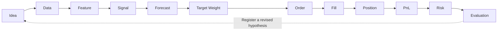
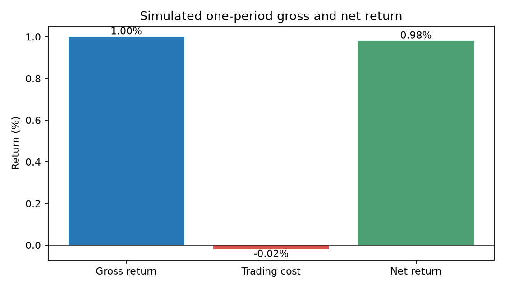

# Chapter 1 — Quantitative Finance and the Quant Industry

> The central task is to turn an investment idea into a traceable chain of data, decisions, fills, and evidence.
> Prerequisites: elementary algebra, percentages, and basic logical reasoning. Read the programming logic first if needed; Chapter 2 develops the environment and syntax.

## 1. Learning goals

Distinguish quantitative finance, financial engineering, systematic trading, and algorithmic trading. Explain the problems that researchers, traders, developers, risk specialists, derivatives specialists, and execution specialists solve. Draw the path from a hypothesis to a conclusion and identify each step's inputs, outputs, and possible failures.

You should be able to turn the idea that past relative performance may persist into a testable hypothesis; record features, signals, forecasts, target weights, orders, fills, positions, and profit and loss (PnL) as separate objects; and reconcile a two-asset example with transaction costs. Job titles provide an entry point. Understanding the objects establishes the working boundary.

## 2. Why a quant needs this map

A historical wealth curve with a high Sharpe ratio does not show what the researcher knew before buying. It does not establish that the price was executable, that the sample retained delisted companies, or how many designs the researcher tried. Examine the process behind the curve before evaluating the result.

This chapter uses a constructed study to explain the objects. Separate the hypothesis, calculation rule, and market evidence. A technical indicator can provide an input to test; its name or appearance does not establish predictive value.

The Princeton ORFE undergraduate overview lists probability, statistics and stochastic processes, and optimization as common foundations, with finance, econometrics, and computational methods among the applications. This suggests a practical order: represent uncertainty, estimate quantities, make constrained decisions, then investigate strategies. Your role may cover one stage, but your report still needs the assumptions of the other stages. [Princeton ORFE](https://orfe.princeton.edu/undergraduate)

The U.S. Securities and Exchange Commission (SEC) report on algorithmic trading discusses algorithms for investment decisions, order size, quoting, and trading risk. Automatic order submission is one application; it does not establish that a researcher has identified a new source of expected return. [SEC report](https://www.sec.gov/files/algo_trading_report_2020.pdf)

## 3. Intuition

### Start with rights, quantities, and quotes

A financial instrument specifies the rights and obligations of its holder and counterparty. Cash, securities, and contractual rights with economic value can constitute financial assets. A stock is both an instrument and an asset in an account. These categories overlap. Chapter 10 develops the trading mechanisms; here we establish the background for calculation.

| Object | What you hold | Quantity and price units | Changes that affect wealth |
|---|---|---|---|
| Stock | An ownership interest; distributions depend on the company and the rights attached | Shares; currency per share | Price, entitled dividends, share count |
| Bond | A contractual debt claim with default risk | Units or face value; verify the quotation convention | Interest, repayment, price, default |
| Fund unit | A corresponding share of fund assets | Units; currency per unit | Underlying assets, fees, distributions |
| Derivative | Rights or obligations determined by an underlying and contract terms | Contracts; record the multiplier separately | Underlying, time, contract terms; margin differs from notional exposure |

A price has a time, currency, and quotation unit. A fill price, bid, ask, and valuation price serve different purposes. With \(q\) shares valued at \(P\) currency units per share, \(qP\) has currency units. A quote of 100 does not state the amount invested or establish that the asset is cheap.

Return divides a change in wealth by starting wealth. With no cash flows and a fixed quantity, a price rise from 100 to 102 adds 2, so return is \(2/100=0.02=2\%\). A holder of 100 shares earns 200 currency units, still a 2% return. Risk includes uncertainty, possible losses, and the ability to sell when needed. Beta measures one linear sensitivity, rather than the whole set of risks.

In the spot example, a long position has a positive quantity and gains value as price rises. In a simplified stock short sale, you borrow shares and sell them, assuming an obligation to return shares. A price rise increases the repurchase cost. Actual borrowing, collateral, and financing carry further conditions. Signed weights express direction here; they do not establish that short-sale proceeds are available for unrestricted use.

Consider a teaching hypothesis: information about macroeconomic demand and fundamental shocks may spread with a delay, so assets with stronger past relative performance may continue to outperform next period. Before trading, define the return measure, the historical window, the future horizon, and whether the universe includes companies that later delisted.

A historical return calculated on a decision date is a **feature**. A ranking of assets produces a **signal**. A mapping from rank to estimated future return produces a **forecast**. Risk, costs, and holding limits then inform **target weights**. Execution converts targets to **orders**. A **fill** records actual quantity, price, and time; fills update the **position**. Subsequent price and cash-flow changes produce **PnL**.

The study may fail because the proposed regularity does not exist, the data cannot test it, the forecast is weak, costs absorb the return, risk concentrates, or execution is harder than assumed. Record the point of failure to choose the next task. A more complex model does not resolve these problems by itself.

### The lifecycle



The arrows show dependencies. Completing the chain does not ensure profit. The nine broad stages are:

1. **Idea:** a falsifiable hypothesis grounded in a proposed mechanism, such as slow information adjustment or compensation for risk.
2. **Data:** structured market and fundamental records with timestamps and units, organized under a point-in-time (PIT) information contract.
3. **Signal:** a direction or ranking based only on features known at decision time \(t-1\).
4. **Forecast:** a conditional estimate of the next period's return distribution.
5. **Portfolio:** desired capital proportions under budget, risk, and turnover constraints.
6. **Execution:** orders, matching, and actual fill quantities, prices, and times.
7. **PnL:** monetary gains and losses and dimensionless returns from effective holdings, prices, and cash flows.
8. **Risk:** factor exposures, tail-loss budgets, and stress scenarios.
9. **Evaluation:** benchmark comparisons, friction costs, statistical and economic significance, and experiment versions.

Changing the design after evaluation adds research choices. Register a new version and retain the previous results.

## 4. Mathematical foundations

::: {.body-definition title="Definition: simple return and its scope"}

This chapter uses returns, weighted averages, and subtraction. The simple return of asset \(i\) over \([t-1,t]\) is
\[
R_{i,t}=\frac{P_{i,t}}{P_{i,t-1}}-1.
\]
The prices must be positive and use the same convention. Return is dimensionless. This expression assumes no separately accounted cash flow; Chapters 3 and 11 explain total returns with dividends.

:::

For a holding interval with no rebalancing and consistent cash-flow treatment,
\[
R_{p,t}=\sum_{i=1}^{n}w^{\mathrm{held}}_{i,t-1}R_{i,t}+w^{\mathrm{held}}_{c,t-1}R_{c,t}.
\]
Here \(p\) denotes the portfolio, \(n\) the number of risky assets, and \(w^{\mathrm{held}}_{i,t-1}\) and \(w^{\mathrm{held}}_{c,t-1}\) the actual risky-asset and cash weights after the opening fills, at the start of \([t-1,t]\). Cash return covers that same interval. Use beginning holdings, rather than targets selected with information from the interval's end.

Investing 60% in an asset returning 2%, 20% in an asset returning −1%, and 20% in zero-return cash gives a gross return of 1%. All weights share the same starting net asset value (NAV) denominator.

Gross return less trading and financing costs gives net return. With a simplified interval cost fraction \(c_t\),
\[
R^{\mathrm{net}}_{p,t}=R^{\mathrm{gross}}_{p,t}-c_t.
\]
We measure cost against initial NAV, assume no external subscriptions or withdrawals, and simplify fee timing and reinvestment. Chapters 29 and 35 use cash ledgers to keep different cash-flow times separate.

## 5. Definitions

### 5.1 Four overlapping fields

| Field | Main object | Typical question | Output and check |
|---|---|---|---|
| Quantitative finance | Mathematical, statistical, and computational representations of finance | How do we price, measure risk, allocate capital, or test a regularity? | Models, estimates, numerical methods, testable conclusions |
| Financial engineering | Contracts, risk transfer, and implementation structures | How do we replicate an option or design hedging and financing? | Pricing and hedging plans; no-arbitrage and risk conditions |
| Systematic trading | Explicit investment and trading rules | What information determines what to hold and when? | Reproducible rules, holdings, out-of-sample evaluation |
| Algorithmic trading | Programmed trading decisions | How do we split orders, quote, control speed, or decide trades? | Algorithms, orders, fills, execution-risk evaluation |

A fund may select stocks with a model and trade them with an execution algorithm. A derivatives pricing model can belong to quantitative finance without an active investment strategy.

::: {.body-pitfall title="Common mistake: treating statistical arbitrage as risk free"}

**Statistical arbitrage** uses statistical relationships, such as relative prices, factor-neutral portfolios, and pair spreads, to construct trades. The name does not guarantee absence of risk. Estimation errors, structural changes, financing, and fills can cause losses. A no-arbitrage pricing condition and a statistical strategy's expected advantage are different claims.

:::

**High-frequency trading (HFT)** commonly combines short holding periods, low-latency infrastructure, and frequent order interactions. No single threshold covers all institutions. Describe latency, order frequency, holding period, and mechanism instead of judging research quality by trades per second.

**Fundamental quant** encodes statements, valuation, operations, and other fundamental information as testable signals. Availability times and accounting conventions matter as much as the code.

### 5.2 A map of responsibilities

| Role | Main responsibility | Example | Interfaces |
|---|---|---|---|
| Quant research | Hypotheses, estimation, experiments, evidence | Test momentum after costs | Data, portfolios, validation, reports |
| Quant trading | Trading state, risk, implementation decisions | Adapt a plan to falling liquidity | Signals, positions, execution |
| Quant development | Reliable data, calculation, and trading systems | Prevent misaligned data or duplicate orders | APIs, code, logs, deployment |
| Risk quant | Risk measures, models, constraints | Factor concentration, stress losses, margin needs | Holdings, markets, limits |
| Derivatives quant | Pricing, calibration, sensitivities, hedging | Option values and Greeks | Quotes, numerical methods, trading desks |
| Execution quant | Trading costs and execution algorithms | Balance impact against waiting risk | Parent orders, books, fills |

Institutions combine and rename responsibilities. The table is a working map, rather than a universal hiring classification. Identify who chooses the hypothesis, assures the data, handles execution, and checks risk.

### 5.3 Keep the objects distinct

In regression attribution, **alpha** is an intercept relative to a specified model. Researchers may also use the word for expected active return or a predictive signal. State the intended meaning. **Beta** is linear sensitivity to a market or factor. A **factor** may mean a company characteristic used for sorting, a common return, or a tradable portfolio. A low P/E characteristic differs from the return on a value-factor portfolio.

| Object | Example or definition | Representation | Availability and units |
|---|---|---|---|
| Feature | Cumulative return over the past 11 months | \(x_{i,t}\) | Calculable after the formation interval; dimensionless |
| Signal | Same-date percentile rank of historical return | \(s_{i,t}\) | Uses the available universe; often 0–1 |
| Forecast | Conditional estimate of next month's return | \(\widehat\mu_{i,t +1\mid t}\) | Produced at \(t\), for \(t\) to \(t+1\); decimal return |
| Target weight | Desired capital allocation after rebalancing | \(w^{\mathrm{target}}_{i,t}\) | Decision after risk and cost constraints; dimensionless |
| Order | Instruction to buy or sell, with quantity, limit, and conditions | ID and submission parameters | Recorded at submission; no holding until filled |
| Fill | Actual executed quantity, price, and time | \((\Delta q_{i,t},E_{i,t},trade\_time)\) | A partial order can produce multiple fills |
| Position | Accumulated actual quantity | Prior quantity plus filled quantity | Updated at each fill; shares or contracts |
| Exposure | Capital size or sensitivity to an asset, industry, or factor | Weight, currency amount, or \(B^\top w\) | Specify the capital convention or risk model |
| PnL | Change in value from holdings and cash | Final value minus initial value minus external net inflow | Currency and holding interval |

In \(B^\top w\), \(B\) is an asset-by-factor exposure matrix and \(w\) an asset-by-one vector, giving a factor-by-one result. Chapters 5, 15, and 21 develop it. The same capital weight can correspond to different market risk.

## 6. Derivations

### 6.1 From capital to return

Starting with \(V_0\), allocate \(V_0 w_i\) to asset \(i\). Its final value is \(V_0 w_i(1+R_i)\); cash ends at \(V_0 w_c(1+R_c)\). With \(\sum_iw_i+w_c=1\),
\[
V_1=V_0\left(1+\sum_iw_iR_i+w_cR_c\right).
\]
Divide by \(V_0\) and subtract one to obtain Section 4's formula. The allocation is effective at the interval's start; we do not reset it using ending prices.

### 6.2 From trading amount to cost

Let \(w_i^{\mathrm{before}}\) and \(w_i^{\mathrm{after}}\) denote weights before and after filled rebalancing. Define the total risky-asset traded fraction, counting purchases and sales without halving:
\[
T=\sum_{i=1}^n\left|w_i^{\mathrm{after}}-w_i^{\mathrm{before}}\right|.
\]
This is total risky-asset traded notional divided by initial NAV. It excludes changes in cash weight. With fee \(k\) per unit traded, \(C=V_0 kT\) and \(c=C/V_0=kT\). A fee of \(k=0.001\) means 10 basis points (bps), or 0.1%, rather than 10%. Sources may call the quantity turnover or halve it; check the convention before comparing costs.

### 6.3 Interpreting alpha and beta

A single-market regression takes the form
\[
R_{i,t}-R_{f,t}=\alpha_i+\beta_i(R_{m,t}-R_{f,t})+\epsilon_{i,t}.
\]
\(R_i\), \(R_f\), and \(R_m\) are asset, risk-free, and market returns at the same currency and frequency. Alpha is the sample/model intercept, beta the sensitivity to market excess return, and epsilon the unexplained component. Use decimal returns; a daily intercept does not directly equal an annual return.

This introduces the regression objects. It does not prove the equilibrium assumptions of the capital asset pricing model (CAPM). Chapter 8 derives estimation; Chapters 14 and 15 discuss pricing and empirical tests. A positive estimated intercept still requires checks for uncertainty, omitted factors, costs, and selection bias.

```{=latex}
\needspace{26\baselineskip}
```

### 6.4 Partial fills: reconcile quantities and cash

::: {.body-example title="Complete example: partial fills and cash"}

Targets determine orders; fills determine quantities. Start from Section 8's account: 500 shares of A, 300 of B, both priced at 100, and cash of 20,000, for NAV of 100,000. The plan buys 100 A and sells 100 B. Now only 40 A fill, while all 100 B sell. This is a constructed example with 10 bps on actual traded notional, immediate payment from cash, and no external cash flow.

The purchase costs 4,000 and the sale raises 10,000. Total traded notional is 14,000 and the fee is 14. Cash becomes \(20,000-4,000+10,000-14=25,986\). Actual holdings are 540 A and 200 B; post-fill NAV is \(54,000+20,000+25,986=99,986\). Trading exchanges cash and assets; only the fee reduces NAV. The unfilled 60 A do not enter the position.

At final prices A=102 and B=99, NAV is \(540(102)+200(99)+25,986=100,866\). Net PnL is 866, or 0.866% of initial NAV. The alternative check is price PnL \(540(2)+200(-1)=880\), less the fee of 14. Using the target 600 A would overstate profit by \(60(2)=120\). If weights use post-fee NAV, their denominator is 99,986. Keep this event ledger separate from Section 8's simplified terminal fee deduction. We take fills as given; we do not model matching or financing.

:::

## 7. Financial interpretation

A forecast does not specify how much capital to invest. Allocation depends on forecast uncertainty, correlations, loss budgets, costs, liquidity, and financing. High weights in two correlated stocks can concentrate the same economic risk twice.

With market beta 1.5, a one-percentage-point increase in market excess return corresponds in the regression model to about 1.5 percentage points of portfolio change, holding other effects fixed. It does not guarantee the next realization, particularly during crises or leverage constraints.

Specify what “net alpha” deducts. Commissions alone can omit borrowing, financing, spreads, and impact. Chapter 35 develops the model; here, report the included and omitted costs.

## 8. Numerical example

All inputs are **constructed for teaching**, rather than observations or strategy performance. We follow the nine stages.

Times use Coordinated Universal Time (UTC) and constructed days, rather than an actual exchange calendar. At D 0 16:00, prices are A 98/B 101; at D 1 16:00, A 100/B 100. Publication occurs at 16:01, ingestion at 16:02, and signal formation at 16:05. Both assets fill at 100 at D 2 09:30. The measured interval runs from D 2 09:30 to D 3 16:00, with final prices A 102/B 99 and no dividends.

| Input | A | B | Purpose |
|---|---:|---:|---|
| D 0–D 1 historical return | \(100/98-1\approx 2.040816\%\) | \(100/101-1\approx-0.990099\%\) | Compare past performance |
| Assigned high/low signal | +1 | −1 | Enter the stated forecast mapping |
| Next holding-period forecast | 1.5% | 0.5% | Inform the portfolio decision |
| D 2–D 3 realized return | 2% | −1% | Evaluate after the interval |

At D 1, the last row is unknown. The target weights 0.6/0.2 are a specified rule, rather than a uniquely derived optimum from the two forecasts.

1. **Idea:** macroeconomic industry-demand differences may propagate slowly and create short-term persistence.
2. **Data:** use prices and returns already ingested at decision time \(t-1\), with both `available_at` and `ingested_at` no later than that decision.
3. **Signal:** assign +1 to the stronger A and −1 to the weaker B.
4. **Forecast:** specify the teaching mapping \(\widehat\mu_i=0.01+0.005 s_i\). It gives A 1.5%, B 0.5%, and cash 0%. Constants have decimal-return units per holding period. We have neither fitted nor validated the mapping. Rank has no return units; the realized 2%/−1% are separate inputs.
5. **Portfolio:** choose long-only target weights \(w_A^{\mathrm{target}}=0.60\), \(w_B^{\mathrm{target}}=0.20\), and \(w_c^{\mathrm{target}}=0.20\).
6. **Execution:** initial NAV is 100,000 with weights 0.50/0.30/0.20. At D 2's price of 100, the account holds 500 A, 300 B, and 20,000 cash. Buy 100 A and sell 100 B, each for 10,000 currency units. Assume full fills, yielding 600 A and 200 B. Distinguish currency notional from share quantity. At the start of the return interval, the total traded fraction is \(T=|0.60-0.50|+|0.20-0.30|=0.20\), or 20,000 currency units. Held weights are 0.60/0.20/0.20.
7. **PnL:** realized A/B/cash returns are 2%/−1%/0%. Gross return is \(0.60(0.02)+0.20(-0.01)+0.20(0)=0.01=1.00\%\). At \(k=0.001\), cost is \(C=100,000(0.001)(0.20)=20\), or 0.02% of initial NAV. Net return is \(1.00\%-0.02\%=0.98\%\). Final NAV is \(100,000(1+0.0098)=100,980\); net PnL is 980 currency units.
8. **Risk:** risky-asset gross and net exposure both equal 0.80; cash provides a 20% buffer. A alone falling 10%, with B and cash unchanged, produces \(0.6(-0.10)=-6\%\) gross return. This is a constructed stress scenario, rather than a probability estimate.
9. **Evaluation:** a specified 50/50 A/B benchmark with no cash returns 0.5% gross. The gross difference is 0.5 percentage points; benchmark costs are unspecified, so a net difference is unavailable. One observation cannot establish mean significance. At 50 bps, strategy cost becomes 0.10% and net return 0.90%. Freeze the record and parameters to retain the trial history.

We assume full fills at interval start, no additional impact or external cash flow, and a fee deducted against initial NAV without changing the stated asset allocation. A self-financing ledger must reconcile the source of fee cash and actual quantities. This example checks arithmetic and object definitions; it is not a trading engine.

Choosing weights 0.6/0.2 after observing A 2%/B −1% and applying them to that finished interval creates look-ahead bias. The same multiplication can represent an invalid experiment.

## 9. Python implementation

### Default accepted-reader entry point

Use the shared I3 reader at the cloned repository root (`quantweft/`). Set up its environment under README.md, then run from that reader root:

```bash
.venv/bin/python run_notebook.py notebooks/ch01_lifecycle.ipynb
```

The constructed notebook does not read omitted French files or download data. Each run writes to a unique `runs/` subdirectory. The historical CLI and test/data paths below refer to the course root. French calculations require authorized local inputs and manifests and were not rerun for this batch. The portable I3 CLI defaults to a fresh UUID run and rejects overwriting. When already at the reader root, do not run `cd quantweft` again. README.md and OPTIONAL_DATA.md describe setup and optional inputs. A constructed check does not revalidate market calculations.

The chapter script is `code/ch01_lifecycle.py`, with `notebooks/ch01_lifecycle.ipynb`; the run environment and steps are described in the [environment notes](../../README.md). The script records the teaching construction and capital convention and sends no trading instructions. The original course-root command is:

```bash
cd quantweft
.venv/bin/python code/ch01_lifecycle.py
```

The following standalone program explains the calculation. Shared implementations and their tests live in `src`.

```python
from math import isclose

def one_period_net_return(
    weights: tuple[float, ...],
    returns: tuple[float, ...],
    prior_weights: tuple[float, ...],
    cost_rate: float,
) -> tuple[float, float, float]:
    if not (len(weights) == len(returns) == len(prior_weights)):
        raise ValueError("weights and returns must have the same length")
    if cost_rate < 0:
        raise ValueError("cost_rate must be nonnegative")
    gross_return = sum(w * r for w, r in zip(weights, returns))
    turnover = sum(abs(w - old) for w, old in zip(weights, prior_weights))
    cost = cost_rate * turnover
    return gross_return, cost, gross_return - cost

gross, cost, net = one_period_net_return(
    weights=(0.6, 0.2), returns=(0.02, -0.01),
    prior_weights=(0.5, 0.3), cost_rate=0.001,
)
assert isclose(gross, 0.01)
assert isclose(cost, 0.0002)
assert isclose(net, 0.0098)
print({"gross": gross, "cost": cost, "net": net})
```

Floating-point output may show 0.009800000000000001. Use a tolerance, rather than comparing strings. The local function assumes zero cash return; it does not cover financed shorts or complex rebalancing. Chapter 29 supplies a ledger.

The next standalone block reconciles the simplified convention: specify the post-fill asset allocation, deduct the 20-unit fee at the end, and ignore the reinvestment effect of fee timing. Chapter 29 handles self-financing constraints.

```python
from math import isclose
initial_nav = 100000.0
stock_end = 600 * 102.0 + 200 * 99.0
trade_amount = 100 * 100.0 + 100 * 100.0
cost_currency = trade_amount * 0.001
cash_end = 20000.0 - cost_currency
ending_nav = stock_end + cash_end
pnl_currency = ending_nav - initial_nav
assert isclose(stock_end, 81000.0)
assert isclose(cost_currency, 20.0)
assert isclose(ending_nav, 100980.0)
assert isclose(pnl_currency / initial_nav, 0.0098)
print(stock_end, cash_end, ending_nav, pnl_currency)
```

### Timing contract

Suppose historical information through Monday's close forms the feature, the signal follows the close, and fills occur at Tuesday's trading start. Measure changes after the Tuesday fill. The Monday-close-to-Tuesday-open gap does not belong to a position first purchased on Tuesday.

Chapter 2 demonstrates index alignment with `shift`. A shifted row still needs consistent price endpoints. Using close-to-close returns to approximate an open-fill holding return requires a separate error disclosure.

## 10. Visualization



The horizontal axis shows Gross, Cost, and Net; the vertical axis shows return percent. The cost bar is −0.02%, expressing its contribution to return; the fee itself is positive 0.02%. Check that the fee equals the gross/net difference. The 0.02-percentage-point fee is small relative to 1% gross return here. The figure illustrates constructed arithmetic and establishes no strategy advantage.

The lifecycle arrows show dependencies. An incorrect net return may arise from fill price, position timing, corporate actions, or cost units. Trace the relevant inputs.

## 11. Real market example

Kenneth French publishes industry-portfolio and factor returns. The course's frozen 10-industry snapshot comes from [10 Industry Portfolios](https://mba.tuck.dartmouth.edu/pages/faculty/ken.french/Data_Library/det_10_ind_port.html); its download and hashes appear in `data/manifests/french_industries_2026-10-05.json`. Raw data are omitted from the portable reader and require authorized user-supplied inputs.

The source description assigns stocks by Standard Industrial Classification (SIC) industry at each June end and computes returns from July through the following June. You have returns on **already constructed portfolios**, rather than executable stock quantities or observations of Open, High, Low, Close, and Volume (OHLCV). This supports return-panel and regression exercises; it does not establish that you can reproduce every historical fill.

Map it to the lifecycle: industry-return differences may motivate an idea; monthly portfolio returns provide data; historical industry returns form features; ranks form signals; research weights allocate across return series. The file does not supply executable prices, constituents, or quantities for execution. Bound the statistical conclusion accordingly.

This chapter performs no momentum backtest on that sample and reports no strategy Sharpe. Chapter 2 handles loading and units, Chapter 15 factor regression, and Project 1 and later projects description and strategy validation. The database revises historical calculations, so a snapshot differs from the current page. [French library and format changes](https://mba.tuck.dartmouth.edu/pages/faculty/ken.french/data_library.html)

## 12. Common mistakes

### Using a future realization as the forecast

`forecast = next_month_return` uses an outcome unavailable at prediction time. Historical realized returns may serve as training labels after their intervals finish. Keep separate columns for the feature available at `signal_time`, the forecast generated then, and the later `realized_return`. A common display date does not imply common availability.

```python
past_return = -0.02
next_return = 0.03
# Wrong: use the future outcome for the current decision
wrong_weight = 1.0 if next_return > 0 else 0.0
# Use historical information first; evaluate the future afterward
correct_weight = 1.0 if past_return > 0 else 0.0
```

These inputs are constructed. The programming solution compares realized returns. In actual work, both variables need explicit return intervals.

### Treating zero net exposure as zero risk

Long A 50% and short B 50% gives zero net exposure and 100% gross exposure. If A rises 10% and B 20%, the cost-free return is \(0.5(0.1)-0.5(0.2)=-5\%\). Dollar neutrality does not imply beta neutrality or protection from loss.

### Confusing cost-rate units

10 bps equals \(10/10000=0.001\). Entering 10 gives a 1000% rate; entering 0.1 gives 10%. Record units in configurations and data dictionaries, and use the 20-currency-unit hand calculation as a check.

### Treating regression alpha as established advantage

An intercept depends on model, sample, frequency, factors, and estimation error. Check multiple testing, costs, and out-of-sample evidence. Discuss statistical and economic significance separately.

### Equating reproducibility with valid research

Repeated output confirms that fixed inputs and code reproduce a calculation. Invalid data, future information, omitted delistings, and wrong formulas can also reproduce. Test input validity and experimental design.

## 13. Quant research application

Write a minimal protocol for the momentum hypothesis:

1. **Mechanism:** adjustment may occur in stages, creating association between past strength and future return. Treat this as a proposed explanation.
2. **Sample:** begin with industry portfolios for method practice. For a stock strategy, recheck the PIT universe, prices, cash flows, and borrowing.
3. **Formation:** specify months and whether to skip the most recent month. Chapter 25 develops 12–1 momentum.
4. **Decision and fill:** use information available through \(t\), trade at an executable later time, and match return endpoints to the fill.
5. **Control:** compare equal weighting or a specified benchmark instead of reporting only the best curve.
6. **Freeze:** determine windows, weights, costs, and metrics before final out-of-sample evaluation; retain all trials.
7. **Evaluation:** report gross/net return, risk, exposure, turnover, failure windows, uncertainty, and unverified execution assumptions.

You can define a question and data contract before learning regression and backtesting software. Add a tool when it addresses a specific problem.

## 14. Chapter summary

Researchers turn an economic question into hypotheses and testable objects. Developers make data and calculations reproducible. Trading and execution staff convert target weights into orders and fills; fills update holdings. Risk staff assess possible losses, and holdings plus cash flows determine PnL. The lifecycle connects these responsibilities.

Features provide inputs; signals guide decisions; forecasts estimate future outcomes; targets allocate capital; orders request trades; fills record execution; positions record actual quantities; exposure measures capital or sensitivity; PnL records subsequent monetary results. Attach a model and frequency to alpha and beta. Chapters 2 and 3 develop implementation and information availability.

## 15. Exercises

**1-E01:** A program splits a large order into small orders every minute. A person chooses investment direction. Which field does this illustrate? Does it establish quant research?

**1-E02:** Explain feature, signal, forecast, target weight, order, fill, and position. Give a historical-return example and label decision, submission, fill, and position-effective times.

**1-E03:** Does long A 50%/short B 50% eliminate market risk? State the information you need.

**1-E04:** Industry returns support regression but do not validate stock-order execution. Name three missing inputs.

**1-E05:** Risky weights are 0.4/0.4 and cash 0.2. Returns are 3%/−2% and cash 0.1%. Calculate gross return.

**1-E06:** Risky weights change from 0.3/0.5 to 0.5/0.3, fee 5 bps per traded notional, starting NAV 200,000 currency units. Calculate cost, counting purchases plus sales without halving.

**1-E07:** A/B returns are 10%/20%. Hold A 0.5/B −0.5 and cash 1 at zero return. Calculate net/gross exposure and gross return.

**1-N01 (identify):** Classify a quote of 100 currency units per share, 100 shares held, signal +1, and a next-period forecast of 1.5%, with units. Can signal +1 directly mean a 1% forecast? When do orders arise and holdings update?

**1-N02 (one step):** Starting NAV 50,000; risky weights 0.40/0.40, cash 0.20. Full fills change risky weights to 0.70/0.10; cash stays 0.20. At 10 bps calculate total unhalved traded fraction, actual traded notional, fee amount, and cost fraction. Does cash-weight change enter turnover?

**1-N03 (full calculation):** Starting NAV 100,000; risky/cash weights change from 0.50/0.30/0.20 to 0.60/0.20/0.20. Realized returns 2%/−1%/0%, fee 10 bps. Show turnover, fee, gross/net return, ending NAV, net PnL, and risky gross/net exposure, with units.

**1-B01 (partial fills):** Under Section 6.4's fill state, calculate post-fill cash, quantities, NAV, and final net PnL. Explain why the target 600 A cannot determine actual A profit.

## 16. Programming exercises

**1-P01:** Run the chapter script and check gross 0.01/cost 0.0002/net 0.0098. Change the rate to 50 bps and interpret the result.

**1-P02:** With past return −2% and next return 3%, compare a rule selecting holdings from the future return's sign with one using the past return's sign. Define and run all variables.

**1-P03:** Write a check rejecting a `signal_time` of 16:05 and same-day `trade_time` 16:00. Make the next-day opening time pass. Use timezone-aware UTC objects.

**1-N04 (diagnose):** Targets 0.6/0.2 do not fill; holdings remain 0.5/0.3, cash 0.2. No other trade occurs; fees apply only to actual traded notional. Returns 2%/−1%/0%. Identify both errors below, calculate actual gross/net return, and repair with assertions.

```python
target_weights = (0.6, 0.2)
prior_weights = (0.5, 0.3)
returns = (0.02, -0.01)
cost_rate = 10  # Wrong: treat 10 bps as the decimal rate
planned_turnover = sum(abs(w - old) for w, old in zip(target_weights, prior_weights))
gross = sum(w * r for w, r in zip(target_weights, returns))
net = gross - cost_rate * planned_turnover
print(gross, net)
```

## 17. Challenge problems

**1-C01:** Design a minimal momentum protocol. Which assumptions can you register? Which data gaps prevent an investability conclusion? Propose a control that could overturn the initial explanation.

**1-C02:** Name at least three gaps between the simplified fee example and an actual self-financing ledger. Propose a reconciliation identity.

**1-N05 (research judgment):** A historical-return ranking uses today's security list and forms its signal after the closing price is final, yet assumes fills at that same close. The report shows one high-Sharpe result without costs. Identify timing/sample defects, missing fee/trial evidence, and whether this proves actual net profitability or disproves the regularity.

\clearpage

## 18. Solutions / Solution Hints

### Concepts and hand calculations

**1-E01:** This is an execution algorithm within algorithmic trading. Studying execution parameters and impact may constitute execution-quant research. Following a fixed plan does not establish alpha research. Human investment direction can coexist with automated execution.

**1-E02:** Historical cumulative return is a feature; its rank at \(t\) is a signal; an estimate made at \(t\) for a future interval is a forecast. The target is a desired capital fraction, the order a submitted instruction, the fill an actual execution record, and the position the filled share quantity. For example, decide at D 1 16:05, submit at D 2 09:29, and confirm a fill at 09:30; that quantity becomes effective at 09:30 and its return starts afterward. Unfilled orders leave quantities unchanged.

**1-E03:** Net capital exposure is zero. Unequal asset betas can leave nonzero market beta. Industry, stock-specific, spread, borrowing, and financing risks remain. Obtain betas, correlations, factor exposures, and trading/capital constraints.

**1-E04:** Historical constituents and quantities; executable quotes/depth; borrowing and financing terms. Corporate actions, calendars, and costs also need checks. Portfolio-return files supply none of these by themselves.

**1-E05:** \(0.4(0.03)+0.4(-0.02)+0.2(0.001)=0.0042=0.42\%\). Cash contributes 0.02 percentage points.

**1-E06:** \(T=|0.5-0.3|+|0.3-0.5|=0.4\). At \(5\mathrm{bps}=0.0005\), cost fraction is 0.0002=0.02%, or 40 currency units. A halved convention needs a matching fee convention.

**1-E07:** Risky net exposure \(0.5-0.5=0\), gross 1, return 5%−10%=−5%. Cash weight 1 satisfies the total budget but does not offset price changes. Actual access to short-sale proceeds depends on collateral and financing; this question simplifies them.

**1-N01:** 100 currency/share is price,100 shares is quantity, and their product 10,000 is market value. Signal +1 is dimensionless;1.5% forecasts the next holding return. A mapping and conditions are needed to convert a score into expected return. Execution submits orders, and actual fills update positions. Unfilled orders do not increase holdings.

**1-N02:** \(T=|0.70-0.40|+|0.10-0.40|=0.60\). Notional is \(50,000(0.60)=30,000\), comprising 15,000 bought and 15,000 sold. At \(k=0.001\), \(c=0.0006=0.06\%\) and \(C=30\). Cash rebalancing is excluded from risky-asset turnover.

**1-N03:** \(T=0.10+0.10=0.20\); \(k=0.001\), \(c=0.0002=0.02\%\), \(C=20\). Gross return \(0.60(0.02)+0.20(-0.01)=0.012-0.002=0.010=1.00\%\). Net 0.98%; ending NAV 100,980; PnL 980 currency units. Risky gross/net exposure both 0.80=80%.

**1-B01:** Actual holdings 540 A/200 B; traded notional 14,000; fee 14; cash 25,986; post-fill NAV 99,986; final NAV 100,866; PnL 866 and return 0.866% of initial NAV. Price PnL 880 less fee 14 gives 866. The unfilled 60 shares would falsely add 120 profit if you used the target. Post-fee weights divide by 99,986 and their amounts sum to that NAV.

### Programming reference solutions

**1-P01:** 50 bps=0.005 gives cost 0.001=0.1% at turnover 0.2. Net return 0.009=0.9%. Change `cost_rate=0.005` in Section 9 and assert `isclose(net, 0.009)`. Equal gross return need not give equal net return.

**1-P02:** The future-informed rule obtains 3%; the historical rule holds no asset and obtains 0. The difference comes from future knowledge.

```python
past_return = -0.02
next_return = 0.03
wrong_weight = float(next_return > 0.0)
correct_weight = float(past_return > 0.0)
wrong_pnl_fraction = wrong_weight * next_return
correct_pnl_fraction = correct_weight * next_return
assert wrong_pnl_fraction == 0.03
assert correct_pnl_fraction == 0.0
print(wrong_pnl_fraction, correct_pnl_fraction)
```

**1-P03:** Compare timezone-aware instants, rather than date strings. This checks time order; it does not establish that an exchange is open. Chapter 3 adds calendars.

```python
from datetime import datetime, timezone

def check_trade_time(signal_time: datetime, trade_time: datetime) -> None:
    if signal_time.tzinfo is None or trade_time.tzinfo is None:
        raise ValueError("timezone required")
    if trade_time <= signal_time:
        raise ValueError("trade must follow signal")

signal = datetime(2026, 6, 1, 16, 5, tzinfo=timezone.utc)
wrong_trade = datetime(2026, 6, 1, 16, 0, tzinfo=timezone.utc)
try:
    check_trade_time(signal, wrong_trade)
except ValueError:
    pass
else:
    raise AssertionError("look-ahead timing was not rejected")
check_trade_time(signal, datetime(2026, 6, 2, 13, 30, tzinfo=timezone.utc))
```

The dates and UTC times are constructed; we do not claim a particular security's actual opening time.

**1-N04:** First,10 bps equals 0.001; entering 10 multiplies the rate by 10,000. Second, targets differ from actual holdings and planned trading differs from fills. No fills leaves holdings 0.5/0.3, actual turnover 0, and fees 0. Gross \(0.5(0.02)+0.3(-0.01)=0.007\), net 0.7%.

```python
from math import isclose
held_weights = (0.5, 0.3)
returns = (0.02, -0.01)
actual_traded_fraction = 0.0
cost_rate = 10 / 10000.0
gross = sum(w * r for w, r in zip(held_weights, returns))
cost = actual_traded_fraction * cost_rate
net = gross - cost
assert isclose(gross, 0.007)
assert cost == 0.0
assert isclose(net, 0.007)
print(gross, cost, net)
```

This uses a specified fill state, rather than a matching model. Actual systems also record rejections, missed opportunities, and other possible fees.

### Challenge solutions and grading

**1-C01:** Specify mechanism, universe, window endpoints, signal/return intervals, benchmark, costs, validation, and search scope. A preregistered reversal window or subsample comparison can challenge the explanation. Industry data cannot establish stock borrowing, impact, or full-market PIT validity. Grade timing/data scope 40%, falsifiable hypothesis/control 30%, validation/limits 30%; do not grade by positive return.

**1-C02:** Gaps include fee timing, post-trade cash, converting weights to quantities, unfilled orders, dividends/financing, and price drift between trades. Use
\[
NAV_t=CASH_t+\sum_iq_{i,t}P_{i,t}-LIAB_t.
\]
CASH is cash, \(q\) actual quantity, \(P\) valuation price, and LIAB liabilities. Record external flows and trade cash flows separately. Pair each asset change with its cash change; fees reduce NAV. Grade at least three gaps 50%, consistent units and event order 50%.

**1-N05:** Final-close input must arrive and be processed before the signal and order. Same-close execution lacks timing evidence. Today's list cannot establish historical membership; obtain entry/exit and tradability records. Add actual traded notional, rates, spreads/impact/financing, fills, trial history, benchmarks, and out-of-sample design. High Sharpe proves neither actual net profit nor absence of the economic regularity. The backtest cannot support an executable conclusion. Grade 10 points: timing 3, universe 2, fee/trial evidence 3, conclusion scope 2.

## 19. Further reading

- **Must know:** Princeton ORFE's official overview for foundations and applications; the SEC report's definitions and trading uses.
- **Should know:** the [MIT Finance Theory I overview](https://ocw.mit.edu/courses/15-401-finance-theory-i-fall-2008/) for valuation, investment, and risk themes.
- **Optional:** compare institutional job descriptions by responsibilities. Titles vary and do not provide a universal qualification standard.

## 20. References

1. **ORFE:** Princeton ORFE, Undergraduate Program. The historical course record reports reading the core overview on 2026-10-05. [Official page](https://orfe.princeton.edu/undergraduate).
2. **SEC_ALGO:** SEC, *Staff Report on Algorithmic Trading in U.S. Capital Markets*,2020. The record covers algorithmic decision uses and makes no unverified statistical claim. [Official PDF](https://www.sec.gov/files/algo_trading_report_2020.pdf).
3. **FRENCH_10:** Kenneth R. French, *Detail for 10 Industry Portfolios*. This chapter explains applicability. [Portfolio description](https://mba.tuck.dartmouth.edu/pages/faculty/ken.french/Data_Library/det_10_ind_port.html).
4. **FRENCH:** Kenneth R. French, Data Library, for format and historical-calculation revisions. [Library](https://mba.tuck.dartmouth.edu/pages/faculty/ken.french/data_library.html).

Source-reading levels follow the existing source_notes.md and accepted I3 records. This batch did not revisit websites or read additional full texts.

Local shared references: [source notes](../../../../part00/chapter01/source_notes.md), [accepted reader setup](../../README.md), [optional data contract](../../OPTIONAL_DATA.md), [shared script](../../../../code/ch01_lifecycle.py), [shared notebook](../../notebooks/ch01_lifecycle.ipynb).
