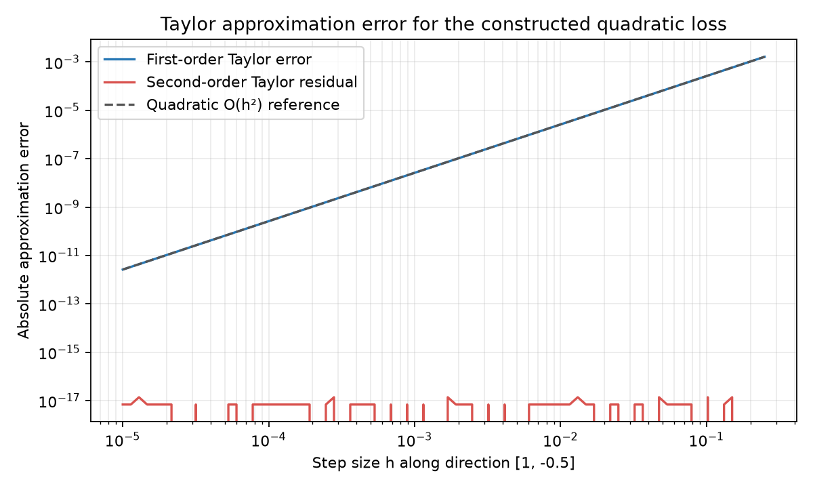

# Chapter 4: Calculus, Rates of Change, Curvature and Local Decisions

> Spine: use the response of a price to a yield change and the curvature of a portfolio objective to make a small change in inputs something you can calculate and check.
> Prerequisites: Chapter 2's Python and arrays. Section 6.3 develops column vectors, transposes and a two-by-two product before Chapter 5 collects the linear algebra. You will derive a constructed bond's first and second derivatives, read their units, and compare analytic and numerical derivatives of a quadratic objective.

## 1. Learning Objectives

Work from a one-variable rate of change to a local approximation with several inputs. You should be able to:

1. Define a derivative by a limit of difference quotients and distinguish continuity, differentiability and twice continuous differentiability, written \(C^2\).
2. Read a derivative's units from its input and output.
3. Distinguish a partial derivative, total differential, gradient, directional derivative and Hessian matrix.
4. State the smoothness and remainder conditions behind first- and second-order Taylor approximations.
5. Accumulate marginal changes using the fundamental theorem of calculus.
6. Classify an interior stationary point as a minimum, maximum or saddle when the second-order test applies, and recognize when it is inconclusive.
7. Compare central differences with analytic gradients and Hessians, including the effects of step size.

The two constructed cases give concrete checks. The bond has
\[
P\approx90.70295,\qquad P'\approx-172.76752,\qquad P''\approx493.62148.
\]
The portfolio case gives objective \(-0.0452\), gradient \((-0.022,-0.038)^\top\) and Hessian \(\Sigma\). Their inputs are teaching assumptions, not market observations.

## 2. Why Quantitative Research Needs Calculus

A yield rises by one basis point: how much does the formula price change? A feature changes: which way does a model score move? A portfolio weight changes: does its risk objective increase? Calculus separates the slope, the chosen direction and the curvature in each question.

A slope needs a shock size before it becomes a price change. In our bond case, \(-172.77\) is the response per unit of decimal yield; multiply by \(0.0001\) for one basis point. An unconstrained weight update needs a separate budget check. A lower objective does not establish a fully invested portfolio.

The gradient describes the local response; the Hessian describes how that response changes. A definite integral accumulates marginal responses along a path. These calculations describe the chosen mathematical model. Evidence for prediction, execution and costs must come from a research design that also addresses those questions.

## 3. Intuition: Slope and Curvature

Read \(P(y)\) as the output of the pricing rule \(P\) at yield \(y\). Changing the input can change the output while leaving the rule fixed. For \(f(x)=x^2\), input \(x=3\) gives \(f(3)=9\); \(x\) is the independent variable and \(f(x)\) the dependent variable.

On a price-yield graph, put yield on the horizontal axis and price on the vertical axis. A tangent line at the current yield has slope \(P'\). If the curve bends upward, equal yield shocks at different locations need not give equal price changes. The second derivative records that curvature.

For \(f(w_1,w_2)\), think of a surface. The gradient points toward the steepest local ascent in Euclidean coordinates; among Euclidean unit directions, the negative-gradient direction gives the steepest instantaneous decrease per unit distance. A bowl has positive curvature in every direction; a saddle bends upward in one direction and downward in another. This picture says nothing by itself about global convexity, position limits, leverage or feasibility of a finite update.

## 4. Mathematical Foundations: Increments, Units and Shapes

### 4.1 Variables, Function Inputs and Powers

The parentheses in \(f(x)\) specify an input, not multiplication of \(f\) by \(x\). In \(g(x,z)\), two inputs produce one output. A partial derivative changes one input while holding the others fixed.

A power means repeated multiplication: \((1+y)^2=(1+y)(1+y)\). A negative power gives a reciprocal: \(a^{-2}=1/a^2\), for \(a\ne0\). Thus \(100/(1+y)^2=100(1+y)^{-2}\). For the constructed annual-compounding bond we require \(y>-1\), so the discounting base is positive.

### 4.2 Input Increments and Difference Quotients

Change \(x\) to \(x+h\). The signed input increment is \(h\), and the output increment is
\[
\Delta f=f(x+h)-f(x).
\]
For \(h\ne0\), the average rate of change is
\[
\frac{f(x+h)-f(x)}h=\frac{\Delta f}h.
\]
Its units are output units divided by input units. For \(f(x)=x^2\), moving from 2 to 2.1 gives \(h=.1\), outputs 4 and 4.41, increment .41 and average rate 4.1. With \(h=.01\), the rate is 4.01. As nonzero \(h\) approaches zero, the rate approaches 4. The quotient remains undefined at \(h=0\).

Differentiability lets us separate a linear part from a smaller remainder:
\[
f(x+h)-f(x)=f'(x)h+o(|h|).
\]
The notation \(o(|h|)\) means that the remainder divided by \(|h|\) tends to zero. It does not guarantee a quadratic error rate. A stronger error bound requires stronger smoothness assumptions.

### 4.3 Units and Dimensions

A derivative has units
\[
[\text{derivative}]=[\text{output}]/[\text{input}].
\]
Price uses currency units; yield is a dimensionless decimal. Accordingly, \(P'(y)\) is price units per unit of decimal yield. A change of .01 is one percentage point, or 100 basis points (bp). Since one bp is one hundredth of a percentage point,
\[
1\text{ bp}=.0001,\quad25\text{ bp}=.0025,\quad100\text{ bp}=.01.
\]
A derivative reported per decimal yield unit is not a price change per percentage point or per bp.

With inputs \(w\in\mathbb R^n\), gradient entries can have different units if the coordinates do. Hessian entry \(H_{ij}\) has function units divided by the units of inputs \(i\) and \(j\). Coordinate scaling matters when comparing gradient magnitudes or choosing a numerical step.

For \(f:\mathbb R^n\to\mathbb R\), use column inputs and a column gradient, both \(n\times1\); the Hessian is \(n\times n\). Then \(\nabla f^\top\Delta w\) and \(\Delta w^\top H\Delta w\) are scalars. Check the convention before adding transposes merely to make a program run.


::: {.body-conditions title="Input conditions: a fixed-maturity construction"}

Our bond pays a single face value of 100 at the end of year two, uses annual compounding, and measures cash flow and price in the same currency. It is a closed-form teaching case.

:::

## 5. Definitions

A limit describes nearby function values. If for every \(\varepsilon>0\) there is a \(\delta>0\) such that \(0<|h|<\delta\) implies \(|f(x+h)-L|<\varepsilon\), then \(\lim_{h\to0}f(x+h)=L\).


::: {.body-definition title="Definition: continuity and differentiability"}

Continuity requires the function to be defined at the point and its limit to equal its value. Differentiability requires the finite limit
\[
f'(x)=\lim_{h\to0}\frac{f(x+h)-f(x)}h.
\]
Differentiability implies continuity; continuity alone is insufficient. At zero, \(|x|\) is continuous, but its left and right slopes are \(-1\) and 1. A continuously differentiable function is \(C^1\); continuous second partial derivatives give the usual \(C^2\) condition.

:::

A partial derivative \(\partial f/\partial w_i\) changes coordinate \(i\), holding the others fixed. The gradient collects the partial derivatives:
\[
\nabla f(w)=\begin{bmatrix}\partial f/\partial w_1\\\vdots\\\partial f/\partial w_n\end{bmatrix}.
\]
At a differentiable point, the total differential is the linear part:
\[
df=\nabla f(w)^\top dw,\quad
f(w+\Delta w)-f(w)=\nabla f(w)^\top\Delta w+o(\|\Delta w\|).
\]
It approximates a small increment; it need not equal an arbitrary finite change.

For a unit direction \(u\), the directional derivative is
\[
D_uf(w)=\lim_{h\to0}\frac{f(w+hu)-f(w)}h=\nabla f(w)^\top u
\]
when \(f\) is differentiable. A direction that is not normalized also scales the rate by its length. Normalize directions before comparing rates per unit distance.

The Hessian collects second partial derivatives:
\[
\nabla^2f(w)=\left[\frac{\partial^2f(w)}{\partial w_i\partial w_j}\right]_{i,j=1}^n.
\]
Under \(C^2\) smoothness in a neighborhood, mixed partials agree and the Hessian is symmetric. Its curvature along \(u\) is \(u^\top\nabla^2f(w)u\).

A second-order Taylor expansion is
\[
f(w+h)=f(w)+\nabla f(w)^\top h+\tfrac12h^\top\nabla^2f(w)h+R_3(h).
\]
For \(C^2\) functions, \(R_3(h)=o(\|h\|^2)\). If you retain only the linear term, you omit the quadratic term as well: the resulting error is generally \(O(\|h\|^2)\), not necessarily \(o(\|h\|^2)\). For \(C^3\) functions with the appropriate bounded third derivatives along the segment,
\[
R_3(h)=\tfrac16D^3f(w+\theta h)[h,h,h],\qquad0<\theta<1.
\]
Here \(D^3f(z)[h,h,h]\) is the third directional derivative at \(z\). If its magnitude is bounded by \(M\|h\|^3\), then \(|R_3(h)|\le M\|h\|^3/6\). For a quadratic polynomial this remainder is zero.

An error \(O(|h|^3)\) is bounded by \(C|h|^3\) for a fixed constant in a sufficiently small neighborhood. It need not equal \(h^3\). Curvature usually gives a quadratic error after a tangent approximation; a third-order bound after a quadratic approximation needs the stated conditions. Compare finite-shock approximations with exact values using a tolerance chosen before inspecting the results.

For continuous \(g\), a definite integral is the limit of Riemann sums. With \(\Delta x=(b-a)/n\) and a point \(\xi_k\) in each subinterval,
\[
\int_a^b g(x)\,dx=\lim_{n\to\infty}\sum_{k=1}^ng(\xi_k)\Delta x.
\]
If \(F'=g\) and \(g\) is continuous, the fundamental theorem of calculus gives
\[
\int_a^b g(x)\,dx=F(b)-F(a).
\]

::: {.body-example title="Worked example: midpoint accumulation"}

Integrating a marginal price response per input unit over that input returns price units. For \(\int_0^1x^2dx=1/3\), two midpoint intervals give \(.5(.25^2+.75^2)=.3125\), short by .0208333. Ten give .3325, short by .0008333. The finite sum approximates the integral; convergence requires the relevant integrability and grid refinement conditions.

:::

A differentiable local extremum in an open region has zero gradient. At a stationary point of a locally \(C^2\) function, a positive definite Hessian gives a strict local minimum, a negative definite Hessian a strict local maximum, and an indefinite Hessian a saddle. A semidefinite Hessian is generally inconclusive. At the origin, \(x^4\) is a minimum, \(-x^4\) a maximum, and \(x^2-y^4\) a saddle, despite their zero gradients and semidefinite Hessians. Inspect higher-order terms or changes along different paths. A constrained boundary extremum need not have zero full-space gradient.

For differentiable functions and fixed constants,
\[
(af+bg)'=af'+bg',\quad(fg)'=f'g+fg',\quad(f/g)'=(f'g-fg')/g^2\quad(g\ne0).
\]
A constant has derivative zero; the power rule \((x^m)'=mx^{m-1}\) holds where that power is defined and differentiable. Composite functions also need the chain rule. The derivative of a product is not the product of the derivatives.

To derive the product rule, add and subtract \(f(x+h)g(x)\) in the numerator. It becomes \(f(x+h)[g(x+h)-g(x)]+g(x)[f(x+h)-f(x)]\). Divide by nonzero \(h\), use continuity implied by differentiability and take the limit to obtain \(fg'+gf'\). Combine this with the derivative of \(g^{-1}\) for the quotient rule. For \(x^2\), the difference quotient is \(2x+h\), tending to \(2x\).

Existing partial derivatives need not imply multivariable differentiability. Define \(g(x,y)=xy/\sqrt{x^2+y^2}\) away from zero and \(g(0,0)=0\). Both partial derivatives at zero vanish along the coordinate axes, but \(g(t,t)=|t|/\sqrt2\). Dividing this error from the proposed zero linear part by the distance \(\sqrt2|t|\) gives 1/2, not zero. Continuous partial derivatives provide a common sufficient condition; merely calculating two partials does not establish a total differential.

## 6. Derivations: From a Bond Curve to a Portfolio Surface

### 6.1 Bond Derivatives and Yield Units

For our constructed bond,
\[
P(y)=100(1+y)^{-2},\qquad y>-1.
\]
The exponent reflects two annual discount periods. Write the outer rule as \(100u^{-2}\) and the inner rule as \(u=1+y\). The power rule and chain rule give
\[
P'(y)=100(-2)(1+y)^{-3}\frac{d(1+y)}{dy}=-200(1+y)^{-3}.
\]
The exponent moves into the coefficient and decreases by one; the inner derivative is 1.

Check directly from the definition. For \(a=1+y>0\),
\[
\frac{P(y+h)-P(y)}h
=\frac{100[a^2-(a+h)^2]}{h(a+h)^2a^2}
=-\frac{100(2a+h)}{(a+h)^2a^2}\longrightarrow-\frac{200}{a^3}.
\]
Cancel the nonzero \(h\) before taking the limit. You have not divided by zero. Differentiating again gives
\[
P''(y)=(-200)(-3)(1+y)^{-4}=600(1+y)^{-4}.
\]
Throughout \(y>-1\), the first derivative is negative and the second positive. A higher yield lowers this formula price, and the response changes with position. Those are properties of the formula rather than measurements of a market yield curve.

### 6.2 Path Derivatives and Directional Derivatives

For a specified yield path \(y(t)\),
\[
\frac{dP}{dt}=P'(y(t))\frac{dy}{dt}.
\]
If \(t\) uses years, multiplying price per decimal yield unit by decimal yield per year gives price per year. This path fixes remaining maturity at two years. Treat \(t\) as a scenario parameter, not the full calendar-time evolution of one bond.

For a bond whose remaining maturity changes, use \(P(y,\tau)=100(1+y)^{-\tau}\):
\[
\frac{dP}{dt}=P_y\frac{dy}{dt}+P_\tau\frac{d\tau}{dt},\qquad
P_\tau=-P\log(1+y).
\]
In a smooth calendar-time scenario, \(d\tau/dt=-1\). The terms capture yield movement and shortening maturity in this model, excluding credit, trading and cash-flow events. The calculation below isolates the yield term.

Let \(y(t)=.05+.002t\), a constructed increase of 20 bp per year. At zero,
\[
\frac{dP}{dt}=(-172.7675197063)(.002)=-.3455350394
\]
price units per year. The path is specified for teaching, not estimated as a forecast.

For \(g(x,z)=x^2+3z\), \(x(t)=1+t\), \(z(t)=2t\), at zero the partials are 2 and 3 and the path speeds 1 and 2. Therefore
\[
\frac{dg}{dt}=g_xx'+g_zz'=2(1)+3(2)=8.
\]
At \(dt=.01\), the differential predicts .08. The exact change \(g(1.01,.02)-g(1,0)=.0801\) also includes the quadratic term .0001. The following self-contained code checks the path derivative and both changes.

```python
face_value = 100.0
y0 = 0.05
yield_change_per_year = 0.002

def price(yield_rate: float) -> float:
    return face_value / (1.0 + yield_rate) ** 2

def yield_path(time_years: float) -> float:
    return y0 + yield_change_per_year * time_years

def price_path(time_years: float) -> float:
    return price(yield_path(time_years))

analytic_price_rate = (-200.0 / (1.0 + y0) ** 3) * yield_change_per_year
step_years = 1e-4
numeric_price_rate = (
    price_path(step_years) - price_path(-step_years)
) / (2.0 * step_years)

def g(x: float, z: float) -> float:
    return x**2 + 3.0 * z

g_rate = (2.0 * 1.0) * 1.0 + 3.0 * 2.0
dt = 0.01
exact_g_change = g(1.0 + dt, 2.0 * dt) - g(1.0, 0.0)
linear_g_change = g_rate * dt
print("bond price rate per year:", analytic_price_rate, numeric_price_rate)
print("g exact/linear change:", exact_g_change, linear_g_change)
assert abs(analytic_price_rate - numeric_price_rate) < 1e-8
assert abs(exact_g_change - 0.0801) < 1e-12
assert abs(linear_g_change - 0.08) < 1e-12
```

For a vector path,
\[
\frac d{dt}f(w(t))=\nabla f(w(t))^\top\frac{dw}{dt}.
\]
If the gradient is nonzero, Cauchy-Schwarz gives the smallest derivative over Euclidean unit directions as \(-\|\nabla f\|_2\), attained at \(-\nabla f/\|\nabla f\|_2\). Changing coordinate scales or the distance metric can change the steepest direction. Geometrically, \(q(h)=f(w+hu)\) has \(q'(0)=\nabla f^\top u\). If \(u\) is not normalized, parameter \(h\) no longer equals distance travelled.

### 6.3 Gradient and Hessian of a Quadratic Objective

Use the teaching score
\[
f(w)=\tfrac12w^\top\Sigma w-\mu^\top w,\quad
\Sigma=\begin{bmatrix}.04&.01\\.01&.09\end{bmatrix},\quad
\mu=\begin{bmatrix}.05\\.08\end{bmatrix}.
\]
Both expected simple returns and covariance refer to the same annual interval and use decimals. A general mean-variance score has a risk-aversion coefficient:
\[
f(w)=\tfrac{\lambda_{\mathrm{risk}}}{2}w^\top\Sigma w-\mu^\top w.
\]
That coefficient sets the trade-off and has inverse return units when preserving the return-unit interpretation. Here we fix its numerical value at 1 and suppress it for differentiation. The objective is a risk-return score, not a realized return. Changing decimals to percentages requires a corresponding coefficient change. Chapter 9 develops the convention; its English translation is pending a later batch.

For symmetric \(\Sigma\),
\[
\nabla_w(\tfrac12w^\top\Sigma w)=\Sigma w,\quad
\nabla_w(-\mu^\top w)=-\mu,
\quad\nabla f=\Sigma w-\mu,\quad\nabla^2f=\Sigma.
\]
The shapes in \(w^\top\Sigma w\) are \((1\times2)(2\times2)(2\times1)\), leaving a scalar. First,
\[
\Sigma w=\begin{bmatrix}.04w_1+.01w_2\\.01w_1+.09w_2\end{bmatrix}.
\]
Multiplying by \(w^\top\) gives two cross terms, \(.01w_1w_2\) and \(.01w_2w_1\). After multiplying by 1/2 their sum is \(.01w_1w_2\). Thus
\[
f=.02w_1^2+.01w_1w_2+.045w_2^2-.05w_1-.08w_2,
\]
\[
f_{w_1}=.04w_1+.01w_2-.05,\qquad
f_{w_2}=.01w_1+.09w_2-.08.
\]
For example, the derivative of \(.02w_1^2\) is \(.04w_1\), and of \(.01w_1w_2\) with respect to \(w_1\) is \(.01w_2\), because \(w_2\) stays fixed. At \((.6,.4)\) these entries are \(.024+.004-.05=-.022\) and \(.006+.036-.08=-.038\).

Differentiate each gradient entry again:
\[
\nabla^2f=
\begin{bmatrix}
\partial f_{w_1}/\partial w_1&\partial f_{w_1}/\partial w_2\\
\partial f_{w_2}/\partial w_1&\partial f_{w_2}/\partial w_2
\end{bmatrix}
=\begin{bmatrix}.04&.01\\.01&.09\end{bmatrix}.
\]
The diagonal entries describe individual-coordinate curvature; .01 describes interaction between simultaneous changes. Along \(d\), the quadratic change is \(d^\top\Sigma d/2\), positive for every nonzero direction because this matrix is positive definite.

For a budget-preserving transfer \(\Delta w=(-.01,.01)\), the linear contribution is \((-.022)(-.01)+(-.038)(.01)=-.00016\). The quadratic contribution is .0000055. With no higher-order remainder, the exact change is \(-.0001545\), taking weights from \((.60,.40)\) to \((.59,.41)\). For a nonsymmetric matrix, the quadratic gradient uses \((\Sigma+\Sigma^\top)w/2\); our covariance is symmetric.

### 6.4 Integrating a Marginal Price Response

Because \(P'\) is continuous over \([.05,.06]\),
\[
P(.06)-P(.05)=\int_{.05}^{.06}P'(y)\,dy
=88.9996440014-90.7029478458=-1.7033038444.
\]
Price per yield unit times yield units returns price units. This is an exact accumulation within the formula; holding the initial slope fixed and multiplying by .01 would give a linear approximation. The negative integral means a net decline, not a negative price. Reversing the endpoints reverses the change's sign. Finer Riemann sums accumulate more local responses over the same interval.

### 6.5 Central Differences

For a sufficiently smooth scalar function,
\[
f(x+h)=f(x)+f'(x)h+\tfrac12f''(x)h^2+O(h^3),
\]
\[
f(x-h)=f(x)-f'(x)h+\tfrac12f''(x)h^2+O(h^3).
\]
Subtract and divide by \(2h\) to cancel the even terms:
\[
f'(x)\approx\frac{f(x+h)-f(x-h)}{2h}.
\]
Under the stated smoothness, truncation error is \(O(h^2)\). Floating-point cancellation prevents unlimited improvement as \(h\) shrinks. Compute a vector gradient coordinate by coordinate; Hessian diagonal entries use second central differences and mixed entries use four points.

A large step averages over too much curvature. A very small step subtracts almost equal values and amplifies rounding; it may also divide simulation noise by a tiny number. Check neighboring step sizes for a stable range. One apparently perfect step is weak evidence. Near a parameter boundary, a central difference may call the function outside its legal domain; handle the boundary explicitly or use a justified one-sided method.

### 6.6 From a Descent Direction to a Finite Step

A negative directional derivative does not guarantee descent at every step size. For our fixed quadratic objective, let \(g=\Sigma w-\mu\ne0\) and take \(w_{new}=w-\eta g\), \(\eta>0\). Substituting into the exact second-order change gives
\[
f(w-\eta g)-f(w)=-\eta g^\top g+\tfrac12\eta^2g^\top\Sigma g.
\]
The negative term grows linearly in the step; positive curvature grows quadratically. For positive definite \(\Sigma\), strict descent holds exactly when
\[
0<\eta<\frac{2g^\top g}{g^\top\Sigma g}.
\]
At our current weights, \(g=(-.022,-.038)^\top\), \(g^\top g=.001928\), and \(g^\top\Sigma g=.00016604\). The upper bound is about 23.22332. Check the intermediate products:
\[
\Sigma g=(-.00126,-.00364)^\top,\quad
g^\top g=.000484+.001444=.001928,
\]
\[
g^\top\Sigma g=.00002772+.00013832=.00016604.
\]
The starting score is \(-.0452\). Step .1 gives change \(-.0001919698\); step 30 gives \(+.016878\), raising the score to \(-.028322\). At the upper bound the change is zero. When the gradient is zero, this update stays put; do not apply the bound by dividing by zero.

This exact bound belongs to this fixed quadratic score. A general differentiable objective needs a suitably small step, local curvature checks or an explicit backtracking rule. Even the descending .1 step has weights summing to 1.006. Along the existing feasible direction \(d=(-1,1)^\top\), weights \(w+sd=(.6-s,.4+s)^\top\) preserve the budget; long-only holdings with \(s\ge0\) require \(0\le s\le.6\). At \(s=.01\) the exact score change is \(-.0001545\). Check descent and feasibility separately.

## 7. Financial Interpretation

\(P'(y)\) measures the formula price's local sensitivity to yield. For a one-bp shock, multiply by .0001 after confirming decimal units. It supplies neither a yield forecast nor realized trading profit.

In the portfolio score, gradient entry \(i\) gives the first-order response to increasing weight \(i\) while holding the others fixed. Positive definite curvature in the global quadratic objective gives strict convexity and a unique unconstrained minimum. Investment constraints add another problem: \(\mathbf1^\top w=1\), \(w_i\ge0\), leverage, sectors and turnover. A full gradient step may leave the feasible set, requiring projection, constrained optimization or Lagrange multipliers.

The .1 update in Section 8.2 sums to 1.006. The transfer in Section 6.3 sums to zero as an increment and preserves the budget. For a budget-feasible small direction, \(\mathbf1^\top d=0\); at a zero long-only weight, \(d_i\ge0\) is also necessary. At a constrained local minimum, all feasible first-order directional changes must be nonnegative, while the full gradient can be nonzero. That necessary condition alone is not sufficient: inspect curvature or higher-order changes. A multiplier's sign depends on whether you write the budget as \(\mathbf1^\top w-1=0\) or its negative.

The fixed risk-aversion scaling makes the example a numerical score. Variance and expected return do not naturally have the same units. A financial mean-variance objective needs an explicit coefficient or normalization; these calculations cannot identify a particular investor's utility or preferences.

## 8. Numerical Examples

### 8.1 A Zero-Coupon Bond and One Basis Point

At \(y=.05\),
\[
P=100/1.05^2=90.7029478458,
\]
\[
P'=-200/1.05^3=-172.7675197063,\quad
P''=600/1.05^4=493.6214848751.
\]
One bp gives linear change \(-.01727675197\). A .01 shock is 100 bp and gives linear change \(-1.7276751971\). Direct substitution gives \(P(.06)=88.9996440014\), hence exact change \(-1.7033038444\).

The quadratic approximation restores curvature:
\[
P(.06)\approx P(.05)+P'(.05)(.01)+\tfrac12P''(.05)(.01)^2
=88.9999537230.
\]
The curvature contribution is \(+.0246810742\), giving approximate change \(-1.7029941228\). Exact minus quadratic change is about \(-.000309722\). Positive curvature moderates a decline after a positive yield shock and augments a rise after a negative shock. Use a tolerance to decide whether a local approximation is adequate. The following code defines the input and asserts the analytic/numerical agreement in the project environment.

```python
import numpy as np
from quant_course.math_tools import finite_difference_gradient, finite_difference_hessian

face_value = 100.0
y = 0.05

def bond_price(point: np.ndarray) -> float:
    return face_value / (1.0 + point[0]) ** 2

price = bond_price(np.array([y]))
analytic_first = -2.0 * face_value / (1.0 + y) ** 3
analytic_second = 6.0 * face_value / (1.0 + y) ** 4
numeric_first = finite_difference_gradient(bond_price, [y], step=1e-4)[0]
numeric_second = finite_difference_hessian(bond_price, [y], step=1e-3)[0, 0]

print(f"price={price:.10f}")
print(f"first analytic/numeric={analytic_first:.10f}/{numeric_first:.10f}")
print(f"second analytic/numeric={analytic_second:.10f}/{numeric_second:.10f}")
assert np.isclose(price, 90.7029478458)
assert np.isclose(analytic_first, numeric_first, rtol=1e-6)
assert np.isclose(analytic_second, numeric_second, rtol=2e-6)
```

### 8.2 A Step on the Quadratic Surface

For \(w=(.6,.4)^\top\),
\[
\Sigma w=\begin{bmatrix}.04(.6)+.01(.4)\\.01(.6)+.09(.4)\end{bmatrix}
=\begin{bmatrix}.028\\.042\end{bmatrix},\quad
\nabla f=\begin{bmatrix}-.022\\-.038\end{bmatrix}.
\]
The quadratic term is \(.6(.028)+.4(.042)=.0336\), and \(\mu^\top w=.062\), so \(f=.0336/2-.062=-.0452\). The Hessian is \(\Sigma\). Its first leading principal minor is .04 and determinant \(.04(.09)-.01^2=.0035\), both positive.

At learning rate \(\eta=.1\),
\[
w_{new}=w-.1\nabla f=(.6022,.4038)^\top,
\qquad f(w_{new})=-.0453919698.
\]
This particular step descends, but the weights sum to 1.006. Section 6.6 shows why a larger step can increase the score. Compare analytic and central-difference quantities in one place:

```python
import numpy as np
from quant_course.math_tools import finite_difference_gradient, finite_difference_hessian

sigma = np.array([[0.04, 0.01], [0.01, 0.09]])
mu = np.array([0.05, 0.08])
weights = np.array([0.6, 0.4])

def objective(point: np.ndarray) -> float:
    return float(0.5 * point @ sigma @ point - mu @ point)

exact_gradient = sigma @ weights - mu
numeric_gradient = finite_difference_gradient(objective, weights)
numeric_hessian = finite_difference_hessian(objective, weights)
next_weights = weights - 0.1 * exact_gradient

print(f"f={objective(weights):.10f}")
print("gradient:", exact_gradient)
print("numeric gradient:", numeric_gradient)
print("numeric Hessian:\\n", numeric_hessian)
print("one unconstrained step:", next_weights)
print(f"new objective={objective(next_weights):.10f}")
assert np.isclose(objective(weights), -0.0452)
assert np.allclose(exact_gradient, [-0.022, -0.038])
assert np.allclose(numeric_hessian, sigma, atol=2e-7)
assert objective(next_weights) < objective(weights)
```

## 9. Python Implementation

### Default Entry in the Accepted Reader Package

Follow the [reader installation instructions](../../README.md). From its root, run:

```bash
.venv/bin/python run_notebook.py notebooks/ch04_calculus.ipynb
```

The default Notebook calls the packaged shared implementation, reads no absent French inputs and downloads nothing. New execution records and figures go to a unique runs subdirectory; reader CLI outputs use universally unique identifiers (UUIDs) and reject overwrites. Historical production tests that were not packaged remain references to original checks. Use the Notebook's assertions for the reader route. French inputs require the [optional-data contract](../../OPTIONAL_DATA.md) and were not rerun in this batch.

The separate original course route uses [ch04_calculus.py](../../../../code/ch04_calculus.py), [the Notebook](../../../../notebooks/ch04_calculus.ipynb), and shared **src/quant_course/math_tools.py**. Install its [project environment](../../README.md), then run from the course root:

```bash
.venv/bin/python tools/run_a2.py --chapter 4
```

The deterministic formulas have no random seed, market observations, signal timestamp, trade timestamp or measured holding interval. A strategy application must establish input availability at signal_time, later execution at trade_time and returns from actual position activation.

The application programming interface (API) `finite_difference_gradient` takes a callable scalar function, a finite nonempty real vector and a step, defaulting to `1e-5`; it returns a floating-point vector of the same length. `finite_difference_hessian` takes the same kind of inputs, defaults to `1e-4`, and returns a square matrix matching the input dimension. Every perturbed function call must return a finite real scalar. NaN, infinity, complex or nonnumeric inputs cause explicit errors. A shared default step is a starting point; inspect coordinate scales and stability.

Hessian diagonals use \([f(x+h)-2f(x)+f(x-h)]/h^2\); mixed terms use four points. NumPy `gradient` is a different interface for sampled arrays: central differences inside, one-sided differences at boundaries, preserving shape. Supply the actual coordinates rather than treating each gap as one:

```python
import numpy as np

time_years = np.array([0.0, 0.4, 1.0, 1.8, 3.0])
values = time_years**2
estimated_slope = np.gradient(values, time_years)
print("time in years:", time_years)
print("sampled function:", values)
print("estimated derivative:", estimated_slope)
assert np.isclose(estimated_slope[2], 2.0)
```

## 10. Visualization: Error Orders and Floating-Point Limits



The horizontal axis is step \(h\) along direction \((1,-.5)\), on a log scale; the vertical axis is absolute approximation error in the objective's score units. Blue shows first-order error, and a dashed line supplies an \(O(h^2)\) reference. Red shows the second-order residual. Because the objective is quadratic, its exact second-order remainder is zero; numerical residuals reach a rounding floor rather than continuing the theoretical power law.

Compare slopes and the plateau. The plateau does not establish a feature of the exact function. This is neither a yield curve nor measured market-price error. The bond outputs support hand calculations; the figure supports the approximation-error lesson.

## 11. From Constructed Formulas to Market Research

This chapter has not downloaded or analyzed bond prices, curves or cash flows. It has no empirical period, market frequency, data authorization, market-version hashes or market result. Face value 100, two-year maturity and 5% annual-compounding yield are teaching assumptions.

A fixed-income study needs security identity, coupons and payment dates, day count, yield compounding, clean or dirty price, curve source, timestamps and versions. Real cash flows require their respective discount periods; a single yield and factor need not suffice. Credit spreads, curve changes, liquidity and accrued interest affect quotes.

Specify security selection, quote observation times, yield-price matching, duplicates, missingness, accrual and cash-flow mapping to curve nodes. Check a fitted sensitivity on another period or other securities. Without those records the derivation explains a model implication rather than how the market behaved. Later financial chapters develop duration, convexity and market data; their English editions are pending later batches.

## 12. Common Mistakes

### 12.1 Calling .01 a One-Basis-Point Shock

Decimal yields require .0001 for one bp. The negative assertion below demonstrates that .01 is a different shock; an assertion that the two shocks were equal would fail.

```python
import numpy as np

y = 0.05
dy_wrong = 0.01
dy_one_bp = 0.0001
price = lambda rate: 100.0 / (1.0 + rate) ** 2

wrong_change = price(y + dy_wrong) - price(y)
one_bp_change = price(y + dy_one_bp) - price(y)
print(f"wrongly labeled one bp: {wrong_change:.10f}")
print(f"actual one bp: {one_bp_change:.10f}")
assert not np.isclose(dy_wrong, dy_one_bp)
assert np.isclose(one_bp_change, -0.0172742842, atol=1e-10)
```

The exact one-bp change is \(-.0172742842\); the .01 change is \(-1.7033038444\), both in price units.

```{=latex}
\needspace{22\baselineskip}
```

### 12.2 Omitting Parentheses in a Difference Quotient


::: {.body-pitfall title="Common mistake: missing parentheses"}

A forward difference subtracts two function values before division. Dividing only the second value changes both the result and units.

```{=latex}
\par\smallskip
```

```python
import numpy as np

function = lambda value: value**2
x = 3.0
h = 0.01
wrong = function(x + h) - function(x) / h
correct = (function(x + h) - function(x)) / h
print(f"wrong={wrong:.6f}, correct={correct:.6f}, exact={2*x:.6f}")
assert not np.isclose(wrong, 2.0 * x)
assert np.isclose(correct, 6.01)
```

The correct forward difference is 6.01, near the derivative 6; the wrong expression is \(-890.9399\).

:::

### 12.3 Treating a Quadratic Taylor Polynomial as an Exact Formula

A second-order Taylor expression needs its remainder except when the function's form makes the remainder zero. At zero, approximating \(e^{.5}\) gives:

```python
import math

x = 0.5
approximation = 1.0 + x + x**2 / 2.0
exact = math.exp(x)
error = exact - approximation
print(f"quadratic approximation={approximation:.10f}")
print(f"exact value={exact:.10f}")
print(f"omitted remainder={error:.10f}")
assert error > 0.0
```

The polynomial is 1.625; the exact value is about 1.6487212707; the omitted remainder is about .0237212707.

### 12.4 Calling Every Zero Gradient a Minimum

At the origin, \(x^2-y^2\) rises along \(x\) and falls along \(y\). The first-order condition finds a stationary point, while Hessian signs and directional checks identify the saddle:

```python
import numpy as np

def saddle(point: np.ndarray) -> float:
    return float(point[0] ** 2 - point[1] ** 2)

origin = np.array([0.0, 0.0])
gradient = np.array([2.0 * origin[0], -2.0 * origin[1]])
hessian = np.array([[2.0, 0.0], [0.0, -2.0]])
wrongly_called_minimum = np.allclose(gradient, 0.0)
eigenvalues = np.linalg.eigvalsh(hessian)
rise = saddle(np.array([0.1, 0.0])) - saddle(origin)
fall = saddle(np.array([0.0, 0.1])) - saddle(origin)
print("gradient:", gradient, "naive minimum label:", wrongly_called_minimum)
print("Hessian eigenvalues:", eigenvalues, "directional changes:", rise, fall)
assert wrongly_called_minimum
assert eigenvalues[0] < 0.0 < eigenvalues[1]
assert rise > 0.0 and fall < 0.0
```

### 12.5 Treating an Unconstrained Step as a Feasible Portfolio

The Section 8.2 step sums to 1.006. Specify constraints before choosing a projected update or feasible direction. The example retains the wrong unconstrained update for comparison and separately checks a budget-preserving step.

```python
import numpy as np

sigma = np.array([[0.04, 0.01], [0.01, 0.09]])
mu = np.array([0.05, 0.08])
weights = np.array([0.6, 0.4])

def objective(point: np.ndarray) -> float:
    return float(0.5 * point @ sigma @ point - mu @ point)

gradient = sigma @ weights - mu
unconstrained = weights - 0.1 * gradient
feasible_direction = np.array([-1.0, 1.0])
feasible = weights + 0.01 * feasible_direction
print("unconstrained weights/sum:", unconstrained, unconstrained.sum())
print("feasible weights/sum:", feasible, feasible.sum())
print("starting/feasible objective:", objective(weights), objective(feasible))
assert not np.isclose(unconstrained.sum(), 1.0)
assert np.isclose(feasible.sum(), 1.0)
assert np.all(feasible >= 0.0)
assert objective(feasible) < objective(weights)
```

### 12.6 Comparing Gradients Across Different Coordinate Units

A gradient mixing percentage-point and ratio coordinates mixes units. Specify scaling and its effects on gradients, Hessians and steps. Changing units changes the numerical optimization path, not the economic question. Here the derivative per bp is one ten-thousandth of the derivative per decimal unit, while the same physical shock has the same impact:

```python
import numpy as np

y = 0.05
one_basis_point_in_decimal = 0.0001
price = lambda rate: 100.0 / (1.0 + rate) ** 2
derivative_per_decimal = -200.0 / (1.0 + y) ** 3
derivative_per_basis_point = derivative_per_decimal / 10000.0
impact_from_decimal_coordinate = derivative_per_decimal * one_basis_point_in_decimal
impact_from_bp_coordinate = derivative_per_basis_point * 1.0
print("derivative per decimal unit:", derivative_per_decimal)
print("derivative per basis point:", derivative_per_basis_point)
print("same shock impact:", impact_from_decimal_coordinate, impact_from_bp_coordinate)
assert np.isclose(impact_from_decimal_coordinate, impact_from_bp_coordinate)
```

### 12.7 Omitting Path Speed from the Chain Rule

\(P'\) has price/yield units; \(dP/dt\) has price/time units. A constructed yield increase of 20 bp per year has speed .002 decimal units per year:

```python
import numpy as np

y = 0.05
yield_change_per_year = 0.002
derivative_price_per_yield = -200.0 / (1.0 + y) ** 3
wrong_price_rate = derivative_price_per_yield
correct_price_rate = derivative_price_per_yield * yield_change_per_year
print("wrong units/value:", wrong_price_rate, "price per yield unit")
print("chain-rule rate:", correct_price_rate, "price per year")
assert not np.isclose(wrong_price_rate, correct_price_rate)
assert np.isclose(correct_price_rate, -0.3455350394)
```

## 13. Connecting Local Calculations to Research Decisions

State the objective, units, frequency and estimation window. Compute its value, gradient and Hessian. A candidate direction with \(\nabla f^\top d<0\) gives first-order descent for a sufficiently small positive step; curvature can change the result for a finite step.

Estimate \(\mu\) and \(\Sigma\) from observations available before signal_time. Declare budget, leverage, shorting, sector and turnover constraints. Compare analytic and numerical derivatives over sensible scales and steps. Project a candidate into the feasible set or use a constrained solver. Evaluate subsequent holding returns after trade_time, including trading, funding, borrow costs and weight drift, against a simple benchmark.

Keep input checks, derivative comparisons, stationarity classifications, feasibility and out-of-sample performance as separate checks. Success of one cannot fill missing evidence for another. Fees, impact and data availability can change the entire objective's relevance to executable decisions.

## 14. Chapter Summary

Derivatives give local rates in specified units. The chain rule combines input sensitivities with path speeds. Gradients collect coordinate rates and Hessians describe curvature. Taylor approximations require their smoothness and remainder conditions; integrals accumulate marginal responses under the fundamental theorem's conditions.

The constructed bond slopes downward and curves upward. The quadratic portfolio score has gradient \(\Sigma w-\mu\) and Hessian \(\Sigma\). A negative-gradient direction needs a finite-step check, and a descending update needs a feasibility check. Numerical agreement helps find implementation errors; market claims still require the relevant data, timing and cost evidence.

## 15. Exercises

### 4-N01: Inputs and Difference Quotients

For \(q(x)=2x^2+1\), identify independent and dependent variables and explain exponent 2. For a move from 2 to 2.1, calculate \(h,q(2),q(2.1),\Delta q\) and \(\Delta q/h\) in order. State what the quotient measures.

### 4-N02: Bond Derivatives and Basis Points

Set \(u=1+y\) in \(P(y)=100(1+y)^{-2}\). Derive \(P'\) and \(P''\) using the power and chain rules. Evaluate at .05 to four decimal places. Convert a 25-bp rise to decimals, compute the linear price change and give derivative and change units.

### 4-N03: Diagnose a Slope Labelled as a Price Change

The following code claims to report a one-bp price change. Explain the mismatch between its name and value. Replace it with a linear price-change approximation and check against the difference of formula prices.

```python
def price(y):
    return 100.0 / (1.0 + y) ** 2

y = 0.05
one_bp = 0.0001
reported_price_change = (price(y + one_bp) - price(y)) / one_bp
assert abs(reported_price_change + 172.7675) < 0.1
```

### 4-N04: Model Implications and Market Evidence

A researcher uses \(P'(.05)=-172.7675\) as evidence that yield will rise tomorrow and that a real bond will lose about .0173 price units. Can either claim follow from the teaching formula? Before reporting a real bond's one-bp sensitivity, which model, quote and timing fields must be recorded?

### 4-E01: Continuity and Differentiability

Explain why differentiability implies continuity. Give a continuous but nondifferentiable function, identify the point, and compare its left and right difference quotients.

### 4-E02: Yield-Shock Units

Convert 1, 25 and 100 bp to decimal increments. If a program uses .01 for one bp, how many bp does it actually apply?

### 4-E03: A Price Slope

Derive \(P'(y)\) from \(100/(1+y)^2\). Explain its sign, value and units at .05. Does it predict tomorrow's yield direction?

### 4-E04: Total Differential and Chain Rule

For \(g=x^2+3z\), \(x(t)=1+t\), \(z(t)=2t\), find the two partials and \(dg/dt\) at zero and check the chain rule.

### 4-E05: Unit Directions

Explain normalization when comparing directional derivatives. Normalize \(u=(1,1)\).

### 4-E06: Gradient and Hessian

Find both for \(q(x,y)=x^2+xy+2y^2\). Check positive definiteness and interpret the stationary point.

### 4-E07: Taylor Remainders

Which smoothness is needed for a third-order Lagrange remainder after a second-order expansion? What changes for a quadratic polynomial?

### 4-E08: Stationary-Point Classification

Give two-variable functions with a local minimum, local maximum and saddle at zero, checking their gradients and Hessians.

### 4-E09: Accumulating a Marginal Change

Compute \(\int_0^1 2x\,dx\). Interpret it with an antiderivative and as accumulated marginal change.

### 4-B01: Direction and Finite Step Size

For the existing quadratic score at \(w=(.6,.4)^\top\), derive the exact negative-gradient update and strict-descent interval. Compare steps .1 and 30 and check weight sums. Along \(d=(-1,1)^\top\) with \(s\ge0\), which steps meet the budget and long-only constraints? Why does score descent not establish better real investment returns?

## 16. Programming Exercises

### 4-P01: Check Bond Differences

At \(y=.05\), compare analytic first and second derivatives with the project's central-difference functions. Use \(h=10^{-4}\) for the first and \(10^{-3}\) for the second. Print differences and assert suitable tolerances. State the units of one-bp and 100-bp price changes.

### 4-P02: Check the Quadratic Score

Using the chapter's \(\Sigma,\mu,w\), compute the score, analytic and numerical gradients, numerical Hessian, and an unconstrained .1 update. Assert descent and report the weight sum. Explain why this has not solved a feasible portfolio problem.

### 4-P03: Sampled Derivatives and Integrals

Sample \(x^2\) at nonuniform nodes \([0,.4,1,1.8,3]\). Pass the coordinates to NumPy `gradient` and check the interior derivative. Approximate \(\int_0^1x^2dx\) by midpoint sums with 10, 100 and 1000 intervals; explain the error changes.

## 17. Challenge Problems

### 4-C01: Choosing a Yield-Shock Approximation

From yield .05, compare exact, linear and quadratic changes for rises of 1, 25 and 100 bp. Declare a repeatable tolerance and decide which approximations meet it. Distinguish floating-point error from model error.

Ten points: units/shocks 2, exact and approximate values 3, error/tolerance 2, small/large-step interpretation 2, constructed rather than market identity 1. No single tolerance is mandatory; a reproducible rule is.

### 4-C02: Add a Full-Investment Budget

Solve
\[
\min_w\ \tfrac12w^\top\Sigma w-\mu^\top w,
\qquad\mathbf1^\top w=1,\quad w\ge0.
\]
Explain why \(\Sigma^{-1}\mu\) is not the budget answer. Derive the budget-only equality solution, then discuss boundary candidates under nonnegativity. Supply reproducible values or full enumeration steps, and state the solver checks.

Twelve points: unconstrained/budget conflict 2, Lagrange derivation 3, nonnegative boundary analysis 3, numerical/analytic result 2, feasibility/objective verification 2. Bare library output without constraints and verification earns at most 4.

## 18. Complete Solutions

### 4-N01

\(x\) is the input and \(q(x)\) the output; exponent 2 means \(x\cdot x\). Here \(h=.1\),
\[
q(2)=9,\quad q(2.1)=9.82,\quad\Delta q=.82,\quad\Delta q/h=8.2.
\]
The quotient has output/input units and is the average rate on \([2,2.1]\). More generally,
\[
\frac{q(2+h)-q(2)}h=\frac{2[(2+h)^2-2^2]}h
=\frac{8h+2h^2}h=8+2h\longrightarrow8.
\]
Take the limit through nonzero increments.

### 4-N02

With \(P=100u^{-2}\), \(u=1+y\), the outer derivative is \(-200u^{-3}\), and the inner derivative is 1. Hence
\[
P'=-200(1+y)^{-3},\quad P''=(-200)(-3)(1+y)^{-4}=600(1+y)^{-4}.
\]
At .05, these are \(-172.7675\) and 493.6215. Their units are price/decimal yield and price/(decimal yield squared). Since 25 bp is .0025,
\[
\Delta P\approx(-172.7675197063)(.0025)=-.4319
\]
price units. The negative response belongs to the formula and does not predict yield movement.

### 4-N03

Dividing a price change by a yield change produces an average rate, not a one-bp price change. The assertion tests closeness of the quotient to the derivative within .1. Its variable name cannot change its units. Multiply the analytic slope by the shock for a linear approximation; subtract the two prices for the exact constructed change:

```python
def price(y):
    return 100.0 / (1.0 + y) ** 2

y = 0.05
one_bp = 0.0001
slope = -200.0 / (1.0 + y) ** 3
linear_price_change = slope * one_bp
exact_price_change = price(y + one_bp) - price(y)
assert abs(linear_price_change - (-0.01727675197063)) < 1e-12
assert abs(exact_price_change - (-0.0172742842)) < 1e-10
```

The linear change is about \(-.0172767520\), the exact change \(-.0172742842\), in price units. Curvature accounts for their small difference.

### 4-N04

The derivative is a local slope of a single-cash-flow, two-year, annual-compounding rule at 5%. Given a one-bp rise, it supports a linear change of about \(-.0173\). It contains no forecast of tomorrow's yield and does not establish a real bond's observed response.

Record identity, coupons, cash-flow dates, remaining maturity, day count, compounding, clean/dirty quote convention, quote source and observation time, yield-price matching and version. A future-price claim also needs information-timed evidence for yield direction, costs and position activation.

### 4-E01

Write
\[
f(x+h)-f(x)=h\left(\frac{f(x+h)-f(x)}h\right).
\]
As \(h\to0\), the finite convergent quotient times \(h\) tends to zero, proving continuity. For \(|x|\) at zero, the function and limit are zero, while left/right quotients are \(-1\) and 1, so no derivative exists.

### 4-E02

The increments are .0001, .0025 and .01. Labelling .01 as one bp applies 100 bp, a hundredfold shock and an absolute error of 99 bp.

### 4-E03

\(P'=-200(1+y)^{-3}\). At .05 it is \(-172.7675197063\) price units per decimal yield unit. Higher yield lowers this formula price locally. The slope does not estimate tomorrow's yield direction.

### 4-E04

\(g_x=2x\), \(g_z=3\). At zero, \(x=1,z=0\), so partials are 2 and 3. The chain rule gives \(2(1)+3(2)=8\). Direct substitution gives \(g(t)=(1+t)^2+6t\), whose derivative at zero is also 8.

### 4-E05

An unnormalized vector mixes direction and speed in \(\nabla f^\top u\). Normalize to compare equal-length movements. The norm of \((1,1)\) is \(\sqrt2\); the unit direction is \((1/\sqrt2,1/\sqrt2)\).

### 4-E06

\[
\nabla q=\begin{bmatrix}2x+y\\x+4y\end{bmatrix},\quad
\nabla^2q=\begin{bmatrix}2&1\\1&4\end{bmatrix}.
\]
Leading minor 2 and determinant 7 are positive. The strictly convex quadratic has its unique global and strict local minimum at its stationary point \((0,0)\).

### 4-E07

Third differentiability along the segment is needed for the intermediate-point Lagrange expression; a uniform bound also needs bounded third derivatives. A quadratic equals its second-order Taylor polynomial, so the third-order remainder is zero.

### 4-E08

\(x^2+y^2\), \(-x^2-y^2\) and \(x^2-y^2\) have zero gradients at zero and Hessians \(2I\), \(-2I\), and \(\operatorname{diag}(2,-2)\). These give minimum, maximum and saddle respectively.

### 4-E09

\[
\int_0^1 2x\,dx=[x^2]_0^1=1.
\]
The marginal response \(2x\) belongs to \(F=x^2\); accumulated change from zero to one equals \(F(1)-F(0)=1\).

### 4-P01: Reference Implementation

Run in the project's frozen environment. Define the teaching function locally and compare both derivative orders:

```python
import numpy as np
from quant_course.math_tools import finite_difference_gradient, finite_difference_hessian

face_value = 100.0
y = 0.05
price = lambda point: face_value / (1.0 + point[0]) ** 2
exact_first = -2.0 * face_value / (1.0 + y) ** 3
exact_second = 6.0 * face_value / (1.0 + y) ** 4
numeric_first = finite_difference_gradient(price, [y], step=1e-4)[0]
numeric_second = finite_difference_hessian(price, [y], step=1e-3)[0, 0]
one_bp = price(np.array([y + 0.0001])) - price(np.array([y]))
one_hundred_bp = price(np.array([y + 0.01])) - price(np.array([y]))

print("price:", price(np.array([y])))
print("first:", exact_first, numeric_first)
print("second:", exact_second, numeric_second)
print("1 bp exact price change:", one_bp)
print("100 bp exact price change:", one_hundred_bp)
assert np.isclose(exact_first, -172.7675197063)
assert np.isclose(exact_second, 493.6214848751)
assert np.isclose(numeric_first, exact_first, rtol=1e-6)
assert np.isclose(numeric_second, exact_second, rtol=2e-6)
assert np.isclose(one_bp, -0.0172742842, atol=1e-10)
assert np.isclose(one_hundred_bp, -1.7033038444, atol=1e-10)
```

### 4-P02: Reference Implementation

The snippet defines its inputs. Central differences check the analytic gradient that supplies the update direction:

```python
import numpy as np
from quant_course.math_tools import finite_difference_gradient, finite_difference_hessian

sigma = np.array([[0.04, 0.01], [0.01, 0.09]])
mu = np.array([0.05, 0.08])
weights = np.array([0.6, 0.4])

def objective(point: np.ndarray) -> float:
    return float(0.5 * point @ sigma @ point - mu @ point)

gradient = sigma @ weights - mu
numeric_gradient = finite_difference_gradient(objective, weights)
hessian = finite_difference_hessian(objective, weights)
new_weights = weights - 0.1 * gradient
print("objective:", objective(weights))
print("gradient:", gradient)
print("numeric gradient:", numeric_gradient)
print("numeric Hessian:\\n", hessian)
print("new weights:", new_weights, "sum:", new_weights.sum())
print("new objective:", objective(new_weights))
assert np.isclose(objective(weights), -0.0452)
assert np.allclose(gradient, [-0.022, -0.038])
assert np.allclose(numeric_gradient, gradient, atol=1e-9)
assert np.allclose(hessian, sigma, atol=2e-7)
assert objective(new_weights) < objective(weights)
assert not np.isclose(new_weights.sum(), 1.0)
```

The final assertion deliberately shows the budget violation. A descending program objective has not solved the constrained problem.

### 4-P03: Reference Implementation

Use actual nonuniform coordinates. Refine midpoint intervals to check error reduction against the analytic integral:

```python
import numpy as np

nodes = np.array([0.0, 0.4, 1.0, 1.8, 3.0])
samples = nodes**2
derivative = np.gradient(samples, nodes)
print("interior derivative at x=1:", derivative[2])
assert np.isclose(derivative[2], 2.0)

def midpoint_integral(n: int) -> float:
    edges = np.linspace(0.0, 1.0, n + 1)
    midpoints = (edges[:-1] + edges[1:]) / 2.0
    width = 1.0 / n
    return float(np.sum(midpoints**2) * width)

exact = 1.0 / 3.0
errors = [abs(midpoint_integral(n) - exact) for n in (10, 100, 1000)]
print("midpoint errors:", errors)
assert errors[0] > errors[1] > errors[2]
```

The exact integral is \([x^3/3]_0^1=1/3\). On the nonuniform grid, NumPy uses neighboring coordinate gaps to construct interior differences.

### 4-C01: Values and a Repeatable Decision Rule

| Decimal yield change | Basis points | Exact change | Linear change | Quadratic change |
|---:|---:|---:|---:|---:|
| .0001 | 1 | -.0172742842 | -.0172767520 | -.0172742839 |
| .0025 | 25 | -.4303811146 | -.4319187993 | -.4303762321 |
| .0100 | 100 | -1.7033038444 | -1.7276751971 | -1.7029941228 |

An absolute price-error tolerance of .001 accepts all three quadratic approximations and rejects the linear 100-bp approximation. At a relative tolerance of .1% of the exact change, the 100-bp quadratic error is about .0182% and passes; the linear error is about 1.43% and fails. Declare the threshold first and inspect neighboring shocks.

Roundoff arises from finite precision, often creating an error plateau at tiny steps. Model error arises from wrong cash flows, yield conventions or economic assumptions. A smaller difference step may alter the former without repairing the latter. These figures measure the constructed formula's approximations, not a real bond's quote errors.

### 4-C02: Derivation and Candidate Optimum

The unconstrained stationarity equation is \(\Sigma w-\mu=0\), yielding
\[
w_0=\Sigma^{-1}\mu=(1.0571428571,.7714285714)^\top.
\]
Its sum is about 1.82857, violating the budget. With the equality constraint, use
\[
\mathcal L(w,\lambda)=\tfrac12w^\top\Sigma w-\mu^\top w+\lambda(\mathbf1^\top w-1).
\]
Stationarity gives \(\Sigma w-\mu+\lambda\mathbf1=0\), so
\[
w(\lambda)=\Sigma^{-1}(\mu-\lambda\mathbf1),\quad
\lambda=\frac{\mathbf1^\top\Sigma^{-1}\mu-1}{\mathbf1^\top\Sigma^{-1}\mathbf1}.
\]
The values are
\[
\lambda=.0263636364,\quad w=(.45454545,.54545455)^\top,
\quad f(w)=-.0463636364.
\]
Both weights are nonnegative. Positive definiteness gives a strictly convex score on the convex feasible set, making this the unique long-only global optimum as well. Boundary scores are \(f(1,0)=-.03\) and \(f(0,1)=-.035\), both higher. Verify the equality solution:

```python
import numpy as np

sigma = np.array([[0.04, 0.01], [0.01, 0.09]])
mu = np.array([0.05, 0.08])
ones = np.ones(2)
sigma_inverse_mu = np.linalg.solve(sigma, mu)
sigma_inverse_ones = np.linalg.solve(sigma, ones)
lagrange_multiplier = (ones @ sigma_inverse_mu - 1.0) / (ones @ sigma_inverse_ones)
weights = np.linalg.solve(sigma, mu - lagrange_multiplier * ones)

def objective(point: np.ndarray) -> float:
    point = np.asarray(point, dtype=float)
    return float(0.5 * point @ sigma @ point - mu @ point)

kkt_residual = sigma @ weights - mu + lagrange_multiplier * ones
print("lambda:", lagrange_multiplier)
print("constrained weights:", weights)
print("KKT stationarity residual:", kkt_residual)
print("sum:", weights.sum(), "objective:", objective(weights))
print("boundary objectives:", objective([1.0, 0.0]), objective([0.0, 1.0]))
assert np.isclose(weights.sum(), 1.0)
assert np.allclose(kkt_residual, np.zeros(2), atol=1e-12)
assert np.isclose(objective(weights), -0.0463636364)
assert np.all(weights >= 0.0)
assert objective(weights) < min(objective([1.0, 0.0]), objective([0.0, 1.0]))
```

In higher dimensions inspect active zero-weight boundaries and the Karush-Kuhn-Tucker (KKT) complementary-slackness conditions. Check primal feasibility, stationarity/dual conditions and the objective; a solver's success status alone is insufficient.

### 4-B01

Substitute \(h=-\eta g\) into the exact quadratic increment \(g^\top h+h^\top\Sigma h/2\):
\[
\Delta f=-.001928\eta+.00008302\eta^2.
\]
Strict descent requires \(0<\eta<23.22331968\). At .1, change is \(-.0001919698\), weights \((.6022,.4038)\), sum 1.006. At 30, change is \(+.016878\), weights \((1.26,1.54)\), sum 2.8. Both fail the budget, and the latter also increases the score.

Along \((.6-s,.4+s)\), the sum remains one and nonnegativity with \(s\ge0\) requires \(0\le s\le.6\). Its exact change is \(-.016s+.055s^2\), giving \(-.0001545\) at .01. Within the feasible interval, strict descent for positive steps additionally requires \(s<.016/.055\). These are fixed teaching-score conditions. Investment-return claims need estimates, information timing, execution, costs and out-of-sample evaluation.

## 19. Further Reading

- **Must know:** MIT 18.01SC sessions 3-5 and 48 for rates, limits, continuity and the fundamental theorem.
- **Must know:** MIT 18.02SC sessions 26-30 and 32-38 for partial derivatives, tangent approximations, optimization, chain rule, differentials and directions.
- **Should know:** NumPy `gradient` documentation for coordinate spacing and interior/boundary formulas.
- **Advanced:** Boyd and Vandenberghe, *Convex Optimization*, Section 3.1 and Chapter 9 for optimality conditions and descent methods.
- **Optional:** MIT 18.01SC Taylor's Formula resources for one-variable expansions and remainders.

## 20. References and Reading Boundaries

The inherited sources, exact URLs, verification methods and limits appear in the [Chinese source audit record](../../../../part01/chapter04/source_notes.md). The original exposition and derivations explain the mathematics; MIT OpenCourseWare supports topic placement and formula structure, Boyd supports convex optimality conditions, and NumPy supports sampled-array difference semantics. The bond and quadratic numbers are constructed by the author. No new external-document reading, market data download or market execution took place for this translation.
