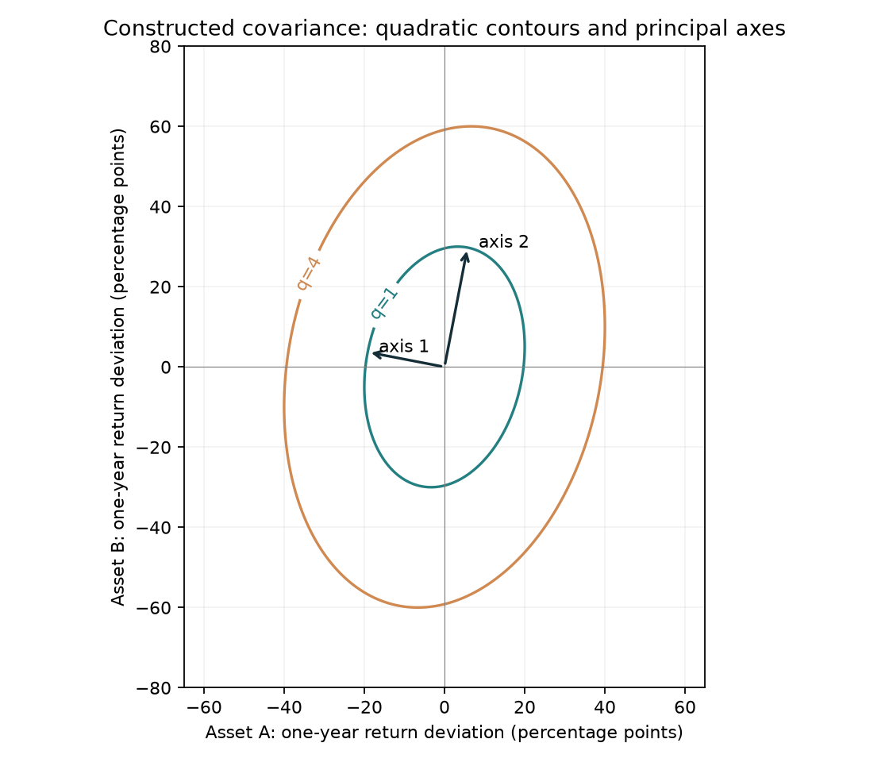
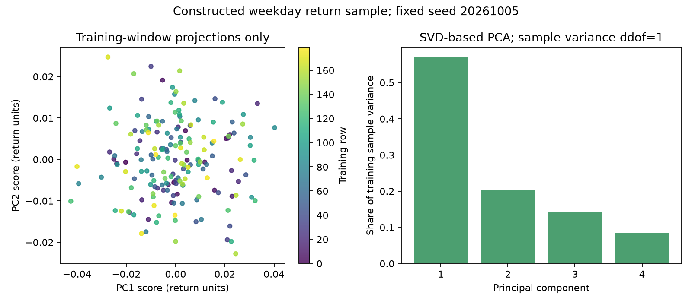

# Chapter 5: Linear Algebra, Portfolio Objects and Risk

> Spine: matrices let you calculate across assets; shape, orientation and sample meaning give those calculations their financial interpretation.
> Prerequisites: Chapter 2's arrays and indexing, and elementary algebra. Chapter 6 develops probability and covariance formally; its current Chinese edition remains the reference until a later English batch. Here we begin with a supplied covariance matrix. Principal component analysis (PCA) follows Chapter 3's information-time contract.

## 1. Learning Objectives

Write holdings as vectors and multi-asset returns as matrices, explaining each axis before computing. Read matrix multiplication, transpose, rank, basis and orthogonality, and recognize singular or ill-conditioned systems.

For risk, derive portfolio variance from a two-asset expansion and assess whether a candidate matrix can be a covariance matrix. For dimension reduction, read singular value decomposition (SVD) and PCA: training centering, directions, scores, explained variance and the exclusion of future rows from fitting.

You need not master every abstract vector-space theorem yet. Check dimensions, calculate small examples and understand the conditions before verifying them in code. Chapter 8 develops regression; Chapters 9 and 20 use these objects in portfolio problems. Chapter 20's English edition is already available; other later chapters remain Chinese pending translation.

## 2. Why Quantitative Research Needs Linear Algebra

With one stock you can calculate each number. With 500 stocks, a date has 500 returns, 500 weights, many exposure coordinates and a 500-by-500 risk matrix. Explicit shapes make the calculations manageable and expose missing terms or incorrect axis order.

A solver does not know that monthly covariance was mixed with annual expected returns, or that column 17 now represents another security. Arrays retain positions after labels are removed. Data engineering establishes identities and available times; linear algebra then computes under those contracts.

We use a return panel, a weight vector and a covariance matrix throughout. Chapter 2 introduced broadcasting; here matrix products explain the resulting portfolio returns. Chapter 21 later addresses estimation error and investment constraints.


::: {.body-conditions title="Input conditions: axes, intervals and units"}

Before computing, record asset order, observation axis, return interval and units. Annual decimal returns multiplied by dimensionless weights give annual decimal portfolio returns. Covariance and \(w^\top\Sigma w\) have squared-return units; their square roots have return units. Equal shapes cannot justify mixing daily, monthly and annual objects. Aggregated variance also depends on cross-period covariance, so annualization needs time-dependence assumptions; compounded simple returns need their product rule.

:::

## 3. Intuition

A weight vector is a recipe; a contemporaneous return vector records how each ingredient changes over one holding interval. Their inner product multiplies paired entries and adds them.

A matrix can map weights to returns by date, or holdings to industry and style exposures. A return panel and a risk matrix are both two-dimensional but have different axes.

Two volatile assets can move imperfectly together. Risk depends on both individual movement and joint movement. An eigenvector keeps its direction under a matrix transformation; an eigenvalue measures the scaling in that direction. For a risk matrix, these directions carry particular variances.

PCA rotates coordinates toward the greatest sample variation, then the greatest remaining orthogonal variation. Historical variance concentration alone does not identify a useful forecast or investment direction.

## 4. Mathematical Foundations

### 4.1 Vectors, Length and Transpose

Use column vectors:
\[
w=\begin{bmatrix}w_1\\w_2\end{bmatrix},\qquad
R_t=\begin{bmatrix}R_{1,t}\\R_{2,t}\end{bmatrix}.
\]
Weights and same-interval simple returns are dimensionless; each vector is \(2\times1\). Transpose turns \(w\) into a \(1\times2\) row. Then
\[
w^\top R_t=w_1R_{1,t}+w_2R_{2,t}
\]
is a scalar. Interpreting it as realized portfolio return also requires actual weights held at the interval's start.

For \(a,b\in\mathbb R^p\), the inner product is \(a^\top b=\sum_ja_jb_j\), and Euclidean length is
\[
\|a\|_2=\sqrt{a^\top a}=\sqrt{\sum_ja_j^2}.
\]
Length is not gross exposure. Gross exposure uses the L1 norm \(\sum_j|a_j|\). For \((.5,-.5)\), Euclidean length is about .7071 while gross exposure is 1. Select the norm for the quantity you intend to measure.

At start-of-interval weights \((.6,.4)^\top\) and returns \((.02,-.01)^\top\),
\[
\begin{bmatrix}.6&.4\end{bmatrix}
\begin{bmatrix}.02\\-.01\end{bmatrix}
=.6(.02)+.4(-.01)=.008.
\]
This is .8%, a scalar. Choosing those weights after seeing the interval's returns would introduce future information.

### 4.2 Return Panels and Matrix Multiplication

Let \(X\in\mathbb R^{n\times p}\) have observation intervals as rows and securities as columns, with \(X_{ti}=R_{i,t}\). In our two-interval example, reset to fixed target weights each interval and ignore fees/cash. Then
\[
y=Xw\in\mathbb R^{n\times1},\qquad y_t=\sum_iX_{ti}w_i.
\]
This is a specified-weight mapping, not an automatic rebalancing backtest. Drifting positions need the actual interval weights; Chapter 29 later develops the ledger.

For \(A\in\mathbb R^{m\times k}\) and \(B\in\mathbb R^{k\times n}\),
\[
(AB)_{ij}=\sum_{\ell=1}^kA_{i\ell}B_{\ell j}.
\]
The shared axis \(k\) contracts, leaving \(m\times n\). The output row is \(i\), column \(j\), and summation axis \(\ell\). Multiplication generally does not commute; \(BA\) may be undefined. Identity \(I_p\) has ones on the diagonal and zeros elsewhere, with \(I_pw=w\).

A fixed matrix maps \(x\) linearly to \(Ax\). For example,
\[
A=\begin{bmatrix}1&2\\3&4\end{bmatrix},\quad x=(2,-1)^\top,
\quad Ax=2\begin{bmatrix}1\\3\end{bmatrix}-\begin{bmatrix}2\\4\end{bmatrix}
=\begin{bmatrix}0\\2\end{bmatrix}.
\]
The first column is the image of \((1,0)^\top\), the second the image of \((0,1)^\top\); input coordinates combine those columns. Column order therefore has meaning.

Calculate every output cell:
\[
\begin{bmatrix}1&2\\3&4\end{bmatrix}
\begin{bmatrix}5&6\\7&8\end{bmatrix}
=\begin{bmatrix}
1(5)+2(7)&1(6)+2(8)\\3(5)+4(7)&3(6)+4(8)
\end{bmatrix}
=\begin{bmatrix}19&22\\43&50\end{bmatrix}.
\]
Each entry is a row of the left matrix dotted with a column of the right. In \(Xw\), that dot product produces one return per date. Shapes \((n\times p)(p\times1)\) yield \(n\times1\).

The elementwise, or Hadamard, product has \((A\odot B)_{ij}=A_{ij}B_{ij}\), requiring compatible shapes or specified broadcasting. NumPy `@` multiplies matrices and `*` multiplies elements. Both can return plausible values; the operation's purpose and axes distinguish them.

### 4.3 Linear Combinations, Span, Basis and Rank

A linear combination of \(v_1,\ldots,v_k\) is \(\sum_jc_jv_j\). Their span contains all such combinations. They are linearly independent if only zero coefficients yield zero; otherwise they are dependent.

A basis is independent and spans the chosen space. The standard plane basis \((1,0)^\top,(0,1)^\top\) gives unique coordinates. A new basis changes coordinates while preserving the object.

For \(\begin{bmatrix}1&2\\2&4\end{bmatrix}\), columns \((1,2)^\top\) and \((2,4)^\top\) lie on the same line; the second is twice the first. The column space has dimension, or rank, 1. Columns \((1,0)^\top,(0,1)^\top\) span the plane and have rank 2. Column count measures storage; rank measures independent directions.

Rank equals both column-space and row-space dimension. A hundred stored factors can offer far fewer independent directions if many are linear combinations. The null space is \(\{v:Av=0\}\). Holdings \(w,w+v\) with \(Av=0\) look identical under the mapping \(A\). If \(A\) records only industry exposures, individual holdings and other risks can still differ.

### 4.4 Orthogonality and Projection

Nonzero vectors with \(a^\top b=0\) are orthogonal. A mutually orthogonal unit set is orthonormal. Perpendicularity depends on the inner product; zero column inner products in one sample do not establish economic independence or future uncorrelatedness.

Project \(x\in\mathbb R^p\) onto nonzero \(v\in\mathbb R^p\):
\[
\operatorname{proj}_v(x)=v\frac{v^\top x}{v^\top v}.
\]
For unit \(v\), this is \(v(v^\top x)\). The residual \(e=x-\operatorname{proj}_v(x)\) satisfies \(v^\top e=0\), preparing the least-squares geometry in Chapter 8.

For \(x=(3,2)^\top,v=(1,0)^\top\), the coordinate score is 3, the projected vector \((3,0)^\top\), and residual \((0,2)^\top\). A scalar score and a projected vector are different objects. The arrows lie on perpendicular horizontal and vertical axes.

### 4.5 Linear Systems, Inverses and Conditioning

In \(Ax=b\), solve for \(x\). A full-rank square \(A\) has a unique solution and inverse satisfying \(A^{-1}A=AA^{-1}=I_p\), so algebraically \(x=A^{-1}b\). A singular matrix has no inverse; the system may have no solution or multiple solutions.

Numerically prefer `solve(A,b)` over constructing the entire inverse for one right-hand side. Check the residual \(Ax-b\), input contracts and financial constraints. For \(A=\begin{bmatrix}2&1\\1&2\end{bmatrix}\), \(b=(5,4)^\top\), substitution verifies \(x=(2,1)^\top\). Multiple right-hand sides can reuse a factorization. A solver does not repair ill-conditioning.

Invertibility does not imply stability. The Euclidean condition number is
\[
\kappa_2(A)=\|A\|_2\|A^{-1}\|_2=s_{max}(A)/s_{min}(A),
\]
where the norm is induced by Euclidean vector length and the \(s\)'s are singular values. A tiny minimum singular value compresses a direction whose inverse mapping amplifies errors. This diagnoses relative sensitivity; it does not rank economic estimates by reliability.

## 5. Definitions

### 5.1 Symmetry and Definiteness


::: {.body-definition title="Definition: positive and semidefinite matrices"}

We use real matrices. A symmetric matrix has \(A=A^\top\). It is positive definite (PD) if \(v^\top Av>0\) for every nonzero \(v\); it is positive semidefinite (PSD) if \(v^\top Av\ge0\) for every \(v\). PSD allows a nonzero zero-value direction.

Positive diagonals or a few positive portfolio quadratic forms cannot check every direction. For a real symmetric matrix, nonnegative eigenvalues are equivalent to PSD, strictly positive ones to PD. Floating-point tolerances must follow scale; rounding near \(-10^{-16}\) and a material negative eigenvalue \(-.8\) are different findings.

:::

### 5.2 Covariance Matrices

Begin with a supplied risk table ordered A, B on both axes:
\[
\Sigma=\begin{bmatrix}.04&.01\\.01&.09\end{bmatrix}.
\]
Diagonal entries are individual variances, off-diagonals describe joint movement. You can compute with the table before deriving probability theory.

For a same-interval return vector \(R\) with finite second moments and \(\mu=\mathbb E[R]\),
\[
\Sigma=\mathbb E[(R-\mu)(R-\mu)^\top],\quad
\Sigma_{ij}=\operatorname{Cov}(R_i,R_j).
\]
\(R,\mu\) are \(p\times1\); \(\Sigma\) is \(p\times p\) with squared-return units. Expectation \(\mathbb E\) is developed in the current Chinese Chapter 6, pending its English translation. Here this formula identifies symbols; calculations start from a supplied \(\Sigma\).

Volatility \(\sigma_i=\sqrt{\Sigma_{ii}}\) has return units. For nonzero volatilities, correlation is \(\rho_{ij}=\Sigma_{ij}/(\sigma_i\sigma_j)\). Correlation keeps standardized joint movement and removes risk magnitude; a constant zero-volatility sequence has no usual correlation coefficient.

### 5.3 Eigenvalues and Spectral Decomposition

A nonzero \(q\) satisfying \(Aq=\lambda q\) is an eigenvector with eigenvalue \(\lambda\). Normalize its length as needed. A real symmetric matrix admits
\[
A=Q\Lambda Q^\top,\qquad Q^\top Q=I_p.
\]
Columns of \(Q\) are orthonormal eigenvectors; \(\Lambda\) is diagonal. A repeated-eigenvalue subspace has multiple valid bases; even a distinct-eigenvalue vector can reverse sign. NumPy `eigh` returns column eigenvectors and uses one triangle, so check symmetry independently.

### 5.4 SVD and PCA

Every real \(X_c\in\mathbb R^{n\times p}\) has
\[
X_c=UDV^\top.
\]
For the reduced computational form, \(r=\min(n,p)\): \(U\) is \(n\times r\), \(D\) is \(r\times r\), and \(V^\top\) is \(r\times p\). Singular values satisfy \(s_1\ge\cdots\ge s_r\ge0\), and the corresponding columns of \(U,V\) are orthonormal. You may retain zero values or further truncate to actual rank. Rectangular matrices need no inverse for SVD.

PCA finds orthogonal directions of maximum projected training variance after centering. Directions are columns of \(V\); scores are observation coordinates along them. Explained variance is another object. The covariance-PCA convention here does not automatically scale features.

Center by subtracting each training column mean:
\[
X_c=X-\mathbf1_n\bar x^\top.
\]
Standardization also divides by training standard deviations, removing original volatility magnitudes. For correlation-PCA, justify equal scaling and fit both means and scales only on training rows.

With \(k\) retained directions, \(V_k\) is \(p\times k\), and scores \(T=X_cV_k\) are \(n\times k\). Projected points in original coordinates are \(TV_k^\top\); add the training mean to reconstruct uncentered data. The project stores one direction per row: `components` is \(k\times p\), and scores are `(X-center) @ components.T`.

For \(n_h\) held-out rows,
\[
T_{held}=(X_{held}-\mathbf1_{n_h}\bar x_{train}^\top)V_k.
\]
If trained with standardization, apply the frozen training scales too. Retain cutoff, feature order, center, scales and directions. Future rows enter the transform, never the past fit.

## 6. Derivations

### 6.1 Portfolio Variance from a Two-Asset Expansion

For fixed start-of-interval weights, \(R_p=w^\top R\). Match frequency, interval and currency conventions, and determine weights before the random return. Random weights related to returns need conditioning or a joint model.

Linearity gives \(\mathbb E[R_p]=w^\top\mu\), and
\[
R_p-\mathbb E[R_p]=w^\top(R-\mu).
\]
Squaring the scalar and moving deterministic weights outside expectation,
\[
\begin{aligned}
\operatorname{Var}(R_p)
&=\mathbb E\{[w^\top(R-\mu)][(R-\mu)^\top w]\}\\
&=w^\top\mathbb E[(R-\mu)(R-\mu)^\top]w\\
&=w^\top\Sigma w.
\end{aligned}
\]
The shape is \((1\times p)(p\times p)(p\times1)=1\times1\). For two assets,
\[
\sigma_p^2=w_1^2\sigma_1^2+w_2^2\sigma_2^2+2w_1w_2\Sigma_{12}.
\]
Expand the four matrix cells to see both cross terms:
\[
\begin{aligned}
w^\top\Sigma w
&=w_1(w_1\Sigma_{11}+w_2\Sigma_{21})
+w_2(w_1\Sigma_{12}+w_2\Sigma_{22})\\
&=w_1^2\Sigma_{11}+w_1w_2\Sigma_{21}
+w_1w_2\Sigma_{12}+w_2^2\Sigma_{22}.
\end{aligned}
\]
Symmetry combines the middle terms. Omitting them omits joint risk.

### 6.2 Why Covariance Is PSD

For every \(v\),
\[
v^\top\Sigma v=\mathbb E\{[v^\top(R-\mu)]^2\}\ge0.
\]
An expected square cannot be negative. If a nonzero combination is always zero, the covariance need not be PD. If B always returns twice A, \(v=(2,-1)^\top\) gives a zero-change direction.

For \(n\ge2\) common complete rows centered by column,
\[
\widehat\Sigma=X_c^\top X_c/(n-1),\qquad
v^\top\widehat\Sigma v=\|X_cv\|_2^2/(n-1)\ge0.
\]
The denominator is the sample-covariance convention. This Gram-matrix proof requires every entry to come from the same \(X_c\). Pairwise missing-data deletion can use different dates and lose this guarantee.

Centered columns sum to zero, so the sum of the \(n\) row vectors is zero and the rows are dependent. Thus \(\operatorname{rank}(X_c)\le\min(n-1,p)\). For \(p\ge n\), sample covariance is necessarily rank deficient. Inverting it cannot create the missing information.

### 6.3 Variance Along Risk Axes

Write \(\Sigma=Q\Lambda Q^\top\) and coordinates \(z=Q^\top w\):
\[
w^\top\Sigma w=z^\top\Lambda z=\sum_j\lambda_jz_j^2.
\]
Each \(\lambda_j\) is the variance along a unit eigen-direction; \(z_j\) is the holding coordinate on it. These axes can change as estimates change. Calling the first one a market factor requires economic evidence.

### 6.4 Why PCA Takes the Largest Eigenvalue Direction

For unit \(v\), centered scores \(t=X_cv\) have mean zero and sample variance
\[
t^\top t/(n-1)=v^\top\widehat\Sigma v,\qquad v^\top v=1.
\]
Write \(v=Qa\). Orthogonality gives \(\sum_ja_j^2=1\), so variance is \(\sum_j\lambda_ja_j^2\), bounded by the largest eigenvalue. Putting all length on that direction attains the bound. The next direction must be orthogonal to the first and maximizes the remaining variance, continuing recursively.

SVD gives
\[
\widehat\Sigma=VD^2V^\top/(n-1),\quad
\lambda_j=s_j^2/(n-1),\quad
\mathrm{EVR}_j=\lambda_j/\sum_\ell\lambda_\ell.
\]
Explained variance ratio (EVR) is dimensionless; eigenvalues retain squared-return units. Scores \(T_k=X_cV_k\) reconstruct
\[
\widehat X_k=T_kV_k^\top+\mathbf1_n\bar x^\top.
\]
All nonzero directions reconstruct the centered data. Fewer directions discard variation. For that same centered matrix, truncated SVD minimizes squared reconstruction error at the chosen rank; the error equals the sum of discarded squared singular values. This optimization has no labels, fills or future net returns in its objective.

## 7. Financial Interpretation

### 7.1 Diversification and Joint Movement

At asset volatilities 20%, 30% and correlation \(1/6\), covariance is .01. A 60/40 portfolio has positive joint-risk contribution, but imperfect co-movement gives volatility below the weighted 24%. Individual risks are insufficient; low historical correlation does not eliminate crisis dependence. Chapter 33 addresses stress scenarios.

### 7.2 Small Eigenvalues Can Amplify Errors

Solving \(\Sigma x=\mu\) divides mean coordinates by risk eigenvalues. A tiny eigenvalue can turn a small expected-return change into a large position change. An apparent low-risk arbitrage direction may reflect short samples, duplicate assets or omitted costs.

Stable algorithms do not remove economic estimation error. Shrinkage, regularization and position limits can reduce sensitivity, while introducing bias and model choices that need out-of-sample checks. Chapters 8 and 21 develop these methods.

### 7.3 Appropriate Roles for PCA

PCA can summarize joint asset movement, diagnose near-duplicate columns and supply a candidate feature transform. Directions need separate units, budgets, shorting conventions, costs and signs before they define tradable positions.

PCA is unsupervised and uses no target labels. A high-variance direction may be common noise for a prediction task; a low-variance direction may contain target information. Covering 95% of training variance alone cannot establish trading value. Chapter 41 continues dimension reduction and model selection.

## 8. Numerical Examples

### 8.1 Two Assets: Each Risk Contribution

These supplied annual parameters are teaching constructions, not daily estimates or current market parameters:
\[
\mu=(.05,.08)^\top,\quad
\Sigma=\begin{bmatrix}.04&.01\\.01&.09\end{bmatrix},\quad w=(.6,.4)^\top.
\]
Use annual simple expected returns, the same annual covariance interval, weights held at its start, no fees and no within-interval trades.

1. Expected return: \(.6(.05)+.4(.08)=.062\), or 6.2%.
2. The row \(w^\top\Sigma\) is \([.6(.04)+.4(.01),.6(.01)+.4(.09)]=[.028,.042]\).
3. Its dot product with weights is \(.028(.6)+.042(.4)=.0336\).
4. The four original-cell contributions are .0144, .0024, .0024 and .0144, summing to .0336.
5. Volatility is \(\sqrt{.0336}=.183303\), about 18.33%.

Calling .0336 a 3.36% volatility confuses variance with standard deviation. Omitting cross terms gives .0288. With unchanged asset volatilities and perfect positive correlation, covariance is .06 and portfolio volatility 24%. At zero correlation, variance is .0288 and volatility about 16.97%. These changes come from specified joint-movement assumptions, not measured allocation effects.

### 8.2 Rank-Deficient Systems

For
\[
A=\begin{bmatrix}1&2\\2&4\end{bmatrix},\quad b=(3,6)^\top,
\]
both rows and columns are dependent and rank is 1. The sole independent equation is \(x_1+2x_2=3\), with solutions \((3-2t,t)^\top\) for all real \(t\). Null direction \((2,-1)^\top\) leaves the output unchanged.

Changing \(b\) to \((3,7)^\top\) makes the rows inconsistent: twice a left side equal to 3 cannot equal 7. Least squares can fit approximately, but does not establish an exact solution. Chapter 8 develops its objective.

### 8.3 Eigenvalues, Invertibility and the Budget

For the Section 8.1 covariance,
\[
\det(\Sigma-\lambda I_2)=(.04-\lambda)(.09-\lambda)-.01^2
=\lambda^2-.13\lambda+.0035.
\]
For a two-by-two matrix, the determinant is \(ad-bc\); zero means no inverse. Here
\[
\lambda_{1,2}=\frac{.13\mp\sqrt{.0029}}2
\approx.03807418,\ .09192582.
\]
Both are positive, and the condition number is about 2.41438775. This supplied small matrix is not nearly singular; real estimation quality is a separate question.

As a linear-system exercise,
\[
\Sigma^{-1}=\frac1{.0035}\begin{bmatrix}.09&-.01\\-.01&.04\end{bmatrix}.
\]
Multiply back: the upper-left entry is \((.09(.04)-.01^2)/.0035=1\), off-diagonals cancel, and the remaining diagonal is 1. Multiplying by \(\mu\) gives \((1.05714286,.77142857)^\top\), sum 1.82857143. This fails a no-borrowing, fully invested two-asset budget. Solving the algebra does not supply an executable portfolio.

### 8.4 Three Rows: PCA and Reconstruction by Hand


::: {.body-example title="Worked example: three-row PCA reconstruction"}

Use undated geometric data,
\[
X=\begin{bmatrix}1&2\\2&4\\3&6\end{bmatrix},\quad \bar x=(2,4)^\top.
\]
Centered rows are \((-1,-2),(0,0),(1,2)\), so
\[
\widehat\Sigma=X_c^\top X_c/2=\begin{bmatrix}1&2\\2&4\end{bmatrix}.
\]
Eigenvalues are 5 and 0. Choose \(v_1=(1,2)^\top/\sqrt5\), giving scores \((-\sqrt5,0,\sqrt5)^\top\), sample variance 5. Direction \((-2,1)^\top/\sqrt5\) has zero scores. One component explains 100% because the points lie exactly on a line; this does not imply real assets need only one factor.

The first row reconstructs as \(-\sqrt5v_1^\top+(2,4)=(1,2)\). Reversing both direction and score signs leaves their product unchanged.

:::

## 9. Python Implementation

### Default Entry in the Accepted Reader Package

Follow the [reader installation instructions](../../README.md) and run from its root:

```bash
.venv/bin/python run_notebook.py notebooks/ch05_linear_algebra.ipynb
```

The default Notebook uses packaged shared logic without absent French inputs or downloads. New runs and figures use unique runs directories; the reader CLI uses universally unique identifiers (UUIDs) and rejects overwrites. Historical tests absent from the reader are original production-check references. Use the Notebook assertions. Optional French inputs require the [data contract](../../OPTIONAL_DATA.md); this batch did not rerun them.

The [shared PCA implementation](../../../../src/quant_course/math_tools.py) takes only a training matrix and returns its mean, row-stored directions, explained variances, ratios and training scores. Require at least two rows and one column of finite real values. It neither fills NaN nor standardizes; zero total variance raises an error. The separate original-course route uses [the script](../../../../code/ch05_linear_algebra.py), [Notebook](../../../../notebooks/ch05_linear_algebra.ipynb) and [project environment](../../README.md):

```bash
.venv/bin/python tools/run_a2.py --chapter 5
```

Each following snippet is self-contained. A NumPy one-dimensional vector is not literally a two-dimensional column; `@` defines its contractions. Use `reshape(-1,1)` when an explicit column is needed.

```python
import numpy as np

asset_returns = np.array([[0.02, -0.01], [-0.03, 0.04]])
weights = np.array([0.6, 0.4])
portfolio_returns = asset_returns @ weights
assert asset_returns.shape == (2, 2)
assert weights.shape == (2,)
assert portfolio_returns.shape == (2,)
assert np.allclose(portfolio_returns, [0.008, -0.002])
assert np.allclose(portfolio_returns, (asset_returns * weights).sum(axis=1))
print(portfolio_returns)
```

The rows are two supplied holding intervals, with decimal returns and A/B column order matched to weights. There is no signal or execution design, so the code checks multiplication rather than a backtest.

The second snippet verifies algebra, symmetry, spectrum and constraints. `eigh` returns ascending eigenvalues; PCA generally selects descending variance. The [official interface documentation](https://numpy.org/doc/stable/reference/generated/numpy.linalg.eigh.html) records that ordering and triangle convention; its previously read source scope is retained.

```python
import numpy as np

covariance = np.array([[0.04, 0.01], [0.01, 0.09]])
expected_returns = np.array([0.05, 0.08])
weights = np.array([0.6, 0.4])
assert np.allclose(covariance, covariance.T)
eigenvalues, directions = np.linalg.eigh(covariance)
assert eigenvalues.min() > 0.0
assert np.allclose(directions.T @ directions, np.eye(2))
assert np.allclose(covariance @ directions, directions * eigenvalues)
variance = float(weights @ covariance @ weights)
assert np.isclose(variance, 0.0336)
assert np.isclose(weights @ expected_returns, 0.062)
solution = np.linalg.solve(covariance, expected_returns)
assert np.linalg.norm(covariance @ solution - expected_returns) < 1e-12
assert not np.isclose(solution.sum(), 1.0)
print(variance, np.sqrt(variance), eigenvalues, solution)
```

The third constructs covariance from one finite matrix and checks SVD against the spectrum. Its geometric rows have no timestamps or trade interpretation.

```python
import numpy as np
from quant_course.math_tools import pca_fit_transform

samples = np.array([[1.0, 2.0], [2.0, 4.0], [3.0, 6.0]])
result = pca_fit_transform(samples, n_components=1)
centered = samples - result.center
sample_covariance = centered.T @ centered / (len(samples) - 1)
assert np.allclose(sample_covariance, [[1.0, 2.0], [2.0, 4.0]])
assert np.isclose(result.explained_variance[0], 5.0)
assert np.isclose(result.explained_variance_ratio[0], 1.0)
assert np.allclose(result.projection @ result.components + result.center, samples)
print(result.center, result.explained_variance, result.explained_variance_ratio)
```

The larger script constructs 252 daily rows for four fictitious assets with seed 20261005. Dates are timezone-aware Coordinated Universal Time (UTC) business-day labels without an exchange holiday calendar. Fit the first 180 rows, 2024-01-02 through 2024-09-09, and hold out 72. The inherited variance shares are about 56.96%, 20.19%, 14.36% and 8.49%. It creates no signal, fills or strategy-return result. Read actual outputs rather than changing the sample to obtain appealing percentages.

Later rows use `(X_later-center) @ components.T` with fitted parameters. Joining them to training before SVD changes the past fit. Missing-data policies belong in the training process; the shared implementation rejects missing values rather than silently zero-filling them.

## 10. Visualization



The Section 8.1 annual matrix supplies this geometry. Axes show A/B annual return deviations in percentage points. Contours have \(q=x^\top\Sigma^{-1}x=1\) or 4; eigen-direction arrows have lengths equal to eigenvalue square roots. Inspect the long/short axes and tilt from positive covariance. Without a specified probability distribution, these ellipses are not automatically confidence regions, nor does a two-dimensional one-standard-deviation ellipse automatically contain 68% of observations. See the [geometry script](../../../../code/ch05_covariance_geometry.py).



The left axes are first/second component scores in decimal-return units. Each point is a training observation, colored by row order from early to late. The first axis has larger variance because PCA selects it that way; this is not independent investment evidence, a price series or a wealth chart.

The right panel shows component index against training variance share. The first two explain about 77.15%, leaving about 22.85% of training variation discarded by a two-direction truncation. Held-out shares can differ. The plot uses centering and SVD, without per-feature standardization or whitening. Whitening would rescale component variance and is discussed later in Chapter 41.

## 11. A Recorded Market-Snapshot Example

Chapter 2 already read the Kenneth R. French ten-industry monthly portfolio-return cache. Arranging it as months by industries lets you inspect common-sample covariance and PCA. These are published portfolio-return directions, not individual-stock risk models or executable industry strategies. A return-month label does not establish data availability at that month's closing auction.

The code uses complete common months from January 2010 through December 2019. The inherited executed first-three EVRs are 71.6043%, 7.5198% and 7.1064%; see the run record. They describe this recorded snapshot, fixed window and unstandardized convention. No 2020-or-later rows entered that fit. Nonetheless, the downloaded version may contain historical revisions and is insufficient to establish historical point-in-time (PIT) availability. Chapter 3 explains that version-time distinction.

```python
from pathlib import Path
import numpy as np
import pandas as pd
from quant_course.math_tools import pca_fit_transform

path = Path("data/processed/french_10_industries_monthly.csv")
raw = pd.read_csv(path, dtype={"month": "string"})
monthly = raw.set_axis(pd.PeriodIndex(raw.pop("month"), freq="M"), axis="index")
train = monthly.loc["2010-01":"2019-12"].dropna(axis=0, how="any")
assert train.index.is_monotonic_increasing and train.index.is_unique
assert len(train) == 120
fit = pca_fit_transform(train.to_numpy(), n_components=3)
covariance = np.cov(train.to_numpy(), rowvar=False, ddof=1)
assert np.linalg.eigvalsh(covariance).min() >= -1e-12
assert np.isclose(fit.explained_variance.sum(), np.linalg.eigvalsh(covariance)[-3:].sum())
print("French snapshot: monthly published portfolio returns; not PIT prices")
print("training rows:", len(train), "features:", list(train.columns))
print("first three training EVR:", fit.explained_variance_ratio)
```

Common-sample `dropna` removes a whole month when any industry is missing. Research should report removed months and reasons, not only the final count. Here the fixed 120-row assertion prevents silently substituting another sample while keeping the same claims. PCA on uncentered price levels is not automatically a return-risk factor model.

## 12. Common Mistakes

### 12.1 Valid Dimensions with the Wrong Security Order

A two-entry dot product runs after swapping identities, but its meaning changes:

```python
import numpy as np
import pandas as pd

returns = pd.Series({"A": 0.02, "B": -0.01})
weights = pd.Series({"B": 0.4, "A": 0.6})
wrong = float(returns.to_numpy() @ weights.to_numpy())
correct = float(returns @ weights.reindex(returns.index))
assert np.isclose(wrong, 0.002)
assert np.isclose(correct, 0.008)
print("positional mistake:", wrong, "aligned labels:", correct)
```

Freeze the column list before array operations. Training, risk, holdings and execution need the same security mapping. Permanent identifiers from Chapter 3 do not automatically enforce column order.

### 12.2 Pairwise Plausibility without Joint Consistency


::: {.body-pitfall title="Common mistake: pairwise plausibility without consistency"}

Consider the constructed candidate correlation matrix
\[
C=\begin{bmatrix}1&.9&.9\\.9&1&-.9\\.9&-.9&1\end{bmatrix}.
\]
Its pairwise correlations lie in \([-1,1]\) and diagonal entries are 1, but eigenvalue \(-.8\) makes it invalid. For \(v=(-1,1,1)^\top\), \(Cv=-.8v\) and \(v^\top Cv=-2.4\). A variance cannot be negative.

Separate windows or pairwise deletions can lose joint consistency. This is a deliberately invalid construction, not a claim about a market dataset. Investigate alignment, computation and units before choosing a model repair. Clipping all negative eigenvalues changes the risk model and must be recorded.

:::

### 12.3 Calling a Successful Solve a Valid Portfolio

A small linear-system residual says little about budgets, leverage, sectors, shorting or costs. Section 8.3 is not a maximum-Sharpe portfolio: no risk-free return, budget normalization or feasible set has yet been specified.

### 12.4 Fitting PCA before a Time Split

A full-sample fit makes past features depend on future means and covariance. Unsupervised processing can still leak future information. Fit each training window and only transform its successor. Section 18 changes an extreme future row to test the frozen past mean.

### 12.5 Mixing Scales and Risk Units

Columns combining prices, dollar turnover, percentages and bp can have high variance simply because of their units. Standardization may help compare features but also removes original risk magnitudes. Choose covariance- or correlation-PCA for the question; do not rescale arbitrarily and keep interpreting the result in original return units.

### 12.6 Comparing Every Eigenvector Sign Literally

A direction and its negative are equivalent. Nearly equal eigenvalues can make individual vectors sensitive to perturbations while their span is more stable. Check subspaces, orthogonality, reconstruction and spectrum; identical loading signs are not the sole criterion.

## 13. Research Application

For a risk-panel study, specify currency, frequency, holding intervals and securities; use versions available by the training cutoff and a shared missing-data rule. Estimate covariance on the same complete sample. Check symmetry, units, minimum eigenvalue, rank and conditioning before evaluating weights.

For PCA, fit means/directions in training and project the next window with those past parameters. Save feature order, cutoff, versions, center, directions and random configuration. Compare principal subspaces across windows as well as signs. Chapters 19 and 41 later address changing structure.

Predeclare at least two ways the proposal can fail: large direction changes under tiny sample perturbations, or no improvement in out-of-sample risk prediction/downstream loss despite high training EVR. Compare equal weights, a single common-risk direction or existing economic factors rather than only complex models against one another.

This chapter hands off numerical diagnostics and risk structure, not investment performance. A backtest still needs signal, execution, holdings, costs and label timing as developed in Chapter 29.

## 14. Chapter Summary

Vectors, matrices and transposes encode multi-asset mappings with explicit shapes. Rank counts independent directions; invertibility determines unique square-system solutions; conditioning diagnoses error amplification. Orthogonality, projection and changes of basis explain risk and regression geometry.

Fixed-weight variance is \(w^\top\Sigma w\) with all cross terms. Covariance is PSD but may be singular. Common complete samples preserve the Gram-matrix guarantee; short samples constrain rank. PCA centers past observations and selects orthogonal high-variance directions. Explained variance, prediction and trading feasibility require their respective checks.

Next, the current Chinese Chapter 6 develops probability, Chapter 8 applies projection to regression, and Chapters 9, 20 and 21 address estimated, constrained portfolio choices. Knowing the matrix objects prepares these problems without pretending to solve them already.

## 15. Exercises

**5-E01.** A panel has 120 months and ten industries. Give shapes of \(X,w,Xw,X^\top X\), explain the axes and state why \(X^\top X\) is not automatically sample covariance.

**5-E02.** Calculate the dot product of weights \((.6,.4)\) and returns \((2\%,-1\%)\). Swap the returns without changing weights. What changes, and why do both calculations run?

**5-E03.** Distinguish rank 1 from one stored column. For \(A=\begin{bmatrix}1&2\\2&4\end{bmatrix}\), give a nonzero null vector and explain the missing inverse.

**5-E04.** Give a PSD but non-PD covariance, identify a nonzero zero-variance direction and explain why PSD does not imply independence of all assets.

**5-E05.** Use the annual covariance in Section 8.1 with equal weights. Calculate expected return, variance, volatility and correlation, including units.

**5-E06.** For centered rows \(n=20,p=30\), explain why covariance is singular. If different pairs use different samples, can one Gram matrix still establish PSD?

**5-E07.** Section 8.4 retains 100% of sample variance with one component. Reverse its sign: what happens to scores, reconstruction and EVR? Does this prove future prediction?

**5-N01: Identify Shapes.** For \(X=\begin{bmatrix}.02&-.01\\-.03&.04\end{bmatrix}\), columns A/B, weights \((.6,.4)^\top\) reset at each interval start without fees, and \(R_1=(.02,-.01)^\top\), give shapes/meanings of \(X,w,Xw,w^\top R_1\). Calculate both returns and specify covariance units and weight timing.

**5-N02: Calculate Every Cell.** Multiply \(\begin{bmatrix}1&2\\3&4\end{bmatrix}\begin{bmatrix}5&6\\7&8\end{bmatrix}\), displaying the row-column dot product for all four cells. Explain why reversing multiplication needs a fresh calculation.

**5-N03: Diagnose the Axis.** What does this runnable code output? Change it to returns by date and assert the hand results.

```python
import numpy as np

returns = np.array([[0.02, -0.01], [-0.03, 0.04]])
weights = np.array([0.6, 0.4])
wrong = (returns * weights).sum(axis=0)
print(wrong)
```

**5-N04: Assess the Research Claim.** A researcher stacks ten assets' full-period price levels, centers with the full-period mean and does PCA. They name the first direction a market-return factor, trade it and use high EVR as proof of strategy success. Identify at least three object/scale/timing errors, define a train/holdout process and state the evidence needed for trading claims.

## 16. Programming Exercises

**5-P01.** Diagnose a supplied real square matrix: shape, finite values, symmetry, eigenvalues and a scale-relative PSD check, rank and condition number. Test \(\Sigma\), the rank-deficient example and Section 12.2's invalid correlation matrix. Reject asymmetry rather than silently fixing it.

**5-P02.** Center one complete training matrix and compute covariance. Use shared `pca_fit_transform` to verify full-component reconstruction, orthogonality and score variances. Retain one direction and compare squared reconstruction error with discarded squared singular values.

**5-P03.** Fit four training rows and transform one future row. Replace the future row by an extreme value: verify unchanged fit parameters, while showing that a leaky combined fit changes the mean. Record feature order and reject mismatched future column counts. Define all inputs locally.

## 17. Challenge Problems

**5-C01.** For near-duplicate assets with covariance \(.04\begin{bmatrix}1&.999\\.999&1\end{bmatrix}\), compare linear solutions for means \((.05,.05)^\top\) and \((.051,.049)^\top\). Explain amplified holdings and propose remedies at three different levels. Merely switching to `solve` is insufficient.

**5-C02.** French monthly industry PCA gives high first-component EVR. A colleague claims it is the market factor and retaining it must improve Sharpe. Plan checks of economic naming, versions/timing, out-of-sample results, scales, risk and costs, and specify findings that would reject the claim.

## 18. Complete Solutions

### 18.1 Concepts and Hand Calculations

**5-E01.** \(X:120\times10\), \(w:10\times1\), \(Xw:120\times1\), \(X^\top X:10\times10\). Panel rows are months and columns industries; the Gram axes are both industries. Covariance also needs column centering and division by 119. An uncentered Gram matrix includes mean-level contributions.

**5-E02.** The correct return is \(.6(.02)+.4(-.01)=.008\), .8%. After swapping returns it is \(.6(-.01)+.4(.02)=.002\), .2%. Matching vector lengths only check shape, not identity; this is the same kind of positional mistake as Section 12.1.

**5-E03.** Stored columns and independent directions differ. The second column is twice the first, giving rank 1. \(A(2,-1)^\top=0\). If an inverse existed, multiplying that equality by it would force the nonzero vector to be zero, a contradiction.

**5-E04.** Take \(\Sigma_0=\begin{bmatrix}1&2\\2&4\end{bmatrix}\). For \(v=(a,b)^\top\), \(v^\top\Sigma_0v=(a+2b)^2\ge0\), establishing PSD. Direction \((2,-1)^\top\) has zero variance, so it is not PD. Perfectly related assets are compatible with PSD; orthogonality/zero correlation also do not generally establish probability independence, as Chapter 6 later explains.

**5-E05.** Annual expected return is .065, or 6.5%; variance is \(.25(.04)+.25(.09)+.5(.01)=.0375\); volatility is \(\sqrt{.0375}\approx19.365\%\). Correlation is \(.01/(.2(.3))=1/6\), dimensionless. Pair annual means with annual covariance.

**5-E06.** Centered rank is at most 19, leaving at least eleven zero-eigenvalue directions in a 30-asset covariance. Pairwise samples generally cannot be represented by one \(X_c^\top X_c/(n-1)\). That loses the guarantee, not a theorem that every pairwise-deletion result is non-PSD.

**5-E07.** \(v\to-v\) sends \(t\to-t\), leaving \(tv^\top\), its variance and EVR unchanged. The 100% arises from exact sample collinearity. No future targets or fees were used, so prediction and trading claims lack their evidence.

### 18.2 Programming Reference Implementations

**5-P01.** Tie the tolerance to spectral scale and report both it and the minimum eigenvalue. Diagnosis is separate from invertibility; valid PSD can be singular. The function refuses materially invalid directions rather than deleting them.

```python
import numpy as np

def diagnose_symmetric_matrix(matrix, relative_tolerance: float = 1e-10) -> dict:
    raw = np.asarray(matrix)
    if raw.ndim != 2 or raw.shape[0] != raw.shape[1] or raw.shape[0] == 0:
        raise ValueError("require a non-empty square matrix")
    if not np.issubdtype(raw.dtype, np.number) or np.iscomplexobj(raw):
        raise TypeError("require real numeric values")
    values = raw.astype(float)
    if not np.isfinite(values).all():
        raise ValueError("require finite values")
    if not np.isfinite(relative_tolerance) or relative_tolerance <= 0:
        raise ValueError("tolerance must be positive and finite")
    scale = max(float(np.linalg.norm(values, ord=2)), np.finfo(float).tiny)
    if not np.allclose(values, values.T, rtol=relative_tolerance,
                       atol=relative_tolerance * scale):
        raise ValueError("input is not symmetric; do not silently symmetrize")
    eigenvalues = np.linalg.eigvalsh(values)
    tolerance = relative_tolerance * scale
    return {"eigenvalues": eigenvalues, "tolerance": tolerance,
            "psd_numerical": bool(eigenvalues.min() >= -tolerance),
            "pd_numerical": bool(eigenvalues.min() > tolerance),
            "rank": int(np.linalg.matrix_rank(values)),
            "condition_2": float(np.linalg.cond(values))}

covariance = np.array([[0.04, 0.01], [0.01, 0.09]])
singular = np.array([[1.0, 2.0], [2.0, 4.0]])
invalid = np.array([[1.0, 0.9, 0.9], [0.9, 1.0, -0.9], [0.9, -0.9, 1.0]])
assert diagnose_symmetric_matrix(covariance)["pd_numerical"]
assert diagnose_symmetric_matrix(singular)["psd_numerical"]
assert not diagnose_symmetric_matrix(singular)["pd_numerical"]
assert not diagnose_symmetric_matrix(invalid)["psd_numerical"]
assert np.isclose(diagnose_symmetric_matrix(invalid)["eigenvalues"][0], -0.8)
print(diagnose_symmetric_matrix(covariance))
```

Numerical PD depends on the tolerance and does not replace the exact definition. Even small asymmetry needs investigation and an explicit treatment rule; this teaching checker rejects it.

**5-P02.** Full components check reconstruction and variance conventions; a single component checks truncation error. The squared Frobenius norm \(\|A\|_F^2=\sum_{ij}A_{ij}^2\) sums squared errors in common units.

```python
import numpy as np
from quant_course.math_tools import pca_fit_transform

samples = np.array([[1.0, 2.0, 0.0], [2.0, 0.0, 1.0],
                    [4.0, 3.0, 2.0], [3.0, 5.0, 1.0]])
full = pca_fit_transform(samples, n_components=3)
centered = samples - full.center
covariance = centered.T @ centered / (len(samples) - 1)
assert np.allclose(full.projection @ full.components + full.center, samples)
assert np.allclose(full.components @ full.components.T, np.eye(3))
assert np.allclose(np.var(full.projection, axis=0, ddof=1), full.explained_variance)
assert np.isclose(full.explained_variance.sum(), np.trace(covariance))
short = pca_fit_transform(samples, n_components=1)
reconstructed = short.projection @ short.components + short.center
squared_error = float(np.square(samples - reconstructed).sum())
singular_values = np.linalg.svd(centered, compute_uv=False)
assert np.isclose(squared_error, np.square(singular_values[1:]).sum())
print("discarded reconstruction error:", squared_error)
```

Large-unit columns dominate unscaled squared reconstruction error. The objective remains computable, but its research meaning requires a scale decision.

**5-P03.** Transform with frozen centers/directions, without refitting. Column counts can be checked, while security names/order must be saved and checked by the caller as model metadata.

```python
import numpy as np
from quant_course.math_tools import pca_fit_transform

training = np.array([[0.01, -0.02], [0.02, 0.01],
                     [-0.01, 0.03], [0.0, -0.01]])
future = np.array([[0.03, 0.02]])
fit = pca_fit_transform(training, n_components=2)
saved_center = fit.center.copy()
saved_components = fit.components.copy()

def transform_past_fit(values, center, components):
    array = np.asarray(values, dtype=float)
    if array.ndim != 2 or array.shape[1] != len(center):
        raise ValueError("feature count differs from training")
    if not np.isfinite(array).all():
        raise ValueError("non-finite future features")
    return (array - center) @ components.T

scores = transform_past_fit(future, fit.center, fit.components)
changed_future = np.array([[100.0, -100.0]])
changed_scores = transform_past_fit(changed_future, fit.center, fit.components)
assert not np.allclose(scores, changed_scores)
assert np.array_equal(fit.center, saved_center)
assert np.array_equal(fit.components, saved_components)
leaky_fit = pca_fit_transform(np.vstack([training, changed_future]), n_components=2)
assert not np.allclose(leaky_fit.center, saved_center)
try:
    transform_past_fit(np.zeros((1, 3)), fit.center, fit.components)
except ValueError:
    pass
else:
    raise AssertionError("mismatched feature count accepted")
print("past center:", fit.center, "leaky center:", leaky_fit.center)
```

The assertions show this extreme future input did not change this fit. They do not prove every caller uses only past rows; callers still implement the time split and persist cutoff/version.

### 18.3 Challenge Reasoning and Scoring

**5-C01.** The common direction \((1,1)^\top/\sqrt2\) has eigenvalue .07996; the spread \((1,-1)^\top/\sqrt2\) has .00004. Their ratio is 1999. Equal means have zero spread coordinate and produce about \((.625313,.625313)^\top\). A small mean difference is amplified in the spread direction, giving \((25.625313,-24.374687)^\top\).

```python
import numpy as np

covariance = 0.04 * np.array([[1.0, 0.999], [0.999, 1.0]])
first = np.linalg.solve(covariance, np.array([0.05, 0.05]))
second = np.linalg.solve(covariance, np.array([0.051, 0.049]))
assert np.isclose(np.linalg.cond(covariance), 1999.0)
assert np.allclose(second - first, [25.0, -25.0])
print(first, second)
```

At the data level, check duplicates, synchronous returns and common-sample length. At the estimation level, assess mean shrinkage and covariance regularization, recording bias. At the decision level, impose budgets, leverage, asset limits and turnover costs. Stable decomposition and residual checks support these steps without replacing them. Ten points: directions/eigenvalues 3, solutions/amplification 3, three-level remedies 3, rejection of automatic arbitrage claims 1.

**5-C02.** Compare component scores with independently defined market excess returns using matched currency, frequency and model. High correlation alone does not establish identity. Record snapshot version and return month; distinguish retrospective analysis from actual PIT trading, which a current revised snapshot cannot reproduce by itself.

Fit preprocessing only inside each training window. Compare covariance-PCA, correlation-PCA and simple economic baselines under predeclared downstream prediction or risk loss. In the next window, assess subspace stability, risk forecast error and target prediction rather than reusing training EVR. A strategy also needs executable asset mapping, budgets, delays, costs and net returns. Only in-sample gains, strong scale dependence, a few years driving the result or no improvement after costs cannot support the strong claim.

Ten points: 2 for economic naming and comparison, 2 for versions and timing, 2 for training and later-window checks, 2 for scales and stability, and 2 for investment constraints, costs and falsification. “PCA reduces dimensions, so the model is better” earns no method credit.

### 18.4 Complete Answers to the Existing N-Series

**5-N01.** \(X\) is \(2\times2\), intervals by A/B; \(w\) is \(2\times1\), start-of-interval holdings; \(Xw\) is \(2\times1\). Returns are \(.6(.02)+.4(-.01)=.008\) and \(.6(-.03)+.4(.04)=-.002\). \(w^\top R_1\) is a scalar .008. Weights and returns are dimensionless and covariance has squared-return units. Choosing weights after observing returns brings future information into the calculation.

**5-N02.**
\[
AB=\begin{bmatrix}1(5)+2(7)&1(6)+2(8)\\3(5)+4(7)&3(6)+4(8)\end{bmatrix}
=\begin{bmatrix}19&22\\43&50\end{bmatrix}.
\]
Reversing the operation requires rechecking shapes and meaning. Both happen to be square, so \(BA\) exists but equals \(\begin{bmatrix}23&34\\31&46\end{bmatrix}\), a different result.

**5-N03.** Axis zero sums dates, yielding weighted totals by asset \((-.006,.012)\), not return by date. Sum asset columns or use matrix multiplication:

```python
import numpy as np

returns = np.array([[0.02, -0.01], [-0.03, 0.04]])
weights = np.array([0.6, 0.4])
by_date = (returns * weights).sum(axis=1)
via_matrix = returns @ weights
assert by_date.shape == (2,)
assert np.allclose(by_date, [0.008, -0.002])
assert np.allclose(via_matrix, by_date)
assert np.allclose((returns * weights).sum(axis=0), [-0.006, 0.012])
```

Axis one preserves rows/dates. The assertions check shape, hand results, matrix-product equivalence and the wrong-axis output.

**5-N04.** Price levels are not returns. A direction describes variation in its actual inputs and cannot automatically be named a return factor. Full-period centering leaks holdout observations into fitting; differing price scales also affect covariance-PCA directions. EVR does not measure forecasting, execution or net profit.

Specify objects/order, derive matching-frequency returns from information-available prices, and split training/holdout by time. Fit center and any justified standard deviations only on training data. Freeze directions, center, columns and cutoff, then transform held-out returns. Predeclare a risk or trading task, compare simple benchmarks in later windows and check stability. A trading claim additionally needs executable mapping, timing, fees and net results. Training EVR without these results cannot support it.

## 19. Further Reading

- **Must know:** [MIT 18.06 syllabus](https://ocw.mit.edu/courses/18-06-linear-algebra-spring-2010/pages/syllabus/) for systems, spaces, projections, eigenvalues and positive matrices before the final SVD topic.
- **Should know:** NumPy [SVD](https://numpy.org/doc/stable/reference/generated/numpy.linalg.svd.html), [solve](https://numpy.org/doc/stable/reference/generated/numpy.linalg.solve.html) and [eigh](https://numpy.org/doc/stable/reference/generated/numpy.linalg.eigh.html): output shapes, direction storage and order.
- **Should know:** [scikit-learn PCA](https://scikit-learn.org/stable/modules/generated/sklearn.decomposition.PCA.html): centering without automatic feature scaling, component/variance attributes and solver conditions.
- **Advanced:** Current Chinese Chapters 21 and 41 for shrinkage, constraints and dimension reduction, pending their English batches.

## 20. References and Reading Boundaries

The exposition and small examples are original teaching material, not a page-by-page textbook rewrite. Historical source verification is dated 2026-10-05; the [Chinese source audit record](../../../../part01/chapter05/source_notes.md) states actual reading and limits. No new external reading, market download or market execution was performed for this translation.

MIT_LA and MIT_LA_SYLL support course-topic mapping, without claiming every video/lecture was read. NP_SVD supports decomposition, reduced shapes, ordering and reconstruction; NP_EIGH supports real-symmetric input, column directions, ascending eigenvalues and the triangle convention. NP_SOLVE and NP_COND support full-rank square systems, errors and the two-norm condition number. SK_PCA supports centering/scaling and component/variance attributes; the project uses explicit shared SVD and does not claim equivalence to every online library default. The exact official URLs are retained in the source audit record and the reading links above.
