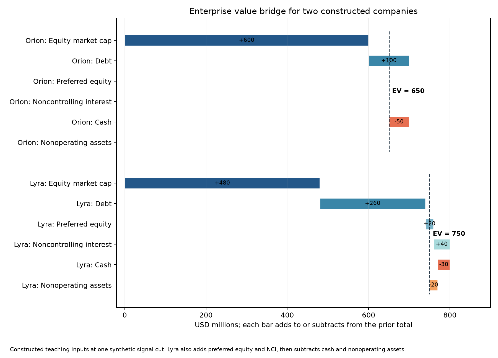
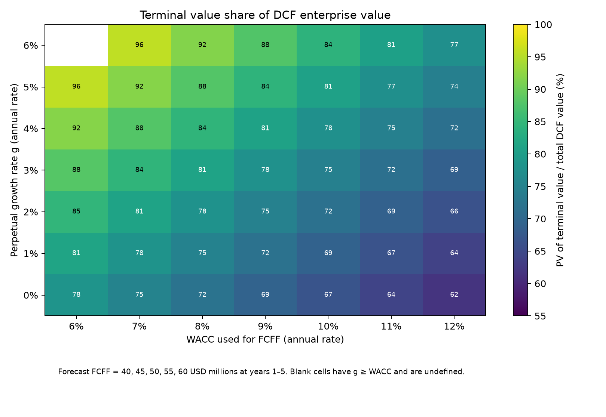

# Chapter 13 — Valuation for Quants

> Start by aligning statement cash flows, common equity market capitalization, and capital claims before calculating valuation ratios or discounted values. Prerequisites: Chapters 4, 11, and 12. After this chapter, you can bridge enterprise value (EV) to common equity value, explain common valuation ratios, construct discounted cash flow (DCF) valuations with matched cash flows and discount rates, and turn them into candidate fundamental signals without look-ahead.

## 1. Learning Objectives

After completing this chapter, you should be able to:

1. Recalculate enterprise value from common market capitalization and explicitly defined cash, interest-bearing debt, preferred equity, noncontrolling interest (NCI), and nonoperating assets (NOA) at the same valuation date, then bridge back to common equity value.
2. Specify the numerators, denominators, units, periods, shareholder scopes, and comparability conditions of price-to-earnings (P/E), price-to-book (P/B), EV/EBITDA, EV/EBIT, earnings yield, and free cash flow (FCF) yield.
3. Identify cash-flow claims: pair free cash flow to firm (FCFF) with the weighted average cost of capital (WACC) and EV, and free cash flow to equity (FCFE) with the cost of equity and common equity value. Understand that CFO−CapEx is often a useful proxy without automatically equaling FCFF or FCFE.
4. Derive finite-horizon DCF, WACC, and Gordon growth terminal value (TV), explain their assumptions, and use sensitivity and terminal-value share to identify what drives the result.
5. Construct candidate cross-sectional signals using point-in-time (PIT) statement availability, actual ingestion, market-valuation times, and share classes, with rules for zero, negative, and missing denominators.

Completion requires individually reproducible hand calculations, same-chapter answers covering every question ID, core Python functions importable from a clean project environment, and explicit separation of constructed inputs from company disclosures in every example.

## 2. Why Quants Need This

Value research involves more than ranking ratios. Statements first describe accounting profit or cash flow for a period. Researchers then determine whose cash it is, which items are operating, and which version was available at signal time. Market data price different claims at a particular instant. Only then can a numerator and denominator support cross-company comparison. A scope error anywhere can mislabel financing differences, accounting differences, or future information as cheapness.

The chain is statement lines and periods → FCFF or FCFE → matched discount rate → EV or common value → comparable ratios → PIT cross-sectional signal → industry neutrality and out-of-sample tests. Each stage inherits earlier limits. For example, dividing consolidated EBITDA by only parent common market capitalization omits creditors, preferred holders, and noncontrolling shareholders from the value denominator. A portfolio ranking built from that mismatch has no coherent economic interpretation.

This chapter teaches measurement, valuation relationships, and research design. A low multiple does not imply low risk or future excess returns; DCF is not observable truth. Without historical market quotes, we can verify disclosed statement arithmetic and demonstrate formulas with constructed prices. The latter are not actual market capitalization, actual valuation, or measured strategy performance.

## 3. Intuition

Imagine two software companies in the same industry. Each market capitalization prices common-equity claims. Company A has little debt and substantial cash; Company B has more debt, preferred shares, and NCI. To ask what common holders pay per unit of their earnings, P/E pairing common market capitalization with common earnings is a reasonable start. To ask what all operating-capital providers pay per unit of operating earnings before interest, tax, and depreciation, add debt, preferred equity, and NCI to common value, deduct cash and other nonoperating assets, and divide by EBITDA over the same consolidation scope. The multiples answer different questions.

Now consider cash flow. A factory's cash must fund working capital and CapEx before distribution to creditors and shareholders. FCFF is operating cash available to all capital providers before debt service; FCFE belongs to common equity after interest, taxes, and net borrowing adjustments. Discounting the first gives operating enterprise value; discounting the second directly gives common equity value. Discounting shareholder cash at an all-capital rate, or operating cash at an equity rate, mixes distinct claims.

Begin with three questions: whose value is in the numerator, whose cash flow or profit is in the denominator, which period/version does it cover, and at what instant is the market price observed? These connect accounting, capital structure, and information timing.

## 4. Mathematical Foundations

Represent an amount as the signed-value, currency, and unit triple `Amount`. For example, \(600\;\text{USD millions}\) means six hundred million US dollars. Price \(60\;\text{USD/share}\) times \(10\;\text{million shares}\) gives \(600\;\text{USD millions}\). Before adding, subtracting, or dividing amounts, align currency, unit, and required conversions. Denote dimensionless multiples by `x` and yields by decimals or percentages.

Distinguish three time objects: income/cash-flow statement flows cover period \([p_0,p_1]\); balance-sheet amounts belong to closing date \(p_1\); prices, market capitalization, and diluted shares belong to valuation instant \(s\). Statement versions separately have `available_at`, `ingested_at`, and accession. At research cutoff `signal_time`, both the public source and local data must be ready. Order time `trade_time` follows signal formation; returns start only once holdings actually take effect.

Amounts cannot be paired merely because both have dollar dimensions. FY2024 flows and market capitalization cover different time objects, but trailing P/E can pair FY2024 or TTM earnings already public at signal time with signal-time market value. Explicitly identify the trailing convention and verify version availability. Balance-sheet cash, debt, and common book equity use the same known closing date and disclosure version.

## 5. Formal Definitions

### 5.1 Market Capitalization, Enterprise Value, and Common Equity Value

**Equity market capitalization** sums each relevant common share class's price times its corresponding shares outstanding at the specified date, after currency and unit alignment. With one class, \(M_s=P_s Q_s\), where \(P_s\) is the valuation-time price in quote currency/share, \(Q_s\) that class's shares then outstanding, and \(M_s\) a currency amount. Handle American depositary receipt (ADR) ratios, dual classes, and convertible securities under the declared research convention; do not mix a share price with another class's earnings per share (EPS).

::: {.body-definition title="Definition and Scope: The Claim Bridge from EV to Common Equity"}

This chapter defines **enterprise value (EV)** with an explicit claim bridge. Interest-bearing debt (D), preferred equity (PREF), and NCI are non-common claims; cash (CASH) and separately identified nonoperating assets (NOA) are deducted in constructing operating EV. NCI represents outside ownership claims in consolidated subsidiaries:

\[
EV_s=M_s+D_s+PREF_s+NCI_s-CASH_s-NOA_s.
\]

Start with common market capitalization. Creditors, preferred holders, and subsidiary noncontrolling holders also claim resources, but their claims are absent from parent common capitalization. Adding them covers all capital providers for the corresponding operations. Cash and separately valued NOA are excluded from the matched operating profit or cash flow, so deduct them from operating value. \(CASH_s\) includes only cash judged deductible under the research rules. Do not automatically deduct restricted cash or minimum operating cash. Deduct \(NOA_s\) only once; an asset already contributing to operating cash flow cannot also be treated as a separate nonoperating asset.

All right-hand items are currency amounts corresponding to the valuation time: \(M_s\) is total common market capitalization, \(D_s\) defined interest-bearing debt, \(PREF_s\) preferred claims, \(NCI_s\) NCI value, \(CASH_s\) cash/equivalents deductible under the rule above, and \(NOA_s\) separately treated NOA. Units must match. This is a declared teaching convention, not a universal vendor EV definition. Pension shortfalls, leases, associate investments, and restricted cash may require additional bridges.

**Common equity value** deducts non-common capital claims from EV and adds back cash and other nonoperating assets:

\[
M_s=EV_s-D_s-PREF_s-NCI_s+CASH_s+NOA_s.
\]

This value belongs to common shareholders. Book equity is not market value and cannot substitute for it. With consolidated operating profit in the EV multiple denominator, retain other capital-provider claims in the bridge. A consolidated, non-wholly-owned subsidiary contributes all its operating results to consolidated EBITDA, so add the corresponding external NCI value to EV, not to P/E earnings or common capitalization. Consolidation depends first on control and applicable-standard exceptions, not a single ownership percentage; joint control is not synonymous with non-wholly-owned consolidation. For associates or joint ventures accounted for using the equity method or otherwise not line-by-line consolidated, separately identify the parent-held investment value and any investment earnings already in the denominator, following the asset-scope bridge in 13-C01. Partial ownership does not automatically mean adding NCI. Valuation NCI need not equal book NCI; disclose any book-value approximation.

:::

### 5.2 Equity Ratios and Earnings Yield

**Price-to-earnings (P/E)** divides common market capitalization by net income attributable to common shareholders, \(NI^{common}\):

\[
P/E_s=\frac{M_s}{NI^{common}_{p,v}}.
\]

\(NI^{common}_{p,v}\) is the company's net income attributable to that common-equity scope in period \(p\) and version \(v\), with matched currency and unit. Conventional P/E requires positive earnings. Negative earnings are not comparable, commonly labeled N/M; zero earnings are undefined. A negative arithmetic P/E below positive P/E does not make a loss-maker cheaper.

**Price-to-book (P/B)** divides common capitalization by common book equity, \(BV^{common}\): \(P/B_s=M_s/BV^{common}_{p_1,v}\). Book equity belongs to the same issuer's common holders, closing date \(p_1\), and statement version \(v\). Nonpositive common book equity prevents conventional mechanical P/B ranking; preserve the negative-equity state and missingness reason.

**Earnings yield** is \(NI^{common}_{p,v}/M_s\). It is the reciprocal of P/E only with positive net income and identical definitions. Negative net income produces negative yield, expressing the loss direction rather than an attractive positive-return signal.

### 5.3 Enterprise Multiples and Cash-Flow Yields

**EV/EBITDA** divides EV by EBITDA for the same period and consolidation scope; **EV/EBIT** uses EBIT. EBITDA is generally not a uniquely standardized statement line: record original lines, adjustments, and company/research definitions. These operating denominators require EV to cover corresponding debt, preferred, and NCI claims. Conventional multiples with nonpositive EBIT or EBITDA are excluded from cross-sectional ranking.

The term **free cash flow (FCF)** has many definitions. Distinguish three here:

- **Free cash flow to firm (FCFF):** convert EBIT into after-tax operating profit using operating tax rate \(T\): \(FCFF=EBIT(1-T)+D\&A-CapEx-\Delta NWC+Adj\). Depreciation and amortization (D\&A) are noncash expenses; CapEx is positive expenditure; an increase \(\Delta NWC\) in net operating working capital (NWC) consumes cash; \(Adj\) contains explicit other operating cash adjustments. All amounts share currency, unit, and forecast period.
- **Free cash flow to equity (FCFE):** initially restrict the simplified formula to common equity and debt only, with all items covering the same common-equity operating scope. \(FCFE=NI^{common}+D\&A-CapEx-\Delta NWC+NetBorrowing+Adj\). \(NI^{common}\) is common-attributable net income. Net borrowing equals new debt less repayments; a positive amount supplies cash to equity.
- **CFO minus CapEx:** \(CFO-CapEx\) is a common cash-flow proxy. Label its precise research definition or proxy status; do not automatically rename it FCFF.

All these cash flows have currency/period units. Signs matter: PP&E purchases usually appear as negative statement cash flows; formula \(CapEx\) is positive expenditure, so align signs before subtracting it from CFO or operating cash flow. SEC staff describes CFO minus capital expenditures as common but nonuniform FCF and cautions that it is not discretionary cash after all debt service and nondiscretionary spending. [SEC C&DI 102.07](https://www.sec.gov/rules-regulations/staff-guidance/corporation-finance-interpretations/non-gaap-financial-measures)

**FCF yield** must identify its claim: \(FCFE/M_s\) is common-equity FCF yield, and \(FCFF/EV\) enterprise FCF yield. If a data product divides \(CFO-CapEx\) by market capitalization, label it an equity-yield proxy with that explicit formula; do not directly compare it with FCFF/EV. Preserve and separately flag negative FCF yields. A nonpositive value denominator \(M_s\) or EV invalidates the yield.

### 5.4 DCF, WACC, and Terminal Value

**Discounted cash flow (DCF)** converts expected future cash flows to present value at the valuation date. With annual year-end flows:

\[
V_0=\sum_{t=1}^{N}\frac{CF_t}{(1+r)^t}+\frac{TV_N}{(1+r)^N}.
\]

\(CF_t\) is a currency amount at the end of year \(t\); \(r\) is the annual effective discount rate matching the cash-flow risk and claim; \(N\) is the dimensionless explicit forecast horizon; and \(TV_N\) is continuing value at year-end \(N\). Match cash flows, TV, currencies, real/nominal conventions, and rates. Semiannual or monthly compounding requires corresponding intervals and discount factors.

The simplified common-equity/debt **weighted average cost of capital (WACC)** is:

\[
WACC=\frac{E}{D+E}k_e+\frac{D}{D+E}k_d(1-T).
\]

Weights use market values because the rate should reflect relative claim values at the valuation date. Historical book equity cannot directly replace market weights. If cash flows cover all consolidated subsidiary operations, parent common capitalization alone omits NCI. A broader form is:

\[
WACC=\frac{E_P k_e+NCI\,k_{NCI}+PREF\,k_p+D\,k_d(1-T)}{V_{cap}},
\qquad V_{cap}=E_P+NCI+PREF+D.
\]

Amounts are valuation-time market values: \(E_P\) parent common equity, \(NCI\) NCI in that operating scope, \(PREF\) preferred equity, and \(D\) included financing debt. Each \(k\) is the corresponding annual effective capital cost. Combine \(E_P+NCI\) into \(E\) only under the constructed assumption that parent and NCI equity have the same risk; preferred equity retains separate weight and cost. The formula assumes \(V_{cap}\), total gross financing claims, represents financing weights for the operating risk. Capital costs must match that risk and weight scope. Cash and NOA are deducted from operating EV, but under this assumption not from \(V_{cap}\). Substantial lower-risk nonoperating cash can dilute observed common-equity beta and required return; cash is not necessarily risk-free, and NOA is not synonymous with cash. For pure operating FCFF, remove nonoperating-asset risk or consistently adjust costs, weights, and value scope. Do not directly combine observed whole-company equity cost with gross weights. If book debt approximates unavailable debt market value, disclose the bias assumption rather than claiming actual market weights.

See [Damodaran, DCF Inputs](https://pages.stern.nyu.edu/~adamodar/New_Home_Page/lectures/dcfinput.html) for market weights, preferred costs, and matching rates to cash-flow risk, and [Damodaran, What Is Debt?](https://pages.stern.nyu.edu/~adamodar/New_Home_Page/valquestions/whatisdebt.htm) for gross/net debt and cash conventions. Gross-debt and net-debt routes handle cash risk and weights differently. Apply the selected route consistently to EV, weights, capital costs, and operating cash flows; deducting cash in EV alone does not align costs. These materials provide frameworks, not a unique issuer-level treatment of cash, NOA, NCI, or leases. Actual valuation must match operating risk, costs, and value-bridge scope.

\(E,D\) are simplified market weights when no preferred, NCI, or other separate claims exist; \(k_e,k_d\) are annual effective equity and pretax debt costs in consistent currency/tenor terms; \(T\) approximates a sustainable marginal tax rate. Target leverage, pensions, or lease debt require corresponding cash-flow and value-bridge adjustments. WACC debt must use the same lease treatment as EV and cash flows; see Section 7.2. WACC is dimensionless.

Discount FCFF at WACC to obtain operating enterprise value, then apply the claim bridge. Discount FCFE at the equity cost to obtain common equity value. An explicitly assumed capital asset pricing model (CAPM) can specify equity cost, for example \(k_e=R_f+\beta ERP\), with risk-free rate \(R_f\), market-risk exposure \(\beta\), and equity risk premium (ERP), compensation for stock-market risk. Match rate frequencies and real/nominal terms. Richer risk models are possible, but convenience does not justify swapping discount rates.

::: {.body-conditions title="Conditions: Mathematical and Economic Scope of Stable-Growth TV"}

Under stable growth, **terminal value (TV)** compresses perpetual post-forecast cash flows into a value at year-end \(N\):

\[
TV_N=\frac{CF_{N+1}}{r-g}=\frac{CF_N(1+g)}{r-g},\quad r>g.
\]

For enterprise valuation, \(CF\) is FCFF and \(r=WACC\); for equity valuation, \(CF\) is FCFE and \(r=k_e\). \(g\) is perpetual growth matched to currency and inflation convention; \(r,g\) are dimensionless rates for the same interval. Annual cash flow divided by an annual rate gives currency value. This growth model also requires \(r>-1\) and \(g>-1\) for positive discount and growth factors; only then does \(r>g\) ensure geometric-series convergence. These mathematical conditions do not themselves require positive \(CF_N\). A going-concern interpretation additionally needs an explicit normalized stable-period base \(CF_N\) and a sustainable cash-flow path. A numerical formula output from negative or unstable forecasts does not establish credible mature-stage value. Nor do these conditions validate forecasts, competition, risk, or terminal-value share. Mature reinvestment, returns, leverage, margins, and growth must be jointly sustainable.

:::

## 6. Derivations

### 6.1 From Market Capitalization to Comparable Multiples

If the market pays \(M_s\) for common equity while operating cash also serves creditors, preferred holders, and NCI, add those claims to cover all operating-capital holders. Deduct idle cash and separately identified NOA from required operating capital value. EV additions and deductions therefore define claim and asset boundaries rather than an arbitrary adjustment list. Rearrangement gives the reverse bridge: \(M_s=EV-D-PREF-NCI+CASH+NOA\).

Next, match each multiple's numerator and denominator at the same claim level:

- Common market capitalization pairs with common earnings or common book equity for P/E or P/B.
- EV pairs with consolidated operating income or pre-depreciation operating income for EV/EBIT or EV/EBITDA.
- Common FCFE pairs with market capitalization, and firm FCFF with EV, for the corresponding FCF yields.

This is more than memorizing categories. The EV bridge reveals omitted capital providers; identifying the cash-flow claim determines the discount rate and valuation object.

### 6.2 From Accounting Cash Flow to FCFF and FCFE

Define net operating profit after tax, \(NOPAT\), as \(NOPAT=EBIT(1-T)\): after-tax operating profit before financing effects. D&A reduces accounting EBIT without another current cash payment, so add \(D\&A\). CapEx consumes cash, so deduct \(CapEx\); operating working-capital growth consumes cash, so deduct \(\Delta NWC\). Thus:

\[
FCFF=NOPAT+D\&A-CapEx-\Delta NWC+Adj.
\]

This starting point precedes interest and principal payments and belongs to all financing providers. Common-attributable net income already reflects interest and tax. Add noncash D&A, deduct capital investment and working-capital growth, and add net borrowing to obtain common-equity cash:

\[
FCFE=NI^{common}+D\&A-CapEx-\Delta NWC+NetBorrowing+Adj.
\]

This simplified FCFE formula and the bridge below assume only common equity and debt, the same operating scope, a realizable interest tax shield, and consistent other accounting adjustments. With preferred equity or NCI, combining parent common net income with whole-group D&A and CapEx mixes claims. Either build all-equity cash over a consistent scope and deduct preferred/NCI entitlements, or construct parent common cash item by item. Deducting NCI only in the ending EV bridge does not correct period FCFE. Under the simple debt-tax-shield assumption, \(FCFE=FCFF-k_dD(1-T)+NetBorrowing\). Interest and principal can put FCFE below FCFF; new borrowing can temporarily lift it above the operating contribution. Major leverage changes complicate direct FCFE forecasts. The FCFF/WACC route can value operations first and then bridge through valuation-date debt, NCI, and other claims.

However, \(CFO-CapEx\) usually starts from reported CFO after interest, depending on classification, and cash taxes. It may include exchange effects, noncash adjustments, interest classifications, and working-capital effects, without adjusting new borrowing or net capitalized items. It is useful as a statement feature; calling it FCFF or FCFE requires checking the accounting mapping and making necessary adjustments.

::: {.body-example title="Worked Example: The Itemized Bridge from CFO to FCFF and FCFE"}

Use constructed inputs for a company with only common equity and debt to bridge an annual CFO proxy to FCFF. Assume cash interest is in CFO, cash taxes equal the tax rate times \((EBIT-\text{cash interest})\), the interest shield is usable, and there are no nonoperating gains/losses. D\&A and \(\Delta NWC\) cover the same operations and year and are already fully included in CFO: EBIT 50, tax rate 25\%, cash interest 8, D\&A 10, positive CapEx 15, \(\Delta NWC=5\), and net borrowing 3, all in USD millions. Simplified net income is \((50-8)(1-0.25)=31.5\), so \(CFO=31.5+10-5=36.5\).

| Itemized CFO-to-FCFF bridge | USD millions |
|---|---:|
| Reported CFO (already includes D\&A add-back and \(\Delta NWC\) cash effect) | 36.5 |
| Add cash interest already deducted in CFO | +8.0 |
| Deduct the interest cash tax shield \(8\times25\%\) | −2.0 |
| Unlevered operating cash flow | 42.5 |
| Deduct positive CapEx expenditure | −15.0 |
| FCFF | 27.5 |

Starting directly from EBIT also gives \(50(1-0.25)+10-15-5=27.5\). Do not add D\&A or deduct \(\Delta NWC\) again after CFO; both are already included. The simple proxy \(CFO-CapEx=36.5-15=21.5\) is below FCFF by after-tax interest \(8(1-0.25)=6\) and has not unlevered operating cash. For the same company's FCFE, retain common net income and net borrowing: \(31.5+10-15-5+3=24.5\). Real statements can differ in interest presentation, cash taxes, other operating adjustments, and leases. Reconcile items before deciding whether the inputs support this bridge.

:::

### 6.3 From Cash Flows to Discounting and Terminal Value

Move a cash flow at the end of year \(t\) back one year by dividing by \(1+r\); discount a year-two flow twice to obtain \(CF_2/(1+r)^2\). Summing \(N\) explicit years gives finite-horizon present value. If stable cash flows follow \(CF_{N+j}=CF_{N+1}(1+g)^{j-1}\), their value at year-end \(N\) is:

\[
\begin{aligned}
TV_N&=\sum_{j=1}^{\infty}\frac{CF_{N+1}(1+g)^{j-1}}{(1+r)^j}\\
&=\frac{CF_{N+1}}{1+r}\sum_{j=0}^{\infty}\left(\frac{1+g}{1+r}\right)^j\\
&=\frac{CF_{N+1}}{r-g}.
\end{aligned}
\]

A geometric series converges when its ratio has absolute value below 1. Here \(r>-1\) and \(g>-1\) make the ratio positive, so convergence simplifies to \(\frac{1+g}{1+r}<1\), or \(r>g\). Checking r>g alone wrongly accepts inputs such as g=-300%, outside this growth model. TV is located at year-end \(N\) and must be divided by \((1+r)^N\) to reach \(V_0\). Adding TV directly to today's explicit-flow present value omits \(N\) years of discounting.
## 7. Financial Interpretation

### 7.1 What Multiples Compare

P/E and P/B price common equity per unit of attributable earnings or book net assets. They retain leverage and nonoperating-asset effects in common value. P/E also reflects growth, earnings volatility, repurchases, unusual charges, taxes, and accounting policies. P/B may better relate to financial firms' asset/capital constraints, but book value can diverge greatly from operating capital for businesses with substantial uncapitalized R&D or brands.

EV/EBITDA aligns an additional layer of capital-structure claims beyond net debt and uses operating results before depreciation. Companies with different capital intensity can therefore show similar EV/EBITDA yet different sustainable FCF. EV/EBIT includes D&A in operating costs and exposes asset-consumption differences, but still deducts neither CapEx nor working capital. No multiple replaces checks of cash, reinvestment, and risk.

### 7.2 Align Taxes, Interest, Leases, and Periods

Construct FCFF from operating profit with operating cash-tax assumptions. Do not mix interest-inclusive net income with an incorrect after-tax-interest add-back to FCFE. FCFE begins with common earnings after financing costs. Multiplying WACC debt cost by \(1-T\) assumes deductible interest. Align pretax/after-tax, real/nominal, and annual/quarterly cash-flow conventions.

Leases readily introduce accounting differences into EV/EBITDA or FCF ratios. Adding lease liabilities as EV debt requires checking rent, right-of-use depreciation, and lease principal/interest classifications in EBIT/EBITDA and cash flow. If rent remains an ongoing operating expense, do not add the same commitment again as EV debt. Teaching code does not automatically add lease liabilities: this is an explicit definition choice, not automatic precision.

### 7.3 Limits of TV and Quantitative Signals

Post-forecast TV often accounts for much of DCF. A high terminal share indicates sensitivity to stable-period assumptions, not correctness or cheapness. At minimum, check a grid of \(r\) and \(g\), the transition to stable growth, terminal returns on capital versus capital costs, and reinvestment sufficient for growth.

Quantitative research usually compresses fundamentals into rankable indicators rather than certifying intrinsic value for one firm. Similar industry business/accounting models can improve comparability. Industry-neutral ranking still requires checks of size, leverage, earnings quality, liquidity, estimation risk, and factor exposures. Freeze factor definitions, availability, and execution lag before backtesting; test against out-of-sample data, delistings, revisions, and transaction costs. Every ranking remains a hypothesis.

## 8. Numerical Example

::: {.body-example title="Worked Example: Orion and Lyra’s EV Bridges and All Ratios"}

Both companies, prices, shares, statements, and market values in this section are constructed for teaching, in USD millions, not quotes, actual companies, or strategy performance. Assume one fictional signal cutoff, with FY2024 flows already public and ingested. Orion's constructed price is USD 60/share with 10 million diluted shares, giving market capitalization \(60\times10=600\). Lyra's price is USD 24/share with 20 million shares, giving 480.

| Constructed input/calculation | Orion | Lyra |
|---|---:|---:|
| Common market capitalization \(M\) | 600 | 480 |
| Interest-bearing debt \(D\) | 100 | 260 |
| Preferred equity / NCI | 0 / 0 | 20 / 40 |
| Cash / NOA | 50 / 0 | 30 / 20 |
| Common net income / common book equity | 30 / 180 | 20 / 120 |
| EBITDA / EBIT | 75 / 50 | 75 / 50 |
| FCFE / FCFF | 28 / 40 | 18 / 40 |
| EV bridge result | \(600+100-50=650\) | \(480+260+20+40-30-20=750\) |

FCFF and FCFE are separately specified constructed cash flows already matched to firm and common claims, not inferred from the listed net income. Lyra has NCI and preferred equity: whole-group D&A/CapEx cannot simply adjust parent common net income to reconstruct FCFE. Reconstruction would require additional attribution/distribution adjustments.

Orion's enterprise multiples are \(650/75=8.67x\) for EV/EBITDA and \(650/50=13x\) for EV/EBIT. Common P/E is \(600/30=20x\), P/B \(600/180=3.33x\), and earnings yield \(30/600=5\%\). Pair FCFE with market capitalization for equity yield \(28/600=4.67\%\); pair FCFF with EV for enterprise yield \(40/650=6.15\%\).

Lyra's EV/EBITDA is \(750/75=10x\) and EV/EBIT \(750/50=15x\); P/E is \(480/20=24x\), P/B \(480/120=4x\), and earnings yield \(20/480=4.17\%\). Equity FCF yield is \(18/480=3.75\%\) and enterprise FCF yield \(40/750=5.33\%\). Omitting preferred/NCI, or adding debt without deducting cash/NOA, changes EV multiples without changing operating profit: a bridge error alone can manufacture ranking differences.

:::

A hand-calculable WACC example also uses constructed amounts and assumes common/debt market weights and costs match the simplified operating risk: \(E=600,D=100,k_e=10\%,k_d=6\%,T=25\%\), giving

\[
WACC=\frac{600}{700}(10\%)+\frac{100}{700}(6\%)(1-25\%)\approx9.2143\%.
\]

::: {.body-example title="Worked Example: Lyra’s Financing Weights and Operating EV"}

Lyra's constructed bridge illustrates EV versus WACC weight scope: \(M=480,D=260,PREF=20,NCI=40,CASH=30,NOA=20\), so \(EV=480+260+20+40-30-20=750\), with reverse bridge \(750-260-20-40+30+20=480\). Assume \(k_e=k_{NCI}=10\%,k_p=7\%,k_d=6\%,T=25\%\). The capital-claim weighting base is \(V_{cap}=480+40+20+260=800\), and

\[
WACC=\frac{480(10\%)+40(10\%)+20(7\%)+260(6\%)(1-25\%)}{800}
=\frac{65.1}{800}=8.1375\%.
\]

Here 800 is gross financing claims before cash/NOA deductions; 750 is operating EV after those deductions. They serve different calculations. This example assumes cash-risk adjustments are already reflected in the specified costs; it is not an actual company cost estimate.

:::

::: {.body-example title="Worked Example: Five-Year FCFF and Year-End TV"}

A separate constructed DCF uses year-end FCFF of 40, 45, 50, 55, and 60 USD millions in years 1–5, WACC 9%, and stable \(g=3\%\). Year-five TV is \(60(1.03)/(0.09-0.03)=1{,}030\) USD millions. Discounting all five flows and TV at year-end gives EV approximately 860.57. TV present value is \(1{,}030/1.09^5\approx669.43\), about 77.79% of total EV. These figures reproduce the formula without validating \(g\), WACC, or forecasts.

:::

## 9. Python Implementation

### Default Entry Point for This Reader Edition

From the [accepted I3 reader package](../../../../qa/a10/ACCEPTED_COMPLETE_LOCAL_READER_I3.md) root, set up its [environment](../../README.md), then run:

```bash
.venv/bin/python run_notebook.py notebooks/ch13_valuation.ipynb
```

The Notebook calls the packaged shared implementation. Orion/Lyra, forecasts, capital costs, PIT clocks, and market values are constructed; the Apple section only checks statement lines. By default it displays two existing packaged figures without redrawing them. The runner writes new kernel execution records to a unique `runs/execution_*` directory; the Notebook separately creates a unique UUID chapter-method directory and prints its location. These directories have distinct purposes; existing figures are not new batch outputs. Unbundled French data are neither read by default nor downloaded. The CLI and old production tests below refer to the working-course root. Readers use the Notebook assertions above and need not restore missing production tests. English Notebook Markdown remains pending BIL23 integration. No Notebook or old numerical suite was executed in this batch.

### Historical Working-Course Root and Original Implementation

Core functions are in [valuation.py](../../../../src/quant_course/valuation.py), entry points and plots in [ch13_valuation.py](../../../../code/ch13_valuation.py), tests in [test_ch13_valuation.py](../../../../tests/test_ch13_valuation.py), and the teaching Notebook in [ch13_valuation.ipynb](../../../../notebooks/ch13_valuation.ipynb). The module downloads no data. Amounts require explicit currency/unit; multiple functions return `None` for nonpositive denominators; FCF yield preserves cash-flow signs and checks claims; PIT selection checks both `available_at` and `ingested_at`.

The same core interfaces calculate the constructed cases, from price and million-share counts through market capitalization, EV, and multiples. From the project directory, run:

```python
from pathlib import Path
import sys
sys.path.insert(0, str(Path.cwd() / "src"))
from quant_course.valuation import Amount, enterprise_value, price_to_earnings

market_cap = Amount(600.0, "USD", "USD millions")
debt = Amount(100.0, "USD", "USD millions")
cash = Amount(50.0, "USD", "USD millions")
net_income = Amount(30.0, "USD", "USD millions")
ev = enterprise_value(market_cap, debt, cash)
print(
    f"EV={ev.value:.0f} USD millions; "
    f"P/E={price_to_earnings(market_cap, net_income):.2f}x"
)
```

Examples combine annual statement flows with market amounts at one constructed signal instant. PIT demonstrations use constructed UTC times marked `Z`. A later revision cannot change an earlier signal even when it covers the same fiscal period. Market snapshots cannot exceed signal_time. Example trade_time follows signal_time; real execution additionally requires trading calendars, matching delays, and order conventions. No actual return interval is calculated here.

## 10. Visualization



The [EV claim-bridge figure](../../../../figures/a3/ch13_ev_bridge.png) uses USD millions horizontally and constructed companies/bridge items vertically. Each bar adds to or deducts from the preceding cumulative value; dashed lines mark final EV. Lyra's preferred equity/NCI raise EV, while cash/NOA reduce it. Orion shows only market capitalization, debt, and cash.



The [terminal-share sensitivity figure](../../../../figures/a3/ch13_terminal_sensitivity.png) places annual FCFF WACC horizontally and annual perpetual growth \(g\) vertically. Colors and cell figures give TV present value as a percentage of total DCF EV. Inputs are constructed FCFF 40, 45, 50, 55, and 60 USD millions. Cells with \(g\ge WACC\) are blank because the perpetual-growth formula does not converge. Terminal share rises near \(g=WACC\), prompting scrutiny of stable-period assumptions rather than validating the model.

The CLI generates both figures from the listed constructed numbers, without market observations or random sampling; no random seed is needed. Axes and captions identify units and assumptions.

## 11. Real Market Example

The real-source example verifies statement facts, not actual valuation or market performance. Apple FY2024 Form 10-K reports operating income 123,216 and net income 93,736 USD millions, diluted EPS USD 6.08, and weighted-average diluted shares of 15,408,095 thousand shares. FY2024 ends 2024-09-28; accession is `0000320193-24-000123`. These explain the EPS numerator/denominator without a verified matched price, security-class mapping, or historical capitalization snapshot. No actual Apple P/E, P/B, or FCF yield is calculated. [Apple FY2024 Form 10-K](https://www.sec.gov/Archives/edgar/data/320193/000032019324000123/aapl-20240928.htm)

Issued and outstanding shares in Apple's filing differ from weighted-average diluted EPS shares. Balance-sheet shares are a closing-date stock; EPS shares are a fiscal-year weighted average. Market capitalization needs shares outstanding for the corresponding class at the valuation date. Price/EPS additionally requires the EPS period, basic/diluted choice, and share basis. Actual capitalization requires verified prices, all relevant common classes, ADR conversions, and trading times. These data were not downloaded, so there is no quote sample period, frequency, or file hash.

## 12. Common Mistakes

### 12.1 Dividing FCFE by EV

Dividing Orion FCFE \(28\) USD millions by EV \(650\) gives 4.31%, versus correct common FCF yield \(28/600=4.67\%\). The mismatch inserts creditors and other claims into an FCFE denominator. Enterprise yield requires FCFF/EV instead. The core module rejects an explicit `cash_flow_basis="FCFE"` with `claim_basis="EV"` call.

```python
fcfe = 28.0
equity_value = 600.0
enterprise_value_amount = 650.0
wrong_yield = fcfe / enterprise_value_amount
correct_yield = fcfe / equity_value
assert round(wrong_yield * 100, 2) == 4.31
assert round(correct_yield * 100, 2) == 4.67
```

### 12.2 Ranking Negative P/E as Cheapest

Arithmetic P/E for loss-makers is negative; a ranking algorithm may put the smallest negative number first among low valuations. The denominator sign changes interpretation. Mark P/E noncomparable and preserve a loss flag. Negative earnings yield can remain a separate feature with explicitly designed ranking and missingness rules.

```python
pe = {"LossCo": 480.0 / -20.0, "ProfitCo": 600.0 / 30.0}
wrong_order = sorted(pe, key=pe.get)
def comparable_pe(market_cap: float, net_income: float) -> float | None:
    return market_cap / net_income if market_cap > 0 and net_income > 0 else None
safe = {
    name: comparable_pe(480.0, -20.0)
    if name == "LossCo"
    else comparable_pe(600.0, 30.0)
    for name in pe
}
assert wrong_order[0] == "LossCo"
assert safe["LossCo"] is None and safe["ProfitCo"] == 20.0
```

### 12.3 Automatically Calling (CFO-CapEx) FCFF

CFO often includes interest paid, cash taxes, and working-capital adjustments, while accounting standards may classify interest differently. FCFF uses after-tax operating profit less operating reinvestment. Check interest, taxes, and working capital for omissions or duplication. This code compares an accounting cash-flow proxy with operating-profit-based FCFF:

```python
cfo = 44.0
capex = 15.0
reported_cfo_less_capex = cfo - capex
ebit, tax, da, change_nwc = 50.0, 0.25, 10.0, 5.0
fcff = ebit * (1 - tax) + da - capex - change_nwc
assert reported_cfo_less_capex == 29.0
assert fcff == 27.5
```

Different results alone do not establish a statement error. Trace interest, tax, noncash adjustments, working-capital definitions, capitalization, and versions.

### 12.4 Mismatching EV and the Operating Denominator

::: {.body-pitfall title="Pitfall: Operating Denominator and EV Claim Scope"}

If EBITDA is consolidated but EV omits NCI, value covers only some equity claims while profit includes all subsidiary operations. Omitting Lyra's NCI understates EV from 750 to 710 USD millions and EV/EBITDA from 10x to 9.47x. This false signal comes from a bridge-scope mismatch, not improved operations. Adding lease debt to EV while using EBITDA after corresponding lease-cost deductions may also count leases twice. Record EBITDA's consolidation scope and align NCI, leases, and other bridge items to the same economic scope.

```python
market_cap, debt, preferred, nci = 480.0, 260.0, 20.0, 40.0
cash, nonoperating_assets, consolidated_ebitda = 30.0, 20.0, 75.0
wrong_ev = market_cap + debt + preferred - cash - nonoperating_assets
correct_ev = wrong_ev + nci
wrong_multiple = wrong_ev / consolidated_ebitda
correct_multiple = correct_ev / consolidated_ebitda
assert wrong_ev == 710.0 and correct_ev == 750.0
assert round(wrong_multiple, 2) == 9.47 and correct_multiple == 10.0
print(f"Omitting NCI: EV={wrong_ev:.0f}, EV/EBITDA={wrong_multiple:.2f}x")
print(f"Matched scope: EV={correct_ev:.0f}, EV/EBITDA={correct_multiple:.2f}x")
```

:::

### 12.5 Pairing Current Capitalization with Future Statements or Wrong Periods

Period-end is not market availability. Backfilling an earlier signal with a later-restated FY2024 value displayed today inserts unavailable information into rankings. The code deliberately miscalculates early yield using the latest version, then uses PIT selection for the version public and ingested at signal_time: the wrong yield is 4.17%, the then-reproducible yield 4.67%. Market amounts likewise need snapshots no later than the signal, with matched share class and valuation date.

```python
from datetime import date, datetime, timezone
from pathlib import Path
import sys
sys.path.insert(0, str(Path.cwd() / "src"))
from quant_course.valuation import FinancialVintage, select_pit_vintage

utc = timezone.utc
def vintage(available, ingested, accession, fcfe):
    return FinancialVintage(
        issuer_id="SYNTHETIC-1", security_id="SYNTHETIC-A", fiscal_period="FY2024",
        period_end=date(2024, 12, 31),
        available_at=datetime.fromisoformat(available).replace(tzinfo=utc),
        ingested_at=datetime.fromisoformat(ingested).replace(tzinfo=utc),
        accession=accession,
        currency="USD", unit="USD millions", net_income_common=30.0,
        common_book_equity=180.0, ebit=50.0, ebitda=75.0, free_cash_flow=fcfe,
        cash_flow_basis="FCFE", industry="Software",
    )

versions = [
    vintage("2025-02-15T12:00:00", "2025-02-16T09:00:00", "SIM-ORIGINAL", 28.0),
    vintage("2025-04-02T12:00:00", "2025-04-02T14:00:00", "SIM-RESTATED", 25.0),
]
signal_time = datetime(2025, 3, 31, 16, 1, tzinfo=utc)
market_cap_at_signal = 600.0  # Constructed March 31 market cap, USD millions
wrong_latest = max(versions, key=lambda row: row.available_at)
wrong_yield = wrong_latest.free_cash_flow / market_cap_at_signal
selected = select_pit_vintage(
    versions, security_id="SYNTHETIC-A", fiscal_period="FY2024", signal_time=signal_time
)
correct_yield = selected.free_cash_flow / market_cap_at_signal
assert wrong_latest.accession == "SIM-RESTATED"
assert selected.accession == "SIM-ORIGINAL"
assert round(wrong_yield * 100, 2) == 4.17
assert round(correct_yield * 100, 2) == 4.67
print(f"Incorrect future-restated yield={wrong_yield:.2%}; PIT yield={correct_yield:.2%}")
```

Real research must also preserve `period_start/end`, accession, `available_at`, `ingested_at`, `signal_time`, market-snapshot `as_of`, and share-class validity periods.

Every three-argument `MarketCapSnapshot` example explicitly assumes that at `as_of` quotes were already public and ingested, the multiplied shares were then-known historical shares, and all EV components used statement versions known at that signal instant. These are constructed demonstration assumptions. Real data need separate market-data `available_at` and `ingested_at` constrained with `as_of` by signal_time. Quote time differs from researcher receipt time; current shares cannot multiply historical prices retrospectively. The selector also lacks Chapter 12's non-reliance state machine; production must exclude known invalid versions.
A restatement ingested only after the signal remains unusable even if `available_at` qualifies. Reject version conflicts or route them for review; do not silently zero-fill missing values.

### 12.6 Confusing Shares, Units, or Lease Policies

Price has currency/share units; multiplying shares in millions yields currency millions. Earnings must also be in millions for units to cancel. Dividing total USD capitalization by USD-millions profit creates a million-fold error. Constructed price USD 60 and 10 million shares give capitalization 600 USD millions and P/E 20x. Correct units alone do not fix multiplying one A-class price by A+B shares: with class prices 60 and 30, total capitalization should be 540, not 600 USD millions.

```python
from pathlib import Path
import sys
sys.path.insert(0, str(Path.cwd() / "src"))
from quant_course.valuation import market_cap_from_price

price_usd_per_share = 60.0
shares_millions = 10.0
net_income_usd_millions = 30.0
market_cap = market_cap_from_price(price_usd_per_share, shares_millions)
wrong_pe_mixed_units = (price_usd_per_share * 10_000_000) / net_income_usd_millions
correct_pe = market_cap.value / net_income_usd_millions
assert market_cap.value == 600.0
assert wrong_pe_mixed_units == 20_000_000.0 and correct_pe == 20.0

class_a_price, class_a_shares_m = 60.0, 8.0
class_b_price, class_b_shares_m = 30.0, 2.0
wrong_single_class_cap = class_a_price * (class_a_shares_m + class_b_shares_m)
correct_all_class_cap = (
    class_a_price * class_a_shares_m + class_b_price * class_b_shares_m
)
assert wrong_single_class_cap == 600.0 and correct_all_class_cap == 540.0
print(
    f"Mixing USD and USD millions: incorrect P/E={wrong_pe_mixed_units:.0f}, "
    f"correct P/E={correct_pe:.0f}x"
)
print(
    f"Omitting class B price: incorrect market cap={wrong_single_class_cap:.0f}, "
    f"correct market cap={correct_all_class_cap:.0f} USD millions"
)
```

See Section 7.2 for lease consistency. Also check ADR ratios, split adjustments, basic/diluted EPS shares, restricted cash, and nonoperating investments to avoid repeated additions or deductions.

## 13. Quant Research Application

To use valuation measures as candidate fundamental signals, follow this workflow.

1. **Declare assumptions and universe.** Freeze permanent security IDs, tradable share classes, industries, delisting treatment, fiscal periods, and company classification. Common-stock studies use common earnings, market values, and book values. Consolidated operating profit requires matched NCI scope in EV.
2. **Freeze statement features.** Specify trailing net income/EPS for P/E, parent common book equity for P/B, and original lines/adjustments for EV/EBITDA and EV/EBIT. Choose FCFE/market cap, FCFF/EV, or a separately named (CFO-CapEx) proxy. Preserve versions of tax, interest, lease, cash, debt, share, currency, and unit treatments.
3. **Filter and price at the cutoff.** Candidate versions require external `available_at≤signal_time` and local `ingested_at≤signal_time`. Report dates, acceptance strings, and ingestion cannot substitute for one another. Market value uses prices and shares at or before the signal. All-class aggregation, corporate actions, ADRs, FX, and exchange calendars need independent sources. With closing prices, signal calculation and orders follow the close, `trade_time` is the next executable instant, and holding returns begin when positions actually take effect.
4. **Set numerical boundaries.** Nonpositive market value/EV invalidates the measure. Nonpositive P/E, P/B, EV/EBIT, or EV/EBITDA denominators retain loss/zero/negative-equity reasons and stay out of monotonic rankings. Preserve source/mapping/unit/version failure states. Negative earnings or FCF yield can retain its sign without entering an undesigned cheapness ranking alongside positives.
5. **Compare within industries before testing factors.** At each signal date, use preregistered directions for industry percentiles or robust standard scores, then form portfolios. Report exclusion shares for loss-makers/negative-equity firms and sensitivity to alternative rules. Use industry equal weights or medians as baselines, rather than explaining performance only against a broad index.
6. **Test counterevidence and net-of-cost results.** Use rolling training/validation/out-of-sample intervals with fixed rebalance, execution lag, suspension/delisting, and version rules. Compare industry, size, leverage, and distress exposures. Measure turnover, spreads, impact, commissions, stock borrowing, and liquidity constraints. Changing a late version must not change earlier signals. Tests must catch future capitalization, statements, constituents, or revisions. Report new results alongside industry baselines, simple book/earnings ranks, and before/after-cost outcomes.

No historical security panel, market prices, industry classifications, or execution costs are assembled here; no factor returns, significance, capacity, or investment conclusions are reported. Future empirical work should first freeze the schema and eligibility rules, then use verifiable actual version chains.

## 14. Chapter Summary

Valuation begins by identifying claims. Common market value pairs with common earnings/equity; EV with operations covering all capital providers. FCFE and equity cost give common value; FCFF and WACC give operating enterprise value. Cash flows, taxes, interest, leases, and NCI scope must remain consistent. EV bridges and multiples create comparable market measures; DCF discounts explicit forecasts. TV compresses long-run assumptions and often dominates. Quantitative workflows also require denominator signs, units, periods, versions, share classes, and signal/trade timing. Meeting these constraints does not establish profitable signals: industry benchmarks, out-of-sample tests, and costs remain necessary.

## 15. Exercises

Answers to conceptual, calculation, and interpretation questions are in Section 18.

**13-E01 (Claims)** Consolidated EBITDA includes all EBITDA of a non-wholly-owned subsidiary. Why does EV/EBITDA require NCI consideration? How should common capitalization be used when studying only parent shareholders?

**13-E02 (EV bridge)** Calculate Lyra's EV and reverse common equity value using Section 8. Explain the signs of preferred equity, NCI, cash, and NOA.

**13-E03 (Multiples)** For both Section 8 companies, calculate P/E, P/B, EV/EBITDA, EV/EBIT, earnings yield, FCFE/equity yield, and FCFF/EV yield. Identify each claim pairing.

**13-E04 (Nonpositive denominators)** A company has capitalization 500 USD millions and net loss −25; another has common book equity −60. State P/E/P/B treatment, calculate the loss-maker's earnings yield, and explain how rankings preserve the information.

**13-E05 (Cash flows)** With EBIT=80, tax rate 25%, D&A=12, CapEx=20, and \(\Delta NWC=5\), calculate FCFF. Then use common net income 45 and net borrowing −3 to calculate FCFE. Both input sets use USD millions.

**13-E06 (WACC)** \(E=700,D=300,k_e=9\%,k_d=5\%,T=20\%\). Calculate WACC and explain why weights usually use market values.

**13-E07 (DCF and TV)** Year-end FCFF is 30, 35, and 40 USD millions, WACC=10%, and perpetual growth \(g=2\%\). Calculate year-three TV and express today's value under year-end discounting; many decimal places are unnecessary.

**13-E08 (PIT)** A FY2024 10-K is public on 2025-02-15 and ingested February 16; a restatement is public/ingested on 2025-04-02. Signals are 2025-03-31 and 2025-04-03. Capitalization snapshots are 600 on March 31 and 620 on April 2, in USD millions. Original/restated FCFE is 28/25. Select each version, calculate FCF yield, and identify the market-value date used.

**13-E09 (Real-source boundaries)** Apple FY2024 10-K lists net income, diluted EPS, and weighted-average diluted shares. Do these alone establish actual historical P/E? Identify at least three additional data or definition checks.

## 16. Programming Exercises

Programming exercises run in the project `.venv` and import Section 9's core module. Each requires outputs verified by assertions.

**13-P01 (Claim-safe ratios)** Use `Amount`, the EV bridge, P/E, EV/EBITDA, and FCFE yield to reproduce Orion and Lyra. Assert EV 650/750, P/E 20/24, and EV/EBITDA approximately 8.67/10. Pairing FCFE with EV must be rejected.

**13-P02 (Discount matching and TV sensitivity)** For annual FCFF `[40,45,50,55,60]` USD millions, calculate TV and EV with WACC=9% and \(g=3\%\). Assert EV approximately 860.57 and terminal share approximately 77.79%. Traverse a WACC/\(g\) grid, returning TV only when \(g<WACC\).

**13-P03 (Cross-section and PIT counterevidence)** Use `industry_percentile_ranks` for three profitable firms and one loss-maker missing P/E at the same signal date, including tied ranks. Move a restatement's `ingested_at` beyond signal_time and assert the early signal retains the original. Verify exclusion of market values later than signal_time.

## 17. Challenge Problems

Open questions allow multiple reasonable answers but require explicit scope, timing, and counterevidence. Reference arguments and scoring appear in the answers.

**13-C01 (Consolidated EBITDA, NCI, and leases; prerequisite: Chapter 12)** X and Y have equal operating profit. Y has substantial unconsolidated investments or consolidated non-wholly-owned subsidiaries and is lease-intensive; first identify the actual accounting scope of each category. Propose consistent EV/EBITDA paths, identify at least two seemingly conservative bridges that double-count, and list required note fields.

**13-C02 (Value-signal research design; prerequisites: Chapters 3 and 12)** Design a cross-company PIT FCF-yield test. Justify FCFF/EV, FCFE/market cap, or a CFO−CapEx proxy. Define versions, market prices, share classes, capitalization, industry groups, negative-denominator and missingness rules; specify signal_time, trade_time, and return interval. Include at least two counterevidence tests and an out-of-sample, benchmark, and transaction-cost comparison. Do not present unexecuted research as results.

## 18. Solutions / Solution Hints

### Conceptual and Hand-Calculation Answers

**13-E01** Consolidated EBITDA includes all subsidiary operations, while common capitalization prices only parent common-share claims. EV adds debt, preferred equity, NCI, and other non-common claims to cover that operating scope. For parent holders, use common capitalization with common-attributable earnings/book value or FCFE. From enterprise value, deduct non-common claims and add back excluded cash/NOA.

**13-E02** \(EV=480+260+20+40-30-20=750\) USD millions. Reverse bridge: \(750-260-20-40+30+20=480\), matching constructed common capitalization. Debt, preferred equity, and NCI add to EV; cash and NOA subtract. The signs follow claim and nonoperating-asset boundaries.

**13-E03** Orion: P/E \(600/30=20x\), P/B \(600/180=3.33x\), EV/EBITDA \(650/75=8.67x\), EV/EBIT \(650/50=13x\), earnings yield \(30/600=5\%\), FCFE/equity \(28/600=4.67\%\), FCFF/EV \(40/650=6.15\%\). Lyra: P/E \(480/20=24x\), P/B \(480/120=4x\), EV/EBITDA \(750/75=10x\), EV/EBIT \(750/50=15x\), earnings yield \(20/480=4.17\%\), FCFE/equity \(18/480=3.75\%\), FCFF/EV \(40/750=5.33\%\). P/E, P/B, earnings yield, and FCFE yield pair common claims; EV multiples and FCFF yield pair firm-level claims. Matched constructed units cancel in amount ratios.

**13-E04** Arithmetic P/E \(500/(-25)=-20x\) is not a conventional comparable multiple and stays out of rankings, labeled N/M or negative earnings. Earnings yield \(=-25/500=-5\%\) can preserve the loss direction under a separate rule. Negative common book equity likewise excludes conventional P/B ranking while retaining its state. Do not rank absolute denominators or silently delete firms and call survivors the full universe.

**13-E05** \(FCFF=80(1-0.25)+12-20-5=47\) USD millions. \(FCFE=45+12-20-5-3=29\) USD millions. Net borrowing −3 indicates net repayment. Net income already deducts interest; the FCFF EBIT starting point does not. Without interest and capital-structure data, their difference cannot be inferred from one another.

**13-E06** \(WACC=0.7(9\%)+0.3(5\%)(1-20\%)=6.3\%+1.2\%=7.5\%\). Valuation reflects current market claim pricing and required returns; market weights approximate marginal capital structure. Book values are historical accounting amounts potentially far from current financing proportions. Explicitly disclose any book-debt approximation.

**13-E07** \(TV_3=40(1.02)/(0.10-0.02)=510\) USD millions. With year-end flows, \(V_0=30/1.10+35/1.10^2+40/1.10^3+510/1.10^3\approx469.42\) USD millions. TV is located at year-three end and receives three discount periods, like year-three FCFF. The result still depends on normalized FCFF, WACC, and sustainable growth.

**13-E08** On March 31, select only the original because the restatement is not yet public/ingested; use March 31 capitalization for FCFE yield \(28/600=4.67\%\). On April 3, select the April 2 restatement and April 2 capitalization, no later than the signal, for yield \(25/620\approx4.03\%\). Inputs are constructed. A public restatement ingested after signal_time would remain unusable.

**13-E09** No. At minimum, verify common-stock price and matched valuation time; all common classes/ADR conversions and share basis; and available statement version with trailing EPS period/shareholder scope. Also check trading time zone, dividends/splits, valuation date, and ending shares versus weighted-average EPS shares. Net income and EPS alone explain only statement earnings definitions.

### Programming Answers

**13-P01** Run the complete program below from the project root. It directly calls the chapter module; both `assert` checks cover EV bridges and claim restrictions.

```python
from pathlib import Path
import sys
sys.path.insert(0, str(Path.cwd() / "src"))
from quant_course.valuation import (
    Amount,
    enterprise_value,
    enterprise_multiple,
    fcf_yield,
    price_to_earnings,
)

def a(value: float) -> Amount:
    return Amount(value, "USD", "USD millions")

orion_ev = enterprise_value(a(600), a(100), a(50))
lyra_ev = enterprise_value(a(480), a(260), a(30), noncontrolling_interest=a(40),
                           preferred_equity=a(20), nonoperating_assets=a(20))
assert orion_ev.value == 650 and lyra_ev.value == 750
assert price_to_earnings(a(600), a(30)) == 20
assert price_to_earnings(a(480), a(20)) == 24
assert enterprise_multiple(orion_ev, a(75)) == 650 / 75
assert enterprise_multiple(lyra_ev, a(75)) == 10
assert fcf_yield(a(40), orion_ev, cash_flow_basis="FCFF", claim_basis="EV") == 40 / 650
try:
    fcf_yield(a(28), orion_ev, cash_flow_basis="FCFE", claim_basis="EV")
except ValueError:
    pass
else:
    raise AssertionError("FCFE must be paired with equity value")
print("Orion EV=650; Lyra EV=750; claim matching passed")
```

**13-P02** The complete reference implementation follows. Change only (r,g), recalculating TV and DCF for each valid pair.

```python
from pathlib import Path
import sys
sys.path.insert(0, str(Path.cwd() / "src"))
from quant_course.valuation import (
    Amount,
    discounted_cash_flow_value,
    gordon_terminal_value,
)

flows = [Amount(value, "USD", "USD millions") for value in (40, 45, 50, 55, 60)]
rate, growth = 0.09, 0.03
tv = gordon_terminal_value(flows[-1], rate, growth)
value = discounted_cash_flow_value(
    flows, rate, cash_flow_basis="FCFF", discount_rate_basis="WACC", terminal_value=tv
)
pv_tv = tv.value / (1 + rate) ** len(flows)
assert round(tv.value, 2) == 1030.00
assert round(value.value, 2) == 860.57
assert round(100 * pv_tv / value.value, 2) == 77.79
valid = []
for test_rate in (0.08, 0.09, 0.10):
    for test_growth in (0.02, 0.03, 0.04):
        if test_growth < test_rate:
            test_tv = gordon_terminal_value(flows[-1], test_rate, test_growth)
            valid.append((test_rate, test_growth, test_tv.value))
assert len(valid) == 9
print(f"TV={tv.value:.2f}; EV={value.value:.2f}; PV(TV)/EV={pv_tv/value.value:.2%}")
```

**13-P03** Section 9's core module supplies all PIT types and industry-percentile functions. This complete code checks ranks, late-ingested restatements, and future-market-value exclusion. Companies and UTC clocks are explicitly constructed, not actual corporate histories.

```python
from pathlib import Path
import sys
sys.path.insert(0, str(Path.cwd() / "src"))
from quant_course.valuation import industry_percentile_ranks

values = {"A": 0.05, "B": 0.03, "C": 0.03, "LOSS": None}
industries = {"A": "Software", "B": "Software", "C": "Software", "LOSS": "Software"}
ranks = industry_percentile_ranks(values, industries)
assert ranks == {"A": 1.0, "B": 0.25, "C": 0.25, "LOSS": None}
print(ranks)

from datetime import date, datetime, timezone
from quant_course.valuation import (
    Amount, FinancialVintage, MarketCapSnapshot,
    select_pit_vintage, select_pit_market_cap,
)
signal = datetime(2025, 3, 31, 20, tzinfo=timezone.utc)
original = FinancialVintage(
    issuer_id="SIM-ISSUER", security_id="SIM-COMMON", fiscal_period="FY2024",
    period_end=date(2024, 12, 31),
    available_at=datetime(2025, 2, 15, 8, tzinfo=timezone.utc),
    ingested_at=datetime(2025, 2, 16, 8, tzinfo=timezone.utc),
    accession="SIM-V1", currency="USD", unit="USD millions",
    net_income_common=30, common_book_equity=180, ebit=50, ebitda=75,
    free_cash_flow=28, cash_flow_basis="FCFE", industry="Software",
)
from dataclasses import replace
restated = replace(
    original, accession="SIM-V2", free_cash_flow=25,
    available_at=datetime(2025, 3, 1, 8, tzinfo=timezone.utc),
    ingested_at=datetime(2025, 4, 2, 8, tzinfo=timezone.utc),
)
assert select_pit_vintage(
    [original, restated], security_id="SIM-COMMON",
    fiscal_period="FY2024", signal_time=signal,
) == original
# Constructed assumption: prices and historical shares were public and ingested by as_of.
old_cap = MarketCapSnapshot("SIM-COMMON", signal, Amount(600, "USD", "USD millions"))
future_cap = MarketCapSnapshot(
    "SIM-COMMON", datetime(2025, 4, 2, 20, tzinfo=timezone.utc),
    Amount(620, "USD", "USD millions"),
)
assert select_pit_market_cap(
    [old_cap, future_cap], security_id="SIM-COMMON", signal_time=signal,
) == old_cap
print("late ingestion and future market cap excluded")
```

### Challenge Answers

**13-C01** First distinguish consolidated non-wholly-owned subsidiaries from investments not consolidated line by line, then fix the activities covered by the operating denominator. Partial ownership or a percentage alone does not determine an NCI addition.

**Consolidated path.** If consolidated EBITDA includes 100% of subsidiary operations, operating EV must cover debt, preferred equity, and external NCI over the same scope. NCI value adds to parent common capitalization in constructing EV; it does not add to P/E earnings or common capitalization itself. Retaining all subsidiary EBITDA while omitting NCI omits claims and mismatches scope, rather than double-counting. A proportionately attributable operating scope requires rebuilding debt, cash, NOA, and operating amounts consistently, with headquarters allocations and intragroup transactions explained. Multiplying consolidated EBITDA by ownership percentage and pairing it directly with common capitalization is insufficient.

**Unconsolidated-investment path.** Assume the investment is separately valued as a nonoperating asset. Let \(I\) be the estimated value of the parent-held equity stake and \(NOA_{\mathrm{other}}\) other separately identified NOA. Separating that investment from assets embedded in common-equity pricing gives the core operating bridge:

\[
EV_{\mathrm{core}}=M+D+PREF+NCI-CASH-NOA_{\mathrm{other}}-I.
\]

Here NCI belongs only to the consolidated operating scope above; do not add outside holders of the unconsolidated investee again. The operating denominator must also exclude this investment's contribution. If reported EBITDA already excludes equity-method income, deduct nothing further. If the chosen EBITDA definition actually includes investment earnings, check their item, period, and attribution, then remove exactly the included part. Investment earnings are not the investee's full EBITDA and cannot casually represent a full operating contribution via ownership scaling. Conversely, after valuing core operating FCFF excluding investment earnings to obtain \(EV_{\mathrm{core}}\), add \(I\) back through the same asset bridge to reach parent common value:

\[
M=EV_{\mathrm{core}}-D-PREF-NCI+CASH+NOA_{\mathrm{other}}+I.
\]

Do not retain the same investment in core cash flows/TV and add its full separately estimated value again. Do not deduct its value twice or remove investment earnings from a denominator that already excludes them. A valuation route including the investment as a whole must jointly define its cash flows, risk/discount rate, and value scope; a one-sided multiple adjustment is insufficient.

**Two lease paths.** Under financing treatment, EV includes corresponding lease liabilities, the operating denominator uses a consistent capitalization convention, and FCF/WACC jointly address lease principal, interest, and debt cost. Alternatively, retain all cash rent as an ongoing operating expense and exclude the same lease commitment from EV; profit, cash flow, and capital costs follow that expense treatment. These are mutually exclusive internally consistent conventions.

Double-counting examples include valuing core operations from cash flows after full rent deduction and then deducting the same lease liability again in the EV-to-common bridge; or retaining an investment in core cash flows/TV and separately adding back its full value. Omitting NCI is an omission and should be labeled separately. Check ownership/control evidence, actual consolidation/equity-method scope, book NCI and valuation basis, parent-held unconsolidated investment value and income location, subsidiary EBIT/EBITDA, intragroup transactions and headquarters costs, lease maturities/rates, right-of-use depreciation, cash rent, and lease principal/interest cash-flow classification. Disclose book-value proxies for NCI or investment market values. One balance-sheet figure cannot settle the appropriate convention.

Reference scoring (10 points): consistent claims/operating scope, 3; at least two mutually exclusive internally consistent lease paths, 3; at least two double-counting/omission examples, 2; verifiable notes and fields, 2.

**13-C02** The reference design chooses FCFE/common capitalization, conditional on reliable common-attributable earnings, interest, net borrowing, and reinvestment. Major leverage changes or difficult borrowing forecasts favor FCFF/EV with explicit WACC and EV bridge. If only CFO−CapEx is available, name it a cash-flow proxy and describe accounting differences without claiming FCFF. Rows preserve permanent issuer/security IDs, share class and validity, fiscal period, currency/unit, original line, accession, available_at, ingested_at, revision status, and transformation-code version. Market snapshots preserve price/share sources, as_of, currency, ADR ratios, corporate actions, and all-common-class aggregation. Industry classifications retain same-date versions. Signals select only statements satisfying both clocks. Constructed orders execute at the next tradable instant; the return interval begins after actual position execution and ends at the next holding interval's valuation endpoint. Same-close execution of a closing signal is not the default.

Counterevidence includes injecting future restatements or prices without changing early factors; moving ingestion after a signal must force fallback or missingness; removing constituents announced only later must not alter historical universes. Out-of-sample reporting includes industry equal-weight and median baselines, predefined rebalance/ranking rules, negative-denominator/missing shares, turnover, capacity, delistings, and results before/after commissions, spreads, impact, borrowing, and financing costs. Conclusions apply only to samples, times, and definitions actually run.

Reference scoring (10 points): matched cash-flow claims and discount rates, 2; PIT and share-class/market-value versions, 3; signal/trade/return timing, 2; two executable counterevidence tests, 2; benchmark and net-of-cost out-of-sample comparison, 1.

## 19. Further Reading

- **Must Know — MIT OpenCourseWare, Finance Theory I, “Present Value Relations”:** read Lectures I–II and slides on asset cash flows, present values, perpetuities, and compounding to reinforce discount timing. These materials are not a unique EV-bridge standard. [Slides and videos](https://ocw.mit.edu/courses/15-401-finance-theory-i-fall-2008/pages/video-lectures-and-slides/present-value-relations/)
- **Should Know — Aswath Damodaran, “An Introduction to Valuation”:** read DCF, equity-versus-firm valuation, and relative-valuation sections on claims, discount rates, reinvestment, and comparability. [Public notes](https://pages.stern.nyu.edu/~adamodar/New_Home_Page/background/valintro.htm)
- **Should Know — Damodaran, “Valuation” lecture notes:** read FCFE, FCFF, and model selection to compare valuation paths under changing leverage. Historical amounts and valuations are not current quotes. [Notes](https://pages.stern.nyu.edu/~adamodar/New_Home_Page/lectures/val.html)
- **Should Know — SEC, Non-GAAP Financial Measures C&DI 102.07:** examine limits of common CFO-minus-CapEx FCF. This is US SEC staff guidance, not a global accounting-standard definition. [SEC page](https://www.sec.gov/rules-regulations/staff-guidance/corporation-finance-interpretations/non-gaap-financial-measures)
- **Advanced — Damodaran, “Terminal Value”:** read stable growth, currency, and real/nominal constraints, especially sensitivity to (r-g). [Public chapter](https://pages.stern.nyu.edu/~adamodar/New_Home_Page/littlebook/terminalvalue.htm)

## 20. References

1. MIT OpenCourseWare, [Finance Theory I — Present Value Relations](https://ocw.mit.edu/courses/15-401-finance-theory-i-fall-2008/pages/video-lectures-and-slides/present-value-relations/): present values, perpetuities, and compounding, Sections 4, 6, and 8. Also [Equities slides](https://ocw.mit.edu/courses/15-401-finance-theory-i-fall-2008/pages/video-lectures-and-slides/equities/): dividend discounting, EPS, and P/E examples, Sections 5 and 7.
2. Aswath Damodaran, NYU Stern, [Valuation](https://pages.stern.nyu.edu/~adamodar/New_Home_Page/lectures/val.html): FCFE/FCFF, equity/firm valuation, WACC, and matched cash flows/rates, Sections 5–7; [An Introduction to Valuation](https://pages.stern.nyu.edu/~adamodar/New_Home_Page/background/valintro.htm): DCF and relative valuation, Sections 5–7 and 13.
3. Aswath Damodaran, [Terminal Value](https://pages.stern.nyu.edu/~adamodar/New_Home_Page/littlebook/terminalvalue.htm): stable cash flows, discount rates, growth, and TV sensitivity, Sections 5–8 and 10.
4. SEC, [Non-GAAP Financial Measures C&DIs, Question 102.07](https://www.sec.gov/rules-regulations/staff-guidance/corporation-finance-interpretations/non-gaap-financial-measures): common CFO-minus-CapEx FCF is nonuniform, requires explanation, and is not freely discretionary cash, Sections 5–7 and 12.
5. Apple Inc., [FY2024 Form 10-K, accession 0000320193-24-000123](https://www.sec.gov/Archives/edgar/data/320193/000032019324000123/aapl-20240928.htm): period, operating income, net income, diluted EPS, EPS weighted-average shares, ending shares, and balance-sheet lines, Section 11. This supports original filing facts only, not actual capitalization, P/E, signals, or returns.

This chapter uses no secondary-market valuations or historical quotes. Source locations, reading scope, and verification limits are in [source_notes.md](../../../../part02/chapter13/source_notes.md).
