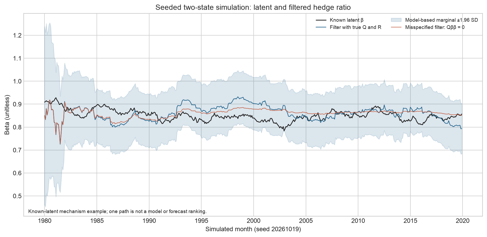
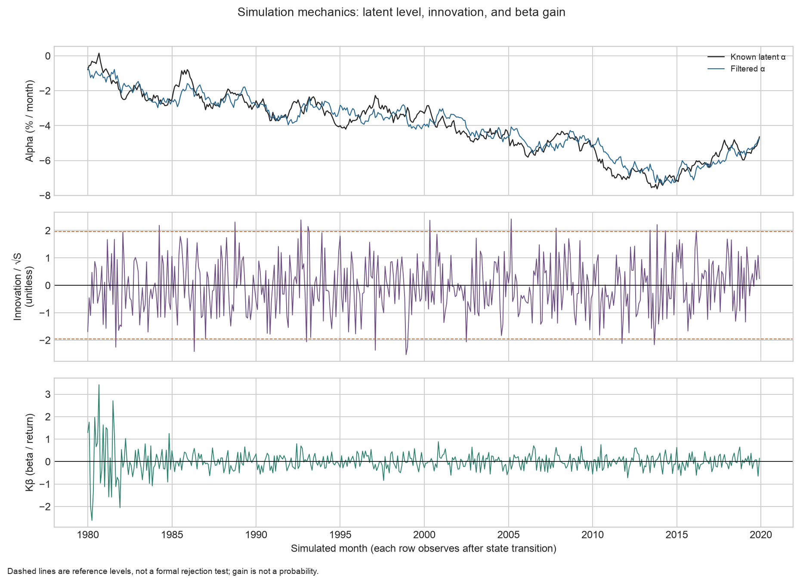
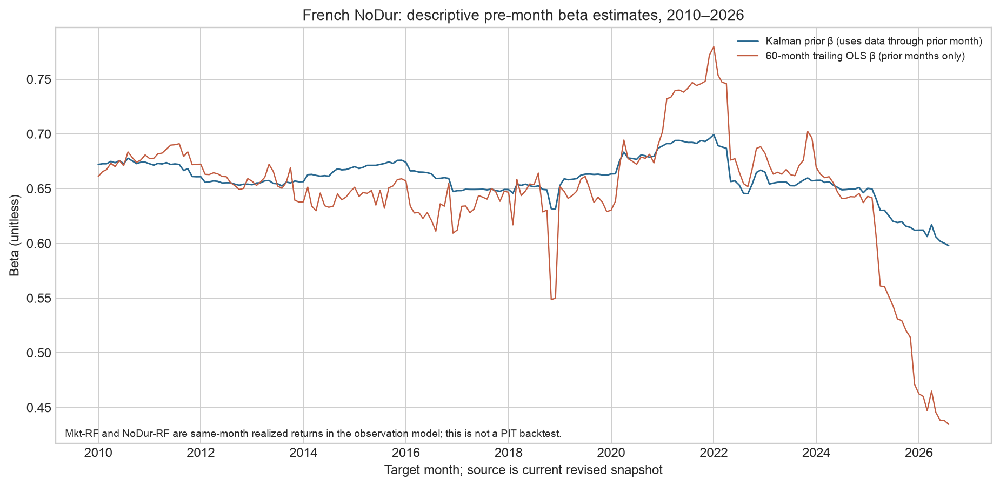
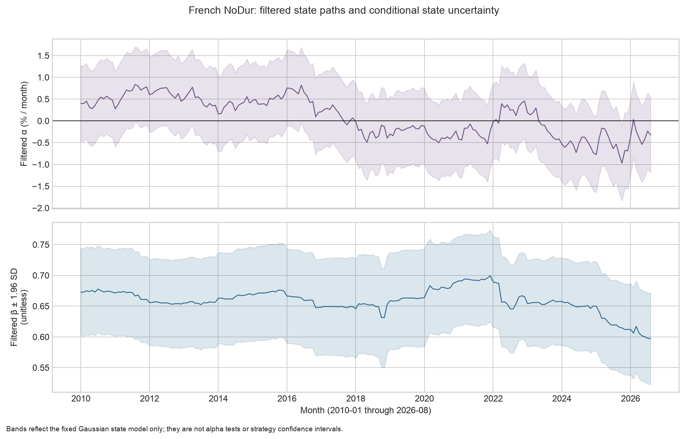

# Chapter 19 — State-Space Models and the Kalman Filter

> Core idea: First use the state transition to form a prior, then use the innovation from a new observation to update the hidden state. The timestamp determines whether that update can inform a trade.
> Prerequisites: Chapter 5, linear algebra; Chapter 6, conditional Gaussian distributions; Chapter 8, regression; Chapter 16, monthly time indexing.
> By the end of this chapter, you will be able to derive the scalar-observation Kalman update from a conditional Gaussian distribution, calculate a one-dimensional dynamic beta by hand, explain a two-dimensional alpha/beta state and its hedge ratio, distinguish filtering from smoothing, and build a research workflow that keeps future information out of historical signals.

## 1. Learning objectives

After reading, you should be able to write a state-space representation and state the units and dimensions of its states, observations, and noise; derive the prediction, innovation, innovation variance, Kalman gain, and posterior covariance from a joint Gaussian distribution; calculate a beta update by hand; distinguish the information used by a filtered state from that used by a smoothed state; and run the core function, fixed-seed simulation, and frozen-data example while explaining which investment claims they do not validate.

You have completed this chapter when your hand calculations match the code, every state and observation has a clear timestamp, and you can find complete answers to the original 13 questions and the 3 added teaching questions in Section 18.

## 2. Why Quant practitioners use state-space models

A historical regression beta is the average market exposure over a particular sample window. If exposure changes over time, a fixed beta averages away those changes. Rolling ordinary least squares (OLS) repeatedly changes the sample window, so both the window length and the re-estimation point affect the result.

A state-space model separates the problem into two processes: how latent exposure changes and how current returns vary around that exposure. A dynamic beta is an estimate of market exposure that changes over time. Each month, as new returns arrive, you compare them with the model’s prior expectation and update the beta estimate. The process-noise variance specifies how much state change the model allows; the observation-noise variance describes how much returns deviate from the relationship with the state.

This decomposition gives risk estimation a recursive update rule. It does not determine whether beta is stable, how large process noise should be, whether a hedge can be executed, or whether dynamic beta outperforms rolling OLS. You still need training-period and out-of-sample evidence to answer those questions.

## 3. Intuition: the state changes behind the scenes while returns mix signal and noise

You can observe monthly asset and market returns, but not the asset’s true sensitivity to the market. That sensitivity is a latent state. Monthly residuals can also reflect industry shocks, portfolio changes, and measurement error.

The filter processes each month in sequence:

| Timing | Information available | Action | Output |
|---|---|---|---|
| Before the month begins | Observations through the prior month | Project forward with the state-transition model | Prior mean and variance for the month |
| After this month’s returns arrive | This month’s asset and market returns | Subtract the prior expectation from the realized value | Innovation and its variance |
| Month-end update | The prior, innovation, and variance above | Adjust the state based on uncertainty | Filtered state incorporating this month’s observation |

The prior distribution is the state distribution before the observation month begins; the posterior distribution is the state distribution conditional on this month’s observation. The predicted state can inform risk controls during the month, but the filtered state does not exist until this month’s returns arrive. They refer to different information sets.

## 4. Mathematical setup and notation

Suppose the state has \(d\) components and each period provides one scalar observation:

\[
\mathbf{x}_t=F_t\mathbf{x}_{t-1}+\boldsymbol{\eta}_t,\qquad
y_t=\mathbf{h}_t\mathbf{x}_t+\varepsilon_t.
\]

\(\mathbf{x}_t\in\mathbb{R}^{d\times1}\) is the state vector and latent state; \(F_t\in\mathbb{R}^{d\times d}\) is the state-transition matrix; \(\mathbf{h}_t\in\mathbb{R}^{1\times d}\) is the observation-design row vector; and \(y_t\in\mathbb{R}\) is the current observation. The state noise is \(\boldsymbol{\eta}_t\in\mathbb{R}^{d\times1}\), and the observation noise is \(\varepsilon_t\in\mathbb{R}\).

In this chapter, let
\[
\boldsymbol{\eta}_t\sim N(\mathbf{0},Q_t),\qquad
\varepsilon_t\sim N(0,R_t),
\]
where \(Q_t\in\mathbb{R}^{d\times d}\) is the state-noise covariance and \(R_t>0\) is the scalar observation-noise variance. The conditional covariance of the state distribution given the information available, which is also the covariance of state-estimation error, is denoted by \(P\). Covariance matrices are positive semidefinite, and the observation-noise variance is positive. Here, \(N\) denotes a Gaussian distribution.

The implementation starts from \(\mathbf{x}_{-1}\) and applies one state transition before observing \(y_0\). This convention separates the initial state from the first observation. If the initial value is mistakenly treated as \(\mathbf{x}_0\) and then transitioned again, the first-period prior changes. A random walk with \(F=1\) hides this offset, so the core check also uses \(F=2\) to test the first step.
This chapter uses different notation from the general representation in statsmodels 0.15.0. The official documentation uses \(Z_t\) for the observation design, \(H_t\) for the observation-noise covariance, \(T_t\) for the state transition, \(R_t\) for the noise-selection matrix, and \(Q_t\) for the noise covariance. Thus, this chapter’s \(\mathbf{h}_t\) corresponds to the official \(Z_t\); this chapter’s \(F_t\) corresponds to the official \(T_t\); and this chapter’s observation variance \(R_t\) corresponds to the official \(H_t\). If the official state noise passes through a selection matrix, the state covariance in this chapter equals \(R_tQ_tR_t^\top\). The official \(R_t\) is a matrix, not this chapter’s observation-noise variance.

### Which object does each of the three uncertainties belong to?

| Quantity | Random object | Role in the recursion |
|---|---|---|
| \(Q_t\) | New state shock \(\boldsymbol\eta_t\) | State-change uncertainty added after the transition |
| \(R_t\) | Observation error \(\varepsilon_t\) | Noise that remains in the observation given the state |
| \(P_{t|t-1}\), \(P_{t|t}\) | State minus its prior/posterior estimate | Estimation-error covariance computed from the information available |

\(Q,R\) are model inputs specified in this chapter; \(P\) is the state uncertainty produced by the recursion. The state itself can change each month, and even when \(Q\) is fixed, \(P\) can still change as observations update it. \(Q\) is not a beta value, and \(R\) is not the asset’s total-return variance; the latter also includes the part projected from the state through the design row.

Notation note: the scalar \(h_t\) in Chapter 18 is the conditional variance of monthly returns; the bold \(\mathbf h_t\) in this chapter is the design row that maps the state to the observation. Here, \(P\) is the state-error covariance, while \(S\) is the innovation variance. In the code, `observation_design` is the design, `process_covariance` corresponds to \(Q\), and `observation_variance` corresponds to \(R\); the interface follows the existing implementation.

## 5. Formal definitions: hidden states, observations, and model assumptions

A latent state is a variable the model describes but cannot directly observe. Dynamic beta is one example. The observation equation links it to visible returns, while the state equation describes how it changes from one period to the next.

Filtering computes, in time order,
\[
\hat{\mathbf{x}}_{t|t}
=E[\mathbf{x}_t\mid y_0,\ldots,y_t],
\]
The subscript \(t|t\) means that the estimate uses observations through \(t\). Prediction is computed before the current observation arrives:
\[
\hat{\mathbf{x}}_{t|t-1}
=E[\mathbf{x}_t\mid y_0,\ldots,y_{t-1}].
\]
Smoothing computes
\[
\hat{\mathbf{x}}_{t|T}
=E[\mathbf{x}_t\mid y_0,\ldots,y_T],\quad T>t.
\]
A smoothed state includes observations after the target month, so it is useful for explaining the full history after the fact. This chapter does not implement a smoother; do not describe smoothing as a code output or a real-time signal.

The conditional Gaussian posterior in this chapter requires the following assumptions:

1. The initial state \(\mathbf{x}_{-1}\) has a Gaussian distribution with known mean and covariance.
2. State noise and observation noise are zero-mean Gaussian in each period; noise is independent across periods.
3. State noise, observation noise, and the initial state are mutually independent.
4. \(F_t\), \(Q_t\), \(R_t\), and the design \(\mathbf{h}_t\) are known at the relevant time. With a random design, the stated independence assumptions must continue to hold conditional on that design. If a market input is correlated with a state shock, the current recursion does not automatically correct for that endogeneity.
5. The observation variance is positive, the covariance is positive semidefinite, and the innovation variance is invertible. With one scalar observation, the innovation variance is a positive scalar.

The conditional expectations below also assume that the model matrices and an appropriate exogenous observation design are given. In the dynamic-beta example, the current month’s market return \(f_t\) is not fully known until month-end: it is not needed for the state prediction at the start of the month, and substituting realized \(f_t\) into the expected observation gives a contemporaneous conditional fit, not a forecast of the asset return made at the start of the month.

The Gaussian assumption ensures that each conditional distribution remains Gaussian, so the mean and covariance describe the full posterior. If the distribution is non-Gaussian, linear projection can still give a linear minimum mean-square-error estimate; the recursive quantities alone do not establish that the full posterior is Gaussian. The assumptions determine the scope of the conclusions.

## 6. Deriving one update from a conditional Gaussian distribution

First, let the state estimate through \(t-1\) be
\[
\mathbf{x}_{t-1}\mid\mathcal{Y}_{t-1}\sim
N(\mathbf{m}_{t-1},P_{t-1}),
\qquad
\mathcal{Y}_{t-1}=\{y_0,\ldots,y_{t-1}\}.
\]

### 6.1 Predict with the state equation

Substitute the state transition into the conditional mean:
\[
\mathbf{m}_{t|t-1}
=E[F_t\mathbf{x}_{t-1}+\boldsymbol{\eta}_t\mid\mathcal{Y}_{t-1}]
=F_t\mathbf{m}_{t-1}.
\]
Zero-mean, independent state noise does not change the predicted mean. Apply the linear-transformation rule to the covariance, then add the covariance of the independent noise:
\[
P_{t|t-1}=F_tP_{t-1}F_t^\top+Q_t.
\]
This variance describes the model’s uncertainty about the state before this period’s return arrives.

### 6.2 Calculate the prior observation and innovation

The observation equation gives the prior observation mean \(\hat y_{t|t-1}=\mathbf{h}_t\mathbf{m}_{t|t-1}\). The innovation is the new observation minus the prior observation:
\[
v_t=y_t-\mathbf{h}_t\mathbf{m}_{t|t-1}.
\]
The conditional covariance between the state and observation, and the innovation variance, are
\[
C_t=\operatorname{Cov}(\mathbf{x}_t,y_t\mid\mathcal{Y}_{t-1})
=P_{t|t-1}\mathbf{h}_t^\top,
\]
\[
S_t=\operatorname{Var}(v_t\mid\mathcal{Y}_{t-1})
=\mathbf{h}_tP_{t|t-1}\mathbf{h}_t^\top+R_t.
\]
\(C_t\) is a \(d\times1\) vector, and \(S_t\) is a scalar. It projects state uncertainty into return units and adds the observation-noise variance of returns.

### See the update weight through scalar precision

For a scalar prior with \(P^->0\) and \(R>0\), and a known nonzero design \(H\) that satisfies the exogeneity condition above, the observation \(y/H\) is the state plus noise with variance \(R/H^2\). Completing the square gives
\[
P^+=\left(1/P^-+H^2/R\right)^{-1},\qquad
m^+=P^+\left(m^-/P^-+Hy/R\right).
\]
The two information precisions add. Let \(w=H^2P^-/(H^2P^-+R)=KH\); then
\[
m^+=(1-w)m^-+w(y/H),\qquad 0<w<1.
\]
The convex weight is \(w=KH\), not \(K\), which has state/observation units. If \(H=0\), the observation is unrelated to the state, \(K=0\), and the posterior remains the prior; do not divide by \(H\). A degenerate prior with \(P^-=0\) also cannot use the inverse-precision formula, but the original covariance recursion still applies.

Hold \(m^-=1,H=0.02,y=0.03\) fixed (the innovation remains 0.01) along with the previous-period \(P=0.04,F=1\), and change only the model inputs:

| \(Q\) | \(R\) | \(P^-=P+Q\) | \(S\) | \(K\) | \(KH\) | \(m^+\) |
|---:|---:|---:|---:|---:|---:|---:|
| 0.01 | 0.0001 | 0.05 | 0.00012 | 8.333333 | 0.166667 | 1.083333 |
| 0.06 | 0.0001 | 0.10 | 0.00014 | 14.285714 | 0.285714 | 1.142857 |
| 0.01 | 0.0004 | 0.05 | 0.00042 | 2.380952 | 0.047619 | 1.023810 |

For this fixed positive design, increasing \(Q\) raises prior uncertainty and gives the observation more influence on the state; increasing \(R\) lowers observation precision and reduces the adjustment. This illustrates how the model allocates information; it does not establish that any particular \(Q,R\) is better in markets.

### 6.3 Obtain the posterior from the conditional formula for a joint Gaussian

Conditional on the historical observations, the state and new observation have a joint Gaussian distribution:
\[
\begin{bmatrix}\mathbf{x}_t\\y_t\end{bmatrix}
\sim N\left(
\begin{bmatrix}\mathbf{m}_{t|t-1}\\
\mathbf{h}_t\mathbf{m}_{t|t-1}\end{bmatrix},
\begin{bmatrix}
P_{t|t-1}&P_{t|t-1}\mathbf{h}_t^\top\\
\mathbf{h}_tP_{t|t-1}&S_t
\end{bmatrix}
\right).
\]
Apply the conditional-mean and Schur-complement formulas for a partitioned Gaussian distribution to obtain
\[
\mathbf{m}_{t|t}=
\mathbf{m}_{t|t-1}
+P_{t|t-1}\mathbf{h}_t^\top S_t^{-1}v_t,
\]
\[
P_{t|t}=
P_{t|t-1}
-P_{t|t-1}\mathbf{h}_t^\top S_t^{-1}
\mathbf{h}_tP_{t|t-1}.
\]
Define the Kalman gain
\[
K_t=P_{t|t-1}\mathbf{h}_t^\top S_t^{-1},
\]
The mean can then be written as \(\mathbf{m}_{t|t}=\mathbf{m}_{t|t-1}+K_tv_t\). The gain comes from the covariance between the state and observation; it converts an innovation measured in return units into an adjustment measured in state units. The filter passes \((\mathbf{m}_{t|t},P_{t|t})\) to the next-period prediction.

The implementation uses the Joseph covariance update:
\[
P_{t|t}=(I-K_t\mathbf{h}_t)P_{t|t-1}
(I-K_t\mathbf{h}_t)^\top+K_tR_tK_t^\top.
\]
Under the model assumptions, this equals the conditional-covariance formula above; under finite-precision rounding, it better preserves symmetry and positive semidefiniteness. With one scalar observation, \(R_t\) is a scalar and \(K_t\) is \(d\times1\).

## 7. Financial interpretation: two-dimensional alpha, beta, and a dynamic hedge ratio

Write the asset and market monthly excess simple returns as
\[
y_t=\alpha_t+\beta_t f_t+\varepsilon_t,\qquad
\mathbf{x}_t=
\begin{bmatrix}\alpha_t\\\beta_t\end{bmatrix},\qquad
\mathbf{h}_t=\begin{bmatrix}1&f_t\end{bmatrix}.
\]
Thus, the observation equation is \(y_t=\mathbf{h}_t\mathbf{x}_t+\varepsilon_t\). The design matrix \(\mathbf{h}_t\) has dimension \(1\times2\), the state vector has dimension \(2\times1\), and their product is a scalar monthly return. Set the state transition to \(F=I_2\), so alpha and beta each follow a random walk around their previous levels. The example program uses fixed parameters:

| Parameter | Value | Meaning |
|---|---:|---|
| Initial mean \(\mathbf{m}_{-1}\) | \([0,1]^\top\) | Initial alpha is 0 and beta is 1 |
| Initial covariance \(P_{-1}\) | \(\operatorname{diag}(0.0004,0.04)\) | Initial state variances for alpha and beta |
| Transition \(F\) | \(I_2\) | Alpha and beta means continue as random walks |
| Process covariance \(Q\) | \(\operatorname{diag}(10^{-6},10^{-5})\) | Monthly state-change variance |
| Observation variance \(R\) | \(0.0004\) | Residual variance of monthly decimal returns |

These are teaching values specified in advance; the program does not estimate them from the full sample.

\(\beta_t\) is the asset’s first-order linear exposure to excess market returns. If the asset position has dollar notional \(A\), the target short notional in the market proxy is \(\beta_t A\). If you hold \(q_A\) shares of the asset at price \(P_A\) and the market proxy trades at price \(P_M\), both are quoted in the same currency and use the same return interval, then the number of market-proxy shares is
\[
q_M=-\beta_t\frac{q_A P_A}{P_M}.
\]
When \(\beta_t>0\), this formula establishes a short position in the market; when \(\beta_t<0\), it establishes a long position to offset the asset’s negative market exposure. The actual position is also constrained by currency conversion, margin, basis, stock lending, execution timing, and costs. A beta estimate does not replace those implementation conditions.

The state components have different units: alpha is a monthly decimal return, and beta is a dimensionless exposure. Alpha variance is measured in return squared, beta variance in beta squared, and their covariance in return times beta. Estimating the alpha state is not a test of whether a strategy’s alpha is statistically significant.

::: {.body-example title="Worked example: a two-dimensional state and cross-covariance"}

The same update applies to a two-dimensional hand calculation. Let the prior mean be \(\mathbf{m}^-=[0,1]^\top\), prior covariance \(P^- = \operatorname{diag}(0.0004,0.04)\), design \(\mathbf{h}=[1,0.02]\), observation \(y=0.03\), and noise variance \(R=0.0001\). This is a teaching construction using monthly returns in decimal units. The prior observation mean is \(0.02\), and the innovation is \(v=0.01\). The cross-covariance between state and observation is
\[
C=P^-\mathbf{h}^\top=
\begin{bmatrix}0.0004\\0.0008\end{bmatrix},
\qquad
S=\mathbf{h}P^-\mathbf{h}^\top+R=0.000516.
\]
Thus, \(K=C/S=[0.775194,1.550388]^\top\), and the posterior mean is
\[
\mathbf{m}^+=\mathbf{m}^-+Kv=
\begin{bmatrix}0.007752\\1.015504\end{bmatrix}.
\]
The same return innovation updates both alpha and beta. The posterior covariance is
\[
P^+=P^- - CC^\top/S
\approx
\begin{bmatrix}
0.0000899225&-0.0006201550\\
-0.0006201550&0.0387596899
\end{bmatrix}.
\]
The negative off-diagonal element means that, under this prior and observation design, the errors in alpha and beta are correlated conditional on this return; it is not a standalone risk variance.

:::

## 8. Calculating dynamic beta by hand: how one return updates the state

::: {.body-example title="Worked example: one scalar beta update and its timing"}

The following is a teaching construction, not a market observation. The state contains only beta. The previous-period posterior mean is \(1\) and the posterior variance is \(P_{t-1}=0.04\). Set the random-walk transition to \(F=1\) and the process variance to \(Q=0.01\). This month’s excess market return is \(f_t=0.02\), the asset’s excess return is \(y_t=0.03\), and the observation-noise variance is \(R=0.0001\).

The prior beta mean is \(m_{t|t-1}=1\times1=1\), and the prior variance is
\[
P_{t|t-1}=1^2(0.04)+0.01=0.05.
\]
The prior return is \(f_tm_{t|t-1}=0.02\). Therefore, the innovation is
\[
v_t=0.03-0.02=0.01.
\]
The scalar observation design is \(h_t=f_t=0.02\), so the innovation variance is
\[
S_t=0.02^2\times0.05+0.0001
=0.00002+0.0001=0.00012.
\]
The Kalman gain is
\[
K_t=\frac{0.05\times0.02}{0.00012}
=8.333333.
\]
The posterior beta mean is
\[
m_{t|t}=1+8.333333\times0.01=1.083333.
\]
Check the posterior variance with the scalar update:
\[
P_{t|t}=0.05-K_t(0.02)(0.05)=0.041666667.
\]

Beta and beta variance are measured in beta and beta squared, respectively. \(f_t,y_t\) are monthly decimal returns, and \(R,S_t\) are in squared decimal returns. The units of \(K_t\) are beta per decimal return. A value greater than 1 is entirely possible; it is not a probability. Only in special cases, such as a scalar observation and a state measured in the same units, is it natural to view the gain as a weight between 0 and 1.

The market return \(f_t\) is not fully known until this month’s returns are realized, so \(m_{t|t}\) in this example is a month-end risk estimate. If you need a beta hedge ratio at the start of the month, use the then-available \(m_{t|t-1}\) and confirm that the market proxy and trading arrangements can be executed at that time.

:::

### State prediction and return prediction use different clocks

| Timing | Quantity that can be computed | Quantity still unknown or unavailable for backfilling |
|---|---|---|
| Before the month | \(F\mathbf m_{t-1}\), \(FP_{t-1}F^\top+Q\) | The current state shock and the full monthly asset and market returns |
| When the month-end market factor \(f_t\) arrives | \([1,f_t]\mathbf m^-\) using the realized design | This is not an asset-return forecast made before the month |
| When the month-end asset return arrives | The innovation, filtered state, and next-month plan | The filtered state cannot change the position already held this month |
| After the sample ends | A smoothed historical estimate using future observations | It cannot be a real-time signal for the target month; smoothing is not implemented here |

To forecast an asset return before the month begins, you need to specify a conditional distribution for future \(f_t\) and account for its joint relationship with the state. You cannot substitute \(f_t\), which is known only at month-end, and call the result a forecast made before the month.

Return beta, price-regression coefficients, and share counts also need separate interpretations. If another model uses \(\log P_A=a+b\log P_B+e\), then with \(a,b\) held fixed the local relationship is \(dP_A/P_A\approx b\,dP_B/P_B\), and the approximate local hedge share count is \(-b q_A P_A/P_B\). This converts local price sensitivity; it does not mean setting \(q_B=-bq_A\), nor does it automatically interpret a log-price cointegration coefficient as monthly-return beta. Finite price changes, changing coefficients, cash, and costs still belong in the actual ledger. This chapter retains the single-leg and two-dimensional state-estimation interfaces and does not change the Project 5 share-count protocol.

## 9. Python implementation and execution

### Default standalone entry point

From the root of the bundled reader package, create a separate environment using its [environment instructions](../../README.md), then run:

```bash
.venv/bin/python run_notebook.py notebooks/ch19_state_space.ipynb
```

First check the prior, innovation, gain, and posterior for one scalar update. Then compare the two-dimensional alpha/beta conditional Gaussian formula with the core implementation term by term. The two-dimensional example specifies the prior covariance directly, uses an identity transition, and sets Q to 0; do not confuse it with the dynamic process parameters in Section 7.

Next, use seed 20261019 to construct a sample starting in 1980-01 and spanning 480 months. Draw the initial state from a Gaussian distribution with mean [0.001,0.9] and covariance diag(0.0001,0.04); set Q=diag(0.000004,0.00004) and R=0.0004; draw market returns from a Gaussian distribution with mean 0 and standard deviation 0.04. Each period, transition the latent state first and then generate the observation. Comparing the true Q filter with a filter whose beta process variance is zero gives one constructed path; retain the result in Section 18 where the misspecified filter has lower RMSE, and do not use it to recommend a model.

By default, the Notebook writes `constructed_latent.csv` and `constructed_filter.csv` to `runs/ch19_state_space_<uuid>/`. It displays the two simulated PNGs already included in `fixtures/figures/a4/` and does not generate new images. The other two French figures and historical numbers in Sections 10–11 are frozen chapter reading material, not default-run outputs.

`RUN_FRENCH=False`; French data are not read or downloaded by default. Importing the chapter workflow does not run its historical market analysis. The chapter run directory is separate from the runner’s `runs/execution_<uuid>/`, which stores an execution copy and status. Assertions included in the package let readers check the constructed calculations; the production tests not included in the package do not need to be restored. Constructed results do not establish market predictability or a trading advantage after costs.

The CLI below follows the historical course-work root path and requires suitable, authorized data inputs and an environment; it does not replace the default command above.

### Shared implementation and historical course-work path

The recursion is implemented by **kalman_filter** in [the state-space core](../../../../src/quant_course/state_space.py). The chapter script [code/ch19_state_space.py](../../../../code/ch19_state_space.py) reuses that function; it validates the frozen French data, runs a fixed-parameter analysis, and outputs tables and figures. The default Notebook above reuses the shared core and constructed-simulation branch, including the conditional-Gaussian check and hand-calculation assertions. The historical French analysis is handled separately by the CLI below.

The code below reproduces the example in Section 8; its outputs remain in beta and monthly decimal-return units:

```python
import numpy as np
from quant_course.state_space import kalman_filter

result = kalman_filter(
    observations=np.array([0.03]),
    observation_design=np.array([[0.02]]),
    initial_state=np.array([1.0]),
    initial_covariance=np.array([[0.04]]),
    transition=np.array([[1.0]]),
    process_covariance=np.array([[0.01]]),
    observation_variance=0.0001,
)
assert np.isclose(result.predicted_covariances[0, 0, 0], 0.05)
assert np.isclose(result.innovations[0], 0.01)
assert np.isclose(result.innovation_variances[0], 0.00012)
assert np.isclose(result.gains[0, 0], 8.333333333333333)
assert np.isclose(result.filtered_states[0, 0], 1.0833333333333333)
assert np.isclose(result.filtered_covariances[0, 0, 0], 0.04166666666666667)
```

You can run the CLI from any directory by using an absolute path. Put outputs in a new directory to preserve existing data and figures. The script does not download French data and checks the SHA-256 hashes of the six raw, extracted, and processed files. Overwriting results with the same names requires the explicit **--overwrite** option.

```bash
python /path/to/quant_course/code/ch19_state_space.py \
  --output-dir /tmp/ch19-output \
  --figure-dir /tmp/ch19-figures
```

The core API in this chapter uses fixed \(F,Q,R\) and allows the observation design to vary by period; it does not implement general period-specific transitions and noise matrices. The core function requires one finite observation in every period, rejects missing values, and does not compress or skip months. The dynamic-beta helper also checks the monthly indexes of the two return series. If a data source is missing a month, first find out why, then choose a missing-data update that preserves the time step or revise the sample; missing-data updates are not implemented in this chapter’s core.

## 10. Figures: viewing the state, innovation, and uncertainty



In Figure 1, the horizontal axis is the simulated month generated with fixed seed 20261019, and the vertical axis is dimensionless beta. The black line is the known latent beta; the blue line is filtered beta using the true \(Q,R\); the light-blue band shows the model’s marginal \(\pm1.96\) standard deviations; and the red line comes from a filter that misspecifies the beta process variance as zero. The figure shows how filtering follows the state and why one simulated path cannot rank models universally.



Figure 2 uses simulated months on the horizontal axis. The top panel’s vertical axis is monthly alpha in percent; the middle panel shows \(v_t/\sqrt{S_t}\); and the bottom panel shows the beta gain \(K_{\beta,t}\), in beta per return. The dashed lines at \(\pm1.96\) in the middle panel are reference lines under a Gaussian distribution, not a formal model test on their own; the gain in the bottom panel is not a probability.



Figure 3 uses target month on the horizontal axis and dimensionless beta on the vertical axis. Before each month begins, the blue line uses only earlier observations to obtain the Kalman prior; the red line is the OLS slope over the 60 months through the prior month. Both lines come from the same currently revised history. Their difference shows how parameters and windows change the estimate; it does not show that one method makes more money.



Figure 4 covers months from 2010-01 through 2026-08. The top panel’s vertical axis shows filtered alpha (monthly percent) and its conditional marginal \(\pm1.96\) standard deviations; the bottom panel shows dimensionless filtered beta with the same type of interval. The shading reflects only the conditional state variance under the fixed Gaussian state model. It excludes parameter-selection uncertainty and is not an alpha-significance interval or a strategy-return interval.

## 11. Real-market example: the French NoDur industry portfolio

The example uses monthly returns for the 10 industry portfolios and the three-factor file from the Kenneth R. French Data Library. NoDur is an industry portfolio, not an individual stock. The asset input is the NoDur monthly total return minus RF; the market input is Mkt-RF, which already subtracts RF, so the code does not subtract RF again. Returns are in decimals over calendar months.

The frozen download date is 2026-10-05, and the sample runs from 1926-07 through 2026-08, for 1,202 months. The analysis checks monthly continuity with the monthly-series reader and verifies six hashes in the local manifests for the raw ZIPs, extracted CSVs, and processed CSVs. See the French factor manifest and industry-data manifest. The processed industry CSV has SHA-256 3b097d810c295d64eedfa1ece7067ff2a0707f5ca90e33935df9949251f70950; the FF3 CSV has SHA-256 c19770a19a0ac47ad1c29074f57234570aeaa9725212cb4fa8146a2846c52814.

All initial states and \(P_{-1},Q,R\) are teaching values; the program does not fit them on the full sample. The full-sample recursion is descriptive only and is not a point-in-time (PIT) backtest. Figures 3 and 4 show only the period from 2010-01 onward.

| Month | Kalman prior beta | Month-end filtered beta | Prior 60-month OLS beta |
|---|---:|---:|---:|
| 2010-01 | 0.672096 | 0.672764 | 0.661122 |
| 2020-03 | 0.675173 | 0.683395 | 0.670480 |
| 2026-08 | 0.597956 | 0.596971 | 0.434646 |

By 2026-08, the month-end filtered beta is 0.596971, with a model-conditional standard deviation of about 0.03788. The prior beta for that month is 0.597956, and the rolling OLS beta is 0.434646. The filtered value and rolling slope use different state noise, windows, and shrinkage; this difference alone cannot tell us which estimate is closer to future exposure.

The data come from one currently revised version, without public timestamps or historical versions for each period. The analysis therefore makes no claim of point-in-time availability, a no-look-ahead strategy return, alpha outperformance, or actual hedge performance. The French Library page provides downloadable data; the local manifests do not record blanket permission for external redistribution. This chapter retains the source and hashes and does not repackage this snapshot.

## 12. Common mistakes

| Mistake | Problem | Correction |
|---|---|---|
| Treating \(K=8.3333\) as a confidence probability greater than 1 | The gain is measured in beta per return, not probability; the conversion ratio changes when the market return is small | Check the state units of \(Kv\) and the resulting update |
| Using filtered beta to place an order at the start of the same month | Filtered beta uses that month’s asset and market returns | Use predicted beta before the month starts; update the next-period state after month-end |
| Treating a full-sample smoother as a historical signal | A smoothed state is conditional on observations after the target time | Use only filtered or predicted states for real-time signals |
| Subtracting RF a second time from Mkt-RF | The factor file already provides excess market returns | Subtract RF once from the NoDur total return only |
| Fitting \(Q,R\) and initial beta on the full sample | The parameters absorb future sample information, creating leakage even if the recursion itself is causal row by row | Estimate parameters in a training window and freeze them out of sample or update them by a prespecified rule |
| Dropping a missing month and continuing the recursion | The number of state transitions becomes misaligned | Preserve the monthly index and specify a missing-data policy; this chapter’s function raises an error for a missing month or NaN |
| Treating a state interval as a test of alpha significance | The conditional variance includes only state uncertainty under the specified model | For an alpha test, handle parameter uncertainty, identification, and multiple selection separately |

## 13. Quant research application: testing whether a dynamic hedge ratio improves risk control

A narrow hypothesis to test is whether, with a tradable market proxy and a prespecified month-end timestamp, a market-neutral portfolio formed using the beta prior available before the month begins reduces out-of-sample risk or tracking error. This is a risk hypothesis, not a claim that beta filtering predicts market direction.

1. Record the data source, release date, receipt time, return interval, and units. Confirm that the industry portfolio and market proxy can be traded at the specified weights.
2. Choose a training window. Use only training data to estimate or specify the initial alpha and beta mean and covariance \(\mathbf{m}_{-1},P_{-1}\), along with \(Q,R\). Record the parameter choices, window, and selection rules, then freeze them for the test period.
3. At the end of period \(t-1\), after receiving complete returns, save \(\hat{\mathbf{x}}_{t-1|t-1}\) and use the state equation to generate the next period’s beta prior. Under the random-walk model, the mean satisfies \(\hat\beta_{t|t-1}=\hat\beta_{t-1|t-1}\).
4. Establish the hedge at an executable time and hold it through the month. At month-end, calculate the realized hedged-portfolio return from actual asset and market returns. Do not backfill the month-end filtered beta to the start of the month.
5. Using the same training information, compare static OLS beta with rolling OLS beta over the prior 60 months. Report unhedged and hedged volatility, tail loss, turnover, transaction costs, and execution constraints.
6. Repeat the process in later months. Check the mean, serial correlation, and tails of standardized innovations; test sensitivity to \(Q,R\); and explain how conclusions change under model misspecification.

Specify in advance what evidence would reject the hypothesis. For example, reject the claim that “this dynamic hedging approach reduces achievable risk” if out-of-sample risk does not improve or if the improvement disappears after turnover and costs. If PIT data, a historical market proxy, or a cost model is missing, report descriptive risk paths at most.

## 14. How the pieces fit together

The state transition carries the prior-period posterior into the current-period prior; the observation design maps the state to visible returns; the innovation measures the gap between the current observation and its prior; the innovation variance measures uncertainty in that gap; the gain adjusts the state based on its covariance with the observation; and the updated covariance carries post-observation uncertainty into the next period. The Gaussian and independent-noise assumptions let these means and variances describe the full conditional posterior.

In finance, the beta state provides a dynamic estimate for current-period risk. Whether an estimate can inform an order depends on whether it was available before the order. Conditional variance, parameter estimation, and strategy risk represent different sources of uncertainty and should be reported separately.

## 15. Exercises

Complete answers to every question appear in Section 18.

**19-E01 (Concept)** In the two-dimensional alpha/beta model, identify the state, observation, design vector, state noise, and observation noise. Which item can only be observed after month-end?

**19-E02 (Dimensions and units)** State the dimensions and units of \(\mathbf{x}_t,\mathbf{h}_t,Q,R\) in the alpha/beta model. Explain why the alpha-beta covariance is not the same as either the alpha variance or the beta variance.

**19-E03 (By hand)** Let the previous-period posterior have \(m=1,P=0.04\), with transition \(F=2\) and state-noise variance \(Q=0.01\). The current observation design is \(H=1\), the return observation is \(y=2.10\), and the observation-noise variance is \(R=0.03\). Following this chapter’s convention, transition from \(x_{-1}\) and calculate the current prior, innovation, \(S,K\), posterior mean, and posterior variance.

**19-E04 (Interpretation)** The Kalman gain in Section 8 is greater than 1. Explain its units and identify the error in interpreting it as a probability.

**19-E05 (Information timing)** Let \(t\) be March. Monthly market and asset returns are not complete until the last trading day of March. When can \(\hat\beta_{t|t-1}\) and \(\hat\beta_{t|t}\) be used to form positions?

**19-E06 (Assumptions)** Market return \(f_t\) and the current state shock \(\eta_t\) are correlated because of the same event. Can the original conditional Gaussian update still be interpreted as the correct posterior? State what condition is missing.

**19-E07 (Distribution)** If state and observation noise still have zero means and known covariances but are heavy-tailed, which conclusions remain valid as linear-projection recursions, and which claims about a “full Gaussian posterior” must be withdrawn?

**19-E08 (Parameter leakage)** A researcher uses all observations from 1926–2026 to choose \(Q,R\), then reruns the filter month by month. Identify where leakage occurs and describe an acceptable training/test treatment.

### Added teaching questions (separately numbered)

**19-R01 Precision derivation and boundary cases.** Complete the square in a scalar Gaussian prior and observation density to write the posterior precision and mean. Why is the weight KH? What happens when H=0?

**19-R02 Hand calculation comparing Q and R.** Use the three rows in the Section 6 table to calculate each posterior variance. Explain why the same innovation produces different adjustments.

**19-R03 Position and timing check.** Hold 10 shares of an asset priced at 50, with the proxy priced at 100 and log-price coefficient b=1.2. How many shares are needed for the local hedge? If b is a filtered state at the end of the current month, can it determine the position for that month?

## 16. Programming exercises

**19-P01 (Hand-calculation regression check)** Use the core function to reproduce the Section 8 example. Assert the prior variance, innovation, innovation variance, gain, posterior beta, and posterior variance individually, with tolerance no greater than \(10^{-10}\).

**19-P02 (Prefix causality)** Construct 8 months of single-state data and save the filtered states for the first 5 months. Change only observations from month 6 onward and run the same filter with the same parameters. Assert that the first 5 filtered states are identical and that the final state in the changed segment differs.

**19-P03 (Time boundaries)** Give the dynamic-beta function a pair of continuous indexes with one month missing and a pair of monthly series containing NaN. Confirm that the function raises an error in both cases; do not drop the missing month and continue fitting.

## 17. Challenge questions

**19-C01 (Unexpected ranking in a simulation)** With fixed seed 20261019, use the accompanying script to generate 480 periods of latent alpha and beta. Compare the beta root-mean-square error (RMSE) and marginal model-interval coverage for a correctly specified filter using the true \(Q\) and another filter that sets beta’s process variance to zero. If the misspecified filter has lower RMSE, can you recommend it? Explain the limits on extending the conclusion.

**19-C02 (Research design)** Design a point-in-time dynamic-beta hedging evaluation for a real asset. Specify data versions, timestamps, parameter estimation, static and rolling benchmarks, return accounting, costs, and failure conditions. Explain how to avoid using the same month’s month-end filtered beta to backfill its position.

## 18. Exercise answers and derivations

### 19-E01

Let \(\mathbf{x}_t=[\alpha_t,\beta_t]^\top\); monthly asset excess return \(y_t\) is the observation; \(\mathbf{h}_t=[1,f_t]\) maps the state to returns; \(\boldsymbol{\eta}_t\) allows alpha and beta to change over time; and \(\varepsilon_t\) is the deviation of realized returns from the state relationship. If \(f_t\) and \(y_t\) are both current-month returns, the complete observation is not known until the last trading day of that month. At the start of the month, you can form \(\hat{\mathbf{x}}_{t|t-1}\) but cannot know this month’s filtered state.

### 19-E02

\(\mathbf{x}_t\) has dimension \(2\times1\); \(\mathbf{h}_t\) has dimension \(1\times2\); \(Q\) has dimension \(2\times2\); and \(R\) is a scalar. Alpha is measured in monthly decimal returns, while beta is dimensionless. Thus, alpha variance is in return squared, beta variance in beta squared, and \(\operatorname{Cov}(\alpha,\beta)\) in return times beta. The off-diagonal matrix elements describe joint variation and cannot be treated as either diagonal variance.

### 19-E03

Apply the first transition:
\[
m^-=2(1)=2,\qquad P^-=2^2(0.04)+0.01=0.17.
\]
The expected observation is \(1\times2=2\), so \(v=2.10-2=0.10\). Then
\[
S=1^2(0.17)+0.03=0.20,\qquad K=\frac{0.17}{0.20}=0.85.
\]
The posterior mean is \(2+0.85(0.10)=2.085\). The posterior variance is
\[
P^+=0.17-0.85(1)(0.17)=0.0255.
\]
The first prior mean is 2; skipping the transition would incorrectly give 1. This is why the first-step timing check uses \(F=2\) rather than \(F=1\).

### 19-E04

The numerator \(PH\) of the gain has units of beta times return, and the denominator \(S\) has units of return squared, so \(K\) has units of beta per return. After multiplying by the innovation \(v\), \(Kv\) is in beta units. Treating \(K\) as a probability would incorrectly force it below 1 and obscure how market-return scaling affects the update.

### 19-E05

\(\hat\beta_{t|t-1}\) is conditional on data through the end of February and can be used as the hedge weight before March begins, provided the asset and market proxy can be traded as planned. \(\hat\beta_{t|t}\) includes both March returns and can only be used after March ends, to update the April plan. Using it to determine the March position would backfill future information from the same month.

### 19-E06

You cannot directly call this update the correct conditional posterior. Given the design, the derivation assumes that the state shock, observation error, and initial state are independent. If \(f_t\) and \(\eta_t\) are correlated, observing \(f_t\) may itself provide information about the state shock, so the prior mean and covariance conditional on that design must be recalculated; the original \(P^-\) cannot simply be reused. If the observation error is also correlated with the state, the cross-covariance terms must be rederived. Include the correlation mechanism in the joint conditional distribution, or rewrite the information set and observation equation, then derive the recursion again.

### 19-E07

With linearity, finite second moments, and correct covariances, the mean and covariance recursions can still be interpreted as linear projections and error-covariance calculations. Heavy tails do not ensure that the conditional distribution remains Gaussian, so these values cannot be claimed to describe the full posterior density; an interval of \(\pm1.96\) standard deviations also does not automatically have 95% coverage. To assess the full distribution or tail risk, specify a heavy-tailed model and recalibrate.

### 19-E08

Leakage occurs in the model selection for \(Q,R\): the researcher lets 2026 observations determine the filtering rule used for every step since 1926. First freeze the training cutoff and select parameters using training data. In the test period, apply the frozen values or re-estimate under a prespecified expanding-window rule, using only history available at each point. Determine the initial-state mean and covariance using the same boundary. A causal month-by-month recursion does not undo leakage from having seen future data during parameter selection.

### 19-P01 through 19-P03

Run the following Python program from the repository root with PYTHONPATH=src python -. The first block checks the hand calculation, the second changes only the future suffix, and the third checks missing-month and NaN boundaries.

```python
import numpy as np
import pandas as pd
from quant_course.state_space import kalman_filter, dynamic_beta_filter

# 19-P01: Hand-check the scalar beta update.
manual = kalman_filter(
    [0.03], [[0.02]], initial_state=[1.0],
    initial_covariance=[[0.04]], transition=[[1.0]],
    process_covariance=[[0.01]], observation_variance=0.0001,
)
actual = [
    manual.predicted_covariances[0, 0, 0],
    manual.innovations[0],
    manual.innovation_variances[0],
    manual.gains[0, 0],
    manual.filtered_states[0, 0],
    manual.filtered_covariances[0, 0, 0],
]
expected = [0.05, 0.01, 0.00012, 8.333333333333333,
            1.0833333333333333, 0.04166666666666667]
np.testing.assert_allclose(actual, expected, rtol=0, atol=1e-12)

# 19-P02: Changes to future observations must not rewrite past filtered states.
y = np.arange(8, dtype=float) / 10
h = np.ones((8, 1))
kwargs = dict(
    initial_state=[0.0], initial_covariance=[[1.0]],
    transition=[[1.0]], process_covariance=[[0.02]],
    observation_variance=0.3,
)
original = kalman_filter(y, h, **kwargs)
changed_y = y.copy()
changed_y[5:] += 100
changed = kalman_filter(changed_y, h, **kwargs)
np.testing.assert_allclose(original.filtered_states[:5],
                           changed.filtered_states[:5], rtol=0, atol=0)
assert not np.allclose(original.filtered_states[5:],
                       changed.filtered_states[5:])

# 19-P03: Do not compress missing months or silently accept NaN.
months = pd.period_range("2025-01", periods=3, freq="M")
market = pd.Series([0.01, 0.02, -0.01], index=months)
asset = pd.Series([0.02, 0.01, 0.00], index=months)
parameters = dict(
    initial_beta=1.0, initial_variance=0.04,
    process_variance=0.01, observation_variance=0.0001,
)
for bad_asset, bad_market in [
    (asset.drop(months[1]), market.drop(months[1])),
    (asset.copy().where(pd.Series([True, False, True], index=months)), market),
]:
    try:
        dynamic_beta_filter(bad_asset, bad_market, **parameters)
    except (TypeError, ValueError):
        pass
    else:
        raise AssertionError("expected invalid monthly input to be rejected")
```

### 19-C01

The script uses a fixed seed to generate 480 periods, known latent states, and two sets of filtered results. The historical constructed run produced beta RMSE \(0.0454210\) for the filter using the true \(Q\) and \(0.0364814\) for the filter that sets \(Q_{\beta\beta}\) to zero; the marginal 95% standard-deviation band for the true-parameter filter has coverage of 1.00 on this path. This path does not support the ranking “filtering with the true \(Q\) is better”; it gives the opposite RMSE ranking once.

You cannot use this to recommend \(Q_{\beta\beta}=0\). Error on a single path depends on the latent path, observation noise, and initial-state draw. RMSE measures recovery of the known latent beta, not net hedged returns. To compare methods, estimate the error distribution across multiple independent paths on a prespecified parameter grid, and report state error, interval coverage, response to turning points, and the specific risk objective separately. A simulation ranking still does not establish an investment advantage in the French data.

### 19-C02

An acceptable research plan should provide a checkable record for every timestamp:

- Record the data source, release version, availability time for each row, sample period, currency, return definition, missing-data treatment, and hash. Use price series that represent a tradable market; French factors can serve as a statistical benchmark but do not guarantee that a corresponding tradable product exists.
- Estimate or select \(F,Q,R,\mathbf{m}_{-1},P_{-1}\) in the training window and freeze them together with the window and hyperparameter grid. Also specify a static training-period OLS benchmark and a rolling OLS benchmark over the prior 60 months. During testing, read only versions available at the time.
- At the end of period \(t-1\), calculate and record \(\hat\beta_{t|t-1}\). Hold the hedge at this weight from the next month’s first executable time. Record actual asset returns, market returns, and costs for month t in month t’s P&L. The \(\hat\beta_{t|t}\) computed only at month-end can affect positions in t+1 or later.
- Report unhedged and hedged returns, volatility, tail risk, beta residuals, turnover, stock-borrowing/financing/market-impact costs, and data and execution limits for each weighting rule. Tune parameters only within rolling training windows.
- Without PIT history, do not describe a currently revised history as a genuine historical backtest. If the market proxy cannot be traded at the target weight, or risk does not fall after costs, reject the claim of achievable risk improvement.

A suitable conclusion could be “This parameterization has better risk metrics than the benchmark in the available sample, but the difference is sensitive to \(Q\) and costs,” or “We found no out-of-sample improvement.” The score checks whether timestamps and data versions are clear (2 points), whether parameters and benchmarks are fair (2 points), whether returns and costs can be recomputed (2 points), and whether failure conditions were prespecified and the conclusion appropriately limited (2 points). The design fails if it has any one of these omissions: same-month filtered-beta leakage, treating a currently revised history as PIT, or omitting costs.

### Full answers to the added teaching questions

**19-R01.** Given a scalar Gaussian prior with \(P^->0,R>0\), let
\[
A=\frac1{P^-}+\frac{H^2}{R},\qquad
B=\frac{m^-}{P^-}+\frac{Hy}{R},\qquad
C=\frac{(m^-)^2}{P^-}+\frac{y^2}{R}.
\]
The exponent of the prior density times the observation density is \(-1/2\) times the following quadratic:
\[
\frac{(x-m^-)^2}{P^-}+\frac{(y-Hx)^2}{R}
=Ax^2-2Bx+C
=A\left(x-\frac BA\right)^2+C-\frac{B^2}{A}.
\]
The linear coefficient in the quadratic is \(-2B\); after multiplication by \(-1/2\), the linear coefficient in the exponent is \(+B\). The final two terms do not contain \(x\) and are absorbed into the normalizing constant. Comparing with the Gaussian density exponent \(-(x-m^+)^2/(2P^+)\) gives
\[
P^+=\frac1A=\left(\frac1{P^-}+\frac{H^2}{R}\right)^{-1},
\qquad m^+=\frac BA=P^+\left(\frac{m^-}{P^-}+\frac{Hy}{R}\right).
\]
The first hand example gives \(A=24,B=26,C=29\), so the expanded expression is \(24x^2-52x+29\), the posterior variance is \(1/24\), and the mean is \(26/24\). \(KH=H^2P^-/(H^2P^-+R)\) is a dimensionless convex weight, while \(K\) has state/observation units. When \(H=0\), \(K=0\), so the posterior equals the prior; do not use \(y/H\). If \(P^-=0\), the prior is a degenerate point mass, and the inverse-precision derivation does not apply. With \(R>0\), the original covariance recursion still gives \(K=0,P^+=0,m^+=m^-\).

**19-R02.** Calculate \(P^+=P^-R/(H^2P^-+R)\). The three results, in order, are 0.041666667, 0.071428571, and 0.047619048. Increasing Q makes the prior more uncertain in this example; increasing R makes the observation less precise. They increase and decrease KH, respectively.

**19-R03.** The local share count is -1.2×10×50/100=-6 shares; writing -12 shares confuses notional with share count. Local log-price sensitivity is not automatically return beta. A month-end filtered state can be used at a later executable time after the next state transition; it cannot be backfilled into the current month.

## 19. Further reading

- **Must Know**: Kalman (1960), read pp. 35–45 of the original paper for the problem statement, state recursion, and Theorem 3. The paper uses early notation and a specific measurement setup; the scalar observation-error formula in this chapter is derived from the conditional distribution of a joint Gaussian and does not attribute every modern implementation to that paper.
- **Must Know**: statsmodels 0.15.0, *Time Series Analysis by State Space Methods*. Read the matrix names and dimensions in the general state-space form, the lower-order state-space models, and the distinction between KalmanFilter and KalmanSmoother.
- **Should Know**: the local [state-space core](../../../../src/quant_course/state_space.py) and [chapter Notebook](../../../../notebooks/ch19_state_space.ipynb). Recalculate this chapter’s examples in prior, innovation, and update order, then inspect the time-index validation.
- **Advanced**: the official statsmodels state-space chapters on custom models, initialization, likelihood, and result objects. This chapter does not include parameter-estimation or smoother code; as you read further, watch for differences between software conventions and this chapter’s notation.

## 20. References and source scope

1. **CH19_KALMAN1960**: R. E. Kalman, “A New Approach to Linear Filtering and Prediction Problems,” *Journal of Basic Engineering*, 82(1), 35–45, 1960. DOI: [10.1115/1.3662552](https://doi.org/10.1115/1.3662552). See [source_notes.md](../../../../part03/chapter19/source_notes.md) for the reading scope, mirror notes, and claims supported by this source.
2. **CH19_STATSMODELS**: statsmodels 0.15.0, [Time Series Analysis by State Space Methods](https://www.statsmodels.org/stable/statespace.html). This chapter follows its model overview and maps the differing notation in the text.
3. **FRENCH**: Kenneth R. French Data Library, [10 Industry Portfolios](https://mba.tuck.dartmouth.edu/pages/faculty/ken.french/Data_Library/det_10_ind_port.html) and [Fama/French Factors](https://mba.tuck.dartmouth.edu/pages/faculty/ken.french/Data_Library/f-f_factors.html). The actual snapshots and input hashes are recorded in two local manifests; see [source_notes.md](../../../../part03/chapter19/source_notes.md) for the reading scope.
