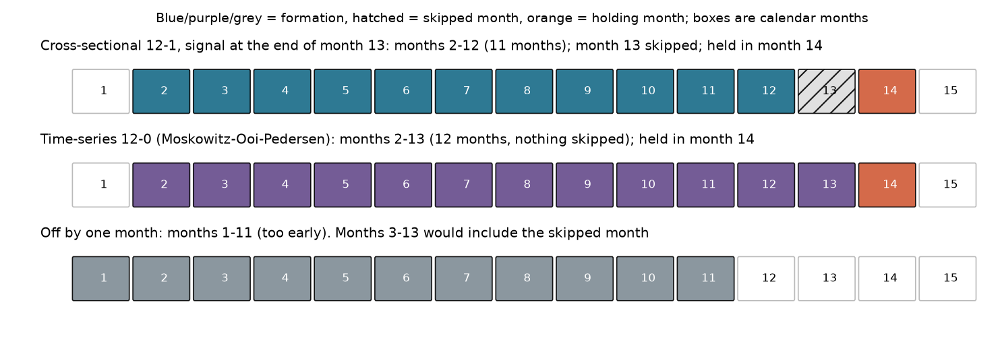
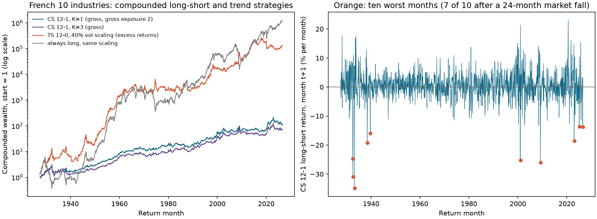
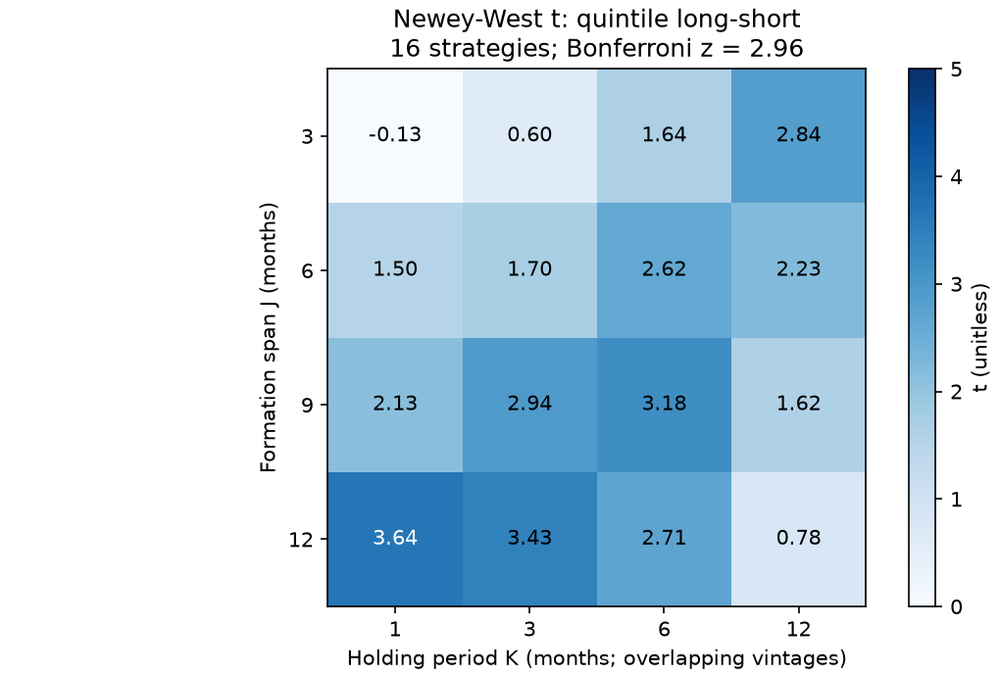
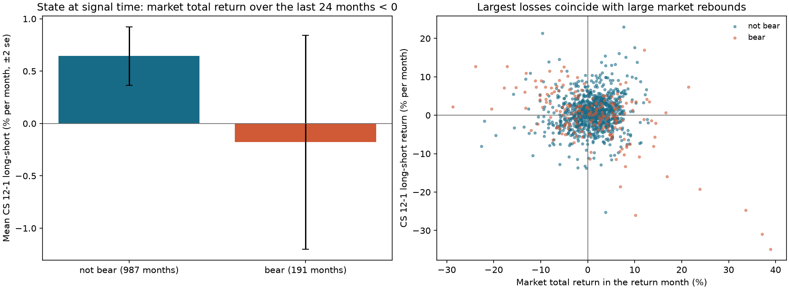

# Chapter 25 — Momentum

> Through line: Turn “past winners keep winning” into precisely bounded windows, directionally explicit positions, and returns whose costs can be measured. Distinguish cross-sectional momentum (XSMOM) from time-series momentum (TSMOM, also called trend); they are different strategies.
> Prerequisites: Chapter 11 (returns and compounding) and Chapter 23 (cross-sectional research). After this chapter, you should be able to write the exact signal-month endpoints of 12–1 momentum without an off-by-one error; explain the difference between $\prod(1+r)-1$ and a sum; construct both a winner-minus-loser cross-sectional portfolio and a time-series trend portfolio; reduce turnover with overlapping holdings and derive the turnover formula; identify data-definition problems involving stock splits, futures rolls, and continuous contracts, and survivorship in the sample; and report results using real monthly returns for 10 industries, including negative results, costs, and crash states.

## 1. Chapter goals

Readers should be able to:

1. For signal month $s$ (at month-end), write the 12–1 formation interval (months $s-11,\dots,s-1$, 11 months in all), the skipped month ($s$), and the holding interval ($s+1$); explain that the 12–0 time-series momentum window of Moskowitz, Ooi, and Pedersen (2012; hereafter MOP) includes the most recent month.
2. Calculate by hand and distinguish $\prod(1+r)-1$, $\sum r$, and $\sum\ln(1+r)$, and give an example in which sum-based and compound-return rankings are reversed.
3. Construct a cross-sectional momentum portfolio (long the highest formation-return bucket and short the lowest) and a time-series momentum portfolio (go long or short each asset according to the sign of its own past return, with positions scaled by ex ante volatility). Explain net exposure (the sum of signed weights, equivalently long weights minus the absolute short weights), gross exposure (the sum of absolute weights), and the relevant benchmark for each.
4. Construct a portfolio with $K$ months of overlapping holdings, derive the adjacent-month weight change $(w^{(t)}-w^{(t-K)})/K$, and compare turnover (the monthly sum of absolute weight changes) and costs for $K=1,3,6$ using real industry data.
5. Identify and correct three data-definition errors: false losers caused by unadjusted stock splits and dividends, false returns created by stitching futures prices across rolls, and survivorship bias from backtesting only the stocks that exist today.
6. Report 12–1, window variants, a $J\times K$ grid (including a Bonferroni threshold), time-series trend versus an always-long benchmark, and crash states for 10 industry portfolios; state clearly what cannot be concluded.

Completion criterion: Every momentum signal should include a timeline marking formation months, the skipped month, `signal_time`, `trade_time`, and the holding month. You should be able to explain what changes when the window is one month longer or shorter than the standard definition.

## 2. Why Quant needs this

Momentum is the factor in Part IV most easily “implemented incorrectly.” Its definition fits in one sentence (“assets that rose more in the past keep rising”), but moving a window endpoint by one month, summing returns instead of compounding, failing to adjust prices for splits, stitching futures prices directly, or using a universe of only surviving companies can all change the result without producing an error. Momentum also has a clear crash risk: strategies with positive long-run means can suffer very large losses in a small number of months. Those losses cluster in rebounds after market declines, so reporting only the mean and its $t$-statistic is incomplete.

The chapter proceeds as follows: first make the window endpoints and compounding exact (Sections 6.1–6.2); then specify the two portfolios using overlapping holdings and volatility scaling (Sections 6.3–6.4); explain why their risks and benchmarks differ (Section 6.5); examine crash states (Section 6.6); address data definitions (Sections 6.7–6.8); and finish with a full report on 10 industry portfolios (Section 11). We use the period-by-period IC, quantile portfolios, and inference methods chosen for the dependence structure from Chapter 23; the experiment ledger in Chapter 22 constrains window searches; Chapter 27 extends the futures-roll issue to carry.

## 3. Intuition

An asset that rose the most over the past year tends, on average, to rise a little more next month than an asset that fell the most over the past year: this is cross-sectional momentum. If an asset’s own price has trended upward over the past year, it is more likely to continue rising next month: this is time-series momentum, also called trend. The first compares assets’ relative positions and is always one long and one short, with net position near zero. The second looks only at each asset on its own; if most assets are rising, the portfolio is net long and its return includes the market’s overall moves.

The intuition has two further details. First, why skip the most recent month? Individual-stock monthly returns exhibit short-term reversal: last month’s winners often give some of it back next month, in connection with liquidity and market microstructure (AMP 2013, printed p. 936). Thus, the “1” in 12–1 removes the most recent month from the formation period. Second, why consider the holding period? Signals update each month. Replacing the entire portfolio every month creates high turnover; instead, let each new vintage occupy $1/K$ of the target book. The replaced quantity is a vintage share, while actual turnover still depends on the difference between old and new weights. The tradeoff is a slower response (the overlapping-holdings design of Jegadeesh and Titman 1993).

Simplifying boundary: the real-data example in this chapter has only 10 industry portfolios (revised value-weighted monthly returns). They do not exhibit the microstructure reversals of individual stocks; the cross section is small; and the observations are not an executable trade series. This chapter does not support conclusions about individual stocks.

### 3.1 Fixing the 12–1 clock with actual calendar months

::: {.body-example title="Complete worked example: compound returns month by month"}

The signal month is December 2025. All monthly returns in the table are split-adjusted total returns that include cash dividends. They are shown in percentage points for readability; divide by 100 before entering them in Python. Start with wealth of 1 and multiply by $1+r$ row by row instead of adding the returns.

| Return month | Monthly return (%) | Cumulative wealth (shown to six decimals) | Role in this 12–1 signal |
|---|---:|---:|---|
| 2025-01 | 3 | 1.030000 | $s-11$, first observation |
| 2025-02 | -2 | 1.009400 | second observation |
| 2025-03 | 5 | 1.059870 | third observation |
| 2025-04 | 1 | 1.070469 | fourth observation |
| 2025-05 | -4 | 1.027650 | fifth observation |
| 2025-06 | 6 | 1.089309 | sixth observation |
| 2025-07 | 2 | 1.111095 | seventh observation |
| 2025-08 | -1 | 1.099984 | eighth observation |
| 2025-09 | 4 | 1.143984 | ninth observation |
| 2025-10 | 3 | 1.178303 | tenth observation |
| 2025-11 | -2 | 1.154737 | $s-1$, eleventh observation |
| 2025-12 | 5 | Not multiplied into this signal | Most recent month $s$, skipped |
| 2026-01 | -6 | Unknown when the signal is formed | Holding month and next-month label $s+1$ |

The displayed cumulative values are for reading only; retain full precision internally at every step. The 11-observation compounded signal is $1.1547369892-1=15.4737\%$; the sum is only 15%. Including December 2025 gives 12–0: $1.1547369892\times1.05-1=21.2474\%$. The $-6\%$ return in January 2026 does not enter any December 2025 signal; that is the boundary imposed by the causal clock.

The general formula follows from the table: the start is $s-(12-1)=s-11$, the end is $s-1$, and the count is $(s-1)-(s-11)+1=11$. In the current interface, `window=11` is the number of observations and `skip=1` means to skip the most recent 1 month; do not infer 12–1 from the name and set `window=12`. Knowing the month-end input does not mean it can be traded at that same closing price. Actual `trade_time` must be a tradable time after the information becomes available, with fills, holidays, halts, and costs recorded. Here we have only a monthly-return-label proxy.

:::

## 4. Mathematical foundations

**Notation.** Asset $i$’s monthly simple return is $R_{i,t}$ (a unitless decimal for month $t$, known at the end of that month). Signal month $s$ means the end of month $s$: the decision is made then, and the holding month is $s+1$. Windows use “lookback span–skip” notation: 12–1 looks back 12 months and skips the most recent 1 month, so it actually uses $12-1=11$ months of returns.

**Compounded return.** For a set of months $\mathcal W$, $F=\prod_{k\in\mathcal W}(1+R_{i,k})-1$. Expanding, $\prod_k(1+R_k)-1=\sum_kR_k+\sum_{j<k}R_jR_k+\dots+\prod_kR_k$; the sum is only the first-order term. When monthly returns are on the order of $\pm5\%$, the second-order terms over a year are on the order of $0.5\times(\sum R)^2-0.5\sum R^2$. Log returns add: $\ln(1+R)$ gives $\ln(1+F)=\sum_k\ln(1+R_k)$.

**Time-series signal.** Asset $i$’s sign is $\mathrm{sign}(F_i)\in\{-1,0,+1\}$. Volatility $\sigma_{i,s}$ is the annualized standard deviation estimated using returns available through month-end $s$. Portfolio weight is $w_{i,s}=\mathrm{sign}(F_{i,s})\cdot(\sigma^*/\sigma_{i,s})/S_s$, where $\sigma^*$ is each asset’s target annualized volatility and $S_s$ is the number of assets with valid inputs that month.

**Overlapping holdings.** Form one new “vintage” (a batch of target weights) $w^{(s)}\in\mathbb R^N$ each month and hold it for $K$ months. The portfolio at the end of month $s$ is $B_s=\frac1K\sum_{j=0}^{K-1}w^{(s-j)}$.

**Bear-market state.** $I_s=\mathbf 1\{\prod_{k=s-23}^{s}(1+M_k)-1<0\}$, where $M_k$ is the market total return. This uses only the 24 months through month-end $s$. This is the definition in Daniel and Moskowitz (2014 working paper; note to Table 3).

Frequency convention: monthly. `signal_time` is month-end; execution is at the next tradable time; the return interval is month $s+1$; all weights update monthly.

## 5. Formal definitions

**Formation interval, skipped month, and holding interval.** The formation interval contains the months used to calculate the signal. For 12–1, these are $s-11,\dots,s-1$. The skipped month is excluded between the formation and holding intervals; for 12–1 it is month $s$. The holding interval is the month held after the signal is decided: month $s+1$. The French database’s “prior (2–12)” corresponds to the same definition: the portfolio is formed at the end of month $t-1$ and held in month $t$, using formation months $t-12,\dots,t-2$ (French momentum-factor description page).

**Cross-sectional momentum.** On a given date, rank assets by their formation returns, buy the highest bucket, and sell the lowest (Jegadeesh and Titman 1993 use deciles). Its direction follows relative ranks rather than the sign of each asset’s absolute return; portfolio market risk still depends on the two legs’ exposures.

**Time-series momentum (TSMOM).** Each asset’s own past-return sign determines its long or short direction, and the position size is inversely proportional to ex ante volatility (Moskowitz, Ooi, and Pedersen 2012, equation (5): $\mathrm{sign}(r_{t-12,t})\cdot(40\%/\sigma_t)\,r_{t,t+1}$, where $\sigma_t$ is the ex ante volatility known at the end of month $t$; the formation window includes the most recent month).

**Short-term reversal.** The negative predictive relation of the most recent month’s return, associated with liquidity and market microstructure for individual stocks (AMP 2013). This chapter tests whether it appears in industry portfolios.

**Trend.** Used synonymously with time-series momentum: persistence in an asset’s own price direction.

**Momentum crash.** Sustained or extreme negative returns in momentum strategies, concentrated in rebound months after market declines (Daniel and Moskowitz 2014).

**Rebalancing and overlapping holdings.** Update signals and adjust positions monthly. Overlapping holdings replace a vintage share equal to $1/K$ each month; this does not guarantee that trading volume falls by exactly $1/K$. In this course, the target weights are reset each month to the equal-weighted average, ignoring price drift; this differs from actual buy-and-hold without rebalancing.

**Total return, price return, and adjusted prices.** Price return includes only price changes; total return also accounts for dividends and splits. An unadjusted price after a split treats the split as a crash.

**Roll and continuous contract.** Before a futures contract expires, move to the next contract. A “continuous price” made by joining prices of different contracts has a jump on the roll date; that jump is not a return earned by holding any one contract.

**Survivorship bias.** A backtest includes only companies that still exist, omitting companies (including those later delisted) that were investable at each historical `signal_time`.

## 6. Derivations

### 6.1 Exact endpoints for 12–1

Signal month $s$ is at month-end. The formation return is

\[
F_{i,s}=\prod_{k=1}^{11}(1+R_{i,s-k})-1 ,
\]

using months $s-11,s-10,\dots,s-1$, 11 months in all; month $s$ is skipped; and the holding month is $s+1$. Look back 12 months from $s-11$ through $s$ and remove the most recent 1 month: hence 12–1. MOP (2012) uses $r_{t-12,t}$ for its time-series signal, that is, $\prod_{k=0}^{11}(1+R_{s-k})-1$, covering months $s-11,\dots,s$, 12 months with none skipped. The windows differ by one month and are not the same signal. Three ways to make a one-month endpoint error are: (1) shift the window back one month ($s-12,\dots,s-2$), dropping the most recent valid information; (2) shift it forward one month ($s-10,\dots,s$), including the month that should be skipped; or (3) misread 12–1 as 12 months minus 1 month but still use 12 observations ($s-12,\dots,s-1$). Row $s$ of `formation_return(returns, window=11, skip=1)` is exactly $s-11,\dots,s-1$. A test verifies that changing returns in month $s$ and later does not change that row (Chapter 23, Section 9, code segment five).

### 6.2 Why $\prod(1+r)-1$, not $\sum r$

Returns compound over time: principal of 1 becomes $\prod(1+R_k)$ after $n$ months, so cumulative return is that value minus 1. Whether a sum understates or overstates compounding depends on the return path: $\prod(1+R_k)-1=\sum R_k+\sum_{j<k}R_jR_k+\dots$. In a second-order approximation, at a fixed arithmetic sum, a larger sum of squared returns lowers the compound return. A strict ranking requires additional conditions; for example, a mean-preserving spread in positive wealth factors lowers their sum of logs. Variance alone cannot determine the ranking of compound returns for arbitrary multi-month paths. The following two-month example can be calculated exactly. Asset X returns $+50\%,-50\%$: sum 0, compounded return $1.5\times0.5-1=-25\%$. Asset Y returns $0,0$: sum 0, compounded return 0. By the sum, X and Y tie; by compounding, Y ranks above X. Log returns agree with compounding: $\ln1.5+\ln0.5=-0.288=\ln0.75$. Therefore, all signals in this chapter use compounding. If the data are log returns, sum them and then exponentiate. `formation_return` sums `log1p` for simple returns and then applies `expm1`; a missing return cell or insufficient history makes the window NaN. A missing calendar-month row violates the continuous-index requirement and raises an error.

### 6.3 Turnover of overlapping-holdings portfolios

Form a new batch of weights $w^{(s)}$ each month and hold it for $K$ months; the portfolio is $B_s=\frac1K\sum_{j=0}^{K-1}w^{(s-j)}$. The difference between adjacent months is

\[
B_s-B_{s-1}=\frac1K\bigl(w^{(s)}-w^{(s-K)}\bigr)
\]

because $B_s$ and $B_{s-1}$ share the middle $K-1$ vintages and differ only by the newly added $w^{(s)}$ and the just-removed $w^{(s-K)}$. Thus target-weight turnover is

\[
\mathrm{turn}_s=\sum_i|B_{i,s}-B_{i,s-1}|=\frac1K\bigl\|w^{(s)}-w^{(s-K)}\bigr\|_1 .
\]

Each vintage has gross exposure of 2 (1 per leg), so $\|w^{(s)}-w^{(s-K)}\|_1\le4$ and turnover is bounded above by $4/K$. For $K=1$, it is the change between adjacent months. The more persistent the signal, the more slowly $\|w^{(s)}-w^{(s-K)}\|_1$ tends to grow with $K$, so turnover falls more. In the real industry data, mean turnover for $K=1,3,6$ is 0.904, 0.518, and 0.364 (Section 11). For $K=3$, mean $\|\cdot\|_1$ is about $3\times0.518=1.55$, greater than 0.904 for $K=1$: the portfolio from three months earlier differs more than last month’s portfolio, but only one-third of it needs to be revised each month. The cost is a slower response: with a $K$-month holding period, the portfolio contains, on average, $(K-1)/2$ months of stale information.

### 6.4 Time-series momentum exposure and benchmark

Weights are $w_{i,s}=\mathrm{sign}(F_{i,s})\,(\sigma^*/\sigma_{i,s})/S_s$. Gross exposure is $\sum|w_i|=\frac{\sigma^*}{S}\sum_i|\mathrm{sign}(F_i)|/\sigma_i$. It can be simplified to a sum of inverse volatilities only when every valid signal is nonzero; a zero signal has zero weight. Net exposure is $\sum w_i=\frac{\sigma^*}{S}\sum_i\mathrm{sign}_i/\sigma_i$ and depends jointly on the shares and volatilities of long and short assets. Hand calculation (Section 8.3): three assets, signals $(+1,-1,+1)$, volatilities $(10\%,20\%,40\%)$, and $\sigma^*=40\%$. The positions before division are $(4,-2,1)$; divide by 3 to get $(1.333,-0.667,0.333)$, gross exposure 2.333, and net exposure 1.0. Net exposure describes an imbalance in nominal long and short positions, but does not by itself establish the size or sign of market beta; market beta also depends on each asset’s exposure. Most assets in this industry sample carry equity-market risk. When most trend signals are positive, the portfolio is net long. So evaluate time-series momentum against an “always long, scaled the same way” benchmark: $r^{\mathrm{TS}}_{s+1}=\sum_i w_{i,s}r_{i,s+1}$ versus $r^{\mathrm{AL}}_{s+1}=\sum_i(\sigma^*/\sigma_{i,s}/S)\,r_{i,s+1}$. MOP (2012) also regressed on an always-long benchmark (“a positive alpha in 90% of the cases”). In the real industry data, the time-series 12–0 monthly mean is 1.391%, versus 1.779% for always long with the same scaling; the difference is $-0.389\%$ ($t=-1.05$). In this sample, trend filtering did not outperform simply holding long.

### 6.5 Cross-sectional versus time-series momentum

Cross-sectional momentum is relative: equal long and short legs give zero net exposure and balance nominal capital. Its market beta is $\sum_iw_i\beta_i$ and is not necessarily zero just because $\sum_iw_i=0$. It mainly expresses relative strength, but may still bear market-direction risk. Time-series momentum is absolute: each asset is compared only with its own past, so the portfolio can be entirely long or entirely short and its net exposure changes with market conditions. Both use past-return signals, but their portfolio properties differ; their correlation is only 0.42 in the industry sample, and their benchmarks differ: cross-sectional momentum is compared with zero (or equal weight), while time-series momentum is compared with always long.

### 6.6 Crash states: conditional means

Classify each signal month as bear or non-bear according to whether the market’s cumulative return over the prior 24 months is negative. Let the next-month conditional means of cross-sectional momentum be $\bar r_1$ and $\bar r_0$, and let the bear-state share be $p$. Then the unconditional mean is $p\bar r_1+(1-p)\bar r_0$. In the industry data, the bear state occurs 16.2% of the time (191 months), with a mean of $-0.179\%$ per month (standard deviation 7.05%). The other 987 months have a mean of $+0.644\%$ (standard deviation 4.37%). Volatility is higher and the mean is negative in the bear state; 7 of the 10 worst months occur after a bear state, while the market rose in 8 of those months (table in Section 11). This direction is consistent with Daniel and Moskowitz’s (2014, printed p. 8) description of individual-stock winner-minus-loser portfolios, but this chapter’s sample contains 10 industry portfolios, not that paper’s individual-stock deciles, so this is not a replication.

### 6.7 Prices, splits, dividends, and total return

Let split ratio $\rho$ convert 1 old share into $\rho$ new shares, $P^{\mathrm{post}}$ be the post-split price per share, $D$ the cash dividend per new share, and $P^{\mathrm{pre}}$ the pre-split price. Total return is $R=(\rho P^{\mathrm{post}}+\rho D)/P^{\mathrm{pre}}-1$; the unadjusted price change is $P^{\mathrm{post}}/P^{\mathrm{pre}}-1$. The constructed example in Chapter 3 has $P^{\mathrm{pre}}=100$, $\rho=2$, $P^{\mathrm{post}}=51$, and $D=1$: total return is $(102+2)/100-1=+4\%$, while the unadjusted price change is $-49\%$. A momentum strategy using unadjusted prices would treat this stock as a loser. This month’s return is understated by $4-(-49)=53$ percentage points. The difference over the entire formation signal must also be multiplied by the wealth factor from the other months in the window (see below); it cannot be treated as 49 percentage points.

### 6.8 Roll stitching: a continuous price is not a return

Here and in Section 8.5 and 25-E06, chaining within-contract price ratios defines a return index: ignore fees and collateral interest, fully collateralize each segment at its starting contract price, and adjust notional exposure with wealth before multiplying the wealth factors. A fixed one-contract position instead requires currency P&L for each segment and an explicit capital denominator; it is not the same capital return. 

Contract A is priced at 100 and 102 at $t_0,t_1$. At $t_1$ it is rolled into contract B, priced at 106 and 107 at $t_1,t_2$. Joining the prices gives 100, 102, 106, 107 and “returns” of $+2\%,+3.92\%,+0.94\%$. The middle $+3.92\%$ is $106/102-1$, comparing two different contracts: A is closed at 102 at $t_1$, while B is opened at 106 at the same time; the holder did not earn that 3.92%. The returns actually available are $+2\%$ while holding A and $107/106-1=+0.94\%$ while holding B. If B’s price is below A’s (spot premium / downward-sloping futures curve), stitching creates a false negative return. AMP (2013, Appendix A.5) calculates commodity-futures returns by compounding daily excess returns on the most liquid contract, rather than stitching prices. A time-series momentum signal on such prices would treat the roll jump as a trend; Chapter 27 decomposes roll returns separately.

## 7. Financial interpretation

**This chapter does not decide where momentum returns come from.** Jegadeesh and Titman (1993) report winner-minus-loser returns for U.S. individual stocks in 1965–1989; Asness, Moskowitz, and Pedersen (2013) use the same simple measure across multiple asset classes; Moskowitz et al. (2012) report time-series momentum that persists for 1 to 12 months and partially reverses across 58 futures. This chapter has not read the original papers in enough detail to restate their explanations (such as underreaction to information or risk compensation). The Quant requirement is that, whatever the explanation, the signal be constructible at `signal_time`, costs be included, and crashes be reported separately.

**Industry momentum differs from individual-stock momentum.** The skipped month in 12–1 is used for individual stocks to avoid short-term reversal (AMP 2013, printed p. 936). AMP also notes stronger momentum without skipping the most recent month for equity-index futures and currencies (printed p. 937). An industry portfolio is a value-weighted average of many stocks, so bid-ask spreads and liquidity-related microstructure effects are averaged out. The industry results here are consistent with that distinction: the 1–0 window (last month’s return) has a long-short monthly mean of $+0.740\%$ ($t=5.61$), while 1–1 (the historical specification name; `window=1, skip=1`, using only month $s-1$) has a mean of $-0.028\%$ ($t=-0.21$); the 12–0 mean of $0.621\%$ is greater than the 12–1 mean of $0.519\%$. This does not show that individual-stock momentum should not skip a month. It shows only that skipping did not help in these 10 industry portfolios.

**Turnover is a major source of momentum costs.** Monthly target-weight turnover for cross-sectional 12–1 is 0.904 (gross exposure 2). Assuming 10 bp per unit of turnover gives a monthly cost of 9 bp and reduces 0.519% to 0.427%. $K=3$ reduces turnover to 0.518 and gives a net return of 0.423%; $t$ rises from 2.99 to 3.06. The 10 bp per unit is an assumption, not an estimate for industry portfolios; stock-borrow and financing costs are not included.

**Report crash risk alongside the mean.** The cumulative compound return of cross-sectional 12–1 on the 10 industries has a maximum drawdown of about 64% at its worst point. Its 10 worst monthly losses range from 13.6% to 34.8%, with 7 following a bear state. A strategy with a positive mean may still be impossible for an investor to hold.

**The time-series trend return contains market exposure.** In the industry sample, trend signals are positive in most asset-months (67.4% of assets are long); average net exposure is 1.05, so the 1.391% monthly mean includes an equity risk premium. Relative to always long, the mean difference is -0.389% per month with t=-1.05; no statistically clear positive increment is observed. This is not an estimated regression alpha.

### 7.1 Three questions and three mechanisms to test

Cross-sectional momentum asks: “On the same date, do past winners outperform past losers next month?” It needs a common asset universe and buys winners while selling losers. Even if every stock fell in the past, it can still take both sides as long as relative ranks are available. Time-series momentum asks: “Does this asset’s own past direction continue next month?” It uses zero return, or another explicitly stated excess-return threshold, as the cutoff; when all assets point the same way, the portfolio can be net long or net short. Short-term reversal asks: “Do last month’s winners give back their gains?” If the signal is defined as the negative of the most recent month’s return, a higher value means a larger recent decline. This is a different specification from 12–1, which excludes the latest month; one name cannot stand in for the other.

Underreaction is one hypothesis: information takes time to enter prices, so past trends continue. It can be tested using information events defined in advance and subsequent drift. Risk compensation is another: winners and losers have different state exposures, and returns come with losses during some rebounds. The crash-state description in Section 11 can motivate such a test, but cannot prove the cause. Measurement proxies may also arise from industry trends, stale trading, or liquidity; they require the corresponding universe and controls for available quotes. All three can coexist with positive historical returns; past profits cannot decide among these explanations. These are research questions, not extensions of the original empirical findings.

Skipping a month is a specification set in advance, with the cost of giving up the most recent information; whether it helps depends on the asset and data definition. The positive 1–0 result for industry portfolios and the negative time-series difference versus always long are both retained. With individual stocks, futures, or currencies, inputs must be defined again. Do not choose the main specification after looking back at whichever of the 19 variants in this chapter performed best.

## 8. Numerical worked examples: calculate each step

All numbers are generated by `hand_examples()` and independently checked by `qa/a5/claude/recompute/ch25_recompute.py`. These are constructed teaching examples.

### 8.1 The 12–1 window: returns over fourteen months

An asset’s monthly simple returns over months 1–14 are $0.03,\allowbreak -0.02,\allowbreak 0.05,\allowbreak 0.01,\allowbreak -0.04,\allowbreak 0.06,\allowbreak 0.02,\allowbreak -0.01,\allowbreak 0.04,\allowbreak 0.03,\allowbreak -0.02,\allowbreak 0.05,\allowbreak -0.06,\allowbreak 0.02$. The signal is formed at the end of month 13, and month 14 is the holding month. The 12–1 formation interval is months 2–12, 11 months; month 13 ($-6\%$) is skipped.

- Compounded return: $\prod_{k=2}^{12}(1+R_k)-1=17.716\%$; sum: $17.0\%$; difference: 0.716 percentage points.
- Shift the window one month earlier (months 1–11): $15.474\%$; shift it one month later (months 3–13, including the skipped month): $12.911\%$; include month 13 in a 12-month window (months 2–13, the 12–0 window): $10.653\%$.

Interpretation: for the same asset, the signal differs by 2 to 7 percentage points across three erroneous windows. The 12–0 signal is 7 percentage points lower than 12–1 because the skipped month was $-6\%$. If many assets give back gains in the latest month in the same way, 12–0 will rank them lower.

### 8.2 Cross-sectional momentum: six assets

The six assets’ 12–1 formation returns are $(A,B,C,D,E,F)=(30\%,12\%,5\%,-2\%,-10\%,-25\%)$, and their next-month returns are $(2\%,3\%,1\%,0\%,1\%,-2\%)$. Take the top two and bottom two: long A and B, short F and E. The long-leg average is $(2+3)/2=2.5\%$; the short-leg average is $(-2+1)/2=-0.5\%$; long-short return is $2.5-(-0.5)=3.0\%$. Each leg has capital of 1, so gross exposure is 2 and net exposure is 0.

### 8.3 Time-series momentum: volatility scaling

Three assets have signals $(+1,-1,+1)$, ex ante annualized volatilities $(10\%,20\%,40\%)$, and target volatility 40%. Individual positions are $(4,-2,1)$; divide by $S=3$ to get weights $(1.333,-0.667,0.333)$. Gross exposure is $2.333$, and net exposure is $1.0$. Next-month returns are $(1\%,-2\%,3\%)$; asset contributions are $(1.333\%,1.333\%,1.0\%)$, for a portfolio return of $3.667\%$. Interpretation: the low-volatility asset gets the largest weight; the portfolio is net long 1.0, so it is not neutral.

### 8.4 Stock split and dividend

Constructed example from Chapter 3: the pre-split price is 100, 1 share splits into 2 shares (a U.S. 2-for-1 split), the post-split price is 51, and the dividend is 1 per new share. Total return is $(2\times51+2\times1)/100-1=4\%$; the unadjusted price change is $51/100-1=-49\%$.

### 8.5 Futures roll

Contract A: $100,\,102$; contract B at the roll: $106,\,107$. The stitched price series is $100,102,106,107$, with stitched returns of $2.00\%,\,3.92\%,\,0.94\%$. The available returns are $2.00\%$ (holding A) and $0.94\%$ (holding B); 3.92% at the roll is a false return.

### 8.6 Overlapping holdings and turnover

There are two assets and six months of vintage weights: $(0.5,-0.5)$ for the first two months, then a reversal to $(-0.5,0.5)$ from month 3 onward, with the later months unchanged. For $K=1$, adjacent-month turnover is $0,2,0,0,0$; turnover in the reversal month is 2.0. For $K=3$, portfolio $B$ is the average of the latest three vintages. The table starts when three vintages are available: month 3 is $\tfrac13(0.5+0.5-0.5)=0.167$; month 4 is $\tfrac13(0.5-0.5-0.5)=-0.167$; month 5 is $-0.5$; and month 6 is $-0.5$ (weights for the first asset; the second asset has the opposite sign). Turnover shown in the table is $0.667,0.667,0$. If the portfolio had remained $(0.5,-0.5)$ through month 2, its month-2 weight would already be $(0.5,-0.5)$, so there would also be turnover of 0.667 from month 2 to 3. The three months over which the reversal is spread would trade $0.667\times3=2.0$, the same total as one 2.0 trade for $K=1$: the total quantity is unchanged, but the monthly trades are smaller. If the signal repeatedly reverses, $K=3$ can offset some round trips and reduce total turnover. In the real industry data, mean turnover for $K=1,3,6$ is 0.904, 0.518, and 0.364 (Section 11).

### 8.7 Bear-market state

All market monthly returns are $+1\%$ except month 3, which is $-35\%$. At signal month $s=24$ (end of month 24), the window runs from month 1 through 24 and includes month 3; cumulative return is $1.01^{23}\times0.65-1=-18.3\%<0$, so the state is 1. At $s=26$, the window from month 3 through 26 still includes month 3, so the state is 1. At $s=27$, the window from month 4 through 27 no longer includes month 3; cumulative return is $1.01^{24}-1=+26.97\%$, so the state is 0. The state flips in the first month after the window has rolled past the crash month.

## 9. Python implementation

The window is calculated by `formation_return` in [`factor_signals.py`](../../../../src/quant_course/factor_signals.py) (introduced in Chapter 22); portfolio construction and costs are in the new module [`momentum.py`](../../../../src/quant_course/momentum.py); cross-sectional bucketing, IC, and Newey–West inference reuse Chapter 23’s [`factor_research.py`](../../../../src/quant_course/factor_research.py).

| Function | Input | Output and boundary |
|---|---|---|
| `formation_return` | Monthly return panel with a continuous `PeriodIndex`, `window`, `skip` | Compounded formation return. Signal month $s$ uses months $s-skip-window+1,\dots,s-skip$; a missing return cell or an out-of-range window gives NaN; a missing calendar-month row raises an error; returns below $-100\%$ raise an error. |
| `cross_sectional_momentum_weights` | Return panel, window, skip, bucket count, holding months $K$ | Average of the latest $K$ monthly vintages (top bucket $+1/n$, bottom bucket $-1/n$); rows without enough history are NaN. |
| `blend_vintages` | Weight panel, $K$ | Rolling average; fewer than $K$ vintages gives NaN. |
| `time_series_sign` | Excess-return panel, window, skip | $+1/-1/0$; any missing observation in the window gives NaN. |
| `ex_ante_volatility` | Return panel, window 36, minimum 12 | Annualized rolling standard deviation; a teaching substitute, not the daily exponentially weighted estimate in the original paper. |
| `tsmom_weights` | Sign, volatility, target volatility | $\mathrm{sign}\cdot\sigma^*/\sigma/S$; nonpositive volatility or target raises an error. |
| `strategy_returns` | Weights (at signal month), returns | Month-$s$ weights times month-$s+1$ returns; a missing return for a nonzero weight raises an error. |
| `net_of_costs` | Gross returns, weights, unit cost | Gross return minus $c\times\sum|\Delta w|$ (target to target, without drift). |
| `trailing_bear_state` | Market total-return series, window | Mark 1 when the past 24 months (including the current month) compound to a negative return; insufficient window gives NaN. |

Default offline entry point (run from the I3 reader-package root):

```bash
.venv/bin/python run_notebook.py notebooks/ch25_momentum.ipynb
```


The default is `RUN_FRENCH=False`; it displays windows, compounding, CS/TS weights, and the 24-by-6 vintage identity with seed 2 ($K=1,3,6$). All five market-data cells are skipped. By default, it does not import the ch25 module, calculate stock-split or futures-roll examples, or build the historical grid. The runner also writes an execution copy and status to `runs/execution_<stem>_<uuid>/`. The notebook’s English-language layer and the package-wide paths are assembled in BIL23. The following full historical CLI and test references are not the default offline command:

```bash
.venv/bin/python code/ch25_momentum.py
.venv/bin/python -m pytest tests/test_ch25_momentum.py tests/test_ch25_workflow.py -q
```


Frequency is monthly; `signal_time` is month-end; execution is at the next tradable time; the return interval is month $s+1$. French industry data and FF3 were read from revised, hash-checked files. Unit trading cost of 10 bp is an assumption, not an estimate.

Code segment one: 12–1 window and three erroneous windows (Section 8.1).

```python
import numpy as np
import pandas as pd

from quant_course.factor_signals import formation_return

r = [0.03, -0.02, 0.05, 0.01, -0.04, 0.06, 0.02, -0.01, 0.04, 0.03, -0.02, 0.05, -0.06, 0.02]
frame = pd.DataFrame({"a": r}, index=pd.period_range("2020-01", periods=14, freq="M"))
s = pd.Period("2021-01", "M")                                    # month 13: signal at the end of this month
f121 = formation_return(frame, window=11, skip=1).loc[s, "a"]    # months 2..12
f120 = formation_return(frame, window=12, skip=0).loc[s, "a"]    # months 2..13, nothing skipped (time-series style)
early = np.prod(1 + np.array(r[0:11])) - 1                      # months 1..11
late = np.prod(1 + np.array(r[2:13])) - 1                       # months 3..13
assert abs(f121 - 0.177159) < 1e-6 and abs(f120 - 0.106530) < 1e-6
assert abs(early - 0.154737) < 1e-6 and abs(late - 0.129112) < 1e-6
assert abs(sum(r[1:12]) - 0.17) < 1e-12                          # the sum, 0.716 percentage points lower
print(round(f121, 4), round(f120, 4), round(early, 4), round(late, 4))
```


Code segment two: sum and compound return produce opposite rankings (Section 6.2).

```python
import numpy as np
import pandas as pd

from quant_course.factor_research import rank_cross_section
from quant_course.factor_signals import formation_return

idx = pd.period_range("2020-01", periods=2, freq="M")
returns = pd.DataFrame({"X": [0.50, -0.50], "Y": [0.0, 0.0]}, index=idx)
compound = formation_return(returns, window=2, skip=0).iloc[-1]
total = returns.sum()
assert np.isclose(total["X"], 0.0) and np.isclose(total["Y"], 0.0)                              # sums tie
assert np.isclose(compound["X"], -0.25) and np.isclose(compound["Y"], 0.0)                      # compounding separates them
assert np.isclose(np.log1p(returns["X"]).sum(), np.log(0.75))                                   # log returns add up to the compound return
assert list(rank_cross_section(compound.to_numpy())) == [1.0, 2.0]                              # X is the loser
print(compound.round(4).to_dict())
```


Code segment three: six-asset cross-sectional and time-series weights (Sections 8.2 and 8.3).

```python
import numpy as np
import pandas as pd

from quant_course.factor_research import quantile_long_short_weights
from quant_course.momentum import tsmom_weights

idx = pd.period_range("2026-06", periods=1, freq="M")
names = list("ABCDEF")
formation = pd.DataFrame([[0.30, 0.12, 0.05, -0.02, -0.10, -0.25]], index=idx, columns=names)
w = quantile_long_short_weights(formation, 3).iloc[0]                  # terciles of 6 names: top 2 long, bottom 2 short
nxt = np.array([0.02, 0.03, 0.01, 0.00, 0.01, -0.02])
np.testing.assert_allclose(w.to_numpy(), [0.5, 0.5, 0, 0, -0.5, -0.5])
assert abs(w.to_numpy() @ nxt - 0.03) < 1e-12 and abs(w.sum()) < 1e-12 and abs(w.abs().sum() - 2.0) < 1e-12

sig = pd.DataFrame([[1.0, -1.0, 1.0]], index=idx, columns=list("xyz"))
vol = pd.DataFrame([[0.10, 0.20, 0.40]], index=idx, columns=list("xyz"))
tw = tsmom_weights(sig, vol, target_vol=0.40).iloc[0]
np.testing.assert_allclose(tw.to_numpy(), [4 / 3, -2 / 3, 1 / 3])
assert abs(tw.abs().sum() - 7 / 3) < 1e-12 and abs(tw.sum() - 1.0) < 1e-12                       # gross 2.33, net 1.0: not market neutral
assert abs(tw.to_numpy() @ np.array([0.01, -0.02, 0.03]) - 0.036667) < 1e-6
print(tw.round(3).to_dict())
```


Code segment four: turnover formula for overlapping holdings, $\mathrm{turn}_s=\|w^{(s)}-w^{(s-K)}\|_1/K$ (Section 6.3).

```python
import numpy as np
import pandas as pd

from quant_course.momentum import blend_vintages

rng = np.random.default_rng(2)
idx = pd.period_range("2020-01", periods=24, freq="M")
vint = pd.DataFrame(rng.choice([-0.5, 0.0, 0.5], size=(24, 6)), index=idx)          # arbitrary vintage weights
for K in (1, 3, 6):
    blended = blend_vintages(vint, K)
    turnover = blended.diff().abs().sum(axis=1, min_count=1)
    formula = pd.Series([np.abs(vint.iloc[i] - vint.iloc[i - K]).sum() / K for i in range(len(vint))], index=idx)
    np.testing.assert_allclose(turnover.iloc[K:].to_numpy(), formula.iloc[K:].to_numpy(), atol=1e-12)
    assert turnover.iloc[:K].isna().all()                                      # no turnover before K vintages exist
print("turnover = ||w_s - w_(s-K)||_1 / K holds for K = 1, 3, 6")
```


Code segment five: stock split, dividend, and futures roll (Sections 8.4 and 8.5).

```python
pre, ratio, dividend, post = 100.0, 2.0, 1.0, 51.0
assert abs((ratio * post + ratio * dividend) / pre - 1 - 0.04) < 1e-12 and abs(post / pre - 1 + 0.49) < 1e-12

a_prices, b_prices = [100.0, 102.0], [106.0, 107.0]
spliced = a_prices + b_prices
returns_spliced = [spliced[i + 1] / spliced[i] - 1 for i in range(3)]
tradable = [a_prices[1] / a_prices[0] - 1, b_prices[1] / b_prices[0] - 1]
assert abs(returns_spliced[1] - (106 / 102 - 1)) < 1e-15 and abs(returns_spliced[1] - 0.039216) < 1e-6      # fake return at the roll
assert abs(tradable[0] - 0.02) < 1e-15 and abs(tradable[1] - (107 / 106 - 1)) < 1e-15
print([round(x, 4) for x in returns_spliced], [round(x, 4) for x in tradable])
```


Code segment six: bear-state window boundary (Section 8.7) and “no future information” for industry weights.

```python
import numpy as np
import pandas as pd

from quant_course.momentum import cross_sectional_momentum_weights, trailing_bear_state

idx = pd.period_range("2000-01", periods=30, freq="M")
m = pd.Series(0.01, index=idx); m.iloc[2] = -0.35                           # month 3 is the crash month
state = trailing_bear_state(m, window=24)
assert np.isnan(state.iloc[22]) and state.iloc[23] == 1.0 and state.iloc[25] == 1.0 and state.iloc[26] == 0.0

rng = np.random.default_rng(4)
returns = pd.DataFrame(rng.normal(0.01, 0.05, (48, 10)), index=pd.period_range("2010-01", periods=48, freq="M"))
base = cross_sectional_momentum_weights(returns, window=11, skip=1, n_buckets=5, hold_months=3)
shocked = returns.copy(); shocked.iloc[30:] = 0.3
changed = cross_sectional_momentum_weights(shocked, window=11, skip=1, n_buckets=5, hold_months=3)
pd.testing.assert_frame_equal(base.iloc[:31], changed.iloc[:31])           # months >= 30 cannot change weights decided up to month 30
print(state.iloc[[22, 23, 25, 26]].tolist())
```


## 10. Reading the figures

**Figure 25-1: Window timeline.** The horizontal axis is calendar month 1 through 15, with the signal formed at the end of month 13. Row one: cross-sectional 12–1 uses months 2–12 (blue, 11 months), skips month 13 (hatched), and holds in month 14 (orange). Row two: time-series 12–0 uses months 2–13 (purple, 12 months) and does not skip a month. Row three: a common error shifts the window one month earlier (gray, months 1–11). Interpretation: the three rows give different signals.



**Figure 25-2: Cumulative portfolio returns and worst months for 10 industries.** The left panel shows compound wealth (log scale, starting at 1) from July 1927: cross-sectional 12–1 long-short ($K=1$ and $K=3$, gross returns, gross exposure 2), time-series 12–0 (excess returns, volatility-scaled, gross exposure about 2.5), and always long with the same scaling. Interpretation: cross-sectional long-short rises over the long run but by less; time-series trend moves in the same direction as always long, and always long is higher after 2000. The right panel shows monthly cross-sectional 12–1 long-short returns (percent per month), with orange dots marking the 10 worst months. The sample is revised industry portfolios, not executed trades.



**Figure 25-3: $t$-statistics for the $J\times K$ grid.** Rows are formation spans $J\in\{3,6,9,12\}$ (using months $s-J+1,\dots,s-1$; $J=12$ is standard 12–1); columns are holding periods $K\in\{1,3,6,12\}$. Each cell shows the Newey–West $t$-statistic (lag $K-1$) for a five-quantile long-short portfolio (two industries per bucket). The nominal two-sided normal Bonferroni threshold for 16 strategies is $z=2.955$. Valid family-wise error-rate control requires calibrated marginal $p$-values; this grid retains the NW/normal approximation. Lag $K-1$ is a frozen specification, not a sufficient bandwidth for every dependence structure. Interpretation: only $(12,1)$ at 3.64, $(12,3)$ at 3.43, and $(9,6)$ at 3.18 exceed the threshold; $(9,3)$ at 2.94 is just below it; short formation spans and short holding periods are not significant.



**Figure 25-4: Crash states.** Left: classify signal months by whether the market’s cumulative total return over the prior 24 months was negative; show the next-month average cross-sectional 12–1 long-short return: $+0.644\%$ across 987 non-bear months and $-0.179\%$ across 191 bear months (vertical bars are plus or minus two standard errors). Right: each dot is a month, with the market’s total return on the horizontal axis and the long-short return on the vertical axis; bear-state observations are orange. Interpretation: the largest losses occur in months of strong market gains (the lower right), often after a bear state.



## 11. Historical market case

**Data.** The same frozen French 10-industry value-weighted monthly returns as Chapters 22–24 (processed CSV SHA-256 `3b097d810c295d64eedfa1ece7067ff2a0707f5ca90e33935df9949251f70950`, July 1926 through August 2026, 1,202 months) and FF3 Mkt-RF and RF (processed SHA-256 `c19770a19a0ac47ad1c29074f57234570aeaa9725212cb4fa8146a2846c52814`). The industry portfolios are revised published returns, 10 assets, not individual stocks and not an execution series. No new data were downloaded for this chapter.

**Cross-sectional 12–1 (five quantiles, two industries per bucket, equal-weighted, formed monthly).** Signal months run from June 1927 through July 2026. There are no ties in 12–1 formation returns in any of the 1,191 months with formation returns, so each bucket has exactly two industries. The one-month variants (1–0 and 1–1) each have ties in 60 months; ties receive average ranks, so an extreme bucket may contain 1 or 3 industries, but each long and short leg still sums to 1.

| $K$ | Gross mean (% per month) | Gross $t$ (NW lag $K-1$) | Net mean (10 bp per unit) | Net $t$ | Mean turnover |
|---|---:|---:|---:|---:|---:|
| 1 | 0.519 | 3.64 | 0.427 | 2.99 | 0.904 |
| 3 | 0.474 | 3.43 | 0.423 | 3.06 | 0.518 |
| 6 | 0.347 | 2.71 | 0.308 | 2.40 | 0.364 |

**Averaging conventions.** For K=1/3/6, gross returns have 1190/1188/1185 valid months and net returns have 1189/1187/1184. The first valid target has no prior comparable weight, so turnover and net return are missing. Mean turnover uses the valid rows of weight differences themselves and may include a final row without a next-month return label. Thus gross mean minus net mean need not equal 10 bp times this turnover column. Align gross returns and turnover to the same valid months when comparing costs. This table preserves each historical series' own convention; do not infer a new cost or revise history from the rounded displays.

Monthly volatility is 4.9% for $K=1$; annualized gross Sharpe is 0.37 for $K=1$, and net Sharpe is 0.30. Net Sharpe for $K=3$ is 0.31, higher than for $K=1$ or $K=6$. Costs are turnover multiplied by a unit cost; borrowing, financing, and capacity are omitted. The 10 bp value is assumed.

**Window variants ($K=1$).**

| Window | Months | Mean (% per month) | $t$ |
|---|---:|---:|---:|
| 12–1 (months $s-11..s-1$) | 1190 | 0.519 | 3.64 |
| 12–0 (months $s-11..s$) | 1190 | 0.621 | 4.41 |
| 1–0 (month $s$) | 1201 | 0.740 | 5.61 |
| 1–1 (month $s-1$) | 1200 | $-0.028$ | $-0.21$ |
| 6–1 (months $s-5..s-1$) | 1196 | 0.209 | 1.50 |
| 3–1 (months $s-2..s-1$) | 1199 | $-0.018$ | $-0.13$ |

This table has six rows. Combined with the 16 strategies in the $J\times K$ grid, it includes 12–1, 6–1, and 3–1 in both tables; this section evaluates 19 distinct cross-sectional variants in total (the separately reported time-series evaluations are not part of this count and must still be included in the complete research ledger). Under Chapter 22’s ledger, the two-sided Bonferroni threshold for 19 tests is $z=3.01$. The values above it are 1–0 (5.61), 12–0 (4.41), 12–1 (3.64), $(12,3)$ (3.43), and $(9,6)$ (3.18); the others are below. The 1–0 (last-month-return) result is positive at the industry level (no short-term reversal); 1–1, which uses only month $s-1$, is about zero.

**$J\times K$ grid (NW $t$-statistics; monthly mean in % in parentheses).**

| $J\backslash K$ | 1 | 3 | 6 | 12 |
|---|---:|---:|---:|---:|
| 3 | $-0.13$ ($-0.02$) | 0.60 (0.06) | 1.64 (0.13) | 2.84 (0.17) |
| 6 | 1.50 (0.21) | 1.70 (0.22) | 2.62 (0.28) | 2.23 (0.19) |
| 9 | 2.13 (0.30) | 2.94 (0.39) | 3.18 (0.39) | 1.62 (0.15) |
| 12 | 3.64 (0.52) | 3.43 (0.47) | 2.71 (0.35) | 0.78 (0.08) |

**Time-series momentum (excess returns; 40% target annual volatility per asset; volatility is the standard deviation over the prior 36 months, with at least 12 months).**

| Portfolio | Mean (% per month) | $t$ | Monthly SD (%) | Annualized Sharpe | Mean gross exposure | Mean net exposure |
|---|---:|---:|---:|---:|---:|---:|
| TS 12–0 (includes most recent month) | 1.391 | 5.46 | 8.79 | 0.55 | 2.50 | 1.05 |
| TS 12–1 (skips most recent month) | 1.197 | 4.66 | 8.86 | 0.47 | 2.50 | 1.01 |
| Always long (same scaling) | 1.779 | 5.79 | 10.61 | 0.58 | 2.50 | 2.50 |

TS 12–0 is 0.389% per month below always long (difference-series $t=-1.05$). Monthly returns for cross-sectional 12–1 ($K=1$) and time-series 12–0 have correlation 0.42. On average, 67.4% of asset signals are long.

**Crash states.** There are 191 signal months (16.2% of months with a defined state) in which the market’s total return (Mkt-RF plus RF) over the past 24 months is negative. The next-month long-short mean is $-0.179\%$, with standard deviation 7.05%; the remaining 987 months have mean $+0.644\%$ and standard deviation 4.37%. The 10 worst months are:

| Signal month → return month | Long-short (%) | Bear state | Market total return in return month (%) |
|---|---:|---|---:|
| 1933-03 → 1933-04 | $-34.83$ | Yes | $+38.91$ |
| 1932-07 → 1932-08 | $-30.90$ | Yes | $+37.15$ |
| 2009-03 → 2009-04 | $-25.97$ | Yes | $+10.18$ |
| 2000-12 → 2001-01 | $-25.21$ | No | $+3.79$ |
| 1932-06 → 1932-07 | $-24.73$ | Yes | $+33.63$ |
| 1938-05 → 1938-06 | $-19.23$ | Yes | $+23.89$ |
| 2022-12 → 2023-01 | $-18.55$ | Yes | $+6.96$ |
| 1939-08 → 1939-09 | $-15.94$ | Yes | $+16.90$ |
| 2026-06 → 2026-07 | $-13.80$ | No | $-0.28$ |
| 2025-01 → 2025-02 | $-13.63$ | No | $-2.11$ |

Seven follow a bear state; the market’s total return is positive in eight return months. The maximum drawdown of cross-sectional 12–1 ($K=1$, gross) is 64.3%.

**What can and cannot be said.** We can say that 12–1 cross-sectional long-short returns were positive and significant on 10 industry portfolios over 1927–2026 ($t=3.64$, gross), with $t=2.99$ after assumed costs; turnover falls as $K$ rises; results vary substantially by window and holding period, and only some long-formation/short-holding cells exceed the multiple-testing threshold; and the worst months cluster in rebounds after bear states. We cannot say: (1) that individual-stock momentum exists or does not exist, because the sample contains 10 industry portfolios; (2) that skipping a month is useless, because industry portfolios lack individual stocks’ microstructure reversals; (3) that post-2000 weakening is significant: Chapters 22 and 23 report $t=1.70$ for the same data over 2000–2026; (4) that time-series trend beats always long—it does not in this sample; (5) that the net return is achievable, because 10 bp is assumed and borrowing, financing, and capacity are omitted; or (6) that the link between crashes and market rebounds has been proved—this is a description, not a replication of Daniel and Moskowitz’s result.

## 12. Common mistakes

**Mistake 1: shifting the window by one month.** Section 8.1: the same asset’s 12–1 signal is 17.72%, one month earlier it is 15.47%, one month later it is 12.91%, and 12–0 is 10.65%. Fix: use `formation_return(window=11, skip=1)` and pass Chapter 23, code segment five’s test that “changing the future does not change the past.”

**Mistake 2: summing instead of compounding.** Section 6.2: $+50\%,-50\%$ sums to 0 but compounds to $-25\%$. Fix: compound simple returns; add log returns and then exponentiate.

**Mistake 3: inconsistent skipped months in cross-sectional and time-series momentum.** Comparing MOP’s 12–0 with JT’s 12–1 confounds the window difference with the strategy difference: in the industry data, the means of 0.621% and 0.519% differ by 0.10 percentage points. Fix: report them side by side and label every window.

**Mistake 4: using unadjusted prices after a split.** Section 8.4: the split causes a 49% price decline while total return is +4%. In the example below, a “false loser” after a split ranks last and a true loser ranks ahead of it.

```python
import numpy as np
import pandas as pd

from quant_course.factor_research import rank_cross_section

idx = pd.period_range("2020-01", periods=3, freq="M")
prices = pd.DataFrame({"split_stock": [100.0, 51.0, 52.0], "true_loser": [100.0, 90.0, 85.0]}, index=idx)   # 2-for-1 split in month 2 (+$1 dividend per new share)
unadjusted = prices.iloc[-1] / prices.iloc[0] - 1
adjusted_split = (2 * 51.0 + 2 * 1.0) / 100.0 * (52.0 / 51.0) - 1                    # total-return chain: split month, then 52/51
adjusted = pd.Series({"split_stock": adjusted_split, "true_loser": 85.0 / 100.0 - 1})
rank_u, rank_a = rank_cross_section(unadjusted.to_numpy()), rank_cross_section(adjusted.to_numpy())
assert rank_u[0] == 1.0 and rank_a[0] == 2.0                                          # unadjusted: split stock is the worst; adjusted: it is the best
print(unadjusted.round(3).to_dict(), adjusted.round(3).to_dict())
```


**Mistake 5: stitching futures prices directly.** Section 6.8: the stitched series creates a false 3.92% return. A time-series signal would mistake the roll jump for a trend.

```python
import numpy as np

a_prices, b_prices = [100.0, 102.0, 104.0], [108.0, 109.0, 111.0]          # contract B trades at a premium: contango
spliced = np.array([100.0, 102.0, 108.0, 109.0, 111.0])                     # roll between the second and third prices
naive_return = spliced[-1] / spliced[0] - 1                                  # "12-month" return from the spliced series
true_a = a_prices[1] / a_prices[0] - 1
true_b = b_prices[2] / b_prices[0] - 1
true_total = (1 + true_a) * (1 + true_b) - 1                                  # hold A to the roll, then hold B
assert naive_return > true_total + 0.04                                       # the splice overstates the move by the roll gap
assert np.sign(naive_return) == np.sign(true_total) == 1
print(round(naive_return, 4), round(true_total, 4))
```


**Mistake 6: backtesting a universe of current survivors.** Taking today’s listed companies back through history uses future information—“survived until today”—to select the stocks. In the fixed-winner-leg example, omitting delisted losers overstates the future return of the loser leg and understates WML. With a dynamic universe, it also changes winners, ranks, and weights, so the bias direction is not fixed. Numerical example: 10 formation-period losers; 9 later survive and return an average of $+20\%$, and 1 delists at $-100\%$. The actual loser-leg mean is $(9\times20-100)/10=+8\%$; a backtest with only survivors reports $+20\%$. Fix: use constituents as of `signal_time` and include realized delisting returns in the subsequent labels; do not select history using today’s list or feed future delisting returns into the signal. This chapter has no individual-stock data; the Project 4 preparation layer records this as a data gap.

**Mistake 7: using a naive $t$-statistic for overlapping-holding returns.** Portfolio returns with $K$-month holdings are serially correlated. This chapter uses Newey–West with a frozen lag of $K-1$; separately check whether it covers the actual dependence. Chapter 23 showed that lag $K-1$ can still be optimistic in a finite sample. Here, the reported $t$ is an NW value and a rough magnitude reference only.

**Mistake 8: ignoring turnover and costs.** Monthly turnover for cross-sectional 12–1 is 0.904 (gross exposure 2). A 10 bp unit cost removes 0.092 percentage points, about 18% of the gross mean; the $K=1$ net $t$ falls from 3.64 to 2.99. Fix: report costs beside gross returns and state that borrowing and financing are omitted.

**Mistake 9: leaving window searches out of the ledger.** This chapter evaluates 19 distinct cross-sectional strategies across window variants and the $J\times K$ grid, so the threshold should be about $z=3.01$, not 1.96. Fix: record the tests as required by Chapter 22 and draw conclusions only from the prespecified main specification.

## 13. Quantitative research application

**Momentum fields in Project 4 and the checklist for real research.** The current machine signal calls `formation_return(window=11, skip=1)`. The price-contract column is named `total_return` and is defined as a constructed decimal monthly total return; `signal_time` is month-end. The constructed price layer does not record an actual `available_at`. The table below lists descriptive fields needed for future real research (for example, `total_return_m` is not a current machine column). Do not describe its vendor or availability-time fields as data already obtained at this layer.

| Field | Source | Time field | Unit | Missing-data rule |
|---|---|---|---|---|
| `total_return_m` | Total-return prices or vendor total return | Month-end (`event_time`) and `available_at` | Decimal | A missing return cell makes the window NaN; reject a missing calendar-month row before calculation, do not fill it. |
| `mom_12_1` | Calculated | `signal_time` | Decimal | NaN with fewer than 12 months of history. |
| `rank_pct` | Same-date percentile | `signal_time` | 0–1 | NaN with fewer than 2 valid assets on that date. |
| `universe_member` | Historical constituents | Version available at `signal_time`, including delisted firms | Boolean | Without historical constituents, do not claim to have backtested. |
| `label_1m` | Next-month return, including delisting return | Label interval start and end | Decimal | Use the delisting return in the delisting month; do not drop it as NaN. |

**Research workflow.** First write a frozen plan (Chapter 22): the hypothesis that assets with higher same-date 12–1 returns have higher next-month returns; the 12–1 signal window; $K=1$; period-by-period Rank IC with NW $t$ as the primary metric; decision rule and cost assumption. Then evaluate the main specification. Treat window variants and the $K$ grid as robustness checks, record them in the ledger, and do not use them to change the main conclusion. Report gross and net returns, turnover, mean and worst month in crash states, window variants, and the difference from the benchmark (cross-sectional momentum versus zero; time-series momentum versus always long).

**What this chapter completes and leaves open.** Completed: the core window and portfolio functions, and a full report on 10 industries. Not completed: individual-stock momentum (historical constituents, delisting returns, and total-return prices are missing), a cost-adjusted Project 4 strategy (Chapters 35–36), or dynamic momentum. Chapter 28 combines momentum with value and quality.

### 13.1 Return definitions and the Project 4 interface, field by field

| Object to calculate | Required inputs | What cannot substitute |
|---|---|---|
| Monthly stock total return | Share-count changes, splits, cash distributions, and delisting treatment, or a total-return series with these adjustments explicitly defined | Difference in unadjusted closing prices; adding dividends again to a total-return series that already includes them |
| Stock price return | Split-adjusted price, explicitly labeled as excluding cash distributions | Calling it total-return momentum |
| Futures return | P&L while holding the same contract, roll rules, notional-exposure/margin convention, and collateral-interest treatment | Price difference across stitched contracts; it is not profit from executing a roll |
| Current constructed P4 total return | Decimal monthly simple total return defined by the generator, continuous monthly index, sampled using contemporaneous membership | Exchange-traded prices or evidence of live fills |

For the stock example, if the wealth product over the other formation months is $G$, the correct signal is $G(1+R_{\rm total})-1$ and the unadjusted signal is $G(1+R_{\rm raw})-1$. Their difference is $G(R_{\rm total}-R_{\rm raw})$. The current-month difference in the split example in Section 6.7 is 53 percentage points; if $G=1.10$, the formation-signal difference is 58.3 percentage points. A futures price change is also only a simple teaching proxy per unit of notional exposure; a margin-account return and a total return including collateral interest use different denominators.

Project 4’s `mom_12_1` actually calls `formation_return(..., 11, 1)`. Its return input is the constructed monthly total return in the contract, and the month-$s+1$ return is used as the label after signal month $s$. This layer has no source of actual adjusted prices, daily next-tradable-time data, or fill verification. The raw formation signal enters the unified preprocessing and synthesis flow in Chapter 24, Section 13.1; it is not a position by itself. Label alignment, Rank IC, and time-series inference use Chapter 23. The NW lag for overlapping holdings is an existing specification; do not treat $K-1$ as universally sufficient for every serial-dependence structure.

## 14. Chapter summary

Momentum is determined by three things: window endpoints (12–1 uses months $s-11$ through $s-1$, while MOP’s 12–0 includes the most recent month; a one-month difference means a different signal), compounding (summing can change the ranking), and portfolio construction (cross-sectional long-short has zero net exposure; time-series trend can be net long or net short and must be compared with always long). Overlapping holdings replace a $1/K$ vintage share each month; under the rule that resets average target weights and ignores drift, target-weight turnover is $\|w^{(s)}-w^{(s-K)}\|_1/K$. Data definitions determine whether results are credible: use total returns that account for splits and dividends, returns on the held futures contract rather than stitched prices, and constituents available at `signal_time`. On 10 industry portfolios, 12–1 is positive and remains positive after assumed costs, but only a few of 19 distinct cross-sectional variants pass the multiple-testing threshold; time-series trend does not beat always long; and the worst months cluster in rebounds after bear states. Scope: industry portfolios are not individual stocks; costs are assumed; the crash description is not a replication; this chapter has no individual-stock data.

## 15. Exercises

**25-E01 (by hand).** An asset’s monthly returns over months 1–14 are $0.04,\allowbreak -0.03,\allowbreak 0.02,\allowbreak 0.05,\allowbreak -0.01,\allowbreak 0.03,\allowbreak 0.02,\allowbreak -0.02,\allowbreak 0.01,\allowbreak 0.06,\allowbreak -0.04,\allowbreak 0.02,\allowbreak 0.03,\allowbreak -0.05$. The signal is formed at the end of month 13. Calculate 12–1, 12–0, and the returns for windows shifted one month earlier and one month later; also calculate the arithmetic sum for 12–1.

**25-E02 (by hand).** Eight assets have 12–1 formation returns $(40\%,25\%,18\%,10\%,10\%,-5\%,-12\%,-30\%)$ and next-month returns $(3\%,1\%,4\%,0,2\%,1\%,-2\%,-3\%)$. Take the highest and lowest buckets for $q=4$ (resolve ties with average ranks). Find the $q=4$ bucket assignments, long-short weights, and next-month long-short return.

**25-E03 (by hand).** Four assets have signs $(+1,\allowbreak -1,\allowbreak -1,\allowbreak +1)$, ex ante annualized volatilities $(8\%,\allowbreak 16\%,\allowbreak 32\%,\allowbreak 20\%)$, target volatility 40%, and next-month returns $(1.5\%,\allowbreak -3\%,\allowbreak 4\%,\allowbreak -1\%)$. Find the weights, gross exposure, net exposure, portfolio return, and each asset’s contribution.

**25-E04 (by hand).** Two assets have seven months of vintages: $(0.5,-0.5)$ for the first three months and $(-0.5,0.5)$ for the next four. Find target-weight turnover for $K=1$ and $K=3$, and verify $\mathrm{turn}_s=\|w^{(s)}-w^{(s-K)}\|_1/K$.

**25-E05 (by hand).** A stock is priced at 90 and undergoes a 3-for-1 split; after the split it is priced at 31 and pays a cash dividend of 0.5 per new share. Calculate total return and the unadjusted price change. If this month is in a 12–1 formation window, by how many percentage points is the signal understated?

**25-E06 (by hand).** Contract A is priced at 50 and 52; at the roll, contract B is priced at 55 and 56.1. Find the “returns” from the stitched price series, the available returns, and the false return at the roll.

**25-E07 (by hand).** All market monthly returns are $+1\%$ except month 3, which is $-35\%$. What is the bear state for the 24-month window at signal months $s=23,24,26,27$? Explain why the state changes.

**25-E08 (concept and calculation).** Asset X returns $+50\%,-50\%$ over two months and Y returns $0,0$. Rank them by sum and by compounding. Then give a three-month example in which the sum-based and compound-return rankings are opposite.

**25-E09 (interpretation).** Table 11 reports a monthly mean of 1.391% for TS 12–0 and 1.779% for always long. Explain why 1.391% cannot be treated as trend alpha and how to test whether trend adds value.

**25-N01 (calendar and data diagnostic).** Calculate 12–1, 12–0, and the sum from the actual calendar-month table in Section 3.1; mark the formation, skipped, and holding times. If someone multiplies the January 2026 return into the signal, identify the leakage. Then, let the wealth product for the other formation months in the split example in Section 6.7 be $G=1.10$; calculate the difference in the formation signal caused by using unadjusted prices, and explain why the stitched jump at a futures roll is not earned.

## 16. Programming exercises

**25-P01.** Write a test that, for the 14 monthly returns, asserts that `formation_return(window=11, skip=1)` in month 13 equals the value in Section 8.1 and that changing returns in month 13 and later does not change that row. Acceptance criterion: both assertions pass.

**25-P02.** Generate vintage weights for 24 months and 10 assets, then calculate turnover for $K=1,3,6$ and verify $\|w^{(s)}-w^{(s-K)}\|_1/K$. Acceptance criterion: error is less than $10^{-12}$ for all three $K$ values.

**25-P03.** On a constructed random-walk panel with positive drift (10 assets, 480 months, monthly drift 0.5%, monthly volatility 4%), calculate time-series 12–0 and always long with the same scaling; report their means, $t$-statistics, and the $t$-statistic of the difference series, and interpret the results. Acceptance criterion: always-long mean exceeds the time-series portfolio mean and the difference-series $t<-2$.

## 17. Challenge problems

**25-C01 (proof).** Prove that adjacent-month turnover for an overlapping-holdings portfolio $B_s=\frac1K\sum_{j=0}^{K-1}w^{(s-j)}$ equals $\|w^{(s)}-w^{(s-K)}\|_1/K$. If every vintage has gross exposure 2, give the turnover upper bound and state when it is attained. Explain why increasing $K$ does not necessarily reduce turnover by exactly $1/K$. Prerequisite: the triangle inequality for absolute values. Grading: proof 40, upper bound 30, discussion 30.

**25-C02 (open-ended).** Write a complete frozen plan and data-gap table for the Project 4 momentum signal: window, total-return definition, historical constituents and delisting returns, cost and stock-borrow assumptions, crash-state reporting, and multiple-testing count. Identify fields unavailable in the course’s current data. Grading: plan completeness 25, correct time fields 25, data gaps 25, crash and cost treatment 25.

## 18. Complete solutions and reference implementations

**25-E01.** 12–1: compound months 2–12, $\prod_{k=2}^{12}(1+R_k)-1$. The month-by-month product is $0.97\times1.02\times1.05\times0.99\times1.03\times1.02\times0.98\times1.01\times1.06\times0.96\times1.02=1.1101$, or $+11.01\%$ (rounded to $11.009\%$); the sum is $11.0\%$. For 12–0 (months 2–13, adding month 13’s $+3\%$), $1.1101\times1.03=1.1434$, or $+14.34\%$. One month earlier (months 1–11): $13.19\%$; one month later (months 3–13): $17.88\%$. The four windows differ by 2 to 7 percentage points.

**25-E02.** In the given asset order, the ascending ranks for formation returns $(40,25,18,10,10,-5,-12,-30)\%$ are $-30\to1$, $-12\to2$, $-5\to3$, the two 10s tied across ranks 4 and 5 each receive 4.5, $18\to6$, $25\to7$, and $40\to8$. Thus ranks are $(8,7,6,4.5,4.5,3,2,1)$. With $q=4$ and $n=8$, bucket number is $\lfloor4(2r-1)/16\rfloor+1$: $r=8\to4$, $7\to4$, $6\to3$, $4.5\to3$, $3\to2$, $2\to1$, and $1\to1$, giving $(4,4,3,3,3,2,1,1)$. The top bucket contains the first two assets (formation returns 40% and 25%); the bottom contains the last two ($-12\%$ and $-30\%$). Each leg has weights of $\pm0.5$. Long-short return is $\tfrac12(3\%+1\%)-\tfrac12(-2\%-3\%)=2\%+2.5\%=4.5\%$.

**25-E03.** Unnormalized position is $\mathrm{sign}\times0.40/\sigma$: $(+5,\allowbreak -2.5,\allowbreak -1.25,\allowbreak +2)$. Divide by 4 to get weights $(1.25,\allowbreak -0.625,\allowbreak -0.3125,\allowbreak 0.5)$. Gross exposure is 2.6875; net exposure is 0.8125. Contributions are $1.25\times1.5\%=1.875\%$, $-0.625\times(-3\%)=1.875\%$, $-0.3125\times4\%=-1.25\%$, and $0.5\times(-1\%)=-0.5\%$. The portfolio return is 2.0%.

**25-E04.** For $K=1$, adjacent-month turnover is $0,0,2,0,0,0$; the reversal in month 4 trades 2.0. For $K=3$, $B_3=(0.5,-0.5)$; $B_4=\tfrac13(0.5+0.5-0.5)=(0.1667,-0.1667)$; $B_5=\tfrac13(0.5-0.5-0.5)=(-0.1667,0.1667)$; $B_6=(-0.5,0.5)$; and $B_7=(-0.5,0.5)$. Turnover is $0.667,0.667,0.667,0$. For month 4, $\|w^{(4)}-w^{(1)}\|_1/3=\|(-0.5,0.5)-(0.5,-0.5)\|_1/3=2/3$. Months 5 and 6 work the same way; for month 7, $\|w^{(7)}-w^{(4)}\|=0$. Total turnover is 2.0, but only 0.667 is traded per month.

**25-E05.** Total return is $(3\times31+3\times0.5)/90-1=(93+1.5)/90-1=+5.0\%$; the unadjusted price change is $31/90-1=-65.6\%$. The split-month difference is $5.0-(31/90-1)\times100=70.5555556$ percentage points (displayed as 70.6). If the wealth product for the other formation months is $G$, the full formation-signal difference is $G\times70.5555556$ percentage points. Since $G$ is not given in the exercise, the full signal difference is not uniquely determined. It equals the one-month difference only when $G=1$.

**25-E06.** Stitched prices are 50, 52, 55, 56.1, giving returns of 4.00%, 5.77%, and 2.00%. Available returns: hold A for $52/50-1=4.00\%$; no return at the roll itself; hold B for $56.1/55-1=2.00\%$. The false return at the roll is $55/52-1=5.77\%$. The total price change across the stitched series is $56.1/50-1=12.2\%$; the available total return is $1.04\times1.02-1=6.08\%$.

**25-E07.** Number months from 1 through 30; the window is months $s-23,\dots,s$ and requires 24 months. At $s=23$, history is insufficient, so the state is NaN. At $s=24$, months 1–24 include month 3, so cumulative return is $1.01^{23}\times0.65-1=-18.3\%<0$ and state is 1. At $s=26$, months 3–26 still include month 3, so state is 1. At $s=27$, months 4–27 exclude month 3, cumulative return is $1.01^{24}-1=+26.97\%$ and state is 0. The window has moved past the crash month, so the cumulative return no longer includes it.

**25-E08.** X sums to 0 and compounds to $-25\%$; Y sums to 0 and compounds to 0. They tie by the sum, but Y ranks above X by compounding. Three-month example: X returns $+30\%,+30\%,-40\%$, sum $+20\%$, compound return $1.3\times1.3\times0.6-1=+1.4\%$. Y returns $+10\%,+5\%,+4\%$, sum $+19\%$, compound return $1.1\times1.05\times1.04-1=+20.1\%$. By sums, X (20%) ranks above Y (19%); by compound returns, Y (20.1%) ranks above X (1.4%): the rankings reverse.

**25-E09.** The trend portfolio’s average net exposure is 1.05 and 67% of assets are classified as long, so the 1.391% mean includes an equity risk premium (after scaling). Always long with the same scaling earns 1.779%. Test trend’s incremental value using the difference series (TS minus always long) or an intercept from a regression of TS on always long. The difference-series mean is $-0.389\%$ ($t=-1.05$); the sign and significance of the regression intercept depend on the estimated regression. This chapter reports only the difference series and finds no statistically clear positive increment in this sample. Nonsignificance does not prove that the increment is zero.

**25-P01 reference implementation**

```python
import numpy as np
import pandas as pd

from quant_course.factor_signals import formation_return

r = [0.03, -0.02, 0.05, 0.01, -0.04, 0.06, 0.02, -0.01, 0.04, 0.03, -0.02, 0.05, -0.06, 0.02]
idx = pd.period_range("2020-01", periods=14, freq="M")
frame = pd.DataFrame({"a": r}, index=idx)
s = idx[12]
base = formation_return(frame, window=11, skip=1)
assert abs(base.loc[s, "a"] - (np.prod(1 + np.array(r[1:12])) - 1)) < 1e-12
shocked = frame.copy(); shocked.iloc[12:] = 0.9                                  # month 13 and later change
pd.testing.assert_frame_equal(base.iloc[:13], formation_return(shocked, window=11, skip=1).iloc[:13])
```


**25-P02 reference implementation:** see code segment four in Section 9, keep the K=1/3/6 loop and replace its input with `vint = pd.DataFrame(rng.choice([-0.5, 0.0, 0.5], size=(24, 10)), index=idx, columns=[f"A{i}" for i in range(10)])`. Leave the difference, formula, and assertions unchanged; this supplies the required ten columns.

**25-P03 reference implementation**

```python
import numpy as np
import pandas as pd

from quant_course.momentum import ex_ante_volatility, strategy_returns, time_series_sign, tsmom_weights

rng = np.random.default_rng(3)
idx = pd.period_range("1980-01", periods=480, freq="M")
returns = pd.DataFrame(rng.normal(0.005, 0.04, (480, 10)), index=idx, columns=[f"A{i}" for i in range(10)])
vol = ex_ante_volatility(returns)
sig = time_series_sign(returns, window=12, skip=0)
ts = strategy_returns(tsmom_weights(sig, vol, target_vol=0.40), returns).dropna()
always = strategy_returns(tsmom_weights(pd.DataFrame(1.0, index=idx, columns=returns.columns).where(vol.notna()), vol, target_vol=0.40), returns).dropna()
diff = (ts - always).dropna()
t = diff.mean() / (diff.std(ddof=1) / np.sqrt(len(diff)))
assert always.mean() > ts.mean() and t < -2                     # independent returns: no trend to exploit; the 12-month sign filter shorts after a negative cumulative return and gives up the drift
print(round(100 * ts.mean(), 3), round(100 * always.mean(), 3), round(t, 2))
```


The output is about 0.500, 1.565, and $-5.14$: with independent returns and only positive drift, sign filtering shorts after negative cumulative returns over the past 12 months and gives up the drift, so the difference is significantly negative (across five seeds, all $t$-statistics are below $-2.8$). This is a sign-filter example for the specified IID positive-drift construction; it does not prove that positive return autocorrelation is a general necessary condition for trend to add value. Nonlinear predictability, state dependence, and risk scaling can also affect the comparison. The industry-sample difference-series $t=-1.05$ means only that no statistically clear mean advantage is observed; it does not identify the cause or prove there is no increment.

**25-C01.** $B_s-B_{s-1}=\tfrac1K\bigl(\sum_{j=0}^{K-1}w^{(s-j)}-\sum_{j=1}^{K}w^{(s-j)}\bigr)=\tfrac1K(w^{(s)}-w^{(s-K)})$ because the two sums share terms $j=1,\dots,K-1$. Taking the $\ell_1$ norm gives $\mathrm{turn}_s=\|w^{(s)}-w^{(s-K)}\|_1/K$. If each vintage has gross exposure 2, the triangle inequality gives $\|w^{(s)}-w^{(s-K)}\|_1\le\|w^{(s)}\|_1+\|w^{(s-K)}\|_1=4$, so $\mathrm{turn}_s\le4/K$. Equality holds if and only if $w^{(s)}_iw^{(s-K)}_i\le0$ for every asset $i$ (the asset has opposite signs in the two vintages, or at least one weight is zero). As $K$ rises, the denominator grows, but the numerator $\|w^{(s)}-w^{(s-K)}\|_1$ also changes; there is no general theorem that it rises monotonically with $K$ (a periodic signal can make it rise and then fall). Therefore turnover does not necessarily decline strictly as $1/K$. In the industry data, mean numerator is about 1.55 for $K=3$ and about 0.90 for $K=1$. Grading follows the three items in the original.

**25-C02 (grading guidance and reference).** Plan elements: state the hypothesis and sign (winners have higher next-month returns; positive direction); use 12–1 total returns; use historical constituents as of `signal_time`, including delisting returns; use an 11-month window and skip 1 month; equal-weight the highest and lowest deciles; set $K=1$ as the main specification; state separate unit-turnover and stock-borrow cost assumptions; use period-by-period Rank IC with NW $t$ as the primary metric; define the crash state as a negative market total return over the prior 24 months and report conditional means and worst months; specify the experiment budget and ledger; reserve a holdout sample. Data gaps: individual-stock total returns and adjusted prices, historical constituents and delisting returns, borrow rates, and shares available to borrow are all absent from the course’s current data. Grading follows the four original criteria.

**25-N01 complete solution.** January–November 2025 has 11 observations and cumulative wealth of 1.1547369892, so 12–1 is 15.4737%; the sum is 15%. Including December gives 12–0 at 21.2474%. December is the skipped month; January 2026 is the next-month holding label and is unknown when the signal is formed, so including it is look-ahead. In the split example, the correct monthly total return is 4% and the unadjusted monthly return is -49%, a 53-percentage-point difference. Multiplying by $G=1.10$ gives a formation-signal difference of 58.3 percentage points. At a futures roll, selling A and buying B at the same time does not create a price path from A at 102 to B at 106; the price difference between two different claims is not a holding return. Calculate P&L separately for each contract held.

## 19. Further reading

- Must Know: Jegadeesh and Titman (1993), opening of §§I and II; read the J/K strategies, overlapping holdings, and their Bonferroni discussion of 32 tests.
- Must Know: Asness, Moskowitz, and Pedersen (2013), printed pp. 936–937; read the MOM2–12 definition and reason for skipping a month.
- Should Know: Moskowitz, Ooi, and Pedersen (2012), §§2.4 and 4.1; read volatility scaling and equation (5) for TSMOM.
- Should Know: Daniel and Moskowitz (2014 working paper), abstract and note to Table 3; read the crash-state definition. The journal version was not read.
- Advanced: Original paper by Moskowitz and Grinblatt (1999) on industry momentum; not read for this chapter.
- Optional: French database Mom-factor description page; check the definition of prior (2–12).

## 20. References

Citation keys and the scope of what was read are listed in [source_notes.md](../../../../part04/chapter25/source_notes.md).

- CH25_JT1993: Jegadeesh, N., and Titman, S. (1993). *Journal of Finance* 48(1), printed pp. 68–69.
- CH25_AMP2013: Asness, C. S., Moskowitz, T. J., and Pedersen, L. H. (2013). *Journal of Finance* 68(3), printed pp. 936–937.
- CH25_MOP2012: Moskowitz, T. J., Ooi, Y. H., and Pedersen, L. H. (2012). *Journal of Financial Economics* 104(2), §§2.4 and 4.1.
- CH25_DM2014: Daniel, K., and Moskowitz, T. J. (2014). NBER Working Paper 20439, abstract, printed p. 8, and note to Table 3; journal version not read.
- CH25_FRENCH_MOM_PAGE: Ken French database Mom-factor description page.
- FRENCH: Frozen French industry and FF3 snapshots (`data/manifests/`).
