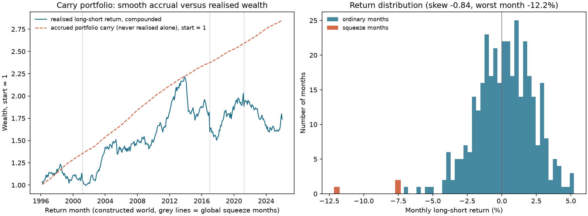
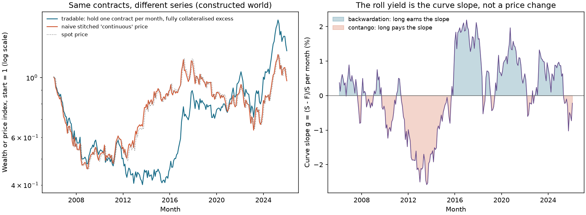
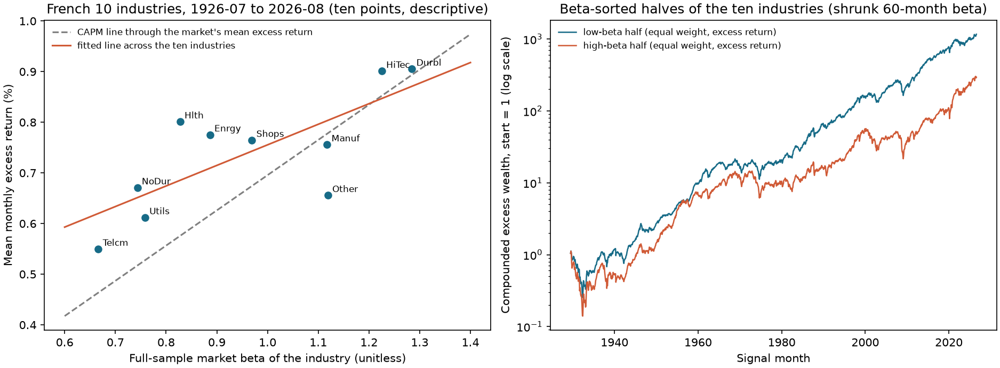
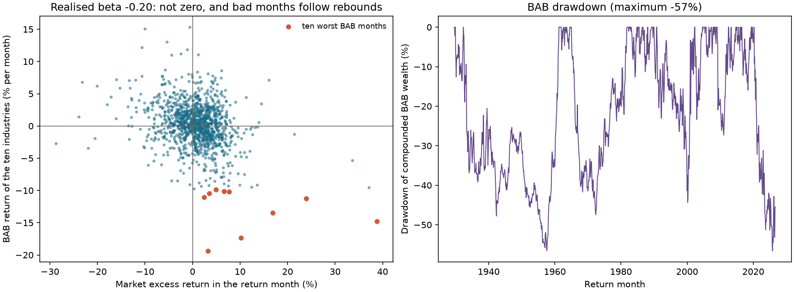

# Chapter 27 — Carry, Defensive Investing, and Low Volatility

> Through line: Carry is “how much a position would earn if market conditions stayed unchanged.” It can be calculated mechanically in advance. Low volatility and low beta raise different research questions: Is the security market line flatter than CAPM predicts? What return difference remains after scaling by beta, and how do financing costs and constraints change the comparison? Carry starts from a cash-flow definition; the low-risk question requires empirical evidence. Both require attention to leverage and losses under stress, as well as average returns.
> Prerequisites: Chapter 10 (cash flows in financial markets: futures, FX, and bonds), Chapter 18 (volatility), and Chapter 23 (cross-sectional research). After this chapter, you should be able to derive carry for futures, FX forwards, zero-coupon bonds, and commodity curves from holding-period cash flows; distinguish the return earned under “unchanged prices” from price changes; explain why spliced continuous futures prices are not tradable PnL; write down the weights, leverage, and financing costs of a beta-sorted, leveraged low-beta portfolio (betting against beta, BAB); explain how shrinkage determines whether BAB is actually market neutral; report low-beta and BAB results for 10 industry portfolios; and report negative results, costs, and crashes alongside positive results.

## 1. Chapter goals

Readers should be able to answer: Does a high-interest-rate currency “earn the interest differential,” or does it earn a return when the exchange rate stays unchanged? Where does the roll return on a commodity futures contract come from? Why is a high-minus-low portfolio’s average carry nonnegative when constructed on a common capital basis, yet its realized return can be negative? Why does a low-beta portfolio need leverage to be compared with the market, and how do financing costs and constraints change the conclusion?

1. Write the futures carry definition $C_t=(S_t-F_t)/X_t$ ($S_t$ is the spot price, $F_t$ the futures price, and $X_t$ the collateral capital), and derive carry for FX forwards, zero-coupon bonds, and commodity futures curves, stating each formula’s quote direction, frequency, and assumptions.
2. Decompose a position’s return as $r_{t+1}=C_t+\Delta S_{t+1}/X_t$ (use $F_t$ as the denominator only when the contract is fully collateralized, $X_t=F_t$). Explain where the “unchanged price” assumption is counterfactual and how the part that is “taken back” (take-back) through price changes determines carry’s predictive power.
3. Explain the difference between a continuous futures price (made by stitching together prices of different expiries) and the tradable return on a single contract; calculate their difference from the roll spread; and verify in a constructed world that $\text{tradable}=\text{carry}+\text{price change}$.
4. Distinguish low volatility, low beta, and defensive investing; use $\sigma_i^2=\beta_i^2\sigma_m^2+\sigma_{\varepsilon,i}^2$ to show why low beta does not imply low volatility.
5. State BAB’s weights, leverage, and return, and prove market neutrality under estimated betas. Distinguish the noiseless and noisy models: under the ranking, positive-denominator, and conditional-expectation assumptions in Section 6.9, derive the sign of true exposure; in the noise model, optimal shrinkage gives conditional neutrality, while the unconditional expectation also requires integrability.
6. Report the average excess returns and alphas of the low- and high-beta halves, BAB returns, sample market-regression beta estimates, subperiods, cost sensitivities, and worst months using the frozen French monthly data for 10 industries. State that these are 10 value-weighted industry portfolios, not individual stocks or a trade-by-trade execution series.
7. In a constructed world with a known data-generating process, reproduce a carry portfolio with positive average carry but negatively skewed returns and deep drawdowns, with a large take-back component. Use 200 new seeds to explain what a single path can and cannot establish.

Completion criterion: Every carry or low-risk signal must have a field table stating quote direction, tenor, `signal_time`, financing and collateral assumptions, roll rule, and conclusions that cannot be drawn without actual forward quotes, futures curves, and financing rates.

## 2. Why carry and low risk need careful comparison

Value, momentum, and quality ask “what to buy.” This chapter asks where a return comes from and how much market exposure is involved in comparing it. An FX forward typically requires margin rather than payment of the full contract principal. Its premium or discount reflects the interest differential, but exchange-rate changes can offset carry. Carry is a counterfactual calculation under a stated quote and capital convention; it does not guarantee an average realized return.

The low-risk question starts with CAPM’s benchmark, $E[r_i]=\beta_iE[r_m]$: if expected excess return is proportional to beta, expected return per unit of beta is the same. Whether the security market line is flatter in the data is an empirical question. Only under the relevant relationship might low-beta portfolios compare favorably after beta scaling. Scale the groups to the same estimated market exposure, then report returns, risk, and estimation error. Leverage also requires financing; spreads, margin requirements, and forced liquidation may change the result. Financing constraints are part of the research question, rather than a reason to assume that low-risk portfolios must earn more.

Three common misinterpretations explain why the definitions need to be precise. First, treating “high interest rates” as “high carry”: reversing the quote direction reverses the sign. Second, treating a continuous futures price as trading PnL: a stitched price jumps on the roll date, and nobody can earn that jump. Third, treating “leveraged low beta” as “market neutral”: if the beta used for scaling is shrunk toward 1, true exposure need not be zero under the specified model (Section 6.9); the historical market-regression beta estimate is about $-0.2$ in Section 11, which does not make it a known true beta. None of these errors raises an exception.

The chapter’s logic is as follows: derive carry from holding-period cash flows (6.1), then write the specific formulas for FX (6.2), bonds (6.3), and commodities (6.4); decompose returns into carry and price changes (6.5), handle rolls and splicing (6.6), and portfolio carry (6.7); then turn to low risk: the beta-volatility decomposition (6.8), BAB construction and neutrality (6.9), and leverage, financing, and crashes (6.10); finally, report results from a constructed world (Section 10) and 10 industry portfolios (Section 11).

## 3. Intuition

Suppose you borrow dollars and buy a yen deposit. The yen deposit has a lower interest rate, while the dollar rate is higher, so you pay the interest differential each year. Reverse the trade—borrow yen and deposit dollars—and you earn the interest differential. This is a carry trade. It makes money when the exchange rate does not move far enough against you. If the high-interest-rate currency depreciates by exactly the interest differential (uncovered interest parity, UIP, holds), the average return is zero. The empirical “carry premium” means UIP fails on average; it does not mean every year is profitable.

The same intuition applies to commodity futures. Suppose the nearby contract is 100 and the deferred contract is 98 (backwardation). You buy the deferred contract. If the curve does not move, it gradually “slides” toward the nearby price as expiry approaches, earning you $2/98$. Conversely, if the nearby contract is 100 and the deferred contract is 101 (contango), buying the deferred contract loses $1/101$ per month if the curve stays unchanged. This return comes from the curve’s shape, not from a price rise or fall. A continuous contract joins nearby and deferred prices end to end, so its price appears to “jump” on the roll date. Nobody earns that jump.

The intuition for low volatility and low beta is this: if risk premia are proportional to beta, then expected return per unit of beta is the same. If the security market line is flatter than the theory predicts, low-beta assets have higher returns per unit of beta and high-beta assets have lower returns. Leveraging the low-beta assets to beta 1 produces an expected return above the market, at the cost of leverage. A study that omits leverage constraints, financing costs, and risk presents only a paper Sharpe ratio.

Scope boundary: the real-data example in this chapter uses only 10 industry portfolios (revised value-weighted monthly returns). It has no actual FX forwards, futures curves, or financing rates. Carry’s numerical examples are hand calculations and a constructed world.

### 3.1 Start with a cash-flow ledger, then name the return

Why can the same forward-price spread produce different reported returns? Because a contract PnL is a currency amount, while a return also needs an invested-capital denominator. **Collateral capital** $X$ is the denominator; **contract notional** is the price multiplied by the number of contract units. They are different quantities. The table below fixes one contract with a unit multiplier. Futures and forwards have different settlement and margin mechanisms; here we use the chapter’s simplified one-period ledger, with the collateral account earning the risk-free rate, and do not model daily margin calls.

| Time | Known at this point | Account action | Still unknown |
|---|---|---|---|
| Signal/entry $t$ | Spot $S_t$, forward $F_t$ to expiry, capital $X_t$, and the one-period interest rate | Deposit $X_t$ in the collateral account and enter a long position in one unit of the underlying | Future spot, margin changes, and trading impact |
| Counterfactual calculation | Only the current quotes above | Assume expiry spot remains at $S_t$ and calculate $(S_t-F_t)/X_t$ | This is carry, not a future observation |
| Expiry $t+1$ | Only now is $S_{t+1}$ known | Return $X_t(1+r^f)$ from the collateral account; contract PnL is $S_{t+1}-F_t$ | Record the two cash flows separately, then divide by $X_t$ |

::: {.body-example title="Complete worked example: Capital changes returns"}

Let $S_t=102,F_t=100,X_t=50,r^f=1\%$ (a one-period decimal rate). The counterfactual contract PnL is 2, so carry is $2/50=4\%$. If the actual expiry spot is 99, the contract loses 1 and the collateral account earns 0.5; ending equity is $50.5-1=49.5$. Total return is $-1\%$ and excess return is $-2\%$. The decomposition is $4\%+(99-102)/50=-2\%$. If the same contract instead has $X=100$, carry falls to $2\%$ and excess return to $-1\%$; collateral interest of 1 offsets the contract loss, leaving a total return of 0. More capital changes the return and leverage, not the PnL on that one contract.

:::

The FX example in Section 8 uses $X=F$, so $C=S/F-1$; this does not mean a “zero-cost contract has infinite returns.” Section 6.3 first calculates the cash bond’s **total holding-period return**, then subtracts the financing benchmark over the same period. When reading carry for different assets, first ask: “What are the cash flows, what is the denominator, and what has been subtracted?” Actual financing spreads, margin calls, and borrowing constraints require additional inputs; they cannot be hidden inside the risk-free collateral assumption.

## 4. Mathematical foundations

**Notation.** Use one period (one month). $S_t$ is the spot price at time $t$, in units of “local currency per unit of the underlying” (for FX, local currency per unit of foreign currency); $F_t$ is the futures (forward) price for delivery exactly at $t+1$, in the same units; $X_t$ is the capital (collateral) allocated to one contract, at least equal to margin; and $r^f$ is the one-period risk-free rate (a decimal), which the collateral capital earns. All prices are positive. Frequency: monthly; `signal_time` is month-end $t$, when $S_t,F_t$ are known; the return period runs from $t$ to $t+1$.

**Futures return.** Allocate $X_t$ and hold the contract for one period. Its end-of-period value is $X_t(1+r^f)+F_{t+1}-F_t$, so total and excess returns per unit of capital are

\[
r^{\text{tot}}_{t+1}=\frac{F_{t+1}-F_t}{X_t}+r^f,\qquad r_{t+1}=\frac{F_{t+1}-F_t}{X_t}.
\]

**Convergence at expiry.** At expiry, the contract price equals spot: $F_{t+1}=S_{t+1}$.

**Carry.** Hold the spot price fixed at $S_{t+1}=S_t$, so $F_{t+1}=S_t$:

\[
C_t=\frac{S_t-F_t}{X_t},\qquad X_t=F_t\ \text{when}\ C_t=\frac{S_t}{F_t}-1 .
\]

**Return decomposition.** Add and subtract $S_t$:

\[
r_{t+1}=\frac{S_{t+1}-F_t}{X_t}=\underbrace{\frac{S_t-F_t}{X_t}}_{C_t}+\underbrace{\frac{S_{t+1}-S_t}{X_t}}_{\text{price change}}
\]

(the same denominator applies when $X_t=F_t$). These are Koijen, Moskowitz, Pedersen, and Vrugt’s definitions (NBER Working Paper w19325, August 2013 version, equations (2)–(6)).

**Beta and volatility.** Regress an asset’s excess return $r_i$ on the market’s excess return $r_m$: $r_i=\alpha_i+\beta_ir_m+\varepsilon_i$, with $\beta_i=\mathrm{Cov}(r_i,r_m)/\mathrm{Var}(r_m)=\rho_{im}\sigma_i/\sigma_m$. Assume finite second moments and strictly positive market variance, and let $\varepsilon_i$ be the population linear-projection residual, orthogonal to the market. Then $\sigma_i^2=\beta_i^2\sigma_m^2+\sigma_{\varepsilon,i}^2$. An arbitrary error term does not automatically satisfy this decomposition.

**BAB weights.** At a month-end, let $\hat\beta$ be the estimated beta vector for $n$ securities, $z_i=\operatorname{rank}(\hat\beta_i)$ (use average ranks for ties), $\bar z=\frac1n\sum z_i$, and $k=2/\sum_i|z_i-\bar z|$. Then

\[
w_H=k\,(z-\bar z)^+,\qquad w_L=k\,(z-\bar z)^-,\qquad \mathbf 1^\top w_H=\mathbf 1^\top w_L=1 ,
\]

where $x^+=\max(x,0)$ and $x^-=\max(-x,0)$. The low-beta leg $w_L$ puts its largest weights on the lowest-beta securities. (Frazzini and Pedersen’s draft, 2013-05-10, equation (16).)

**BAB return.** Let $\hat\beta_L=w_L^\top\hat\beta$, $\hat\beta_H=w_H^\top\hat\beta$, and next-period excess returns be $r^e$, with $r_L=w_L^\top r^e$ and $r_H=w_H^\top r^e$:

\[
r^{\mathrm{BAB}}=\frac1{\hat\beta_L}\,r_L-\frac1{\hat\beta_H}\,r_H .
\]

(Equation (17); the draft writes this as $r-r^f$, which is equivalent to excess returns.) The estimated beta of each leg must be strictly positive. If all betas are tied, the rank weights are undefined.

Frequency convention: monthly; estimate beta using data through month-end $s$; BAB return is for month $s+1$.

## 5. Formal definitions

**Carry.** The return on a position under “unchanged market conditions”; for futures, $C_t=(S_t-F_t)/X_t$. It is one component of expected return that can be calculated in advance; it is not expected return itself.

**Currency carry trade.** A portfolio that goes long high-carry currencies and short low-carry currencies. For forwards, carry is the interest-rate differential $(r^*-r)/(1+r)$.

**Forward premium.** $F/S-1$: the forward price relative to spot; a positive value means the forward is at a premium.

**Covered interest parity (CIP).** With simple interest rates, $F=S(1+r)/(1+r^*)$, where $S$ is quoted as “local currency/foreign currency,” $r$ is the local interest rate, and $r^*$ is the foreign interest rate.

**Term structure and curve slope.** A curve of prices or yields for the same underlying at different expiries. In this chapter’s constructed world, the commodity curve slope $g=(S-F)/S$ measures the shape of the curve.

**Backwardation and contango.** When the nearby contract is more expensive than the deferred contract (a downward-sloping curve, with positive carry on a deferred long), the market is in backwardation. When the deferred contract is more expensive than the nearby contract, it is in contango.

**Convenience yield.** The net return $\delta$ from holding a physical commodity rather than a futures contract, after storage costs.

**Roll yield.** In this chapter, the return earned by holding a contract as it approaches expiry while the curve stays unchanged; it is the manifestation of carry along the futures curve. It comes from the shape of the price curve, not from a change in spot.

**Roll-down.** The price change that results when a bond’s maturity shortens and it moves along an unchanged yield curve toward a lower yield.

**Continuous contract.** A price series formed by joining prices of different expiries end to end. It includes the spread between two contracts on the roll date; that spread is not a return.

**Portfolio carry.** $C^{\mathrm p}=\sum_iw_iC_i$ (KMPV equation (24)).

**Low volatility.** Buying securities ranked by (ex ante) volatility. **Low beta.** Buying securities ranked by (ex ante) beta. They are different: $\sigma^2=\beta^2\sigma_m^2+\sigma_\varepsilon^2$, so a low-beta security may have high idiosyncratic volatility.

**Defensive.** The operational definition in this chapter: an asset or portfolio that loses materially less than the market in down-market months, typically (but not necessarily) low-beta, low-volatility, or high-quality. Measure it with the conditional mean and conditional beta in down months; it is not a standard classification.

**Betting against beta (BAB).** A self-financing portfolio that goes long the low-beta leg levered to beta 1 and short the high-beta leg delevered to beta 1.

**Funding constraints and funding risk.** Limits on borrowing, margin requirements, and financing costs. When constraints tighten, forced deleveraging causes leveraged positions to lose money at the same time. Frazzini and Pedersen’s model predicts that high-beta assets are overpriced, BAB earns positive returns, and BAB returns are low when funding tightens (draft abstract); this chapter does not test the model.

**Crash.** In this chapter, the left tail of a portfolio’s return distribution: large losses clustered in a small number of months because of common shocks rather than diversified idiosyncratic shocks.
## 6. Derivations

### 6.1 From holding-period cash flows to carry

A futures contract does not require the full principal upfront. Allocate capital $X_t$ to one contract (collateral above the margin requirement, for example, invested in a short-term Treasury), and at expiry receive $X_t(1+r^f)$ plus the contract’s PnL, $F_{t+1}-F_t$. Excess return per unit of capital is $(F_{t+1}-F_t)/X_t$; total return is $r^f+(F_{t+1}-F_t)/X_t$ (Section 4). Convergence at expiry, $F_{t+1}=S_{t+1}$, links the contract return to spot: $r_{t+1}=(S_{t+1}-F_t)/X_t$. Set $S_{t+1}=S_t$ to obtain $C_t=(S_t-F_t)/X_t$. Read it this way: carry is positive when the futures price is below spot ($F<S$), and negative when it is above spot. $X=F$ is called full collateralization; then $C=S/F-1$.

This is a one-period case in which the contract expires exactly at period end. For a longer-dated contract, replace “price unchanged” with “curve unchanged” (Sections 6.3 and 6.4).

### 6.2 FX forwards: interest differentials and quote direction

Let $S$ be quoted as “local currency/foreign currency,” and let $r$ and $r^*$ be the local and foreign simple interest rates for the same period. Covered interest parity (CIP) gives $F=S(1+r)/(1+r^*)$. The carry on a long foreign-currency forward (buying one unit of foreign currency at $F$ for delivery at expiry) is

\[
C=\frac{S-F}{F}=\frac SF-1=\frac{1+r^*}{1+r}-1=\frac{r^*-r}{1+r}.
\]

When the foreign rate is higher ($r^*>r$), $F<S$ and $C>0$. The forward is a zero-cost contract; its return is an excess return, and carry is the interest differential normalized by $X=F$. KMPV equation (7) and footnote 6 do use the reciprocal of the local rate for their normalization. That normalization should not be interpreted directly as a same-notional replication that delivers one fixed unit of foreign currency at maturity: today, that replication requires depositing $1/(1+r^*)$ units of foreign currency, at a cost of $S/(1+r^*)=F/(1+r)$ units of local currency. Keep the replication amount separate from the denominator used to report the return.

**Deposit comparison with an explicit denominator.** Convert one unit of local currency into foreign currency and deposit it for one period. Its local-currency value at maturity is $\frac{S_T}{S}(1+r^*)$; a local-currency deposit grows to $1+r$. Since $(1+r^*)/S=(1+r)/F$, excess return $\bigl[\frac{S_T}{S}(1+r^*)-(1+r)\bigr]/(1+r)=\frac{S_T-F}{F}$. Algebraically, this equals the excess return on a forward with $X=F$ (Section 8.1), because the denominator is the local deposit’s ending value $1+r$, not its initial principal of 1. The foreign-currency deposit’s total return is $S_T(1+r^*)/S-1$; its arithmetic excess return is that total return minus $r$. Neither should be conflated with the forward’s total return. Separate two scenarios. If the exchange rate stays unchanged, $S_T=S$, the foreign deposit’s arithmetic excess return on initial local capital of 1 is $r^*-r$. Dividing by the local deposit’s ending value $1+r$ gives relative excess return $(r^*-r)/(1+r)$, equal to forward carry with $X=F$. If instead $S_T=F$, the foreign currency depreciates by exactly $1-(1+r)/(1+r^*)$, offsetting its interest advantage, and excess return relative to the local deposit is zero. Here “break-even” refers to the local-deposit benchmark, not to initial principal. These are different scenarios.

**Quote direction.** With the reciprocal quote, $S'=1/S$ and $F'=1/F$, applying the same formula $(S'-F')/F'$ gives $F/S-1$ (the sign is reversed). Therefore, fix the convention: $S,F$ in the formula are quoted as “local currency/foreign currency,” and carry is the long-foreign-currency carry (the counterexample in Section 8.1).

**UIP and carry trades.** Uncovered interest parity says $E[S_T]=F$: the expected depreciation of the foreign currency exactly offsets the interest differential, leaving the long-forward average return at zero. A profitable carry trade requires $E[S_T]>F$, meaning UIP fails on average. This is an empirical question. This chapter has no actual FX data; it only includes a specified “take-back” fraction in a constructed world (Sections 6.5 and 10).

### 6.3 Zero-coupon bonds: yield, roll-down, and an unchanged curve

Let $y(\tau)$ be the annual-compounded zero-coupon yield curve at maturity $\tau$ years. The price of a zero-coupon bond with face value 1 and maturity $T$ is $P_T=(1+y_T)^{-T}$, where $y_T=y(T)$. Hold it for $h$ years ($h<T$). If the curve is unchanged, it becomes a bond with $T-h$ years to maturity and price $(1+y_{T-h})^{-(T-h)}$. Total return is

\[
1+\mathrm{carry}=\frac{(1+y_T)^T}{(1+y_{T-h})^{T-h}}
=\underbrace{(1+y_T)^h}_{1+\text{yield component}}\times\underbrace{\Bigl(\frac{1+y_T}{1+y_{T-h}}\Bigr)^{T-h}}_{1+\text{roll-down component}} ,
\]

using $(1+y_T)^T=(1+y_T)^h(1+y_T)^{T-h}$. On a flat curve, $y_{T-h}=y_T$ and the roll-down factor is 1. On an upward-sloping curve ($y_{T-h}<y_T$), roll-down is positive: the bond moves toward the short end, its yield falls, and its price rises. Excess return equals total return minus the short-term financing rate over $h$ years, $[(1+y_h)^h-1]$. KMPV (equations (13)–(15)) shows the same structure for coupon bonds: carry consists of yield and roll-down; the yield component less the short rate is the term spread. A modified-duration approximation is

\[
\text{roll-down}\approx-D_{\mathrm{mod}}\,(y_{T-h}-y_T),
\]

where $D_{\mathrm{mod}}$ is for the bond after roll-down (the $(T-h)$-year zero-coupon bond, $(T-h)/(1+y)$). In the numerical example in Section 8.2, using the duration of the original $T$-year bond overstates roll-down.

Assumptions: zero-coupon bonds, annual compounding, linear interpolation of yields by maturity, no credit or liquidity premium, and an “unchanged curve” counterfactual (the actual curve changes every day).

### 6.4 Commodities: convenience yield and curve slope

A cash-flow view of holding physical commodities: buy spot $S$ and hold for one period. The return is the net convenience yield $\delta$ minus financing cost $r$ (borrowing to buy spot). No arbitrage gives $F=S(1+r-\delta)$ (following KMPV equation (9)). If spot is unchanged, carry on a long futures position is

\[
C=\frac{S-F}{F}=\frac{\delta-r}{1+r-\delta}.
\]

Spot prices for commodities are often not cleanly observable, so use the spread between two adjacent futures contracts: nearby $F^1$ (with $T_1$ periods remaining) and the next-nearby $F^2$ (with $T_2>T_1$). If the nearby price stays unchanged, the $F^2$ contract slides toward $F^1$ over $T_2-T_1$ periods. A linear per-period proxy for carry is

\[
C=\frac{F^1-F^2}{F^2\,(T_2-T_1)}
\]

(KMPV equation (10)). It is the price spread over the maturity difference, divided by capital; it is not an exact monthly compounded return for an arbitrary maturity. If the total endpoint price ratio is compounded evenly by period, calculate $(F^1/F^2)^{1/(T_2-T_1)}-1$ instead, with the unchanged-curve path stated explicitly. If $F^i=S(1+(r-\delta)T_i)$ is linear, then $F^1-F^2=S(r-\delta)(T_1-T_2)$ and $C=(\delta-r)S/F^2$, consistent with the formula above. Read it this way: in backwardation ($F^1>F^2$), $C>0$; in contango, $C<0$. Section 8.3 uses nearby 100 and next-nearby 101, one month apart, so $C=-1/101=-0.99\%$ per month.

### 6.5 Return decomposition and “take-back”

Take the conditional expectation of the identity from Section 4, $r_{t+1}=C_t+\Delta S_{t+1}/F_t$ (when $X=F$):

\[
E_t[r_{t+1}]=C_t+E_t\Bigl[\frac{\Delta S_{t+1}}{F_t}\Bigr].
\]

Carry is one component of expected return; the other is the expected price change, which depends on the risk premium and expectations (KMPV equation (6)). Suppose the expected price change is a fraction of carry: $E_t[\Delta S/F]=-\gamma C_t$. Then $E_t[r]=(1-\gamma)C_t$. If $\gamma=1$, the price change exactly offsets carry (the UIP case in FX), leaving zero average return. If $\gamma=0$, price is a martingale and all carry is realized. If $0<\gamma<1$, some carry is taken back. If the cross-sectional regression is $r_{i,t+1}=a+bC_{i,t}+u$, with slope $b=1-\gamma$, then $b=1$ means carry is fully realized and $b=0$ means price changes fully offset it.

The constructed world in Section 10 sets $\gamma=0.5$, but shock loadings $\ell_i=2\,\mathrm{pct}_i-1$ depend on carry rank, so the unconditional expected monthly cross-sectional slope is below $1-\gamma$:
$E[b]\approx(1-\gamma)-p\,E[m]\,\overline{\mathrm{Cov}(\ell,C)/\mathrm{Var}(C)}$,
where $p=1.2\%$ is the monthly shock probability and $E[m]=0.05+0.02\sqrt{2/\pi}=0.066$ is the expected shock size. The last term is the average across months of $\mathrm{Cov}(\ell,C)/\mathrm{Var}(C)$. The theoretical value for this path is 0.23; the median of monthly slope means over 200 new seeds is 0.273 (the median theoretical value is 0.272; the 5th and 95th percentiles are $-0.14$ and 0.56). The measured value on this path is 0.44: it has only 3 shock months (4.3 expected), the average over the 356 non-shock months is 0.65, and the average over shock months is $-24.0$. Thus, the slope below $1-\gamma$ comes from the specified crash loading, not merely sampling error.

### 6.6 Continuous-contract splicing and tradable PnL

Let $c(t)$ be the contract held on date $t$, with price $F_{t,c}$. Tradable return is the price ratio for the same contract on two dates:

\[
r^{\mathrm{trade}}_t=\frac{F_{t+1,c(t)}}{F_{t,c(t)}}-1 .
\]

The return on the spliced price $S^*_t=F_{t,c(t)}$ is

\[
r^{*}_t=\frac{S^*_{t+1}}{S^*_t}-1=\frac{F_{t+1,c(t+1)}}{F_{t,c(t)}}-1 .
\]

Their difference is

\[
r^*_t-r^{\mathrm{trade}}_t=\frac{F_{t+1,c(t+1)}-F_{t+1,c(t)}}{F_{t,c(t)}} .
\]

It is zero when there is no roll ($c(t+1)=c(t)$); when the contract changes, it is the new-minus-old contract price at $t+1$, divided by the old price. In contango, the new contract costs more, so the spliced price jumps upward on the roll date. Nobody earns this amount: at $t+1$, traders sell the old contract at its quote and buy the new contract at its quote. The roll itself creates no PnL. The cost of contango appears as the new contract later converges downward toward spot. Over time, the spliced series is close to spot, while the tradable series is spot plus roll yield (Section 8.4 and the constructed world in Section 10). A spliced price can also become negative or make price ratios invalid, so research should compound single-contract returns rather than calculate returns from a spliced price (the commodity-futures return construction of Asness, Moskowitz, and Pedersen 2013; see Chapter 25’s source notes).

### 6.7 A high-minus-low portfolio’s carry is nonnegative, but its return need not be

For portfolio weights $w_i$ (long weights sum to $+1$, short weights to $-1$, or rank weights), portfolio carry is $C^{\mathrm p}=\sum_iw_iC_i=\overline{C}_{\text{long}}-\overline{C}_{\text{short}}$ (KMPV equations (24) and (25)). Going long high carry and short low carry makes $C^{\mathrm p}\ge0$ by construction. The return decomposition in Section 6.5 gives realized return $=C^{\mathrm p}+\text{price change}$; the average price-change component can offset much of carry.

The nonnegative result requires nonnegative weights within each long and short leg, comparable capital bases, and each long position’s carry to be no lower than each short position’s carry. It can be zero when all values are equal or when there is a boundary tie. Carry observed at formation can still vary over time. Let $D_t$ be the portfolio’s price-change component; then $\mathrm{Var}(r)=\mathrm{Var}(C^{\mathrm p})+\mathrm{Var}(D)+2\mathrm{Cov}(C^{\mathrm p},D)$, and skewness also depends on the joint distribution. Conditional on the formation-time information set, known carry does not contribute to the current conditional innovation; this differs from unconditional time-series risk. Thus, “portfolio carry is positive” and “return is positive” are two different statements. In the constructed world in Section 10, average portfolio carry is 0.516% per month, while average return is 0.179% per month.
### 6.8 Low volatility and low beta: decomposition

$\sigma_i^2=\beta_i^2\sigma_m^2+\sigma_{\varepsilon,\allowbreak i}^2$. Let $\sigma_m=16\%$. Asset X has $\beta=0.5$ and idiosyncratic volatility 25%; asset Y has $\beta=1.2$ and idiosyncratic volatility 5%. Then

$$\sigma_X=\sqrt{(0.5\times0.16)^2+0.25^2}=26.2\%,\qquad \sigma_Y=\sqrt{(1.2\times0.16)^2+0.05^2}=19.8\%.$$

X has lower beta but higher volatility, so ranking by volatility and by beta gives opposite orders (27-E08). “Low volatility” and “low beta” are different signals. They are often correlated empirically, but they are not identical (Section 11: among the 10 industries, the low-beta and low-volatility halves overlap by an average of 3.6 industries).

CAPM says $E[r_i]=\beta_iE[r_m]$ for excess returns. If the security market line is flatter than this, $\alpha_i=E[r_i]-\beta_iE[r_m]$ is positive for low-beta assets and negative for high-beta assets. Suppose a low-beta portfolio has $\beta_p=0.7$ and is held unlevered. To compare it with the market, lever it by $1/0.7=1.43$ to reach beta 1. If expected excess return is independent of beta (a flat SML), the levered portfolio’s expected excess return is $1.43E[r_p]$, above the market’s. CAPM has no cost of leverage; in practice, leverage has costs and constraints (Section 6.10).

### 6.9 BAB: weights, neutrality, and shrinkage

**Construction.** Use $w_L,w_H$ from Section 4, with estimated leg betas $\hat\beta_L,\hat\beta_H$, and return $r^{\mathrm{BAB}}=r_L/\hat\beta_L-r_H/\hat\beta_H$. Each leg is scaled to beta 1 (both leg betas must be positive; only when $0<\hat\beta_L<1<\hat\beta_H$ do the positions separately satisfy $1/\hat\beta_L>1$ and $1/\hat\beta_H<1$; high-low ranking alone does not guarantee that the betas straddle 1). The draft reports that U.S. equity BAB is on average long 1.4 dollars of low-beta stocks, financed by borrowing 1.4 dollars in the risk-free asset, and short 0.7 dollars of high-beta stocks (that draft’s sample, page 19).

**Neutrality under estimated beta.** Apply the portfolio weights directly to the estimates used for scaling: $\hat\beta^{\mathrm{BAB}}=\hat\beta_L/\hat\beta_L-\hat\beta_H/\hat\beta_H=1-1=0$. This algebra needs nonzero estimated leg betas, not equality between estimates and true values; the chapter’s construction additionally requires positive leg betas. Equality with true betas is needed only to extend this result to true market neutrality. In Section 8.5’s special case, each asset’s return is exactly the scaling $\beta_i$ times the market return, so BAB return is zero.

**True exposure.** Actual portfolio beta is $\beta^{\mathrm{BAB}}=\beta^T_L/\hat\beta_L-\beta^T_H/\hat\beta_H$, where $\beta^T$ denotes the true beta of each leg.

**Shrinkage.** Frazzini and Pedersen use $\hat\beta=w\hat\beta^{\mathrm{TS}}+(1-w)\cdot1$ with $w=0.6$ (equation (15) and following; draft page 17), shrinking toward the cross-sectional mean of 1. A common strictly positive $w$ does not change the ranking; $w=0$ makes all estimates equal to 1, eliminating rank information, and the existing `bab_weights` function errors on an all-tied vector. A positive shrinkage weight leaves the membership of the two legs unchanged and only changes their scaling (leverage). Consider two cases.

(a) **No noise.** Use the shrunk beta for scaling, while true beta is the unshrunk value $x$: $\hat\beta=wx+(1-w)$. Define $g(x)=x/(wx+1-w)$. Then $\beta^{\mathrm{BAB}}=g(x_L)-g(x_H)$, with $0<x_L<1<x_H$ and $0<w\le1$. State the domain first: $g$ has a pole at $x=-(1-w)/w$, and $g'(x)=(1-w)/(wx+1-w)^2>0$ for $w<1$ only guarantees that $g$ is increasing on each side of the pole; it does not allow a comparison across the pole. The scaling betas for the two legs, $wx_L+1-w$ and $wx_H+1-w$, are both strictly positive, which means both lie in the same interval to the right of the pole; $x_L>0$ ensures this automatically. Thus $g(x_L)<g(x_H)$ and $\beta^{\mathrm{BAB}}<0$. When $w=1$, $g(x)=1$ and $\beta^{\mathrm{BAB}}=0$. Without the positive-denominator condition, the conclusion can reverse: with $x_L=-1$, $x_H=2$, and $w=0.6$, the low-beta leg’s scaling beta is $-0.2$, and $g(x_L)-g(x_H)=5-1.25=+3.75$. With $w=1$ and $x_L=0$, the expression is $0/0$. This is the existing policy of `bab_returns`: if either weighted leg beta is $\le0$ in any month, it errors instead of “levering” a negative-beta leg to 1. For $x_L=0.7$, $x_H=1.3$, and $w=0.6$, the numerical result is $0.7/0.82-1.3/1.18=0.854-1.102=-0.248$ (27-C01).

(b) **With noise.** Let $\hat\beta=\beta+e$, with $e$ independent of $\beta$, $\beta\sim(1,\sigma_\beta^2)$, and $e\sim(0,\sigma_e^2)$. Then $E[\beta\mid\hat\beta]=1+w^*(\hat\beta-1)$, where $w^*=\sigma_\beta^2/(\sigma_\beta^2+\sigma_e^2)$. This is exact when the pairs $(\beta_i,e_i)$ are cross-sectionally independent and jointly normal; otherwise it is the best linear prediction. If estimation errors are correlated across securities, selecting the legs by extreme ranks creates additional selection bias.

When $w=w^*$, the shrunk beta is exactly the conditional expectation of true beta. Conditional on the entire vector $\hat\beta$, leg weights and scaling denominators $s_L,s_H$ are constants, so the conditional true exposures are exactly $E[\beta^T_L\mid\hat\beta]/s_L=1$ and $E[\beta^T_H\mid\hat\beta]/s_H=1$. BAB’s conditional true beta is therefore zero (there is no Jensen adjustment; the denominators must be defined, $s_L,s_H\ne0$. The unconditional expectation additionally requires the ratio to be integrable, which cannot be assumed under normal tails and is not claimed here).

The sign comparison requires more conditions: the estimated leg betas must straddle 1, $\hat\beta_L<1<\hat\beta_H$, and both scaling denominators $s_L,s_H$ must be strictly positive ($s_H>0$ follows automatically when $\hat\beta_H>1$). Under these conditions, if $w>w^*$ (too little shrinkage), the low-beta leg’s conditional mean true beta exceeds the beta used for scaling and conditional mean BAB exposure is positive. If $w<w^*$ (too much shrinkage), conditional mean exposure is negative. Merely requiring nonzero denominators is insufficient: with $\hat\beta_L=-2$, $\hat\beta_H=2$, $w^*=0.5$, and $w=0.6$, $s_L=-0.8$ and conditional net exposure is $-0.3125$, contrary to the rule that too little shrinkage gives positive exposure. The simulation in 27-P03 uses true beta with mean 1 and standard deviation 0.25, noise standard deviation 0.25 ($w^*=0.5$), 500 securities, and averages over 200 simulations: at $w=1$, $\beta^{\mathrm{BAB}}=+0.47$; at $w=0.5$, $-0.0006$; and at $w=0.2$, $-0.24$.

**Interpretation.** Whether a constant shrinkage weight of 0.6 makes BAB neutral depends on the noise in the beta estimates. In the 10-industry sample in Section 11, the regression beta is about $-0.20$ for $w=0.6$ and about $+0.05$ without shrinkage, consistent with the mechanism in which shrinkage changes exposure. But a large portfolio and a 60-month window do not identify the variance of beta estimation noise, nor do they imply that $w^*$ is close to 1. This chapter does not estimate true beta or identify the causal source of negative exposure.

### 6.10 Leverage, financing, and crashes

**Financing.** The long leg must borrow $\max(1/\hat\beta_L-1,0)$ units (0.27 on average in Section 11). If the borrowing rate exceeds the risk-free rate by $s$ per month, the monthly cost is $s\bigl[\max(1/\hat\beta_L-1,0)+\max(1/\hat\beta_H-1,0)\bigr]$. A financing spread of 1% annualized lowers the mean BAB return for the 10 industries from 0.2045% to 0.1818% per month (Section 11). Financing spreads are only one cost; margin requirements, forced liquidations, and short-sale constraints are not included in this chapter’s calculation.

**Crash.** Suppose a global shock $J$ occurs with low probability, and high-carry currencies’ losses are proportional to their carry rank: $r_i=(1-\gamma)C_i+\text{noise}-\ell_i\,m\,J$, with loading $\ell_i=2\,\mathrm{pct}_i-1\in[-1,1]$ ($\mathrm{pct}_i$ is the carry percentile rank). The long leg’s $\ell$ is about $+0.8$ and the short leg’s about $-0.8$, so the portfolio loading on $J$ is about 1.6. All currencies share the same shock, so adding more currencies does not diversify it away. Expected crash loss per month is about $p\,E[m]\times1.6$. The common $J$ shock creates a concentrated left tail, but noise, changes in carry over time, and their dependence also affect volatility and skewness; it is inaccurate to say all risk comes only from shock months (in Section 10, the 3 shock months average $-9.0\%$ and other months average $+0.26\%$).

### 6.11 What kind of neutrality does BAB mean?

The two BAB legs each have weights summing to 1, then are scaled by $L=1/\hat\beta_L$ and $H=1/\hat\beta_H$. The net weight in risky assets $w=Lw_L-Hw_H$ is $L-H$; gross exposure is $L+H$ (the legs do not overlap). Estimated beta exposure is $L\hat\beta_L-H\hat\beta_H=0$, but the **net dollar exposure is generally not zero**. To express the PnL as a self-financing portfolio, add a risk-free-asset weight of $-(L-H)$. Risk and financing weights then sum to zero. This is a self-financing factor expressed per unit of reference capital, not a deposit for which percentage returns can be calculated from zero initial wealth.

In Section 8.5, $L=1.4815$ and $H=0.7547$, so risky-asset net exposure is $0.7268$ and gross exposure is $2.2362$. Using total returns directly adds $(L-H)r^f$; the risk-free financing leg exactly offsets it, so $Lr_L^e-Hr_H^e$ is equivalent to the complete self-financing ledger. The additional borrowing cost in Section 6.10 uses the course’s leg-by-leg financing convention, $s[\max(L-1,0)+\max(H-1,0)]$: in this example, it charges only the long leg’s amount above 1, or $0.4815$. This is not a complete broker net-financing or margin ledger, and cannot be interchanged with net financing based on $L-H$ or short-borrow fees. The original sensitivity result is retained under this explicit convention.

For a separate homogeneous comparison with gross exposure equal to 2, scale both legs by $k=2/(L+H)>0$. The zero estimated-beta constraint still holds, and returns and fees measured directly on positions under this convention must be recalculated. Net exposure remains $k(L-H)$ and does not automatically become zero. This chapter’s existing BAB figures are not scaled this way; the gross-2 constraint in P4 is a separate contract for Chapter 28’s stock-industry portfolios and should not be applied to historical BAB results. Conditions on positive denominators, true and estimated beta, and shrinkage remain as described in Section 6.9.

## 7. Financial interpretation

**Carry is a mechanical component of expected return, not the whole return.** It can be calculated from today’s prices (using rates or forwards for FX, the curve slope for commodities, and the yield curve for bonds) without estimating a risk-premium model. But the identity in Section 6.5 shows that expected price changes matter too: they can take back carry (as with FX UIP) or amplify it. Researchers can observe $C_t$ directly; they need to test $\gamma$.

**Carry returns are negatively skewed.** The crash mechanism in Section 6.10 explains how carry positions earn small, steady returns in ordinary periods but incur concentrated losses during global shocks (funding stress or rising risk aversion). In the constructed world in Section 10, all 200 new seeds have negative skewness; median skewness is $-1.4$, and 74% of worlds have a maximum drawdown above 25%. Whether this holds in real data requires actual FX, futures, and financing data.

**A roll is not a return.** On the roll date, a continuous contract jumps by the spread between the new and old contracts (Section 6.6). Calculating returns from this spliced price treats curve shape (roll yield) as spot-price movement. Tradable return equals carry plus price change, while the spliced price approximates spot (in the constructed world in Section 10, spliced mean return is 0.093% per month, spot is 0.090%, and tradable mean return is 0.205%).

**Low beta is not low risk.** Low beta means only that an asset has less market co-movement; its idiosyncratic risk may be high (Section 6.8). BAB’s return has two sources: alpha from low-beta assets and negative alpha from high-beta assets when the SML is flat, plus leverage. Leverage has costs and constraints. Frazzini and Pedersen’s model uses constraints to explain why high-beta assets are overpriced (draft abstract); this chapter uses the model’s construction but does not test its mechanism.

**Defensive does not mean cheap.** The low-beta half loses less in down-market months (Section 11: average $-2.86\%$ versus $-4.55\%$), but its downside and upside betas are nearly the same (0.81 versus 0.79). This sample does not show a clear asymmetry between up- and down-market beta. The lower beta is consistent with smaller losses, but this diagnostic cannot attribute the entire difference in losses causally to beta.
## 8. Numerical examples: calculate each step by hand

All figures are generated by `hand_examples()` and independently checked with a different implementation in `qa/a5/claude/recompute/ch27_recompute.py`. The companies, currencies, and contracts are constructed for teaching.

### 8.1 FX forwards: interest differential, quote direction, and break-even exchange rate

::: {.body-example title="Complete worked example: FX quotation, capital, and the deposit denominator"}

The quote is “local currency/foreign currency,” $S=100$. The local annual interest rate is $r=2\%$, and the foreign annual rate is $r^*=6\%$, both simple rates for one year. CIP gives $F=100\times1.02/1.06=96.2264$. Carry on a long foreign-currency forward is

\[
C=\frac{S-F}{F}=\frac{100-96.2264}{96.2264}=3.9216\%=\frac{r^*-r}{1+r}=\frac{0.04}{1.02}.
\]

The forward premium is $F/S-1=-3.7736\%$ (a forward discount). Break-even spot is $S_T=F=96.2264$, so the long forward makes money if foreign-currency depreciation is less than 3.7736%. If expiry spot is 96, the forward return is $(96-96.2264)/96.2264=-0.2353\%$. The equivalent deposit comparison is: the foreign-currency deposit converts back to $1.06\times0.96=1.0176$ local currency, versus $1.02$ in the local deposit; excess return is $(1.0176-1.02)/1.02=-0.2353\%$, relative to the local deposit’s ending value, and matches the $X=F$ forward’s excess return. The foreign-currency deposit’s total return on initial principal of 1 is 1.76%, and its arithmetic excess return is $1.76\%-2\%=-0.24\%$. If the forward is paired with capital $F$ earning 2% collateral interest for the same period, its total return is $2\%-0.235294\%=1.76470588\%$. These total returns use different denominators and accounts, so they need not match. The foreign rate is 4 percentage points higher, but the foreign currency depreciates by 4%, so it earns no positive excess return. The deposit still has a positive total return; failure to earn excess return does not mean the account made no profit.

Quote-direction trap: switch to “foreign currency/local currency.” Then $S'=0.01$, $F'=1/96.2264=0.0103922$, and the same formula, $(S'-F')/F'$, gives $-3.7736\%$. The sign reverses, and the value is $F/S-1$.

:::

### 8.2 Zero-coupon bond carry and roll-down

Annual-compounded yield curve: 2% at 1 year, 3% at 2 years, 3.5% at 3 years, and 4% at 5 years. Buy a 3-year zero-coupon bond and hold it for one year, assuming the curve stays unchanged. Current price is $1.035^{-3}=0.90194$; one year later it is a 2-year bond priced at 3%, or $1.03^{-2}=0.94260$. Total return is $0.94260/0.90194-1=4.5073\%$. Decomposition: yield component $1.035-1=3.5\%$; roll-down component $(1.035/1.03)^2-1=0.9732\%$; and $(1.035)(1.009732)-1=4.5073\%$. Subtract the 2% one-year financing rate to get excess carry of $2.5073\%$. Duration approximation: modified duration of the 2-year bond after roll-down is $2/1.03=1.9417$, so estimated roll-down is $\approx1.9417\times(0.035-0.03)=0.9709\%$, 0.002 percentage points below the exact 0.9732%. Using the original 3-year bond’s duration, $3/1.035=2.899$, would give 1.449%, an overestimate of about 50%. On a flat curve (all yields at 3.5%), roll-down is zero and total return is 3.5%.

### 8.3 Commodity curve

The nearby contract (one month to expiry) is 100 and the next-nearby contract (two months to expiry) is 101. Per month, $C=(100-101)/(101\times1)=-0.990\%$ (contango; a long next-nearby contract loses 0.99% per month if the curve stays unchanged). If the nearby contract is 100 and next-nearby is 98 instead, $C=(100-98)/98=+2.041\%$ per month (backwardation).

### 8.4 Rolling: spliced prices and tradable returns

The return index below ignores collateral interest and fees, is fully collateralized at the starting contract price each period, and adjusts notional with wealth (fractional units are allowed). It is not the cash account for a fixed one-contract position. Spot remains at 100 and the deferred curve is higher by one price unit per period. Contract A is priced at 102, 101, and 100 in periods 0, 1, and 2 (converging to spot at expiry in period 2). At period 2, roll into contract B, whose prices at periods 2 and 3 are 103 and 102. Hold A through period 2, then hold B:

| Interval | Tradable return (same contract at both endpoints) | Return from spliced prices |
|---|---|---|
| Period 0→1 | $101/102-1=-0.980\%$ | $-0.980\%$ |
| Period 1→2 | A: $100/101-1=-0.990\%$ | Spliced series 101→103: $+1.980\%$ |
| Period 2→3 | B: $102/103-1=-0.971\%$ | $-0.971\%$ |

Cumulative tradable return is $-2.913\%$ (spot is unchanged, while contango costs about 1% per month). The spliced series $102\to101\to103\to102$ has a cumulative return of 0%, matching spot. The period 1→2 difference is $1.980-(-0.990)=2.970\%=(103-100)/101$, the new-old contract price difference at period 2 divided by the old price (Section 6.6). Nobody earns the $+1.98\%$ in the spliced series.

### 8.5 BAB: weights, leverage, return, and neutrality

Estimated betas for four securities are $0.6,0.9,1.1,1.4$. Ranks are $1,2,3,4$, $\bar z=2.5$, deviations are $(-1.5,-0.5,0.5,1.5)$, $\sum|z-\bar z|=4$, and $k=2/4=0.5$. Low-beta leg weights are $w_L=(0.75,0.25,0,0)$; high-beta leg weights are $w_H=(0,0,0.25,0.75)$. Each leg’s weights sum to 1. Their betas are $\hat\beta_L=0.75\times0.6+0.25\times0.9=0.675$ and $\hat\beta_H=0.25\times1.1+0.75\times1.4=1.325$. Leverage is $1/0.675=1.4815$ on the low-beta leg and $1/1.325=0.7547$ on the high-beta leg. Next month’s excess returns are $(1.2\%,1.5\%,1.0\%,2.0\%)$, so $r_L=1.275\%$ and $r_H=1.75\%$:

\[
r^{\mathrm{BAB}}=\frac{1.275\%}{0.675}-\frac{1.75\%}{1.325}=1.8889\%-1.3208\%=0.5681\%.
\]

Neutrality check: if each security’s next-month excess return is exactly $\beta_i\times1\%$ (the market rises 1%), then $r_L=0.675\%$, $r_H=1.325\%$, and $r^{\mathrm{BAB}}=1\%-1\%=0$. Financing cost: the long leg borrows $1.4815-1=0.4815$ units. If the monthly borrowing spread is 0.2%, cost is $0.2\%\times0.4815=0.0963\%$, leaving BAB return of $0.4718\%$. The short leg is delevered and does not borrow.

### 8.6 Portfolio carry and return

Monthly carry for four currencies is $0.4\%,0.2\%,-0.1\%,-0.3\%$. Go long the first two and short the last two, with weights $\pm0.5$. Portfolio carry is $0.5(0.4+0.2)-0.5(-0.1-0.3)=0.5\%$, equal to “average long carry of 0.3% minus average short carry of $-0.2\%$” (KMPV equation (25)). Suppose next month’s price changes $\Delta S/F$ are $-0.3\%,-0.1\%,0,+0.2\%$. Currency returns $=C+\Delta S/F$ are $0.1\%,0.1\%,-0.1\%,-0.1\%$. Portfolio return is $0.5(0.1+0.1)-0.5(-0.1-0.1)=0.2\%$, only 40% of portfolio carry: price changes take back 60%.

### 8.7 Shrinkage and true exposure

An original beta of 0.5 shrinks to $0.6\times0.5+0.4=0.7$; 1.8 shrinks to 1.48. If the low-beta leg’s true beta is 0.7 and the high-beta leg’s is 1.3, while scaling uses the shrunk values 0.82 and 1.18, true portfolio beta is $0.7/0.82-1.3/1.18=0.854-1.102=-0.248$ (Section 6.9(a)).
## 9. Python implementation

The carry functions are in the new module [`carry.py`](../../../../src/quant_course/carry.py); beta and BAB are in [`low_risk.py`](../../../../src/quant_course/low_risk.py). Ranking reuses Chapter 23’s [`factor_research.py`](../../../../src/quant_course/factor_research.py). FX forward reference quotes reuse Chapter 10’s existing [`covered_fx_forward_quote`](../../../../src/quant_course/market_instruments.py).

| Function | Inputs | Output and boundaries |
|---|---|---|
| `futures_carry` | Spot, futures price, optional collateral | $(S-F)/X$; defaults $X$ to $F$; prices must be positive; arrays are matched by position |
| `forward_premium` | Spot, forward | $F/S-1$ |
| `fx_carry_from_rates` | Local and foreign interest rates | $(r^*-r)/(1+r)$; rates must exceed $-1$; quote is local/foreign |
| `commodity_curve_carry` | $F^1,F^2,T_1,T_2$ | $(F^1-F^2)/(F^2(T_2-T_1))$; $T_2>T_1$ |
| `zero_coupon_carry` | Curve, maturity, holding period, optional financing rate | Total return, yield component, roll-down component, excess return; curve must cover $T$ and $T-h$ |
| `roll_down_approximation` | Modified duration, two yields | $-D(y_{\text{after roll-down}}-y_{\text{current}})$ |
| `portfolio_carry` | Weights and carry (same labels) | $\sum w_iC_i$; missing carry for a nonzero weight raises an error |
| `held_contract_returns` | Contract-price table and contract held each day | $F_{t+1,c}/F_{t,c}-1$; missing held-contract prices raise an error; last row is NaN |
| `naive_splice_returns` | Same | Return from spliced prices (includes the spread on the roll date); last row is NaN |
| `rolling_beta` | Asset excess returns, market excess return, window, minimum months | Row $s$ uses only months $s-\text{window}+1$ through $s$; market data may not be missing |
| `vol_corr_beta` | Same, with volatility and correlation windows | $\rho\sigma_i/\sigma_m$; defaults to 12 and 60 months, with at least 12 and 36 months |
| `vasicek_shrink` | Beta, weight, prior | $w\hat\beta+(1-w)\cdot\text{prior}$; defaults are 0.6 and 1 |
| `bab_weights` | Beta vector for a month | $w_L,w_H$ (each leg sums to 1; missing-beta weights are 0); ties use average ranks; all-tied vector errors |
| `bab_returns` | Excess returns, beta, optional borrowing spread | BAB, each leg, leg betas and leverage; errors if either leg beta is nonpositive or a held security’s next-month return is missing |
| `state_beta` | Asset, market, Boolean condition | Conditional slope and intercept |

The default offline reading entry point is the accepted reader package’s `notebooks/ch27_carry_lowrisk.ipynb`: `RUN_FRENCH=False`, 10 FX currencies by 360 months (seed 20261114), 240 commodity months (seed 20261115), FX sweep defaulting to 60 worlds, and beta-noise defaulting to 100 worlds by 500 names. It creates only a new `RUN_DIR` and does not write historical figures, CSV, or JSON. The 200-seed and French results and this chapter’s four historical figures are existing historical evidence and are not rerun by the default path. The runner also saves a separate execution copy and status. Code blocks are retained in full for study; the following are historical CLI/test entry points from the original engineering project, not reader defaults. Do not run them when the standalone package does not include those engineering entry points:

```bash
.venv/bin/python code/ch27_carry_lowrisk.py
.venv/bin/python -m pytest tests/test_ch27_carry.py tests/test_ch27_lowrisk.py tests/test_ch27_workflow.py -q
```

Frequency: monthly; `signal_time` is the last instant of month-end (UTC); beta and volatility use data only through that month-end; BAB returns in the following month. Seeds: FX world 20261114 and commodity world 20261115.

Code block one: carry for FX, bonds, and commodities (Sections 8.1–8.3).

```python
from quant_course.carry import (
    commodity_curve_carry, fx_carry_from_rates, futures_carry, roll_down_approximation, zero_coupon_carry,
)

s, r_local, r_foreign = 100.0, 0.02, 0.06
f = s * (1 + r_local) / (1 + r_foreign)                       # covered parity; quote = local currency per foreign
assert abs(f - 96.2264) < 1e-4
c = futures_carry(s, f)
assert abs(c - fx_carry_from_rates(r_local, r_foreign)) < 1e-12 and abs(c - 0.04 / 1.02) < 1e-12
assert futures_carry(1 / s, 1 / f) < 0 < c                    # the inverted quote flips the sign
forward_return = (96.0 - f) / f                               # spot ends at 96
deposit_excess = (96.0 / s * (1 + r_foreign) - (1 + r_local)) / (1 + r_local)
assert abs(forward_return - deposit_excess) < 1e-12 and abs(forward_return + 0.0023529) < 1e-7

z = zero_coupon_carry([1, 2, 3, 5], [0.02, 0.03, 0.035, 0.04], 3.0, 1.0, financing_rate=0.02)
assert abs(z["total"] - (1.035 ** 3 / 1.03 ** 2 - 1)) < 1e-12
assert abs((1 + z["yield_component"]) * (1 + z["roll_down_component"]) - (1 + z["total"])) < 1e-12
approx = roll_down_approximation(2 / 1.03, 0.035, 0.03)
assert abs(approx - 0.0097087) < 1e-7 and approx < z["roll_down_component"]
assert abs(commodity_curve_carry(100.0, 101.0, 1.0, 2.0) + 1 / 101) < 1e-15
```

Code block two: rolls, spliced prices, and tradable returns (Section 8.4).

```python
import numpy as np
import pandas as pd

from quant_course.carry import held_contract_returns, naive_splice_returns

dates = pd.period_range("2026-01", periods=4, freq="M")
prices = pd.DataFrame({"A": [102.0, 101.0, 100.0, np.nan], "B": [np.nan, np.nan, 103.0, 102.0]}, index=dates)
chosen = pd.Series(["A", "A", "B", "B"], index=dates)
trade = held_contract_returns(prices, chosen).iloc[:3]
naive = naive_splice_returns(prices, chosen).iloc[:3]
assert np.allclose(trade, [101 / 102 - 1, 100 / 101 - 1, 102 / 103 - 1])
assert np.allclose(naive, [101 / 102 - 1, 103 / 101 - 1, 102 / 103 - 1])
gap = naive - trade
assert gap.iloc[0] == 0 and gap.iloc[2] == 0 and abs(gap.iloc[1] - (103 - 100) / 101) < 1e-12   # new minus old price at the roll, over the old price
assert abs((1 + naive).prod() - 1) < 1e-12 and abs((1 + trade).prod() - 1 + 0.029126) < 1e-6    # stitched 0%, tradable -2.91%
```

Code block three: BAB weights, returns, neutrality, and shrinkage (Sections 8.5 and 8.7).

```python
import pandas as pd

from quant_course.low_risk import bab_returns, bab_weights, vasicek_shrink

beta = pd.Series([0.6, 0.9, 1.1, 1.4], index=list("ABCD"))
wl, wh = bab_weights(beta)
assert wl.tolist() == [0.75, 0.25, 0.0, 0.0] and wh.tolist() == [0.0, 0.0, 0.25, 0.75]
bl, bh = float(wl @ beta), float(wh @ beta)
assert abs(bl - 0.675) < 1e-12 and abs(bh - 1.325) < 1e-12
r = pd.Series([0.012, 0.015, 0.010, 0.020], index=beta.index)
by_hand = (wl @ r) / bl - (wh @ r) / bh
idx = pd.period_range("2026-01", periods=2, freq="M")
betas = pd.DataFrame([beta.to_numpy()] * 2, index=idx, columns=beta.index)
out = bab_returns(pd.DataFrame([r.to_numpy()] * 2, index=idx, columns=beta.index), betas)
assert abs(out["bab"].iloc[0] - by_hand) < 1e-15 and abs(by_hand - 0.0056813) < 1e-7
neutral = bab_returns(pd.DataFrame([beta.to_numpy() * 0.01] * 2, index=idx, columns=beta.index), betas)
assert abs(neutral["bab"].iloc[0]) < 1e-15                    # every asset returns exactly beta x market: BAB = 0
g = lambda x, w: x / (w * x + 1 - w)                          # true beta / scaling beta when the scaling beta is shrunk with weight w
assert abs(g(0.7, 0.6) - g(1.3, 0.6) + 0.2480) < 1e-3         # realised BAB beta -0.248
assert abs(g(0.7, 1.0) - 1.0) < 1e-12 and abs(g(1.3, 1.0) - 1.0) < 1e-12
assert abs(vasicek_shrink(0.5) - 0.7) < 1e-12 and abs(vasicek_shrink(1.8) - 1.48) < 1e-12
```

Code block four: return decomposition and portfolio carry (Sections 6.5 and 6.7).

```python
import numpy as np
import pandas as pd

from quant_course.carry import futures_carry, portfolio_carry

s0 = np.array([100.0, 100.0, 100.0, 100.0])
f = np.array([99.0, 99.7, 100.2, 100.6])                       # contango makes the last two carry negative
s1 = np.array([99.6, 99.8, 100.1, 100.0])                      # month-end spot
c = futures_carry(s0, f)
r = (s1 - f) / f
assert np.allclose(r, c + (s1 - s0) / f)                       # return = carry + price change
w = pd.Series([0.5, 0.5, -0.5, -0.5], index=list("ABCD"))
cp = portfolio_carry(w, pd.Series(c, index=w.index))
assert abs(cp - (c[:2].mean() - c[2:].mean())) < 1e-15 and cp > 0
assert float(w.to_numpy() @ r) < cp                            # the price change took part of the carry back
```

## 10. Reading the figures

**Figure 27-1: Smoothed cumulative carry and actual wealth of the carry portfolio (constructed world).** Left: the orange dashed line cumulatively adds portfolio carry ($1+\sum C^{\mathrm p}$); the blue line compounds actual long-short returns (starting at 1, for 359 months from 1996); gray vertical lines mark global-shock months. Right: histogram of monthly long-short returns, with shock months in orange. Read it this way: cumulative carry is a smooth rising line, while actual returns plunge in shock months and later recover. Over 359 months, average return is only about one-third of average carry; maximum drawdown is 32%, the worst month is $-12.2\%$, and skewness is $-0.84$. This is a constructed world with specified take-back fraction $\gamma=0.5$ and shock mechanism.



**One path versus 200 new seeds.** The figure above shows one path from one seed (20261114), with only 3 shock months (average $-9.0\%$; the other months average $+0.26\%$). Run the same data-generating process once for each of 200 new seeds (20261115 to 20261314; these are integer seeds, not dates; the commodity world also uses seed 20261115, and the same integer in different examples does not by itself establish independent random streams). Median average return is 0.148% per month (5th percentile $-0.072\%$, 95th percentile 0.407%); 11.5% of worlds have negative average returns. Skewness is negative in all worlds (median $-1.42$, 5th percentile $-2.26$, 95th percentile $-0.36$). Median maximum drawdown is 32.2% (5th and 95th percentiles 51.7% and 17.1%), and 74% of worlds exceed 25%. In all 200 worlds, actual average returns are below average portfolio carry (the latter ranges from 0.36% to 0.91% per month). Read it this way: negative skewness and drawdowns in this figure are typical of this process, not one lucky path. But they follow from the specified shock mechanism (1.2% shock probability, specified loadings and sizes), and do not tell us how heavy the left tail of actual FX carry is.

**Figure 27-2: Three series from the same contracts (constructed commodity world).** Left (log scale, starting at 1): blue is tradable return from holding the same expiry contract over each period and compounding its returns (ignore collateral interest/fees, fully collateralize each period, and adjust notional with wealth using fractional units; this is not a fixed one-contract cash ledger); orange is the compounded spliced-price return; gray dotted line is spot. Right: curve slope $g=(S-F)/S$, with blue shading for backwardation (a long earns the slope) and orange shading for contango (a long pays the slope). Read it this way: spliced prices nearly coincide with spot, while the tradable series moves away from spot in a direction determined by the sign and persistence of the curve slope. The figure shows prolonged contango from about 2010 to 2015, when tradable returns lag spot substantially; after 2016, backwardation prevails most of the time and tradable returns lead spot.



**Figure 27-3: Security market line and beta-sorted industry portfolios.** Left: full-sample beta on the horizontal axis (unitless) and monthly mean excess return (in %) on the vertical axis for 10 industries. The gray dashed line is the CAPM line through the market’s mean excess return (0.70% per month); the orange line fits the 10 points (slope 0.41). Right: excess wealth (log scale, starting at 1) for the low-beta and high-beta halves (5 equally weighted industries each), sorted by 60-month rolling beta shrunk with $w=0.6$. Read it this way: the fitted line is flatter than the CAPM line, and the low-beta half has higher long-run wealth. The 10 points and full-sample betas are ex post estimates and are descriptive only.



**Figure 27-4: Monthly BAB returns and drawdowns (10 industries).** Left: each point is one month, with market excess return (%) on the horizontal axis and BAB return (% per month) on the vertical axis; orange points mark BAB’s 10 worst months. Right: drawdown in compounded BAB wealth. Read it this way: the scatter slopes down (sample regression beta is negative, $-0.20$), and all 10 worst months occur in months when the market rose. Maximum drawdown is 57%. These BAB returns are constructed from 10 industries, beyond the published aggregate returns, and exclude costs and financing spreads.

The figure’s reference to “rebounds” means a positive market return in the same return month on the horizontal axis. It does not establish a sequence in which a rebound precedes or causes a bad BAB month.


## 11. Real-market example

**Data and limitations.** As in Chapters 22–25, use the frozen French value-weighted monthly returns for 10 industries (processed CSV SHA-256 `3b097d810c295d64eedfa1ece7067ff2a0707f5ca90e33935df9949251f70950`), from 1926-07 through 2026-08, or 1,202 months, and FF3 Mkt-RF and RF (processed SHA-256 `c19770a19a0ac47ad1c29074f57234570aeaa9725212cb4fa8146a2846c52814`). Industries are assigned by four-digit SIC code each June and held from July through the following June (French database description page). These are revised published returns for 10 value-weighted industry portfolios, not individual stocks, point-in-time vintages, or tradable executions. All returns are excess returns (subtracting RF). The first signal month is 1929-06 (at least 36 months of beta history required); the last is 2026-07, for 1,166 signal months and return months from 1929-07 through 2026-08. **This chapter has no actual FX forwards, futures curves, or financing rates, so the carry section has no real-data evidence; it contains only hand calculations and a constructed world.**

**Specification (fixed in advance).** Beta: 60-month rolling OLS (at least 36 months), shrunk with $w=0.6$ toward prior 1 (Frazzini and Pedersen’s constant). BAB: rank weights (equation (16)) for 10 industries, with no financing spread. Low-beta and low-volatility halves: rank by shrunk beta or standard deviation of monthly returns over the past 12 months, and equally weight the lowest 5 against the highest 5. Primary metric: BAB’s mean monthly return and its regression on the market.

**Low-beta and low-volatility halves (1,166 signal months; $t$ treats months as independent observations, a naive statistic).**

| Portfolio (5 equally weighted industries) | Mean excess return (% per month) | $t$ | Monthly standard deviation (%) | Annualized Sharpe | Market beta | Alpha (% per month, $t$) |
|---|---:|---:|---:|---:|---:|---:|
| Low-beta half | 0.706 | 5.42 | 4.44 | 0.55 | 0.78 | 0.196 (4.21) |
| High-beta half | 0.681 | 3.74 | 6.21 | 0.38 | 1.14 | $-0.065$ ($-1.71$) |
| Low-volatility half | 0.623 | 4.60 | 4.63 | 0.47 | 0.82 | 0.085 (1.95) |
| High-volatility half | 0.763 | 4.35 | 6.00 | 0.44 | 1.10 | 0.047 (1.16) |

The two sorts overlap by an average of 3.6 industries. The low-beta and high-beta halves have almost the same mean excess return (0.71% versus 0.68%), so the low-beta half has a higher Sharpe and positive alpha. This is consistent with a flatter security market line, but describes one 100-year sample of 10 industries; it does not test the low-beta effect among individual stocks. The fitted line through the full-sample beta and mean excess return of 10 industries has slope 0.41 (% per month per unit of beta), while the market’s mean excess return is 0.70%; the fitted line is flatter than the CAPM line.

**BAB (1,166 months).** Mean return is 0.2045% per month, $t=1.99$ (Newey–West lag 6: 2.01), standard deviation 3.50%, and annualized Sharpe 0.20. Regression on the market: alpha $0.334\%$ ($t=3.38$), **beta $=-0.197$ ($t=-10.7$)**, and $R^2=0.09$. Average leverage is 1.27 on the long leg and 0.88 on the short leg; average leg betas are 0.79 and 1.13; average leg excess returns are 0.645% and 0.715%.

**Shrinkage weight used for scaling (same ranking, only leverage changes).**

| Scaling beta | Mean (% per month) | $t$ | Market beta | Alpha (% per month, $t$) |
|---|---:|---:|---:|---:|
| Raw ($w=1.0$) | 0.466 | 3.94 | $+0.052$ | 0.432 (3.63) |
| $w=0.8$ | 0.322 | 3.04 | $-0.081$ | 0.375 (3.54) |
| $w=0.6$ (fixed primary specification) | 0.205 | 1.99 | $-0.197$ | 0.334 (3.38) |

In this industry sample, more shrinkage used for scaling produces a more negative market-regression beta estimate; the estimate under no shrinkage is near zero. This is consistent with the mechanism in Section 6.9, but these regressions do not identify true beta, optimal shrinkage, or a causal mechanism. However, $w=0.8$ and $w=1.0$ were added after seeing the results, so their higher $t$ statistics are not clean tests. The three shrinkage settings amount to three comparisons; if that is the full test family, the marginal $p$-values are valid, and a normal approximation is used, the two-sided 5% Bonferroni reference threshold is about $z=2.39$ (Chapter 22). The primary setting’s $t=1.99$ does not exceed it. This does not adjust for all subperiod, cost, and grouping variants in the chapter; naive $t$ statistics should not be treated as exact normal tests.

**Subperiods ($w=0.6$).**

| Return months | Months | Mean (% per month) | $t$ | Market beta | Alpha (% per month, $t$) |
|---|---:|---:|---:|---:|---:|
| 1929-07 to 1963-06 | 408 | 0.103 | 0.72 | $-0.18$ | 0.235 (1.80) |
| 1963-07 to 1999-12 | 438 | 0.153 | 1.05 | $-0.14$ | 0.234 (1.62) |
| 2000-01 to 2026-08 | 320 | 0.405 | 1.56 | $-0.33$ | 0.613 (2.47) |

All three subperiod means are positive, and none individually exceeds 2 in absolute $t$-statistic. Standard deviation is higher after 2000 (4.63%). These subperiods follow the dates used in Chapters 23–26; they were not selected for this chapter.

**Financing-spread sensitivity ($w=0.6$, borrowing rate exceeds the risk-free rate by annualized $s$; this is an assumption, not data).**

| $s$ (annualized) | 0 | 0.5% | 1% | 2% | 4% |
|---|---:|---:|---:|---:|---:|
| Mean (% per month) | 0.205 | 0.193 | 0.182 | 0.159 | 0.114 |
| $t$ | 1.99 | 1.88 | 1.77 | 1.55 | 1.11 |

**Down and up months.** Classify return months after the fact by whether the market excess return is positive (a diagnostic, not a tradable signal): 462 down months and 704 up months. The low-beta half averages $-2.86\%$ in down months and $+3.05\%$ in up months; the high-beta half averages $-4.55\%$ and $+4.11\%$. The low-beta half’s down- and up-market betas are 0.81 and 0.79; the high-beta half’s are 1.13 and 1.19. The low- and high-volatility halves average $-3.16\%$ and $-4.25\%$ in down months.

**Worst months and drawdowns.** BAB’s worst month is 2001-01: $-19.3\%$ (market excess return in the same month: $+3.3\%$). All of the 10 worst months—2001-01, 2009-04, 1933-04, 1939-09, 1938-06, 2000-02, 1999-01, 1999-12, 2023-01, and 2026-05—coincide with positive market excess returns; the largest is $+38.8\%$ in 1933-04. Maximum drawdown is 56.6%, with the trough in 2025-10. Correlations are $-0.30$ with market excess return, $-0.31$ with SMB, and $+0.03$ with HML.

**What can and cannot be said.** We can say that, in the 1929–2026 sample of 10 value-weighted industry portfolios, the low-beta half has nearly the same mean excess return as the high-beta half, with lower risk; BAB has a positive mean return ($+0.20\%$ per month, $t\approx2$); its mean is positive in each of three subperiods but not significant in any one; its sample regression exposure is negative, consistent with the shrinkage model, although this chapter does not identify the cause; and its worst months occur during market rebounds. We cannot say: (1) that an individual-stock low-beta premium exists or does not exist; results for 10 industries do not test Frazzini and Pedersen’s individual-stock or cross-asset results; (2) that funding constraints explain BAB returns, because this chapter has no funding-constraint data; (3) that the strategy is tradable, because actual borrow fees, margin, short-sale constraints, and financing rates are unavailable and costs are assumed; or (4) that any $t$ statistic has been adjusted for multiple testing. The chapter evaluates 3 shrinkage settings, 3 subperiods, 5 financing spreads, and 4 overlapping groupings.

**What a per-asset carry study is missing.** FX: spot and forward quotes at the same time and maturity (including bid and ask), quote direction and settlement identity, and deposit or implied rates for the relevant tenor. Commodities: prices for adjacent contracts, expiry dates, and roll rules. Bonds: zero-coupon or coupon yield curves and the cheapest-to-deliver bond for futures. All assets: financing rates, margin, and fees, plus evidence that these data were available at `signal_time` . The chapter did not download these data; the Project 4 preparation-layer gap table lists them one by one.

## 12. Common mistakes

**Mistake 1: Reversing the quote direction.** Substituting a “foreign currency/local currency” price into a “local currency/foreign currency” formula reverses the carry sign (Section 8.1: $-3.77\%$ versus $+3.92\%$). Fix: write the units of $S$ beside every formula and test that the reciprocal quote gives the opposite sign (code block one).

**Mistake 2: Treating high interest rates as all of carry.** Carry is the return under “unchanged prices”; foreign-currency appreciation or depreciation determines the realized result (Section 8.1: a foreign rate 4 percentage points higher is offset by 4% depreciation). Fix: report carry and price change separately (Section 6.5).

**Mistake 3: Treating continuous futures prices as tradable PnL.** A spliced price contains the new-old contract spread on the roll date (Sections 6.6 and 8.4). Fix: calculate returns from the two endpoint prices of the same contract, then compound them (code block two); report the roll rule and expiry dates.

**Mistake 4: Mixing contracts with different maturities without dividing by the maturity difference.** Commodity carry is a per-unit-time quantity; if $T_2-T_1$ is not one month, divide by it (Section 6.4). When comparing commodities, use common units.

**Mistake 5: Using the wrong duration for roll-down.** Use the duration of the shorter bond after roll-down; using the original bond’s duration overstates roll-down (Section 8.2: 1.449% versus the exact 0.973%).

**Mistake 6: Treating portfolio carry as expected return.** Under Section 6.7’s common-capital and leg-weight conditions, a portfolio sorted on carry has nonnegative carry; strict positivity additionally requires a difference between the high and low groups. Price changes can take back some carry, and realized returns can be negative (Section 10: average return is only about 35% of average carry).

**Mistake 7: Confusing low beta with low volatility, or vice versa.** $\sigma^2=\beta^2\sigma_m^2+\sigma_\varepsilon^2$, so the two rankings can be opposite (27-E08); among 10 industries, the low-beta and low-volatility halves overlap by only 3.6 industries on average (Section 11).

**Mistake 8: Treating scaling with shrunk beta as market neutrality.** In the noisy model in Section 6.9, too much shrinkage produces negative conditional true exposure under the stated assumptions, including leg estimates straddling 1 and positive scaling denominators; the unconditional mean additionally requires integrability. The $-0.20$ in Section 11 is a historical regression estimate, not an identified causal mechanism. Fix: always report BAB’s market regression beta and the shrinkage weight used for scaling. Algebraic neutrality under estimated betas does not establish true market neutrality; empirical evaluation must report sample regression estimates and their uncertainty.

**Mistake 9: Assuming leverage is free.** The BAB long leg borrows $1/\hat\beta_L-1$ units; borrowing spreads, margin, and short-sale costs affect returns (sensitivity in Sections 8.5 and 11). When comparing levered and unlevered Sharpe ratios, state the financing assumption.

**Mistake 10: Using future data in beta or volatility.** Centered windows and full-sample beta are unavailable at `signal_time`. Fix: row $s$ may use only months $\le s$, and test that changing the final row does not change earlier beta estimates:

```python
import numpy as np
import pandas as pd

from quant_course.low_risk import rolling_beta

rng = np.random.default_rng(3)
idx = pd.period_range("2000-01", periods=60, freq="M")
m = pd.Series(rng.normal(0, 0.04, 60), index=idx)
a = pd.DataFrame({"x": 1.2 * m + rng.normal(0, 0.01, 60)}, index=idx)
b = rolling_beta(a, m, window=24, min_periods=12)
a2 = a.copy(); a2.iloc[-1, 0] += 0.5                          # change only the last month
b2 = rolling_beta(a2, m, window=24, min_periods=12)
assert b["x"].iloc[:-1].equals(b2["x"].iloc[:-1]) and b["x"].iloc[-1] != b2["x"].iloc[-1]
```

**Mistake 11: Treating ex post “down-market months” as a signal.** Classifying a month in Section 11 by whether the market fell is a diagnostic; the signal date cannot know the market’s direction in the following month. A usable state variable must use only information available by $s$ (the bear-market state in Chapter 25).

**Mistake 12: Drawing conclusions from one path or one choice.** In the constructed world, 3 shock months determine skewness; in the real-data analysis, 3 shrinkage settings by 3 subperiods make a 9-cell overlapping grid, but do not cover every cost or grouping variant examined (Chapter 22). Fix: repeat with new seeds, log every variant, and do not treat an ex post selected specification as the primary result.

## 13. Quantitative research applications

**Candidate cross-asset field contract (not current Project 4 machine fields).**

| Field | Source | Time field | Unit | Missing data and convention |
|---|---|---|---|---|
| `spot`, `forward` | FX quotes (bid and ask) | Quote time, settlement date | Local currency/foreign currency | Quote direction, tenor, bid/ask; absent from the course’s current data |
| `futures_curve` | Settlement prices for each futures expiry | Quote date, expiry date | Price | Roll rule; absent from the course’s current data |
| `yield_curve` | Zero-coupon or coupon yield curve | Date | Annual decimal | Compounding convention; absent from the course’s current data |
| `financing_rate`, `margin` | Broker or repo | Date | Decimal, ratio | Borrowing spread and margin; absent from the course’s current data |
| `market_excess` | FF3 Mkt-RF | Month | Decimal | Same asset universe; available (frozen snapshot) |
| `beta`, `vol` | Calculated | `signal_time` | Unitless, annualized | Record window, minimum months, and shrinkage weight in the plan; use only data through $s$ |

**Research workflow (10 industries, real data).** Frozen plan: test whether industries with lower 60-month shrunk beta have no lower next-month excess return and whether BAB’s average return is positive. Signal is `vasicek_shrink(rolling_beta(...), 0.6)`; primary metrics are BAB’s mean monthly return and its market-regression beta. Report the two halves first, then BAB; fix the shrinkage weight and window before viewing results; place all other specifications in the Chapter 22 ledger. Results are in Section 11: BAB mean is 0.2045% per month ($t=1.99$), sample regression beta is $-0.20$, and all three subperiod means are positive but individually insignificant; a 2% annual financing spread reduces the mean to 0.159%. The constructed-world results provide limited engineering evidence for the functions and process on the verified inputs; they do not prove correctness for arbitrary inputs and are not real-world effect estimates.

**Constraints for Project 4.** (1) Estimate beta and volatility using only data through the signal month, and record the shrinkage weight and window in the plan. (2) For every portfolio described as “market neutral,” report its market-regression beta and $t$ statistic. (3) Report leverage, borrowing assumptions, and financing-spread sensitivity for leveraged portfolios. (4) Do not make empirical claims about carry or futures without actual quotes, curves, and financing data; see the gap table above. (5) Report the worst month, maximum drawdown, and same-month market return. (6) Log every variant. (7) Address low-risk factors’ correlations and crowding alongside value, momentum, and quality in Chapter 28.

### 13.1 From factor family to current Project 4: verify inputs before integration

The current P4 machine contract synthesizes only seven raw fields for stock value, momentum, and quality (Chapters 24–26). This chapter retains carry, low risk, and BAB as candidate methods. The interface table below explains why they are not yet part of that synthesis; “covered in the chapter” does not mean “implemented in the engineering pipeline.”

| Candidate method | What this chapter can calculate | Corresponding input or contract currently missing from P4 |
|---|---|---|
| FX carry | $(S-F)/X$ given same-tenor quotes | Spot and forward at the same time, settlement date, bid/ask, capital, and financing convention |
| Bond carry | Holding return and roll-down under an unchanged curve | Cash flows and yield curve by bond, maturity and compounding convention, financing, and executable prices |
| Commodity carry | Adjacent-expiry price spread and same-contract PnL | Curve with contract identities, expiry, roll, collateral, and fees |
| Low volatility/low beta/BAB | Risk estimates through signal time, ranking, and scaling | Point-in-time stock returns and market benchmark, estimation window, shrinkage, financing, and borrow rules |

French industry monthly returns support only the aggregate industry diagnostics already in this chapter. They do not supply the per-stock fields above and do not establish a real carry premium. Before integration, specify quotes and denominators, the information clock, missing-data handling, and degenerate-case policy; then Chapter 28 can define the synthesis and portfolio constraints. The current C13 P4 repair only aligns the declared supported universe, 60-name threshold, and industry projection/gross exposure; it does not add the factors in this chapter. The research ledger and IC inference in Chapters 22–23 and the seven-field definitions in Chapters 24–26 remain prerequisites; this chapter does not rerun their empirical tests.
## 14. Chapter summary

Carry is the return under “unchanged market conditions”: for futures, $C=(S-F)/X$; for FX forwards, $C=(r^*-r)/(1+r)$ when quoted local/foreign; for zero-coupon bonds, it is the yield component plus roll-down; for commodities, it is $(F^1-F^2)/(F^2(T_2-T_1))$. Return equals carry plus price change, which can take back much of carry. A high-minus-low portfolio’s carry is nonnegative under the stated common-capital and weight conditions, but its realized return can still be negative. Spliced continuous futures prices are not tradable returns; their difference is the roll spread. Low beta and low volatility differ: $\sigma^2=\beta^2\sigma_m^2+\sigma_\varepsilon^2$. BAB leverages the low-beta leg and deleverages the high-beta leg; it is market neutral under estimated beta. In the noiseless model, shrinking toward 1 on the positive-denominator interval produces negative exposure. In the noisy model, optimal shrinkage gives conditional neutrality under all conditions in Section 6.9; the sign under over- or under-shrinkage also requires leg estimates to straddle 1 and positive denominators. Historical negative beta does not identify that mechanism.

For the 10 industry portfolios: the low-beta half has nearly the same mean excess return as the high-beta half, with less risk; BAB averages 0.20% per month ($t\approx2$), has sample regression beta $-0.20$, and has positive but individually insignificant mean returns in all subperiods. Its worst months occur during market rebounds, and maximum drawdown is 57%. In the constructed FX world, average return is only about one-third of average carry, with negative skewness. Scope boundary: 10 industries are not individual stocks; actual FX, futures, and financing data are unavailable; costs and financing spreads are assumed; and the shock mechanism in the constructed world is specified.

## 15. Exercises

**27-E01 (calculation).** The quote is dollars per euro, $S=1.10$; the annual dollar rate is 4%, the annual euro rate is 2%, and both are one-year simple rates. Assume CIP. Find $F$, the carry on a long euro forward (calculate once from prices and once from rates), and carry on a short euro forward. If spot is 1.12 after one year, find the return on the long forward and verify it using a deposit comparison.

**27-E02 (calculation).** Zero-coupon yields (annual compounded): 3% at 1 year, 3.5% at 2 years, 4% at 3 years, and 4.5% at 5 years. Buy a 3-year zero-coupon bond and hold for one year, assuming the curve is unchanged. Find total return, yield component, roll-down component, and excess return after 3% financing. Then approximate roll-down with modified duration and explain which bond’s duration to use.

**27-E03 (calculation).** A commodity’s nearby contract (one month to expiry) is 80, and the next-nearby contract (three months to expiry) is 82. Using the linear proxy in Section 6.4 and capital equal to the deferred contract price of 82, calculate monthly carry. If the same collateral capital earns 0.3% per month, what is total return? Is the curve in backwardation or contango?

**27-E04 (calculation).** Contract A is priced at 60, 59, and 58 in periods 0, 1, and 2; contract B is priced at 61 and 60 in periods 2 and 3. Hold A through period 2, then roll into B. Ignore interest and fees; fully collateralize each period and adjust notional with wealth (fractional units allowed). Calculate each return and cumulative return for the rebalanced index and the spliced price series, plus their difference on the roll date. Verify that the difference equals the new-old contract spread at the roll date divided by the old price.

**27-E05 (calculation).** Monthly carry for four currencies is $0.5\%,0.3\%,-0.2\%,-0.6\%$, and next month’s price changes $\Delta S/F$ are $-0.4\%,-0.2\%,+0.1\%,+0.5\%$. Go long the first two and short the last two with weights $\pm0.5$. Calculate portfolio carry, portfolio return, the fraction taken back, and the cross-sectional regression slope of return on carry.

**27-E06 (calculation).** Estimated betas for four securities are $0.5,0.8,1.3,1.6$ and next month’s excess returns are $1.0\%,1.2\%,1.5\%,2.5\%$. Calculate BAB weights, the two leg betas and leverage, and BAB return. If borrowing costs 0.3% more per month, calculate long-leg borrowing cost and net return.

**27-E07 (calculation).** The true betas of a low-beta leg and high-beta leg are 0.4 and 1.6, with no estimation noise. Calculate each leg’s true exposure and BAB’s true beta when scaling with shrinkage weights $w=1$ and $w=0.6$ toward a prior of 1.

**27-E08 (concept and calculation).** Market volatility is 16%. X has $\beta=0.5$ and idiosyncratic volatility 25%; Y has $\beta=1.2$ and idiosyncratic volatility 5%. Calculate each asset’s total volatility, state their rankings by beta and by volatility, and explain why a low-beta portfolio needs leverage to be compared with the market.

**27-N01 (cash-flow and interface diagnosis).** A contract has $S=102,F=100,r^f=1\%$, and actual expiry spot is 99. (a) For each of $X=50,100$, calculate carry, price-change component, excess return, collateral interest, and total return. (b) For BAB legs with betas $0.675,1.325$, state risky-asset net exposure, gross exposure, estimated beta, and financing-leg weight. Does this make the position dollar neutral? (c) If you wanted to add FX carry to current P4, list at least three missing inputs and explain why existing `mom_12_1` cannot substitute for a forward quote.

## 16. Programming exercises

**27-P01.** Use `zero_coupon_carry` to reproduce 27-E02. Assert that total return equals $(1+\text{yield component})(1+\text{roll-down component})-1$ and matches the hand calculation; also assert that the duration approximation is below exact roll-down. Acceptance: all three assertions pass.

**27-P02.** Use `held_contract_returns` and `naive_splice_returns` to reproduce 27-E04. Assert that the roll-date difference equals the new-old contract price spread on that date divided by the old price, that the difference is zero on non-roll dates, and that cumulative spliced return is 0. Acceptance: all four assertions pass.

**27-P03.** Simulate 500 securities: true beta has mean 1 and standard deviation 0.25; estimation noise has standard deviation 0.25 (optimal shrinkage weight 0.5). Use `bab_weights` to construct BAB and calculate true BAB beta (the ratio of true beta to the beta used for scaling) at $w=1,0.5,0.2$, averaging over 200 simulations. Acceptance: at $w=1$, the result exceeds 0.3; at $w=0.5$, its absolute value is below 0.05; at $w=0.2$, it is below $-0.15$.

## 17. Challenge problems

**27-C01 (derivation).** Let BAB’s true leg betas be $0<x_L<1<x_H$, and let the beta used for scaling be $\hat\beta=wx+(1-w)$ with $0<w\le1$ (so both scaling betas are strictly positive). Derive true portfolio beta $=g(x_L)-g(x_H)$, where $g(x)=x/(wx+1-w)$. Prove that it is strictly negative for $w<1$ and zero for $w=1$. Now suppose estimated beta is noisy, $\hat\beta=\beta+e$ (each security has $\beta_i\sim N(1,\sigma_\beta^2)$ and $e_i\sim N(0,\sigma_e^2)$, all mutually independent). Prove that shrinking with $w^*=\sigma_\beta^2/(\sigma_\beta^2+\sigma_e^2)$ makes $E[\beta_i\mid\hat\beta_i]$ equal the beta used for scaling, and gives each leg conditional true exposure 1 given $\hat\beta$ (on the observation region $s_L,s_H\ne0$). Under $\hat\beta_L<1<\hat\beta_H$ and $s_L,s_H>0$, explain why too little and too much shrinkage give exposures of opposite signs. Give an example showing that removing the positive-denominator condition can reverse the conclusion. If only moments and independence are given, without normality, state the result as “best linear prediction.” Additional prerequisite: linear least squares (Chapter 6). Grading: first part 40, second part 40, sign discussion 20.

**27-C02 (open-ended).** Write a data-gap table and frozen plan for a “real-data study of FX carry.” For each field (spot, forward, bid/ask, quote direction, settlement date, interest rate, financing spread), state a real source, time field, and missing-data rule. Explain which conclusions cannot be drawn without those data. Give two metrics that separately test “average carry is positive” and “carry return is positive,” and two crash-risk statistics. Grading: gap table 30, frozen plan 30, claims that cannot be made 20, metrics 20.

## 18. Complete answers and solution notes

**27-E01.** $F=1.10\times1.04/1.02=1.12157$. For a long euro forward, $C=(S-F)/F=(1.10-1.12157)/1.12157=-1.923\%$; from rates, $(r^*-r)/(1+r)=(0.02-0.04)/1.04=-1.923\%$, as expected. For a short euro forward, $C=(F-S)/F=+1.923\%$ (the dollar rate is higher, so the dollar side earns the differential). If spot is 1.12, the long-forward return is $(1.12-1.12157)/1.12157=-0.140\%$. Deposit comparison: the euro deposit converts to dollars at $1.12/1.10\times1.02=1.03855$, versus $1.04$ for the dollar deposit; excess return is $(1.03855-1.04)/1.04=-0.140\%$, matching the forward. Avoiding an excess loss requires spot at least equal to $F$, or euro appreciation of at least about 1.96%. Strictly positive forward excess return requires spot strictly above $F$.

**27-E02.** $y_3=4\%$ and $y_2=3.5\%$. Total return is $=1.04^3/1.035^2-1=1.124864/1.071225-1=5.0073\%$. Yield component is $4.0\%$; roll-down is $(1.04/1.035)^2-1=0.9685\%$; and $1.04\times1.009685=1.050073$. After 3% financing, excess return is $2.0073\%$. Duration approximation: modified duration of the 2-year zero after roll-down is $2/1.035=1.9324$, giving roll-down of approximately $1.9324\times(0.04-0.035)=0.9662\%$, versus exact 0.9685%, a difference of 0.002 percentage points. Using the 3-year bond’s duration before roll-down, $3/1.04=2.885$, gives 1.442%, an overestimate.

**27-E03.** $C=(80-82)/(82\times2)=-1.2195\%$ per month (simple annualized: $-14.63\%$, assuming the curve is unchanged); this is contango because the deferred contract is more expensive. Under the question’s linear monthly proxy and capital convention, collateral earning 0.3% per month gives total return of $-1.2195\%+0.3\%=-0.9195\%$ per month.

**27-E04.** Tradable returns: A’s $59/60-1=-1.667\%$ and $58/59-1=-1.695\%$; B’s $60/61-1=-1.639\%$. Cumulative return is $0.98333\times0.98305\times0.98361-1=-4.918\%$. Spliced prices $60,59,61,60$ yield $-1.667\%$, $+3.390\%$ (59→61), and $-1.639\%$, with cumulative return 0. The roll-date difference is $3.390-(-1.695)=5.085\%$, equal to $(61-58)/59=5.085\%$: the period-2 spread between new contract B at 61 and old contract A at 58, divided by the old price 59. The curve is in contango because the new contract is more expensive. The spliced series counts that 5.1% as a return, but nobody earns it.

**27-E05.** Portfolio carry is $0.5(0.5+0.3)-0.5(-0.2-0.6)=0.4+0.4=0.8\%$. Currency returns $=C+\Delta S/F$ are $0.1\%,0.1\%,-0.1\%,-0.1\%$; portfolio return is $0.5(0.2)-0.5(-0.2)=0.2\%$. Take-back is 0.6%, or 75% of carry; realized return is 25% of carry. For the cross-sectional regression, $\bar C=0$ and $\bar r=0$, so the slope is $\sum Cr/\sum C^2=(0.05+0.03+0.02+0.06)/(0.25+0.09+0.04+0.36)=0.16/0.74=0.216$ (calculated in percentage points, but the ratio is scale-invariant). Under the linear parameterization in Section 6.5 alone, this implies $1-b\approx78.38\%$. This is a description of that four-currency cross-sectional OLS; it is not the same parameter as the 75% portfolio take-back above, and does not identify a population $\gamma$ exactly.

**27-E06.** Ranks are $1,2,3,4$: $w_L=(0.75,0.25,0,0)$ and $w_H=(0,0,0.25,0.75)$. $\hat\beta_L=0.75\times0.5+0.25\times0.8=0.575$; $\hat\beta_H=0.25\times1.3+0.75\times1.6=1.525$; leverage is $1/0.575=1.739$ and $1/1.525=0.656$. $r_L=0.75\times1.0+0.25\times1.2=1.05\%$, and $r_H=0.25\times1.5+0.75\times2.5=2.25\%$. Thus, $r^{\mathrm{BAB}}=1.05/0.575-2.25/1.525=1.826\%-1.475\%=0.351\%$. The long leg borrows 0.739 units; borrowing cost is $0.3\%\times0.739=0.222\%$, leaving $0.351-0.222=0.129\%$. The short-leg leverage is below 1, so it does not borrow.

**27-E07.** At $w=1$, scaling beta equals true beta, so long-leg true exposure is $0.4/0.4=1$, short-leg exposure is $1.6/1.6=1$, and BAB beta is 0. At $w=0.6$, scaling betas are $0.6\times0.4+0.4=0.64$ and $0.6\times1.6+0.4=1.36$. Long-leg true exposure is $0.4/0.64=0.625$, short-leg true exposure is $1.6/1.36=1.176$, and BAB beta is $0.625-1.176=-0.551$. Shrinking toward 1 leaves the low-beta leg underlevered and the high-beta leg insufficiently delevered, producing negative net exposure. A truly neutral short leg would have size $1/1.6=0.625$, but scaling by the shrunk beta gives $1/1.36=0.735294$. The larger short position therefore carries more negative true exposure.
**27-E08.**

$$\begin{aligned}\sigma_X&=\sqrt{(0.5\times0.16)^2+0.25^2}=\sqrt{0.0064+0.0625}=26.2\%,\\ \sigma_Y&=\sqrt{(1.2\times0.16)^2+0.05^2}=\sqrt{0.036864+0.0025}=19.8\%.\end{aligned}$$

By beta, X is low and Y high; by volatility, Y is low and X high, so the rankings are reversed. A low-beta portfolio has $\beta_p<1$; to match the market’s market exposure it needs leverage of $1/\beta_p$ (1.43 when $\beta_p=0.7$). Leverage brings financing costs and constraints.

**27-P01**

```python
from quant_course.carry import roll_down_approximation, zero_coupon_carry

z = zero_coupon_carry([1, 2, 3, 5], [0.03, 0.035, 0.04, 0.045], 3.0, 1.0, financing_rate=0.03)
assert abs(z["total"] - (1.04 ** 3 / 1.035 ** 2 - 1)) < 1e-12 and abs(z["total"] - 0.050073) < 1e-6
assert abs((1 + z["yield_component"]) * (1 + z["roll_down_component"]) - 1 - z["total"]) < 1e-12
assert abs(z["excess_total"] - 0.020073) < 1e-6
assert roll_down_approximation(2 / 1.035, 0.04, 0.035) < z["roll_down_component"]
```

**27-P02**

```python
import numpy as np
import pandas as pd

from quant_course.carry import held_contract_returns, naive_splice_returns

dates = pd.period_range("2026-01", periods=4, freq="M")
prices = pd.DataFrame({"A": [60.0, 59.0, 58.0, np.nan], "B": [np.nan, np.nan, 61.0, 60.0]}, index=dates)
chosen = pd.Series(["A", "A", "B", "B"], index=dates)
trade, naive = held_contract_returns(prices, chosen).iloc[:3], naive_splice_returns(prices, chosen).iloc[:3]
gap = naive - trade
assert abs(gap.iloc[1] - (61 - 58) / 59) < 1e-12 and gap.iloc[0] == 0 and gap.iloc[2] == 0
assert abs((1 + naive).prod() - 1) < 1e-12 and abs((1 + trade).prod() - 1 + 0.049180) < 1e-6
```

**27-P03**

```python
import numpy as np
import pandas as pd

from quant_course.low_risk import bab_weights

n, worlds = 500, 200
realised = {}
for w in (1.0, 0.5, 0.2):
    betas = []
    for k in range(worlds):
        rng = np.random.default_rng(1000 + k)
        true = rng.normal(1.0, 0.25, n)                           # true betas
        est = true + rng.normal(0.0, 0.25, n)                     # noisy estimates; optimal weight 0.25^2 / (0.25^2 + 0.25^2) = 0.5
        scaled = pd.Series(w * est + (1 - w))                     # shrunk beta used for ranking and scaling
        wl, wh = bab_weights(scaled)
        betas.append((wl * true).sum() / (wl * scaled).sum() - (wh * true).sum() / (wh * scaled).sum())
    realised[w] = float(np.mean(betas))
assert realised[1.0] > 0.3 and abs(realised[0.5]) < 0.05 and realised[0.2] < -0.15
```

**27-C01.** True portfolio beta is $w_L^\top\beta^T/\hat\beta_L$ for the long leg and $w_H^\top\beta^T/\hat\beta_H$ for the short leg. Without noise, $\hat\beta=wx+(1-w)$, so the two legs’ exposures are $g(x_L)$ and $g(x_H)$, where $g(x)=x/(wx+1-w)$. Its derivative is
$g'(x)=\bigl[(wx+1-w)-wx\bigr]/(wx+1-w)^2=(1-w)/(wx+1-w)^2$,
which is strictly positive when $w<1$. The function has a pole at $x=-(1-w)/w$; a positive derivative means it increases on either side of the pole, not across it. The stated $0<x_L<x_H$ makes both scaling betas $wx+1-w$ positive, so both points are to the right of the pole in the same interval. Therefore $g(x_L)<g(x_H)$ and BAB true beta is negative. For example, if $x_L=-1$, $x_H=2$, and $w=0.6$, scaling betas are $-0.2$ and $1.6$, and the difference in exposures is $5-1.25=+3.75$. When $w=1$, $g\equiv1$ and the difference is zero. Numerical example ($x_L=0.7$, $x_H=1.3$, $w=0.6$): $0.7/0.82-1.3/1.18=0.8537-1.1017=-0.248$.

With noise, leg membership is determined only by ranks of $\hat\beta$. Suppose the pairs $(\beta_i,e_i)$ are cross-sectionally independent and jointly normal. Conditional on the full vector $\hat\beta$, $E[\beta_i\mid\hat\beta]=E[\beta_i\mid\hat\beta_i]=1+w^*(\hat\beta_i-1)$, where $w^*=\mathrm{Cov}(\beta,\hat\beta)/\mathrm{Var}(\hat\beta)=\sigma_\beta^2/(\sigma_\beta^2+\sigma_e^2)$. Scaling beta is $s_i=w\hat\beta_i+1-w$. The long-leg scaling beta is $s_L=\sum_iw_{L,i}s_i$, and its true beta is $\beta^T_L=\sum_iw_{L,i}\beta_i$, so $E[\beta^T_L\mid\hat\beta]=w^*\hat\beta_L+1-w^*$. If $w=w^*$, this equals $s_L$, and the long leg’s conditional exposure is $E[\beta^T_L/s_L\mid\hat\beta]=E[\beta^T_L\mid\hat\beta]/s_L=1$ ($s_L$ is constant, so there is no Jensen term). The short leg is the same, so conditional on $\hat\beta$, BAB’s true-beta expectation is zero (requires $s_L,s_H\ne0$; an unconditional expectation additionally requires the ratios to be integrable, which cannot be assumed under normal tails and is not proved here).

When $w\ne w^*$, let $m=w^*\hat\beta+1-w^*$ be the conditional expectation. Then $s-m=(w-w^*)(\hat\beta-1)$. Suppose $\hat\beta_L<1<\hat\beta_H$ and $s_L,s_H>0$ (consistent with `bab_returns` rejecting nonpositive leg betas; when $\hat\beta_H>1$, $s_H>0$ automatically). If $w>w^*$, then $s_L<m_L$, so $m_L/s_L>1$, while $s_H>m_H$, so $m_H/s_H<1$; net exposure is positive (too little shrinkage). If $w<w^*$, both inequalities reverse and exposure is negative (too much shrinkage). Positive denominators are necessary: with $\hat\beta_L=-2$, $\hat\beta_H=2$, $w^*=0.5$, and $w=0.6$, $s_L=-0.8$, $m_L=-0.5$, so the ratio is $0.625<1$ and net exposure is $0.625-1.5/1.6=-0.3125$. The numerical results in 27-P03 ($+0.47,-0.0006,-0.24$) are consistent. Grading: first part (derivative and sign) 40, second part (conditional expectation) 40, sign discussion 20.

**27-C02 (grading guide and reference answer).** The course’s current data contain no FX spot or forward quotes, futures curves, yield curves, or financing spreads; they do contain French Mkt-RF, RF, and monthly returns for 10 industries. Each row of the gap table should include field, required real source (for example, historical dealer quotes or exchange settlement prices), time field (`available_at`), and missing-data rules (missing bid/ask and holiday-adjusted settlement date). Without those fields, do not make empirical claims about the size or stability of a carry premium, crash probability, or tradability, or present constructed-world numbers as FX market estimates. Two metrics: (1) average portfolio carry and average return separately, with their ratio and confidence interval; (2) cross-sectional return-on-carry slope $b$ (corresponding to $1-\gamma$). Two crash metrics: skewness and worst month (with the same-month global-shock proxy value), plus maximum drawdown. The frozen plan must state quote direction, tenor, roll and financing assumptions, and number of variants before viewing returns.

**27-N01 complete answer.** (a) Contract carry PnL is $102-100=2$, actual PnL is $99-100=-1$, and spot change is $99-102=-3$. At $X=50$: carry 4%, price change $-6\%$, excess return $-2\%$; interest is 0.5, ending equity is 49.5, and total return is $-1\%$. At $X=100$: carry 2%, price change $-3\%$, excess return $-1\%$; interest is 1, ending equity is 100, and total return is 0. Both decompositions equal actual contract PnL divided by capital plus the risk-free return for the period. (b) $L=40/27=1.481481$, $H=40/53=0.754717$; risky-asset net exposure is $1040/1431=0.726765$, gross exposure is $3200/1431=2.236198$, estimated beta is $L(0.675)-H(1.325)=0$, and financing-leg weight is $-1040/1431$. Market-beta neutrality does not mean dollar neutrality. This is factor PnL per unit of reference capital. (c) At minimum, the signal-time same-tenor spot and forward, quote direction and settlement date, bid/ask, and collateral/financing assumptions are required. `mom_12_1` is a window of realized stock returns; a forward is today’s price for future delivery. They are different economic objects available at different times. Current P4 has no FX fields, so momentum cannot fill the gap.

## 19. Further reading

- Must know: Koijen, Moskowitz, Pedersen, and Vrugt, *Carry* (NBER Working Paper w19325, August 2013 version). Read the definition in Section 2 (equations (2)–(7), (9), (10), (13)–(15)) and portfolio carry (equations (24) and (25)); the journal version has not been read.
- Should know: Frazzini and Pedersen, *Betting Against Beta* (author manuscript dated 2013-05-10), BAB construction (equations (14)–(17)) and the five predictions in the abstract; the theory and empirical sections and journal version have not been read.
- Should know: Chapter 10 of this course (financial markets), on forward, futures, and bond cash flows; and Chapter 18 (volatility), on ex ante volatility estimation.
- Advanced: Read the original work by Lustig et al. on FX carry and Brunnermeier and Pedersen on funding liquidity and market liquidity, and verify empirical findings about carry crashes and funding constraints; not read for this chapter.
- Optional: Find exchange-published futures contract specifications and settlement-price histories, and practice identifying expiry dates, roll rules, and margin requirements.

## 20. References

Citation keys and scope of reading are listed in [source_notes.md](../../../../part04/chapter27/source_notes.md).

- CH27_KMPV2013: Koijen, R. S. J., Moskowitz, T. J., Pedersen, L. H., Vrugt, E. B. *Carry*. NBER Working Paper 19325, August 2013 version (working paper; journal version not read); equations (2)–(7), (9)–(10), (13)–(15), (24)–(25), and footnote 6.
- CH27_FP2013: Frazzini, A., Pedersen, L. H. *Betting Against Beta*, author manuscript dated 2013-05-10 (working paper; journal version not read); abstract, equations (14)–(17), and relevant text on pages 16–21.
- CH27_FRENCH_IND: Kenneth R. French Data Library, “Detail for 10 Industry Portfolios” page.
- CH25_AMP2013: Asness, Moskowitz, and Pedersen (2013), commodity futures return construction (Chapter 25 source notes).
- FRENCH: Frozen snapshots of French 10-industry and FF3 data (`data/manifests/french_industries_2026-10-05.json`, `data/manifests/french_factors_2026-10-05.json`).
