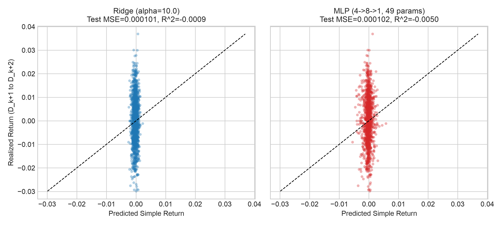
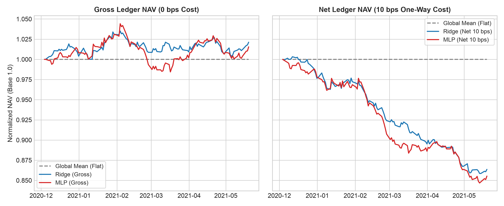
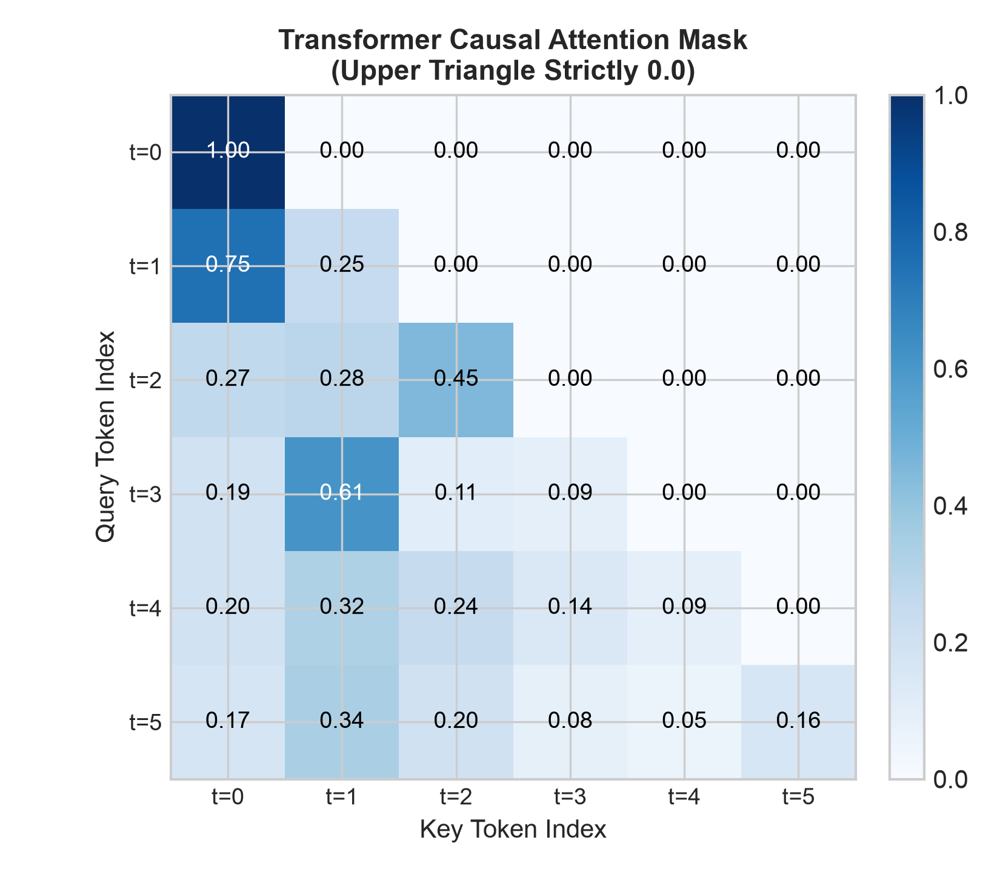

# Chapter 42: Deep Learning Foundations and Quantitative Applications

> Author: Yuxiao Ma. This chapter uses frozen constructed results; no training was repeated. Main thread: The essence of a network architecture is a structural inductive bias on function space. In low-signal-to-noise financial time series, adding parameters does not automatically create a trading advantage. Strict boundary purging and a trading ledger with explicit fee assumptions are central to evaluating whether a complex deep model is useful.
> Prerequisites: the chain rule in [Chapter 4](../../../../part01/chapter04/plan.md); matrix dimensions in [Chapter 5](../../../../part01/chapter05/plan.md); Ridge regression in [Chapter 8](../../../../part01/chapter08/plan.md) and [Chapter 39](../../../../part07/chapter39/plan.md); the execution ledger in [Chapter 29](../../../../part05/chapter29/plan.md); time-causal validation in [Chapter 31](../../../../part05/chapter31/plan.md) and [Chapter 38](../../../../part07/chapter38/plan.md); and early stopping in [Chapter 40](../../../../part07/chapter40/plan.md). By the end, you should be able to calculate and implement MLP forward and backward propagation in pure NumPy; implement CNN local cross-correlation, RNN state recursion and gradient products, the modern LSTM constant-error carousel and Transformer strict causal masking; check the time boundaries for features, labels, and preprocessing before comparing models; and evaluate the performance of constructed signals under assumed fees.

---

## 1. Learning Objectives

After completing this chapter, readers should be able to:

1. **Compute**:
   - Given an input vector and weight matrices, calculate by hand the forward-pass output and intermediate activations of a multilayer perceptron (MLP) using matrix algebra;
   - Derive the analytical gradients of a mean squared error loss with $L_2$ regularization with respect to every layer's weights and biases, using the multivariate chain rule, and check the numerical gradients with central differences;
   - Independently calculate 1D convolutional neural network (CNN) valid cross-correlation, simple recurrent neural network (RNN) state recursion and cross-time gradient attenuation products, a modern long short-term memory network (LSTM with a forget gate) one-step gate, candidate, and state updates and its constant error carousel (CEC) direct partial derivative, as well as Transformer sinusoidal positional encoding, scaled dot-product attention, and a strict causal mask.
2. **Explain**:
   - Describe the structural inductive bias built into each deep-learning architecture and the geometric constraints it places on the hypothesis space;
   - Explain how low signal-to-noise ratio (SNR) and a small effective number of independent samples in financial asset-pricing data constrain high-capacity neural networks, and analyze overfitting through the bias-variance decomposition on the training-set distribution for fixed inputs;
   - Explain that a causal attention mask can block look-ahead within a layer but cannot repair label leakage or look-ahead already present in the input features.
3. **Diagnose**:
   - Identify overfitting, vanishing gradients, and numerical overflow during deep-model training;
   - Diagnose test-set contamination in early stopping and ensure that best-epoch restoration is based strictly on an independent validation set;
   - Check for look-ahead leakage in feature standardization and ensure that means and variances are calculated using only mature training data.
4. **Implement**:
   - Write a lightweight MLP trainer and predictor in pure NumPy, supporting mini-batch stochastic gradient descent (SGD), weight decay, and validation-set early stopping;
   - Build a panel-data pipeline that follows a strict causal-time contract and purges boundary labels based on their settlement times;
   - Connect the model to a standard quantitative execution ledger and evaluate gross and net portfolio performance with one-way costs of 0 and 10 bps and an execution lag.

---

## 2. Why Quant Needs It

Across the life cycle of quantitative investment and research, researchers often explore moving from traditional linear factor models, such as Fama-French multifactor models or elastic-net regression, to complex nonlinear models. In quantitative finance, however, directly applying deep-learning paradigms from computer vision (CV) or natural language processing (NLP) often presents serious challenges:

1. **Structural inductive bias and overfitting**: A fully connected neural network (MLP), as a universal function approximator, has very high expressive capacity. Yet single-period returns in cross-sectional prediction usually have a low signal-to-noise ratio; much of their variation comes from unpredictable market microstructure disturbances or idiosyncratic shocks. Fitting dozens or even thousands of parameters directly to limited historical data makes a network prone to mistaking in-sample random noise for a pattern, which can push test-set $R^2$ down or even below zero.
2. **Prior structural constraints in specific architectures**: To curb the growth of degrees of freedom, modern deep learning uses architecture-specific inductive biases:
   - **CNNs** impose a prior of local-pattern translation equivariance through local connectivity and weight sharing;
   - **RNNs/LSTMs** impose a prior of Markov-style hidden-state evolution and controllable memory decay through autoregressive state transitions and gating;
   - **Transformers** use self-attention to overcome limits imposed by temporal distance and strict causal masking to prevent future information from flowing into the past.
   Quantitative researchers need to understand why these architectures were introduced, which structural assumptions each one makes, and when those assumptions are appropriate for financial time series.
3. **Strict time contracts and false excess-return traps**: Deep-model training can introduce look-ahead leakage inadvertently. Examples include failing to purge boundary samples for multi-period return labels, standardizing on the full sample, or assuming that a Transformer's causal attention mask automatically corrects future information in input features. High-complexity deep models can also produce sharply fluctuating cross-sectional predictions, resulting in very high rebalancing turnover. Gross Sharpe before fees may fall substantially once it is run through a real execution ledger with trading frictions.

This chapter explains the main operators through mathematical derivations and pure NumPy implementations, then compares the mean, Ridge, and a small MLP in a constructed low-SNR experiment with a fixed time split. The results describe the prediction and fee trade-off in this experiment; they cannot be extrapolated to real-market performance.

---

## 3. Intuition

### 3.1 Linear Models vs. Neural Networks: A Straightedge and Multidimensional Modeling Clay

A linear model such as OLS or Ridge is like a rigid wooden ruler: it can fit only a straight cross-sectional line between features and returns. If the true economic mechanism includes a nonlinear threshold effect—for example, momentum is strong when volatility is very low but decays sharply once volatility exceeds a threshold—the linear ruler cannot represent that bend.

An MLP is like a lump of multidimensional modeling clay. Each hidden-layer neuron represents an affine transformation with a bias, followed by a bend from a nonlinear activation such as hyperbolic tangent $\tanh$ or a rectified linear unit (ReLU). Composing the mappings across layers lets the network fold and partition feature space into complex nonlinear decision manifolds. But the more pliable the clay, the more easily random ripples on the water (noise) can pull it off course. In a low-SNR environment, weight decay ($L_2$ regularization) and early stopping add “stiffness” to the clay and help keep it from fitting in-sample noise too closely.

### 3.2 Why Specialized Structures Are Needed: Intuition for CNNs, RNNs, and Transformers

Flattening the past $T$ days of prices into one vector and passing it directly to a fully connected network (MLP) has important shortcomings when modeling asset-price time series:

1. **Parameter growth and disregard for temporal locality**: A fully connected network gives the relationship between day $t-1$ and day $t$ the same degrees of freedom as the relationship between day $t-100$ and day $t$. It ignores local translation structure in time series. The intuition behind a **CNN** is to slide a fixed-size small window (a convolution kernel) along the time axis to extract local patterns such as “short-cycle momentum” or “difference-based reversal,” reusing the same kernel weights at every historical time.
2. **Remembering and forgetting long histories**: Financial states, such as volatility regimes, often have time-varying dependencies. The intuition behind an **RNN** is to maintain a “memory carrier,” the hidden state $h_t$, and update it by mixing old memory with new input each day. Multiplying state Jacobians in a standard RNN can cause gradients to decay or explode exponentially during backpropagation. The intuition behind an **LSTM** is to introduce an additive channel controlled by gates—the “constant error carousel” (CEC)—so important information can pass across longer intervals when the forget gate is open.
3. **Global view and causal masking**: Although an LSTM mitigates vanishing gradients, its step-by-step temporal recursion limits direct associations across long time spans. The intuition behind a **Transformer** is to discard recurrence and directly calculate the association between any two days using Query-Key dot-product similarity. But quantitative prediction has a strict time constraint: **today cannot read tomorrow's information**. For this chapter’s task, which predicts at each historical position using information available at that position, a Transformer therefore applies a strict causal mask to the upper triangle of the attention matrix ($\mathbf{M}_{i,j}=-\infty$ when $j>i$), ensuring that each position attends only to itself and the past. If the entire input window is available before one common forecast cutoff and only its final representation predicts a target after that cutoff, bidirectional encoding within the window does not automatically leak future information. Availability times, training/label boundaries, and preprocessing must still be checked.

---

## 4. Mathematical Foundations

### 4.1 Notation and Tensor-Dimension Contract

Before deriving the network, define each mathematical symbol and tensor dimension precisely. Let the batch contain $B$ samples:

- Input feature matrix $\mathbf{X} \in \mathbb{R}^{B \times D_{\mathrm{in}}}$: each row is one sample (an asset's feature vector on a particular date), and each column is one input feature;
- Target-label matrix $\mathbf{Y} \in \mathbb{R}^{B \times D_{\mathrm{out}}}$: for a single-target return forecast, $D_{\mathrm{out}}=1$;
- First-layer weight matrix $\mathbf{W}_1 \in \mathbb{R}^{D_{\mathrm{in}} \times D_{\mathrm{hidden}}}$ and bias row vector $\mathbf{b}_1 \in \mathbb{R}^{1 \times D_{\mathrm{hidden}}}$;
- Hidden-layer pre-activation $\mathbf{Z}_1 \in \mathbb{R}^{B \times D_{\mathrm{hidden}}}$ and activation output $\mathbf{A}_1 \in \mathbb{R}^{B \times D_{\mathrm{hidden}}}$;
- Second-layer weight matrix $\mathbf{W}_2 \in \mathbb{R}^{D_{\mathrm{hidden}} \times D_{\mathrm{out}}}$ and bias row vector $\mathbf{b}_2 \in \mathbb{R}^{1 \times D_{\mathrm{out}}}$;
- Final network prediction $\hat{\mathbf{Y}} \in \mathbb{R}^{B \times D_{\mathrm{out}}}$.

### 4.2 Matrix Differentiation and Elementwise Operations

1. **Hadamard product (elementwise product)**: Denoted by $\odot$. For $\mathbf{A},\mathbf{B} \in \mathbb{R}^{M \times N}$, $(\mathbf{A} \odot \mathbf{B})_{i,j}=A_{i,j}B_{i,j}$.
2. **Frobenius norm**: The squared Frobenius norm of matrix $\mathbf{W}$ is the sum of the squares of its entries: $\|\mathbf{W}\|_F^2=\operatorname{tr}(\mathbf{W}^\top\mathbf{W})=\sum_{i,j}W_{i,j}^2$.
3. **Hyperbolic tangent and its derivative**:
   $$\tanh(z)=\frac{e^z-e^{-z}}{e^z+e^{-z}}=\frac{1-e^{-2z}}{1+e^{-2z}}$$
   Its first derivative satisfies the analytic identity:
   $$\frac{d\tanh(z)}{dz}=1-\tanh^2(z)$$
4. **Logistic sigmoid and its derivative**:
   $$\sigma(z)=\frac{1}{1+e^{-z}}$$
   Its first derivative is:
   $$\frac{d\sigma(z)}{dz}=\sigma(z)(1-\sigma(z))$$

---

## 5. Formal Definitions

### 5.1 Multilayer Perceptron (MLP)

Define the mathematical mapping of a single-hidden-layer regression MLP, $f: \mathbb{R}^{B \times D_{\mathrm{in}}} \to \mathbb{R}^{B \times D_{\mathrm{out}}}$, as follows:
$$\mathbf{Z}_1=\mathbf{X}\mathbf{W}_1+\mathbf{b}_1$$
$$\mathbf{A}_1=\phi(\mathbf{Z}_1)$$
$$\hat{\mathbf{Y}}=\mathbf{A}_1\mathbf{W}_2+\mathbf{b}_2$$
Here, $\phi(\cdot)$ is a nonlinear activation function; this chapter uses the hyperbolic tangent $\tanh$. In matrix addition, the bias vector is broadcast to every row.

### 5.2 Regularized Objective (MSE + L2 Regularization)

Given target labels $\mathbf{Y}$ and regularization strength $\lambda\ge 0$, define the batch loss as the sum of normalized mean squared error (MSE) and Frobenius-norm penalties on the weight matrices in all layers:
$$\mathcal{L}(\mathbf{W}_1,\mathbf{b}_1,\mathbf{W}_2,\mathbf{b}_2)=\frac{1}{B\cdot D_{\mathrm{out}}}\|\hat{\mathbf{Y}}-\mathbf{Y}\|_F^2+\lambda\left(\|\mathbf{W}_1\|_F^2+\|\mathbf{W}_2\|_F^2\right)$$
*Design notes*:

1. The MSE term is normalized by $\frac{1}{B\cdot D_{\mathrm{out}}}$ so the scalar loss remains on a consistent scale across different numbers of output dimensions (when $D_{\mathrm{out}}=1$, this is exactly equivalent to $\frac{1}{B}$).
2. This chapter does not apply an $L_2$ penalty to the bias vectors $\mathbf{b}_1,\mathbf{b}_2$, to avoid directly pulling the baseline output toward zero. This is a modeling choice; other tasks may penalize biases. Biases also affect local derivatives by changing activation locations.

### 5.3 One-Dimensional CNN Valid Cross-Correlation

Let the input $\mathbf{x}$ be a vector of length $N$ and the filter $\mathbf{w}$ be a vector of length $K$, with $N\ge K$:
$$\mathbf{x}=[x_0,\ldots,x_{N-1}]^\top,\qquad\mathbf{w}=[w_0,\ldots,w_{K-1}]^\top.$$
In valid mode (without edge padding), the one-dimensional cross-correlation operator produces a feature map $\mathbf{y}=\mathbf{x}\star\mathbf{w}$ of length $N-K+1$:
$$y_i=(\mathbf{x}\star\mathbf{w})_i=\sum_{j=0}^{K-1}x_{i+j}w_j,\quad \forall i\in\{0,1,\dots,N-K\}$$
*Translation equivariance*:
If a time shift is applied to the input sequence, $T_\tau(\mathbf{x})_t=x_{t-\tau}$, cross-correlation satisfies $(T_\tau(\mathbf{x})\star\mathbf{w})_i=(\mathbf{x}\star\mathbf{w})_{i-\tau}$; in other words, the operation commutes with translation: $f(g(x))=g(f(x))$. The convolution operation itself provides **translation equivariance**, not translation invariance. The stated relation holds for an infinite sequence or under a consistent boundary definition; a finite valid window satisfies it only at common valid positions, and stride and padding also affect the result. Global pooling can provide invariance when translation only reorders the same set of features; after cropping or edge changes, the result still needs to be checked.

### 5.4 Recurrent Neural Networks and Modern Long Short-Term Memory (RNN & Modern LSTM)

1. **Simple recurrent neural network (Simple RNN)**:
   $$h_t=\tanh(w_hh_{t-1}+w_xx_t+b)$$
2. **Modern long short-term memory with a forget gate (Modern LSTM with Forget Gate, Gers et al. 2000)**:
   For input $x_t\in\mathbb{R}^{D_{\mathrm{in}}}$, previous hidden state $h_{t-1}\in\mathbb{R}^{D_h}$, and previous cell state $c_{t-1}\in\mathbb{R}^{D_h}$ at time $t$:
   $$\mathbf{f}_t=\sigma(\mathbf{W}_f x_t+\mathbf{U}_f h_{t-1}+\mathbf{b}_f)\quad\text{(forget gate)}$$
   $$\mathbf{i}_t=\sigma(\mathbf{W}_i x_t+\mathbf{U}_i h_{t-1}+\mathbf{b}_i)\quad\text{(input gate)}$$
   $$\tilde{\mathbf{c}}_t=\tanh(\mathbf{W}_c x_t+\mathbf{U}_c h_{t-1}+\mathbf{b}_c)\quad\text{(candidate cell state)}$$
   $$\mathbf{c}_t=\mathbf{f}_t\odot\mathbf{c}_{t-1}+\mathbf{i}_t\odot\tilde{\mathbf{c}}_t\quad\text{(cell-state update)}$$
   $$\mathbf{o}_t=\sigma(\mathbf{W}_o x_t+\mathbf{U}_o h_{t-1}+\mathbf{b}_o)\quad\text{(output gate)}$$
   $$\mathbf{h}_t=\mathbf{o}_t\odot\tanh(\mathbf{c}_t)\quad\text{(hidden-state output)}$$

The main text writes LSTM states as column vectors: $\mathbf{W}_g\in\mathbb{R}^{D_h\times D_{\mathrm{in}}}$ and $\mathbf{U}_g\in\mathbb{R}^{D_h\times D_h}$. The code uses batch row vectors $x@W_g+h@U_g$, so its code weights are the transposes of the mathematical weights shown here; the two conventions agree in the scalar worked example. The six equations follow PyTorch's official modern LSTM equations; the Gers paper is cited only for the historical origin of the forget gate.

### 5.5 Transformer Sinusoidal Positional Encoding and Strict Causal Attention (PE & Causal Attention)
The triangular mask here serves per-position real-time prediction. A final-position forecast from a window already known at one cutoff may use another encoding structure, provided it respects that task’s information set.

1. **Sinusoidal positional encoding (Vaswani et al. 2017)**:
   For position $pos\in\{0,1,\dots,T-1\}$ and channel indices $2i,2i+1\in\{0,1,\dots,d-1\}$:
   $$\mathrm{PE}_{(pos,2i)}=\sin\left(\frac{pos}{10000^{2i/d}}\right)$$
   $$\mathrm{PE}_{(pos,2i+1)}=\cos\left(\frac{pos}{10000^{2i/d}}\right)$$
2. **Causal scaled dot-product attention**:
   Let the sequence length be $T$, with feature projection matrices $\mathbf{Q},\mathbf{K}\in\mathbb{R}^{T\times d_k}$ and $\mathbf{V}\in\mathbb{R}^{T\times d_v}$ (requiring $d_k>0$, $d_v>0$, and $T>0$). The attention output is:
   $$\mathrm{Attention}(\mathbf{Q},\mathbf{K},\mathbf{V})=\operatorname{softmax}\left(\frac{\mathbf{Q}\mathbf{K}^\top}{\sqrt{d_k}}+\mathbf{M}\right)\mathbf{V}$$
   The causal-mask matrix $\mathbf{M}\in\mathbb{R}^{T\times T}$ is defined by:
   $$\mathbf{M}_{i,j}=\begin{cases}0,&j\le i\\-\infty,&j>i\end{cases}$$
   The upper triangle is set strictly to $-\infty$, so after softmax normalization the upper-triangular attention weights are exactly zero in numerical computation.

---

## 6. Derivations

### 6.1 Full Matrix Chain-Rule Derivation of MLP Backpropagation Gradients

This section derives, without skipped steps, the partial derivatives of the scalar loss $\mathcal{L}$ with respect to every parameter.

**Step 1: Differentiate the loss with respect to the final predictions $\hat{\mathbf{Y}}$.**
Expand the loss function:
$$\mathcal{L}=\frac{1}{B\cdot D_{\mathrm{out}}}\sum_{i=1}^B\sum_{k=1}^{D_{\mathrm{out}}}(\hat{Y}_{i,k}-Y_{i,k})^2+\lambda\left(\|\mathbf{W}_1\|_F^2+\|\mathbf{W}_2\|_F^2\right)$$
Differentiate with respect to matrix element $\hat{Y}_{i,k}$:
$$\frac{\partial\mathcal{L}}{\partial\hat{Y}_{i,k}}=\frac{2}{B\cdot D_{\mathrm{out}}}(\hat{Y}_{i,k}-Y_{i,k})$$
In matrix form, define the output error term $\boldsymbol{\delta}_2\in\mathbb{R}^{B\times D_{\mathrm{out}}}$:
$$\boldsymbol{\delta}_2=\frac{\partial\mathcal{L}}{\partial\hat{\mathbf{Y}}}=\frac{2}{B\cdot D_{\mathrm{out}}}(\hat{\mathbf{Y}}-\mathbf{Y})$$

**Step 2: Differentiate with respect to second-layer parameters $\mathbf{W}_2$ and $\mathbf{b}_2$.**
By the chain rule, $\hat{\mathbf{Y}}=\mathbf{A}_1\mathbf{W}_2+\mathbf{b}_2$. For weight entry $W_{2,j,k}$:
$$\frac{\partial\mathcal{L}}{\partial W_{2,j,k}}=\sum_{i=1}^B\frac{\partial\mathcal{L}}{\partial\hat{Y}_{i,k}}\frac{\partial\hat{Y}_{i,k}}{\partial W_{2,j,k}}+2\lambda W_{2,j,k}=\sum_{i=1}^B A_{1,i,j}\delta_{2,i,k}+2\lambda W_{2,j,k}$$
The sum on the right is the matrix product $(\mathbf{A}_1^\top\boldsymbol{\delta}_2)_{j,k}$. Therefore, the full matrix gradient is:
$$\frac{\partial\mathcal{L}}{\partial\mathbf{W}_2}=\mathbf{A}_1^\top\boldsymbol{\delta}_2+2\lambda\mathbf{W}_2\in\mathbb{R}^{D_{\mathrm{hidden}}\times D_{\mathrm{out}}}$$
For the bias term $\mathbf{b}_2\in\mathbb{R}^{1\times D_{\mathrm{out}}}$, the derivative of the bias for each sample is 1:
$$\frac{\partial\mathcal{L}}{\partial b_{2,k}}=\sum_{i=1}^B\delta_{2,i,k}\implies\frac{\partial\mathcal{L}}{\partial\mathbf{b}_2}=\mathbf{1}_{1\times B}\boldsymbol{\delta}_2\in\mathbb{R}^{1\times D_{\mathrm{out}}}$$

**Step 3: Backpropagate the error to hidden-layer activations $\mathbf{A}_1$.**
Differentiate with respect to hidden activation entry $A_{1,i,j}$:
$$\frac{\partial\mathcal{L}}{\partial A_{1,i,j}}=\sum_{k=1}^{D_{\mathrm{out}}}\frac{\partial\mathcal{L}}{\partial\hat{Y}_{i,k}}\frac{\partial\hat{Y}_{i,k}}{\partial A_{1,i,j}}=\sum_{k=1}^{D_{\mathrm{out}}}\delta_{2,i,k}W_{2,j,k}$$
The sum on the right corresponds to matrix product $(\boldsymbol{\delta}_2\mathbf{W}_2^\top)_{i,j}$. Thus:
$$\frac{\partial\mathcal{L}}{\partial\mathbf{A}_1}=\boldsymbol{\delta}_2\mathbf{W}_2^\top\in\mathbb{R}^{B\times D_{\mathrm{hidden}}}$$

**Step 4: Differentiate with respect to hidden-layer pre-activations $\mathbf{Z}_1$.**
Because the activation $\mathbf{A}_1=\tanh(\mathbf{Z}_1)$ is applied elementwise, use the scalar derivative identity $\tanh'(z)=1-\tanh^2(z)$:
$$\frac{\partial\mathcal{L}}{\partial Z_{1,i,j}}=\frac{\partial\mathcal{L}}{\partial A_{1,i,j}}\cdot\tanh'(Z_{1,i,j})=(\boldsymbol{\delta}_2\mathbf{W}_2^\top)_{i,j}\cdot(1-A_{1,i,j}^2)$$
Write this as a Hadamard product and define the hidden-layer local error $\boldsymbol{\delta}_1\in\mathbb{R}^{B\times D_{\mathrm{hidden}}}$:
$$\boldsymbol{\delta}_1=\frac{\partial\mathcal{L}}{\partial\mathbf{Z}_1}=(\boldsymbol{\delta}_2\mathbf{W}_2^\top)\odot(1-\mathbf{A}_1^2)$$

**Step 5: Differentiate with respect to first-layer parameters $\mathbf{W}_1$ and $\mathbf{b}_1$.**
Since $\mathbf{Z}_1=\mathbf{X}\mathbf{W}_1+\mathbf{b}_1$, the derivation is the same as in Step 2:
$$\frac{\partial\mathcal{L}}{\partial W_{1,m,j}}=\sum_{i=1}^B X_{i,m}\delta_{1,i,j}+2\lambda W_{1,m,j}\implies\frac{\partial\mathcal{L}}{\partial\mathbf{W}_1}=\mathbf{X}^\top\boldsymbol{\delta}_1+2\lambda\mathbf{W}_1\in\mathbb{R}^{D_{\mathrm{in}}\times D_{\mathrm{hidden}}}$$
$$\frac{\partial\mathcal{L}}{\partial\mathbf{b}_1}=\mathbf{1}_{1\times B}\boldsymbol{\delta}_1\in\mathbb{R}^{1\times D_{\mathrm{hidden}}}$$

**Step 6: Equivalence of $L_2$ regularization and weight decay under ordinary SGD.**
Under a standard SGD optimizer, the weight update is:
$$\mathbf{W}^{(t+1)}=\mathbf{W}^{(t)}-\eta\frac{\partial\mathcal{L}}{\partial\mathbf{W}}=\mathbf{W}^{(t)}-\eta\left(\nabla_{\mathbf{W}}\mathcal{L}_{\mathrm{MSE}}+2\lambda\mathbf{W}^{(t)}\right)=(1-2\eta\lambda)\mathbf{W}^{(t)}-\eta\nabla_{\mathbf{W}}\mathcal{L}_{\mathrm{MSE}}$$
The factor $(1-2\eta\lambda)$ reduces parameter magnitude. The algebraic identity does not itself require an inequality. For the decay factor to be positive and less than 1, however, we need $0<2\eta\lambda<1$. Note that this strict equivalence holds only for ordinary SGD. With momentum or adaptive learning rates such as Adam, the $L_2$ regularization gradient is altered by smoothed gradient history and differs substantially from decoupled weight decay (AdamW).

---

### 6.2 Simple RNN State Recursion and Gradient-Product Attenuation

Consider the scalar Simple RNN state equation $h_t=\phi(w_hh_{t-1}+w_xx_t+b)$. The partial derivative of the loss at time $T$ with respect to an earlier hidden state $h_{T-k}$ is:
$$\frac{\partial\mathcal{L}_T}{\partial h_{T-k}}=\frac{\partial\mathcal{L}_T}{\partial h_T}\prod_{j=T-k+1}^{T}\frac{\partial h_j}{\partial h_{j-1}}$$
The one-step Jacobian is:
$$\frac{\partial h_j}{\partial h_{j-1}}=w_h\cdot\phi'(w_hh_{j-1}+w_xx_j+b)$$
If we use the linear activation $\phi(z)=z$, then $\frac{\partial h_j}{\partial h_{j-1}}=w_h$ and the gradient transfer factor reduces to a geometric sequence:
$$\frac{\partial h_T}{\partial h_{T-k}}=(w_h)^k$$

- If $|w_h|<1$ (for example, $w_h=0.5$), then across $k=10$ steps the attenuation factor is $0.5^{10}\approx9.76\times10^{-4}$, and the gradient of early input information approaches 0 during backpropagation (vanishing gradients).
- If $|w_h|>1$, the product grows exponentially and can lead to exploding gradients.

### 6.3 Deriving the Modern LSTM Constant Error Carousel (CEC) Partial Derivative

Consider the modern LSTM cell-state transition:
$$c_t=f_t\odot c_{t-1}+i_t\odot\tilde{c}_t$$
Fix the gates and candidate state, and analyze the partial derivative along the direct linear path of cell memory. The Jacobian of the vector state is a diagonal matrix:
$$\left.\frac{\partial\mathbf{c}_t}{\partial\mathbf{c}_{t-1}}\right|_{\text{fixed gates}}=\operatorname{diag}(\mathbf{f}_t).$$
The direct partial derivative of coordinate $r$ is $f_{t,r}$; across $k$ steps, the direct Jacobian is
$$\left.\frac{\partial\mathbf{c}_T}{\partial\mathbf{c}_{T-k}}\right|_{\text{fixed gates}}=\operatorname{diag}\left(\bigodot_{j=T-k+1}^{T}\mathbf{f}_j\right).$$
Only in the scalar case can this be abbreviated as $\partial c_t/\partial c_{t-1}=f_t$, with the multi-step product $\prod_{j=T-k+1}^{T}f_j$.
If the forget gate is saturated in its open state ($f_j\approx1$), the error can travel across a longer sequence through the additive channel. This is called the **constant error carousel (CEC)**.
*Boundary note*: the total derivative also includes nonlinear gate-dependent paths through $h_{t-1}$ (such as $\frac{\partial f_t}{\partial h_{t-1}}$ and $\frac{\partial i_t}{\partial h_{t-1}}$). When the network is deep or the forget gate is not saturated, gradients can still decay or oscillate. We cannot claim that an LSTM “eliminates all gradient problems.”

### 6.4 Complete Workflow for Batches, One Optimization Step, and Early Stopping

One sample is a row of features and a mature label for one asset on one signal date; a mini-batch is a set of training rows selected for the current gradient step. One epoch passes through every training row. In this example, 2,136 rows are divided into batches of 32, giving 67 updates per epoch and a final batch of 24 rows; the loss is still divided by the actual number of rows in that batch. Rows are shuffled only within the 178 mature training dates, never across validation or test. This computational arrangement does not imply that real financial samples are independent.

Let the parameter set be $\theta=(W_1,b_1,W_2,b_2)$ and let $L_{\mathcal B}$ be the average data loss for batch $\mathcal B$. At each step, first calculate the forward pass, then calculate the full-parameter gradients from §6.1 and update $\theta\leftarrow\theta-\eta\nabla_\theta(L_{\mathcal B}+\lambda\sum W^2)$; the penalty applies only to weights. Full-batch gradient descent uses all training rows. Stochastic gradient descent (SGD) often refers to a one-row or mini-batch estimate. Mini-batch noise, computational cost, and stability all need to be considered together; a lower training loss does not imply better future predictions.

For example, §8.1 uses a learning rate of $\eta=0.01$: $W_{1,00}$ changes from 0.2 to $0.2-0.01(0.019587)=0.19980413$; $b_2$ changes from 0.05 to $0.05-0.01(0.063251)=0.04936749$. This hand calculation uses $\lambda=0.01$; the main experiment remains frozen at 0.001. Do not mix them.

```text
Initialize weights; best_loss=+∞; bad_epochs=0; best_weights not yet set
For epoch=0,...,199:
    Shuffle training rows only; calculate MSE+L2 gradients in batches and update all parameters
    Calculate unpenalized MSE on the full validation set; reject non-finite results
    If val_mse < best_loss: copy all weights and biases, update best_epoch, set bad_epochs=0
    Otherwise increment bad_epochs; stop if bad_epochs>=15
Return a copy of best_weights, not the current parameters at stopping
Only after model selection is complete, predict from test features and evaluate in the original return units
```

The main experiment uses zero-based epoch indices: best_epoch=5 is the sixth pass, and stopped_epoch=20 means 21 passes were actually completed. Early stopping counts “15 consecutive epochs without a new low”; it does not require validation error to rise strictly each epoch. Validation-error fluctuations can also trigger stopping. The training API accepts only training and validation arrays, but the caller still has to ensure that test arrays were not passed under another name; a parameter name cannot prove that the whole study is leakage-free.

---

## 7. Financial Interpretation

### 7.1 Why Financial Time-Series SNR Constrains Model Complexity

In computer vision or speech recognition, inputs contain rich local redundancy and high SNR. In secondary-market asset pricing:

1. **Signal-to-noise characteristics**: Researchers should test whether the predictive signal is strong relative to noise. This chapter deliberately constructs a weak-signal, relatively high-noise case; it does not establish a universal SNR for all markets or frequencies.
2. **Limits on the effective number of independent samples**: Although high-frequency tick data are densely recorded, daily or weekly cross-sectional prediction provides only about 250 trading days a year. Ten years of history still gives only about 2,500 broad market cross-sections. A nonlinear network with many parameters can mistake in-sample noise for signal.
3. **Bias-variance trade-off**:
   For fixed input $x$, the generalization error averaged over the training-set distribution $\mathcal{D}$ decomposes as:
   $$\mathbb{E}_{\mathcal{D},\epsilon}[(\hat{y}(x)-y)^2]=\operatorname{Bias}^2(\hat{y}(x))+\operatorname{Var}_{\mathcal{D}}(\hat{y}(x))+\sigma_\epsilon^2$$
   Let $y=f_*(x)+\epsilon$, where new-observation noise is independent of the training set, has conditional mean 0, and conditional variance $\sigma_\epsilon^2(x)$. The left side must take expectations over both the training set and the new-observation noise. Write $\hat y-f_*$ as $\hat y-\mathbb{E}_{\mathcal D}[\hat y]+\mathbb{E}_{\mathcal D}[\hat y]-f_*$; the cross term has expectation 0, giving the decomposition above. Increasing capacity may reduce approximation bias, but it may also change estimation variance. There is no general monotonic theorem connecting parameter count and variance; regularization, the training algorithm, and the data distribution also matter.

### 7.2 The Cost of Trading Frictions for High-Turnover Signals

A nonlinear model may be sensitive to small input perturbations, causing the cross-sectional rank of daily predictions to change frequently:

- Frequent changes can result in high rebalancing frequency. If annualized turnover reaches 350+ times;
- Under a one-way trading-cost assumption of 10 bps (0.001), the annualized cost is on the order of:
  $$\text{Annual Fee Drag}\approx\text{Turnover}\times\text{Fee Rate}\approx360\times0.001=36.0\%$$
- This cost drag can substantially erode gross excess returns before fees and turn net Sharpe deeply negative. In actual investing, capital dynamics must be tracked in a daily execution ledger; static linear deductions cannot substitute for actual net returns.

---

## 8. Numerical Example

This section gives small examples that can be recalculated by hand, covering MLP forward and backward propagation, CNN cross-correlation, RNN state recursion, LSTM one-step gating, sinusoidal positional encoding, and Transformer causal attention.

### 8.1 Hand Calculation of Forward and Backward Propagation for a 2→2→1 MLP

Take input feature vector $x=[0.5,-0.2]$, target $y=[0.1]$ ($B=1$, $D_{\mathrm{out}}=1$).
Set the network hyperparameters to:
$$\mathbf{W}_1=\begin{pmatrix}0.2&-0.1\\0.4&0.3\end{pmatrix},\quad\mathbf{b}_1=[0.1,0.0]$$
$$\mathbf{W}_2=\begin{pmatrix}0.5\\-0.2\end{pmatrix},\quad\mathbf{b}_2=[0.05],\quad\lambda=0.01$$

**Step 1: Forward propagation**

1. Hidden-layer pre-activation:
   $$\mathbf{z}_1=x\mathbf{W}_1+\mathbf{b}_1=[0.5(0.2)+(-0.2)(0.4)+0.1,\;0.5(-0.1)+(-0.2)(0.3)+0.0]=[0.12,-0.11]$$
2. Activations (hyperbolic tangent):
   $$a_{1,1}=\tanh(0.12)\approx0.119427,\quad a_{1,2}=\tanh(-0.11)\approx-0.109559$$
3. Output-layer calculation:
   $$\hat y=a_{1,1}(0.5)+a_{1,2}(-0.2)+0.05=0.119427(0.5)+(-0.109559)(-0.2)+0.05\approx0.131625$$
4. Loss calculation:
   $$\operatorname{MSE}=\frac{1}{1\times1}(\hat y-y)^2=(0.131625-0.1)^2=(0.031625)^2\approx0.00100014$$
   $$L_2\text{ penalty}=0.01\times\left((0.2^2+(-0.1)^2+0.4^2+0.3^2)+(0.5^2+(-0.2)^2)\right)=0.01\times(0.30+0.29)=0.0059$$
   $$\mathcal{L}\approx0.00100014+0.005900=0.00690014$$

**Step 2: Backpropagation gradients**

1. Output error: $\delta_2=\frac{2}{1\times1}(\hat y-y)=2\times0.031625=0.063251$.
2. Second-layer gradients:
   $$\frac{\partial\mathcal{L}}{\partial\mathbf{W}_2}=\mathbf{a}_1^\top\delta_2+2\lambda\mathbf{W}_2=\begin{pmatrix}0.119427\\-0.109559\end{pmatrix}(0.063251)+0.02\begin{pmatrix}0.5\\-0.2\end{pmatrix}=\begin{pmatrix}0.017554\\-0.010930\end{pmatrix}$$
   $$\frac{\partial\mathcal{L}}{\partial b_2}=\delta_2=0.063251$$
3. Hidden-layer local error:
   $$\boldsymbol{\delta}_1=(\delta_2\mathbf{W}_2^\top)\odot(1-\mathbf{a}_1^2)=[0.063251\times0.5,\;0.063251\times(-0.2)]\odot[1-0.119427^2,\;1-(-0.109559)^2]$$
   $$=[0.031625,-0.012650]\odot[0.985737,0.987997]=[0.031174,-0.012498]$$
4. First-layer gradients:
   $$\frac{\partial\mathcal{L}}{\partial\mathbf{W}_1}=x^\top\boldsymbol{\delta}_1+2\lambda\mathbf{W}_1=\begin{pmatrix}0.5\\-0.2\end{pmatrix}\begin{pmatrix}0.031174&-0.012498\end{pmatrix}+0.02\begin{pmatrix}0.2&-0.1\\0.4&0.3\end{pmatrix}$$
   $$=\begin{pmatrix}0.019587&-0.008249\\0.001765&0.008500\end{pmatrix}$$
   $$\frac{\partial\mathcal{L}}{\partial\mathbf{b}_1}=\boldsymbol{\delta}_1=[0.031174,-0.012498]$$

The analytical derivatives match the central-difference numerical check in `tests/test_deep_learning.py` to a precision of $10^{-10}$.

---

### 8.2 Hand Calculation of One-Dimensional CNN Valid Cross-Correlation

Input sequence $x=[1,2,3,4]$ and filter kernel $w=[1,-1]$ (length $K=2$).

- $i=0$: $x[0]w[0]+x[1]w[1]=1(1)+2(-1)=-1$;
- $i=1$: $x[1]w[0]+x[2]w[1]=2(1)+3(-1)=-1$;
- $i=2$: $x[2]w[0]+x[3]w[1]=3(1)+4(-1)=-1$.

The feature map is exactly $[-1,-1,-1]$. This operation extracts the local difference of the first item minus the next; the example does not involve learning a convolution kernel.

---

### 8.3 Hand Calculation of Simple RNN State Recursion

Set the scalar Simple RNN parameters to $w_h=0.5$, $w_x=1.0$, and $b=0.0$, with initial hidden state $h_{-1}=0.0$. Let the input sequence be $x=[1.0,2.0,0.0]$ at $t=0,1,2$ and use the identity activation $\phi(z)=z$:

- $t=0$: $h_0=0.5(0.0)+1.0(1.0)+0.0=1.0$;
- $t=1$: $h_1=0.5(1.0)+1.0(2.0)+0.0=2.5$;
- $t=2$: $h_2=0.5(2.5)+1.0(0.0)+0.0=1.25$.

The state sequence is $[1.0,2.5,1.25]$. Across $k=3$ steps, the gradient transfer factor is $\frac{\partial h_2}{\partial h_{-1}}=(w_h)^3=(0.5)^3=0.125$.

---

### 8.4 Hand Calculation of a Modern LSTM One-Step Gating Example

Consider a scalar one-step LSTM with dimension 1. The input is $x_t=0.5$, previous hidden state $h_{t-1}=0.1$, and previous cell state $c_{t-1}=0.2$. Set all weight matrices to $W=1.0$, $U=0.5$, and all biases to $b=0.0$:

1. Linear pre-activation: $z=Wx_t+Uh_{t-1}+b=1.0(0.5)+0.5(0.1)+0.0=0.55$;
2. Forget gate: $f_t=\sigma(0.55)=\frac{1}{1+e^{-0.55}}\approx0.634135$;
3. Input gate: $i_t=\sigma(0.55)\approx0.634135$;
4. Candidate cell state: $\tilde{c}_t=\tanh(0.55)\approx0.500520$;
5. Cell-state update:
   $$c_t=f_tc_{t-1}+i_t\tilde{c}_t=0.634135(0.2)+0.634135(0.500520)=0.126827+0.317397=0.444224$$
6. Output gate: $o_t=\sigma(0.55)\approx0.634135$;
7. Hidden-state output:
   $$h_t=o_t\tanh(c_t)=0.634135\times\tanh(0.444224)=0.634135\times0.417143\approx0.264523$$

This exactly matches the output of the core `lstm_step` function.

---

### 8.5 Hand Calculation of Sinusoidal Positional Encoding (PE)

Let the sequence length be $T=3$ and dimension $d=4$. The channel scales are $10000^{0/4}=1.0$ and $10000^{2/4}=100.0$.

- **$pos=0$**:
  $\mathrm{PE}_{0,0}=\sin(0)=0.0$; $\mathrm{PE}_{0,1}=\cos(0)=1.0$;
  $\mathrm{PE}_{0,2}=\sin(0)=0.0$; $\mathrm{PE}_{0,3}=\cos(0)=1.0$;
  $\implies\mathrm{PE}[0]=[0.0000,1.0000,0.0000,1.0000]$.
- **$pos=1$**:
  $\mathrm{PE}_{1,0}=\sin(1.0)\approx0.8415$; $\mathrm{PE}_{1,1}=\cos(1.0)\approx0.5403$;
  $\mathrm{PE}_{1,2}=\sin(0.01)\approx0.0100$; $\mathrm{PE}_{1,3}=\cos(0.01)\approx0.9999$;
  $\implies\mathrm{PE}[1]\approx[0.8415,0.5403,0.0100,0.9999]$.
- **$pos=2$**:
  $\mathrm{PE}_{2,0}=\sin(2.0)\approx0.9093$; $\mathrm{PE}_{2,1}=\cos(2.0)\approx-0.4161$;
  $\mathrm{PE}_{2,2}=\sin(0.02)\approx0.0200$; $\mathrm{PE}_{2,3}=\cos(0.02)\approx0.9998$;
  $\implies\mathrm{PE}[2]\approx[0.9093,-0.4161,0.0200,0.9998]$.

---

### 8.6 Hand Calculation of Transformer Causal Attention and Output O for Three Tokens

Let $T=3$, $d_k=2$, and $d_v=2$:
$$\mathbf{Q}=\begin{pmatrix}1&0\\0&1\\1&1\end{pmatrix},\quad\mathbf{K}=\begin{pmatrix}1&1\\1&0\\0&1\end{pmatrix},\quad\mathbf{V}=\begin{pmatrix}1&2\\3&4\\5&6\end{pmatrix}$$

1. Dot-product matrix $\mathbf{Q}\mathbf{K}^\top$:
   $$\mathbf{Q}\mathbf{K}^\top=\begin{pmatrix}1&1&0\\1&0&1\\2&1&1\end{pmatrix}$$
2. Scaled dot-product scores (divide by $\sqrt{2}\approx1.414214$):
   $$\mathbf{S}=\begin{pmatrix}0.7071&0.7071&0.0000\\0.7071&0.0000&0.7071\\1.4142&0.7071&0.7071\end{pmatrix}$$
3. Apply the causal mask (upper triangle set to $-\infty$):
   $$\tilde{\mathbf{S}}=\begin{pmatrix}0.7071&-\infty&-\infty\\0.7071&0.0000&-\infty\\1.4142&0.7071&0.7071\end{pmatrix}$$
4. Calculate the row-wise softmax weight matrix $\mathbf{A}$:
   - Row 0: only the first entry is unmasked, so $\mathbf{A}[0]=[1.0000,0.0000,0.0000]$.
   - Row 1: valid entries are $[0.7071,0.0000]$. Using 0.7071 as the baseline, $\exp(0)=1.0$ and $\exp(-0.7071)\approx0.493069$. The denominator is 1.493069.
     After normalization, $\mathbf{A}[1]\approx[0.669761,0.330239,0.000000]$.
   - Row 2: valid entries are $[1.4142,0.7071,0.7071]$. Using 1.4142 as the baseline, $\exp(0)=1.0$, $\exp(-0.7071)\approx0.493069$, and $\exp(-0.7071)\approx0.493069$. The denominator is 1.986138.
     Divide each of the three valid terms by the denominator:
     $$\mathbf{A}[2]\approx[0.503490,0.248255,0.248255].$$
5. Calculate the final output matrix $\mathbf{O}=\mathbf{A}\mathbf{V}$ using unrounded A. Decimal coefficients below are displayed approximations; round O only at the end:
   - $\mathbf{O}[0]=1.0\times[1,2]=[1.0000,2.0000]$;
   - $\mathbf{O}[1]=0.669761[1,2]+0.330239[3,4]=[0.669761+0.990717,\;1.339522+1.320956]\approx[1.6605,2.6605]$;
   - $\mathbf{O}[2]=0.503490[1,2]+0.248255[3,4]+0.248255[5,6]\approx[2.4895,3.4895]$.

The upper triangle is strictly zero, so future key-value pairs cannot affect historical outputs.

---

## 9. Python Implementation

The NumPy teaching implementation for this chapter is in `src/quant_course/deep_learning.py`. The complete training path is the MLP: `fit_mlp` updates both layers' weights and biases, stops early based on validation-set MSE, and restores the best checkpoint; `predict` then produces predictions for the isolated test set. The matrix backpropagation in §6.1 and the optimization workflow in §6.4 connect in this path.

The remaining architectures are used to isolate mechanisms: `cnn_cross_correlation` performs one-dimensional valid cross-correlation with a fixed kernel and does not train that kernel; `rnn_states` is a scalar linear recursion corresponding to the identity-activation gradient-product toy form in §6.2, while a general nonlinear RNN also includes activation derivatives; `lstm_step` computes the gates, cell state, and hidden state for one cell step and does not train on a sequence; the Transformer code provides sinusoidal positional encoding, masked softmax, and Q/K/V causal-attention operators, not a full Transformer trainer. The hand calculations in §8 check these local operations; they are not end-to-end training comparisons across architectures.

### 9.1 Commands and Runtime Environment
Run these commands from the course source root.

- **Python interpreter**: `.venv/bin/python`
- **Core unit-test command**:
  ```bash
  PYTHONPATH=src .venv/bin/python -m pytest tests/test_deep_learning.py -v
  ```
- **Standalone CLI experiment command**:
  ```bash
  .venv/bin/python code/ch42_deep_learning.py --out build/batches/A8-C/reader/runs/ch42_trial_01
  ```
  *No-overwrite contract*: if the specified `--out` directory already exists, the script raises an error (`FileExistsError`) and refuses to run, keeping historical experiment data immutable.

### 9.2 Fully Self-Contained Core-Interface Example

```python
import numpy as np
from quant_course.deep_learning import (
    forward,
    loss_and_grad,
    fit_mlp,
    predict,
    generate_ch42_panel_data,
    split_ch42_panel,
)

# 1. Generate panel data and split it with time-boundary purging
x, raw_return, close, dates, assets = generate_ch42_panel_data(seed=4201)
splits = split_ch42_panel(x, raw_return, dates, assets)

# 2. Calculate feature and label means and standard deviations on the training set only
mu_X = np.mean(splits.X_train, axis=0)
sigma_X = np.std(splits.X_train, axis=0)
mu_y = float(np.mean(splits.y_train))
sigma_y = float(np.std(splits.y_train))

X_tr_s = (splits.X_train - mu_X) / sigma_X
y_tr_s = (splits.y_train - mu_y) / sigma_y
X_va_s = (splits.X_val - mu_X) / sigma_X
y_va_s = (splits.y_val - mu_y) / sigma_y
X_te_s = (splits.X_test - mu_X) / sigma_X

# 3. Train an MLP and automatically restore the best validation-set early-stopping checkpoint
mlp_res = fit_mlp(
    X_train=X_tr_s,
    y_train=y_tr_s,
    X_val=X_va_s,
    y_val=y_va_s,
    hidden_dim=8,
    lr=0.01,
    batch_size=32,
    l2_reg=0.001,
    max_epochs=200,
    patience=15,
    seed_init=4202,
    seed_shuffle=4203,
)

# 4. Predict and reverse standardization
pred_te_s = predict(X_te_s, mlp_res.W1, mlp_res.b1, mlp_res.W2, mlp_res.b2)
pred_te_real = pred_te_s * sigma_y + mu_y

print(f"MLP trained. Best Epoch: {mlp_res.best_epoch}, Stopped Epoch: {mlp_res.stopped_epoch}")
print(f"Test predictions shape: {pred_te_real.shape}, Mean prediction: {pred_te_real.mean():.6f}")
```

---

## 10. Visualization

The historical frozen CONSTRUCTED teaching CLI experiment produced five figures. This round reuses the original figures, stored under the relative directory `figures/root_r2/`:

### 10.1 Training and Validation Loss Curves with Early Stopping


- **Figure notes**: The x-axis is epoch (0 to 20), and the y-axis is standardized mean squared error (MSE).
- **Observed pattern**: Training MSE (blue) declines overall, with a small rise from index 16 to 17. Validation MSE (orange) reaches its minimum at index 5 (0.9812), then fluctuates without reaching a new low. Patience=15 is exhausted at index 20, after 21 passes were actually completed; the weights from index 5 (the sixth pass) are restored (green dashed line). This observation does not establish that training or validation error must be monotone.

### 10.2 Test-Set Prediction Scatter: Ridge and MLP



- **Figure notes**: The left panel shows the best Ridge regression ($\alpha=10$); the right panel shows the 4→8→1 MLP. The x-axis is predicted return and the y-axis is realized next-day simple return. The black dashed line is the ideal 45-degree fit.
- **Observed pattern**: The constructed labels vary much more widely than the model predictions. Both models' prediction ranges on the horizontal axis are clearly narrower than the realized-return range on the vertical axis, creating a narrow, nearly vertical scatter. This reflects how noise dominates realized returns in a low-SNR setting. The MLP test MSE ($0.00010186$) is slightly worse than Ridge ($0.00010144$), and both test-set $R^2$ values are slightly negative.

### 10.3 Gross and Net Cumulative Portfolio NAV from the Execution Ledger



- **Figure notes**: The left panel assumes zero cost (Gross); the right assumes a one-way cost of 10 bps (Net). The x-axis is ledger settlement date. The signal period is December 3, 2020 through May 17, 2021, with settlement extending to the final label date; the final settlement date is May 19, 2021. The y-axis is normalized portfolio NAV, with initial capital set to 1.0.
- **Observed pattern**: Under the zero-cost assumption, Ridge and MLP earn gross returns of +2.12% and +1.55%, respectively, in this constructed ledger, with gross Sharpe ratios of 0.817 and 0.501. Once the assumed one-way transaction cost of 10 bps is included, annualized turnover of 350+ times from frequent cross-sectional reordering reduces net NAV; Ridge and MLP end at about 0.864 and 0.855, respectively (net returns about -13.64% and -14.47%, net Sharpe ratios -5.47 and -4.69).

### 10.4 Daily Cross-Sectional Spearman IC on the Test Set


- **Figure notes**: The x-axis contains 118 mature test dates, and the y-axis is the Spearman rank correlation (IC) across 12 assets on each date.
- **Observed pattern**: In the frozen 118 daily IC rows, Ridge ranges from $[-0.6853,0.5594]$ and MLP from $[-0.8322,0.8112]$ (summarized directly from the frozen IC columns; predictions and training were not rerun). This shows how volatile cross-sectional return rankings are. Although the MLP mean IC (0.0241) is slightly higher than Ridge (0.0180), with a paired difference of +0.0061, time-series volatility means that this descriptive difference in means is not statistical significance or a net trading advantage.

### 10.5 Heatmap of Strictly Causal Transformer Attention Weights



- **Figure notes**: The x-axis is the key-token time index ($t=0\dots5$), and the y-axis is the query-token time index ($t=0\dots5$).
- **Observed pattern**: The upper-triangular area, where key time is later than query time, is set strictly to 0.00, with values clearly shown in the matrix grid. This gives an engineering illustration that causal masking blocks information from flowing backward in time.

---

## 11. Real-Market Example / Experimental and Methodological Benchmark

Deep learning in asset pricing is widely discussed in academic and industry quantitative literature. This section clearly separates **verified methodological literature** from the **constructed teaching experiment run locally by the author**, to avoid conflation or fabricated data.

### 11.1 Review of Methodological Literature and Scope

1. **Backpropagation and structural bias (Goodfellow et al., 2016, §§6.5/9.2)**:
   - Backpropagation establishes a general computational framework for propagating error gradients layer by layer through local chain rules in composed functions;
   - Through local receptive fields and weight sharing, CNNs substantially reduce effective model degrees of freedom and build translation equivariance for time-series signals into the architecture as a prior.
2. **Recurrent memory and causal constraints on attention (Gers et al., 2000 abstract; PyTorch modern LSTM equations; Vaswani et al., 2017)**:
   - LSTM introduces a constant error carousel (CEC) with a forget gate, creating an additive channel for long-range memory flow;
   - Transformer uses dot-product self-attention to overcome sequence-distance limits and relies on a causal mask to block future information within attention calculations.
3. **No market-data run in this round**:
   No backtest on real secondary-market data was run in this round. All empirical numbers come from the frozen constructed teaching experiment in this chapter (seeds 4201, 4202, and 4203); they must not be extrapolated or described as real-market performance.

### 11.2 Summary of the Constructed Teaching Benchmark

Under the strictly frozen protocol, this chapter uses independent random seed 4201 to generate a synthetic asset panel with a weak nonlinear component ($0.0004x_0+0.0002(x_1^2-1)$) and independent Gaussian noise. The full empirical summary is in the table below:

| Metric | Global training mean | Ridge | 4→8→1 MLP | Teaching and methodological meaning |
|---|---:|---:|---:|---|
| **Parameter count** | 1 (scalar mean from training samples) | 5 (4 weights + 1 bias) | 49 (32 + 8 + 8 + 1) | Model complexity differs by nearly 50× |
| **Test-set MSE** | **0.00010135** | 0.00010144 | 0.00010186 | Mean baseline has the lowest MSE; MLP has the highest |
| **Test-set $R^2$** | 0.000000 | -0.000892 | -0.004977 | MLP and Ridge both have slightly negative out-of-sample $R^2$ |
| **Daily Spearman IC** | NaN (constant; no variance) | 0.0180 | 0.0241 | Paired data are available on all 118 mature test days |
| **Paired IC difference (MLP − Ridge)** | — | baseline | +0.0061 | Slight increase in cross-sectional rank correlation |
| **Gross return (0 bps)** | 0.00% | +2.12% | +1.55% | Gross return before transaction costs |
| **Gross Sharpe (0 bps)** | NaN | 0.817 | 0.501 | Gross performance before costs |
| **Annualized turnover** | 0.0 | 351.8 | 360.2 | Cross-sectional reordering results in high turnover |
| **Net return (10 bps)** | 0.00% | **-13.64%** | **-14.47%** | Large drawdown after one-way 10 bps costs |
| **Net Sharpe (10 bps)** | NaN | **-5.468** | **-4.688** | Net performance is negative under this constructed setup |

**Why the negative results are retained**:
The experiment honestly reports the “negative results” that the MLP's out-of-sample MSE is worse than the one-parameter mean baseline and its net return suffers a severe drawdown under trading frictions. Quantitative research should not selectively report hand-picked seeds or intervals simply because a model is called “deep learning.” Revealing the model's limits is a core value of quantitative engineering.

---

## 12. Common Mistakes

This section reviews four common traps in quantitative deep learning practice and provides runnable counterexamples and corrected code.

### 12.1 Trap 1: Full-Sample Standardization Causes Global Look-Ahead Leakage

- **Failure mechanism**: Calling `fit_transform` on all features before splitting the data lets the future test-set mean and extreme variance flow into the training inputs.
- **Self-contained verification code**:

```python
import numpy as np

# Simulated data
rng = np.random.default_rng(42)
X_all = rng.normal(loc=0.0, scale=1.0, size=(100, 2))
X_all[80:] += 5.0  # A regime shift occurs in the future

# Incorrect: fit once on the full sample (leakage occurs)
mu_leaked = np.mean(X_all, axis=0)
sigma_leaked = np.std(X_all, axis=0)

# Correct: fit on the training set only (no leakage)
mu_clean = np.mean(X_all[:80], axis=0)
sigma_clean = np.std(X_all[:80], axis=0)

print(f"Leaked mean: {mu_leaked}, Clean train mean: {mu_clean}")
assert not np.allclose(mu_leaked, mu_clean), "Leakage alters training distribution!"
```

### 12.2 Trap 2: Cross-Period Time-Series Labels Are Not Purged at Boundaries

- **Failure mechanism**: When return labels span multiple dates (for example, signal $D_k$ predicts returns from $D_{k+1}$ to $D_{k+2}$), the outcomes for training samples $k=178,179$ are not settled until $D_{180},D_{181}$. If the split is made directly at date 180, the final labels become available at or after validation begins and fail this frozen fitting snapshot’s strict `<` rule, so both 178 and 179 are removed. This strict convention does not imply that every other protocol using `≤` when boundary information has already arrived is leaky; interpret the actual clock and fitting snapshot.
- **Self-contained repair code**:

```python
import pandas as pd
import numpy as np

dates = pd.bdate_range(start="2020-01-02", periods=20, tz="UTC") + pd.Timedelta(hours=16)
# Signal at k, execute one period later at k+1, hold one period through k+2; the label is then available
df = pd.DataFrame({
    "signal_date": dates[:18],
    "label_available_at": dates[2:],
})

val_first_signal = dates[10]
# Correct filter: keep only mature training samples settled before the validation set's first signal time
train_clean = df[df["label_available_at"] < val_first_signal]
print(f"Total candidate dates: {len(df)}, Mature clean dates: {len(train_clean)}")
```

### 12.3 Trap 3: Assuming a Transformer Causal Mask Prevents Look-Ahead in Input Features

- **Failure mechanism**: A causal mask only ensures that the attention layer **does not actively query a future hidden state, given the current feature representations**. If the input feature itself already contains future returns—for example, `rolling(5).mean().shift(-1)` reads at $t$ a window through $t+1$, or after-hours revisions are used without recording `available_at`—then the input at each time step is already contaminated. A causal mask cannot defend against this feature-level look-ahead leakage. A standard right-aligned `rolling(5).mean()` at $t$ reads only $t-4$ through $t$ and can be causal; `shift(-1)` pulls the next row's window result back to $t$. Do not infer look-ahead from “right-aligned” alone.

### 12.4 Trap 4: Monitoring the Test Set for Early Stopping or Failing to Restore the Best Epoch After Divergence

- **Failure mechanism**: During training, the network parameters at the lowest validation loss are not saved properly, and the parameters from the final epoch are returned as soon as early stopping triggers; or, more seriously, the test set itself is monitored for early stopping.
- **Self-contained checkpoint code**:

```python
best_val_loss = float("inf")
best_weights = {}

# During training
for epoch in range(10):
    val_loss = 1.0 + (epoch - 3)**2 * 0.1  # Simulate the lowest loss at epoch=3
    if val_loss < best_val_loss:
        best_val_loss = val_loss
        best_weights = {"epoch": epoch, "loss": val_loss}

# After training stops: restore best_weights, not the epoch=9 weights
assert best_weights["epoch"] == 3
print(f"Successfully restored checkpoint from epoch {best_weights['epoch']}")
```

---

## 13. Quantitative Research Application

A standardized end-to-end deep-learning research system should follow a workflow such as:

```
[Form a theoretical hypothesis] -> [Engineer features and record availability times] -> [Split strictly by time and purge boundary labels]
       |
       v
[Set one-parameter/low-parameter baselines (Mean, Ridge)] -> [Train deep model and early-stop on an independent validation set]
       |
       v
[Evaluate out-of-sample generalization (MSE, R^2, IC)] -> [Dollar-neutral targets and gross-exposure normalization]
       |
       v
[Connect a lagged execution ledger (Execution Lag = 1)] -> [Deduct multiple cost tiers (0, 10 bps)]
       |
       v
[Assess fee tolerance under fixed cost assumptions (Net Sharpe > 0? Is turnover tolerable?)]
```

The target-weight interface first demeans valid cross-sectional predictions, then normalizes to $\sum_i|w_i|=1$, giving zero net dollar weight. It returns all zeros if there are too few valid assets or all predictions are identical. It does not guarantee beta neutrality, and realized weights drift after execution; the ledger remains authoritative.

### 13.1 Standards for the Main Research Stages

1. **Stage 1: Baseline first**
   Before starting any complex deep-learning project, set up two baselines: the overall mean fitted on the mature training block only (178 dates / 2,136 rows; no validation or test data) to test whether there is any statistical predictive power, and a regularized linear model such as Ridge to test whether nonlinear complexity adds value. If the deep model cannot beat a strongly constrained Ridge out of sample, reassess whether the network architecture's complexity is justified.
2. **Stage 2: Time contract and availability-time registration**
   Record the factor's `signal_time`, order execution `trade_time`, and label settlement `label_available_at` strictly. Apply boundary purging and never randomly shuffle training, validation, and test time blocks (No Shuffling Across Time Blocks). This does not conflict with reordering mini-batches within a mature training block.
3. **Stage 3: Stress-test transaction costs and friction tolerance**
   Pass prediction outputs to the execution ledger and test a stepwise transaction-cost range from 0 to 20 bps. Assess the strategy's breakeven cost and make sure it has a buffer against live-market slippage.

---

## 14. Chapter Summary

1. **Structural inductive bias is central to model selection**: Deep learning is not a universal black box. MLP, CNN, RNN/LSTM, and Transformer architectures each introduce different prior assumptions. Adding network depth blindly without enough prior structure can accelerate overfitting.
2. **Low financial SNR constrains parameter freedom**: The ratio of parameter count to the effective number of training samples is a risk-diagnostic clue, but cannot determine generalization error by itself. Under weak signals, a one-parameter mean and a low-parameter Ridge may remain robust out of sample because their estimation variance is lower.
3. **Strict time splits and boundary purging are essential**: For multi-period return labels, samples that cross the boundary between training and validation/test must be excluded. A causal mask blocks look-ahead within a layer but cannot replace strict time engineering at lower layers.
4. **Real trading frictions are central to quantitative-strategy evaluation**: Any high-turnover prediction signal must be evaluated in a complete execution ledger with explicit one-way friction assumptions (10 bps is assumed in this constructed example, not a measured real-market fee). Gross return without costs does not reveal actual investment viability.

---

## 15. Exercises

### 42-E01 (Conceptual: MLP Matrix Dimensions and Forward Pass)

A quantitative stock-selection model uses a $4\to8\to1$ MLP. It has four technical indicators as input, an eight-neuron hidden layer with a $\tanh$ activation, and next-day expected return as output.

1. Write the exact matrix dimensions for first-layer weight $\mathbf{W}_1$, first-layer bias $\mathbf{b}_1$, second-layer weight $\mathbf{W}_2$, and second-layer bias $\mathbf{b}_2$;
2. Calculate the model's total number of trainable parameters, ignoring regularization;
3. If the input is a cross-sectional feature matrix $\mathbf{X}\in\mathbb{R}^{32\times4}$ containing 32 stocks, state the tensor shapes of hidden-layer pre-activation $\mathbf{Z}_1$, hidden activation $\mathbf{A}_1$, and final prediction $\hat{\mathbf{Y}}$ in the forward pass.

### 42-E02 (Mathematical: Expand the Analytical Gradient and L2 Term)

Consider the loss function $\mathcal{L}=\frac{1}{B\cdot D_{\mathrm{out}}}\|\hat{\mathbf{Y}}-\mathbf{Y}\|_F^2+\lambda(\|\mathbf{W}_1\|_F^2+\|\mathbf{W}_2\|_F^2)$.

1. Derive in detail the regularization component of the second-layer weight gradient $\frac{\partial\mathcal{L}}{\partial\mathbf{W}_2}$;
2. Explain why, in an ordinary SGD update $\mathbf{W}\leftarrow\mathbf{W}-\eta\frac{\partial\mathcal{L}}{\partial\mathbf{W}}$, $L_2$ regularization is equivalent to weight decay, and state the effective contraction condition;
3. Explain why bias vectors $\mathbf{b}_1,\mathbf{b}_2$ are usually not penalized with $L_2$ regularization.

### 42-E03 (Explanatory: Early Stopping and the Bias-Variance Trade-Off)

In the Chapter 42 experiment, the MLP reaches its lowest validation loss at epoch 5, but training does not stop until epoch 20.

1. Using the bias-variance trade-off from statistical learning theory, explain why validation error can first fall and then rise as training continues. Explain why the actual curve in this chapter cannot be summarized as necessarily U-shaped;
2. Why must the epoch-5 weight checkpoint be restored after stopping, instead of using the epoch-20 parameters directly?

### 42-E04 (Conceptual: CNN Cross-Correlation, Weight Sharing, and Translation Equivariance)

1. Explain how parameter sharing and local connectivity in a one-dimensional CNN reduce the number of model parameters;
2. Why does convolution provide translation equivariance rather than translation invariance? Explain the difference between cross-correlation in deep learning and mathematical convolution.

### 42-E05 (Mathematical: RNN Vanishing Gradients and the LSTM Constant Error Carousel)

1. Given the scalar Simple RNN state recursion $h_t=w_hh_{t-1}+x_t$, calculate the gradient transfer attenuation across 10 time steps if $|w_h|=0.5$;
2. For a scalar modern LSTM, derive in detail the direct-path partial derivative $\frac{\partial c_t}{\partial c_{t-1}}=f_t$ under the assumption that gates and the candidate state are fixed;
3. Explain how the constant error carousel (CEC) mechanism mitigates vanishing gradients in long-sequence backpropagation and why it cannot be said to eliminate every form of gradient attenuation.

### 42-E06 (Explanatory: Transformer Causal Mask and Research-Leakage Boundary)

1. Explain in detail why the upper-triangular elements of a causal mask in Transformer scaled dot-product attention are set to $-\infty$ rather than 0;
2. Make the case for the statement: “A causal mask only ensures that attention does not look ahead internally; it cannot prevent temporal look-ahead leakage in the construction of lower-layer input features.” Give a concrete feature example from quantitative research.

---

## 16. Programming Exercises

### 42-P01 (Programming: Central-Difference Numerical Gradient Checker)

Write a Python function `check_mlp_gradients(X, y, W1, b1, W2, b2, l2_reg=0.01, eps=1e-6)` that:

1. Calls the analytical loss-and-gradient function to calculate analytical gradients $(\mathbf{dW}_1,\mathbf{db}_1,\mathbf{dW}_2,\mathbf{db}_2)$;
2. For every scalar element of every parameter tensor, calculates a symmetric central-difference numerical gradient by perturbing the parameter by $+\epsilon$ and $-\epsilon$;
3. Asserts that the maximum absolute error for every parameter is less than $10^{-7}$ and prints a verification-passed report.

### 42-P02 (Programming: MLP Training with Early Stopping and Boundary Isolation)

Write a complete model-training and isolated-test evaluation script that:

1. Takes a constructed panel containing 360 dates;
2. Splits mature training, validation, and test data strictly over $[0,177]$, $[180,237]$, and $[240,357]$, excluding boundary samples whose labels have not settled;
3. Fits standardization parameters for features and labels on the training set only;
4. Runs `fit_mlp` and reports unstandardized test-set MSE and $R^2$.

### 42-P03 (Programming: Transformer Future-Input Perturbation-Invariance Unit Test)

Write a pytest-style automated test function named `test_causal_attention_future_invariance()` that:

1. Constructs Query, Key, and Value matrices for five time steps with feature dimension 4;
2. Calculates causal-mask attention output $\mathbf{O}_{\mathrm{orig}}$;
3. Perturbs the input values at the last two time steps ($t=3,4$) and recalculates output $\mathbf{O}_{\mathrm{pert}}$;
4. Asserts that historical time-step outputs ($t=0,1,2$) remain exactly unchanged (maximum absolute difference equals 0.0);
5. Includes a negative test: with causal masking disabled (`mask=False`), assert that the future perturbation changes historical outputs.

---

## 17. Challenge Problems

### 42-C01 (Challenge: Test-Set Peeking and Optimistically Biased Test Results)

Design and run a negative-control experiment that contaminates the test set:

1. In the normal procedure, early stopping monitors an independent validation set;
2. In the contaminated procedure, deliberately pass the test set to the early-stopping monitor and use test loss to select the best checkpoint;
3. Compare final test MSE and $R^2$ reported by the two procedures;
4. From a quantitative-research methodology perspective, write a 300-word report explaining why “selecting the best early-stopping checkpoint on the test set” is data snooping.

### 42-C02 (Challenge: Fee Tolerance and Turnover Trade-Off Across Several Cost Tiers)

Using test-set predictions from the Chapter 42 $4\to8\to1$ MLP experiment:

1. Connect to the Chapter 29 execution ledger and run backtests at one-way costs of 0, 2, 5, 10, and 20 bps (as a post hoc teaching sensitivity analysis, separate from the main protocol);
2. Plot net Sharpe as one-way transaction costs increase;
3. Use bisection to find, within a numerical tolerance, the breakeven fee rate at which the MLP strategy's net Sharpe crosses zero;
4. Discuss how smoothing network predictions (such as with exponential moving average, EMA) or adding a turnover-penalty loss could mitigate turnover drag.

---

## 18. Complete Solutions

### 42-E01 Complete Solution

1. **Tensor dimensions**:
   - Input dimension $D_{\mathrm{in}}=4$, hidden dimension $D_{\mathrm{hidden}}=8$, and output dimension $D_{\mathrm{out}}=1$;
   - First-layer weight $\mathbf{W}_1\in\mathbb{R}^{4\times8}$;
   - First-layer bias $\mathbf{b}_1\in\mathbb{R}^{1\times8}$;
   - Second-layer weight $\mathbf{W}_2\in\mathbb{R}^{8\times1}$;
   - Second-layer bias $\mathbf{b}_2\in\mathbb{R}^{1\times1}$.
2. **Total trainable parameter count**:
   - Weight parameters: $(4\times8)+(8\times1)=32+8=40$;
   - Bias parameters: $8+1=9$;
   - Total: $40+9=49$ floating-point parameters.
3. **Batch tensor shapes**:
   - Input $\mathbf{X}\in\mathbb{R}^{32\times4}$;
   - Hidden pre-activation $\mathbf{Z}_1=\mathbf{X}\mathbf{W}_1+\mathbf{b}_1\in\mathbb{R}^{32\times8}$;
   - Hidden activations $\mathbf{A}_1=\tanh(\mathbf{Z}_1)\in\mathbb{R}^{32\times8}$;
   - Final prediction $\hat{\mathbf{Y}}=\mathbf{A}_1\mathbf{W}_2+\mathbf{b}_2\in\mathbb{R}^{32\times1}$.

### 42-E02 Complete Solution

1. **Derivation of the regularization gradient**:
   Expand the regularization term as a sum of squared entries:
   $$g(\mathbf{W}_2)=\lambda\|\mathbf{W}_2\|_F^2=\lambda\sum_{j=1}^{D_{\mathrm{hidden}}}\sum_{k=1}^{D_{\mathrm{out}}}W_{2,j,k}^2.$$
   Differentiate with respect to a particular entry $W_{2,j,k}$: $\frac{\partial g}{\partial W_{2,j,k}}=2\lambda W_{2,j,k}$. In matrix form, this is $2\lambda\mathbf{W}_2$.
2. **Weight-decay equivalence and contraction condition**:
   Under ordinary SGD, the parameter update is:
   $$\mathbf{W}\leftarrow\mathbf{W}-\eta\frac{\partial\mathcal{L}}{\partial\mathbf{W}}=\mathbf{W}-\eta\left(\nabla_{\mathbf{W}}\mathcal{L}_{\mathrm{MSE}}+2\lambda\mathbf{W}\right)=(1-2\eta\lambda)\mathbf{W}-\eta\nabla_{\mathbf{W}}\mathcal{L}_{\mathrm{MSE}}$$
   When learning rate $\eta>0$ and $\lambda>0$, if $0<2\eta\lambda<1$, the contraction factor $(1-2\eta\lambda)$ lies strictly between 0 and 1 and pulls the weight toward zero at each step. This is why it is equivalent to weight decay under ordinary SGD.
3. **Why biases are not regularized**:
   This chapter does not penalize biases so that baseline output and activation shifts remain free; this is not a mathematical requirement. Penalizing biases pulls them toward zero. Its practical effect must be assessed for the task, and we cannot claim that bias has no effect on local curvature or generalization.

### 42-E03 Complete Solution

1. **Why validation error may rise again**:
   Early in training, the model starts from random weights and learns the main nonlinear patterns in the data; it may gradually learn reusable relationships, reducing validation error. As training continues, a high-capacity network may use excess degrees of freedom to fit idiosyncratic random noise in the training samples. The bias term may then decline only slowly while estimation becomes more sensitive to training-sample noise, causing prediction error on unseen validation samples to rebound. The curve might be U-shaped, but it could also fluctuate, plateau, or continue declining. In this chapter, the validation curve reaches its recorded minimum at epoch 5 and then fluctuates slightly; the curve does not establish a monotone relationship between epoch and variance.
2. **Why the checkpoint must be restored**:
   Epoch-20 validation error is above the recorded minimum; this experiment does not establish that its true future error must also be higher. Early stopping treats “number of training epochs” as a discrete implicit regularization hyperparameter. The stopping rule means the validation minimum was not refreshed for 15 consecutive epochs; it does not require a continuous rise. Under the fixed selection rule, restore the checkpoint from index 5. Using index 20 directly would violate that rule and select parameters with higher observed validation error, but we cannot conclude that they would necessarily generalize worse to every new sample.

### 42-E04 Complete Solution

1. **Parameter sharing and local connectivity**:
   - Local connectivity: each convolutional neuron connects only to an adjacent local window of length $K$ in the input sequence, rather than to the entire sequence of length $N$. This reduces its number of connections from $O(N)$ to $O(K)$;
   - Parameter sharing: the same convolution kernel slides across the entire time series, so every time step reuses the same $K$ weights. This example has one input channel, one output channel, and one kernel, giving $K+1$ parameters, including bias, independent of the sequence length $N$. In general, with $C_{\rm in}$ input channels and $C_{\rm out}$ output channels, the parameter count is $C_{\rm out}(KC_{\rm in}+1)$.
2. **Translation equivariance and cross-correlation**:
   - Convolution satisfies $f(g(x))=g(f(x))$: input shifts commute with feature extraction, giving translation equivariance. Translation invariance instead requires $f(g(x))=f(x)$. Global pooling can provide invariance when translation only reorders the same complete set of features; local pooling or edge cropping does not automatically guarantee invariance;
   - Mathematical convolution flips the kernel in time, $\sum_jx_{i-j}w_j$; cross-correlation does not flip it, $\sum_jx_{i+j}w_j$. Because deep-learning kernel weights are learned end to end by gradient descent, either convention has the same expressive power up to a flip. Frameworks implement cross-correlation without flipping the kernel.

### 42-E05 Complete Solution

1. **Simple RNN gradient attenuation**:
   From the derivation, $\frac{\partial h_{10}}{\partial h_0}=(w_h)^{10}=(0.5)^{10}=\frac{1}{1024}\approx0.00097656$. The gradient has decayed by more than a factor of 1,000 after only 10 time steps of backpropagation.
2. **LSTM state partial derivative**:
   The cell-state update is $c_t=f_t\odot c_{t-1}+i_t\odot\tilde{c}_t$. This exercise uses a scalar state; holding the gate and candidate values fixed, differentiate with respect to $c_{t-1}$ (the vector version is $\operatorname{diag}(\mathbf{f}_t)$):
   $$\frac{\partial c_t}{\partial c_{t-1}}=\frac{\partial(f_t\odot c_{t-1})}{\partial c_{t-1}}+\frac{\partial(i_t\odot\tilde{c}_t)}{\partial c_{t-1}}=f_t+0=f_t$$
3. **How CEC helps and its limits**:
   CEC replaces the RNN's chain product with a direct path that includes a forget gate. When the forget gate remains highly active ($f_t\approx1$), the gain on the direct gradient path is close to 1.0, allowing error to propagate through time. The total derivative is still constrained by nonlinear paths through hidden-state feedback; with greater depth or unsaturated gates, gradients can still decay. Therefore, it cannot be claimed to solve every gradient problem.

### 42-E06 Complete Solution

1. **Why set the mask to $-\infty$**:
   Softmax applies the natural exponential transform. Let the original score be $S_{ij}$. An additive mask value $M_{ij}=0$ preserves $S_{ij}$, whose exponential is $\exp(S_{ij})$ and is generally not 1. Only if a future logit is directly overwritten with 0 is its exponential $\exp(0)=1$. Neither operation strictly masks a future position. With a mask of $-\infty$, however, $\lim_{z\to-\infty}\exp(z)=0.0$, so the future position's numerator is exactly zero in softmax normalization and its attention weight is strictly zero.
2. **Limits of causal masks and a counterexample**:
   - **Mechanism**: The causal mask applies strictly within the attention-matrix calculation. It only prevents output at time $t$ from aggregating input at time $t+1$, given the input vectors at each time step.
   - **Counterexample**: A researcher defines a feature called “five-day moving-average breakout,” but mistakenly codes it as `df['close'].rolling(5).mean().shift(-1)`. At $t$, this takes the moving average from $t+1$, with a window from $t-3$ through $t+1$ that includes tomorrow's closing price. When this feature is fed into a Transformer with a causal mask, the model has already received tomorrow's close in the input at time $t$. The causal mask cannot prevent this feature-level look-ahead.

---

### 42-P01 Complete Implementation and Runtime Check

```python
import numpy as np
from quant_course.deep_learning import loss_and_grad

def check_mlp_gradients(X, y, W1, b1, W2, b2, l2_reg=0.01, eps=1e-6):
    """Check that MLP analytical gradients closely match numerical central differences."""
    loss, dW1, db1, dW2, db2 = loss_and_grad(X, y, W1, b1, W2, b2, l2_reg=l2_reg)
    param_dict = {"W1": (W1, dW1), "b1": (b1, db1), "W2": (W2, dW2), "b2": (b2, db2)}

    for name, (param, analytic_g) in param_dict.items():
        num_g = np.zeros_like(param)
        it = np.nditer(param, flags=["multi_index"])
        while not it.finished:
            idx = it.multi_index
            orig = param[idx]
            param[idx] = orig + eps
            l_plus, _, _, _, _ = loss_and_grad(X, y, W1, b1, W2, b2, l2_reg=l2_reg)
            param[idx] = orig - eps
            l_minus, _, _, _, _ = loss_and_grad(X, y, W1, b1, W2, b2, l2_reg=l2_reg)
            param[idx] = orig
            num_g[idx] = (l_plus - l_minus) / (2.0 * eps)
            it.iternext()

        max_err = float(np.max(np.abs(analytic_g - num_g)))
        assert max_err < 1e-7, f"Gradient mismatch on {name}: max_err={max_err:.2e}"
        print(f"[*] Parameter {name} gradient check passed with max_err = {max_err:.2e}")
    return True

# Runtime verification
if __name__ == "__main__":
    rng = np.random.default_rng(42)
    X = rng.normal(size=(4, 2))
    y = rng.normal(size=(4, 1))
    W1 = rng.normal(size=(2, 2))
    b1 = rng.normal(size=(1, 2))
    W2 = rng.normal(size=(2, 1))
    b2 = rng.normal(size=(1, 1))
    assert check_mlp_gradients(X, y, W1, b1, W2, b2)
```

---

### 42-P02 Complete Implementation and Runtime Check

```python
import numpy as np
from quant_course.deep_learning import generate_ch42_panel_data, split_ch42_panel, fit_mlp, predict

def run_isolated_pipeline():
    # 1. Generate panel data and split by time
    x, raw_return, close, dates, assets = generate_ch42_panel_data(seed=4201)
    splits = split_ch42_panel(x, raw_return, dates, assets)

    # 2. Fit standardization parameters on the training set only
    mu_X = np.mean(splits.X_train, axis=0)
    sigma_X = np.std(splits.X_train, axis=0)
    mu_y = float(np.mean(splits.y_train))
    sigma_y = float(np.std(splits.y_train))

    X_train_s = (splits.X_train - mu_X) / sigma_X
    y_train_s = (splits.y_train - mu_y) / sigma_y
    X_val_s = (splits.X_val - mu_X) / sigma_X
    y_val_s = (splits.y_val - mu_y) / sigma_y
    X_test_s = (splits.X_test - mu_X) / sigma_X

    # 3. Train the MLP and restore the early-stopping checkpoint
    mlp_res = fit_mlp(
        X_train=X_train_s, y_train=y_train_s,
        X_val=X_val_s, y_val=y_val_s,
        hidden_dim=8, lr=0.01, batch_size=32, l2_reg=0.001,
        max_epochs=200, patience=15, seed_init=4202, seed_shuffle=4203
    )

    # 4. Predict on the test set and invert the transformation
    pred_s = predict(X_test_s, mlp_res.W1, mlp_res.b1, mlp_res.W2, mlp_res.b2)
    pred_real = pred_s * sigma_y + mu_y

    # 5. Evaluate MSE and R^2 in the original units
    mse_test = float(np.mean((splits.y_test - pred_real) ** 2))
    mse_mean_baseline = float(np.mean((splits.y_test - mu_y) ** 2))
    r2_test = 1.0 - mse_test / mse_mean_baseline

    print(f"Test MSE: {mse_test:.8f}, Test R^2: {r2_test:.6f}")
    return mse_test, r2_test

if __name__ == "__main__":
    run_isolated_pipeline()
```

---

### 42-P03 Complete Implementation and Runtime Check

```python
import numpy as np
from quant_course.deep_learning import causal_attention

def test_causal_attention_future_invariance():
    T, d_k = 5, 4
    rng = np.random.default_rng(42)
    Q = rng.normal(size=(T, d_k))
    K = rng.normal(size=(T, d_k))
    V = rng.normal(size=(T, d_k))

    # 1. Output with the causal mask
    weights_orig, out_orig = causal_attention(Q, K, V, mask=True)
    # Strictly verify that the upper triangle is zero
    assert np.allclose(np.triu(weights_orig, k=1), 0.0)

    # 2. Perturb only future time steps t=3, 4
    Q_pert, K_pert, V_pert = Q.copy(), K.copy(), V.copy()
    Q_pert[3:] += 10.0
    K_pert[3:] -= 5.0
    V_pert[3:] += 8.0

    _, out_pert = causal_attention(Q_pert, K_pert, V_pert, mask=True)

    # 3. Historical outputs at t=0, 1, 2 are unaffected
    history_diff = np.max(np.abs(out_orig[:3] - out_pert[:3]))
    assert history_diff == 0.0, f"Future leakage detected! diff={history_diff}"

    # 4. Negative test: without the mask, future perturbations contaminate historical outputs
    _, out_unmasked = causal_attention(Q, K, V, mask=False)
    _, out_unmasked_pert = causal_attention(Q_pert, K_pert, V_pert, mask=False)
    leakage = np.max(np.abs(out_unmasked[:3] - out_unmasked_pert[:3]))
    assert leakage > 1e-3, "Unmasked attention failed to detect leakage."
    print("[*] Causal attention invariance unit test passed.")

if __name__ == "__main__":
    test_causal_attention_future_invariance()
```

---

### 42-C01 Complete Runnable Code and Analysis Report

```python
import numpy as np
from quant_course.deep_learning import generate_ch42_panel_data, split_ch42_panel, fit_mlp, predict

def run_c01_experiment():
    x, raw_return, close, dates, assets = generate_ch42_panel_data(seed=4201)
    splits = split_ch42_panel(x, raw_return, dates, assets)

    mu_X, sigma_X = np.mean(splits.X_train, axis=0), np.std(splits.X_train, axis=0)
    mu_y, sigma_y = float(np.mean(splits.y_train)), float(np.std(splits.y_train))

    X_tr_s = (splits.X_train - mu_X) / sigma_X
    y_tr_s = (splits.y_train - mu_y) / sigma_y
    X_va_s = (splits.X_val - mu_X) / sigma_X
    y_va_s = (splits.y_val - mu_y) / sigma_y
    X_te_s = (splits.X_test - mu_X) / sigma_X
    y_te_s = (splits.y_test - mu_y) / sigma_y

    # 1. Clean procedure: monitor the independent validation set
    res_clean = fit_mlp(X_tr_s, y_tr_s, X_va_s, y_va_s, hidden_dim=8, lr=0.01,
                        batch_size=32, l2_reg=0.001, max_epochs=200, patience=15,
                        seed_init=4202, seed_shuffle=4203)
    pred_clean_real = predict(
        X_te_s, res_clean.W1, res_clean.b1,
        res_clean.W2, res_clean.b2
    ) * sigma_y + mu_y
    mse_clean = float(np.mean((splits.y_test - pred_clean_real)**2))
    mse_base = float(np.mean((splits.y_test - mu_y)**2))
    r2_clean = 1.0 - mse_clean / mse_base

    # 2. Contaminated procedure: monitor the test set directly
    res_contaminated = fit_mlp(X_tr_s, y_tr_s, X_te_s, y_te_s, hidden_dim=8, lr=0.01,
                               batch_size=32, l2_reg=0.001, max_epochs=200, patience=15,
                               seed_init=4202, seed_shuffle=4203)
    pred_contam_real = predict(
        X_te_s, res_contaminated.W1, res_contaminated.b1,
        res_contaminated.W2, res_contaminated.b2
    ) * sigma_y + mu_y
    mse_contam = float(np.mean((splits.y_test - pred_contam_real)**2))
    r2_contam = 1.0 - mse_contam / mse_base

    print(f"Clean Pipeline        : Best Epoch={res_clean.best_epoch}"
          f", Test MSE={mse_clean:.8f}, R^2={r2_clean:.6f}")
    print(f"Contaminated Pipeline : Best Epoch={res_contaminated.best_epoch}"
          f", Test MSE={mse_contam:.8f}, R^2={r2_contam:.6f}")
    return {
        "clean": {"best_epoch": res_clean.best_epoch, "mse": mse_clean, "r2": r2_clean},
        "contaminated": {"best_epoch": res_contaminated.best_epoch,
                         "mse": mse_contam, "r2": r2_contam},
    }

if __name__ == "__main__":
    run_c01_experiment()
```

**Post hoc teaching-run values inherited from the frozen historical run (not rerun in this round)**:

- Compliant procedure: restored Best Epoch = 5, test MSE = $0.0001018575$, $R^2=-0.004977$;
- Contaminated procedure: restored Best Epoch = 17, test MSE = $0.0001015535$, $R^2=-0.001978$.

**Methodological analysis report**:
In the machine-learning development loop, the test set serves as an independent stand-in for an “unseen future.” When researchers pass the test set to an early-stopping monitor, the model is effectively searching across training checkpoints for the one that minimizes loss on that specific test set. This is a classic form of data snooping: the test set is demoted from an “unbiased evaluation set” to a “model-selection set.” The slight improvement reported on the test set then reflects survivor bias on data that are already known. In live operation, future market conditions cannot participate in choosing a model checkpoint in advance, so there is no guarantee that this overfit checkpoint will work out of sample.

---

### 42-C02 Complete Runnable Code, Bisection Root-Finding, and Sensitivity Analysis

```python
import numpy as np
import pandas as pd
import matplotlib.pyplot as plt
from quant_course.deep_learning import generate_ch42_panel_data, split_ch42_panel, fit_mlp, predict
from quant_course.ml_pipeline import backtest_predictions

def run_c02_experiment():
    x, raw_return, close, dates, assets = generate_ch42_panel_data(seed=4201)
    splits = split_ch42_panel(x, raw_return, dates, assets)

    mu_X, sigma_X = np.mean(splits.X_train, axis=0), np.std(splits.X_train, axis=0)
    mu_y, sigma_y = float(np.mean(splits.y_train)), float(np.std(splits.y_train))

    X_tr_s = (splits.X_train - mu_X) / sigma_X
    y_tr_s = (splits.y_train - mu_y) / sigma_y
    X_va_s = (splits.X_val - mu_X) / sigma_X
    y_va_s = (splits.y_val - mu_y) / sigma_y
    X_te_s = (splits.X_test - mu_X) / sigma_X

    mlp_res = fit_mlp(X_tr_s, y_tr_s, X_va_s, y_va_s, hidden_dim=8, lr=0.01,
                      batch_size=32, l2_reg=0.001, max_epochs=200, patience=15,
                      seed_init=4202, seed_shuffle=4203)
    pred_mlp = predict(X_te_s, mlp_res.W1, mlp_res.b1, mlp_res.W2, mlp_res.b2) * sigma_y + mu_y

    idx_test = pd.MultiIndex.from_product(
        [splits.test_dates, assets], names=["signal_time", "asset"]
    )
    pred_series = pd.Series(pred_mlp.ravel(), index=idx_test)

    # 1. Backtest at several cost levels (post hoc teaching exploration; units: bps)
    fee_grid = [0.0, 2e-4, 5e-4, 1e-3, 2e-3]
    grid_results = []
    for fee in fee_grid:
        bt = backtest_predictions(close, pred_series, rebalance_every=1, fee_rate=fee)
        ret = float(bt["metrics"]["total_return"])
        sharpe = float(bt["metrics"]["sharpe"])
        grid_results.append({"fee_bps": fee * 10000, "total_return": ret, "sharpe": sharpe})
        print(f"Fee {fee*10000:4.1f} bps: Return = {ret*100:6.2f}%, Sharpe = {sharpe:6.3f}")

    fig, ax = plt.subplots()
    ax.plot([row["fee_bps"] for row in grid_results],
            [row["sharpe"] for row in grid_results], marker="o")
    ax.axhline(0, color="gray", linestyle="--")
    ax.set(xlabel="One-way fee (bps)", ylabel="Annualized Sharpe",
           title="Constructed post-hoc cost sensitivity")
    plt.show()
    plt.close(fig)

    # 2. Find the breakeven cost where net Sharpe = 0 by bisection
    def sharpe_at_fee(f):
        bt = backtest_predictions(close, pred_series, rebalance_every=1, fee_rate=f)
        return float(bt["metrics"]["sharpe"])

    f_low, f_high = 0.0, 2e-4
    endpoints = [sharpe_at_fee(f_low), sharpe_at_fee(f_high)]
    assert np.isfinite(endpoints).all() and endpoints[0] > 0 > endpoints[1]
    for _ in range(30):
        f_mid = 0.5 * (f_low + f_high)
        s_mid = sharpe_at_fee(f_mid)
        if s_mid > 0:
            f_low = f_mid
        else:
            f_high = f_mid
    breakeven_bps = 0.5 * (f_low + f_high) * 10000
    print(f"\nNumerical Sharpe-Zero Fee Rate (Sharpe crosses 0): {breakeven_bps:.4f} bps")
    return grid_results, breakeven_bps

if __name__ == "__main__":
    run_c02_experiment()
```

**Post hoc teaching-run values inherited from the frozen historical run (not rerun in this round)**:

- 0 bps (gross return): total return +1.55%, Sharpe = +0.501;
- 2 bps: total return -1.88%, Sharpe = -0.541;
- 5 bps: total return -6.80%, Sharpe = -2.101;
- 10 bps: total return -14.47%, Sharpe = -4.688;
- 20 bps: total return -27.96%, Sharpe = -9.779;
- **Bisection estimate of the breakeven one-way fee to numerical tolerance**: **0.9605 bps** (about 0.96 basis points).

**Discussion**:

1. **Turnover and fee sensitivity**: With annualized turnover as high as 360.2, the MLP strategy's net Sharpe falls quickly as the one-way fee rises. Net Sharpe crosses below zero when one-way cost reaches only 0.9605 bps;
2. **Protocol boundary**: The root found here is where annualized Sharpe is zero (mean daily return is zero); it is not the point where compounded total return is zero. After 30 bisection rounds, the fee-interval width is no more than $2/2^{30}$ bps. This 0/2/5/10/20 bps sensitivity analysis is a post-class extension and does not change the main protocol's frozen 0 bps and 10 bps benchmarks. This value describes only the fixed-proportional-cost tolerance of this constructed ledger; it is not capital capacity. No AUM, order-size, traded-volume, or market-impact model is present. Bisection requires finite, continuous Sharpe over the interval and opposite-signed endpoints. This run locates a crossing in that local interval; a global monotonic relationship cannot be inferred merely from changes in the Sharpe denominator. Real fees, slippage, and impact must be estimated separately by market, order, and capacity;
3. **Possible improvements**:
   - **Signal smoothing**: Apply an exponential moving average (EMA), such as $\alpha=0.3$, to raw daily cross-sectional predictions to reduce sharp changes in target positions;
   - **Turnover-penalty loss**: Explicitly add a turnover penalty, $\lambda_{\mathrm{turnover}}\sum_t\|w_t-w_{t-1}\|_1$, to the network's training objective. This is a research suggestion that has not been run and is not proven to improve this result. Actual weights must be defined using current and previous executions, prices, and NAV; a cross-time penalty must preserve temporal adjacency and cannot be applied directly to arbitrary neighboring rows in shuffled mini-batches. EMA has not been validated in this experiment either.

---

## 19. Further Reading

1. **Must Know (classic readings)**:
   - Goodfellow, I., Bengio, Y., & Courville, A. (2016). *Deep Learning*. MIT Press. Read Chapter 6 closely (backpropagation and computation graphs) and §7.8 (early stopping as regularization).
   - Vaswani et al. (2017). *Attention Is All You Need*. Read §3.2 (scaled dot-product attention and causal masking) and §3.5 (positional encoding).
2. **Should Know (advanced recommendations)**:
   - Goodfellow et al., *Deep Learning*, Chapter 9 §§9.1–9.2. Understand the local connectivity, weight sharing, and cross-correlation reviewed for this chapter.
   - Gers, F. A., Schmidhuber, J., & Cummins, F. (2000). *Learning to Forget: Continual Prediction with LSTM*. Understand why the forget gate became a core component of modern recurrent networks.
3. **Advanced (frontier research)**:
   - Goodfellow et al., *Deep Learning*, §§10.7 and 10.10.1. Compare long-term dependencies and the LSTM variants in the book; do not conflate them term by term with the modern equations in this chapter.
4. **Optional (further reference)**:
   - Scikit-learn official documentation: *Common pitfalls and recommended practices*. Review preprocessing leakage and time-series splitting.

---

## 20. References

1. Goodfellow, I., Bengio, Y., & Courville, A. (2016). *Deep Learning*. MIT Press. Official online edition: [Feedforward Networks §§6.2.2.1/6.5](https://www.deeplearningbook.org/contents/mlp.html), [Mini-batches and SGD §§8.1.2–8.1.3/8.3.1](https://www.deeplearningbook.org/contents/optimization.html), [Cross-correlation and equivariance §§9.1–9.2](https://www.deeplearningbook.org/contents/convnets.html), and [Long-term dependencies §10.7 and LSTM variants §10.10.1](https://www.deeplearningbook.org/contents/rnn.html).
2. Gers, F. A., Schmidhuber, J., & Cummins, F. (2000). Learning to Forget: Continual Prediction with LSTM. *Neural Computation*, 12(10), 2451–2471. [Author PDF](https://sferics.idsia.ch/pub/juergen/FgGates-NC.pdf). The historical source check covered only the title, authors, and abstract; BIL20 inherits that reading scope; see the next item for the modern tanh-gate equations.
3. PyTorch Contributors. *torch.nn.LSTM*, official version 2.14 documentation. [Modern six-equation form](https://docs.pytorch.org/docs/2.14/generated/torch.nn.LSTM.html). Used only as the source for the equations; PyTorch was not installed or called in this chapter.
4. Vaswani, A., et al. (2017). Attention Is All You Need. *Advances in Neural Information Processing Systems*, 30. [Author paper, arXiv:1706.03762](https://arxiv.org/pdf/1706.03762). Sections §§3.2.1, 3.2.3, and 3.5 were read.
5. Scikit-learn Developers. [Common pitfalls and recommended practices](https://scikit-learn.org/stable/common_pitfalls.html). The preprocessing-leakage section was read.

The historical reading scope, versions, and evidence are recorded in the shared source file `part07/chapter42/source_notes.md`. BIL20 inherits those records and did not revisit the web sources. Suggested further reading does not mean that the full text was verified in this round.
