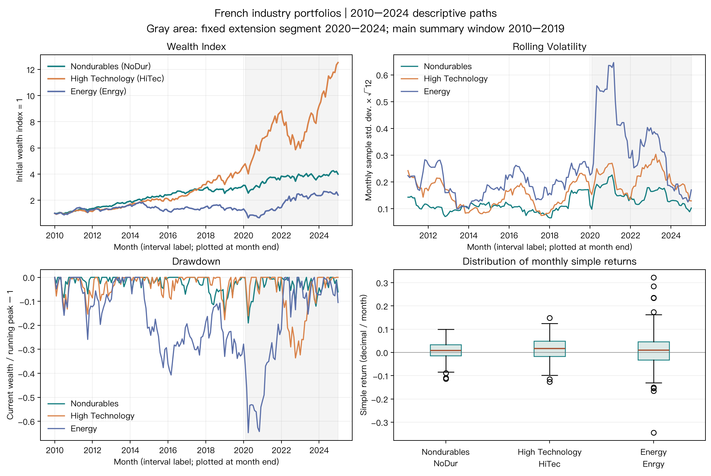

# Project 1 Research Report: Describing Industry Portfolio Returns and Risk

> Historical report for the October 5, 2026 French snapshot. All reported results and figure identities are retained. The reproduction section describes the original working-course route; the current Seed101 offline Notebook does not rerun it. Use the [English reader guide](../READER_GUIDE.md) for current execution.

## Findings

All three industry portfolios have positive cumulative returns in the fixed January 2010–December 2019 monthly window. High Technology has the largest final wealth index, 4.627, followed by Nondurables at 3.141 and Energy at 1.331. Higher growth does not imply lower path risk: Energy’s conventionally annualized volatility is 20.03% and maximum drawdown is 40.70%, both the largest of the three. Annualized Sharpe ratios against the same-month risk-free return proxy (RF) are approximately 1.039, 1.032 and 0.217 for Nondurables, High Technology and Energy. Growth, volatility and performance relative to RF measure different aspects; one ranking is not an overall investment conclusion.

This report describes history using the publication vintage obtained for this project. The sample is neither an implementable strategy nor a historical point-in-time database. Returns cannot reconstruct actual prices, price paths, announcements, information then available, trades, financing or transaction costs. The report claims no Alpha, realizable excess return or future return.

## Questions and Windows

The main question asks how Nondurables, High Technology and Energy differ in 2010–2019 compound growth, return dispersion, performance relative to same-month RF and peak-to-trough losses when measured consistently at monthly frequency. Consumer goods, technology and energy provide contrasting business categories. This small teaching sample represents neither all industries nor a winner-selection procedure.

A second question asks whether main-window rankings change across fixed historical slices. The three portfolios are also reported over 2010–2014, 2015–2019 and 2020–2024, each containing 60 continuous months. The later 2020–2024 interval is a fixed descriptive segment observed after the data update. It is not an out-of-training, holdout or out-of-sample test.

The main window has 120 months and excludes 2020–2024. Figures extend through December 2024 to display path changes, shading the extension in gray. The three industries and all intervals are fixed in the [configuration](../../../../../projects/project01/configs/analysis.json). The project does not search additional industries, windows or parameters to maximize return, Sharpe or other measures.

## Sources, Snapshot and Sample

Inputs come from the Kenneth R. French Data Library’s US 10 Industry Portfolios monthly table and the Fama/French three-factor monthly table. The analysis reads `NoDur`, `HiTec`, `Enrgy` and `RF`. Industry portfolios group US listed companies by industry. Source details describe formation at the end of June using industry codes, followed by returns from July through the following June. See the [10-industry description](https://mba.tuck.dartmouth.edu/pages/faculty/ken.french/Data_Library/det_10_ind_port.html) and [French Data Library](https://mba.tuck.dartmouth.edu/pages/faculty/ken.french/data_library.html).

Input snapshots were downloaded and frozen on October 5, 2026. The manifest lists SHA-256 hashes for source ZIPs, extracted CSVs and processed CSVs. Historical analysis rechecks both consumed processed-file hashes against course source manifests. Industry returns use the “Average Value Weighted Returns — Monthly” block. Source percentages are divided by 100 once and saved as decimals. RF comes from the monthly factor-file block and receives the same conversion; loading does not repeat it.

Both processed snapshots contain 1,202 rows from July 1926 through August 2026. The analysis uses January 2010–December 2024, 180 months, with all four selected fields continuous and complete; its main window is the first 120 months. Source missing sentinels −99.99 and −999 were converted to empty fields during processing. The shared loader checks hashes, column types, finite values, ascending and unique months and monthly continuity. The project neither fills returns with zero, forward-fills RF nor silently removes gaps. Industry and RF monthly indexes must match exactly; join one-to-one on `month`, then select configured windows.

The [manifest](../../../../../projects/project01/data_manifest.json) supplies vintages, exact paths and hash chains; the [dictionary](../data_dictionary.md) defines fields, units and clock limitations. Inputs were obtained as a revised publication vintage, rather than contemporaneously saved monthly snapshots. French states that updates rebuild the full history, so historical returns can change. See the [Data Library update description](https://mba.tuck.dartmouth.edu/pages/faculty/ken.french/data_library.html). The factor-file header declares CRSP vintage 202608. Its source also states that the one-month Treasury-bill input changes from Ibbotson Associates to the ICE BofA US 1-Month Treasury Bill Index in June 2024. See the [factor description](https://mba.tuck.dartmouth.edu/pages/faculty/ken.french/Data_Library/f-f_factors.html). The long history therefore cannot be interpreted as data generated contemporaneously by one frozen method.

## Time and Units

`month` labels a monthly return interval: `2010-01` is the January 2010 interval, not a day or intraday observation time. Inputs do not supply each historical month’s release/ingestion time (`available_at`), signal time (`signal_time`) or trade time (`trade_time`). This analysis forms no signals or orders. It cannot determine whether an order could be submitted or filled after a close.

Industry returns are published monthly simple portfolio total returns including dividends, with dimensionless units; `0.01` means a monthly return of 1%. The project uses the standard industry file; French separately publishes an “ex. Dividends” version. See the [industry-portfolio listing](https://mba.tuck.dartmouth.edu/pages/faculty/ken.french/data_library.html). Value-weighted industry returns are separate from stock prices, open/high/low/close/volume (OHLCV), a present-day universe or execution prices. They describe the published portfolio’s return path but cannot reconstruct an investor’s prices, positions, flows or costs.

`RF` is the monthly one-month US Treasury-bill return proxy in the Fama/French factor file. It represents a same-month risk-free opportunity-cost reference, rather than a frictionless cash rate guaranteed to every investor. Sharpe subtracts that month’s RF from its industry return. There is no annual-rate conversion or single yearly constant. The source states that the proxy input comes from Ibbotson Associates through May 2024 and the ICE BofA US 1-Month Treasury Bill Index from June 2024. See the [Fama/French factor description](https://mba.tuck.dartmouth.edu/pages/faculty/ken.french/Data_Library/f-f_factors.html).

## From Returns to Risk: Methods and Reasons

### 1. Connect the monthly observations into wealth using simple returns

The source directly supplies each month’s portfolio simple return, `R_t`. Without external contributions, account wealth evolves as

\[
W_t=W_{t-1}(1+R_t),\qquad W_0=1.
\]

This recursion reflects returns measured against changing capital; monthly addition loses compounding. `W_0=1` is a chosen initial wealth unit, not an observed security price. Each plotted wealth line is a product of published growth factors, so it is called a wealth index, not a price.

### 2. Use log returns to explain multiplication over time

Log return is defined as `g_t = ln(1+R_t)`. All returns for the three portfolios in this sample exceed −100%, so it is defined.

\[
\sum_{t=1}^{T}g_t=\ln\!\left(\prod_{t=1}^{T}(1+R_t)\right).
\]

The identity explains why log returns describe time-series compounding: cumulative logs add, and exponentiation recovers the wealth growth factor. It does not replace cross-asset simple-return weighting; the project does not add different assets’ log returns. Tables report both arithmetic monthly simple-return means and mean monthly log returns, distinguishing typical single-month movement from time-compound growth. Shared `wealth_index` still constructs cumulative wealth from simple returns.

### 3. Express dispersion on an annual scale and state the convention

Volatility uses monthly simple-return sample standard deviation `s(R)` with one degree of freedom deducted; the report multiplies it by `√12`. This expresses monthly dispersion on a customary annual scale for comparison. It is conventional annualization, not an identity for annual compound-return standard deviation. Serial correlation, changing volatility and nonstationarity can distort square-root scaling. Rolling figures similarly multiply the sample standard deviation of each 12 continuous months by `√12`, leaving the first 11 months blank because the window is incomplete.

### 4. Measure opportunity cost with same-month RF

Sharpe uses simple excess returns `e_t=R_t-RF_t`. The project reports

\[
\widehat{SR}_{ann}=\sqrt{12}\,\frac{\overline{(R-RF)}}{s(R-RF)}.
\]

Subtracting same-month RF in the numerator measures the arithmetic return difference relative to a risk-free alternative for that month. The denominator is the sample standard deviation of those monthly differences. Numerator and denominator thus share the same frequency before application of the stated `√12` annualization convention. This is not a strategy-effectiveness test; no correction is made for serial dependence, sample selection or multiple comparisons. RF is subtracted once. This is neither a factor regression nor an Alpha estimate.

### 5. Locate losses relative to the historical wealth peak

Drawdown is defined as

\[
D_t=\frac{W_t}{\max_{0\leq s\leq t}W_s}-1.
\]

Track the running wealth peak, then measure the current proportional distance below it. This distinguishes cumulative final growth from the largest intervening loss. Tables report positive maximum drawdown loss as `−min(D_t)` and give peak and trough months. Calculations include initial wealth 1 before the window begins; the plotted starting point is an initial-capital convention, not a market price.

### 6. Summarize initial-to-final wealth with CAGR

Compound annual growth rate (CAGR) compresses the initial-to-final wealth ratio into a single annual compound rate:

\[
\mathrm{CAGR}=(W_T/W_0)^{1/(T/12)}-1.
\]

Each reporting window contains whole months; `T/12` years is an explicit, reproducible interval convention. CAGR provides a common annual growth scale while hiding volatility and peaks and troughs. It is therefore reported alongside volatility and drawdown rather than replacing them.

## Main-Window Results: 2010–2019

Total return, CAGR, volatility and drawdown are displayed as percentages; wealth index starts at 1. Sharpe is dimensionless. All three portfolios share mean monthly RF of approximately 0.0427%.

| Industry portfolio | Final wealth index | Cumulative simple return | CAGR | Annualized volatility `s(R)√12` | Annualized Sharpe, `√12` convention | Maximum drawdown loss (peak → trough) |
|---|---:|---:|---:|---:|---:|---:|
| Nondurables (NoDur) | 3.1412 | 214.12% | 12.13% | 11.14% | 1.039 | 15.84% (2018-01 → 2018-12) |
| High Technology (HiTec) | 4.6270 | 362.70% | 16.55% | 15.61% | 1.032 | 17.68% (2018-08 → 2018-12) |
| Energy (Enrgy) | 1.3313 | 33.13% | 2.90% | 20.03% | 0.217 | 40.70% (2014-06 → 2016-02) |

The two monthly means reflect compounding differences. Arithmetic simple-return means are 1.0099% for NoDur, 1.3848% for HiTec and 0.4053% for Enrgy per month. Mean log returns are respectively 0.9538%, 1.2766% and 0.2384% per month. Energy has a particularly large gap: compounding positive and negative months gives lower growth than a reading of its arithmetic monthly mean alone suggests. Mean logs are not another directly weightable industry portfolio return.

HiTec has the highest final wealth; Energy has the greatest dispersion and peak-to-trough loss. NoDur and HiTec have similar Sharpe values. Ranking them by a small Sharpe difference overlooks estimation uncertainty, interval selection and path risk. This report constructs neither confidence intervals nor significance tests, and does not interpret decimal differences as statistically stable superiority.

## Fixed Segments: Do Descriptive Rankings Change over Time?

Recalculating the same measures over predetermined segments checks whether rankings from one ten-year description depend on the historical phase. It does not select a best interval. CAGR, conventionally annualized volatility and maximum drawdown use percentages; Sharpe is dimensionless. Each industry has 60 continuous months in every segment. Wealth restarts at 1 immediately before each window, so segment drawdown tracks peaks only within that 60-month window, without carrying over the previous window’s peak.

| Fixed segment | Industry | CAGR | Annualized volatility | Annualized Sharpe | Maximum drawdown |
|---|---|---:|---:|---:|---:|
| 2010–2014 | NoDur | 17.05% | 11.08% | 1.481 | 8.47% |
| 2010–2014 | HiTec | 14.84% | 15.79% | 0.956 | 15.39% |
| 2010–2014 | Enrgy | 7.88% | 19.25% | 0.488 | 25.88% |
| 2015–2019 | NoDur | 7.41% | 11.16% | 0.609 | 15.84% |
| 2015–2019 | HiTec | 18.30% | 15.55% | 1.102 | 17.68% |
| 2015–2019 | Enrgy | −1.84% | 20.86% | −0.033 | 28.18% |
| 2020–2024 | NoDur | 4.93% | 15.25% | 0.235 | 19.03% |
| 2020–2024 | HiTec | 22.04% | 21.84% | 0.920 | 33.60% |
| 2020–2024 | Enrgy | 12.44% | 37.50% | 0.435 | 51.16% |

NoDur has the highest CAGR in the first five years; HiTec leads in both later segments. Energy has cumulative return of −8.88% and Sharpe of −0.033 in 2015–2019, then positive cumulative return in 2020–2024. In that later period it also has the highest annualized volatility, 37.50%, and maximum drawdown, 51.16%. Rankings, excess returns and path risk therefore change with the interval; the main window does not identify a permanent winner. All windows are retrospective analyses of the downloaded vintage, supplying neither transferable next-period robustness nor out-of-sample evidence. Complete machine-readable means and peak/trough months are in the window-results CSV.

## Figures: Read Coordinates without Turning Returns into Prices



Upper left: the horizontal axis uses month-end plotting labels for monthly return intervals; the vertical axis is wealth compounded from 1. Its initial point is the selected December 2009 capital, not an observed December 2009 price. Solid lines cover the entire 2010–2024 plotting window. Gray shading marks 2020–2024 as a descriptive extension after the main window. Upper right: months remain on the horizontal axis; the vertical axis is the trailing 12-month sample standard deviation multiplied by `√12`. Brief spikes indicate greater local dispersion, not model-predicted future risk.

Lower left: the vertical axis is `wealth / running maximum wealth − 1`. Zero means wealth is at its historical peak; −0.5 means it is half below that peak. Its time axis matches the wealth path and retains initial capital. Lower-right boxplots show the three industries horizontally and 2010–2024 decimal monthly simple returns vertically. Center lines are medians, boxes span quartiles and separate points represent distant sample months. Extreme points remain part of the actual input; unfavorable or prominent observations are not removed. Month labels supply no intramonth events or trade times.

## Limitations and Conclusion

These French industry inputs teach compounding and sample statistics. They supply no individual prices, OHLCV, historical constituent lists, contemporaneous monthly vintages, precise release dates, signals, executions or costs. Updates may revise historical returns; the October 5, 2026 download time cannot become each historical month’s availability time. The Treasury-bill input changes in June 2024, a distinction retained in comparisons across periods.

Square-root-12 annualization is a reporting convention. Serial dependence and conditional volatility affect annual aggregation. Sharpe is a window mean-to-standard-deviation ratio without uncertainty or serial-dependence adjustments; it is not an Alpha estimate. No position rule exists, so there are no estimable strategy transaction costs, financing, borrowing or net returns. Inventing an “after-cost Alpha” value would exceed the inputs’ evidential scope.

The strongest supported description is that High Technology has the highest historical compound growth in 2010–2019 among these published, revised monthly value-weighted industry portfolios, while Energy has greater historical volatility and peak losses. Industry return rankings change across fixed historical slices. This cannot be extrapolated to future individual stocks or tradable investments, and establishes neither an asset-pricing explanation nor causality.

## Historical Reproduction Route

```bash
.venv/bin/python projects/project01/run_project01.py
.venv/bin/python -m pytest tests/test_project01_analysis.py -q
```

The historical CLI reads frozen files and generates figures, JSON metrics and window CSVs. Tests check snapshot hashes, continuous intervals, one-to-one RF alignment and hand-checkable wealth/drawdown boundaries. See the [QA record](../../../../../projects/project01/qa/acceptance.md) for the complete original checks. Historical teaching derivations and tables are in the original [Notebook](../../../../../projects/project01/notebooks/project01_financial_data_analysis.ipynb), designed for a clean kernel under that original data route.
