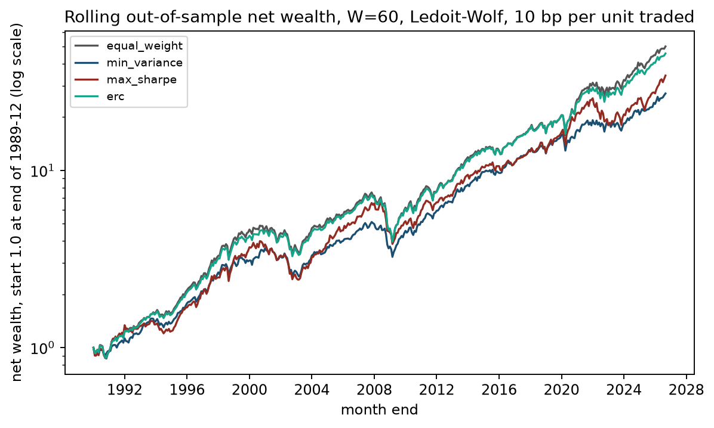
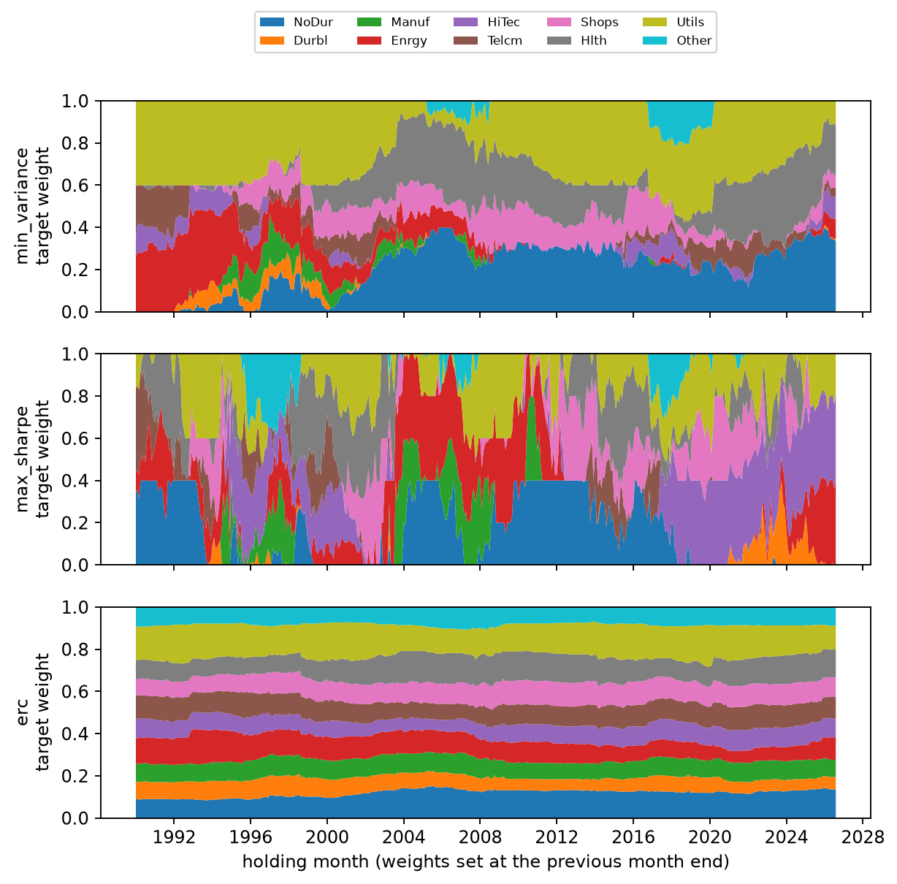
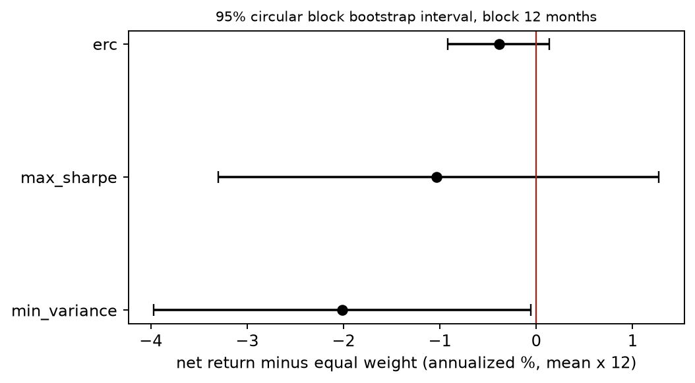
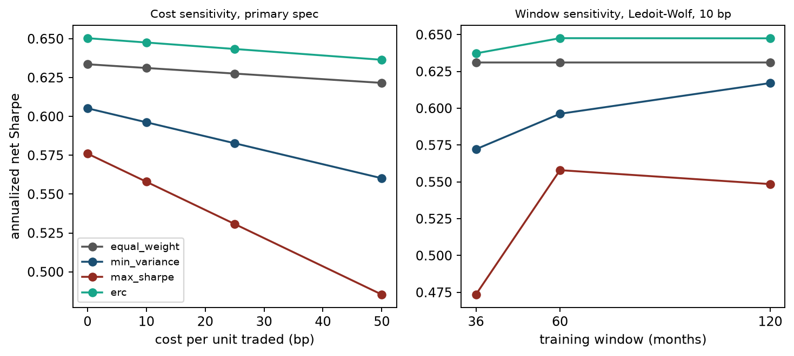

# Project 3 Research Report: Rolling Out-of-Sample Comparison of Four Long-Only Portfolios

Historical research date: 2026-10-06. This report fully preserves the historical inputs, values, and negative results; the default offline Notebook runs only an independent constructed example, as described in the [guide](../READER_GUIDE.md). This language revision did not rerun the report.

## 1. Research question and falsifiable hypothesis

Chapter 20 explains that mean-variance optimization is exact when the moments are known; Chapter 21 explains that when moments are estimated, the optimizer amplifies estimation error. Using the same data and timing rules, this project compares four long-only, fully invested portfolios rebalanced monthly:

| Code | Portfolio | What must be estimated |
|---|---|---|
| equal_weight | Equal weight 1/N | Nothing |
| min_variance | Long-only minimum variance, 40% cap per asset | Covariance |
| max_sharpe | Long-only maximum Sharpe, 40% cap per asset | Covariance and excess means |
| erc | Equal Risk Contribution | Covariance |

Pre-specified hypothesis (H1): among the three portfolios based on estimated moments, at least one outperforms equal weight in out-of-sample Sharpe or mean net return after costs, and the direction of that advantage remains unchanged across windows, covariance estimators, and cost tiers. If the difference interval crosses zero or is negative under the main specification, or if an advantage appears only under some sensitivity settings, the project has not passed its pre-specified advantage screen. This screen is not a calibrated joint hypothesis test.

Author's handoff statement: the main specification was entered in [configs/project03.json](../../../../../projects/project03/configs/project03.json) before viewing this project's out-of-sample results: a 60-month window, Ledoit–Wolf shrinkage covariance, 10 bp per unit of turnover, a 40% cap, lag 0, and evaluation from 1990-01 through 2026-08 (440 months). The author later fixed two numerical implementation issues (the ERC stopping criterion and a feasibility pre-check for capped portfolios) and added an interval for the Sharpe difference; both are recorded in `qa/a4/claude_a4/revision_log.md`. These changes did not alter any strategy parameters. This is the author's local statement and revision record; it has no timestamp from an independent registration platform. Because the study uses existing historical data, it is not a prospectively registered trial.

## 2. Data

- Assets: value-weighted monthly total returns (including dividends), in decimals, for the 10 Industry Portfolios from Kenneth R. French Data Library.
- Risk-free return: the RF column from the FF3 file, aligned by month.
- Snapshot: downloaded and frozen on 2026-10-05; the reader verified SHA-256 hashes for 6 raw, extracted, and processed files (see [data_manifest.json](../../../../../projects/project03/data_manifest.json)).
- Available sample: 1926-07 through 2026-08; the earliest month used in this project is 1979-12 (first training window for W=120, lag 1).

Limitation: these are current revised historical values, with no historical vintages or receipt timestamps; they are not point-in-time (PIT) data. The industry portfolios are published research portfolios, not tradable products with bid/ask prices, fills, and capacity data; the source's methods handle classification, constituent changes, and delistings, which this project did not audit. See [data_dictionary.md](../data_dictionary.md) for field definitions.

## 3. Timing contract and tradability assumptions

For holding month \(t\):

1. Training window: with lag 0, \([t-60,t-1]\); with lag 1, \([t-61,t-2]\). Only these months are used to estimate covariance and means.
2. Decision and trade: at the end-of-month close of \(t-1\), with execution at the close implied by the returns and no intraday impact.
3. Holding: no trades during month \(t\); weights drift by month-end.
4. Cost: deducted from NAV at trade as \(c\times\sum\lvert w^{target}-w^{pre}\rvert\).

Lag 0 assumes the return for month \(t-1\) is available at the end of month \(t-1\). French data are not actually published then, so the main specification uses an idealized month boundary. The lag-1 sensitivity shows that this assumption has little effect on the results (Section 8), but adding a lag does not turn the current revised snapshot into tradable historical data. Cost tiers of 0/10/25/50 bp are hypothetical scenarios, not estimates of actual slippage.

The project charges a **normalized weight-turnover proxy**: it estimates the fee from the difference between drifted weights measured against old NAV and target weights, then invests the post-fee funds at the target weights. This is not an exact self-financing model of transaction amounts. For an exact trading-amount convention, let \(q\) be fees as a fraction of old NAV. The vector of actual traded amounts as a fraction of old NAV is \((1-q)\mathbf w^{target}-\mathbf w^{pre}\), and it must satisfy
\[
q=c\sum_i\left|(1-q)w_i^{target}-w_i^{pre}\right|.
\]
Here \(c\) is the cost rate per unit of traded amount, \(\mathbf w^{pre}\) is the pre-trade asset weight normalized by old NAV (all zero in the first month), and \(\mathbf w^{target}\) is the post-fee target weight normalized by new NAV. The current code uses \(q\approx c\sum_i|w_i^{target}-w_i^{pre}|\); it does not separately count the additional adjustment caused by fees. The exact first-month fee is \(c/(1+c)\), while the current proxy is \(c\); when \(c=0.001\), these are 0.000999001 and 0.001, respectively. The approximation differs little at low costs, but this proxy ledger must not be described as a real-trade ledger.


## 4. Methods

- Covariance: Ledoit–Wolf (2004) shrinkage toward a scaled identity matrix (main specification); sample covariance (sensitivity). See `src/quant_course/portfolio_construction.py`'s `ledoit_wolf_identity`.
- Minimum Variance: Chapter 9's `solve_mean_variance`, with zero means. Covariance is first divided by its largest element (which does not change the weights and avoids solver-tolerance distortion); 40% cap.
- Maximum Sharpe: `max_sharpe_long_only` uses the variable substitution \((\mathbf{y},\kappa)\) to form a convex quadratic program (Chapter 9, Section 7, and 9-C01 prove the conditions for the transformation; Chapter 21 restates and implements it). Means are sample means of industry returns less RF in the training window; 40% cap. This is not an “unproven convex QP”: the ratio objective itself is non-concave; convexity comes from the transformation.
- ERC (no 40% weight cap): `risk_budget_weights` applies Newton iterations to \(\tfrac12\mathbf{y}^\top\Sigma\mathbf{y}-\sum_ib_i\ln y_i\). After stopping, it checks that each asset's volatility share differs from 1/10 by less than \(10^{-6}\), or raises an error. By definition each asset has a 10% capital weight under equal weighting; ERC is an uncapped risk-budget solution. Its observed maximum weight in the main sample is about 19.83%, but that is a sample result, not a constraint. Only Minimum Variance and Maximum Sharpe explicitly have a 40% cap; feasibility should be rechecked on other data.
- Fallback: only an exception caught by the try block containing the optimizer call causes an equal-weight holding for that month, with the reason recorded. Data validation, covariance estimation, and later `risk_contributions` are outside that catch; their failure can terminate the run. It is incorrect to say that every input error triggers a fallback. No shuffled K-fold is used, and no tuning is done during the evaluation period.

## 5. Ledger consistency

For every strategy and month, the revised `primary_ledger.csv` records the training window, status, pre-trade weights (the prior month's target weights after drift from its returns), target weights, turnover, cost, gross return, net return, and RF, including per-industry `pre_weight_*` and `target_weight_*` columns and an initial cash weight. `tests/test_project03_backtest.py` checks that: each training window ends before its holding month; changing future returns does not change past weights and returns; turnover uses drifted pre-trade weights; the net-return formula is \(=(1-\text{cost})(1+\text{gross})-1\); gross return equals target weights times that month's returns; long-only, fully invested, and cap constraints hold; and fallbacks are recorded. The portfolio starts from cash before investing. There is no cash, borrowing, or short selling during the holding period; RF is used only for excess returns. `information_cutoff` is the last month in the training window; `decision_at`/`trade_at` always remains at the end of the month before holding. A lag moves the information cutoff earlier but does not move the trade time.

## 6. Main-specification results (W60, Ledoit–Wolf, 10 bp, 40% cap, lag 0; 1990-01..2026-08, 440 months)

| Metric | Equal weight | Minimum Variance | Maximum Sharpe | ERC |
|---|---:|---:|---:|---:|
| Annualized mean net excess return | 9.05% | 7.03% | 8.01% | 8.66% |
| Annualized net volatility | 14.32% | 11.78% | 14.36% | 13.37% |
| Annualized net Sharpe | 0.631 | 0.596 | 0.558 | 0.648 |
| Annualized gross Sharpe | 0.634 | 0.605 | 0.576 | 0.650 |
| Net CAGR | 11.25% | 9.42% | 10.11% | 10.98% |
| Maximum drawdown (net) | −48.1% | −36.4% | −41.5% | −45.5% |
| Average monthly turnover (excluding first month) | 2.6% | 8.6% | 21.5% | 2.8% |
| Annualized mean fee as a share of old NAV | 0.03% | 0.11% | 0.26% | 0.04% |
| Annualized mean gross-minus-net return difference (bp) | 3.37 | 10.65 | 26.20 | 3.64 |
| Average maximum weight | 10.0% | 35.9% | 37.8% | 15.5% |
| Average effective number of assets \(1/\sum w^2\) | 10.0 | 4.0 | 3.5 | 9.3 |
| Average maximum ex ante risk share | 15.9% | 35.4% | 43.5% | 10.0% |
| Number of fallback months | 0 | 0 | 1 | 0 |



Figure 1: The x-axis is month-end; the y-axis is net wealth on a logarithmic scale, with 1.0 at 1989-12 month-end. All four lines include 10 bp costs. Reading the plot: Equal weight and ERC nearly overlap at the top; Minimum Variance has shallower drawdowns in 2000–2002 and 2008 but the slowest long-run growth; Maximum Sharpe has the most volatile path.



Figure 2: Three stacked area plots, with holding month on the x-axis and target weight (summing to 1) on the y-axis; colors identify the 10 industries. Reading the plot: Minimum Variance remains concentrated in Utils, NoDur, and Hlth and often reaches the 40% cap; Maximum Sharpe rotates its holdings as a whole every few months, following the industry with the highest mean over the most recent 60 months (such as Enrgy in 2003–2008 and HiTec after 2019); ERC weights change slowly and remain close to equal weight.

## 7. Inference: are the differences distinguishable from zero?

A circular moving-block bootstrap (12-month block length, 5,000 replications, seed 20261006) estimates 95% percentile intervals for the mean of “strategy monthly net return − equal-weight monthly net return,” and for paired-bootstrap differences in annualized net Sharpe:

| Strategy | Mean net-return difference (annualized) | 95% interval | Share of draws >0 | Sharpe difference | 95% interval | Share of draws >0 |
|---|---:|---|---:|---:|---|---:|
| Minimum Variance | −2.01% | [−3.97%, −0.06%] | 2.2% | −0.035 | [−0.174, 0.101] | 29.2% |
| Maximum Sharpe | −1.04% | [−3.30%, 1.27%] | 18.4% | −0.073 | [−0.236, 0.089] | 18.0% |
| ERC | −0.38% | [−0.92%, 0.13%] | 7.8% | +0.016 | [−0.014, 0.050] | 84.1% |



Figure 3: The x-axis shows the annualized mean net-return difference (%); points are point estimates and error bars are 95% block-bootstrap intervals. The red line is zero.

Interpretation: Minimum Variance's mean net-return difference lies below zero in the unadjusted single-comparison 95% interval; volatility is lower, and it is indistinguishable from equal weight on a risk-adjusted basis. Maximum Sharpe is negative on both measures, with intervals crossing zero. ERC's Sharpe point estimate is slightly higher (0.016), but its interval crosses zero and its mean return is slightly lower. None of the three portfolios passed H1's research screen. An interval crossing zero means there is insufficient evidence of an advantage; it does not prove the strategies equivalent or that the overall advantage is zero. The circular-block method also assumes sampled blocks can represent the target process; blocking does not remove nonstationarity across 1990–2026. Percentile intervals and the “share of draws >0” are neither posterior probabilities of an advantage nor calibrated joint p-values. The intervals reflect uncertainty under this resampling scheme only; they do not include model selection, data revisions, or multiple comparisons (the report compares 3 strategies × 2 metrics and applies no multiple-testing correction).

## 8. Robustness: window, covariance estimator, lag, and cost

The complete table is in `outputs/sensitivity.csv` (12 specifications × 4 strategies × 4 cost tiers, 192 rows total; all are retained). Annualized net Sharpe at 10 bp:

| Specification | Equal weight | Minimum Variance | Maximum Sharpe | ERC |
|---|---:|---:|---:|---:|
| W36, LW, lag 0 | 0.631 | 0.572 | 0.474 | 0.637 |
| W60, LW, lag 0 (main) | 0.631 | 0.596 | 0.558 | 0.648 |
| W120, LW, lag 0 | 0.631 | 0.617 | 0.549 | 0.647 |
| W60, sample covariance, lag 0 | 0.631 | 0.577 | 0.551 | 0.648 |
| W60, LW, lag 1 | 0.631 | 0.597 | 0.556 | 0.649 |

Cost tiers (main specification, 0/10/25/50 bp): Equal weight 0.634/0.631/0.628/0.622; Minimum Variance 0.605/0.596/0.583/0.560; Maximum Sharpe 0.576/0.558/0.531/0.485; ERC 0.650/0.648/0.643/0.636.



Figure 4: In the left panel, the x-axis is cost per unit of turnover (bp) and the y-axis is annualized net Sharpe. In the right panel, the x-axis is the training window (months), with cost fixed at 10 bp. Reading the plot: Maximum Sharpe has the steepest slope (highest turnover); shorter windows make mean estimates noisier and worsen Maximum Sharpe and Minimum Variance; ERC and equal weight are insensitive to both.

Findings:

- The ranking is the same across all 12 specifications: ERC is close to equal weight, Minimum Variance is next, and Maximum Sharpe ranks lowest.
- Shrinkage covariance helps Minimum Variance slightly (W60: 0.596 versus 0.577) and has almost no effect on ERC.
- A 1-month lag barely changes the results. This shows that the conclusion is not sensitive to the assumption of availability at month-end; it does not show that the data are PIT.
- At W36, Maximum Sharpe has 14 fallback months: in 8 months all industries had negative excess means in the training window; in 6 months, at least one industry had a positive mean but no positive-excess-return portfolio was feasible under the 40% cap (around 2009).

## 9. Subperiods

| Period | Equal weight | Minimum Variance | Maximum Sharpe | ERC |
|---|---:|---:|---:|---:|
| 1990-01..2007-12 net Sharpe | 0.611 | 0.494 | 0.534 | 0.628 |
| 2008-01..2026-08 net Sharpe | 0.653 | 0.686 | 0.579 | 0.668 |
| 1990-01..2007-12 maximum drawdown | −31.3% | −30.9% | −39.4% | −28.7% |
| 2008-01..2026-08 maximum drawdown | −45.8% | −34.7% | −41.5% | −43.5% |

Minimum Variance has a higher Sharpe than equal weight only in the later subperiod. The ranking changes by subperiod, so it cannot be extrapolated.

## 10. Concentration, risk, and return sources

Minimum Variance and Maximum Sharpe average about 4 effective assets, with maximum ex ante risk shares of 35%–44%; by construction, ERC assigns about 10% of ex ante volatility to each industry. The industries' contributions to annualized mean gross return under the main specification (average \(w_{i,t}R_{i,t}\times1200\), %/year):

| Industry | Equal weight | Minimum Variance | Maximum Sharpe | ERC |
|---|---:|---:|---:|---:|
| NoDur | 1.03 | 2.01 | 1.57 | 1.20 |
| Durbl | 1.36 | 0.19 | −0.12 | 0.91 |
| Manuf | 1.23 | 0.46 | 1.01 | 1.07 |
| Enrgy | 1.20 | 1.19 | 1.79 | 1.21 |
| HiTec | 1.60 | 0.43 | 3.11 | 1.34 |
| Telcm | 0.78 | 0.02 | 0.28 | 0.78 |
| Shops | 1.25 | 1.13 | 0.90 | 1.23 |
| Hlth | 1.21 | 1.45 | 1.17 | 1.30 |
| Utils | 0.99 | 2.89 | 0.49 | 1.46 |
| Other | 1.11 | 0.07 | 0.77 | 0.89 |
| Total | 11.76 | 9.84 | 10.97 | 11.39 |

Minimum Variance held less of Durbl, HiTec, and Manuf, whose evaluation-period mean returns were higher, and allocated more weight to Utils and NoDur, whose means were lower. This accounts for its roughly 2% annualized return gap: lower volatility came with lower mean return, not “free” risk reduction. This is an accounting decomposition of contemporaneous returns, not a causal attribution.

## 11. Hindsight comparison (not tradable)

Using sample moments over the entire 1990-01..2026-08 evaluation period and the same 40% cap, the maximum-Sharpe weights produce an annualized Sharpe of 0.754 for a fixed-weight target portfolio's gross-return path (the denominator is the sample standard deviation of same-month gross return minus RF) (Utils 31%, Hlth 29%, HiTec 18%, Shops 16%, Enrgy 4%, NoDur 2%). The rolling version has 0.576 at the same zero cost, and 0.558 after 10 bp fees. The solver's objective value for the supplied sample moments is 0.753856, with asset gross-return covariance in the denominator; the path-based value is 0.754281, with realized excess-return standard deviation in the denominator. Varying RF by month makes them slightly different, so they must not be described as the same number. The in-sample portfolio uses all information from the evaluation period; its estimation window, fixed weights, and rolling strategy also differ. These differences do not separately identify a causal effect of look-ahead bias and cannot be treated as tradable performance.

## 12. Solver failures and fallback records

Under the main specification, Maximum Sharpe had 1 fallback month (2003-04, when no positive-excess-return portfolio was feasible under the 40% cap); the other strategies had 0. Records for all 12 specifications are in `outputs/fallback_log.csv`. Two implementation problems occurred during development: ERC Newton stalled near \(10^{-12}\), and the old code incorrectly reported “not converged” and fell back to equal weight; CLARABEL returned infeasible for capped infeasible problems. Both have been fixed and their causes documented. After the fixes, ERC has 0 fallbacks, and all infeasible cases are identified in the input pre-check.

## 13. Negative and zero results

The project's main finding is negative: for 10 industries, monthly data, and long-only constraints, none of the three estimated-moment portfolios credibly outperformed equal weight after costs. Maximum Sharpe is the only portfolio that estimates means; it also performed worst, had the highest turnover, and was most sensitive to costs and window length. This is directionally consistent with Chapter 21's estimation-error simulation and the working-paper version of DeMiguel, Garlappi, and Uppal (the project read only the methods and abstract of their 2006 conference paper). The intervals for ERC's differences from equal weight cross zero: this sample detects no return advantage and does not establish equivalence. Its ex ante risk distribution is more even, but this project does not infer higher returns from that structure.

## 14. Limitations

- Current revised history, not PIT; industry portfolios are not directly tradable; borrowing, financing, taxes, and capacity constraints are excluded.
- There are only 10 assets, so the conclusions do not generalize to a large stock universe.
- Monthly decisions ignore the intramonth path and execution timing.
- Costs are modeled as linear rates, with no market impact or nonlinear scale effects.
- The block bootstrap assumes within-block dependence captures serial correlation; no multiple-comparison correction was applied.
- Only one cap (40%) and one mean estimator (sample mean) were tested; more variants increase selection bias and should be pre-registered separately.

## 15. Conclusion

Under this project's data and assumptions, none of the three strategies passed H1's research screen; this is not a formal statistical rejection of an “overall advantage.” Equal weight and ERC are difficult to distinguish in out-of-sample net Sharpe. Minimum Variance reduces volatility and drawdown but has a lower point estimate and a mean-return difference below zero in the unadjusted single-comparison interval. Maximum Sharpe has the highest turnover and is most sensitive to costs. Estimation error in the mean is a theoretically possible mechanism, but this comparison does not separately identify its causal contribution. A high in-sample Sharpe does not provide evidence of a tradable advantage.

## 16. Historical reproduction route

```bash
.venv/bin/python projects/project03/run_project03.py
.venv/bin/python -m pytest tests/test_project03_backtest.py tests/test_ch21_portfolio_construction.py -q
```

The commands above are historical course-work-root commands and require the corresponding environment and authorized data. The historical record shows a runtime of about 25 seconds; this is not a promise about the current default run. This route writes to `projects/project03/outputs/` and `figures/projects/project03_*.png`; the default offline constructed entry point does not run it or generate this report's bootstrap or sensitivity tables. Notebook: [notebooks/project03_portfolio_oos.ipynb](../notebooks/project03_portfolio_oos.ipynb). Exercises and solutions: [exercises.md](../exercises.md), [solutions.md](../solutions.md).

## 17. Sources and review scope

The rolling window and turnover after weight drift follow [DeMiguel, Garlappi, and Uppal, 2006 conference paper](https://users.nber.org/~confer/2006/si2006/ap/uppal.pdf) Section 3 (printed pp. 10–12, equations 10–13); the return-difference/annualization boundary follows [Sharpe's 1994 author webpage](https://web.stanford.edu/~wfsharpe/art/sr/sr.htm), “Definitions” and “Time Dependence.” The historical review read the cited sections; it does not claim to have read the 2009 journal version. See [Chapter 21 source notes](../../../../../course/zh/chapters/ch21/source_notes.md) for the authors' source-review scope for covariance/ERC; data source and hashes are in the manifest. Project metrics and intervals were computed by local code and are not statistics from the cited papers.

