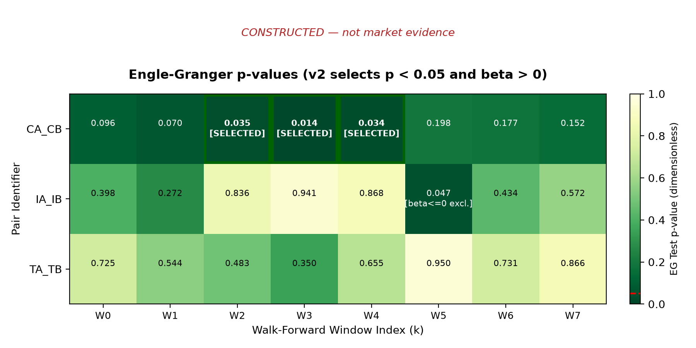
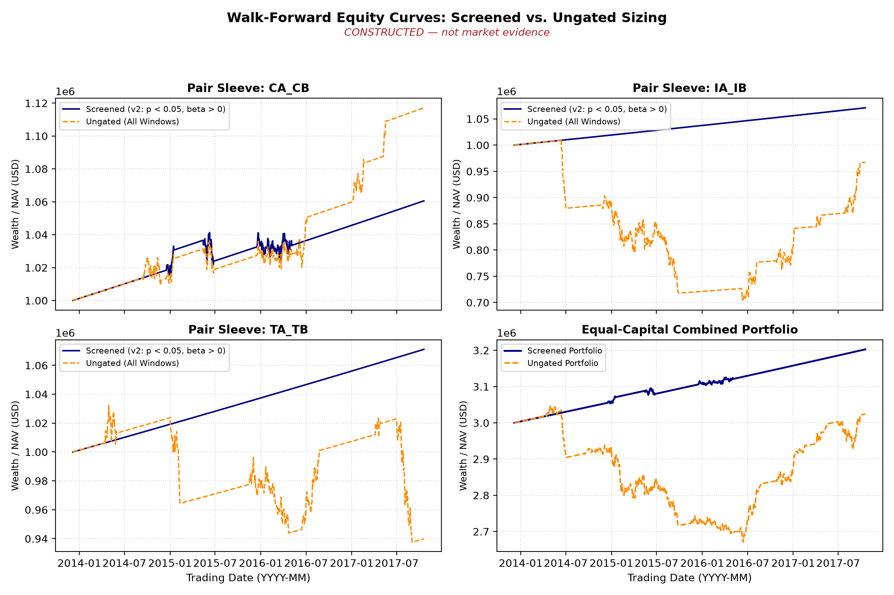
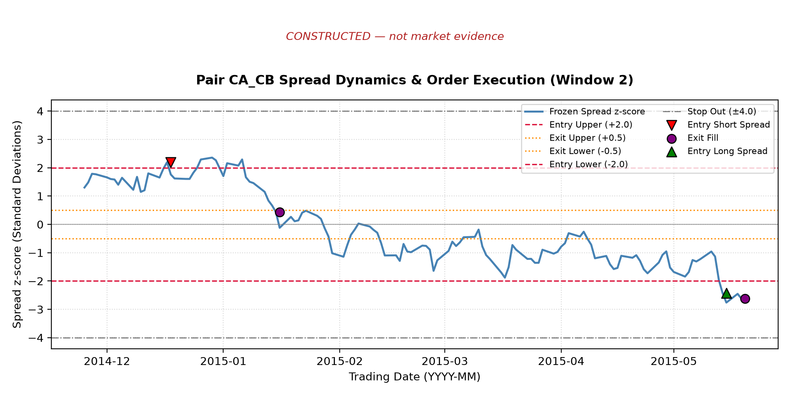
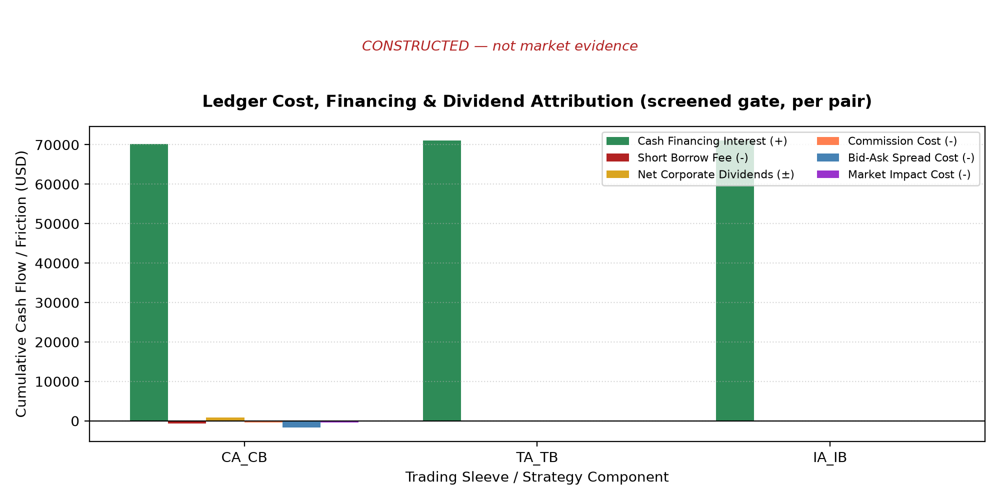
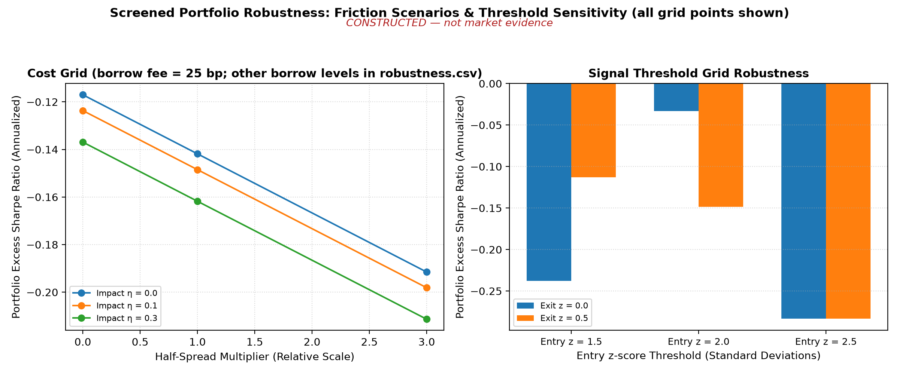

# Project 5 Research Report: Preregistered Walk-Forward Pairs Trading

Status: inherits the c5/v2 constructed results and the limited-accepted ALIGN alignment; the current execution domain is governed by the 2026-10-14 whole-share boundary. BIL17B is a teaching-integration candidate. Historical result date: 2026-10-10; protocol/boundary date: 2026-10-14. **Real-price empirical work: blocked (data permissions).** Every numeric result in this report comes from the explicitly labeled teaching constructed panel. It shows only that the workflow, ledger, and testing methods can run under the contract; it is not evidence of profitability or cointegration for any real pair. The old c1–c4 results under preregistration v1 remain unchanged in qa/a7/project05_batch/evidence/ and are not reused as c5 conclusions.

## 1. Research question and falsifiable hypothesis

Chapter 17 explains that if two non-stationary prices have a stationary linear combination (cointegration), the spread returns toward its mean; correlation describes only synchronous movement and does not guarantee spread reversion. This project asks whether, among **eight economically related U.S.-listed pairs fixed in advance**, screening for cointegration only in the training segment and freezing the parameters, then trading relative value one long and one short by z-score in the next segment, produces robust positive excess returns after two-leg costs, borrow, and financing.

Decision rule (claim_rule, unchanged between v1 and v2): a positive result in the primary specification counts as “support” only if it persists across both the cost grid and the selection-effect comparison of screened versus ungated; otherwise the conclusion is “the evidence does not support this strategy,” and all zero and negative results must be retained. The threshold grid and 252-day formation window are descriptive only; they must not be used to choose a version and then report on the same sample.

## 2. Data and status

### 2.1 Preregistered universe and versions

v1 (SHA256 92e5f20c…4b22) was frozen before any price download: eight pairs, EWA/EWC, KO/PEP, XOM/CVX, GDX/GLD (expected to be weak), XOP/XLE, HD/LOW, V/MA, and IVV/SPY (a same-index control); sample 2010-01-04 through 2025-12-31; all windows for all eight pairs count toward the number of tests.

v2 (configs/preregistration_v2.json, SHA256 9af9dc84…87c3) was frozen after the constructed results had been seen but before any real-data analysis, and replaces v1 for all new runs. v1, clarifications A1/A2, and all c1–c4 results remain unchanged. Changes in v2 and their reasons:

| Item | v1 | v2 | Reason |
|---|---|---|---|
| Selection rule | EG p < 0.05 | EG p < 0.05 and beta > 0 | Restricts the project to long-short relative-value pairs; this is not because a negative beta cannot be hedged mathematically |
| Opening execution capacity | 5% of full-day volume on the execution date | 5% of ADV20 known through the signal close, converted to post-split shares on the execution date | Full-day volume is not available until after the close, so using it to determine a 09:30 fill in v1 was look-ahead (c4 acceptance R01) |
| Intraday event order | Accrual → corporate action → execution | Accrual → corporate action → mark both legs at the 09:30 open → execution → accrual | The intraday borrow basis for an existing short with no fill must use the opening price (c4 acceptance R02) |
| Evaluation outputs | Turnover, win rate, and holding days were listed but not implemented | Definitions supplied and implemented (§4) | c4 acceptance R04 |

The universe, dates, windows, test level, thresholds, positions, and all cost-scenario values were unchanged. The P5-ALIGN alignment implementation: the real-data entry point first reads the original preregistration bytes and matches their SHA-256 to the fixed primary-specification summary in the data manifest; data loading begins only after a match. Custom constructed configurations are labeled exploration; this report uses frozen v2.

### 2.2 Source review and access block

Real prices require unadjusted opens and closes, volume, split ratios, and cash dividends per share, with permissions that allow scripted download, persistent storage, internal bank training use, and delivery of derived statistics. The following carries forward only the historical review from 2026-10-10; current terms were not rechecked in this batch, and these specific cases are not generalized into a blanket prohibition on all free sources (see qa/a7/project05_batch/DATA_SOURCE_DECISION.md).

| Source | Finding |
|---|---|
| Yahoo Finance | Terms prohibit automated collection without prior permission and commercial use; no download |
| Alpha Vantage | License limited to personal, non-commercial use |
| Tiingo | Free tier does not permit persistent storage; organizations must purchase a commercial plan |
| Stooq | Bot verification encountered; not bypassed |
| Nasdaq Data Link (Sharadar SEP/SFP) | Procurement candidate pending verification: general terms limit use to internal business purposes and are subject to the Order Form; external distribution of derived products requires a contract or written approval; third-party terms also apply. Coverage for the 16 securities, complete date coverage, unadjusted OHLCV, split, and dividend fields have not been verified |
| Other free sources and historical borrow data | Personal-use restrictions, prohibition on scripted collection, or not found (scout report; some items were not independently reread by the primary reviewer) |

Accordingly, data_manifest.json has status=blocked, and the CLI with --data real refuses to run with exit code 3 and writes no files (c5 test). Whether any specific subscription covers this project's internal training use must be confirmed by the institution's contract; this report does not record authorization.

### 2.3 Teaching constructed panel (the sole source of results in this report)

src/p05_constructed.py (seed 20261010, 1,600 business days) designs three pairs of log total-return paths: CA/CB are cointegrated (beta = 1.2, AR(1) residual, phi = 0.97); TA/TB share a random trend but each also has an independent random walk (not cointegrated); IA/IB are independent. It then backs out unadjusted closes using $C_t = (C_{t-1}/r_t)(TR_t/TR_{t-1}) − D_t$ (a 2-for-1 split in CA on day 700, a 3-for-1 split in TB on day 1100, and quarterly dividends), so the constructed data pass through the same corporate-action code as real data.

## 3. Time contract

| Field | Definition |
|---|---|
| event_time | Open (09:30) and close (16:00) on trading day d, America/New_York |
| available_at | Open price available at 09:30; close and full-day volume available after 16:00; the rate for DFF observation date s is available from the next day (publication lag approximated as one calendar day) |
| signal_time | Close at t: z-score uses only TR through t and frozen formation-period parameters |
| trade_time | Open of the next trading day, t+1; no execution at the same close |
| return interval | Between consecutive closing marks; NAV starts at W_0 at the formation-period-end close, so N+1 points give N returns |
| label interval | None (signals use no future-return labels), so walk-forward does not require purging or embargo |

Event order on the same day: overnight accrual (rate available from the prior close, prior-close mark) → split → dividend → mark both legs at the 09:30 open → opening execution → intraday accrual (rate available at the current open, opening mark) → closing mark.

## 4. Method

**Formation (training segment only).** For each 504-day formation window, run OLS of $\log TR_y = \alpha + \beta\log TR_x + e$, and freeze alpha, beta, residual mean, and residual standard deviation. The EG test uses statsmodels coint (constant, AIC lag); critical values come from the MacKinnon cointegration-residual distribution, not the ordinary ADF (Chapter 17). v2 selection rule: unadjusted p < 0.05 and beta > 0. The within-window BH q-value is reported but is not used to select pairs.

**Signal.** $z_t = (s_t − \bar{s})/\hat{\sigma}_s$, where s_t uses frozen alpha and beta applied to new TR. Enter when |z| ≥ 2 (if z > 0, short the spread: short y and long x); exit when |z| ≤ 0.5 or when z crosses zero; stop out when |z| ≥ 4 and do not re-enter in the same window. Submit a forced-exit request at the final close of the window; completion remains subject to the sample, capacity, and whole-share execution domain.

**Hedge and position sizing.** For a log-price spread, beta is an elasticity (when x changes by 1%, y changes by beta% on average): dollar exposures are $w_y = s/(1 + |\beta|)$ and $w_x = −s\beta/(1 + |\beta|)$, giving gross exposure equal to one times signal-close NAV. At the signal, target shares are $n_t = \operatorname{trunc}(w W_t/C_t)$, rounded toward zero first and then converted to next-day post-split shares $r_{t+1}n_t$. The ex-dividend event on the next day does not increase the target share count, and positions are not rebalanced while held. Before rounding, the absolute share ratio is $|n_x|/|n_y| = |\beta|P_y/P_x$ and the signed ratio is $n_x/n_y = −\beta P_y/P_x$; after rounding the ratios are only approximate. For the price-level regression $P_y = a + bP_x + e$, the signed hedge ratio is −b (Exercise P5-01). When beta < 0, both legs move in the same direction; same-direction positions can also hedge a negatively related pair to first order (with beta = −1.2, the two legs have dollar exposures of 454,500 and 545,500 in the same direction, and if d log y = −1.2 d log x, first-order total PnL is zero). v2 simply restricts the project to long-short pairs. The IS decision reference price is computed separately using next-day opening corporate-action adjustments: $P^{dec} = C_t/r_{t+1} − D_{t+1}$.

**Execution and costs (scenarios, uncalibrated).** Let Q be requested quantity and F actual nonzero fill; first apply capacity and whole-share rules to determine F, and update cash/positions only from F. Charge each leg separately: commission 0.005 dollars/share; half-spread 1 bp for ETFs and 2 bps for individual stocks; temporary impact $\eta\sigma_{20}\sqrt{|F|/ADV_{20}}$, with eta = 0.1 and sigma20 and ADV20 known through the signal close. Here open is an unadjusted open-price proxy, not an observable mid. Execution price = open × (1 + sign(F) × (half-spread + impact)); spread and impact are included in the execution price, and only commission is separately deducted from cash (Chapter 35's no-double-counting rule). **Opening execution budget:** each leg can fill at most 5% of ADV20 known through the signal close, converted to post-split shares on the execution date. This is an uncalibrated opening-execution scenario, not actual opening-market capacity, and does not guarantee an actual participation rate. Full-day volume on the execution date and |q|/full-day volume are used only in a post-close diagnostic; they do not change the 09:30 fill. Under the matched policy, both legs fill in the same proportion, based on the smaller executable proportion; the entry remainder is canceled on arrival. Exit remainders are not treated as closed merely by canceling them; they are worked day by day under the protocol. Completion is constrained by finite sample length, capacity, and the whole-share support domain. The independent policy is only a stress scenario.

**Financing and borrow.** ACT/360. For cash at the start of the interval, accrue cash × (DFF − 25 bps when cash is positive; DFF + 50 bps when cash is negative). Borrow fee = |q_short| × P_available × 0.25% × delta_d/360, using actual short shares and the mark available at interval start: prior close for the overnight interval, and the 09:30 open for the intraday interval; on a split date, use post-split shares and the post-split open price. Shorts compensate dividends on the ex-date. No historical borrow-fee or lendable-quantity data are available; borrow recall is represented only by a locate_unavailable scenario.

**Implementation shortfall (IS).** Sum only over the set of actual nonzero fills; an empty sum is zero. Do not multiply a zero fill by an undefined average price. Each parent order has one first-arrival price: delay $Q(P^{arr} − P^{dec})$ is counted once; each fill $F_k(P^{fill}_k − P^{arr})$ is counted for that fill, including fills of carried remainders on later days. A remainder superseded by a new entry, or an exit remainder still unfilled at the sample end, incurs opportunity cost; an entry remainder canceled on arrival has zero opportunity cost (Chapter 36).

**Trade statistics.** Define one trade (episode) by the position: from the first fill that leaves flat to the fill that returns both legs to zero. If a new entry order occurs while an exit is incomplete, it is merged into the same trade and recorded as a reentry. Trade PnL = fill cash flow − commission + dividends − borrow fee; it excludes cash interest. Win rate is the fraction of closed trades with positive PnL; holding days are trading days from the first fill to the closing fill. An open trade at the sample end is counted separately and excluded from win rate. If there are no closed trades, win rate and holding days are missing. Turnover uses actual filled amounts only: $\text{two-sided traded notional} = \sum |q|P^{fill}$; $\text{annualized one-sided turnover} = 0.5 \times \text{two-sided}/\text{average daily NAV} \times 252/N$; order quantities are not used. Excess Sharpe is missing for a sleeve with no trades (its excess returns are only residual error from discrete accrual).

**Walk-forward.** Roll 504-day formation windows and 126-day trading windows with a 126-day step. For each pair, run two independent ledgers: screened (trade only in windows that pass the v2 screen) and ungated (trade every window). Each starts with W_0 = 1,000,000 dollars; the portfolio is the sum of equal-capital sleeves.

## 5. Implementation checks (constructed panel)

- Historical c5 tests: 40 passed. Historical P5-ALIGN checks: 52 passed (including the new share-count and real-entry counterexamples). c5 additions: changing only full-day volume on the execution date leaves that day's 09:30 fill, price, cash, and pre-close NAV unchanged item by item; the opening budget matches ADV20 × 5% calculated by hand from the input panel (including split conversion); the intraday borrow basis for an existing short with no fill, a one-leg execution day, and a split day is independently derived from input prices and actual positions; per-trade PnL, win rate, holding days, and two-sided traded amount match manual calculations; open trades are excluded from win rate; v2 excludes windows with beta ≤ 0 and the CLI rejects v1.
- Mutation checks: corresponding new tests fail if capacity is changed back to full-day execution-date volume, the open mark is removed, or the beta > 0 condition is removed ([c5 author checks](../../../../../qa/a7/project05_batch/AUTHOR_QA_c5.md)).
- The ledger cash identity, cash = W_0 + interest − borrow + dividends − traded amount − commissions, has residuals around 10⁻⁹ dollars across the ledgers.

The P5-ALIGN historical phase reran the primary scenario and all robustness scenarios (not rerun in this batch); 11 CSVs (including orders, cash events, NAV, episodes, metrics, grid, and stress orders) were byte-for-byte identical to c5, so the following figures and values across five unchanged charts retain c5 identity. A targeted actual-order example shows: signal close 100, weight 0.5, NAV one million, and next-day dividend 1 produced 5,050 shares under the old order and 5,000 after the fix, while the IS reference price remained 99. Positive and negative legs, simultaneous split/dividend, and rounding order passed. Independent cash reconciliation included actual fills, commission, dividends, interest, and borrow. On the real-data entry point, changing a threshold with the same schema is rejected by the summary gate; matching bytes pass the summary gate, but real data still exits with code 3 and no output.

## 6. Constructed demonstration results (not market evidence)

There are 24 tests (3 pairs × 8 windows); EG p < 0.05 occurs 4 times; v2 selects 3 windows (CA_CB windows 2–4). IA_IB window 5 (p = 0.047, estimated beta = −1.907) is excluded because beta ≤ 0. If all tests were null and each p-value were correctly calibrated, linearity of expectation gives $24 \times 5\% = 1.2$ values below 0.05; independence is not required. Overlapping windows and shared series do not make these 24 tests independent. Only one within-window BH q < 0.10 (CA_CB window 3); this is a within-window description and does not establish FDR control across all dependent windows.

Figure 1. The horizontal axis is the walk-forward window; the vertical axis is the pair. Each tile shows the formation-period EG p-value, with v2-selected windows and the window excluded for beta ≤ 0 marked. CA_CB (true cointegration) passes in only 3 windows; p-values in the others are 0.07–0.20: test power is limited with a 504-day window and phi = 0.97. IA_IB (truly independent) has one false positive in window 5 (p = 0.047); its selection has no true cointegration basis, which follows from the constructed data-generating process and multiple testing, not from the sign of beta alone. TA_TB (common trend, not cointegrated) never passes.

| Pair | Mode | Total return | Annualized | Annualized volatility | Excess Sharpe | Signed deepest drawdown, min(drawdown) | Closed trades | Win rate | Mean holding (trading days) | Annualized one-sided turnover |
|---|---|---:|---:|---:|---:|---:|---:|---:|---:|---:|
| CA_CB | screened | 6.06% | 1.48% | 1.63% | −0.14 | −1.87% | 4 | 25% | 37.3 | 1.00 |
| CA_CB | ungated | 11.71% | 2.81% | 2.26% | 0.48 | −1.87% | 8 | 50% | 33.5 | 2.01 |
| TA_TB | screened | 7.10% | 1.73% | 0.06% | missing | 0.00% | 0 | missing | missing | 0.00 |
| TA_TB | ungated | −6.02% | −1.54% | 3.74% | −0.86 | −9.17% | 6 | 50% | 47.2 | 1.55 |
| IA_IB | screened | 7.10% | 1.73% | 0.06% | missing | 0.00% | 0 | missing | missing | 0.00 |
| IA_IB | ungated | −3.28% | −0.83% | 9.24% | −0.23 | −30.48% | 8 | 62.5% | 47.6 | 2.03 |
| Portfolio | screened | 6.76% | 1.65% | 0.55% | −0.15 | −0.58% | 4 | 25% | 37.3 | 0.33 |
| Portfolio | ungated | 0.81% | 0.20% | 3.11% | −0.47 | −12.32% | 22 | 54.5% | 42.4 | 1.86 |

There are 1,008 daily returns (constructed dates 2013-12-06 to 2017-10-18). The cash-credit rate is the constructed 2% rate minus 25 bps, so even sleeves with no trades earn about 7% total return. No sleeve has an open trade at the sample end.

Figure 2. The vertical axis is dollar NAV, starting at W_0; solid line is screened and dashed line is ungated; the lower-right panel sums the three equal-capital pairs. **Interpretation:** under v2, the screened portfolio's excess Sharpe is −0.15 and comes only from 4 CA_CB trades (25% win rate); the truly cointegrated CA_CB trades less often when screened and performs worse than ungated. Under v1 (c1–c4), the screened portfolio selected 4 times and had a 0.39 Sharpe, mainly due to the false-positive IA_IB selection; excluding it under v2 makes the result negative. This does not mean “v2 is better” or “screening works”: v2 was a design change frozen after seeing constructed results because of project scope and timing fixes, and the change was disclosed in the preregistration. Both versions show that screening can miss a true relationship and admit an accidental one.

Figure 3. The CA_CB window 2 frozen-spread z-score. Dashed lines are ±2 entry thresholds, dotted lines are ±0.5 exit thresholds, and dash-dot lines are ±4 stop-loss thresholds. The horizontal axis uses fill_date, while z comes from the corresponding signal_date; the mark is therefore the signal-day z displayed at the execution-date position, not a z recalculated on the execution date. This display debt is carried forward under B23/P5_PLOT_CLOCK_CARRY_FORWARD. The original figure was not redrawn, and changing the caption does not mean it was repaired. Liquidation at the end of the window is triggered by the forced-close rule, not by mean reversion.

Figure 4. Cumulative cash items for screened sleeves (USD). At the constructed interest rate, interest is much larger than trading frictions. For the four CA_CB trades: spread 1,658, impact 442, commission 426, borrow 704 dollars; net dividends after short-dividend compensation are +826 dollars. The pair's dividend differential is a real cash item and must not be “removed” with adjusted prices.

## 7. Robustness (constructed; all grid points are in robustness.csv)

Figure 5. Left: screened-portfolio excess Sharpe over the cost grid with borrow at 25 bps, varying half-spread multiplier and eta. Right: entry/exit threshold grid.

- Cost grid (27 cells): screened-portfolio excess Sharpe is negative in every cell, from −0.41 to −0.12; when borrow fees rise from 25 bps to 5%, the range falls from −0.21 to −0.12 to −0.41 to −0.32.
- Threshold grid (6 cells): −0.28 to −0.03, all negative. The grid is descriptive only; the primary specification was not changed in response.
- 252-day formation window: screened-portfolio excess Sharpe −0.02, ungated −0.77.
- Partial-fill stress (W_0 = 10⁹, budget = 5% of ADV20): under matched, 4 entry parent orders (8 legs) fill only 1.6%–2.0% of the submitted quantity (median 1.9%). Portfolio returns are mainly interest; the capacity budget, not the signal, determines the result. Under the independent policy, the actual share ratio of the first fills can deviate from the submitted ratio by about 64% (Exercise P5-09, budget = 1% of ADV20). Post-close diagnostics show actual fills reaching up to 6.4% of full-day volume, above the 5% ex ante budget: the budget does not guarantee actual participation.

Under the preregistered decision rule, the primary constructed-panel specification has no positive result that could count as “support”; the conclusion is that the evidence does not support the strategy. All negative results are retained.

## 8. Limitations

The latest whole-share support domain is checked before any daily cash entry: if a split would make an actual position 7.5 shares, the entire account fails before overnight accrual or corporate-action booking; exact decimal entitlement conversion is not a guarantee of executable fractional shares. A 7.5-share request from a flat position can instead fill 7 whole shares and cancel the entry remainder; this is a different state. Do not delete a failed window and continue reporting a fixed sample; exit remainders are not guaranteed to reach zero before the sample ends. The historical ALIGN ending section once allowed actual fractional holdings to be retained; it is now superseded by the [latest boundary](../EXECUTION_BOUNDARY.md), while the historical entry point remains unchanged.

1. Real-price empirical work is blocked; none of the above is a conclusion about real assets.
2. Costs, impact, borrow fee, spread, and opening-execution budget are scenarios and are not calibrated. There are no quote or opening-session volume data; the opening execution price is not a mid-price. Permanent impact is absent.
3. Borrow availability and recall are represented only as scenarios; no historical borrow data are available.
4. Dividends are booked on ex-dates (not payment dates); the DFF publication lag is approximated as one day.
5. The constructed panel has 3 pairs and 8 windows; power and the magnitude of selection effects depend on its parameters and do not generalize.
6. Preregistration is a freeze of local-file hashes, not registration on an external platform. v2 was frozen after the constructed results were seen, with its reasons disclosed; it was frozen before any real-data analysis and must not be changed during the real-data phase.
7. Trade PnL excludes cash interest. Win rate and holding days describe only a small number of trades in the constructed sample (4 screened-portfolio trades) and have no statistical significance.

## 9. Conclusion and rerun path

**What can be said:** preregistered v2's design, screening, frozen spread, next-day opening two-leg execution, ex ante opening budget, cost/financing/borrow/dividend/split ledger, IS decomposition, and trade statistics are implemented and were checked with behavioral tests and mutation tests. On the constructed panel, the workflow exposes correlation ≠ cointegration, incorrect critical values, and screening-selection effects. **What cannot be said:** whether the eight preregistered real pairs are cointegrated, whether the strategy is profitable, or the real levels of costs and capacity.

Once data are available (institutional permission confirmed, field/sample validation complete, files under data/processed/p05/, and data_manifest.json status=frozen), rerun v2 from the data node: build TR → form and test all windows for the 8 pairs → screened/ungated ledgers → cost, threshold, formation-window, and partial-fill grids → figures → Notebook → report sections 6–9. Existing constructed results must not be reused as real-data conclusions.

## 10. Reader run route and historical review

Ordinary readers should run .venv/bin/python run_notebook.py projects/project05/notebooks/p05_pairs.ipynb from the root of the accepted I3 package. The new constructed main route writes to the unique RUN_DIR; the outer runner also retains an execution copy of the Notebook and execution.json. It fresh-runs formation and ledgers for three screened/ungated constructed pairs, and produces a table and one figure; it does not run the full CLI grids listed below. The English Notebook layer, portable package, and cold start belong to BIL23 and were not executed in this batch. The commands below are for historical review and maintenance, not a list ordinary readers must run one by one; build_notebook.py writes the source Notebook.

    .venv/bin/python projects/project05/run_project05.py --data constructed --out <new_directory>/cli
    .venv/bin/python projects/project05/make_figures.py --run <new_directory>/cli --out <new_directory>/figures
    .venv/bin/python -m pytest projects/project05/tests/test_p05_pairs.py -q
    .venv/bin/python projects/project05/solutions_code.py
    cd projects/project05 && ../../.venv/bin/python notebooks/build_notebook.py

The CLI reads configs/preregistration_v2.json by default and records its SHA256, selection rule, opening budget, and event order in summary.json; it refuses to run if the output directory already exists. Prerequisites: Chapters 16 and 17 (stationarity, cointegration, and EG critical values); Chapter 29 (unadjusted prices and corporate-action ledger); Chapter 31 (walk-forward); Chapter 35 (costs, financing, borrow, and no double counting); Chapter 36 (execution clock and IS). Part VI interface comparison: qa/a7/project05_batch/PART_VI_CONSISTENCY_c5.md.
