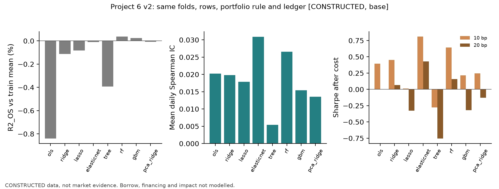
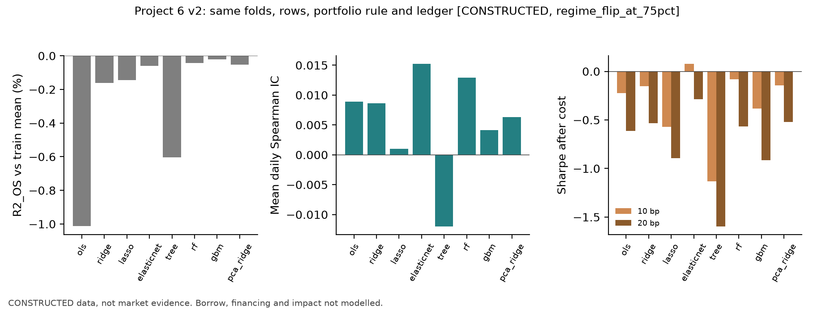
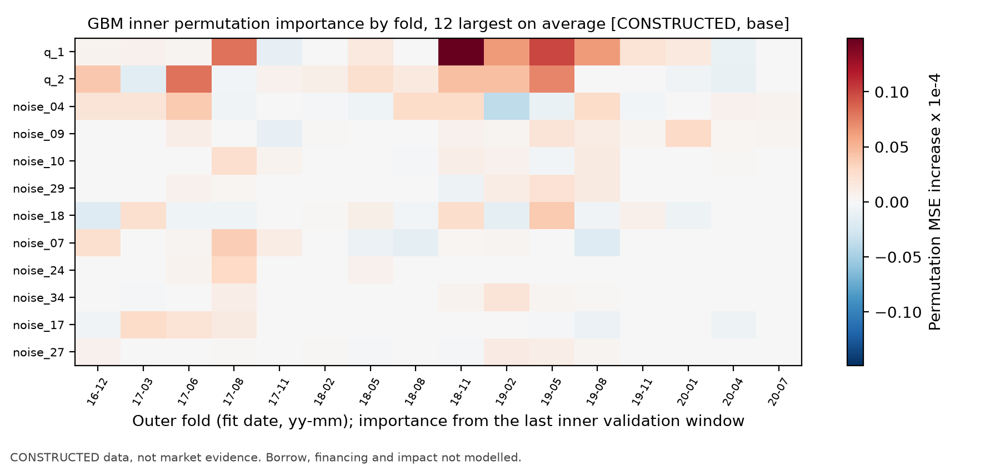
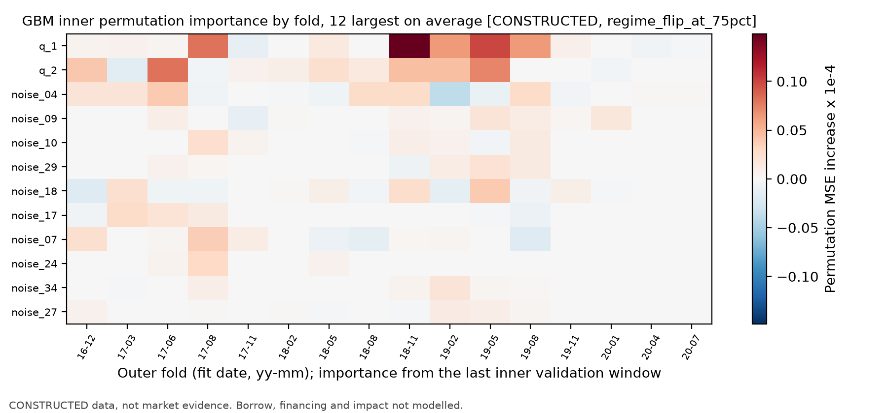
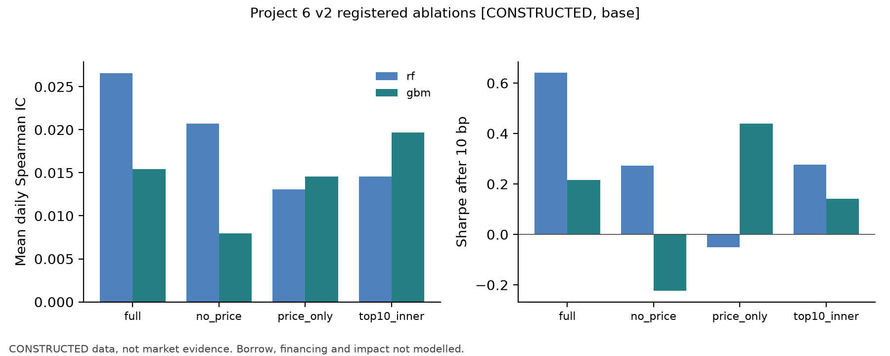
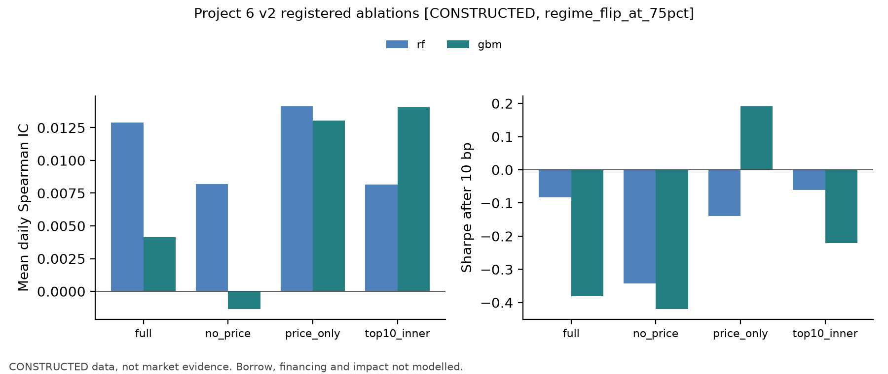

# Project 6 v2: Tree-Model Comparison, Importance, Stability, and Ablation

**Frozen A8-B results dated 2026-10-11; author revision dated 2026-10-16. Author: Yuxiao Ma.** **All results come from a teaching construction (data_class = CONSTRUCTED), not market evidence.** A8-B has its own limited-scope acceptance entry, pending formal integration. The BIL19 bilingual candidate remains pending independent review. Real-data work is blocked, and complete Project 6 remains unverified. The base-pipeline report is [README.md](README.md); its A8-A frozen content remains separately preserved.

## 1. Hypotheses and questions

On the v1 frozen constructed panel (a linear data-generating process with three loaded characteristics, 40 zero-loading characteristics, and three price features), this experiment asks: (1) do a single tree, random forest, or gradient boosting improve out-of-sample forecasts or net portfolio results over zero, training-mean, OLS, and regularized linear models; (2) are results stable across folds and seeds; and (3) how much information is associated with price and characteristic feature groups? The pre-run protocol predicted that trees would have no nonlinear structure to exploit under a linear generating process, would not meaningfully outperform Ridge or Elastic Net, and could turn over more because of piecewise-constant predictions.

The generator makes q sequences and noise sequences independent across sequences; each sequence is a stationary AR(1) over time with rho = 0.98 and marginal variance 1. They are not IID over time. The price features rev_5, mom_60_5, and vol_20 are derived from a return path with common market, q-signal, and idiosyncratic shocks. Thus, the 43 `q/noise` characteristics and the 3 price-derived features have different structures, and the full 46-dimensional panel is not an independent, identically distributed, homoskedastic population. Interpret PCA using the actual covariance structure and pipeline, not an assumption that all 46 features are IID and equal-variance.

P6 uses 46 features, 1,512 dates, and 16 folds. The Chapter 40 interaction experiment is separate: 26 features, 1,260 dates, and 12 folds, with its registered primary strength and a separate fivefold post hoc sensitivity. Do not merge its parameters, outcomes, or post hoc analysis with P6.

## 2. Protocol and freeze

- Configuration: [p06_trees_v2.json](../../../../../projects/project06/configs/p06_trees_v2.json), SHA-256 60101509bbe073678536f0850dd143777b7736be4ec2b6818e05cb736ce23cf4; frozen before the first v2 run, read-only. It inherits `p06_base_v1.json`, SHA-256 62f49e1cab11b6992a9c391180df5d6827f9c5c12bf34f94acde5134ee4c39f7, checked at runtime.
- Seen before the freeze: A8-A v1 constructed outcomes in both the base and reversal scenarios (R², IC, and net Sharpe, recorded in the config), Chapter 38–39 constructed runs, and one timing-only probe. This was not a real-market preregistration.
- The generator and the base and regime_flip_at_75pct scenarios were unchanged; no scenario favorable to tree models was added.
- Timing: signal_time is the close on \(D_k\); trade_time is the close on \(D_{k+1}\); label_end and label_available_at are the close on \(D_{k+6}\). A training row must satisfy label_available_at ≤ fit_time. Outer expanding-window validation has a minimum 504 training dates, 63 dates per test block, and 16 folds. Inner selection uses the final two 63-date windows and at least 252 training dates.
- Models and grids are defined in the frozen configuration. Gradient boosting is HistGradientBoostingRegressor with early_stopping=False; its iteration count (maximum 300) is selected with other parameters by average inner date-fold MSE, then refitted on all outer-training rows.
- Portfolio: demean forecasts cross-sectionally, gross exposure 1, rebalance every five signal dates, execute at the next close, and use one-way fees of 0/10/20 bp in the Chapter 29 ledger; initial capital is 1 million. Borrowing, financing, market impact, and capacity are not modeled.
- Implementation: [p06_trees.py](../src/p06_trees.py); CLI [run_project06_v2.py](../run_project06_v2.py), whose real-data mode historically exits with code 3 without writing files; core logic is in quant_course.tree_models and the read-only reused quant_course.ml_pipeline.
- Baseline check: v1's six-model sequence was rerun with unmodified v1 code and matched the A8-A c3 summary value by value: 209 values per scenario and maximum relative difference 0.0.

The frozen v1 implementation generates six prediction sequences: zero, train_mean, OLS, Ridge, Lasso, and Elastic Net. Version 2 adds four: a single tree, RF, HGB, and PCA + Ridge, for 10 total sequences. The main comparison table and figures show eight fitted models and omit the two constant-forecast baselines. PCA + Ridge is not a tree.

## 3. Results

Numbers are from the author's historical QA run qa_r1 (persistent evidence under `qa/a8/ch40_ch41_batch/evidence/qa_r1/`), with summary copies [v2_summary_base.json](v2_summary_base.json) and [v2_summary_regime.json](v2_summary_regime.json). The tables' \(R^2_{\mathrm{OS}}\) is relative to the training mean. IC is the mean daily Spearman IC over a model's own defined dates. Parenthesized t values for continuous series are historical NW statistics with a four-trading-day bandwidth; \(\Delta IC\) is the mean daily paired difference against Ridge over common dates.

The main tables have eight rows, not eight total prediction sequences. The zero and train_mean baselines are also present in the frozen run. Both produce a constant forecast and a flat portfolio: total return and turnover are zero; IC is undefined (NaN).

**Date counts (added in R01 on 2026-10-11).** There are 1,002 test dates with mature labels in each scenario. Own-date IC means and paired \(\Delta IC\) means use different sets when a model has undefined IC dates. OLS, Ridge, PCA + Ridge, and the three tree models have defined IC on all 1,002 continuous dates. Lasso and Elastic Net sometimes produce constant predictions, making their cross-sectional IC undefined: 630 and 882 valid dates in the base scenario, and 567 and 819 in the reversal scenario. A sparse model must be compared with Ridge on the same common dates. For base Lasso, its mean on 630 dates is 0.0179 and Ridge's mean on those dates is 0.0161, difference +0.0017. For base Elastic Net on 882 dates, the means are 0.0309 and 0.0206, difference +0.0103. In reversal, the 567-date Lasso means are 0.0010 and 0.0031, difference −0.0021; the 819-date Elastic Net means are 0.0152 and 0.0091, difference +0.0061. See [v2_ic_date_bases.json](v2_ic_date_bases.json), independently recomputed from frozen prediction and label CSVs without changing the frozen summaries.

The historical summary retains sparse-series t diagnostics computed after dropping missing dates and treating the remaining observations as adjacent. A lag of four compressed observations is not a four-trading-day HAC. Those t statistics are not reported in the tables. The displayed dashes are intentional; no new HAC was calculated. NaN remains undefined, not zero.

### 3.1 Base scenario (1,002 test dates)

| Model | \(R^2_{\mathrm{OS}}\) vs training mean | IC (t) | \(\Delta IC\) (t) | Sharpe 0 bp | 10 bp | 20 bp | Annual turnover | Max drawdown 10 bp | Total return 10 bp |
|---|---:|---:|---:|---:|---:|---:|---:|---:|---:|
| OLS | −0.839% | 0.0203 (2.24) | +0.0004 (0.18) | 0.79 | 0.39 | 0.00 | 24.3 | −14.2% | +9.39% |
| Ridge | −0.113% | 0.0198 (2.22) | — | 0.84 | 0.45 | 0.07 | 23.6 | −12.9% | +10.90% |
| Lasso | −0.083% | 0.0179 (—)\(^{a}\) | +0.0017 (—)\(^{a}\) | 0.36 | 0.01 | −0.33 | 16.3 | −9.3% | −0.20% |
| Elastic Net | −0.010% | 0.0309 (—)\(^{a}\) | +0.0103 (—)\(^{a}\) | 1.19 | 0.81 | 0.43 | 22.0 | −7.2% | +19.90% |
| Single tree | −0.393% | 0.0054 (0.64) | −0.0144 (−1.61) | 0.21 | −0.28 | −0.75 | 35.1 | −20.0% | −8.70% |
| Random forest | +0.037% | 0.0266 (2.86) | +0.0067 (1.06) | 1.13 | 0.64 | 0.16 | 29.2 | −12.3% | +15.98% |
| HGB | +0.023% | 0.0154 (1.79) | −0.0044 (−0.61) | 0.76 | 0.22 | −0.32 | 36.2 | −11.0% | +5.02% |
| PCA + Ridge | −0.008% | 0.0135 (1.45) | −0.0063 (−0.86) | 0.62 | 0.25 | −0.13 | 23.3 | −12.0% | +5.49% |

(a) The summary has compressed-valid-observation t diagnostics, but the tables do not report them as trading-day inference.

The 16 test blocks contain \(16\times63=1,008\) nominal signal dates (about four years). Labels for the final six dates extend beyond the sample, leaving 1,002 dates in prediction metrics.

### 3.2 Loading-reversal scenario (reversal begins on trading date 1,134; folds 11–16 fall after the reversal)

| Model | \(R^2_{\mathrm{OS}}\) vs training mean | IC (t) | \(\Delta IC\) (t) | Sharpe 0 bp | 10 bp | 20 bp | Annual turnover | Max drawdown 10 bp |
|---|---:|---:|---:|---:|---:|---:|---:|---:|
| OLS | −1.013% | 0.0089 (0.97) | +0.0002 (0.10) | 0.17 | −0.22 | −0.61 | 24.3 | −21.7% |
| Ridge | −0.161% | 0.0087 (0.95) | — | 0.23 | −0.15 | −0.53 | 23.7 | −19.9% |
| Lasso | −0.143% | 0.0010 (—)\(^{a}\) | −0.0021 (—)\(^{a}\) | −0.25 | −0.57 | −0.89 | 14.7 | −15.1% |
| Elastic Net | −0.061% | 0.0152 (—)\(^{a}\) | +0.0061 (—)\(^{a}\) | 0.45 | 0.08 | −0.29 | 20.2 | −15.7% |
| Single tree | −0.604% | −0.0120 (−1.32) | −0.0207 (−2.19) | −0.66 | −1.13 | −1.60 | 36.2 | −30.1% |
| Random forest | −0.042% | 0.0129 (1.35) | +0.0042 (0.66) | 0.41 | −0.08 | −0.57 | 29.7 | −21.0% |
| HGB | −0.020% | 0.0041 (0.46) | −0.0045 (−0.59) | 0.16 | −0.38 | −0.92 | 36.5 | −20.0% |
| PCA + Ridge | −0.053% | 0.0063 (0.68) | −0.0023 (−0.31) | 0.24 | −0.14 | −0.52 | 23.5 | −12.0% |

Ridge's fold ICs after reversal (folds 11–16) are 0.001, −0.086, −0.052, 0.007, 0.019, and −0.032. Most are negative: all models learned the pre-reversal signal sign and needed later expanding-window data to adjust.

To retain \(R^2\) against zero as well as the training-mean tables above, the historical \(R^2\)-vs-zero and 10/20 bp net-return values are listed below. They come from the same qa_r1 summaries and were not recomputed.

| Scenario | Model | \(R^2\) vs zero | Net return 10 bp | Net return 20 bp |
|---|---|---:|---:|---:|
| Base | OLS | −1.715% | +9.39% | −0.76% |
| Base | Ridge | −0.982% | +10.90% | +0.91% |
| Base | Lasso | −0.952% | −0.20% | −6.50% |
| Base | Elastic Net | −0.879% | +19.90% | +9.81% |
| Base | Single tree | −1.264% | −8.70% | −20.66% |
| Base | Random forest | −0.831% | +15.98% | +3.18% |
| Base | HGB | −0.845% | +5.02% | −9.14% |
| Base | PCA + Ridge | −0.876% | +5.49% | −3.91% |
| Reversal | OLS | −1.891% | −6.09% | −14.80% |
| Reversal | Ridge | −1.032% | −4.44% | −13.08% |
| Reversal | Lasso | −1.014% | −10.10% | −15.23% |
| Reversal | Elastic Net | −0.931% | +1.09% | −6.77% |
| Reversal | Single tree | −1.479% | −29.85% | −39.30% |
| Reversal | Random forest | −0.913% | −2.72% | −13.62% |
| Reversal | HGB | −0.890% | −10.55% | −22.71% |
| Reversal | PCA + Ridge | −0.923% | −4.24% | −12.84% |

### 3.3 Ablation (\(\Delta IC\) relative to the same model's full-feature version; Sharpe is 10/20 bp)

| Ablation | Base IC | Base \(\Delta IC\) (t) | Base Sharpe | Reversal IC | Reversal \(\Delta IC\) (t) | Reversal Sharpe |
|---|---:|---:|---:|---:|---:|---:|
| RF: no price | 0.0207 | −0.0059 (−2.05) | 0.27 / −0.20 | 0.0082 | −0.0047 (−1.62) | −0.34 / −0.81 |
| RF: price only | 0.0131 | −0.0135 (−1.09) | −0.05 / −0.81 | 0.0141 | +0.0013 (0.10) | −0.14 / −0.90 |
| RF: inner top 10 | 0.0146 | −0.0120 (−1.85) | 0.28 / −0.23 | 0.0082 | −0.0047 (−0.77) | −0.06 / −0.56 |
| HGB: no price | 0.0080 | −0.0074 (−1.56) | −0.22 / −0.76 | −0.0013 | −0.0055 (−1.14) | −0.42 / −0.94 |
| HGB: price only | 0.0145 | −0.0009 (−0.08) | 0.44 / −0.15 | 0.0130 | +0.0089 (0.77) | 0.19 / −0.40 |
| HGB: inner top 10 | 0.0197 | +0.0043 (0.58) | 0.14 / −0.41 | 0.0141 | +0.0099 (1.22) | −0.22 / −0.76 |

Grouped permutation importance (mean MSE increase × \(10^{-4}\) over 16 folds, measured on the final inner validation window): in the base case, price group −0.0014 (HGB), −0.0006 (RF), and 0.0012 (tree); all-characteristics group 0.0495, 0.052, and 0.0585. In the reversal case, price group −0.0016 (HGB), −0.0009 (RF), and 0.0012 (tree); all-characteristics group 0.0477, 0.0373, and 0.0462.

### 3.4 Stability

- **Seeds (base scenario):** RF seeds 4061/4062/4063 yield ICs of 0.0266/0.0232/0.0237, Sharpe after 10 bp of 0.64/0.52/0.44, and prediction correlations of 0.962–0.982. HGB produces identical results for all three seeds because fitting is deterministic for this data with early stopping disabled.
- **Selected parameters:** a depth-2 tree in 14 of 16 folds; RF leaf size 2,000 in 10 folds and 500 in 6; HGB iteration counts from 2–96, with learning rate 0.02 selected in only 2 folds; PCA + Ridge selected 30 components in 10 folds, 5 in 5 folds, and 15 in 1.
- **Inner-loop importance ranking stability:** mean adjacent-fold rank correlations (the base and reversal scenarios) are tree −0.10/−0.04, RF 0.01/0.01, and HGB 0.09/0.10. Base-case top-10 appearance frequency: RF q1 in 11 folds, noise_04 in 11, noise_18 in 10, and q2 in 9; HGB q1 in 11, q2 in 10, noise_09 in 10.
- **Post hoc diagnostic (not used for model selection):** outer-test-window permutation importance ranks q1 (0.0251 $\times10^{-4}$), q2 (0.0069), and noise_09 (0.0033) highest for HGB; RF ranks q1, noise_04, and q2 highest. RF mean final-model MDI by fold is q1 0.153, q2 0.112, noise_04 0.083; many zero-loading rows are around 0.03.

### 3.5 Figures

- [Base model comparison](../../../../../projects/project06/figures/p06v2_model_comparison_base.png) and [reversal model comparison](../../../../../projects/project06/figures/p06v2_model_comparison_regime.png): \(R^2_{\mathrm{OS}}\), IC, and 10/20 bp Sharpe for the eight fitted models.
- [Base importance stability](../../../../../projects/project06/figures/p06v2_importance_stability_base.png) and [reversal importance stability](../../../../../projects/project06/figures/p06v2_importance_stability_regime.png): fold heatmaps of HGB inner-loop permutation importance.
- [Base ablation](../../../../../projects/project06/figures/p06v2_ablation_base.png) and [reversal ablation](../../../../../projects/project06/figures/p06v2_ablation_regime.png): registered ablations.

## 4. Interpretation

1. No model has \(R^2_{\mathrm{OS}}\) above 0.04% relative to the training mean. Except for the reversal-scenario single tree at \(t=-2.19\), all other main comparisons have \(|t|<2\); the single tree is worse (\(\Delta IC=-0.0207\), unadjusted two-sided approximate \(p\approx0.029\); approximately 0.17 after Bonferroni correction only over three tree models × two scenarios). Ablations and seed comparisons were also registered, so this is an unadjusted descriptive comparison, not a confirmatory significant finding. Consistent with the prediction, trees found no additional structure to exploit under this linear data-generating process.
2. **Turnover:** annual tree turnover is 29.2–36.5 versus 14.7–24.3 for linear models. RF's base-scenario Sharpe is 1.13 before costs and 0.16 after 20 bp; Elastic Net has the highest Sharpe in both scenarios at all three cost levels.
3. **Overlap between price and characteristic information:** past returns contain slowly varying expected returns (feature AR coefficient 0.98), so price features carry indirect signal. When characteristics are present, grouped price permutation importance is close to zero (substitution); removing prices lowers IC for both tree models, while HGB with prices only retains nearly all its IC. In the reversal scenario, HGB with prices only has higher IC than its full-feature version, possibly because momentum features update with recent returns faster than pre-reversal feature coefficients; all related t values are below 1.3, so this is only an observation.
4. By IC, training-only top-10 selection lowers RF in both scenarios and raises HGB in both, as descriptive comparisons. After-cost Sharpe does not move consistently: HGB at 10 bp falls from 0.22 to 0.14 in base and rises from −0.38 to −0.22 in reversal. Permutation importance is noisy in 63-date validation windows, and zero-loading features often appear in the selected set.
5. PCA + Ridge does not rank uniformly below Ridge. Relative to the training mean, \(R^2\) is −0.008%/−0.053% in the base and reversal scenarios, slightly better than Ridge's −0.113%/−0.161%. In reversal, 10/20 bp Sharpe of −0.14/−0.52 is also slightly higher than Ridge's −0.15/−0.53. By contrast, mean IC of 0.0135/0.0063 is below Ridge's 0.0198/0.0087. With all 46 components, the same standardization and alpha, and no whitening, PCA is an orthogonal rotation that preserves the Ridge norm, so it is equivalent to Ridge in the rotated coordinates. Truncation changes the available subspace and is not guaranteed to improve results. Interpret this alongside the AR(1) `q/noise` and derived price features; do not assume all 46 columns are independent and equal-variance.

## 5. Falsification conditions and conclusion

The frozen configuration's comparison.claims_rule only says to make no economic or alpha claim from constructed data and to retain zero and negative results. It does not specify a joint threshold requiring tree-model \(\Delta IC\) NW t values of at least 2 in both scenarios and 20 bp Sharpe above both Ridge and Elastic Net. Do not attribute that threshold to the frozen protocol.

Across the six main comparisons (three tree models × two scenarios), the only absolute t statistic above 2 is the reversal single tree relative to Ridge: paired \(\Delta IC=-0.0207\), historical unadjusted NW t = −2.19, in the direction of worse performance for the tree. Its approximate unadjusted two-sided p value is 0.029; a Bonferroni adjustment over only these six comparisons gives about 0.17. Ablations and seed comparisons were also registered, so this remains an unadjusted description, not a confirmatory finding. All other main comparisons have absolute t values below 2.

The tree models followed the specified training-only pipeline, but showed no distinguishable overall improvement in this construction. This conclusion describes only the current generator, fold design, and cost ledger; it does not generalize to real markets.

## 6. Limitations

- Constructed data: the data-generating process is linear. Conclusions concern only this pipeline and construction, not real markets.
- Multiple comparisons: eight main-table models × two scenarios × three cost levels, plus six ablation variants in each scenario and three-seed stability comparisons were not multiplicity-adjusted; no result is described here as a significant finding.
- Costs: proportional fees only; borrow costs, financing, impact, and capacity are omitted. Short proceeds are fully credited to cash under the Chapter 29 convention.
- Importance: computed on 63-date inner windows with three repeats, so variance is high; grouped permutation has only two groups.
- Computation: qa_r1 end-to-end time (the full p06_trees.run, including writes and plots, not fit time alone) was 1,100 seconds for base and 906 for reversal. Development run dev01 took 1,981 and 1,382 seconds under parallel load, with identical values. RF uses n_jobs=-1; floating-point summation order may vary by thread (post hoc refit matched original predictions within the default tolerance, asserted by posthoc_test_importance).

## 7. I3 notebook display replay and current scope

The I3 reader notebook for P6 v2 has 9 cells, 4 of them code cells. It replays two frozen summaries, the IC date bases, and historical ablation and stability displays from fixed fixtures, and generates `historical_constructed_trees_sharpe.png` from the frozen summaries into RUN_DIR. Fit is explicitly marked SKIPPED; there was no retraining, full CLI, or new model test. The old “not accepted” banner is historical text; A8-B is currently limited-scope accepted pending formal integration. The BIL19 bilingual candidate remains pending independent review, and complete P6 remains unverified. This author revision did not run the notebook, models, generator, or full CLI.

The Chapter 40 experiment's 26 features, 1,260 dates, 12 folds, registered primary strength, and separate fivefold post hoc sensitivity remain separate from P6's 46 features, 1,512 dates, and 16 folds. Data and point-in-time status and A10-B remain unverified; real research remains blocked.

## 8. Real-data prerequisites

See [data_manifest.json](../../../../../projects/project06/data_manifest.json): a licensed, retainable daily equity panel that can support internal training-derived statistics is required, with at least eight years. Create a new configuration version when it becomes available, rerun from the data node, and record all constructed results in this report and Chapters 37–41 as already seen.

