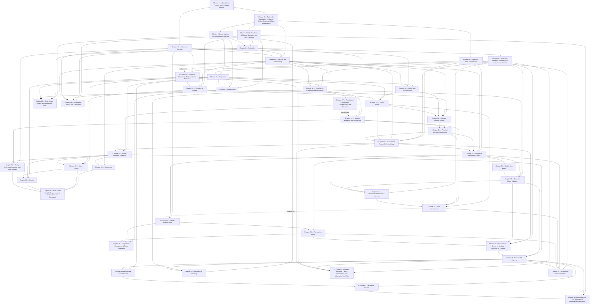

# Chapter prerequisite graph
Solid arrows indicate required preparation; dashed arrows show useful background. Use the chapter numbers to plan your reading, then follow the project milestones in the learning route.

## Reading the prerequisites

- Read Chapter 13 before Chapter 15 for valuation and financial claims, and Chapter 24 before Chapter 26 for accounting conventions and value/quality comparisons.
- Chapters 11, 17 and 33 provide background for Chapters 12, 18 and 34 respectively. Chapter 18 builds on the dependence concepts in Chapter 16; cointegration and VAR are not required for its EWMA/ARCH/GARCH derivations.
- See the [learning route](learning_roadmap.md) for project prerequisites.
