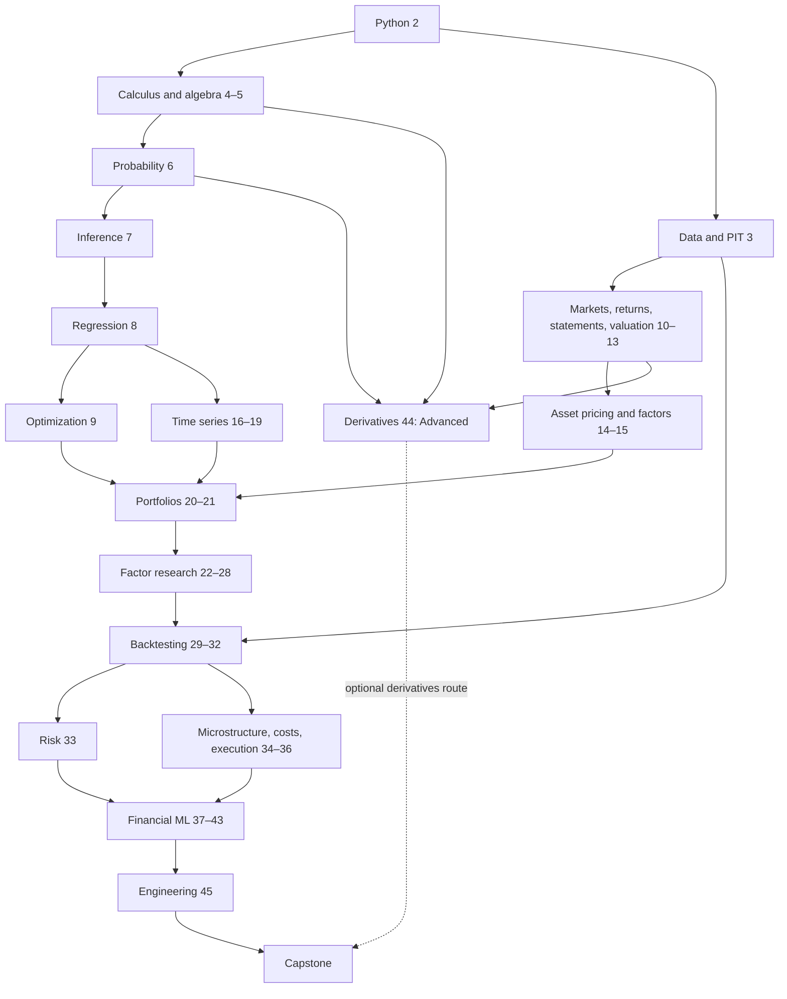

# Learning route and project milestones

Must Know is the research core; Should Know adds interpretation and implementation; Advanced needs stronger preparation; Optional is a route choice. Understand core definitions before selecting tools by the problem. Domain arrows are an overview, not the required-edge list; use the [chapter DAG](dependency_graph.md).

1. Chapters 1–3 establish the lifecycle, Python and time-data contracts. Preview return definitions in Chapter 11 and the market structure needed from Chapter 10.
2. Chapters 4–9 cover calculus, linear algebra, probability, inference, regression and optimization. Chapter 8 uses CAPM to practice regression; its equilibrium interpretation waits until Chapter 14.
3. Chapters 10–15 supply markets, statements, valuation and asset pricing. Complete Project 1 after Chapter 11 and Project 2 after Chapter 15.
4. Chapters 16–21 cover dependence, cointegration, volatility and portfolios. Chapter 19 can be revisited after basic portfolio theory. Complete Project 3 after Chapter 21.
5. Chapters 22–28 develop and combine alpha hypotheses. Small ledgers illustrate methods; assess strategy validity only after the backtesting, validation and cost material in Chapters 29–35.
6. Chapters 29–35 cover backtests, biases, validation, performance, risk and costs; add execution in Chapter 36, then Projects 4 and 5.
7. Chapters 37–40 form the financial-ML core and Project 6. Chapters 41–43 add tools chosen by the problem; Chapter 45 organizes research into an executable project.
8. Finish the Capstone. The derivatives route adds Chapter 44; stochastic calculus is not a prerequisite for starting equity-factor research.

| Project | Prerequisite chapters | Completion criterion |
|---|---|---|
| [Project 1: Financial data analysis](../projects/project01/README.md) | 2, 3, 10, 11 | Return, wealth, volatility and drawdown calculations checked against hand examples; historical data retain provenance. |
| [Project 2: CAPM and Fama–French](../projects/project02/README.md) | 8, 11, 14, 15 | Check excess returns, units, HAC and exposure interpretation. |
| [Project 3: Portfolio optimization](../projects/project03/README.md) | 9, 18, 20, 21 | Estimate inside training windows and compare rolling OOS baselines and costs. |
| [Project 4: Multi-factor equity strategy](../projects/project04/README.md) | 12, 23–26, 28–31, 35–36 | Require PIT signals, historical universes, net returns and robustness; constructed sublabs do not close market evidence. |
| [Project 5: Pairs trading](../projects/project05/README.md) | 16–17, 29–31, 35–36 | Select within training, freeze rules and reconcile self-financing OOS ledgers and costs. |
| [Project 6: Machine-learning alpha](../projects/project06/README.md) | 31, 35, 37–40, 43 | Split by date, fit transforms inside training and compare baselines, net returns and stability. |
| [Capstone](../capstone/README.md) | Methods from all six projects, 33, 45 | 18 report items and reproducible workflow; negative results can pass. Market execution has separate gates. |

Early preparation: download plans/dictionaries for P1; French format parsing for P2; equal-weight baseline for P3; filing PIT dictionaries for P4; alignment for P5; label calendars for P6; hypothesis and data feasibility for the Capstone.

Derivatives route: 4, 6, 9, 10, 11→44→volatility and numerical pricing. Execution route: 10, 29, 33–36, 45→event data, matching and inventory risk. Both are advanced routes. Establish a reliable simple baseline before deciding whether deep learning, LLMs or state-space models are needed. Keep project historical acceptance, constructed sublabs and market evidence distinct; report insignificant alpha and failure after costs faithfully.
