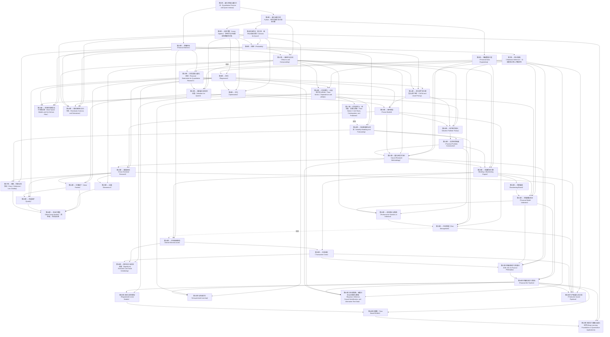

# 章节级先修依赖图
实线是必须先修，虚线是背景联系；没有边不表示没有应用关系。当前45节点、120条必须先修边，另有3条背景边。原118边保留，新增13→15和24→26。

13→15补足估值与财务索取权解释，24→26补足报表口径及价值/质量比较。11→12只提供收益背景；17→18不作硬依赖：第18章以给定均值创新、平方和及第16章依赖结构推导EWMA/ARCH/GARCH，不调用单位根、协整、VAR或EG。33→34提供风险背景而非理解报价/盘口的必需输入。
第12、15、18、26、34章中英开篇的对应导航已随BIL23B整合接受。项目条件见[学习路线](learning_roadmap.md)。
