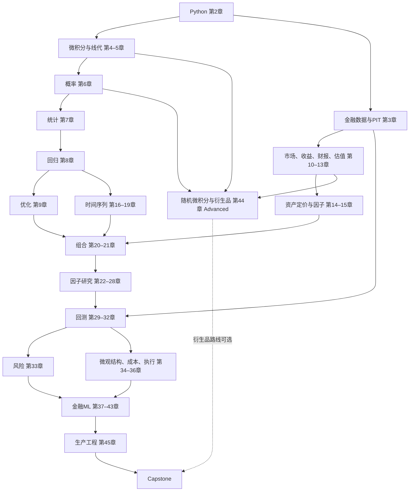

# 学习路线与项目节点

Must Know是研究主线，Should Know补解释和实现，Advanced要求更强先修，Optional是路线选择。先完整理解章内核心定义，再按问题选择工具。领域箭头用于概览，不等于严格先修边；以[章节DAG](dependency_graph.md)为准。

1. 第1–3章建立生命周期、Python与时间数据契约；预读第11章收益定义与第10章必要市场结构。
2. 第4–9章完成微积分、线代、概率、统计、回归、优化。第8章CAPM案例先用于回归练习，金融均衡解释留到第14章。
3. 第10–15章补金融、报表、估值和资产定价；第11章后完成Project 1，第15章后完成Project 2。
4. 第16–21章学习时间依赖、协整、波动与组合；第19章可在掌握基础组合后回学。第21章后完成Project 3。
5. 第22–28章提出与组合Alpha信号。先使用小型账本做演示，策略有效性等完成第29–35章再评价。
6. 第29–35章完成回测、偏差、验证、绩效、风险和成本；补第36章执行。完成Project 4及Project 5。
7. 第37–40章完成金融ML主线与Project 6。第41–43章提供扩展工具；第45章把研究整理成可运行项目。
8. 完成Capstone。衍生品路线另学第44章；权益因子研究不需要把随机微积分作为启动门槛。

| 项目 | 先修章节 | 完成条件 |
|---|---|---|
| [Project 1: 金融数据分析](../../../projects/project01/README.md) | 2, 3, 10, 11 | 核对收益、财富、波动与回撤手算；历史数据保留出处。 |
| [Project 2: CAPM与Fama–French](../../../projects/project02/README.md) | 8, 11, 14, 15 | 核对超额收益、单位、HAC与暴露解释。 |
| [Project 3: 组合优化](../../../projects/project03/README.md) | 9, 18, 20, 21 | 训练内估计，比较滚动样本外基准与成本。 |
| [Project 4: 多因子股票策略](../../../projects/project04/README.md) | 12, 23–26, 28–31, 35–36 | 要求PIT信号、历史股票池、净收益与稳健性；构造子实验不补齐市场证据。 |
| [Project 5: 配对交易](../../../projects/project05/README.md) | 16–17, 29–31, 35–36 | 训练内筛选并冻结规则，对账自融资样本外账本与成本。 |
| [Project 6: 机器学习Alpha](../../../projects/project06/README.md) | 31, 35, 37–40, 43 | 按日期切分，训练内拟合变换，比较基准、净收益与稳定性。 |
| [Capstone](../../../capstone/README.md) | 六项目方法、33、45 | 按报告模板完成研究记录，提供复现步骤，如实报告结果。 |

开始项目前，先完成相应准备：项目1核对数据字段与获取方式；项目2熟悉 French 文件格式；项目3建立等权基准；项目4整理财报的可用时间；项目5对齐两只资产的数据；项目6明确标签区间与训练、测试日期。综合项目从研究假设和数据可行性开始。

衍生品方向：4、6、9、10、11→44→波动与数值定价。执行方向：10、29、33–36、45→事件数据、撮合与库存风险。两者为进阶路线。先建可靠简单基准，再判断深度学习、LLM或状态空间模型是否必要。构造实验用于理解方法，真实市场结论需要相应的数据与检验。没有显著 alpha，或收益在计入成本后消失，也应如实记录。
