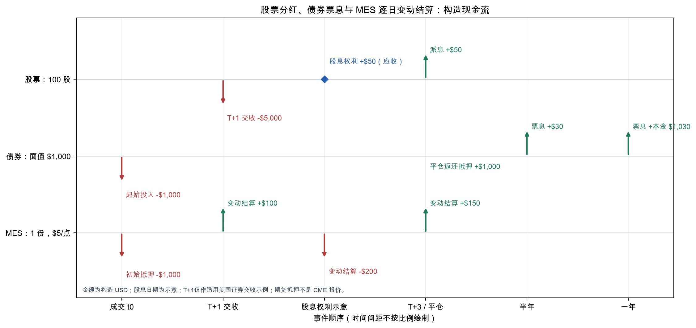

# 第10章 — 金融市场（Financial Markets）

> 主线：一笔交易会经过报价、成交、清算和交收；它的经济收益、权利义务和现金流时点取决于工具与合约。先修：第 1 章的时间戳和数据生命周期。完成后，你能沿着一笔股票、债券、外汇或衍生品交易说明谁承担什么义务、何时转移什么资产，以及名义金额、保证金和实际损益各是什么。

## 1. 本章目标

读完本章，你应能把股票、交易所交易基金、债券、外汇、期货、期权、互换和回购协议写成可核对的权利义务；区分经纪商、交易商、交易所、中央对手方与托管交收机构；按交易日、清算日和交收日排列事件；用单位明确的式子计算股息总收益、票息、互换净支付、汇率换算、期货变动结算、期权到期损益和回购折扣；解释卖空和保证金为何可能带来超过初始抵押金额的损失。

本章不推导完整债券估值、期权定价模型或订单簿执行模型。后续章节分别处理收益构造、微观结构与成本、压力风险和衍生品定价。这里建立的是工具语言和现金流账本。

## 2. 为什么 Quant 需要它

量化研究中的一列数字通常只是合约关系的某个投影。股票价格变化没有包含所有股息；基金份额价格不等于基金净资产价值；期货的指数点数乘以合约乘数才成为货币损益；外汇“1.10”若没有报价方向就无法解释；同一笔交易的成交日和现金交收日也可能不同。

这些差异会改变收益分母、信号何时可用、损失如何结算以及回测里该记哪天。研究者若把期货名义价值当成本金，会算错收益率；若把保证金当最大损失，会低估强平前的现金缺口；若把报告期末、成交时刻和交收日压成同一时间，会让账本看起来整齐，却不符合合约。

因此先问四个问题：交易标的是什么，报价单位是什么，双方承诺了什么，现金或证券什么时候转移？接下来用这四问贯穿各种工具。

## 3. 直觉

先看三个小账本。以下全是教学构造，不是历史行情。一个投资者买 100 股，成交价每股 50 美元，之后价格变为每股 50.20 美元，并取得每股 0.50 美元的股息权利。一个面值 1,000 美元、年票息率 6% 的固定票息债券每半年支付一次利息。一个 CME 微型 E-mini 标普 500 指数期货（Micro E-mini S&P 500 futures, MES）多头头寸（long position）按每指数点 5 美元计算结算现金流。

::: {.body-example title="完整例题：股票权利与现金事件账本"}

先把第一笔股票交易写成事件表。表中的日期、价格和股息安排均为构造；“已形成应收权利”和“现金到账”分开记录，证券价值另按当时价格估计。

| 事件 | 谁对谁承担什么 | 数量与金额 | 该日现金变化（投资者视角） |
|---|---|---|---|
| 成交 T | 投资者通过经纪商买入，买卖双方形成交付义务 | 100股 × USD 50/share = USD 5,000 | 尚未交收，现金不自动扣款 |
| 清算 | 清算安排确认双方交付义务；是否净额/经CCP按适用规则 | 证券100股、对价USD 5,000 | 计算义务不等于支付现金 |
| 交收 | 投资者支付对价，取得交收证券 | 交付100股，对付USD 5,000 | −USD 5,000 |
| 股息权利形成 | 按题设该持有者取得发行人的股息请求权 | 100股 × USD 0.50/share = USD 50 | 0；应收股息增加USD 50 |
| 股息支付 | 发行人经支付/托管安排支付股息 | USD 50 | +USD 50，应收股息减少USD 50 |
| 期末估值 | 投资者仍持有100股，市价USD 50.20/share | 证券价值USD 5,020 | 估值本身不转移现金 |

于是期末持有财富是证券USD 5,020加股息现金USD 50，共USD 5,070。若期末股息还未支付且请求权仍有效，则现金尚未增加，财富应含USD 50应收；不能同时把应收和已支付股息各加一次。这个简化表没有借款、税费或现金利息；实际交付义务按成交确认和产品规则核对。第11章用这些期末价值构造收益区间，第29章再建立成交和费用账本。

:::

股票的持有期财富包括卖出时证券价值和属于持有期的股息；债券持有人按条款收息，通常到期另收本金；期货不要求按指数全额买入一篮子证券，而是按合约变化和乘数结算损益，同时存入履约抵押。它们都可能跟“市场上涨”有关，现金流结构却不相同。

可以把一份合约想成一张明确写着计量单位和日期的承诺书。单位像配方上的克数，时间像约定取货日；漏掉任何一项，数字就失去可执行含义。这个比喻只帮助记忆，真实权利仍以产品文件、适用法律和交易规则为准。

## 4. 数学基础

本章金额统一以明确的币种表示。美元金额记 USD，欧元记 EUR；“每股美元”是 USD/share，“每指数点美元”是 USD/index point。乘以股票数量（share）或期货份数（contract）后才得到 USD。收益率是无量纲比例，通常以小数储存；5% 写作 0.05。

用 $t_0$ 表示成交或持有区间起点，用 $t_1$ 表示该区间终点。信号时点（signal time）是策略形成信号时已拥有信息的时刻，成交时点（trade time）是订单实际可成交的时刻；收益区间（return interval）是收益覆盖的起止区间。成交 $t_0$ 不自动等于交收日，也不一定等于信息可用时刻。回测应满足信息在信号形成前可用，并明确成交延迟；本章的构造账本只演示合约现金流，不模拟撮合。

“一份合约”不是通用单位。每种产品都有合约规模、币种、报价精度、到期或交割方式。公式中的 $N$、$M$、$S$、$K$ 必须在使用处注明：数量 $N$ 的单位、乘数 $M$ 的单位、价格 $S$ 的报价方向，以及执行价 $K$ 的币种和标的单位。

## 5. 正式定义

**股票（stock/equity）**代表公司的剩余权益。股东可能获得现金股息和表决权，但股息不是保证支付的固定利息，清算顺序也通常位于债权人之后。普通股权利、投票安排、分红和公司行动以发行文件和适用法律为准。

**交易所交易基金（exchange-traded fund, ETF）**是持有一篮子资产或按基金文件采用其他策略、且份额在交易场所交易的基金。零售交易者通常按盘中市场价买卖份额；净资产价值（net asset value, NAV）一般按基金估值规则计算，市场价可能相对 NAV 折价（discount）或溢价（premium）。ETF 份额不等于投资者可随时逐只赎回底层资产。此处是 Investor.gov 的美国投资者教育口径，个别产品条款可能不同。

**债券（bond）**是发行人按合同支付利息、到期偿还本金或按其他约定偿付的债务工具。面值 $F$ 以货币计，票息率 $c$ 是年化比例，付息频率 $m$ 的单位是次/年；简单固定票息下，每次票息为 $Fc/m$。发行人信用、优先级、担保、提前赎回和偿付结构都可能改变实际现金流。

**外汇（foreign exchange, FX）**交易一币种换另一币种。本文写 $S_{Q/B}$ 表示“每 1 单位基础货币 $B$ 兑换多少报价货币 $Q$”；若 $S_{USD/EUR}=1.10$，则 1 EUR 报价为 1.10 USD。买入 EUR 10,000 按此中间汇率折算为 USD 11,000，未计点差、费用或结算安排。

**期货（future）**是在标准化交易场所交易、按合约规则每日或指定频率结算的衍生品。**合约乘数（contract multiplier）**把标的报价单位转换成合约货币损益。例如 CME 的微型 MES 每张合约每指数点对应 USD 5，E-mini 标普 500 指数期货（E-mini S&P 500 futures, ES）每张合约每指数点对应 USD 50；乘数只说明损益比例，不代表合约价值或保证金本身。带方向数量为正是多头头寸（long position），为负是空头头寸（short position）；这描述价格敞口方向，不代表持有指数成分股。期货价格变化触发的逐期现金调整称为变动保证金（variation margin）；结算时点及其细节由合约规则确定。

**期权（option）**给予买方按合约约定行权或放弃的权利，卖方承担相应义务。执行价（strike price）为 $K$，买方支付或卖方收到的期权费（premium）也是开仓现金流。看涨期权的到期支付额（payoff）是 \(\max(S_T-K,0)\)，看跌期权是 \(\max(K-S_T,0)\)；\(S_T,K\) 使用同一标的单位和报价货币。期权权利、行权方式、到期和结算标的依具体合约而定。

**互换（swap）**是双方约定在未来交换一组现金流的合约。利率互换通常用名义本金（notional amount）计算利息，但并不一定交换名义本金；例如一方按固定利率支付、按浮动利率收取，双方也可按合约净额结算。支付方向、浮动基准、重置日和结算净额由合约定义。清算方式可为中央清算或双边安排，不能从“swap”一词单独推断抵押规则。

**回购协议（repurchase agreement, repo）**是一方出售证券并约定未来按约定价格买回的融资交易，经济上常以证券作担保。**折扣率（haircut）**表示担保品市场价值中未被融资的比例；实际折扣、估值频率、追加担保与违约处置由合同和市场惯例决定。

::: {.body-definition title="定义：交易、清算与交收的不同职责"}

**经纪商（broker）**通常代理客户订单或安排交易；**交易商（dealer）**可用自身账户买卖并承担库存风险；**做市商（market maker）**持续或按规则提供双边报价以促进交易。机构可兼任多个角色，角色的法定义务取决于司法辖区和业务。**交易所（exchange）**组织挂牌、报价或撮合；**清算（clearing）**确认、净额结算（netting）、风险管理或通过中央对手方（central counterparty, CCP）替代原交易关系；**交收（settlement）**实际转移证券、现金或其他合约资产。交易、清算、交收是相关步骤，不是同义词。

:::

**保证金（margin）**是履约或融资安排所需的资金/证券。证券保证金借款（securities margin loan）是客户向券商借款并以账户资产担保；期货保证金更接近履约保证金（performance bond），不是购买全部名义金额的首付款。期货初始保证金（initial margin）是开仓需缴金额，维持保证金（maintenance margin）是账户维持头寸所需的最低水平；数额会随规则和风险变化。**抵押品（collateral）**支持履约或信用敞口，价值可能变化并被追加。初始保证金既不是预付的最大亏损，也不限制损失；损失可能超过账户原有抵押金额。

## 6. 推导

持有 $N$ 股股票，起始价 $P_0$、终止价 $P_1$，期间每股现金股息 $D$，所有价格与股息单位都是 USD/share。起初投入 $NP_0$ USD，期末证券价值 $NP_1$ USD，并取得现金股息 $ND$ USD。本段限于 $N>0$、$P_0>0$ 的现金股票持有；同一币种的 $P_1$ 与 $D$ 按本例取非负有限值，初始投入 $NP_0$ 才可作为分母。因此简单总收益为

\[
R_{total}=\frac{NP_1+ND-NP_0}{NP_0}
=\frac{P_1-P_0+D}{P_0}.
\]

约掉 $N$ 是因为股数同时乘在分子、分母；这个推导假设股息属于该持有期间、以现金计且不再投资，忽略税费、拆股等公司行动（corporate actions）。价格收益则是 \((P_1-P_0)/P_0\)，没有股息项。

固定票息债券的每期现金流从“面值 × 年票息率”得到年票息金额 $Fc$；一年支付 $m$ 次时，均匀拆为 $C=Fc/m$。面值 USD 1,000、年票息率 0.06、每年两次，得到每期 USD 30。总还本日另按约定支付本金；票息率不是债券市场收益率，也不直接告诉你债券当前价格。

对一份不交换本金、单币种的简化固定对浮动利率互换，令 $N$ 为名义金额，$r_f$ 为该期浮动年利率，$r_k$ 为固定年利率，$\delta$ 为该计息期的年分数。收浮动、付固定一方本期净现金流为

\[
CF=N(r_f-r_k)\delta.
\]

若 $N=USD\ 1{,}000{,}000$、$r_f=3.6\%$、$r_k=4.0\%$、$\delta=0.25$，净额为 $-USD\ 1{,}000$，即该方净支付 USD 1,000。$N$ 以 USD 计，利率是年化比例，$\delta$ 是无量纲年分数，因此公式结果仍是 USD。这个算式假设两腿同币种、同一计息期、简单计息、无费用且以期末结算；不同浮动基准、日计数、支付频率或本金交换条款需要按合约重新计算。名义金额是利息计算基数，不是这次净现金支付额。

对期货，令 $q$ 为带方向的合约份数（多头为正，空头为负），$M$ 为 USD/(contract $\cdot$ index point)，连续两次结算价变化为 \(\Delta F_t\) index points，则期间变动结算为

\[
VM_t=qM\Delta F_t\quad [USD].
\]

多头价格上涨产生正现金流，价格下跌产生负现金流；空头符号相反。若每天按结算价支付/收取变动金额，几日名义现金流之和为 $qM(F_T-F_0)$，前提是合约乘数和持仓数量未变，且没有费用、追加抵押、交割或其他头寸变化。这个期间现金流求和不计算每次结算后中途余额的利息、再投资或融资成本；不同付款时点下，名义现金流求和与带融资的经济损益可能不同。它是期货损益，不等于现金证券收益率；将它除以某个初始保证金，只得到依赖资本占用定义的收益率，不能称为对名义本金的现金资产回报。

::: {.body-example title="完整例题：MES现金与三种资本分母"}

把名义敞口、抵押余额和损益放进三列。例如本章一份MES多头、乘数USD 5/index point、初始结算5,000点，假设存入USD 1,000履约资金；此数是构造条件。表中不提款、不追加、无利息或费用，余额只作现金需求演示，不代替经纪商保证金规则。

| 结算点 | 参考名义敞口USD | 本次VM USD | 抵押账户余额USD |
|---|---|---|---|
| 5,000（初始） | 25,000 | 尚无收益区间 | 1,000 |
| 5,020 | 25,100 | +100 | 1,100 |
| 4,980 | 24,900 | −200 | 900 |
| 5,010 | 25,050 | +150 | 1,050 |

累计交易损益USD 50。除以初始名义敞口USD 25,000是0.2%，除以假设初始押金USD 1,000是5%；若该头寸配置在初始USD 100,000的组合中，它对该组合的本期毛损益贡献是0.05%。三者回答不同资金基数的问题，应随结果写出分母。账户实际是否须追保，还取决于维持要求、其他头寸及客户规则；名义金额变化不是额外支付USD 50。

:::

::: {.body-example title="两条覆盖利率平价路径与完整半年算例"}

FX 报价的量纲也可直接检查。基础货币金额 $A_B$ 单位 B，乘以 $S_{Q/B}$ 单位 Q/B，得到报价货币 $A_Q=A_BS_{Q/B}$ 单位 Q。简单利率、同到期日和报价方向下，覆盖利率平价（covered interest parity）的教学参考关系可写作

\[
F_{Q/B}=S_{Q/B}\frac{1+r_Q\tau}{1+r_B\tau}.
\]

从同一笔初始资本1 B出发，把两条路径都写成到期Q金额，才能比较：

| 路径 | 起点 | 中间操作 | 到期Q金额 |
|---|---|---|---|
| B存款并覆盖汇率 | 1 B | 按B利率存到期；在起点卖出远期的到期B金额 | $(1+r_B\tau)F_{Q/B}$ Q |
| 即期换Q并存款 | 1 B | 即期换得$S_{Q/B}$ Q，再按Q利率存到期 | $S_{Q/B}(1+r_Q\tau)$ Q |

在可按这些利率借贷、可锁定远期且无交易摩擦的同到期条件下，两条终值相等：$(1+r_B\tau)F_{Q/B}=S_{Q/B}(1+r_Q\tau)$。除以正的B累积因子便得到上式。若两条终值不同，套利方向还要同时建立融资腿，不能把已有的1 B免费算入利润。

用本章半年的USD/EUR例，路径一的EUR 1变为EUR 1.015，再以远期换成USD $1.015F$；路径二先换USD 1.10，再变为USD $1.10\times1.025=1.1275$。所以$F=1.1275/1.015=1.1108374384$ USD/EUR。反向报价是$1/F$ EUR/USD；交换币种名称也要交换利率所在的分子与分母。

这里 $r_Q,r_B$ 是年化简单利率，\(\tau\) 以年计，$F$ 和 $S$ 的单位都是 Q/B。这两条投资路径假设简单累积因子 $1+r_Q\tau$ 与 $1+r_B\tau$ 均为正。它来自到期价值相等：持有 1 B 并按 B 利率累积，或先换成 Q 并按 Q 利率累积，再由远期锁定兑换；实际交易还受报价点差、日计数、交割日、信用、融资、抵押和跨币种基差影响。公式是条件关系，不是可直接成交的套利承诺。

:::

## 7. 金融解释

普通现金股票买入需要支付全部成交金额，损益来自价格变化、股息和可能的公司行动。卖空（short sale）通常先通过证券借贷（securities lending）借入证券再卖出，之后买回归还；若股价上涨，回补成本可能很高，且存在借券费、股息替代支付、召回、保证金和强制买回规则。此机制不表示每个市场都允许相同卖空行为。

债券持有者有合同现金流请求权，但可能承受发行人违约、利率、通胀、流动性、再投资和提前赎回风险。债券收益率期限结构（term structure）描述不同期限利率或收益率的关系；久期（duration）概括小幅收益率变化下价格的局部敏感度；凸性（convexity）刻画价格曲线弯曲程度。作为局部近似，修正久期 $D_{mod}$ 和凸性 $C$ 可写

\[
\frac{\Delta P}{P}\approx-D_{mod}\Delta y+\frac12C(\Delta y)^2.
\]

若 $\Delta y$ 使用年化收益率的小数变化，久期单位为年（按相应复利约定解释），$C$ 的单位为年平方。收益率上升 1 个百分点是 $\Delta y=0.01$，即 100 个基点（basis points, bps），不是 1 个基点；$1\ \mathrm{bp}=0.0001$。近似适用于局部冲击、现金流结构大致固定且收益率定义一致的情况；它不是完整重估，也没有涵盖信用利差、期权性或曲线非平行变化。下面在明确复利约定下计算这两个敏感度；第27章的债券carry与滑降使用其中的零息债形式，第44章处理衍生品定价，不把它当作未设置的独立固定收益章。

### 7.1 从现金流到久期和凸性

把第4章的单笔折现扩成一组固定现金流。设第$t_i$年支付$CF_i$ USD，以同一个年有效收益率$y>-1$折现，且本例估值日没有另行扣应计利息：

\[
P(y)=\sum_i CF_i(1+y)^{-t_i}.
\]

每项先用幂函数求导，再求和：$P'(y)=-\sum_i t_iCF_i(1+y)^{-t_i-1}$，$P''(y)=\sum_i t_i(t_i+1)CF_i(1+y)^{-t_i-2}$。定义修正久期$D_{mod}=-P'(y)/P(y)$，凸性$C=P''(y)/P(y)$，它们把USD价格变化转成相对变化。泰勒展开$P(y+\Delta y)=P(y)+P'(y)\Delta y+P''(y)(\Delta y)^2/2+\cdots$，除以$P(y)>0$才得到上面的价格近似。年复利下麦考利久期（Macaulay duration）为$D_{Mac}=\sum_i t_i[CF_i(1+y)^{-t_i}/P]$；由两式逐项比较得到$D_{mod}=D_{Mac}/(1+y)$。这些时间敏感度按年作为计息基准；换成半年复利、不同贴现曲线或有期权性的现金流必须重新求导。

::: {.body-example title="完整例题：两年债的敏感度与精确重估"}

构造一张面值USD 1,000、每年付USD 60、两年到期的债券，以$y=5\%$估值：

| 支付时点（年） | 现金流USD | 折现值USD | $-P'$贡献 | $P''$贡献 |
|---|---|---|---|---|
| 1 | 60 | $60/1.05=57.142857$ | $60/1.05^2=54.421769$ | $120/1.05^3=103.660512$ |
| 2 | 1,060 | $1060/1.05^2=961.451247$ | $2120/1.05^3=1831.335709$ | $6360/1.05^4=5232.387740$ |
| 合计 | 1,120（未折现） | $P=1018.594104$ | $1885.757478$ | $5336.048252$ |

所以$D_{mod}=1.851334$，$C=5.238640$。收益率升至6%，$\Delta y=0.01$：一阶项为$-0.018513336$，二阶项为$+0.000261932$，合计约$-1.825140\%$；精确重估是$60/1.06+1060/1.06^2=1000$ USD，即$-1.825467\%$。凸性项改善了本例的小冲击近似，但没有替代重新贴现。风险报告可用它估计局部利率敞口；信用恶化导致现金流改变时，不能仍当作只变$y$的同一题。

:::

期货的名义敞口等于期货指数水平乘乘数再乘合约数。MES 在 5,000 点附近的一份构造名义敞口是 5,000 index points × USD 5/index point = USD 25,000。这个数字描述参考敞口规模，通常不是签约时付出的 USD 25,000，也不是保证金；损益按之后的点数变化乘乘数计算。交易所、清算会员（clearing member）和经纪商可因产品、客户、波动和风险规则调整保证金。短缺可能触发追加、减仓或平仓；极端行情下实现损失可能超过初始抵押。

期货换月/展期（futures roll）是退出近月或即将到期合约、建立较远到期合约的持仓操作。换月记录应包含两个合约、各自交易价格和数量、乘数、费用及时间；近远月价差本身不是一笔自动入账的独立损失。其收益归因方法和实证成本留给后续策略与交易章节。

期权的权利义务不对称。买方通常先支付期权费，平仓前的损益还受时间、隐含波动率、利率、分红和行权规则影响；到期 payoff 只展示合约到期时的内在价值。简单全额支付的多头期权若不计后续费用，最大合约损失通常是已付期权费；卖方则承担履约义务，短看涨的潜在损失可很大。不能拿一条到期 payoff 线替代全部风险披露。

互换和回购都把时间上的现金流承诺写进合同，但它们不是一个通用“杠杆”类别。互换现金流可能按净额结算；repo 以证券作担保并约定逆向买回；各自清算、抵押和违约条款要查产品文件。中央清算可改变交易对手结构并要求保证金，但不让经济损失消失。

## 8. Numerical Example

**股票总收益。** 构造数据为 $N=100$ 股，$P_0=USD\ 50.00/share$，$P_1=USD\ 50.20/share$，$D=USD\ 0.50/share$。起始投入 USD 5,000；期末股票价值 USD 5,020，股息 USD 50，合计 USD 5,070。总收益 $(5070-5000)/5000=0.014=1.4\%$。只看价格会得到 $(5020-5000)/5000=0.004=0.4\%$。

**债券票息。** 面值 USD 1,000，票息率 6%/年，每年两次支付，单次票息 $1000×0.06÷2=USD\ 30$。假设持有一年且发行人按时兑付，到 6 个月收 USD 30，到 12 个月收 USD 30 票息和 USD 1,000 本金，一年末该笔现金流为 USD 1,030；加上半年前的票息，全年收到 USD 1,060。这里未计买入价、应计利息、税、违约和再投资。

**利率互换。** 构造交易有效日为 2027-01-04，首个计息期在 2027-04-05 结算；为便于手算，年分数取 $\delta=0.25$。名义金额 USD 1,000,000，同一计息期内收浮动 3.6%/年、付固定 4.0%/年；收浮动方净现金流为 $1{,}000{,}000×(0.036−0.04)×0.25=-USD\ 1{,}000$，故需净支付 USD 1,000。假设本合约仅交换利息差额，不交换名义本金，且不计费用、折现、信用和抵押成本。日期与利率均为教学构造。

**MES 逐期结算。** CME 规格页面核验的 MES 乘数为 USD 5/index point。构造结算价从 5,000 变为 5,020、4,980、5,010 点。一份多头每段 VM 为 $+20×5=+USD\ 100$、$-40×5=-USD\ 200$、$+30×5=+USD\ 150$，累计 +USD 50，与 $5×(5010-5000)=USD\ 50$ 相同。若价格从 5,000 跌 300 点，损失为 $−300×5=−USD\ 1,500$。即使账户最初假设存入 USD 1,000，损失仍可超过它；USD 1,000 只是图示用抵押数，不是当前 CME margin quote，也不是合约保证的最大损失。

**FX 报价。** $S_{USD/EUR}=1.10\ USD/EUR$，把 EUR 10,000 换算成 USD 11,000。若年化简单 USD 利率为 5%，EUR 利率为 3%，期限半年的简化远期参考价为 $1.10×(1+0.05×0.5)/(1+0.03×0.5)=1.110837\ USD/EUR$。真实双边报价不会只由这一个式子决定。

**期权与 repo。** 构造一份乘数 100 股/合约的看涨期权，执行价 USD 100/share，期权费 USD 4/share，到期股价 USD 110/share；多头到期净损益为 $(110-100-4)×100=USD\ 600$。若一份短看跌，股价 USD 90/share、执行价 USD 100/share、期权费 USD 3/share，净损益为 $-[(100-90)-3]×100=-USD\ 700$。构造 USD 1,000,000 市值的 repo 担保品和 5% 折扣，简单可融资现金为 $1,000,000×(1-0.05)=USD\ 950,000$；USD 50,000 是价值缓冲，不保证违约时足额回收。

看涨期权的构造例可拆成时间与状态：开仓支付$4\times100=USD\ 400$；到期$S_T=110$时收到$(110-100)\times100=USD\ 1,000$，名义现金和为USD 600。到期若$S_T\le100$，payoff为0、profit为−USD 400；若$100<S_T<104$，payoff为正但仍亏损；在104时才盈亏平衡。这里profit指忽略融资和费用的到期净损益（profit），若要把开仓支付折算到同一终值日期，还应扣期权费的资金成本。短看跌的USD 300开仓收入与USD 1,000到期支付给出−USD 700；不能把负的payoff和已收期权费漏掉一项。

## 9. Python Implementation

### 本读者版的默认运行入口

从接受I3读者包根目录，按其[环境说明](../../editions/zh/README.md)建立独立环境后运行：

```bash
.venv/bin/python run_notebook.py notebooks/ch10_markets.ipynb
```

Notebook调用随包共用实现。第10章全部是合约现金流的构造输入。运行器将新内核执行记录写入唯一的runs/execution_*目录，Notebook新生成的图表写入另一唯一UUID子目录；终端打印实际位置。未随包提供的French数据不默认读取，也不下载。下面的旧课程制作测试与历史CLI按课程工作根说明；读者采用上方Notebook内断言。可选历史数据另遵守[数据契约](../../editions/zh/OPTIONAL_DATA.md)，本批未重跑。

### 历史课程工作根与原实现

本章核心函数位于 [src/quant_course/market_instruments.py](../../src/quant_course/market_instruments.py)，用函数名、参数名和 docstring 标明币种与报价方向，拒绝 NaN、正负无穷、缺失和无效输入，不用填零掩盖数据问题。它包含股票总收益、债券票息、简化互换净现金流、FX 换算与远期参考报价、期货逐期变动结算、期权到期损益和 repo 融资额。[code/ch10_markets.py](../../code/ch10_markets.py) 提供命令行入口并生成教学图；测试使用 pytest。运行命令从课程根目录执行：

```bash
.venv/bin/python code/ch10_markets.py --output-dir figures/a3
.venv/bin/python -m pytest tests/test_ch10_markets.py -q
```

Notebook 在 [notebooks/ch10_markets.ipynb](../../notebooks/ch10_markets.ipynb)，从项目根目录打开并按顺序重跑所有单元。Notebook 和测试直接调用共享包中的核心函数，命令行脚本只承担图表生成与演示输出。本章没有真实价格序列或随机模拟，故不设随机种子。输入全是构造数据，频率为现金流事件或结算区间；代码输出是金额/收益结果，不生成可交易信号，不模拟信号时点（signal time）、成交时点（trade time）或回报估计。

接口实现明确约定：股票股息由调用者确认属于持有区间；汇率参数始终是 quote per one base；期货价格变化是连续两次结算的 index points；期权费和到期标的价使用同一货币/标的单位，乘数显式输入；repo haircut 满足 \(0\le h<1\)。函数返回金额或简单收益，不会替使用者选税务、融资、日历、清算或合约规则。

## 10. Visualization



脚本实际生成 [现金流时间线](../../figures/a3/ch10_cashflow_timeline.png)。横轴是事件顺序标签，从交易到 T+1、股息权利示意、T+3，再到债券半年和一年节点；节点间距不按比例表示日数或实际日历。T+1 只作适用美国证券交收周期的示例；股息日期与其他泳道日期均为构造安排，不代表它们在真实市场具有相同日期。纵轴是股票、面值 USD 1,000 债券和一份 MES 三条分类泳道，不是金额刻度。箭头旁金额单位为 USD，向上表示该账户收到现金，向下表示支付/缴存；蓝色菱形单独标记股票股息权利形成时点，不代表当日收到现金。

图中股票买入款在构造的 T+1 节点交收；之后单独标出股息权利形成和稍后付款。债券票息按构造的半年周期发生，期货逐次结算正负现金流并在平仓时示意返还假设的抵押。抵押金是账户资金转移，不是交易损失。读图时应关注各工具现金流发生时点和性质不同，而不是拿不同泳道的箭头高度或间距比较金额。

## 11. Real Market Example

本章没有读取或下载真实行情，也没有声称这些构造数字代表市场成交。现实规则例只用美国证券交收和 CME 产品规格：SEC staff FAQ 称相关修订规则的合规日为 2024-05-28。Rule 15c6-1 适用于受该规则约束、由在美国注册的经纪商或交易商执行的证券交易；规则也列明证券类别和交易安排的例外，且某些交易可在成交时明确约定延长交收。这里的例子限于适用规则的证券交易：若周二 2024-05-28 成交，按营业日计的 T+1 是周三 2024-05-29。不能据此推出所有债券、外汇、期货、repo、跨境证券或每类交易都按这个日历交收。

DTCC 对 NSCC 连续净额结算（Continuous Net Settlement, CNS）和 DTC 证券/资金簿记转移的说明是美国市场基础设施案例，不是全世界清算架构的定义。CME 产品规格显示 MES 是 USD 5 × S&P 500 指数点，ES 是 USD 50 × 指数点；本章仅引用乘数，未采用页面上会随时间变化的保证金或名义估值。来源页面与阅读范围见 [source_notes.md](source_notes.md)。

## 12. Common Mistakes

**把价格收益叫作股票总收益。** 对本章 100 股例，只算价格得到 0.4%，加上每股 USD 0.50 股息后是 1.4%。修复方法是明确“价格收益”或“总收益”，并核实股息权利是否属于持有区间。

**把 FX 报价方向省略。** “1.10”本身没有兑换意义。本章记 USD/EUR=1.10，表示每 EUR 是 USD 1.10；若反过来记 EUR/USD，数值为 $1/1.10\ EUR/USD$。先写分子货币/分母货币，再做单位约分。

::: {.body-pitfall title="常见误区：保证金不是损失上限"}

**把期货名义金额、保证金和损益混作一项。** 一份 MES 在 5,000 点的参考名义敞口是 USD 25,000；20 点变动产生 USD 100；假设账户押 USD 1,000 也不改变损益算式，更不能限制亏损。保证金是风险缓冲和履约条件。

:::

**把成交日直接当现金交收日。** “T+1”是特定市场、证券和规则下的结算周期，T 表示交易日，后续按适用营业日历计数。策略持仓的经济暴露可从成交时开始，资金可用日或证券交收日则由市场规则决定；两者要分别记。

**只画期权到期 payoff。** payoff 没有告诉你开仓期权费、提前平仓时的市场价、指派风险或合约调整。长期权和短期权也不能只看同一条向上/向下曲线推断风险。

**把 repo haircut 当成无风险保险。** 折扣仅减少初始融资额与担保品价值之差；担保品价格跳空、流动性折价、法律执行和对手方风险都可能耗尽缓冲。信用风险不能由一个 haircut 数字消除。

**用价差解释期货换月损益。** 换月是平掉近月并建立远月头寸。两个到期合约报价不同会改变新旧持仓基准，但价差本身不自动等于已实现现金损失。组合实际结果取决于持仓数量、乘数、平仓/开仓价、交易成本、保证金和期间标的变化。期限结构与展期回报的分解留待后续章节，不在这里做收益结论。

## 13. Quant Research Application

做一个只检查单位和时间逻辑的研究原型：先为每条观测记录工具类型、合约代码、计价币种、报价单位、合约乘数、到期日、交易时间、结算时间和数据可用时刻；然后把订单成交、期末估值、股息/票息、期货变动结算、费用和抵押品变动分开存。不要先把异质工具硬拼成同一列“return”。

若组合使用现货股票，需确定价格是否为复权价、股息是应计还是支付、是否税前；若使用期货，需说明收益分母是名义敞口、保证金资本还是组合净值，并记录换月规则；若涉及汇率，需写明本币/外币方向和折算时点。缺失字段应使检查失败或进入明确的数据质量队列，不应默认为零。实际交易策略还需按第 3 章的信息可用时间、第 29–30 章成交滞后和前视偏差要求建模，并在第 34–36 章处理报价、订单簿和成本。本章账本本身不是回测证据。

## 14. Chapter Summary

金融工具的共同点是把未来权利义务写成合约，区别在于标的、单位、资金安排、收益来源和结算机制。股票和债券是现金证券，ETF 代表基金份额；期货、期权和互换是衍生合同；repo 是以证券担保的融资交易，FX 则必须带着报价方向读。经纪、交易、清算和交收描述不同职责与阶段。

实际量化计算从单位和时间开始：先写币种、每单位价格、份数和合约乘数，再确定现金权利归属时点与付款时点。总收益不等于价格变化，名义金额不等于投入本金，保证金不等于最大损失，T+1 也不是所有市场的通用交收规则。

## 15. Exercises

**10-E01（概念）** 经纪商、交易商和做市商分别可能做什么？它们是否必然是三家不同机构？

**10-E02（概念）** ETF 盘中市场价格、NAV 和底层证券有什么区别？为什么不能把投资者买入 ETF 份额说成逐只买入所有底层证券？

**10-E03（概念）** 按本章的美国例子，T、清算和交收各指什么？为什么 T+1 不可推广为全球所有证券和衍生品的统一规则？

**10-E04（概念）** 解释“期货保证金不是最大损失”。分别说出 securities margin loan 和 futures performance bond 的基本区别。

**10-E05（概念）** 卖空除了股价上涨风险外还可能产生哪些现金义务或操作风险？

**10-E06（手算）** 持有 100 股，买入 USD 50/share，卖出价 USD 49.80/share，期间有 USD 0.30/share 的股息权利。求价格收益和总收益，并写明分母。

**10-E07（手算）** 一份 MES 多头，乘数 USD 5/index point。结算价依次 4,000、3,992、4,005 点，求两次变动结算与累计损益。若账户假设押 USD 500，为什么这不能当作损失上限？

**10-E08（手算）** 一份 USD 利率互换名义金额 USD 1,000,000，某期收 3.6% 浮动、付 4.0% 固定，计息年分数 $\delta=0.25$。求净现金流，并解释名义金额是否在该支付日转移。

**10-P01（编程）** 用本章函数计算 E06 的总收益以及面值 USD 5,000、票息率 4%、每年四次付息的单次票息。输出金额和比例，并断言计算值。

**10-P02（编程）** 用 $S_{USD/EUR}=1.08\ USD/EUR$ 把 EUR 25,000 换算为 USD；再用 USD 利率 4%、EUR 利率 2%、半年期计算简化覆盖利率平价参考远期。输出报价方向，断言公式。

**10-P03（编程）** 构造一份空头 MES 持仓，结算变化为 (-12,+7) 点；计算现金流。另算长看跌期权：到期标的 USD 85/share、执行价 USD 90/share、期权费 USD 2/share、乘数 100；最后计算 USD 2,000,000 repo 担保品、3% haircut 可融资现金。对三项结果分别写断言。

## 16. Programming Exercises

**10-P04** 扩展一个账本函数，输入按时间排序的“日期、金额、币种、事件类型”，只对同一币种求和，遇到 NaN、无穷或缺失币种必须报错。输出至少包含逐日余额和累计现金流。验收时用股票股息权利日与支付日不同的构造数据证明事件没有被合并。

**10-P05** 写一个合约检查器，输入工具类型、报价字符串、乘数、数量和价格变化，检查结果金额单位正确。至少拒绝报价方向缺失的 FX 输入、零或负乘数，以及将按“每指数点 USD”计价的期货价格变化误标为“每份 USD”。

## 17. Challenge Problems

**10-C01（开放研究）** 同一指数的现金 ETF 与 MES 期货各有 USD 25,000 的初始参考敞口。设计一个比较模板，区分持有收益、股息/融资、费用、换月、保证金占用和结算现金流。说明至少四项所需数据，并解释为什么只比较“价格涨跌百分比”不足以证明可复制收益。

**10-C02（开放推理）** 一家机构用 USD 1,000,000 市值的债券作 repo 担保，haircut 5%，以 USD 950,000 融资。设计三种压力情景（担保品价格、流动性/折扣、对手方或交收），说明余额如何恶化以及需要什么合同/市场数据判断损失。为什么初始折扣不能保证足额回收？

### 新增独立练习

**10-N01（事件与状态）** 按第3节事件表，期末股价50.20，USD 50股息权利已形成但尚未支付。分别写证券、应收、股息现金和总财富；支付后再写一次。解释为什么财富不应在支付时重复增加。

**10-N02（FX两路径）** 从EUR 1出发，用USD/EUR=1.10、USD年简单利率5%、EUR年简单利率3%、半年期，写两条到期USD路径，解远期价；解释为何换成EUR/USD要取倒数。

**10-N03（敏感度）** 用第7.1节两年债的两笔现金流计算价格、修正久期和凸性，分别给出收益率升100bps的一阶近似、二阶近似和精确重估。明确现金流和复利假设。

**10-N04（资金分母和期权）** 解释第6节MES累计USD 50为何可对应0.2%、5%、0.05%三个数；分别说明USD 100执行价、USD 4期权费、100股乘数的看涨期权在到期价102和104的payoff与profit。

## 18. Solutions / Solution Hints

**10-E01** 经纪商代理客户传递或安排订单；交易商可用自有账户承担库存和对手方敞口；做市商按制度或商业安排提供买卖报价。一个实体可能兼具多种身份，监管义务和披露依司法辖区、场所及具体业务而异。不要把经济角色强行等同于法律实体数量。

**10-E02** ETF 份额是基金权益的交易单位，市场价由场内供需形成；NAV 是按基金估值规则计算的每份净资产价值。两者可短时或持续存在折溢价。普通二级市场买家交易基金份额，不会在每笔交易中直接收取一篮子底层证券。创建赎回机制通常由获授权参与者依产品规则办理，需查具体基金文件。

**10-E03** T 是证券交易成交日；清算处理交易确认、义务计算及可能的净额/风险管理；交收是现金或证券最终转移。SEC staff FAQ 说明美国相关规则自 2024-05-28 起对受 Rule 15c6-1 约束的美国注册经纪商/交易商证券交易采用 T+1，并列出范围、例外和可明确延长交收的情形。其他市场、工具和交易安排必须查各自规则及营业日历。

**10-E04** 证券保证金贷款可能让客户借款购证券并以账户资产担保；期货保证金通常是履约担保，合约损益按点数变化和乘数结算。保证金不足可触发追加资金、减仓或强平，市场跳动期间的损失仍可超过已押资金。

**10-E05** 卖空者必须买回并归还借入证券；上涨会扩大回补成本，还可能有借券费、股息替代支付、证券召回、可借量变化、保证金追加和强制买回。具体规则和可卖空证券因市场与券商而异。

**10-E06** 起始投资 $100×50=USD\ 5,000$；期末股票价值 $100×49.80=USD\ 4,980$，股息 $100×0.30=USD\ 30$，总财富 USD 5,010。价格收益 $100×(49.80−50)/5,000=-0.004=-0.4\%$；总收益 $(5,010−5,000)/5,000=0.002=0.2\%$。分母是初始股票购买金额 USD 5,000。假定股息确属持有区间且忽略税费。

**10-E07** 第一次价格变化 $3992−4000=-8$ 点，VM $−8×USD\ 5/point=−USD\ 40$。第二次 $4005−3992=+13$ 点，VM $+13×5=+USD\ 65$。累计 $−40+65=+USD\ 25$，也等于 $5×(4005−4000)$。USD 500 是假设的账户抵押；若价格随后下跌 101 点，单次损失可达 USD 505，尚未计成本，且市场可能产生追加义务。抵押金额并不截断合约损益。

**10-E08** 收浮动、付固定的一方本期净额为 $N(r_f-r_k)\delta$。代入 $1{,}000{,}000×(0.036−0.04)×0.25=-1{,}000$，所以该方应净支付 USD 1,000。依题设，这是一份只交换利息现金流的简化互换，名义本金用于计算，不在该支付日转移。若合约另写本金交换，须按条款处理。

**10-P01 参考实现**（独立运行，需在课程根目录执行）：

```python
import sys
from pathlib import Path
sys.path.insert(0, str(Path.cwd() / "src"))

from quant_course.market_instruments import bond_coupon_cashflow, equity_total_return

total_return = equity_total_return(100, 50.0, 49.8, 0.3)
coupon = bond_coupon_cashflow(5_000.0, 0.04, 4)
assert abs(total_return - 0.002) < 1e-12
assert abs(coupon - 50.0) < 1e-12
print(f"总收益={total_return:.3%}; 单次票息=USD {coupon:.2f}")
```

预期输出是总收益 0.200%，单次票息 USD 50.00。股票持有期收益使用第 6 节简化式；债券单次票息为 $5000×0.04÷4=50$。

**10-P02 参考实现：**

```python
import sys
from pathlib import Path
sys.path.insert(0, str(Path.cwd() / "src"))

from quant_course.market_instruments import covered_fx_forward_quote, fx_convert_base_to_quote

spot_usd_per_eur = 1.08
usd = fx_convert_base_to_quote(25_000.0, spot_usd_per_eur)
forward = covered_fx_forward_quote(spot_usd_per_eur, 0.04, 0.02, 0.5)
assert abs(usd - 27_000.0) < 1e-10
assert abs(forward - 1.0906930693069308) < 1e-12
print(f"USD per EUR: spot={spot_usd_per_eur:.4f}, reference forward={forward:.6f}")
print(f"EUR 25,000 converts to USD {usd:,.2f} at the stated spot")
```

单位是 USD/EUR，故 EUR 25,000 × 1.08 USD/EUR = USD 27,000。简化远期为 $1.08×1.02/1.01\approx1.0906930693\ USD/EUR$；这里只是无摩擦教学关系。

**10-P03 参考实现：**

```python
import sys
from pathlib import Path
sys.path.insert(0, str(Path.cwd() / "src"))

from quant_course.market_instruments import (
    futures_variation_margin_usd, listed_option_pnl, repo_cash_advanced,
)

short_mes = futures_variation_margin_usd(-1, 5.0, [-12.0, 7.0])
put_pnl = listed_option_pnl(85.0, 90.0, 2.0, 1, 100, "put")
repo_cash = repo_cash_advanced(2_000_000.0, 0.03)
assert short_mes == (60.0, -35.0)
assert abs(put_pnl - 300.0) < 1e-12
assert abs(repo_cash - 1_940_000.0) < 1e-8
print(f"short MES settlement cashflows: {short_mes} USD")
print(f"long put expiry P&L: USD {put_pnl:.2f}")
print(f"repo cash advanced: USD {repo_cash:,.2f}")
```

空头面对价格下跌 12 点收到 USD 60，随后上涨 7 点支付 USD 35；期末累计 USD 25。看跌期权内在价值是 USD 5/share，扣除 USD 2/share 期权费后乘 100 股，净收益 USD 300。repo 现金是 USD 2,000,000×97%=USD 1,940,000。

**10-P04 参考实现**（独立运行）：

```python
from dataclasses import dataclass
from datetime import date
import math
import re

@dataclass(frozen=True)
class CashEvent:
    event_date: date
    amount: float
    currency: str
    event_type: str
    moves_cash: bool

def cash_ledger(events: list[CashEvent]) -> list[dict[str, object]]:
    ordered = sorted(events, key=lambda event: event.event_date)
    balances: dict[str, float] = {}
    rows: list[dict[str, object]] = []
    for event in ordered:
        if not isinstance(event.event_date, date):
            raise TypeError("event_date must be datetime.date")
        if (
            isinstance(event.amount, bool)
            or not isinstance(event.amount, (int, float))
            or not math.isfinite(event.amount)
        ):
            raise ValueError("amount must be a finite number")
        if (
            not isinstance(event.currency, str)
            or re.fullmatch(r"[A-Z]{3}", event.currency.upper()) is None
        ):
            raise ValueError("currency must be a three-letter code")
        if not isinstance(event.event_type, str) or not event.event_type:
            raise ValueError("event_type must be non-empty")
        if not isinstance(event.moves_cash, bool):
            raise TypeError("moves_cash must be a boolean")
        currency = event.currency.upper()
        cash_flow = float(event.amount) if event.moves_cash else 0.0
        balances[currency] = balances.get(currency, 0.0) + cash_flow
        rows.append({
            "date": event.event_date.isoformat(),
            "event_type": event.event_type,
            "currency": currency,
            "event_amount": float(event.amount),
            "cash_flow": cash_flow,
            "running_cash": balances[currency],
        })
    return rows

events = [
    CashEvent(date(2025, 1, 2), 50.0, "USD", "dividend_entitlement", False),
    CashEvent(date(2025, 1, 6), 50.0, "USD", "dividend_payment", True),
]
rows = cash_ledger(events)
assert rows[0]["date"] == "2025-01-02" and rows[0]["cash_flow"] == 0.0
assert rows[0]["running_cash"] == 0.0
assert rows[1]["date"] == "2025-01-06" and rows[1]["cash_flow"] == 50.0
assert rows[1]["running_cash"] == 50.0
print(rows)
```

事件账本保留权利形成日，但只在支付日增加 USD 现金余额；没有把“应收权利”伪装成现金。不同币种在独立余额里累计。NaN、无穷、空币种或无效事件会失败。评分（10 分）：字段/币种校验 2 分，缺失与非有限值拒绝 2 分，权利与付款日期分开 2 分，逐日/累计余额可复算 2 分，测试与单位说明 2 分。把权利日当到账日或跨币种求和不得满分。

**10-P05 参考实现**（独立运行）：

```python
import math
import re

def convert_fx(amount_base: float, quote: str, quote_per_base: float) -> tuple[str, float]:
    if not isinstance(quote, str) or re.fullmatch(r"[A-Z]{3}/[A-Z]{3}", quote) is None:
        raise ValueError("quote must state QUOTE/BASE, for example USD/EUR")
    if not math.isfinite(amount_base) or not math.isfinite(quote_per_base):
        raise ValueError("FX amount and rate must be finite")
    if amount_base < 0 or quote_per_base <= 0:
        raise ValueError("amount must be non-negative and rate positive")
    quote_currency, _base_currency = quote.split("/")
    return quote_currency, amount_base * quote_per_base

def futures_pnl(
    signed_contracts: int,
    multiplier: float,
    multiplier_unit: str,
    price_change: float,
    price_change_unit: str,
) -> float:
    if isinstance(signed_contracts, bool) or not isinstance(signed_contracts, int):
        raise TypeError("signed_contracts must be an integer")
    if multiplier_unit != "USD/index point" or price_change_unit != "index point":
        raise ValueError("futures multiplier and price-change units do not match")
    if not math.isfinite(multiplier) or multiplier <= 0 or not math.isfinite(price_change):
        raise ValueError("multiplier must be positive and inputs finite")
    return signed_contracts * multiplier * price_change

currency, converted = convert_fx(10_000.0, "USD/EUR", 1.10)
mes_pnl = futures_pnl(-1, 5.0, "USD/index point", -12.0, "index point")
assert currency == "USD" and converted == 11_000.0
assert mes_pnl == 60.0
for invalid_pair in ("", "1.10", "EURUSD"):
    try:
        convert_fx(10_000.0, invalid_pair, 1.10)
    except ValueError:
        pass
    else:
        raise AssertionError(f"accepted ambiguous FX quote: {invalid_pair!r}")
try:
    futures_pnl(1, 0.0, "USD/index point", 1.0, "index point")
except ValueError:
    pass
else:
    raise AssertionError("accepted zero multiplier")
try:
    futures_pnl(1, 5.0, "USD/contract", 1.0, "USD")
except ValueError:
    pass
else:
    raise AssertionError("accepted mismatched units")
print(f"FX conversion: {currency} {converted:.2f}; short MES P&L: USD {mes_pnl:.2f}")
```

FX 断言会拒绝缺失或含糊的报价方向；期货只接受“合约 × USD/index point × index point”的匹配量纲。评分（10 分）：FX 方向和换算单位 3 分，乘数及持仓方向校验 2 分，期货单位推导 2 分，反例测试 2 分，错误信息指出字段 1 分。

**10-C01 参考论证和评分（10 分）**：对比模板至少包括：交易价格与费用、ETF 分红和基金费、期货每日变动结算、期货保证金资本、期货换月与到期规则、融资/现金利率、结算时间、汇率折算。至少 4 项可审计数据，并声明 ETF NAV 与盘中价格的关系、指数期货乘数及交收方式。比较口径可以是等名义敞口或等风险预算，但必须说明分母。一个可接受结论是：两个工具对相同指数方向提供不同的现金流、资金占用和实现风险，仅凭百分比价格变化无法证明可复制的净收益。评分：口径定义 2，数据清单 3，现金流/成本差异 3，避免因果或无套利过度结论 2 分。

**10-C02 参考论证和评分（10 分）**：初始缓冲为 USD 50,000。情景一，担保品跌价 4%，市值降至 USD 960,000，而债务 USD 950,000，缓冲只剩 USD 10,000（忽略融资利息和费用）。情景二，交易对手要求 haircut 从 5% 提至 8%，以 USD 1,000,000 市值可支持的融资变为 USD 920,000，可能需追加 USD 30,000 现金或担保品。情景三，担保品价格跳空并且违约处置延迟，回收价再有 7% 折价，则可回收金额低于债务；违约处置成本会扩大缺口。要判断实际损失还需 repo 主协议、担保品估值和追加频率、融资利息、清算/破产法、抵押品流动性和压力期间价格。评分：量化至少两种情景 4 分，指出合同与执行数据 3 分，解释haircut只提供缓冲且不能保证回收 3 分。可用其他数值，只要公式和假设一致。

**10-N01 完整解。** 支付前证券USD 5,020、应收股息USD 50、该笔股息现金0，总财富USD 5,070；支付后应收0、股息现金USD 50，证券仍USD 5,020，总财富仍USD 5,070。应收转换成现金，不能另把USD 50加到已含应收的总额上。初始投入USD 5,000，总收益1.4%，假定权利有效且忽略税费。

**10-N02 完整解。** EUR存款路径终值EUR $1(1+0.03\times0.5)=1.015$，远期换成USD $1.015F$；即期换USD再存款路径为USD $1.10(1+0.05\times0.5)=1.1275$。相等得$F=1.1108374384$ USD/EUR，倒数约0.9002217295 EUR/USD。两条路径是相同起点、相同到期和币种下的比较，累积因子须正，借贷/报价/成本条件与正文相同。

**10-N03 完整解。** $P=60/1.05+1060/1.05^2=1018.594104$；$-P'=60/1.05^2+2120/1.05^3=1885.757478$；$P''=120/1.05^3+6360/1.05^4=5336.048252$。除以$P$得$D_{mod}=1.851334$、$C=5.238640$。100bps为0.01，一阶相对变化−1.851334%，加入凸性后−1.825140%；精确$P(0.06)=1000$，相对变化−1.825467%。每年有效复利、固定现金流、单收益率、不含应计利息/违约/可赎回性，是这一计算的条件。

**10-N04 完整解。** $50/25000=0.2\%$对初始参考名义敞口，$50/1000=5\%$对构造押金，$50/100000=0.05\%$是对初始组合NAV的贡献；押金不是损失上限。到期102，payoff=$(102-100)100=USD\ 200$，profit=$200-400=-USD\ 200$；104时payoff为USD 400，profit为0。不计资金成本和费用，盈亏平衡点$K+premium=104$。

## 19. Further Reading

- **Must Know：** Investor.gov 的股票、ETF、债券、保证金、卖空和订单执行投资者说明；用来熟悉投资者面对的基础权利义务，不能替代证券合同或监管规则。
- **Must Know：** SEC 的 T+1 FAQ 与 DTCC 的清算/交收页面；只阅读适用于相应美国证券和 DTCC 服务的范围，注意例外。
- **Must Know：** CME 的 MES/ES 合约规格与保证金教育页；核对乘数、报价精度和保证金术语，实际交易前还需读取当期规则手册和经纪商要求。
- **Should Know：** OCC 标准化期权风险披露文件；特别关注行权、指派和到期程序。本章没有逐页审阅整份文件。
- **Should Know：** CFTC 互换定义和清算说明、ECB repo 机制材料及 BIS 外汇掉期讨论；辨认名义金额、现金流与交易对手关系，不从单篇材料推断当前市场规模。
- **Advanced：** MIT OpenCourseWare 15.401 固定收益材料；继续学习债券收益率、利率敏感度和风险度量。本章第7.1节给出固定现金流的局部敏感度算法；第27章把零息债久期用于滑降，第44章展开衍生品定价。

## 20. References

详细 URL、实际读取范围、使用边界及检查日期见 [source_notes.md](source_notes.md)。本章主要引用 SEC/Investor.gov、DTCC、CME Group、OCC、CFTC、ECB、BIS 与 MIT OpenCourseWare 的官方页面。构造数据由本章原创，用来演示算术；它们不是来源页面中的报价或真实观测。特别是美国 T+1、CME 乘数和期货保证金表述，只支持本章点名的规则与合约范围，不应外推至别的市场或产品。

C5新增敏感度桥接使用原创推导和构造现金流；新增读取MIT Part IV课堂转录17:05–19:32的局部近似和风险用途段落（2026-10-13），读取范围与沿用来源证据见本批来源复核。
