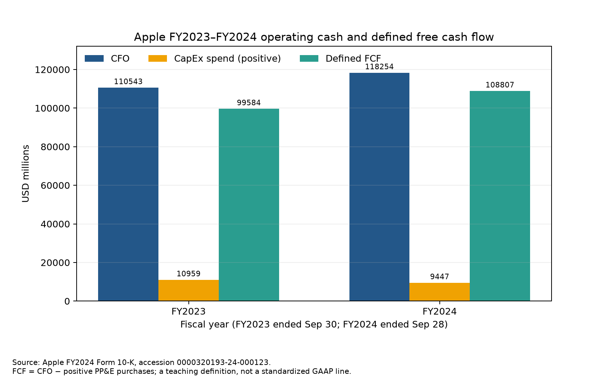
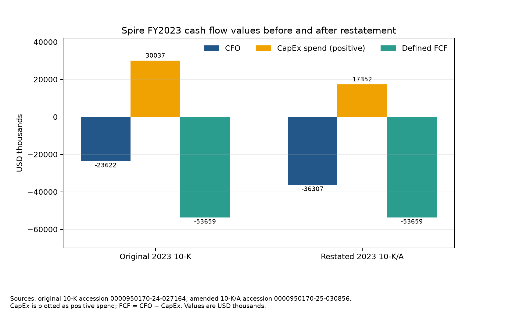

# 第12章 — 财务报表与量化研究（Financial Statements for Quantitative Research）

> 主线：把利润表（Income Statement）、资产负债表（Balance Sheet）和现金流量表（Cash Flow Statement）连成有单位、有期间、有版本、能按信息可用时间复现的公司特征。
> 先修：第 3 章数据工程、第 10 章市场工具；第 11 章收益与复利作为背景。完成后，你能读出三表之间的主要勾稽关系，构造并解释收入（revenue）、利润率（profit margin）、经营活动现金流（Cash Flow from Operations, CFO）、资本开支（Capital Expenditure, CapEx）、自由现金流（Free Cash Flow, FCF）、营运资本（working capital）和债务（debt）特征，并阻止后续重述泄漏到更早信号。

## 1. 本章目标

读完本章，你应能完成四类工作。

1. 从一个报表项目追到它在另外两张表上的影响。给出赊销（credit sales）、折旧（depreciation）、资本开支或借款时，你能说明利润、资产负债和现金（cash）怎样变化。
2. 统一常用财务特征的分子、分母、币种、单位和期间。你能写出明确的息税前利润（Earnings Before Interest and Taxes, EBIT）、息税折旧摊销前利润（Earnings Before Interest, Taxes, Depreciation and Amortization, EBITDA）的代理量、经营活动现金流（Cash Flow from Operations, CFO）、资本开支（Capital Expenditure, CapEx）、自由现金流（Free Cash Flow, FCF）、选定经营营运资本（Selected Operating Working Capital, Selected OWC）、净债（net debt）和自由现金流收益率（Free Cash Flow Yield, FCF Yield）。
3. 对每个数值保存报告期、首个公开版本、申报版本、修订版本、接收时间和本地入库时间。你能判断给定 signal_time 当时哪一版已经同时公开并进入研究库。
4. 复核真实报表中的数值和口径。你会把 Apple FY2024/FY2023 的原表行重算一遍，把 Spire FY2023 原始 10-K 与后来的 10-K/A 分开，并说明这个有限案例支持什么、不能支持什么。

合格标准是：一位复核者可以凭来源链接、accession、报表行名、期间和公式复算结果；构造数据与公司披露不会混在一起；晚到版本不会覆盖早期可见值。

## 2. 为什么 Quant 需要它

因子研究常把财报压缩成一个数，例如营业利润率、CFO/资产、净债（net debt）/EBITDA 或 FCF yield。一个数字看起来很容易比对，但生成它要作几项选择：采用合并利润还是归属于母公司股东的利润，拿期末资产还是平均资产，CapEx 是现金流表上的负数还是转成正数的支出，某个修订值在何时变得公开，供应商又在何时把它写入数据库。

这些选择会改变排序。一家公司可以报告收入增长，却因应收账款增长更快而迟迟收不到现金；另一家公司可能利润下降，但现金流因收回应收款而上升。CapEx 增加会压低短期 FCF，却可能为未来产能投资。会计特征因此不是“读完报表就得到的真值”，而是带口径和版本的测量值。

财务报表提供公司和报告期间层面的信息，证券价格却属于可交易证券、股类与交易时点。把公司级数据映射到普通股，还要验证永久证券标识、上市类别、币种、股本、可交易状态和时间。第 13 章会把企业价值连接到股权价值；本章先把报表数据做成可信输入，不提前声称某个因子有超额收益。

## 3. 直觉

::: {.body-example title="完整例题：交易、三表与现金50到63"}

先看一间虚构公司在一个季度内的账。它向客户交付了价值 100 的商品与服务，其中 80 收到现金，20 赊销。销货成本（cost of goods sold, COGS）为 40，现金运营费用为 25，折旧摊销（depreciation and amortization, D&A）为 10，利息为 5，所得税为 4。公司购入设备 8，并新借款 15。

以下金额统一用构造单位 $u$，期间为同一季度，主体为一家没有非控股权益（noncontrolling interest, NCI）的合并公司。期初没有应收账款（accounts receivable, AR）和应付账款（accounts payable, AP）；除表中交易外，没有分红、增发、汇率影响或其他调整。本例把利息和所得税支付列入 CFO。采购存货（inventory）50，其中现金支付 40、赊欠供应商 10；本期结转销货成本 40，因此期末存货净增 10。

表中物业、厂房及设备（property, plant and equipment, PP&E）购置列入投资活动现金流（cash flow from investing activities, CFI）；新借款列入筹资活动现金流（cash flow from financing activities, CFF）。

| 季内交易 | 利润表影响 | 资产负债表账户变化 | 现金流分类与计算 |
|---|---|---|---|
| 交付销售 100：收现 80，赊销 20 | 收入 +100 | 现金 +80，应收账款 +20 | 直接法收到客户现金 +80；间接法已在利润起点反映收入，另扣应收增加 20 |
| 采购存货 50：支付 40，赊欠 10；结转销货成本 40 | 销货成本 −40 | 现金 −40，存货净增 +10，应付账款 +10 | 直接法付供应商现金 −40；间接法扣存货增加 10、加应付增加 10 |
| 支付现金运营费用 25 | 运营费用 −25 | 现金 −25 | CFO −25 |
| 计提折旧 10 | 折旧费用 −10 | PP&E 净额 −10 | 非现金费用；间接法 CFO 加回 +10 |
| 支付利息 5、所得税 4 | 利息费用 −5、所得税费用 −4 | 现金 −9 | 本例假设二者均列在 CFO：−5−4 |
| 现金购置设备 8 | 购置时不列当期费用 | PP&E 原值 +8，现金 −8 | CFI −8；按正支出记 CapEx = 8 |
| 新借款 15 | 不影响收入或利润 | 债务 +15，现金 +15 | CFF +15 |

利润表给出毛利（gross profit） $100-40=60$、营业利润 $60-25-10=25$、净利润（net income） $25-5-4=16$。本章 EBITDA proxy 为 $25+10=35$；在这些简化假设下，CFO 为 $35-5-4-20=6$，其中 20 是选定经营营运资本的净增加。EBITDA proxy 不扣利息、税和营运资本变化，CFO 则反映这些项目对经营现金的影响，所以两者不相等。用间接法复核同一 CFO：净利润 16，加回折旧 10，扣应收增加 20 和存货增加 10，加应付增加 10，合计 6。

本例选定经营营运资本（Selected Operating Working Capital, Selected OWC）六项中，只有应收账款、存货和应付账款变化，分别为 +20、+10、+10，净增 20；供应商应收款、其他经营流动资产和递延收入变化为 0。CFO 已包含这六项的现金影响，计算 FCF 时只扣指定 CapEx，不能再从 CFO 扣一次这 20。

| 期末存量 | 期初 | 本季度变动 | 期末 | 变动来源 |
|---|---:|---:|---:|---|
| 现金 | 50 | +13 | 63 | CFO 6 + CFI (−8) + CFF 15 |
| 应收账款 | 0 | +20 | 20 | 赊销 |
| 存货 | 20 | +10 | 30 | 采购 50 − 销货成本 40 |
| PP&E 净额 | 100 | −2 | 98 | 购置 8 − 折旧 10 |
| 资产合计 | 170 | +41 | 211 | 四项资产变化之和 |
| 应付账款 | 0 | +10 | 10 | 赊欠供应商 |
| 借款 | 40 | +15 | 55 | 新借款 |
| 负债合计 | 40 | +25 | 65 | 应付账款与借款 |
| 权益 | 130 | +16 | 146 | 净利润 16，无分红或增发 |
| 负债与权益合计 | 170 | +41 | 211 | 期末资产负债恒等式成立 |

三表回答不同问题：利润表解释本期会计经营结果；资产负债表列出期末尚未结清的资源与义务；现金流量表解释现金从 50 变成 63。净利润 16 汇总计入留存收益（权益），本例没有分红或增发。购置设备先增加资产并减少现金，后续折旧才分期减少利润与设备净额。借款带来现金和债务，不是收入。按本章定义，$FCF=6-8=-2$；它只扣除了指定的 PP&E 支出，没有扣还本、分红、收购或租赁付款，因此不能视为可无条件分给股东的现金。

:::

上面的数字全是教学构造。SEC 的投资者指南也按这三种问题介绍三张报表，并把 CFO 的间接法描述为从净收入调节非现金项目以及经营资产负债变动。[SEC 财报入门指南](https://www.sec.gov/reportspubs/investor-publications/investorpubsbegfinstmtguide)

## 4. 数学基础

财报公式需要先处理量纲。

- 利润表与现金流量表项目是一个期间内的流量，例如 FY2024 的 net sales 和 CFO。
- 资产负债表项目是在一个日期的存量，例如 2024-09-28 的现金、债务和应收账款。
- 金额必须使用同一币种与单位。USD millions 的 118,254 与 USD thousands 的 118,254,000 数值不同，不能只看数字本身。
- 比率通常无量纲。金额除以金额时，期间、币种与单位仍须能对应。
- 财政年度不一定与自然年相同。Apple FY2024 截至 2024-09-28，FY2023 截至 2023-09-30，二者都不是 12 月 31 日结账的自然年。

建立特征表时，可以把一条事实写成元组 \((i,p,v,x,u,a)\)：\(i\) 是发行人或实体永久标识，\(p\) 是报告期间或时点，\(v\) 是文件版本，\(x\) 是数值，\(u\) 是币种和单位，\(a\) 是其信息可用时点。再记录本地入库时点 \(g\)、报表名、行项目名、来源 URL、accession 和处理代码版本。只有这些字段足够明确，两个研究者才知道自己算的是同一个量。

## 5. 正式定义

**利润表（income statement）** 汇总一段期间的收入、费用及利润；**资产负债表（balance sheet）** 汇总某个日期的资产、负债与权益；**现金流量表（cash flow statement）** 汇总一段期间经营、投资、筹资活动对现金及现金等价物的影响。美国 SEC 的 10-K 阅读材料将已审计财务报表放在年报的财务信息部分；具体项目仍须读公司附注与审计报表。[How to Read a 10-K](https://www.sec.gov/files/reada10k.pdf)

资产负债表恒等式为：

\[
\text{Assets}_{t}=\text{Liabilities}_{t}+\text{Equity}_{t}.
\]

这里的 \(t\) 是结账日，不是期间；Assets 是资产总额，Liabilities 是负债总额，Equity 是同一合并范围内的权益总额。若报表把少数股东权益（noncontrolling interest, NCI）列入权益，右侧 Equity 应包括它；若做普通股股东因子，则应匹配归属于母公司普通股股东的权益和收益。

现金流量表在本章使用如下勾稽关系：

\[
\text{Cash}_{t_1}-\text{Cash}_{t_0}
=\text{CFO}+\text{CFI}+\text{CFF}+\text{FX}.
\]

\(t_0,t_1\) 是报告期间的开始和结束时点；CFO 是经营活动现金流，CFI 是投资活动现金流，CFF 是筹资活动现金流，FX 是现金及现金等价物受汇率变动影响的单列调节。实际报表对现金、现金等价物、受限制现金和汇率调节的范围可能不同，必须以该报表定义为准。IAS 7 也要求按经营、投资、筹资活动组织现金流，并把汇率变化对现金的影响与这三类流量区分呈列。[IAS 7.11、7.28](https://www.ifrs.org/content/dam/ifrs/publications/html-standards/english/2026/issued/ias7.html)

收入（revenue）是按报告主体采用的准则和合同事实确认的期间项目。收入增长常写为：

\[
g_t=\frac{R_t}{R_{t-1}}-1,
\]

其中 \(R_t\) 和 \(R_{t-1}\) 是同一公司、币种、单位、可比财政期间和一致版本快照中的收入；\(g_t\) 是无量纲增长率。若两年的财政周数、并购范围、汇率或收入确认版本不同，增长率仍可计算，却未必代表同一经济变化。

**营业利润（operating income）** 通常是利润表中营业收入减营业成本和营业费用后的金额；企业的列报项目、重组费用或特殊项目分类各有不同。**息税前利润（EBIT）** 可以作为营业利润的近似，但两者并非所有报表都完全同义。研究者应声明取用的原始行名，不要只存“EBIT”标签。

**息税折旧摊销前利润（EBITDA）** 经常作为分析口径构造为：

\[
\text{EBITDA}^{*}_t=\text{EBIT}^{*}_t+\text{D\&A}_t.
\]

这里 \(\text{EBIT}^{*}\) 在代码中取 operating income，\(\text{D\&A}\) 是同期折旧与摊销费用；星号提醒这是一项教学 proxy。公司披露的 Adjusted EBITDA 可能另外剔除股权薪酬、重组费、减值或并购摊销，本式不等于该公司披露的调整后数字。

**净利润（net income）** 是扣除相应费用、税项与其他损益后的会计结果。合并净利润可能包含 NCI 对应的利润；若因子代表母公司普通股持有人，应选取归属于母公司或普通股股东的利润行。IAS 1 要求相关报表分别显示归属于母公司所有者与非控股权益的利润和综合收益。[IAS 1.81A、1.106(a)](https://www.ifrs.org/content/dam/ifrs/publications/html-standards/english/2024/issued/ias1.html)

**经营活动现金流（cash flow from operations, CFO）** 是报告期间经营现金流入减流出后的净额。间接法通常从净利润或净亏损开始，调回非现金项目，并调整经营资产负债的现金影响。CFO 因此不等于净利润，也不等于 EBITDA。

**资本开支（capital expenditure, CapEx）** 在本章专指指定报告期间购买物业、厂房及设备的现金支出。现金流量表常把它作为负投资现金流列示。为表达公式，把支出转成正数：

\[
\text{CapEx}_t=-\text{PP\&E cash-flow line}_t \quad \text{（当该行是非正现金流时）}.
\]

若公司还把软件开发、资本化研发、租赁、无形资产或收购列作投资，本章这项 CapEx 不自动包含它们。

::: {.body-definition title="定义与条件：本章CFO减CapEx代理"}

**自由现金流（free cash flow, FCF）** 在本章明确定义为：

\[
\text{FCF}_t=\text{CFO}_t-\text{CapEx}_t
=\text{CFO}_t+\text{PP\&E cash-flow line}_t.
\]

式中 \(\text{CFO}_t\) 与 \(\text{CapEx}_t\) 必须来自同一期间、同一币种、同一单位与同一报表版本；第一项是有符号净经营现金流，第二项是正的资本开支支出。SEC staff 将 CFO 减资本开支列为常见 FCF 算法，同时指出 FCF 没有统一定义，不能让读者误以为它扣完所有债务服务和其他非裁量支出。[SEC Non-GAAP C&DI 102.07](https://www.sec.gov/rules-regulations/staff-guidance/corporation-finance-interpretations/non-gaap-financial-measures)

:::

**营运资本（working capital, WC）** 没有唯一的因子定义。为明确本章口径，下面六项定义为**选定经营营运资本（Selected Operating Working Capital, Selected OWC）**；它是经营营运资本的一项可复算子集，不代表完整营运资本或完整净营运资本：

\[
\text{Selected OWC}_t
=\text{AR}_t+\text{VendorRec}_t+\text{Inventory}_t+\text{OtherOpCA}_t
-\text{AP}_t-\text{DeferredRevenue}_t.
\]

\(\text{AR}\) 是应收账款，\(\text{VendorRec}\) 是供应商非贸易应收款，\(\text{Inventory}\) 是存货，\(\text{OtherOpCA}\) 是本例纳入的其他流动经营资产，\(\text{AP}\) 是应付账款，\(\text{DeferredRevenue}\) 是递延收入负债。该定义排除现金、证券投资、借款及其他流动负债；完整营运资本可采用其他账户范围，不能把 Selected OWC 子集当成通用净营运资本。

简化间接法可写为：

\[
\text{CFO}_t\approx \text{NI}_t+\text{Noncash}_t-\Delta \text{OWC}_t+\text{OtherAdj}_t.
\]

\(\text{NI}\) 是净利润，\(\text{Noncash}\) 是折旧等非现金费用减非现金收益等调节项，\(\Delta\text{OWC}=\text{OWC}_{t_1}-\text{OWC}_{t_0}\)，\(\text{OtherAdj}\) 包括其他调节、税息分类、非流动经营项目、汇率或并购影响。近似号提醒：用自己选取的资产负债表子集，不一定能重现报表 CFO 调节中包含更多科目的完整变动。

**债务（debt）** 应限定为研究者定义的有息融资项目。本章 Apple 示例用商业票据与短期、长期 term debt。净债（net debt）按：

\[
\text{NetDebt}_t=\text{InterestBearingDebt}_t-\text{CashAndEquivalents}_t.
\]

本式不扣市场化证券、不含 lease liabilities，也不等价于净金融负债的所有行业口径。若 EBITDA proxy 小于或等于零，NetDebt/EBITDA 没有本章采用的直观解释；代码返回未定义值，不将其强行裁成普通比率。

因子（factor）在本章指由财务事实经明确变换得到的横截面或时间序列特征，例如毛利率、CFO margin、FCF margin、净债/EBITDA 或 FCF yield。它是一个候选信号定义，不自动表示预期收益、因果机制或可交易策略。

## 6. 推导

### 6.1 三表为何联动

权益滚存的简化关系为：

\[
\text{Equity}_{t_1}\approx \text{Equity}_{t_0}+\text{NetIncome}_t-\text{Distributions}_t+\text{OtherEquityChanges}_t.
\]

\(\text{Distributions}\) 指分红或其他分派；股份回购在权益中的列示取决于准则与报表分类；其他权益变化项包括其他综合收益、发行股份、汇兑、NCI 和会计调整等。它不能被误读为“期末权益只等于期初权益加净利润”。

间接法 CFO 以利润表净利润为起点，是第一条链接。资本开支是第二条链接：购入设备时，公司在资产负债表增加 PP&E、现金减少；在现金流量表列投资现金流出；后续期间通过折旧分摊影响利润表。借债是第三条链接：收到借款增加现金与债务，但不增加收入；还本减少现金与债务，但本金偿还不是经营费用。

这些对应关系解释了为什么同一业务可能同时报告正净利润、负 CFO、正资本开支和负 FCF。它们分别回答会计盈利、营运资金占用、投资强度与经营并扣除所定义资本开支后的现金这四个不同问题。

### 6.2 从利润到现金

用简化经营科目时，应收和存货增加占用现金，应付和递延收入增加暂时提供现金：

\[
\begin{aligned}
\text{CFO}_t\approx{}&\text{NI}_t+\text{D\&A}_t-\Delta\text{AR}_t-\Delta\text{VendorRec}_t\\
&-\Delta\text{Inventory}_t-\Delta\text{OtherOpCA}_t\\
&+\Delta\text{AP}_t+\Delta\text{DeferredRevenue}_t+\text{OtherAdj}_t.
\end{aligned}
\]

上式把流量与期间端点存量差连接起来。每个 \(\Delta X_t\) 都是期末减期初；正的资产变化以负号进入近似 CFO，正的经营负债变化以正号进入。它假定所选变化与相应现金收付能够对应；实际表会有坏账准备、汇率、收购、处置、非流动项目与分类调整，不能用本式冒充公司完整的间接法明细。

这里显式列出与 Selected OWC 定义一致的六项变化；OtherAdj 不再包含这六项的现金变化，仅承接其他调节。忽略或另行调节上述非现金差异后，六项营运资本变化可合成 \(-\Delta\text{Selected OWC}\)。一旦 CFO 已包含该变化，研究者再从 CFO 扣一次相同 \(\Delta\text{Selected OWC}\)，便是双重扣减。要构造“剔除营运资本变化后的 CFO”，应明确新指标究竟是加回还是移除哪一组变化，并逐项调节。

### 6.3 从报表项目到候选因子

营业利润率、净利率与 CFO margin 依次回答主营业务经营收益、归属主体后的最终会计收益、以及经营现金相对营业规模。典型比率是：

\[
\begin{aligned}
\text{OperatingMargin}_t&=\frac{\text{OperatingIncome}_t}{\text{Revenue}_t},\\
\text{NIMargin}_t&=\frac{\text{NetIncome}_t}{\text{Revenue}_t},\\
\text{CFOMargin}_t&=\frac{\text{CFO}_t}{\text{Revenue}_t}.
\end{aligned}
\]

经营利润率与CFO margin的金额须覆盖同一合并范围和财政期间、采用同币种和单位。净利率还须声明净利润归属：上式用合并净利润与合并收入；若报告归母净利率（net margin attributable to the parent），本章约定用归母净利润除以同一集团、同期的合并收入。这项收入分母约定不同于ROE的普通股权益、P/E的普通股市值配对，不能据持股比例机械分摊收入，制造未经定义的“普通股股东收入”。若净利润为负，净利率仍显示亏损相对所声明收入基数的比例；若收入为零或负值，以上margin不能沿用一般商业含义。

FCF margin 与 FCF yield 使用不同分母。跨公司比较年度 yield 时，应统一年度或滚动十二个月（Trailing Twelve Months, TTM）FCF；若选择季度窗口，应单独标记，不能默认为年化值。固定窗口是为了让排序反映财务差异，而不是把短期间与长期间混比：

\[
\text{FCFMargin}_t=\frac{\text{FCF}_t}{\text{Revenue}_t},\qquad
\text{FCFYield}_{s,t}=\frac{\text{FCF}_{i,p,v}}{\text{MarketCapitalization}_{s,t}}.
\]

\(i,p,v\) 是公司、报告期间和选定财报版本；\(s,t\) 表示证券及市场估值时点。Yield 的分子是已知版本的期间 FCF，分母是信号时点的股权市值，两者必须币种与单位可比；分母不能拿未来股价或未来股数回填。FCF yield 也不是企业价值收益率。第 13 章再讨论 EV 与股权价值口径。

资产效率比率常以期间流量除以平均存量，例如：

\[
\text{ROA}_t=\frac{\text{NetIncome}_t}{(\text{Assets}_{t_0}+\text{Assets}_{t_1})/2}.
\]

\(\text{ROA}\) 是本章展示的净利润/平均总资产简单定义；不同研究可采用经营收益、税后营业利润或其他分子。平均资产把期间流量与期间平均资源对应起来；只有一个期末余额时，分母含义会变成期末口径，而非平均口径。使用前期与本期两个报表值时，二者仍应来自信号时点可见的版本。

### 6.4 版本与可用时间的推导

::: {.body-conditions title="适用条件：双时钟与独立有效资格"}

对某个候选版本 \(v\) 与信号时刻 \(s\)，在没有撤回或不应依赖事件的简化演示中，本章只检查两只可用时钟：

\[
\operatorname{eligible}(v,s)
\iff a_v\leq s\ \land\ g_v\leq s.
\]

\(a_v\) 是该数值实际首次公开或该版本成为公开来源的时间；\(g_v\) 是研究数据管道确认接收并可供该研究运行使用的时间；\(s\) 是策略生成信号的截点。两只时钟缺一不可。一个已公开但没有进入当前研究库的文件，不是此回测实例当时可读的数据；一个先进入数据库但尚未公开的预发布字段，也不能提前让市场信号知道。

在可用版本中，选取来源发布时间最新的版本：

\[
v^*(s)=\arg\max_{v:\ \operatorname{eligible}(v,s)} a_v.
\]

这里按 \(a_v\) 排序，而不是按入库时间 \(g_v\) 排序。晚入库的旧报告不能遮住已及时入库的新报告；修订版在修订公开和入库之前都不能替换原值。同一公司、同一期间、同一来源可用时点出现冲突行时，应停止并查明版本键，不让文件行顺序替研究者决定哪个数字胜出。

这只是双时钟选择器，不是完整的报表有效性系统。撤回或不应再依赖通知（Non-reliance Notice）即使没有附带新数值，也会改变原值的研究资格。生产选择还需一个按事件时间维护的有效状态 \(h_v(s)\)：它取1表示在信号截点、依据当时已公开且已入库的状态事件，该版本仍允许用于所定义研究；取0表示已被撤回或标记不可依赖。完整资格应包含 \(a_v\le s\)、\(g_v\le s\) 与 \(h_v(s)=1\)。状态事件本身也要保存来源版本及公开、入库时间，不能拿日后获知的通知回填到更早截点。

Spire 的非依赖通知成为研究系统可见后、合格重述值到达之前，不能靠“旧版是最新可得数值”继续使用已失效的原值。严谨处理是把相关特征设为不可用，并按预先约定的缺失策略剔除、暂停或标记待核验；不能使用尚未公开的2025重述值填空。本章代码没有撤回事件接口，也没有该公司的完整状态时间链，所以双时钟构造例不覆盖这一真实中间窗口；不能据它生成 Spire 的历史可交易信号。

:::

真实记录往往只能核到日期，而不能核到精确公开时分和时区。此时应保留日期精度，不要把日期强行补成午夜 UTC。Apple FY2024 10-K 头信息给出 period of report 2024-09-28、filed date 2024-11-01 和原样 acceptance 字符串 20241101060136；Apple 新闻室页面显示 FY2024 结果于 2024-10-31 发布。Spire 原始 FY2023 报表期间截至 2023-12-31，2024-03-06 申报，之后公司于 2024 年 8 月发出不应再依赖部分历史报表的通知，再于 2025-03-03 提交 10-K/A。上述 acceptance 原串没有在本章转换成交易时区，也没有本地供应商的 ingestion 记录。[Apple EDGAR headers](https://www.sec.gov/Archives/edgar/data/320193/000032019324000123/0000320193-24-000123-index-headers.html)、[Spire original headers](https://www.sec.gov/Archives/edgar/data/1816017/000095017024027164/0000950170-24-027164-index-headers.html)、[Spire restatement 10-K/A](https://www.sec.gov/Archives/edgar/data/1816017/000095017025030856/spir-20231231.htm)

## 7. 金融解释

报表项目首先描述会计确认结果，再由研究者选择如何测量经济现象。收入增长测量已确认销售额的变化，不单独告诉你客户何时付款。利润率测量某一利润层级相对收入的大小，不直接说明固定资产更新、债务本金和股东分派后的现金。CFO 反映报表列出的经营现金，不代表公司已扣掉所有投资需求。FCF 的解读取决于这份报表和 CapEx 定义。

公司质量因子中常见的直觉是：利润能不能转换成现金，资产是否快速周转，负债是否增加财务脆弱性。对应的可计算量可以是 CFO/NetIncome、CFO/Revenue、ROA、净债/EBITDA。但这些只是测量选择。若 NetIncome 接近零，CFO/NetIncome 会被小分母放大；若 EBITDA 为负，净债/EBITDA 可能反向难读；若公司正快速建设产能，低 FCF 可能表示投资，而非经营退化。

营运资本变化也有双面性。应收账款增长快过收入，可能显示回款放慢，也可能反映季度末发货或业务结构变化。延迟支付供应商可以暂时抬高 CFO，但研究者还要看付款期限和业务可持续性。公司季节性强时，年度余额差容易把旺季与淡季混在一起，季度比较需要同季度和同周数。

债务指标要与权益主体匹配。有息债务总额、现金抵扣、租赁负债、供应链融资和少数股东权益可能改变杠杆或估值口径。净债公式若扣除了流动性有限的受限制现金，或者把债务遗漏掉，只因名称仍叫 NetDebt 就无法修正含义。记录里应存公式版本和包含的账户列表。

**少数股东权益（noncontrolling interest, NCI）** 使“集团净利润”与“归母普通股收益”区分更重要。若企业合并子公司而没有持有全部权益，合并利润和资产负债中会有归属于非控股股东的部分。研究普通股盈利能力或市值倍数时，应将分子分母对齐到同一个权益主体。IAS 1 对母公司所有者与非控股权益的归属分别列示。[IAS 1](https://www.ifrs.org/content/dam/ifrs/publications/html-standards/english/2024/issued/ias1.html)

准则差异也会影响跨国样本。现金利息、股息及部分现金流分类在不同准则和期间可能有选择或变化；收入项目、租赁和开发支出的列报也可能不同。模型不能靠统一英文字段名抹掉这些差异，应把原表标签、准则、公司扩展标签、会计政策、年度和修订状态保留下来。

## 8. Numerical Example

### 8.1 三表手算：教学构造公司

第 3 节的示例与本节及 12-E07/12-L06 使用同一虚构公司、同一季度和同一构造金额单位 $u$，可逐行重算。利润表：

\[
\text{GrossProfit}=100-40=60,\quad
\text{EBIT}^{*}=60-25-10=25,\quad
\text{NetIncome}=25-5-4=16.
\]

收入、销货成本、现金运营费用、折旧、利息和税额均为本期构造金额；EBIT 使用营业利润近似，未考虑其他非营业项目。

若期初营运资产是存货 20，期末应收账款 20、存货 30、应付账款 10，则选定经营营运资本从 \(20\) 增至 \(20+30-10=40\)，增加 \(20\)。经营现金流为净利润 \(16\)，加回非现金折旧 \(10\)，再减应收与存货增加 \(20+10\)，加应付增加 \(10\)，得到 CFO \(6\)。也可用 \(\text{NI}+\text{D\&A}-\Delta\text{OWC}=16+10-20=6\) 快速核对。

资本开支 \(8\) 是正支出金额，现金流表 PP&E 行会记作 \(-8\)。所以本章 FCF 为 \(6-8=-2\)。如果公司收到新借款 15、期初现金 50，且这期没有其他现金流，则期末现金为 \(50+6-8+15=63\)。

资产端的期末数是现金 63、应收账款 20、存货 30、PP&E 净值 \(100+8-10=98\)，合计 211。负债端为应付账款 10 与债务 \(40+15=55\)，权益从 130 加净利润 16 到 146，合计亦为 211。注意这里购置设备 8 先计资产，后续折旧 10 才逐期减少账面 PP&E；现金支付与当期折旧不相同。

### 8.2 Apple FY2024 和 FY2023：原表数字复算

Apple 2024 Form 10-K 的合并现金流量表以美元百万为单位，列 FY2024（截至 2024-09-28）与 FY2023（截至 2023-09-30）：Cash generated by operating activities 分别为 118,254 与 110,543；Payments for acquisition of property, plant and equipment 分别为 −9,447 与 −10,959。把负的现金流行转换为正的 CapEx 支出后：

\[
\text{FCF}_{2024}=118{,}254-9{,}447=108{,}807,
\qquad
\text{FCF}_{2023}=110{,}543-10{,}959=99{,}584
\]

单位均为 USD millions。同比 FCF 增长为 \(108{,}807/99{,}584-1\approx9.26\%\)，但这两个财年之间的FCF同比变化并不等于股票收益，也不能单独证明现金创造能力已经稳定上升。

同一 10-K 的 net sales 为 391,035 与 383,285，增长约 \(2.0220\%\)。FY2024 毛利为 180,683，所以 gross margin 为 \(180{,}683/391{,}035\approx46.21\%\)；营业利润 123,216，对应 operating margin 约 \(31.51\%\)。D&A 是 11,445，因此教学 EBITDA proxy 是 \(123{,}216+11{,}445=134{,}661\)；它不是 Apple 宣布的 adjusted EBITDA。

按本章债务定义，FY2024 有息债是商业票据 9,967 加短期 term debt 10,912 加长期 term debt 85,750，合计 106,629；只扣现金及现金等价物 29,943，得 net debt 76,686 USD millions。市场化证券与租赁负债均未并入这个窄口径。财报没有为本例提供同一时点的历史市值因子输入，因此代码示范 FCF yield 时另外造一个 4,000,000 USD millions 市值，只用于演示单位相同的除法；不得把 2.72% 报成 Apple 的实际 FCF yield。

### 8.3 Spire FY2023：原始与重述版

::: {.body-example title="完整例题：同年度两个版本的FCF与边界"}

Spire 原始 FY2023 Form 10-K（accession 0000950170-24-027164）现金流量表以 USD thousands 列示 CFO \(-23{,}622\) 和 PP&E 购置现金流 \(-30{,}037\)。换为正 CapEx 支出 \(30{,}037\)，得：

\[
\text{FCF}_{\mathrm{original}}
=-23{,}622-30{,}037=-53{,}659\ \text{USD thousands}.
\]

Spire 2025 年 Form 10-K/A（accession 0000950170-25-030856）把同一 FY2023 重述为 CFO \(-36{,}307\)，PP&E 购置现金流 \(-17{,}352\)。于是：

\[
\text{FCF}_{\mathrm{restated}}
=-36{,}307-17{,}352=-53{,}659\ \text{USD thousands}.
\]

按这项自定义公式，FCF 数额刚好相同；CFO 下修的 12,685 与 CapEx 支出下修的 12,685 相抵。Spire 的重述材料解释了相关合同收入和成本确认、租赁、客户票据及其他会计事项如何影响多个期间与报表。单独看两行现金流分类会漏掉版本变化；单个 Spire 案例也不能证明其他重述必定抵消。[原始 10-K](https://www.sec.gov/Archives/edgar/data/1816017/000095017024027164/spir-20231231.htm)、[10-K/A](https://www.sec.gov/Archives/edgar/data/1816017/000095017025030856/spir-20231231.htm)

:::

## 9. Python Implementation

### 本读者版的默认运行入口

从[接受I3读者包](../../qa/a10/ACCEPTED_COMPLETE_LOCAL_READER_I3.md)根目录，按其[环境说明](../../editions/zh/README.md)建立环境后运行：

```bash
.venv/bin/python run_notebook.py notebooks/ch12_statements.ipynb
```

Notebook调用随包共享实现。第12章复算固定转录的Apple/Spire报表事实，PIT时钟与市值为构造。默认只展示随包既有两张图，不重绘；运行器把新内核执行记录写入唯一的`runs/execution_*`目录，Notebook另建立唯一UUID的本章方法目录并打印位置。两目录用途不同，不把既有图说成本批新产物。未随包提供的French数据不默认读取，也不下载。下方CLI及旧制作测试按课程工作根解释；读者用上方Notebook内断言，旧制作测试未随包时不要求补回。英文Notebook的Markdown层仍待BIL23装配，本批未执行Notebook或旧数值套件。

### 历史课程工作根与原实现

核心指标与版本函数在 [statement_metrics.py](../../src/quant_course/statement_metrics.py)，CLI 和绘图入口在 [ch12_statements.py](../../code/ch12_statements.py)，程序测试在 [test_ch12_statements.py](../../tests/test_ch12_statements.py)，教学 Notebook 在 [ch12_statements.ipynb](../../notebooks/ch12_statements.ipynb)。核心模块封装每项 FinancialFact 的实体、报告期间、币种、单位、accession、修订状态和来源；FCF 函数要求 CFO 与 PP&E 支出行属于相同版本，且拒绝正值的“现金流出”行。特征函数也会检查单位/版本错配、非有限值、财报基本勾稽和 CapEx 符号。

从项目根目录运行：

```text
.venv/bin/python code/ch12_statements.py
.venv/bin/python -m pytest tests/test_ch12_statements.py -q
```

代码不下载财报，也不连接市场行情；Apple 与 Spire 输入是源文件选定数字的固定转录。运行示例将生成本章两张图。下面的调用可以在项目虚拟环境中独立执行：

```python
import math
import sys

from pathlib import Path

sys.path.insert(0, str(Path.cwd() / "src"))
from quant_course.statement_metrics import (
    apple_facts,
    derive_accounting_factors,
    fcf_from_statement_lines,
    fcf_yield,
    spire_cash_flow_facts,
)

apple_2024 = derive_accounting_factors(apple_facts(2024))
assert apple_2024["fcf"] == 108_807.0
constructed_yield = fcf_yield(
    apple_2024["fcf"],
    4_000_000.0,
    currency="USD",
    statement_unit="USD millions",
    market_cap_currency="USD",
    market_cap_unit="USD millions",
    market_cap_label="constructed teaching value",
)
assert math.isclose(constructed_yield, 0.02720175, rel_tol=0, abs_tol=1e-8)

for version in ("original", "restated"):
    cfo, capex_cash_flow = spire_cash_flow_facts(version)
    print(version, fcf_from_statement_lines(cfo, capex_cash_flow))
```

上例的 reporting frequency 是年度；FY2024/FY2023 是 Apple 自身财政年，不是自然年。财报 signal timestamp 若只有日期，则不能支持盘中信号；真实接收与入库时点仍需外部日志。代码中 point-in-time helper 示例用明确标为 SIM 的构造 UTC 时间，并且只挑选同时满足 available_at 与 ingested_at 不晚于 signal_time 的版本。下游交易应发生在信息到达与策略处理之后，并按第 3 章和第 29 章处理执行时延；本章没有测算任何 return interval。

本章的 `FinancialFact` 是这组转录数据的最小教学结构：它用 `fiscal_period` 标记财政年，但没有显式区分期间流量与结账日存量，也不单独保存 `period_start`、`period_end` 或 `as_of_date`。生产面板应为期间流量保留期间起止日，为存量保留结账日/有效时点，并保留 `fact_period_type`；不能把这里的轻量类直接当成完整财务数据 schema。

## 10. Visualization



[Apple FY2023/FY2024 CFO、CapEx 与 FCF 图](../../figures/a3/ch12_apple_cashflow.png)横轴是财政年度，纵轴是 USD millions。蓝柱是 CFO，橙柱把现金流表中的负 PP&E 购置数转换成正 CapEx 支出，绿色柱按 CFO−CapEx 计算。本图显示两个报表年度的数值和单位，不显示股票价格或因子收益。FY2024 CFO 与定义 FCF 都高于 FY2023，CapEx 支出则较低；图表本身不解释原因。



[Spire FY2023 原始版与重述版图](../../figures/a3/ch12_spire_revision.png)固定一个报告期间，横轴切换文件版本，纵轴是 USD thousands。蓝色 CFO 与绿色 FCF 在零线下方；橙色柱按正支出画出 CapEx。重述版中 CFO 更负、CapEx 支出更小，而本章定义的 FCF 仍为 −53,659。读者应先确认 accession 和正负号，再讨论指标是否改变。

图中文字标明原始文件、版本和本章 FCF 公式。图中的真实量只来自相应 SEC 报表，不包含真实股价、供应商时点或投资绩效。

## 11. Real Market Example

本节使用真实公开财报，但只检验有限陈述。它们不是完整逐股 PIT 数据，也不是策略实证。

Apple FY2024 10-K 头信息把 period of report 列为 2024-09-28，把 filed as of date 列为 2024-11-01，并保留 acceptance 字段原串 20241101060136；Apple 新闻室页面标记 2024-10-31 公告 FY2024 第四季度与全年结果。财报对 FY2024 和 FY2023 给出相邻年度的审计报表。按 10-K 行项目和本章定义，两期 FCF 分别是 108,807 与 99,584 USD millions。可据此说明报表版本晚于报告期末，也可复核两个财年数值；不能仅凭这些页面断定新闻稿精确到几点公开、数据供应商何时接入全文，或当日任一时刻市场可见了 10-K 全部附注。

Spire FY2023 原始 10-K 的报告期末为 2023-12-31，accession 为 0000950170-24-027164，Filed date 为 2024-03-06。公司随后在 Form 8-K 中说明部分已发报表不再应依赖，且需要重述相关期间；该 8-K 头信息区分 report date 2024-08-21、filed date 2024-08-27 与原始 acceptance 字符串 20240827161154。公司于 2025-03-03 提交 accession 0000950170-25-030856 的 10-K/A，披露了 FY2023 重述财报。三组表格版本分别保存，并没有把 2025 年数字替换进 2024 年 3 月生成的原始特征。

公司 IR 页面记载了 2024-03-05 的 FY2023 业绩公告日期线索，但本次未验证精确公开时区；两份 Form 10-K 头的 acceptance 字段也没有在此转换成 UTC。两家公司数据提供报表和版本事实，不提供本研究所需的历史供应商 ingestion 日志、交易所日历、交易时点证券价格、历史流通股数、退市证券或完整永久标识映射。因此本节不报告 Apple 或 Spire 的 FCF yield 历史，不宣称构造出已验证的 point-in-time 因子，也不声称跑过真实市场回归。

SEC 的 companyfacts 和 frames 接口便于获取 XBRL 数值；frames 按指定自然期间附近的最近申报事实组织，而公司财年未必与自然期间对齐。当前 API 结果不能自动代替保留原 filing accession 与版本链的历史快照。[SEC EDGAR API 文档](https://www.sec.gov/edgar/sec-api-documentation)

## 12. Common Mistakes

**把 report period end 当可用日。** 错误做法是将截至 12 月 31 日的 Spire 数值放回 12 月 31 日收盘信号。报告日只是财务期间终点，最早公开还要看发布记录，当前研究库何时收到则看 ingestion 日志。修复方式是保留多个时间字段，按可核信号截点过滤。

**把 filed date、接受字段和 ingestion 混成一列 timestamp。** SEC accession headers 展示期间、filing date 和 raw acceptance 等不同元数据；它不记录本地数据库任务的接收时间。修复时逐列保存原始字段、时区状态和系统接收日志，缺失的信息标未知。

::: {.body-pitfall title="常见误区：负现金流行与正支出"}

**从负数 CapEx 行再减一次。** Apple FY2024 PP&E 现金流行是 −9,447，CapEx 支出记作 +9,447。错误计算 \(118{,}254-(-9{,}447)=127{,}701\)；正确的是 \(118{,}254-9{,}447=108{,}807\)。对“现金流行按负数记录”的输入，等价写成 CFO 加该负行。

```python
cfo = 118_254.0
reported_ppe_cash_flow = -9_447.0
wrong = cfo - reported_ppe_cash_flow       # 127,701, sign error
capex_spend = -reported_ppe_cash_flow
correct = cfo - capex_spend                # 108,807
assert wrong == 127_701.0
assert correct == 108_807.0
```

:::

**在 CFO 后重复扣除同一变化营运资本。** 教学公司的 CFO 6 已经包含应收、存货、应付变化。其 FCF 是 \(6-8=-2\)；再减一次营运资本增加 20 得到 −22，是双重计算。若要估算去除某项营运资本变化后的 CFO，须从完整 CFO 调节表中找到同一项的现金贡献，明确加回或移除，而不是对另一套资产负债表 proxy 自动再调整。

**把 FCF 写成 GAAP 统一科目或“可自由花的钱”。** 本章公式只做 CFO 减选定 PP&E CapEx；它没有减本金偿还、分红、收购、租赁付款或其他可能必需的投资。不同研究对 CapEx 范围不同，必须保存公式版本和纳入行名。

**让后续重述改写过去样本。** Spire 2025 10-K/A 的 CFO −36,307 与原版 −23,622 属两个版本。若回测 2024 年初的信号却使用 2025 重述值，历史计算就含有当时不存在的信息。修复方式是按版本元数据与双时钟筛选；保留每版 accession。

**将 frames 返回值当作自然年或历史 vintage。** 财政年末可能不是 12 月，frames 为某个日历期间选择最新匹配事实。读完 SEC API 说明后，仍需回原始申报和期间上下文核对；不能将最近数据接口的回答冒充“某日系统实际看见的旧值”。

**把公司事实直接认作股票信号。** 一家公司可能有普通股、多类股、ADR、并购前实体或退市证券。公司 CIK 和 ticker 不足以让每个字段自动匹配某一可交易 share class。先用永久证券标识建立有历史的发行人与证券映射，说明每股或股权级分母。

## 13. Quant Research Application

从一个可反驳的研究假设开始，例如：“按相同财政年度和公开版本构造的高 CFO margin 公司，之后的横截面回报是否与低 CFO margin 公司不同？”这只是一个研究问题；本章的两个公司案例不足以回答它。

首先定义母体和测量值。明确使用 CFO/Revenue、CFO/平均资产还是 CFO/Net Income；列出现金流量表行、同币种单位、财政期间、收入确认版本和缺失处理。若用 FCF，应定义 CapEx 行和符号；若用 NetDebt/EBITDA，应说明债务包括哪些账户、EBITDA 是公司披露值还是研究 proxy。若分子或分母非正，规定信号的空值或分组处理方式。

其次建立来源和版本表。每条原始事实连接发行人永久 ID、期间、accession、版本状态、文件行、首次已证实的公开时间、SEC filed date、可解析的 accepted 字段、系统入库时间和清洗代码版本。不要把当前 companyfacts 抓取结果设为过去快照。对 XBRL 自定义标签保留原标签、单位、期间上下文与规范化规则；对重复事实核对 duration/instant、币种、维度和修订来源。

第三，按 point-in-time 信号筛选版本。候选版本须满足 available_at 和 ingested_at 都不晚于信号截点；选公开时间最新的已合格版本。若只知道日期级时间，研究策略应使用更保守的日期级截点并单独声明其假设；没有市场时区与交易日历时，不声称盘中可用。随后才能把发行人字段映射到当时存续的证券、股类和市场。

第四，处理比较性。收入增长按同一财政周期、合并范围、币种和相同版本快照计算；存量分母如资产或权益，写明是期末还是期间平均；出现并购、分拆、会计政策改变、货币换算或 restatement 时，另存事件标记。缺失值要区分“不适用”“未报告”“来源未取得”“还未公布”和解析失败，不能都用零填补。

第五，定义研究样本和基准。使用当时可知的历史公司集合，记录退市与标识变迁；否则存续者筛选可能改变横截面。把候选特征与不含该特征的简单基准比较，预注册 winsorization、行业调整、标准化、持有期和交易滞后；用时间顺序样本外评估和交易成本后结果，而不是在全样本挑最漂亮的变换。

最后主动找反证。若信号优势只出现在重述后版本、只有把缺失填成零才成立、只在财年错配样本显著、剔除退市者后才出现，或在公告可用后的可成交时点消失，就应把这些结果写成测量与实现边界。真实历史数据和完整的点时证券映射缺失时，只能完成财报算术与工程演示，不能宣称完成因子实证。

## 14. Chapter Summary

三张报表分别说明期间盈利、期末资源义务和现金来源用途；它们由净利润、营运科目、折旧、资本开支与融资交易勾连。将这些项目变成 factor 时，先确定分子、分母、期间、主体、货币和单位，再保存原始行名及公式。

CFO 与净利润衡量不同结果；CapEx 现金流符号必须转换一致；FCF 取决于研究者公开声明的 CapEx 范围；营运资本 proxy 不得与已含在 CFO 的同一变动重复扣减。收入利润率、现金转换和债务比率只有在口径、期间及股东主体匹配时才可比较。

历史财报还带版本。报告期末、首次公开、filing date、accepted 字段、修订公告与 ingestion 是不同时间信息。只有当相关版本在信号时点已公开并进入当时的研究系统，才可用来产生该信号；后续版本应留在它真正可用的未来时间。

## 15. Exercises

概念题的参考答案见第 18 节。

**12-E01（三表识别）** 赊销增加收入、应收账款上升，但客户尚未付款。指出此时首先变化哪张表，间接法 CFO 为什么可能低于净利润？

**12-E02（会计利润层级）** 用一句话区分 EBIT、EBITDA proxy、净利润和 CFO。哪些量可能直接对应报表行，哪些需研究者构造或核对口径？

**12-E03（资产负债恒等式）** 一家公司资产 500、负债 360、股东权益 130、NCI 10。资产负债恒等式是否成立？如果做母公司股东特征，能否把 10 的 NCI 计入归母权益？

**12-E04（时间字段）** 一份 FY2023 报表 period end 为 2023-12-31，SEC filed date 为 2024-03-06，本地数据库 ingestion 为 2024-03-08。它最早何时可以用于策略信号？还缺什么时间证据？

**12-E05（NWC 与 CFO）** 应收和存货增加、应付不变，在间接法 CFO 中的方向各是什么？为什么若从 CFO 里再扣一次同一批变化会错？

**12-E06（股东主体）** 合并净利润 100，其中归属于 NCI 的利润 15。研究母公司普通股盈利能力时，简单净利率分子应选 100 还是 85？说明分子主体要与什么口径匹配。

手算题须列公式、变量和单位。

**12-E07（三表联动）** 用第 3、8 节同一虚构公司的数据（金额单位均为构造单位 $u$），计算 gross profit、EBIT、净利润、CFO、FCF、期末现金和期末资产/负债/权益。每一步注明折旧和赊销的作用。

**12-E08（Apple 实际报表）** FY2024 Apple 的 CFO 为 118,254，PP&E cash-flow line 为 −9,447，收入 391,035，单位均为 USD millions。计算 CapEx 正支出、FCF、FCF margin 和 CFO margin。

**12-E09（Spire 版本）** 原始版 CFO 为 −23,622，PP&E 行为 −30,037；重述版 CFO 为 −36,307，PP&E 行为 −17,352，单位 USD thousands。分别算 FCF，指出版本间哪些项目变化、这是否说明 FCF 定义统一。

## 16. Programming Exercises

下面每题的输入、异常边界与参考实现都在第 18 节。代码使用 Python、pandas 和本章模块；所有时间戳演示数据均为明确构造值。

**12-P01（符号和单位安全的 FCF）** 编写一个函数，输入 CFO 与 PP&E 现金流行，校验两者同币种、同单位、同期间、同 accession；输入的 PP&E 支出行按负数记录。返回 FCF。验收：Apple FY2024 返回 108,807；若把 CapEx 行改成 +9,447 或版本不一致，应抛异常。

**12-P02（双时钟 PIT）** 用至少两版同一公司同一财年的构造记录测试版本筛选。第一版先公告后入库；第二版公告和入库晚于信号；再加一个位于公告后、入库前的信号。要求时区感知 timestamp，并验证早期 signal 不会被迟到的重述版覆盖。

**12-P03（比率和来源字段）** 从本章 Apple FY2024 facts 计算 FCF margin、营业利润率、净债/EBITDA proxy 与 revenue growth；市值只允许使用标记为 constructed 的教学输入。编写断言验证值和单位边界，展示把 USD 直接与 USD millions 相除会被拒绝。

## 17. Challenge Problems

开放题可以有多种合理方案，但答案必须保留假设、版本和反证。

**12-C01（重述诊断，先修：会计勾稽）** Spire 重述后 CFO 从 −23,622 变为 −36,307，PP&E 现金流支出从 30,037 变为 17,352，net loss 也改变。本章定义的 FCF 不变。提出一个结论边界清晰的解释，再列出至少四项你需要检查的报表或附注，才能判断是经济现金变化、项目重分类、收入确认、资本化还是其他因素导致。

**12-C02（PIT 因子数据设计，先修：第 3 章数据工程）** 为跨公司年度 FCF yield 设计一个最小可审核数据模型。列出原始事实、版本、可用时间、ingestion、发行人到证券映射、市值来源与特征派生记录的字段。说明 report date/filing acceptance 在来源缺少精确时区时如何保守处理，并给出两个会令你的因子失效的反证测试。

## 18. Solutions / Solution Hints

### 概念题

**12-E01** 首先变化的是利润表与资产负债表：若按收入确认条件已经满足，营业收入上升；应收账款增加、权益通过利润滚存增加。现金尚未收到，所以间接法 CFO 会从净利润开始，再把应收账款的增加作为现金占用扣除；最终 CFO 可以小于净利润。确认时点仍取决于公司适用准则和合同履约事实。

**12-E02** EBIT 是利息与所得税前的利润层级，常以营业利润近似；EBITDA proxy 是 EBIT 加折旧摊销；净利润进一步扣除利息、税和其他损益；CFO 把净利润调为经营现金。营业利润和净利润通常是报表列出的利润项目，但名称与主体/列报需看原表；EBITDA 若由研究者用 EBIT+D&A 构造，必须标 proxy；公司 adjusted EBITDA 与本章公式不同。CFO 是现金流量表项目，但定义范围以报表为准。

**12-E03** 负债加权益是 \(360+130+10=500\)，恰好等于资产。这里 NCI 10 属于合并口径权益的组成部分；归母股东权益应使用 130，不把 NCI 加入归母权益。利润或估值的主体口径也要保持一致。

**12-E04** 单凭这些资料不能给出最早策略可用时刻。2023-12-31 是期间终点；2024-03-06 是 filed date；本地系统直到 2024-03-08 才入库。还需核对首次公开公告时点或其它可证实的 available_at；对这个研究实例，数据至少须等到入库之后。因此候选信号时点须满足 \(\max(\text{available\_at},\text{ingested\_at})\leq\text{signal\_time}\)。若时间只有日期精度，就只能作日期级结论。

**12-E05** 应收和存货是经营资产，增加通常消耗 CFO；应付不变就没有应付变化的现金抵销。间接法 CFO 已用这些变化将净利润调成经营现金；若再从 CFO 扣一遍同一变化，现金占用重复计算。

**12-E06** 合并净利润100减去归属于NCI的15，得到归母净利润85；本题再假定没有另需扣除的优先股股息等分配，85才是普通股可用盈利。若存在这类调整，还须从归母净利润继续桥到普通股盈利。按第6.3节约定，归母净利率用该归母净利润除以同一集团、同期间的合并收入；题目未给收入，因此只能选出盈利分子，不能报净利率数值。收入没有可直接按持股比例拆出的“普通股股东收入”行。若算ROE，应把普通股可用盈利与相应普通股权益（注明平均或期末）配对；P/E用普通股市值除普通股可用盈利。合并净利润100仍可描述合并集团，但包含NCI的15。

### 手算题

**12-E07** 金额单位均为构造单位 $u$。收入 100 减销货成本 40，gross profit 为 60。再减现金运营费用 25 与折旧 10，EBIT proxy 为 25；扣利息 5、税 4，net income 为 16。CFO 从 16 出发，加回非现金折旧 10，扣应收增加 20 和存货增加 10，加应付增加 10，得到 6。CapEx 支出为 8，所以 FCF = 6−8 = −2。期末现金为 50+6−8+15 = 63。期末资产为现金 63 + AR 20 + 存货 30 + PP&E 净值 \(100+8−10=98\) = 211；期末负债为 AP 10 + 债务 55 = 65；期末权益为 130+净利润 16 = 146；右侧 65+146=211。赊销形成收入和应收但不增加当期现金；折旧减利润与设备账面额但在 CFO 加回。

**12-E08** PP&E 报表行是负现金流，正 CapEx = \(-(-9{,}447)=9{,}447\) USD millions。FCF = 118,254−9,447 = 108,807 USD millions。FCF margin = \(108{,}807/391{,}035\approx27.8254\%\)；CFO margin = \(118{,}254/391{,}035\approx30.2413\%\)。两个比率无量纲。FCF 公式是本章定义，不是 Apple 的标准化 GAAP 行。

**12-E09** 原版 CapEx 支出为 30,037，故 FCF = −23,622−30,037=−53,659 USD thousands。重述版 CapEx 支出为 17,352，故 FCF = −36,307−17,352=−53,659 USD thousands。CFO 与 CapEx 两项各自变动 12,685、方向相反；该案例只说明本定义下它们的总和抵消，不能证明所有公司 FCF 口径相同，也不能推论任何重述的 FCF 都不变。

### 编程题参考实现

**12-P01** 下段可独立运行，明确保存 period、accession、currency 和单位。错误的 CapEx 正号或版本/期间不匹配会停止：

```python
from dataclasses import dataclass
from math import isclose, isfinite

@dataclass(frozen=True)
class Line:
    value: float
    period: str
    accession: str
    currency: str
    unit: str
    name: str

def same_frame(*lines: Line) -> None:
    keys = {(x.period, x.accession, x.currency, x.unit) for x in lines}
    if len(keys) != 1:
        raise ValueError("period, filing version, currency, and unit must match")
    if any(not isfinite(x.value) for x in lines):
        raise ValueError("line values must be finite")

def fcf(cfo: Line, capex_cash_flow: Line) -> float:
    same_frame(cfo, capex_cash_flow)
    if cfo.name != "cfo" or capex_cash_flow.name != "capex_cash_flow":
        raise ValueError("wrong line item")
    if capex_cash_flow.value > 0:
        raise ValueError("CapEx cash-flow line must be a non-positive outflow")
    return cfo.value - (-capex_cash_flow.value)

cfo = Line(118_254.0, "FY2024", "0000320193-24-000123", "USD", "millions", "cfo")
capex = Line(
    -9_447.0,
    "FY2024",
    "0000320193-24-000123",
    "USD",
    "millions",
    "capex_cash_flow",
)
assert fcf(cfo, capex) == 108_807.0
assert isclose(fcf(cfo, capex), 108_807.0, rel_tol=0, abs_tol=1e-12)

try:
    fcf(
        cfo,
        Line(
            9_447.0,
            "FY2024",
            cfo.accession,
            "USD",
            "millions",
            "capex_cash_flow",
        ),
    )
except ValueError:
    pass
else:
    raise AssertionError("positive cash outflow sign should fail")

try:
    fcf(
        cfo,
        Line(
            -9_447.0,
            "FY2024",
            "RESTATED-ACCESSION",
            "USD",
            "millions",
            "capex_cash_flow",
        ),
    )
except ValueError:
    pass
else:
    raise AssertionError("mixed filing versions should fail")
```

**12-P02** 此例的日期与 CFO 数值全是构造数据；Z 表示构造输入明确采用 UTC。脚本使用项目中的 PIT join，使首版在 14:15 虽已公告但尚未入库时不可见；重述在公告后、入库前也不替换原值：

```python
import sys
from pathlib import Path

import pandas as pd

ROOT = Path.cwd()
sys.path.insert(0, str(ROOT / "src"))
from quant_course.pit import pit_asof_join

signals = pd.DataFrame({
    "issuer": ["SIM-1"] * 4,
    "period": ["FY2023"] * 4,
    "signal_time": [
        "2024-01-10T14:15:00Z",
        "2024-01-10T14:45:00Z",
        "2024-03-20T12:05:00Z",
        "2024-03-20T12:15:00Z",
    ],
})
versions = pd.DataFrame({
    "issuer": ["SIM-1", "SIM-1"],
    "period": ["FY2023", "FY2023"],
    "available_at": ["2024-01-10T14:00:00Z", "2024-03-20T12:00:00Z"],
    "ingested_at": ["2024-01-10T14:30:00Z", "2024-03-20T12:10:00Z"],
    "revision": ["original", "restated"],
    "cfo": [20.0, 14.0],
})
for frame, column in (
    (signals, "signal_time"),
    (versions, "available_at"),
    (versions, "ingested_at"),
):
    frame[column] = pd.to_datetime(frame[column], utc=True)
joined = pit_asof_join(
    signals, versions,
    security_col="issuer", period_col="period",
    signal_time_col="signal_time",
)
assert pd.isna(joined.loc[0, "cfo"])
assert joined.loc[1, "revision"] == "original"
assert joined.loc[2, "revision"] == "original"
assert joined.loc[3, "revision"] == "restated"
```

**12-P03** 下面调用本章函数，校验 Apple 财报来源版本；市场值是显式构造的。fcf_yield 在币种或单位不匹配时抛出 ValueError：

```python
import math
import sys
from pathlib import Path

sys.path.insert(0, str(Path.cwd() / "src"))
from quant_course.statement_metrics import (
    apple_facts,
    derive_accounting_factors,
    fcf_yield,
    revenue_growth,
)

fy2024 = apple_facts(2024)
fy2023 = apple_facts(2023)
metrics = derive_accounting_factors(fy2024)
growth = revenue_growth(fy2024["revenue"], fy2023["revenue"])
assert metrics["fcf"] == 108_807.0
assert math.isclose(metrics["fcf_margin"], 108_807 / 391_035, abs_tol=1e-14)
assert math.isclose(metrics["operating_margin"], 123_216 / 391_035, abs_tol=1e-14)
assert math.isclose(growth, 391_035 / 383_285 - 1, abs_tol=1e-14)
assert math.isclose(
    metrics["net_debt_to_ebitda_proxy"], 76_686 / 134_661, abs_tol=1e-14
)
# 净债与EBITDA使用同币种、同单位；这个比率无量纲。

yield_demo = fcf_yield(
    metrics["fcf"], 4_000_000.0,
    currency="USD", statement_unit="USD millions",
    market_cap_currency="USD", market_cap_unit="USD millions",
    market_cap_label="constructed teaching market cap",
)
assert math.isclose(yield_demo, 108_807 / 4_000_000, abs_tol=1e-14)
try:
    fcf_yield(
        metrics["fcf"], 4_000_000.0,
        currency="USD", statement_unit="USD millions",
        market_cap_currency="USD", market_cap_unit="USD",
        market_cap_label="constructed but wrong scale",
    )
except ValueError:
    pass
else:
    raise AssertionError("unit mismatch should fail")
```

### 挑战题参考论证

**12-C01** 可以下的结论是：按本章 FCF 定义，Spire 所列 CFO 和 PP&E 支出两项重列互相抵消；净亏损同时从 −63,956 变为 −77,558 USD thousands，说明利润与现金分类不是同一件事。不能结论说现金流“没有被修订”，也不能从 FCF 相同推断企业价值、股东回报或所有现金流都不受影响。应查阅：(1) 10-K/A explanatory note 和 restatement background；(2) 原版与重述的合并经营报表、资产负债表、现金流量表；(3) PP&E 与客户合同、embedded lease 的会计附注；(4) 收入确认和 contract assets/liabilities 的期间分配；(5) PP&E purchase/资本化项目、折旧费用与非现金调节；(6) 8-K 对不应依赖期间和首次修订公告的说明。接受的答案须保留版本、单位、每项现金流符号，并指出多行与附注可能同时重列。

评分：明确区分已核数字和因果解释 2 分；重算两版 FCF 2 分；提出四项以上对应审查证据 3 分；指出时间版本与不外推的限制 2 分；说明何种新证据能改变解释 1 分。

**12-C02** 一个最低可审核模型至少分六张逻辑表：issuer/security 映射；财报原始事实；文件版本；公开/提交时间事件；供应商 ingestion 日志；因子运行记录。事实保存 CIK/issuer ID、permanent security ID、原始和标准化 tag、原文行名、数值、币种、XBRL unit、duration/instant、财政期间起止、季度或年度、segment/dimension、accession、版本状态和来源位置。版本事件存 first_public_at 与精度/时区、filed_date、acceptance_raw、revision_public_at 与 accession、ingested_at、vendor/批次及内容哈希。映射表存证券类别、有效起止时间、上市状态和来源。派生表存 signal_time、选中 accession、规则/代码版本、各原始行键、币种换算、分母市场值来源、可交易时点及输出单位。

若只有日期或未校验时区，应按日期级数据处理，不能补造 UTC 午夜；只在保守的后续 signal date 使用，且另核交易日历和供数契约。至少两个反证是：(1) 把后续 restatement 移除后，早期因子应保持不变；若它改变，版本过滤有泄漏；(2) 人为把某版 ingested_at 推到 signal_time 之后，输出必须回退到当时最后一版或空值；若它仍取晚到版本，双时钟实现错。还可加入期间不匹配、currency/unit mismatch、同时间冲突版本、退市证券和多股类映射测试。

评分：原始数据与派生特征可追溯 3 分；正确保存双时间与修订链 3 分；证券身份和市场值有版本/时间 2 分；至少两个可执行反证 2 分。

## 19. Further Reading

- **Must Know — SEC 投资者材料与公司申报**：用一笔交易追踪三表变化；对照 Apple FY2024 和 Spire FY2023 原报/重述申报，记录 accession、期间、单位、版本和附注。投资者导读不代替会计准则。
- **Should Know — SEC EDGAR API 与 Non-GAAP C&DI 102.07**：理解 companyfacts/frames 与公司财政期间口径，并核对聚合结果和常见 FCF 定义的边界。
- **Advanced — IAS 7 与 IAS 1**：比较现金流分类、FX 调节与母公司/NCI 归属。本章引用的公开 HTML 分别为 2026 和 2024 版，不综述完整准则。

## 20. References

本章没有修改共享 sources.json 或 references.bib。下列直接链接对应可核验的官方原文；阅读边界、核验日、原始数值和时间局限记录在 [source_notes.md](source_notes.md)。

1. SEC, [How to Read a 10-K](https://www.sec.gov/files/reada10k.pdf) 与 [Beginners’ Guide to Financial Statements](https://www.sec.gov/reportspubs/investor-publications/investorpubsbegfinstmtguide)：三表功能、现金流经营/投资/筹资分类，第 3、5、6 节。
2. SEC, [EDGAR API Documentation](https://www.sec.gov/edgar/sec-api-documentation)：companyfacts/frames、自然期间与公司财政期间差异，第 6.4、11、13 节。
3. SEC, [Non-GAAP Financial Measures C&DIs, Question 102.07](https://www.sec.gov/rules-regulations/staff-guidance/corporation-finance-interpretations/non-gaap-financial-measures)：常见 FCF 口径与定义边界，第 5、7、12 节。
4. Apple, [FY2024 Form 10-K](https://www.sec.gov/Archives/edgar/data/320193/000032019324000123/aapl-20240928.htm)、[accession headers](https://www.sec.gov/Archives/edgar/data/320193/000032019324000123/0000320193-24-000123-index-headers.html)、[2024-10-31 results release](https://www.apple.com/newsroom/2024/10/apple-reports-fourth-quarter-results/)：期间、财报行、单位与不同披露时间字段，第 8、10、11 节。
5. Spire, [original FY2023 Form 10-K](https://www.sec.gov/Archives/edgar/data/1816017/000095017024027164/spir-20231231.htm)、[original accession headers](https://www.sec.gov/Archives/edgar/data/1816017/000095017024027164/0000950170-24-027164-index-headers.html)、[2024 Form 8-K](https://www.sec.gov/Archives/edgar/data/1816017/000095017024101007/spir-20240821.htm)、[2024 8-K headers](https://www.sec.gov/Archives/edgar/data/1816017/000095017024101007/0000950170-24-101007-index-headers.html)、[amended FY2023 Form 10-K/A](https://www.sec.gov/Archives/edgar/data/1816017/000095017025030856/spir-20231231.htm)、[amended accession headers](https://www.sec.gov/Archives/edgar/data/1816017/000095017025030856/0000950170-25-030856-index-headers.html)：原版、修订通知、重述版、现金流行与 accession，第 6.4、8、10、11、18 节。
6. IFRS Foundation, [IAS 7, 2026 public HTML](https://www.ifrs.org/content/dam/ifrs/publications/html-standards/english/2026/issued/ias7.html) 与 [IAS 1, 2024 public HTML](https://www.ifrs.org/content/dam/ifrs/publications/html-standards/english/2024/issued/ias1.html)：IAS 7.11/7.28、IAS 1.81A/106(a) 的有限差异提示，第 5、7、19 节。
